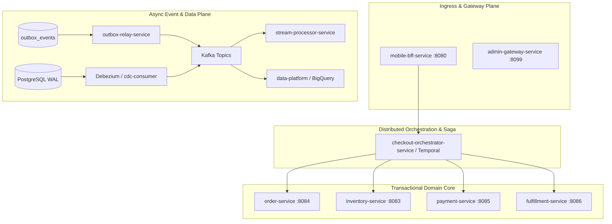

# Architecture Review Skill

Use this skill when designing a new service or feature, evaluating major refactorings, assessing system-wide blast radius, or reviewing distributed transactions across the InstaCommerce platform.

---

## 1. Architectural Quadrants

Every architecture review must examine four core planes:



1. **Ingress & Gateway Plane**:
   - Routes, rate limiting, token authentication, and mobile payload trimming.
   - Preserves gateway statelessness (`mobile-bff-service`, `admin-gateway-service`).
2. **Transactional Domain Core**:
   - Aggregate boundaries, local ACID transactions, and entity state machines.
   - Never coordinates distributed transactions via direct synchronous cross-service chaining.
3. **Distributed Orchestration & Saga Plane**:
   - Temporal workflows for long-running processes (`checkout-orchestrator-service`).
   - Explicit compensations for every non-reversible activity (e.g. `ReleaseStockActivity` if payment fails).
4. **Asynchronous Event & Data Plane**:
   - Outbox pattern for publishing domain events.
   - Debezium CDC for low-latency relational streaming.
   - dbt and Beam/Dataflow for analytical transformation and data mesh products.

---

## 2. Staff-Level Review Criteria

### Criterion 1: One-Way vs. Two-Way Doors (Reversibility)
- Is this change reversible in production without a maintenance window?
- Schema additions are two-way doors (nullable columns, additive JSON fields).
- Schema deletions, column renames, and enum changes are **one-way doors** that require a multi-stage migration (Expand $\rightarrow$ Migrate $\rightarrow$ Contract).

### Criterion 2: Concurrency & Lock Contention
- How does the system behave under a flash sale (10,000 requests/sec for a single SKU)?
- High-contention resources (inventory counters) must use optimistic versioning or Redis reservation buckets with TTL, never blocking table-level locks.

### Criterion 3: Distributed Failure Modes & Blast Radius
- If Kafka is down for 10 minutes: Do transactional services continue accepting orders? (Yes, via local outbox table buffering).
- If downstream payment gateway times out: Does Temporal execute compensation correctly without leaving orphan reservations?
- If Redis cache evaporates: Can the primary PostgreSQL cluster absorb cold-start load without crashing?

---

## 3. Architecture Review Deliverable Template

Deliver review findings using this structured markdown artifact:

```markdown
# Architectural Review: <Title>

## 1. System Topology & Seams
- **Producers**: Which services initiate the transaction?
- **Consumers**: Which services are asynchronously notified?
- **Stores**: What storage engines are involved (Postgres, Redis, Kafka, BigQuery)?

## 2. Distributed Transaction & Failure Matrix
| Step | Action | Failure Mode | Compensating Action | Idempotency Key |
|---|---|---|---|---|
| 1. Order Placed | Create draft order | DB timeout | None (Retryable) | `idempotency_key` |
| 2. Stock Reserve | Deduct available | Out of stock | Cancel order | `order_id` + `sku` |
| 3. Pay Authorize | Charge token | Card declined | Release reserved stock | `order_id` + `attempt` |

## 3. Blast Radius Assessment
- **Contracts Blast Radius**: Any Protobuf or JSON schema affected?
- **Data Platform Blast Radius**: Does dbt staging (`stg_`) break on column changes?
- **GitOps & Rollout**: Helm values changes, sync wave dependencies in ArgoCD.

## 4. Rollback Strategy
- Immediate rollback plan (feature flag toggle vs GitOps commit revert).
- Data cleanup procedure if partially migrated.
```

