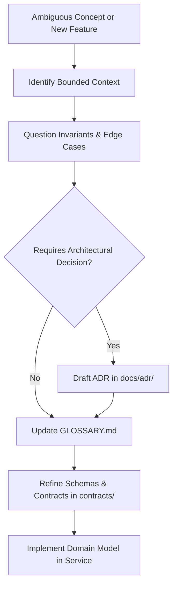

# Domain Modeling Skill: Ubiquitous Language & Boundary Sharpening

Use this skill when introducing new business concepts, clarifying overloaded terminology, establishing entity invariants, resolving ambiguities between code and domain language, or authoring Architecture Decision Records (ADRs).

---

## 1. Core Principles (Matt Pocock Methodology)

Domain modeling is an **active sharpening discipline**, not passive documentation:

1. **Challenge Overloaded Terms**:
   - Flag words that mean multiple things in different contexts (e.g., "order" in cart vs. "order" in warehouse vs. "order" in financial ledger).
   - Enforce bounded context separation. Use prefixing or distinct terms (e.g., `CartItem`, `OrderLine`, `PickItem`).
2. **Stress-Test with Edge Cases**:
   - Ask: "What happens if a customer cancels after the warehouse starts packing?"
   - Ask: "Can a dark store have negative inventory during flash sales?"
   - Turn answers into explicit state machine transitions and invariants.
3. **Active Documentation Updates**:
   - The moment a concept crystallizes, record it in [GLOSSARY.md](file:///Users/omkarkumar/InstaCommerce/GLOSSARY.md).
   - If it changes cross-service boundaries, contracts, or irreversible semantics, document it as an ADR under [docs/adr/](file:///Users/omkarkumar/InstaCommerce/docs/adr/).

---

## 2. Domain Modeling Workflow

### Step 1: Context Mapping & Boundary Isolation
- Which bounded context owns the aggregate root?
  - `Order`: Owned by `order-service`
  - `StockAllocation`: Owned by `inventory-service`
  - `DarkStore`: Owned by `warehouse-service`
  - `DispatchTrip`: Owned by `rider-fleet-service` / `dispatch-optimizer-service`
- Never allow a service to mutate another service's aggregate directly. Use domain events conforming to `EventEnvelope.v1.json` or Temporal sagas.

### Step 2: Define Explicit Invariants
- Invariant rules must be enforced inside aggregate roots, never scattered in controllers or UI.
- Examples:
  - *Inventory Invariant*: Available quantity cannot drop below safety stock threshold without triggering backorder event.
  - *Order Invariant*: Order cannot transition to `DISPATCHED` unless state is `PACKED` and assigned to a rider.
  - *Wallet Invariant*: Balance cannot go negative; debit operations require an `Idempotency-Key`.

### Step 3: Update `GLOSSARY.md`
- Whenever a term is clarified or coined:
  1. Add to Table 1 (Domain Entities & Core Concepts) in `GLOSSARY.md`.
  2. Define: **Term**, **Precise Definition**, and **Anti-Pattern / What It Is NOT**.
  3. Verify consistency with `contracts/src/main/resources/schemas/`.

---

## 3. High-Leverage Checklist

- [ ] Does the term exist in [GLOSSARY.md](file:///Users/omkarkumar/InstaCommerce/GLOSSARY.md)? If not, add it.
- [ ] Is the term free of implementation details (e.g., use `Dark Store` rather than `PostgresWarehouseRow`)?
- [ ] Are aggregate roots and consistency boundaries clearly separated?
- [ ] Are state transitions represented in a Mermaid state machine diagram?
- [ ] Are all published events mapped in `TopicNames.java`?

