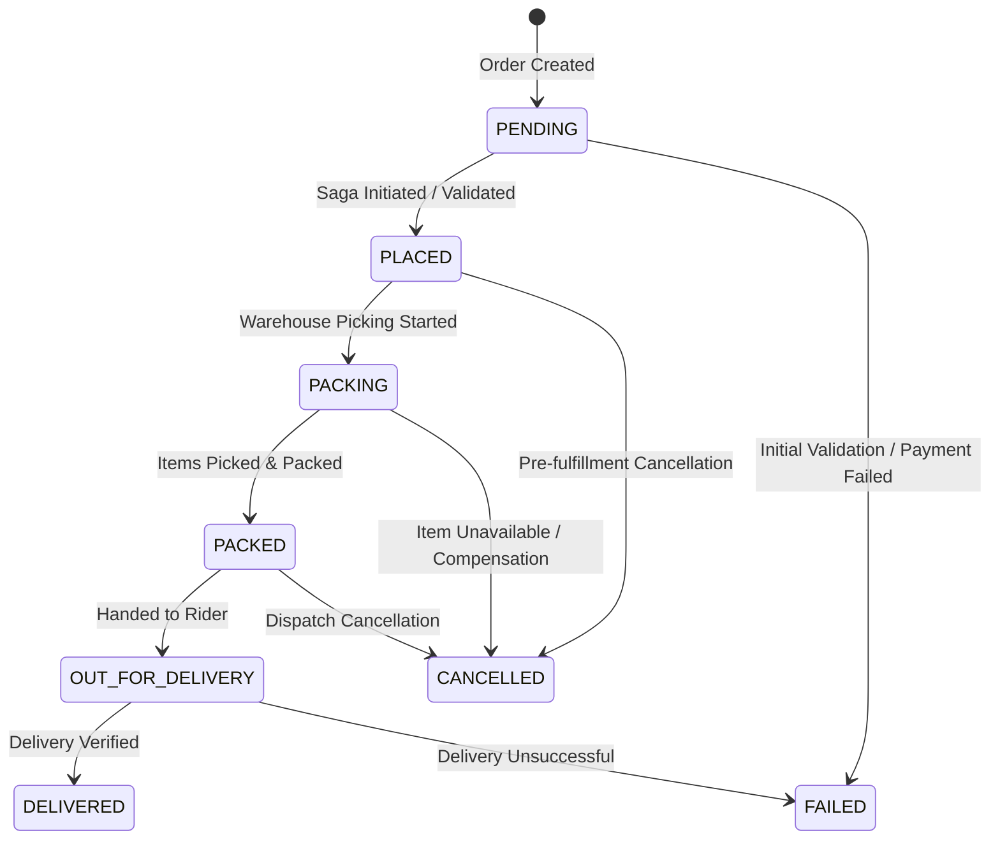

# InstaCommerce Ubiquitous Language & Glossary

> Canonical terminology, architectural concepts, and service mappings for human engineers and autonomous AI agents.
> Use this glossary to eliminate ambiguous jargon, ensure exact terminology, and dramatically save tokens during reasoning.

---

## 1. Domain Entities & Core Concepts

| Term | Precise Definition | Anti-Pattern / What It Is NOT |
|---|---|---|
| **Dark Store** | A micro-fulfillment warehouse optimized solely for rapid order picking and packing within an ultra-local delivery radius (10–15 min ETA). Managed by `warehouse-service`. | Do NOT call it a generic "store" or "retail shop". |
| **Order Saga** | Distributed checkout workflow coordinated by `checkout-orchestrator-service` via Temporal. Drives Order $\rightarrow$ Inventory Reserve $\rightarrow$ Payment Auth $\rightarrow$ Fulfillment Pick. | It is NOT a synchronous 2-phase commit (2PC) or monolithic database transaction. |
| **Compensating Action** | A reversing activity executed by Temporal when a saga step fails (e.g., `ReleaseInventory` if `AuthorizePayment` fails). | Do NOT call it a generic "rollback" or "undo". |
| **Outbox Pattern** | Transactional outbox table (`outbox_events`) co-located with domain tables in PostgreSQL. Domain mutations and outbox records commit in the same local ACID transaction. | Never publish directly to Kafka inside a Spring `@Transactional` block without the outbox. |
| **CDC (Change Data Capture)** | Debezium Kafka Connect reading PostgreSQL WAL logs to stream changes into Kafka topics without application-level polling. Consumed by `cdc-consumer-service`. | Not periodic batch database polling. |
| **Outbox Relay** | High-throughput Go service (`outbox-relay-service`) reading outbox events and publishing them with at-least-once delivery semantics to canonical Kafka topics. | Separate from CDC; dedicated to explicit domain event outboxes. |
| **Dead-Letter Topic (DLT)** | Kafka topic with `.DLT` suffix where poison pills and permanently unparseable messages are diverted after max retry exhaustion (ADR-003). | Do NOT use `.dlq` suffix for domain Kafka topics (only `outbox.relay.dlq` uses DLQ). |
| **Idempotency Key** | Unique client-provided UUID or hashed correlation token header (`X-Idempotency-Key`) stored with TTL to prevent duplicate order placement or payments (ADR-005). | Not just a session ID or random trace header. |
| **Rider Ping** | High-frequency GPS telemetry coordinate submitted by rider apps to `location-ingestion-service` every 3–5 seconds. | Not a full rider profile update. |
| **Dispatch Assignment** | Optimal matching of an unassigned packed order to an available nearby rider computed by `dispatch-optimizer-service`. | Not a FIFO queue; it is an algorithmic TSP/bipartite graph match. |
| **Reconciliation** | T+1 financial balancing between internal order states, payment captures, and external bank/gateway settlement reports executed by `reconciliation-engine`. | Not real-time checkout validation. |
| **Reverse ETL** | Automated sync of aggregated warehouse analytics/features from BigQuery into operational Redis/PostgreSQL databases orchestrated by `reverse-etl-orchestrator`. | Not analytical ingestion (forward ETL). |
| **Data Mesh Product** | Domain-owned analytical dataset modeled in dbt (`mart_*`) with schema contracts and Great Expectations quality assertions. | Not raw staging tables or ad-hoc queries. |
| **Guardrails** | Security and policy validation pipeline in `ai-orchestrator-service` enforcing PII masking, prompt injection detection, and rate limiting before invoking LLMs. | Not basic regex input validation. |

---

## 2. Order State Machine



- **Invariants** (`com.instacommerce.order.domain.model.OrderStatus`):
  - `CANCELLED` and `FAILED` are terminal states; orders in these states can never transition forward.
  - Stock must be reserved and payment authorized before moving from `PENDING` to `PLACED`.
  - Warehouse pick-and-pack transitions status from `PACKING` to `PACKED`.
  - Dispatch assignment transitions status from `PACKED` to `OUT_FOR_DELIVERY`.
  - Payment is captured upon delivery completion or dispatch per financial policy.

---

## 3. Microservice Registry & Topology

| Service Identifier | Stack | Port | Primary Storage | Kafka Topic Published | Helm Key |
|---|---|---|---|---|---|
| `identity-service` | Java 21 / Spring Boot 4 | 8081 | PostgreSQL | `identity.events` | `identity-service` |
| `catalog-service` | Java 21 / Spring Boot 4 | 8082 | PostgreSQL | `catalog.events` | `catalog-service` |
| `inventory-service` | Java 21 / Spring Boot 4 | 8083 | PostgreSQL + Redis | `inventory.events` | `inventory-service` |
| `order-service` | Java 21 / Spring Boot 4 | 8084 | PostgreSQL | `orders.events` | `order-service` |
| `payment-service` | Java 21 / Spring Boot 4 | 8085 | PostgreSQL | `payments.events` | `payment-service` |
| `fulfillment-service` | Java 21 / Spring Boot 4 | 8086 | PostgreSQL | `fulfillment.events` | `fulfillment-service` |
| `notification-service` | Java 21 / Spring Boot 4 | 8087 | PostgreSQL | `notification.events` | `notification-service` |
| `search-service` | Java 21 / Spring Boot 4 | 8088 | Elasticsearch / OpenSearch | `search.events` | `search-service` |
| `pricing-service` | Java 21 / Spring Boot 4 | 8089 | PostgreSQL + Redis | `pricing.events` | `pricing-service` |
| `cart-service` | Java 21 / Spring Boot 4 | 8090 | Redis + PostgreSQL | `cart.events` | `cart-service` |
| `checkout-orchestrator-service` | Java 21 / Spring Boot 4 | 8091 | Temporal Server | — | `checkout-orchestrator-service` |
| `warehouse-service` | Java 21 / Spring Boot 4 | 8092 | PostgreSQL | `warehouse.events` | `warehouse-service` |
| `rider-fleet-service` | Java 21 / Spring Boot 4 | 8093 | PostgreSQL | `rider.events` | `rider-fleet-service` |
| `routing-eta-service` | Java 21 / Spring Boot 4 | 8094 | PostgreSQL + OSRM | — | `routing-eta-service` |
| `wallet-loyalty-service` | Java 21 / Spring Boot 4 | 8095 | PostgreSQL | `wallet.events` | `wallet-loyalty-service` |
| `audit-trail-service` | Java 21 / Spring Boot 4 | 8096 | PostgreSQL + GCS | — | `audit-trail-service` |
| `fraud-detection-service` | Java 21 / Spring Boot 4 | 8097 | PostgreSQL | `fraud.events` | `fraud-detection-service` |
| `config-feature-flag-service` | Java 21 / Spring Boot 4 | 8098 | PostgreSQL + Redis | — | `config-feature-flag-service` |
| `mobile-bff-service` | Java 21 / WebFlux Gateway | 8080 | Stateless | — | `mobile-bff-service` |
| `admin-gateway-service` | Java 21 / WebFlux Gateway | 8099 | Stateless | — | `admin-gateway-service` |
| `cdc-consumer-service` | Go 1.25 | 8104 | Stateless | Consumes Debezium CDC | `cdc-consumer` |
| `dispatch-optimizer-service` | Go 1.25 | 8102 | Stateless / Memory | — | `dispatch-optimizer-service` |
| `location-ingestion-service` | Go 1.25 | 8105 | Redis Cluster | `rider.location.updates` | `location-ingestion` |
| `outbox-relay-service` | Go 1.25 | 8103 | PostgreSQL | Canonical Domain Topics | `outbox-relay` |
| `payment-webhook-service` | Go 1.25 | 8106 | PostgreSQL | `payment.webhooks` | `payment-webhook` |
| `reconciliation-engine` | Go 1.25 | 8107 | PostgreSQL | `reconciliation.events` | `reconciliation-engine` |
| `reverse-etl-orchestrator` | Go 1.25 | 8109 | BigQuery / Postgres | — | `reverse-etl-orchestrator` |
| `stream-processor-service` | Go 1.25 | 8108 | Kafka Streams | Processed Streams | `stream-processor` |
| `ai-orchestrator-service` | Python 3.12 / FastAPI | 8100 | LangGraph / Redis | `ai-orchestrator.events` | `ai-orchestrator-service` |
| `ai-inference-service` | Python 3.12 / FastAPI | 8101 | Redis Cache | — | `ai-inference-service` |

---

## 4. Standard Event Envelope

All asynchronous domain events across Kafka must conform to `EventEnvelope.v1.json` (`com.instacommerce.contracts.events.EventEnvelope`):

```json
{
  "eventId": "uuid-v4",
  "eventType": "OrderPlaced",
  "aggregateType": "Order",
  "aggregate_id": "ord-12345",
  "event_time": "2026-10-12T08:00:00Z",
  "schema_version": "1.0.0",
  "source_service": "order-service",
  "correlation_id": "req-98765",
  "payload": { ... }
}
```

- JSON deserialization supports both camelCase (`eventId`) and snake_case (`event_id`) aliases.
- `correlation_id` is mandatory for end-to-end distributed tracing.

---

## 5. Architectural Seams & Rules of Engagement

1. **Transactional Integrity**:
   - Write to local domain tables and `outbox_events` table in the SAME transaction.
   - Never call external HTTP APIs or Kafka inside an uncommitted database transaction.
2. **Saga Orchestration**:
   - Do not call peer services synchronously from `order-service` to reserve stock or charge payments.
   - Handoff order flow to `checkout-orchestrator-service` via Temporal workflow execution.
3. **Contracts Evolution**:
   - Backward-compatible additions stay in `v1`.
   - Breaking field changes require creating `v2` schema files and multi-stage consumer migration.
4. **Deploy Keys vs Module Paths**:
   - Module names ending in `-service` may map to shorter Helm release names (`cdc-consumer`, `location-ingestion`, `payment-webhook`, `stream-processor`). Always cross-reference `deploy/helm/values.yaml` and `.github/workflows/ci.yml`.

