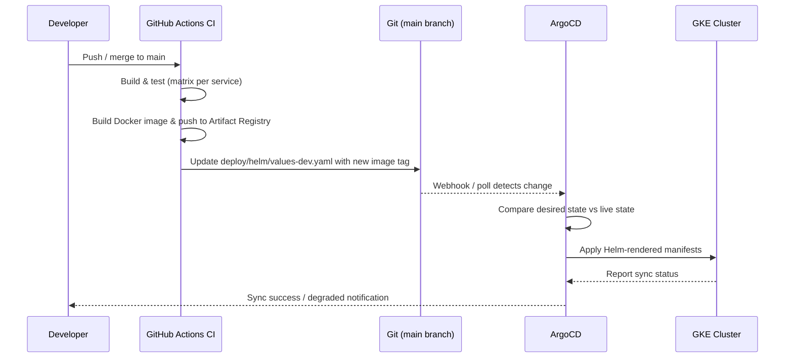

# ArgoCD GitOps Deployment

Declarative, GitOps-driven deployment configuration for InstaCommerce microservices using ArgoCD.

## App-of-Apps Pattern

InstaCommerce uses the **App-of-Apps** pattern — a single root `Application` resource (`app-of-apps.yaml`) manages all child service deployments from the `deploy/helm` chart.

```mermaid
graph TD
    A[ArgoCD Server] -->|watches| B[app-of-apps.yaml]
    B -->|references| C[deploy/helm Chart]
    C --> D[identity-service]
    C --> E[catalog-service]
    C --> F[order-service]
    C --> G[payment-service]
    C --> H[fulfillment-service]
    C --> I[cart-service]
    C --> J[checkout-orchestrator]
    C --> K[search-service]
    C --> L[pricing-service]
    C --> M[notification-service]
    C --> N[warehouse-service]
    C --> O[rider-fleet-service]
    C --> P[routing-eta-service]
    C --> Q[wallet-loyalty-service]
    C --> R[fraud-detection-service]
    C --> S[audit-trail-service]
    C --> T[config-feature-flag-service]
    C --> U[ai-orchestrator-service]
    C --> V[ai-inference-service]
    C --> W[dispatch-optimizer-service]
    C --> X[outbox-relay]
    C --> Y[cdc-consumer]
    C --> Z[mobile-bff-service]
    C --> AA[admin-gateway-service]
    C --> AB[stream-processor-service]
    C --> AC[reverse-etl-orchestrator]
    C --> AD[location-ingestion-service]
    C --> AE[payment-webhook-service]
    C --> AF[reconciliation-engine]

    style A fill:#e44d26,color:#fff
    style B fill:#326ce5,color:#fff
    style C fill:#0db7ed,color:#fff
```



## Sync Strategy

The root application is configured with **automated sync**:

| Setting | Value | Description |
|---------|-------|-------------|
| `automated.prune` | `true` | Removes resources no longer in Git |
| `automated.selfHeal` | `true` | Reverts manual cluster changes |
| `CreateNamespace` | `true` | Auto-creates target namespace |
| Target Revision | `main` | Tracks the `main` branch |
| Destination | `instacommerce` namespace | Single namespace deployment |

## Deployment Flow



### Environments & Progressive Delivery

| Environment | Values File | Application Manifest | Target Namespace | Traffic Strategy |
|---|---|---|---|---|
| **dev** | `values-dev.yaml` | `app-of-apps.yaml` | `instacommerce` | Direct rolling update |
| **staging** | `values-staging.yaml` | `app-of-apps.yaml` | `instacommerce-staging` | Integration gating |
| **prod** | `values-prod.yaml` | `app-of-apps.yaml` | `instacommerce-prod` | Manual promotion / GitOps tag |
| **Canary SF** | `values-canary-sf.yaml` | `applications/canary-sf-fulfillment.yaml` | `instacommerce-canary` | Phase 2 W1 Dark store pilot (100% traffic) |
| **Canary Seattle**| `values-canary-seattle.yaml` | `applications/canary-seattle-fulfillment.yaml` | `instacommerce-canary` | Phase 2 W2 Gated canary (10% traffic) |
| **Canary Austin** | `values-canary-austin.yaml` | `applications/canary-austin-fulfillment.yaml` | `instacommerce-canary` | Phase 2 W3 Staged ramp (5% → 100%) |

## ArgoCD Sync Wave Architecture

InstaCommerce coordinates cross-service initialization dependencies using ArgoCD sync waves:

| Sync Wave | Phase / Tier | Target Resources | Description |
|---|---|---|---|
| **Wave 0** | Core Security & Identity | `ServiceAccount`, `SecretStore`, `GCP IAM` | Workload Identity bindings and service accounts |
| **Wave 1** | Transactional Core | `fulfillment-service`, `order-service` | Ingress and core stateful workflow engines |
| **Wave 2** | Dark Store Warehouses | `warehouse-service`, `inventory-service` | Store layout, inventory locks, staging bins |
| **Wave 3** | Logistics & Dispatch | `rider-fleet-service`, `routing-eta-service` | Real-time GPS ingestion and dispatch solver |

## Progressive Delivery with Argo Rollouts

High-risk services leverage Argo Rollouts (`argocd/rollouts/canary-rollout-template.yaml`) integrated with Istio:
- **Traffic Ramp:** 10% (5 min) $\rightarrow$ 25% (5 min) $\rightarrow$ 50% (10 min) $\rightarrow$ 100%.
- **Automated Metric Gate:** Evaluates Prometheus queries via `argocd/rollouts/analysis-template-error-rate.yaml`:
  - 5xx Error Rate $\le 1\%$ over a 5-minute rolling window.
  - P99 HTTP Latency $\le 1000$ ms.
- **Automated Rollback:** If the `AnalysisTemplate` fails 2 consecutive measurements, Argo Rollouts aborts the step and instantly reverts traffic to the stable ReplicaSet.

## Files

| File | Description |
|------|-------------|
| `app-of-apps.yaml` | Root ArgoCD Application pointing to `deploy/helm` |
| `applications/canary-*.yaml` | Multi-region Canary Application manifests (SF, Seattle, Austin) |
| `rollouts/canary-rollout-template.yaml` | Istio-integrated progressive delivery Rollout definition |
| `rollouts/analysis-template-error-rate.yaml` | Prometheus SLO error-rate and latency gate for canary promotion |

### Automatic Rollback (Self-Heal)

ArgoCD's `selfHeal: true` automatically reverts any manual changes made directly to the cluster.

### Manual Rollback via Git

```bash
# 1. Identify the last known-good commit
git log --oneline deploy/helm/values-dev.yaml

# 2. Revert the values file to the previous version
git revert <commit-sha>
git push origin main

# 3. ArgoCD auto-syncs the reverted state
```

### Manual Rollback via ArgoCD CLI

```bash
# List application history
argocd app history instacommerce

# Roll back to a specific revision
argocd app rollback instacommerce <revision-id>

# Force sync to a specific Git commit
argocd app sync instacommerce --revision <git-sha>
```

### Emergency Rollback

```bash
# Disable auto-sync to prevent ArgoCD from overwriting manual fixes
argocd app set instacommerce --sync-policy none

# Manually roll back a specific deployment in-cluster
kubectl rollout undo deployment/<service-name> -n instacommerce

# Re-enable auto-sync after the Git state is corrected
argocd app set instacommerce --sync-policy automated --self-heal --auto-prune
```

## Files

| File | Description |
|------|-------------|
| `app-of-apps.yaml` | Root ArgoCD Application pointing to `deploy/helm` |
