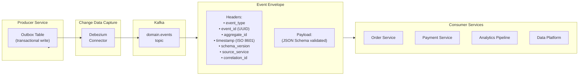
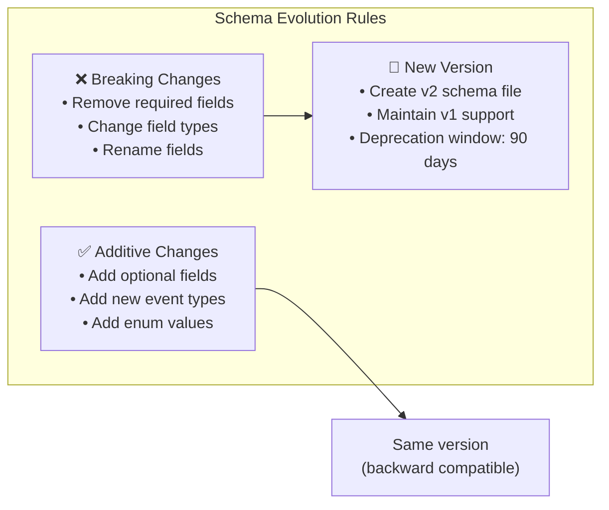

# InstaCommerce Event Contracts

Canonical event schemas (JSON Schema) and gRPC service definitions (Protocol Buffers) for cross-service communication in the InstaCommerce platform. All domain events flow through Kafka via the outbox + Debezium CDC pipeline.

---

## Event Envelope



Every event published to Kafka conforms to `EventEnvelope.v1.json`. The canonical Java representation (`EventEnvelope.java`) and outbox relay emit and deserialize both `camelCase` and `snake_case` keys seamlessly via `@JsonAlias`:

```json
{
  "eventId": "550e8400-e29b-41d4-a716-446655440000",
  "id": "550e8400-e29b-41d4-a716-446655440000",
  "eventType": "OrderPlaced",
  "aggregateType": "Order",
  "aggregateId": "order-12345",
  "schemaVersion": "v1",
  "source_service": "order-service",
  "sourceService": "order-service",
  "correlation_id": "req-abc-123",
  "correlationId": "req-abc-123",
  "eventTime": "2026-03-15T10:30:00Z",
  "payload": { ... }
}
```

| Canonical Field | Aliases Accepted | Type | Description |
|---|---|---|---|
| `eventId` / `id` | `event_id` | String / UUID | Globally unique identifier for event deduplication |
| `eventType` | `event_type`, `type` | String | Domain event discriminator (e.g. `OrderPlaced`, `PaymentCaptured`) |
| `aggregateType` | `aggregate_type` | String | Root aggregate entity type (e.g. `Order`, `Payment`, `Cart`) |
| `aggregateId` | `aggregate_id` | String | Business identifier of the aggregate instance |
| `eventTime` | `event_time`, `timestamp`, `event_timestamp` | ISO-8601 UTC Instant | Timestamp when the domain event occurred |
| `schemaVersion` | `schema_version` | String | Contract schema version (default `v1`) |
| `sourceService` | `source_service`, `service` | String | Microservice that produced the event |
| `correlationId` | `correlation_id` | String | Distributed tracing / request correlation identifier |
| `payload` | — | Object / JSON | Domain event payload validated against JSON Schema |

---

## Directory Structure

```
contracts/
├── build.gradle.kts                   # Protobuf plugin + gRPC dependencies
│
└── src/main/
    ├── proto/                         # gRPC service definitions
    │   ├── common/v1/
    │   │   └── money.proto            # Shared Money type
    │   ├── catalog/v1/
    │   │   └── catalog_service.proto  # Catalog gRPC service
    │   ├── cart/v1/
    │   │   └── cart_service.proto     # Cart gRPC service
    │   ├── fulfillment/v1/
    │   │   └── fulfillment_service.proto # Fulfillment gRPC service
    │   ├── inventory/v1/
    │   │   └── inventory_service.proto # Inventory gRPC service
    │   ├── order/v1/
    │   │   └── order_service.proto    # Order gRPC service
    │   ├── payment/v1/
    │   │   └── payment_service.proto  # Payment gRPC service
    │   ├── rider/v1/
    │   │   └── rider_service.proto    # Rider fleet gRPC service
    │   ├── routing/v1/
    │   │   └── routing_service.proto  # Routing & ETA gRPC service
    │   └── wallet/v1/
    │       └── wallet_service.proto   # Wallet & loyalty gRPC service
    │
    └── resources/schemas/             # JSON Schema event definitions
        ├── README.md
        ├── catalog/
        ├── orders/
        ├── payments/
        ├── inventory/
        ├── fulfillment/
        ├── identity/
        ├── fraud/
        ├── rider/
        └── warehouse/
```

### Build

```bash
# Generate Protobuf + gRPC stubs
./gradlew :contracts:build
```

| Library | Version |
|---------|---------|
| grpc-protobuf | 1.62.2 |
| grpc-stub | 1.62.2 |
| grpc-netty-shaded | 1.62.2 |
| protoc | 3.25.3 |
| protoc-gen-grpc-java | 1.62.2 |

---

## Event Types by Domain

### Orders (`orders.events`)

| Event | Schema | Version | Description |
|-------|--------|---------|-------------|
| `OrderPlaced` | `orders/OrderPlaced.v1.json` | v1 | Order created with items, totals, payment reference |
| `OrderPacked` | `orders/OrderPacked.v1.json` | v1 | Order picked and packed at store |
| `OrderDispatched` | `orders/OrderDispatched.v1.json` | v1 | Order handed to rider for delivery |
| `OrderDelivered` | `orders/OrderDelivered.v1.json` | v1 | Order delivered to customer |
| `OrderCancelled` | `orders/OrderCancelled.v1.json` | v1 | Order cancelled (by customer or system) |
| `OrderFailed` | `orders/OrderFailed.v1.json` | v1 | Order processing failed |

### Payments (`payments.events`)

| Event | Schema | Version | Description |
|-------|--------|---------|-------------|
| `PaymentAuthorized` | `payments/PaymentAuthorized.v1.json` | v1 | Payment authorization succeeded |
| `PaymentCaptured` | `payments/PaymentCaptured.v1.json` | v1 | Payment captured (funds collected) |
| `PaymentFailed` | `payments/PaymentFailed.v1.json` | v1 | Payment processing failed |
| `PaymentRefunded` | `payments/PaymentRefunded.v1.json` | v1 | Payment refunded to customer |
| `PaymentVoided` | `payments/PaymentVoided.v1.json` | v1 | Payment authorization voided |
| `PaymentDisputed` | `payments/PaymentDisputed.v1.json` | v1 | Payment disputed by cardholder |
| `PaymentDisputeUpdated` | `payments/PaymentDisputeUpdated.v1.json` | v1 | Dispute status updated by PSP |
| `PaymentDisputeWon` | `payments/PaymentDisputeWon.v1.json` | v1 | Dispute resolved in merchant's favor |
| `PaymentDisputeLost` | `payments/PaymentDisputeLost.v1.json` | v1 | Dispute resolved in cardholder's favor |
| `PaymentCaptureReverted` | `payments/PaymentCaptureReverted.v1.json` | v1 | Capture attempt reverted to authorized |
| `PaymentVoidReverted` | `payments/PaymentVoidReverted.v1.json` | v1 | Void attempt reverted to authorized |
| `PaymentRefundFailed` | `payments/PaymentRefundFailed.v1.json` | v1 | Refund processing failed |

### Inventory (`inventory.events`)

| Event | Schema | Version | Description |
|-------|--------|---------|-------------|
| `StockReserved` | `inventory/StockReserved.v1.json` | v1 | Stock reserved for an order |
| `StockConfirmed` | `inventory/StockConfirmed.v1.json` | v1 | Stock reservation confirmed |
| `StockReleased` | `inventory/StockReleased.v1.json` | v1 | Reserved stock released back |
| `LowStockAlert` | `inventory/LowStockAlert.v1.json` | v1 | Stock below reorder threshold |

### Fulfillment (`fulfillment.events`)

| Event | Schema | Version | Description |
|-------|--------|---------|-------------|
| `PickTaskCreated` | `fulfillment/PickTaskCreated.v1.json` | v1 | Pick task assigned to store staff |
| `OrderPacked` | `fulfillment/OrderPacked.v1.json` | v1 | Order packing completed |
| `RiderAssigned` | `fulfillment/RiderAssigned.v1.json` | v1 | Rider assigned to order |
| `DeliveryCompleted` | `fulfillment/DeliveryCompleted.v1.json` | v1 | Delivery confirmed complete |
| `DeliveryStatus` | `fulfillment/DeliveryStatus.v1.json` | v1 | Canonical delivery lifecycle states enum |

### Catalog (`catalog.events`)

| Event | Schema | Version | Description |
|-------|--------|---------|-------------|
| `ProductCreated` | `catalog/ProductCreated.v1.json` | v1 | New product added to catalog |
| `ProductUpdated` | `catalog/ProductUpdated.v1.json` | v1 | Product details updated |

### Identity (`identity.events`)

| Event | Schema | Version | Description |
|-------|--------|---------|-------------|
| `UserErased` | `identity/UserErased.v1.json` | v1 | User data erased (GDPR right-to-be-forgotten) |

### Fraud (`fraud.events`)

| Event | Schema | Version | Description |
|-------|--------|---------|-------------|
| `FraudDetected` | `fraud/FraudDetected.v1.json` | v1 | Fraud detected on transaction |

### Rider (`rider.events`)

| Event | Schema | Version | Description |
|-------|--------|---------|-------------|
| `RiderCreated` | `rider/RiderCreated.v1.json` | v1 | New rider registered |
| `RiderOnboarded` | `rider/RiderOnboarded.v1.json` | v1 | Rider onboarding completed |
| `RiderActivated` | `rider/RiderActivated.v1.json` | v1 | Rider activated for deliveries |
| `RiderAssigned` | `rider/RiderAssigned.v1.json` | v1 | Rider assigned to order |
| `RiderSuspended` | `rider/RiderSuspended.v1.json` | v1 | Rider account suspended |

### Warehouse (`warehouse.events`)

| Event | Schema | Version | Description |
|-------|--------|---------|-------------|
| `StoreCreated` | `warehouse/StoreCreated.v1.json` | v1 | New store/dark store created |
| `StoreStatusChanged` | `warehouse/StoreStatusChanged.v1.json` | v1 | Store status changed (open/closed/maintenance) |
| `StoreDeleted` | `warehouse/StoreDeleted.v1.json` | v1 | Store decommissioned |

### Cart (`cart.events`)

| Event | Schema / Payload | Version | Description |
|---|---|---|---|
| `CartCreated` | Cart state snapshot | v1 | User initialized or cloned a cart |
| `CartItemAdded` | Cart items & quantity | v1 | Item added to active cart |
| `CartItemUpdated` | Updated quantities | v1 | Item quantity modified |
| `CartItemRemoved` | Remaining cart items | v1 | Item removed from cart |
| `CartCleared` | Empty cart identifier | v1 | Cart emptied |

### Pricing & Promotions (`pricing.events`, `promotion.events`)

| Event | Schema / Payload | Version | Description |
|---|---|---|---|
| `PriceUpdated` | SKU, store, price | v1 | Base or surge price change published |
| `PromotionCreated` | Promotion metadata & rules | v1 | New campaign or coupon code created |
| `PromotionUpdated` | Active rules & budget | v1 | Campaign details or budget updated |
| `PromotionDeactivated` | Campaign identifier | v1 | Campaign deactivated or expired |

### Wallet & Loyalty (`wallet.events`)

| Event | Schema / Payload | Version | Description |
|---|---|---|---|
| `PointsEarned` | User ID, points, order | v1 | Loyalty points earned on delivered order |
| `PointsRedeemed` | User ID, points redeemed | v1 | Loyalty points converted to discount |
| `WalletCredited` | User ID, amount, type | v1 | Cashback, top-up, or refund credit |
| `WalletDebited` | User ID, amount, type | v1 | Balance applied to payment |

### Routing & Logistics (`delivery.events`, `routing.events`, `rider.geofence.events`)

| Event | Schema / Payload | Version | Description |
|---|---|---|---|
| `DELIVERY_CREATED` | Delivery tracking payload | v1 | Delivery leg instantiated for dispatch |
| `DELIVERY_STATUS_UPDATED` | Status, ETA, rider | v1 | Transition between dispatched, in-transit, arrived |
| `DELIVERY_COMPLETED` | Proof of delivery | v1 | Order delivered and verified |
| `RiderGeofenceEntered` | Store ID, rider ID, radius | v1 | Rider entered dark store pickup geofence |
| `RiderGeofenceExited` | Store ID, rider ID | v1 | Rider departed dark store with package |

---

## Canonical Kafka Topic Registry (`TopicNames.java`)

All Java services, Go relay, and consumers reference this single source of truth:

| Constant | Kafka Topic | Primary Publisher | Primary Consumers |
|---|---|---|---|
| `IDENTITY_EVENTS` | `identity.events` | `identity-service` | Audit, notification, stream-processor |
| `CATALOG_EVENTS` | `catalog.events` | `catalog-service` | Search, pricing, data-platform |
| `ORDERS_EVENTS` | `orders.events` | `order-service` | Fulfillment, wallet, inventory, data-platform |
| `PAYMENTS_EVENTS` | `payments.events` | `payment-service` | Order, wallet, reconciliation, audit |
| `INVENTORY_EVENTS` | `inventory.events` | `inventory-service` | Warehouse, search, catalog, mobile-bff |
| `FULFILLMENT_EVENTS` | `fulfillment.events` | `fulfillment-service` | Rider fleet, order, routing, notifications |
| `RIDER_EVENTS` | `rider.events` | `rider-fleet-service` | Routing ETA, dispatch optimizer |
| `DELIVERY_EVENTS` | `delivery.events` | `routing-eta-service` | Audit trail, notification, rider fleet |
| `ROUTING_EVENTS` | `routing.events` | `routing-eta-service` | Dispatch optimizer, mobile-bff |
| `RIDER_GEOFENCE_EVENTS` | `rider.geofence.events` | `location-ingestion-service` | Routing ETA, fulfillment |
| `CART_EVENTS` | `cart.events` | `cart-service` | Audit trail, AI orchestrator, analytics |
| `PRICING_EVENTS` | `pricing.events` | `pricing-service` | Search, catalog, cart |
| `PROMOTION_EVENTS` | `promotion.events` | `pricing-service` | Cart, checkout orchestrator |
| `WALLET_EVENTS` | `wallet.events` | `wallet-loyalty-service` | Checkout orchestrator, audit trail |
| `FRAUD_EVENTS` | `fraud.events` | `fraud-detection-service` | Checkout, payment, audit trail |
| `NOTIFICATION_EVENTS` | `notification.events` | `notification-service` | Audit trail, analytics |
| `SEARCH_EVENTS` | `search.events` | `search-service` | AI inference, analytics |
| `WAREHOUSE_EVENTS` | `warehouse.events` | `warehouse-service` | Inventory, routing, dispatch |
| `RECONCILIATION_EVENTS` | `reconciliation.events` | `reconciliation-engine` | Ledger, payment, finance platform |
| `AI_ORCHESTRATOR_EVENTS` | `ai-orchestrator.events` | `ai-orchestrator-service` | Audit trail, stream processor |
| `*_DLT` | `{topic}.DLT` | Any DeadLetterPublishingRecoverer | Ops alerting, replay tooling |


---

## gRPC Proto Definitions

| Service | Proto File | Description |
|---------|-----------|-------------|
| `common.v1.Money` | `common/v1/money.proto` | Shared monetary value type (amount + currency) |
| `CatalogService` | `catalog/v1/catalog_service.proto` | Product CRUD, search, category management |
| `CartService` | `cart/v1/cart_service.proto` | Cart management, item updates, cart checkout validation |
| `FulfillmentService` | `fulfillment/v1/fulfillment_service.proto` | Order fulfillment tasks, pick waves, packing verification |
| `InventoryService` | `inventory/v1/inventory_service.proto` | Stock queries, reservations, adjustments |
| `OrderService` | `order/v1/order_service.proto` | Order lifecycle, status queries, cancellations |
| `PaymentService` | `payment/v1/payment_service.proto` | Payment authorization, capture, refund |
| `RiderService` | `rider/v1/rider_service.proto` | Rider shifts, geofence status, automated dispatch assignments |
| `RoutingService` | `routing/v1/routing_service.proto` | Distance matrix, dynamic route optimization, delivery ETA calculation |
| `WalletService` | `wallet/v1/wallet_service.proto` | Wallet balance, credit/debit transactions, customer loyalty points |

---

## Schema Evolution Strategy



### Rules

1. **Backward compatible** (additive) changes are applied to the existing `v1` schema:
   - Add new optional fields
   - Add new event types
   - Widen enum values

2. **Breaking changes** require a new version file (e.g., `OrderPlaced.v2.json`):
   - Removing or renaming required fields
   - Changing field types
   - Both v1 and v2 are supported during a **90-day deprecation window**

3. **Naming conventions**:
   - Events: `{AggregateAction}.v{N}.json` (e.g., `OrderPlaced.v1.json`)
   - Kafka topics: `{domain}.events` (e.g., `orders.events`)

---

## CI Validation

Schema validation runs automatically in CI:

```bash
# Build contracts (compiles protos + validates JSON schemas)
./gradlew :contracts:build
```

| Check | Trigger | Description |
|-------|---------|-------------|
| Proto compilation | Every PR | Compile all `.proto` files, generate gRPC stubs |
| JSON Schema validation | Every PR | Validate all schemas are valid draft-07 |
| Breaking change detection | Every PR | Diff schemas against `main` branch for field removals |
| Compatibility test | Every PR | Verify consumers can deserialize with updated schemas |
