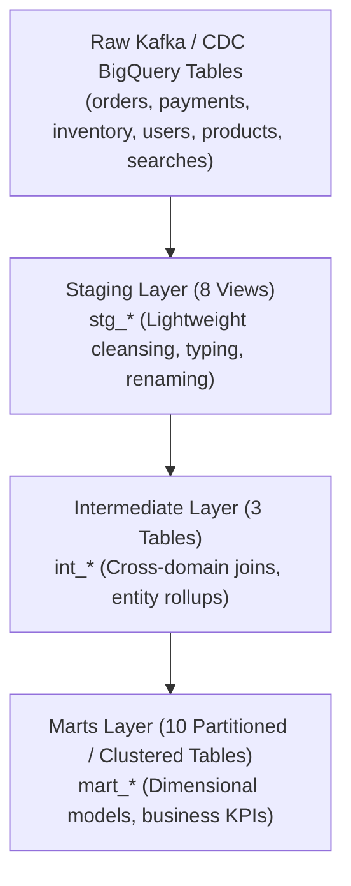

# InstaCommerce dbt Analytics Warehouse

Production dbt (data build tool) project modeling the analytical lakehouse in Google BigQuery for InstaCommerce.

---

## 1. Project Overview & Architecture

The dbt project transforms raw transactional CDC events (ingested via Debezium and Cloud Dataflow) into high-performance analytical data models across three layers:



- **dbt Profile:** `instacommerce` in `profiles.yml`
- **Target Datasets:**
  - `staging`: Sanitized view layer
  - `intermediate`: Pre-aggregated entity tables
  - `marts`: Dimension and fact tables for BI and reverse ETL

---

## 2. Models Inventory

### 2.1 Staging Layer (`models/staging/` - 8 Models)
| Model | Source | Purpose |
|---|---|---|
| `stg_orders.sql` | `raw.orders` | Normalizes order timestamps, currency, totals |
| `stg_payments.sql` | `raw.payments` | Decodes payment methods, status, PSP IDs |
| `stg_users.sql` | `raw.users` | Anonymizes PII, normalizes registration dates |
| `stg_products.sql` | `raw.products` | Standardizes SKU, category, active flags |
| `stg_deliveries.sql` | `raw.deliveries` | Rider transit duration, completion states |
| `stg_inventory_movements.sql` | `raw.inventory` | Stock adjustments, receiving, reservations |
| `stg_searches.sql` | `raw.search_logs` | Query strings, hit count, latency |
| `stg_cart_events.sql` | `raw.cart_events` | Item additions, removals, checkout dropoffs |

### 2.2 Intermediate Layer (`models/intermediate/` - 3 Models)
| Model | Description |
|---|---|
| `int_order_deliveries.sql` | Joins orders with delivery fulfillment metrics (dispatch to door) |
| `int_user_order_history.sql` | Aggregates per-user order frequencies, basket sizes, and recency |
| `int_product_performance.sql` | Aggregates product impressions, cart adds, conversions, and stockouts |

### 2.3 Marts Layer (`models/marts/` - 10 Models)
| Model | Materialization | Partitioning & Clustering | Primary Use Case |
|---|---|---|---|
| `mart_daily_revenue.sql` | Table | Partition: `order_date` | Financial reporting, revenue reconciliation |
| `mart_daily_sales.sql` | Table | Partition: `sale_date`, Cluster: `store_id` | Store daily GMV and basket analysis |
| `mart_order_fulfillment.sql` | Incremental | Partition: `order_date`, Cluster: `store_id, status` | 10-minute delivery SLA tracking |
| `mart_store_performance.sql` | Table | Partition: `order_date`, Cluster: `store_id` | Store picking velocity and stockout rates |
| `mart_rider_performance.sql` | Table | Partition: `order_date`, Cluster: `rider_id` | Rider utilization, earnings, on-time delivery % |
| `mart_user_cohort_retention.sql` | Table | Cluster: `cohort_month` | User retention, repurchase rates |
| `mart_search_funnel.sql` | Table | Cluster: `query_term` | Zero-result searches, click-through rates |
| `mart_sponsored_opportunities.sql` | Table | Cluster: `category_id` | Brand advertising and placement analytics |
| `mart_product_analytics.sql` | Table | Cluster: `sku` | Margin analysis, perishables markdown efficacy |
| `mart_experiment_conversions.sql`| Table | Cluster: `experiment_key` | Feature flag & A/B testing statistical readouts |

---

## 3. Running dbt Locally and in CI

```bash
# Install dependencies
dbt deps

# Run staging layer
dbt run --select staging

# Run intermediate models
dbt run --select intermediate

# Run all business marts
dbt run --select marts

# Run data quality tests
dbt test
```
