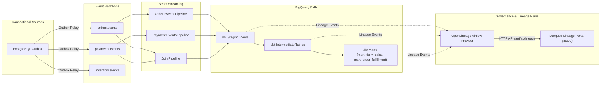

# End-to-End Data Lineage Architecture with OpenLineage and Marquez

## Overview
InstaCommerce captures column-level and dataset-level data lineage across transactional sources, Kafka streaming topics, Apache Beam pipelines, dbt staging/intermediate/mart transformations, and BigQuery analytical destinations.

## Marquez Integration
1. **Airflow Lineage Provider**: Configured in `data-platform/airflow/openlineage.yml` emitting dataset and job lineage events upon task state transitions.
2. **Column-Level Lineage**: Captured from dbt manifest and catalog metadata on daily runs.
3. **Portal Access**: Marquez UI deployed at `http://marquez.internal.instacommerce.com:5000`.
