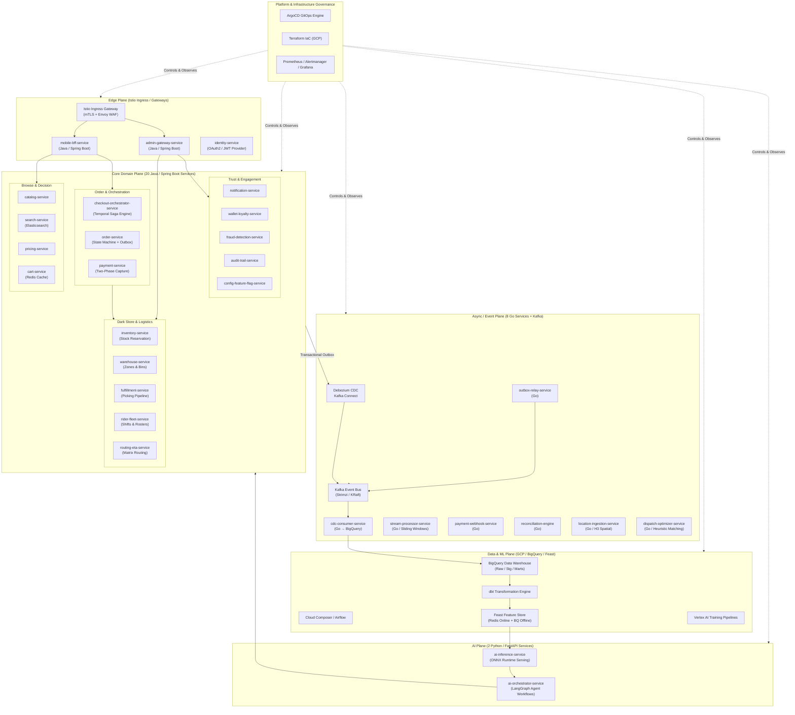
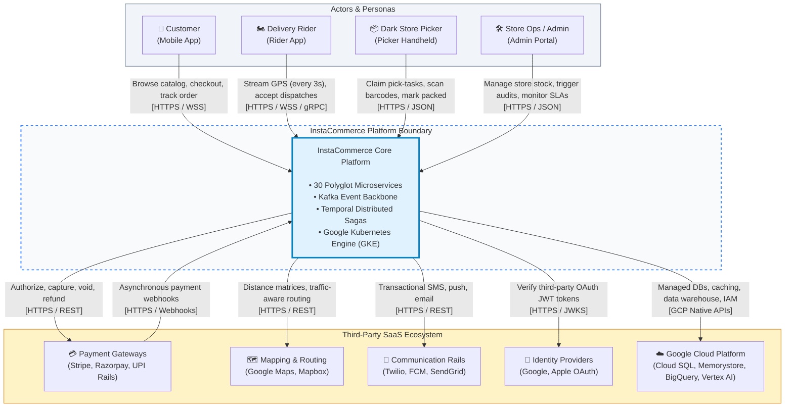
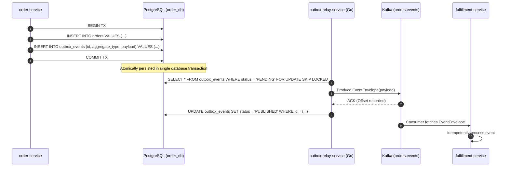

# InstaCommerce Architecture Overview

> **Target Audience:** Staff Engineers, Engineering Leaders, and Core Platform Architects  
> **Repository:** `InstaCommerce` Q-Commerce Monorepo  
> **Scale & Characteristics:** 30 Microservices (20 Java/Spring Boot 4.0, 8 Go, 2 Python/FastAPI), Event-Driven CDC via Debezium & Kafka, Distributed Orchestration via Temporal.io, Multi-Plane Architecture on Google Kubernetes Engine (GKE).

---

## Table of Contents
1. [Executive Summary & High-Level Design (HLD)](#1-executive-summary--high-level-design-hld)
2. [System Context (C4 Level 1)](#2-system-context-c4-level-1)
3. [The Six Architectural Planes](#3-the-six-architectural-planes)
4. [Service Topology & Container View (C4 Level 2)](#4-service-topology--container-view-c4-level-2)
5. [Cross-Plane Communication Patterns](#5-cross-plane-communication-patterns)
6. [Resilience, Fault Tolerance & Non-Functional Requirements](#6-resilience-fault-tolerance--non-functional-requirements)
7. [Operational & Architectural Trade-offs](#7-operational--architectural-trade-offs)

---

## 1. Executive Summary & High-Level Design (HLD)

InstaCommerce is an ultra-fast grocery and essentials delivery (Quick Commerce) platform engineered to fulfill orders within **10–15 minutes** from hyper-local fulfillment micro-warehouses ("Dark Stores"). 

The technical architecture is built around three foundational design tenets:
1. **Isolated Bounded Contexts with Private Persistence:** No shared databases across microservices. Stateful services own dedicated PostgreSQL databases with Flyway migrations.
2. **Dual-Path Execution (Sync vs. Async Separation):** Critical path state mutations use transactional write operations coupled with the **Transactional Outbox Pattern** and **Debezium CDC**, isolating downstream read/analytics models from ingestion pressure.
3. **Durable Distributed Orchestration:** Multi-service coordinating flows (e.g. Checkout Saga, Complex Fulfillment pipelines) run on **Temporal.io** rather than choreographed ad-hoc chains or distributed 2-Phase Commit (2PC), guaranteeing deterministic replayability and forward/backward compensation.

---

## 2. System Context (C4 Level 1)

InstaCommerce interacts with several key personas and external third-party services:

---

## 3. The Six Architectural Planes

The platform divides responsibilities into six decoupled functional planes:

### 3.1 Edge Plane
- **Istio Service Mesh Ingress**: Termination of TLS, enforcement of rate-limiting policies via Envoy filters, and path-based routing.
- **`mobile-bff-service` (Java/Spring Boot)**: Aggregation layer for mobile clients. Handles response shaping, device header extraction, client caching headers, and downstream batching.
- **`admin-gateway-service` (Java/Spring Boot)**: Secured management gateway enforcing strict RBAC (`ROLE_ADMIN`, `ROLE_STORE_MANAGER`), audit logging, and payload validation.
- **`identity-service` (Java/Spring Boot)**: Central identity management. Issues RS256-signed JWTs, manages token revocation tables, handles refresh tokens, and enforces GDPR erasure (`UserErased` events).

### 3.2 Core Domain Plane
Consists of **20 Java/Spring Boot 4.0** microservices (managed via `settings.gradle.kts`):
- **Browse & Decision**: Catalog (hierarchical taxonomy, products), Search (Elasticsearch synchronization), Pricing (rule evaluation, discount quotes), Cart (Redis-backed volatile storage).
- **Transactional Core**: Checkout Orchestrator (Temporal Workflow saga execution), Order Service (aggregate order root and state machine), Payment Service (ledger-backed two-phase payment execution).
- **Dark Store & Logistics**: Inventory Service (optimistic reservation), Warehouse Service (zone/aisle/bin layout), Fulfillment Service (pick-task state machine), Rider Fleet Service (partner onboarding and shift allocations), Routing ETA Service (routing matrices).
- **Trust & Engagement**: Notification Service (multi-channel Kafka consumer), Wallet & Loyalty Service (reward ledger), Fraud Detection Service (heuristic checks & velocity scoring), Audit Trail Service (immutable compliance log), Config & Feature Flag Service (real-time flag toggling).

### 3.3 Async / Event Plane
Consists of **8 Go** microservices optimized for zero-allocation I/O and low latency:
- **`outbox-relay-service`**: High-frequency poller/streamer connecting PostgreSQL `outbox_events` tables directly to Kafka topics.
- **`cdc-consumer-service`**: Batched consumer pulling Debezium CDC change streams and streaming rows directly into BigQuery partitions.
- **`location-ingestion-service`**: Ingests thousands of concurrent rider GPS telemetry streams, indexes coordinates into Uber H3 spatial cells, and updates live Redis geospatial indices.
- **`dispatch-optimizer-service`**: Evaluates active unassigned orders against proximate dark-store riders to compute cost-optimal assignment matrices.
- **`payment-webhook-service`**: Ultra-reliable, idempotent receiver for external payment provider webhooks; performs Redis-backed deduplication and publishes to `payments.events`.
- **`stream-processor-service`**: Computes rolling metrics (e.g. order failure velocity, dark store load) over sliding Kafka event windows.
- **`reconciliation-engine`**: Nightly and hourly cron-driven financial ledger reconciliation between internal payment states and external PSP settlement files.
- **`reverse-etl-orchestrator`**: Syncs analytics marts back into operational stores (e.g., customer LTV scores into pricing/catalog).

### 3.4 Data & ML Plane
- **Storage**: BigQuery serves as the analytics lakehouse with structured raw, staging, intermediate, and dimensional marts layers.
- **Transformation & DAGs**: `dbt` models run via Cloud Composer / Apache Airflow for scheduled batch aggregations. Apache Beam / Google Cloud Dataflow streams real-time Kafka topics into partitioned BigQuery tables.
- **Data Quality**: Great Expectations test suites validate pipeline contracts before triggering downstream marts.
- **Feature Store**: Feast architecture utilizing Cloud Memorystore Redis for online sub-10ms feature retrieval and BigQuery for offline training set generation.
- **Model Training**: Vertex AI orchestrates training for LightGBM, XGBoost, and PyTorch models.

### 3.5 AI Plane
Consists of **2 Python/FastAPI** microservices:
- **`ai-orchestrator-service`**: LangGraph-based conversational and workflow orchestration agent. Implements guardrails, tool execution, PII masking, and human-in-the-loop escalation paths.
- **`ai-inference-service`**: High-performance ONNX Runtime inference server. Exposes sub-20ms endpoints for Search Ranking, Fraud Scoring, Dynamic ETA, Demand Forecasting, and Personalization.

### 3.6 Platform & Governance Plane
- **GitOps**: ArgoCD App-of-Apps deploying unified Helm charts across environments (`values-dev.yaml`, `values-prod.yaml`).
- **Infrastructure as Code**: Modular Terraform managing GCP resources (VPC, GKE, Cloud SQL HA, Cloud Memorystore, IAM Workload Identity).
- **Observability**: Prometheus rules (`instacommerce-slos`), Grafana dashboards, OpenTelemetry distributed tracing, and Google Cloud Logging.

---

## 4. Service Topology & Container View (C4 Level 2)

| Service Name | Stack / Language | Primary Datastore | Default Port | Deployment Key (Helm/CI) | Primary Purpose |
|---|---|---|---|---|---|
| `identity-service` | Java 21 / Spring Boot 4.0 | PostgreSQL (`identity_db`) | 8080 | `identity-service` | User accounts, auth tokens, RBAC, GDPR |
| `catalog-service` | Java 21 / Spring Boot 4.0 | PostgreSQL (`catalog_db`) | 8080 | `catalog-service` | Product definitions, categories, brands |
| `search-service` | Java 21 / Spring Boot 4.0 | Elasticsearch / Postgres | 8086 | `search-service` | Search indexing, query parsing, faceting |
| `pricing-service` | Java 21 / Spring Boot 4.0 | PostgreSQL (`pricing_db`) | 8087 | `pricing-service` | Price rule execution, quotes, promotions |
| `cart-service` | Java 21 / Spring Boot 4.0 | Redis / PostgreSQL (`cart_db`) | 8088 | `cart-service` | Ephemeral customer cart states |
| `checkout-orchestrator-service` | Java 21 / Spring Boot 4.0 | Temporal / PostgreSQL (`checkout_db`) | 8089 | `checkout-orchestrator-service` | Checkout Saga coordinator |
| `order-service` | Java 21 / Spring Boot 4.0 | PostgreSQL (`order_db`) | 8080 | `order-service` | Order domain root, state machine, outbox |
| `payment-service` | Java 21 / Spring Boot 4.0 | PostgreSQL (`payment_db`)| 8080 | `payment-service` | 2-phase payment execution, ledger |
| `inventory-service` | Java 21 / Spring Boot 4.0 | PostgreSQL (`inventory_db`)| 8080 | `inventory-service` | Dark store stock reservations & locks |
| `fulfillment-service` | Java 21 / Spring Boot 4.0 | PostgreSQL (`fulfillment_db`)| 8080 | `fulfillment-service` | Pick, pack, dark-store fulfillment stages |
| `notification-service` | Java 21 / Spring Boot 4.0 | PostgreSQL (`notification_db`)| 8080 | `notification-service` | Multi-channel dispatch (Push, SMS, Email) |
| `mobile-bff-service` | Java 21 / Spring Boot 4.0 | Stateless (Caffeine cache) | 8097 | `mobile-bff-service` | Mobile client aggregation API (Reactive) |
| `admin-gateway-service` | Java 21 / Spring Boot 4.0 | Stateless | 8099 | `admin-gateway-service` | Admin portal gateway & aggregator |
| `wallet-loyalty-service` | Java 21 / Spring Boot 4.0 | PostgreSQL (`wallet_db`) | 8093 | `wallet-loyalty-service` | User credit balances, reward ledgers |
| `fraud-detection-service` | Java 21 / Spring Boot 4.0 | PostgreSQL (`fraud_db`) | 8095 | `fraud-detection-service` | Fraud rule engine, velocity limits |
| `audit-trail-service` | Java 21 / Spring Boot 4.0 | PostgreSQL (`audit_db`) | 8094 | `audit-trail-service` | Immutable append-only audit event log |
| `config-feature-flag-service`| Java 21 / Spring Boot 4.0 | PostgreSQL (`config_db`) | 8096 | `config-feature-flag-service` | Feature flags, dynamic config, A/B tests |
| `rider-fleet-service` | Java 21 / Spring Boot 4.0 | PostgreSQL (`rider_db`) | 8091 | `rider-fleet-service` | Delivery rider status, roster, payouts |
| `routing-eta-service` | Java 21 / Spring Boot 4.0 | PostgreSQL (`routing_db`)| 8092 | `routing-eta-service` | Matrix routing, delivery ETA calculations |
| `warehouse-service` | Java 21 / Spring Boot 4.0 | PostgreSQL (`warehouse_db`)| 8090 | `warehouse-service` | Dark store layout, bin & zone allocation |
| `ai-orchestrator-service` | Python 3.13 / FastAPI | Stateless | 8100 | `ai-orchestrator-service` | LangGraph agent flows, guardrails |
| `ai-inference-service` | Python 3.13 / FastAPI | ONNX Models in Memory | 8000 | `ai-inference-service` | Sub-20ms ONNX ML inference server |
| `outbox-relay-service` | Go 1.22 | PostgreSQL Read-Replicas | 8101 | `outbox-relay` | DB outbox table poller → Kafka publisher |
| `cdc-consumer-service` | Go 1.22 | Kafka / BigQuery | 8102 | `cdc-consumer` | Debezium Kafka streams → BigQuery batcher |
| `location-ingestion-service` | Go 1.22 | Redis / Kafka | 8103 | `location-ingestion` | High-frequency rider GPS ingestion |
| `payment-webhook-service` | Go 1.22 | Redis / Kafka | 8104 | `payment-webhook` | Ingests external PSP webhooks |
| `dispatch-optimizer-service` | Go 1.22 | In-memory / HTTP | 8105 | `dispatch-optimizer-service` | Rider assignment optimization algorithm |
| `stream-processor-service` | Go 1.22 | Kafka / Redis | 8106 | `stream-processor-service` | Real-time sliding window aggregations |
| `reconciliation-engine` | Go 1.22 | PostgreSQL / BigQuery | 8107 | `reconciliation-engine` | Financial transaction reconciliation cron |
| `reverse-etl-orchestrator` | Go 1.22 | BigQuery / PostgreSQL | 8108 | `reverse-etl-orchestrator` | Syncs analytics aggregates back to DBs |

---

## 5. Cross-Plane Communication Patterns

### 5.1 Synchronous Ingress & gRPC Communication
- Client devices communicate with `mobile-bff-service` via REST/JSON over HTTP/2.
- High-performance inter-service queries on the internal mesh (e.g., `checkout-orchestrator` validating pricing or stock during sagas) utilize internal REST APIs with circuit breakers or gRPC defined in `contracts/src/main/proto/`.

### 5.2 Transactional Outbox & Debezium CDC Pattern
To avoid distributed transaction overhead while guaranteeing **at-least-once** event delivery, stateful microservices use the Transactional Outbox Pattern:

### 5.3 Distributed Saga via Temporal.io
Checkout is inherently cross-cutting. Rather than choreography, `checkout-orchestrator-service` uses a Temporal workflow:
1. `validateCart` (Cart Service)
2. `calculatePrice` (Pricing Service)
3. `reserveStock` (Inventory Service) — *Compensation: `releaseStock`*
4. `authorizePayment` (Payment Service) — *Compensation: `voidPayment` / `refundPayment`*
5. `createOrder` (Order Service) — *Compensation: `cancelOrder`*
6. `redeemCoupon` (Pricing Service) — *Compensation: `unredeemCoupon`*
7. `confirmStock` & `capturePayment` (Inventory & Payment Services)
8. `clearCart` (Cart Service — best effort)

---

## 6. Resilience, Fault Tolerance & Non-Functional Requirements

### 6.1 Non-Functional Requirements (NFRs)
- **Availability Target**: 99.99% for Edge Browse, Cart, and Checkout pathways.
- **Latency Budgets**:
  - Browse/Catalog P99: `< 80ms`
  - Cart Updates P99: `< 40ms`
  - Checkout Workflow Execution: `< 1500ms` (inclusive of payment gateway roundtrip)
  - Dark Store Pick-to-Pack Target: `< 3 minutes`
  - Last-Mile Delivery ETA: `< 10 minutes` within 3km delivery radius
- **Throughput Capability**: Engineered for 10,000 peak orders per minute across 250 operational dark stores.

### 6.2 Fault Tolerance Mechanisms
- **Idempotency Keys**: All mutating operations enforce idempotency keys stored in database tables with unique constraints and Redis caches.
- **Circuit Breaking & Retries**: Resilience4j decorators on Java clients and exponential backoff jitter on Go HTTP/Kafka consumers.
- **Dead Letter Queues (DLQ / DLT)**: Every Kafka topic has a paired `.DLT` topic for poison-pill isolation without stalling partition consumer loops.
- **Database Connection Pooling**: HikariCP tuned for PostgreSQL Cloud SQL with autoscaling read replicas.

---

## 7. Operational & Architectural Trade-offs

1. **Temporal Orchestration vs. Choreographed Kafka**:
   - *Trade-off*: Introduces a dependency on the Temporal server cluster.
   - *Rationale*: Eliminates complex distributed state machine debugging across checkout failure compensations; provides full deterministic replay and exact saga visualization.
2. **Transactional Outbox vs. Dual Writes**:
   - *Trade-off*: Adds slight event propagation latency (50–200ms) and extra storage overhead in PostgreSQL.
   - *Rationale*: Prevents silent state corruption where database commit succeeds but message bus publishing fails.
3. **Dedicated Polyglot Async Plane (Go) vs. All-Java**:
   - *Trade-off*: Monorepo maintains two primary language toolchains (JDK/Gradle and Go modules).
   - *Rationale*: Go handles 10x higher concurrent I/O throughput with near-zero garbage collection pauses for location streams and high-speed CDC data loading into BigQuery.
