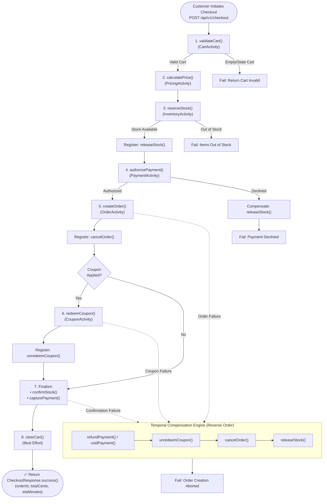

# InstaCommerce Checkout Saga & Temporal Workflow Engine

> **Repository:** `InstaCommerce` Monorepo  
> **Source of Truth:** [`services/checkout-orchestrator-service`](file:///Users/omkarkumar/InstaCommerce/services/checkout-orchestrator-service), [`CheckoutWorkflow.java`](file:///Users/omkarkumar/InstaCommerce/services/checkout-orchestrator-service/src/main/java/com/instacommerce/checkout/workflow/CheckoutWorkflow.java), [`CheckoutWorkflowImpl.java`](file:///Users/omkarkumar/InstaCommerce/services/checkout-orchestrator-service/src/main/java/com/instacommerce/checkout/workflow/CheckoutWorkflowImpl.java), and [`PaymentOperationKeys.java`](file:///Users/omkarkumar/InstaCommerce/services/checkout-orchestrator-service/src/main/java/com/instacommerce/checkout/workflow/PaymentOperationKeys.java).

---

## 1. Architectural Motivation: Why Orchestrated Sagas on Temporal?

In Quick Commerce, checkout spans multiple independent microservices:
1. [`cart-service`](file:///Users/omkarkumar/InstaCommerce/services/cart-service) (Item state and store affinity)
2. [`pricing-service`](file:///Users/omkarkumar/InstaCommerce/services/pricing-service) (Dynamic pricing, surge calculation, delivery fee, coupons)
3. [`inventory-service`](file:///Users/omkarkumar/InstaCommerce/services/inventory-service) (Stock reservation and locking)
4. [`payment-service`](file:///Users/omkarkumar/InstaCommerce/services/payment-service) (PSP pre-authorization and capture)
5. [`order-service`](file:///Users/omkarkumar/InstaCommerce/services/order-service) (Order aggregate root and lifecycle)

### The Architectural Dilemma:
- **Two-Phase Commit (2PC):** Strongly rejected. Holding distributed database locks across independent network boundaries destroys throughput, introduces single-point-of-failure bottlenecks, and is incompatible with third-party payment gateways (Stripe/Razorpay cannot participate in XA transactions).
- **Pure Event Choreography (Kafka Chains):** Rejected for checkout. In choreographies, intermediate business states (e.g., payment authorized but order service down) create complex, split-brain failure topologies. Debugging distributed timeouts, cyclic compensations, and transaction status across 5 topics becomes intractable.

### The Solution:
InstaCommerce utilizes **Temporal.io** to execute an **Orchestrated Saga Pattern**. The [`checkout-orchestrator-service`](file:///Users/omkarkumar/InstaCommerce/services/checkout-orchestrator-service) acts as a centralized orchestrator where execution state is persisted durably to the Temporal Cluster (port `7233`). If an orchestrator pod crashes mid-execution, another pod resumes from the exact recorded history without re-executing completed operations.

---

## 2. Complete Checkout Workflow Lifecycle



---

## 3. Step-by-Step Activity Execution

The workflow logic in [`CheckoutWorkflowImpl.java`](file:///Users/omkarkumar/InstaCommerce/services/checkout-orchestrator-service/src/main/java/com/instacommerce/checkout/workflow/CheckoutWorkflowImpl.java) executes eight sequential stages:

### Step 1: Cart Validation (`CartActivity`)
- Verifies cart contains active items and maps to an active dark store (`storeId`).
- Checks user authentication and minimum order value thresholds.

### Step 2: Dynamic Pricing & Quote Issuance (`PricingActivity`)
- Computes line-item totals, applies surge multipliers, evaluates delivery fees, and validates coupon eligibility.
- Issues a cryptographically signed HMAC **Price Quote** (`quoteId`, `quoteToken`, `totalCents`, `discountCents`). The quote token is forwarded downstream to `order-service` to prevent tampering.

### Step 3: Two-Phase Inventory Reservation (`InventoryActivity`)
- Locks stock quantities in `inventory_db` for 15 minutes (`RESERVED` status).
- **Pre-Registration of Compensation:** Before advancing to payment, the orchestrator registers `inventoryActivity::releaseStock` with the Temporal Saga context:
  ```java
  saga.addCompensation(inventoryActivity::releaseStock, reservationResult.reservationId());
  ```

### Step 4: Payment Authorization (`PaymentActivity`)
- Holds customer funds via PSP (Stripe/Razorpay) using pre-authorized card holds or UPI pre-debits.
- Uses a **Workflow-Stable Idempotency Key** (`paymentKeys.authorize()`).
- If authorization fails (e.g. insufficient funds, fraud block), the workflow triggers `saga.compensate()`, releasing the inventory reservation and terminating cleanly.

### Step 5: Order Record Creation (`OrderActivity`)
- Transacts with `order-service` to insert the order into `order_db` in `PENDING` status.
- Registers `orderActivity::cancelOrder` with the saga context:
  ```java
  saga.addCompensation(orderActivity::cancelOrder, orderResult.orderId());
  ```

### Step 5.5: Coupon Redemption (`CouponActivity`)
- If a promotional discount was applied, records redemption in `pricing_db` to prevent multi-use abuse.
- Registers `couponActivity::unredeemCoupon` with the saga context.

### Step 6: Two-Phase Finalization
- **Inventory Confirmation:** Calls `inventoryActivity.confirmStock(reservationId)`, permanently decrementing stock levels and updating physical store allocation.
- **Payment Capture:** Invokes `paymentActivity.capturePayment(paymentId, paymentKeys.capture(paymentId))` to lock in the pre-authorized transaction.

### Step 7: Cart Flushing (`CartActivity` - Best Effort)
- Evicts active items from the customer's Redis shopping cart session.
- Wrapped in an isolated `try/catch` block. If cart eviction fails due to network hiccups, the checkout saga **does not fail**, because the order and payment are already committed.

---

## 4. Backward Compensation & Rollback Matrix

When an activity throws an unrecoverable exception or business rejection, the orchestrator triggers backward compensation. Temporal guarantees that compensations are executed in **strictly reverse order**:

| Forward Activity | Compensating Reverse Activity | Idempotency Key Strategy | Rollback Guarantee |
|---|---|---|---|
| `reserveStock(items)` | `releaseStock(reservationId)` | `reservationId` | Releases row-level locks on `stock_items` in `inventory_db`. |
| `authorizePayment(amount)` | `voidPayment(paymentId)` | `paymentKeys.voidOp(paymentId)` | Releases PSP hold on customer's card without issuing fees. |
| `createOrder(orderRequest)` | `cancelOrder(orderId)` | `orderId` | Transitions order to `CANCELLED`, recording cancellation reason. |
| `redeemCoupon(code, userId)` | `unredeemCoupon(code, userId)` | `couponCode + orderId` | Restores coupon availability for subsequent checkouts. |
| `capturePayment(paymentId)` | `refundPayment(paymentId, amount)` | `paymentKeys.refund(paymentId)` | Issues full ledger credit and gateway refund API call. |

### Smart Payment Compensation Logic:
Because payment states can be ambiguous across network partitions, [`CheckoutWorkflowImpl.compensatePayment()`](file:///Users/omkarkumar/InstaCommerce/services/checkout-orchestrator-service/src/main/java/com/instacommerce/checkout/workflow/CheckoutWorkflowImpl.java#L248) inspects exact transaction state:
```java
if (paymentCaptured) {
    paymentActivity.refundPayment(paymentId, paymentAmountCents, refundIdempotencyKey);
} else if (paymentCaptureAttempted) {
    try {
        paymentActivity.refundPayment(paymentId, paymentAmountCents, refundIdempotencyKey);
    } catch (Exception ex) {
        paymentActivity.voidPayment(paymentId, voidIdempotencyKey);
    }
} else {
    paymentActivity.voidPayment(paymentId, voidIdempotencyKey);
}
```

---

## 5. Workflow-Stable Idempotency Strategy

A core risk in distributed payment orchestration is double-charging the customer during activity retries or pod restarts.

### Anti-Pattern: Activity-Derived Keys
Deriving keys from Temporal `ActivityId` is dangerous because every retry creates a new activity ID, bypassing downstream deduplication.

### The InstaCommerce Solution: `PaymentOperationKeys`
Idempotency keys are deterministically bound to the durable **Workflow ID**:

```java
// PaymentOperationKeys.java
public final class PaymentOperationKeys {
    private final String workflowId;

    public PaymentOperationKeys(String workflowId) {
        this.workflowId = Objects.requireNonNull(workflowId);
    }

    public String authorize() {
        return "checkout-auth:" + workflowId;
    }

    public String capture(String paymentId) {
        return "checkout-cap:" + workflowId + ":" + paymentId;
    }

    public String voidOp(String paymentId) {
        return "checkout-void:" + workflowId + ":" + paymentId;
    }

    public String refund(String paymentId) {
        return "checkout-ref:" + workflowId + ":" + paymentId;
    }
}
```

Even if the orchestrator crashes and recovers 5 times, `paymentKeys.authorize()` generates the exact same key (`checkout-auth:WF_12345`), guaranteeing that `payment-service` and Stripe process the charge exactly once.

---

## 6. Timeouts, Retries & Circuit Breakers

### Temporal Activity Configurations

| Activity | StartToClose Timeout | Initial Interval | Backoff | Max Attempts | Non-Retryable Exceptions |
|---|---|---|---|---|---|
| **`CartActivity`** | `10 seconds` | `1 sec` | `2.0` | 3 | `CartNotFoundException`, `EmptyCartException` |
| **`PricingActivity`** | `10 seconds` | `1 sec` | `2.0` | 3 | `PricingRuleNotFoundException` |
| **`InventoryActivity`** | `15 seconds` | `1 sec` | `2.0` | 3 | `InsufficientStockException` |
| **`PaymentActivity`** | `30 seconds` | `2 sec` | `2.0` | 3 | `PaymentDeclinedException`, `FraudBlockedException` |
| **`OrderActivity`** | `15 seconds` | `1 sec` | `2.0` | 3 | `InvalidOrderStateException` |
| **`CouponActivity`** | `10 seconds` | `1 sec` | `2.0` | 3 | `InvalidCouponException`, `CouponNotFoundException` |

### Resilience4j Circuit Breakers:
In [`application.yml`](file:///Users/omkarkumar/InstaCommerce/services/checkout-orchestrator-service/src/main/resources/application.yml#L98), downstream REST clients are wrapped in Resilience4j circuit breakers:
- **Sliding Window:** 20 calls (count-based)
- **Failure Rate Threshold:** 50%
- **Wait Duration in Open State:** 30 seconds
- **Half-Open Calls Permitted:** 5 calls

---

## 7. Failure Scenarios & Edge Cases

```mermaid
sequenceDiagram
    autonumber
    actor Customer as Shopper App
    participant Orchestrator as checkout-orchestrator
    participant Inventory as inventory-service
    participant Payment as payment-service
    participant Order as order-service

    Customer->>Orchestrator: POST /api/v1/checkout
    Orchestrator->>Inventory: reserveStock(items)
    Inventory-->>Orchestrator: 200 OK (reservationId = "res_abc")

    Note over Orchestrator,Payment: Payment Declined Scenario
    Orchestrator->>Payment: authorizePayment(amount, key)
    Payment-->>Orchestrator: 402 Declined ("insufficient_funds")
    Note over Orchestrator: Trigger Backward Compensation
    Orchestrator->>Inventory: releaseStock("res_abc")
    Inventory-->>Orchestrator: 200 OK (Stock Released)
    Orchestrator-->>Customer: 400 Bad Request ("Payment declined")

    Note over Customer,Order: Order Creation Crash Scenario
    Customer->>Orchestrator: POST /api/v1/checkout
    Orchestrator->>Inventory: reserveStock(items)
    Inventory-->>Orchestrator: 200 OK
    Orchestrator->>Payment: authorizePayment(amount, key)
    Payment-->>Orchestrator: 200 OK (paymentId = "pay_xyz")
    Orchestrator->>Order: createOrder(orderRequest)
    Note over Order: order-service HTTP 500 / Timeout
    Note over Orchestrator: Trigger Backward Compensation
    Orchestrator->>Payment: voidPayment("pay_xyz")
    Payment-->>Orchestrator: 200 OK (Hold Released)
    Orchestrator->>Inventory: releaseStock("res_abc")
    Inventory-->>Orchestrator: 200 OK (Stock Released)
    Orchestrator-->>Customer: 500 Internal Error ("Order creation aborted; funds released")
```
