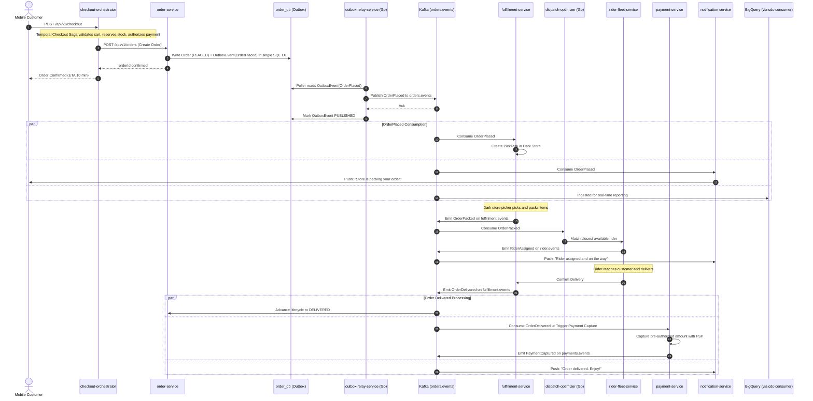

# InstaCommerce Data Flow & Event Architecture

> **Repository:** `InstaCommerce` Monorepo  
> **Source of Truth:** `contracts/`, `services/outbox-relay-service/`, `services/cdc-consumer-service/`, `services/stream-processor-service/`.

---

## 1. Event Envelope Specification

All domain events in InstaCommerce adhere to a strict, standardized envelope definition defined in Java at [`contracts/src/main/java/com/instacommerce/contracts/events/EventEnvelope.java`](file:///Users/omkarkumar/InstaCommerce/contracts/src/main/java/com/instacommerce/contracts/events/EventEnvelope.java) and in JSON Schema at [`contracts/src/main/resources/schemas/common/EventEnvelope.v1.json`](file:///Users/omkarkumar/InstaCommerce/contracts/src/main/resources/schemas/common/EventEnvelope.v1.json).

### Envelope Data Model

```json
{
  "$schema": "https://json-schema.org/draft/2020-12/schema",
  "type": "object",
  "required": [
    "id",
    "eventType",
    "aggregateType",
    "aggregateId",
    "eventTime",
    "schemaVersion",
    "sourceService",
    "payload"
  ],
  "properties": {
    "id": {
      "type": "string",
      "format": "uuid",
      "description": "Unique identifier for this specific event occurrence (for deduplication)"
    },
    "eventType": {
      "type": "string",
      "description": "Type of event, e.g., OrderPlaced, PaymentCaptured, StockReserved"
    },
    "aggregateType": {
      "type": "string",
      "description": "Root entity name, e.g., Order, Payment, StockItem, Rider"
    },
    "aggregateId": {
      "type": "string",
      "description": "Identifier of the entity instance (e.g. order UUID)"
    },
    "eventTime": {
      "type": "string",
      "format": "date-time",
      "description": "ISO-8601 UTC timestamp when the state transition occurred"
    },
    "schemaVersion": {
      "type": "string",
      "pattern": "^v[0-9]+$",
      "description": "Version string of the payload contract, e.g. v1"
    },
    "sourceService": {
      "type": "string",
      "description": "Canonical service identifier producing this event (e.g. order-service)"
    },
    "correlationId": {
      "type": "string",
      "description": "Distributed trace/correlation identifier for cross-service observability"
    },
    "payload": {
      "type": "object",
      "description": "Contract-governed domain data payload"
    }
  }
}
```

---

## 2. Kafka Topic Topology

Canonical topic names are defined centrally in [`contracts/src/main/java/com/instacommerce/contracts/topics/TopicNames.java`](file:///Users/omkarkumar/InstaCommerce/contracts/src/main/java/com/instacommerce/contracts/topics/TopicNames.java).

| Domain / Stream | Main Topic | Dead Letter Topic (DLT) | Partition Strategy | Typical Producers |
|---|---|---|---|---|
| **Orders** | `orders.events` | `orders.events.DLT` | Partitioned by `aggregateId` (`orderId`) | `order-service` |
| **Payments** | `payments.events` | `payments.events.DLT` | Partitioned by `aggregateId` (`paymentId`)| `payment-service`, `payment-webhook-service` |
| **Inventory** | `inventory.events` | `inventory.events.DLT` | Partitioned by `sku` or `storeId` | `inventory-service` |
| **Fulfillment** | `fulfillment.events`| `fulfillment.events.DLT`| Partitioned by `orderId` | `fulfillment-service` |
| **Rider Fleet** | `rider.events` | `rider.events.DLT` | Partitioned by `riderId` | `rider-fleet-service` |
| **Catalog** | `catalog.events` | `catalog.events.DLT` | Partitioned by `productId` | `catalog-service` |
| **Warehouse** | `warehouse.events` | `warehouse.events.DLT` | Partitioned by `storeId` | `warehouse-service` |
| **Search** | `search.events` | `search.events.DLT` | Round-robin / Query Hash | `search-service` |
| **Pricing** | `pricing.events` | `pricing.events.DLT` | Partitioned by `storeId` | `pricing-service` |
| **Promotion** | `promotion.events` | `promotion.events.DLT` | Partitioned by `promoCode` | `pricing-service` |
| **Wallet** | `wallet.events` | `wallet.events.DLT` | Partitioned by `userId` | `wallet-loyalty-service` |
| **Fraud** | `fraud.events` | `fraud.events.DLT` | Partitioned by `userId` or `orderId`| `fraud-detection-service` |
| **Identity** | `identity.events` | `identity.events.DLT` | Partitioned by `userId` | `identity-service` |
| **Reconciliation**| `reconciliation.events`|`reconciliation.events.DLT`| Partitioned by `runId` | `reconciliation-engine` |
| **Location Feed** | `rider.location.updates`| — | Partitioned by `riderId` | `location-ingestion-service` |
| **Webhooks** | `payment.webhooks` | — | Partitioned by `pspReference` | `payment-webhook-service` |

---

## 3. End-to-End Event Flow: The Order Lifecycle



---

## 4. CDC & Real-Time Analytics Pipeline

```mermaid
flowchart LR
    subgraph Microservices["OLTP PostgreSQL Databases"]
        direction TB
        AppDB["Service DBs\n(orders, payments, inventory)"]
        WAL["PostgreSQL WAL\n(Write-Ahead Log)"]
        AppDB --> WAL
    end

    subgraph Streaming["Event Streaming Bus"]
        direction TB
        Debezium["Debezium Kafka Connect\n(Logical Decoding Plugin)"]
        KafkaTopics["Kafka Topics\n(cdc.orders, cdc.payments)"]
        WAL --> Debezium --> KafkaTopics
    end

    subgraph Ingestion["Go Ingestion Layer"]
        CDCConsumer["cdc-consumer-service\n(Batched buffer)"]
        KafkaTopics --> CDCConsumer
    end

    subgraph DataPlatform["Data Platform Lakehouse"]
        direction TB
        BQ_Raw["BigQuery Raw Partitioned Tables"]
        dbt_stg["dbt Staging Models"]
        dbt_marts["dbt Dimension & Fact Marts"]
        CDCConsumer -->|Streaming Inserts| BQ_Raw
        BQ_Raw --> dbt_stg --> dbt_marts
    end

    subgraph ML_Consumption["Downstream Consumption"]
        Feast["Feast Feature Store"]
        dbt_marts --> Feast
        Feast -->|Redis Online Cache| Serving["ai-inference-service"]
    end
```



---

## 5. Schema Evolution Rules & Compatibility Guidelines

To protect independent team deployments from breaking changes across 30 services, the monorepo enforces:

1. **Additive In-Version Changes (`v1`):**
   - Adding optional fields with default values is permitted in the active schema file.
   - Reordering fields is permitted in JSON Schema and Protobuf (field tags must remain unchanged).
2. **Strict Breaking Change Protocol:**
   - Deleting a field or renaming an existing field is considered a breaking change.
   - Changing field types (e.g. `int64` to `string`) is strictly forbidden within the same version.
   - Breaking changes require creating a new schema file (`EventName.v2.json`) alongside `v1`.
   - Consumers must support both `v1` and `v2` during a **90-day deprecation transition period**.
3. **CI Enforcement:**
   - In `.github/workflows/ci.yml`, the `contract-validation` job runs automated JSON schema validation across all schemas under `contracts/src/main/resources/schemas/`.
   - Breaking Protobuf modifications (e.g. field number removals) are automatically flagged in Pull Request diffs.
