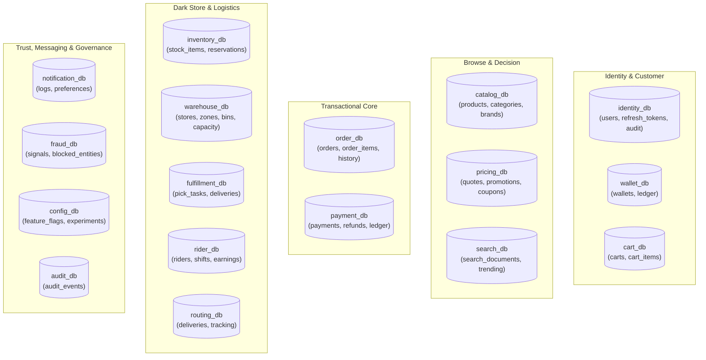
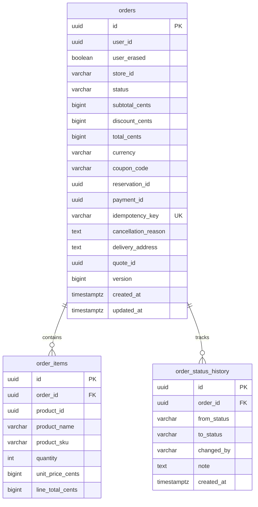
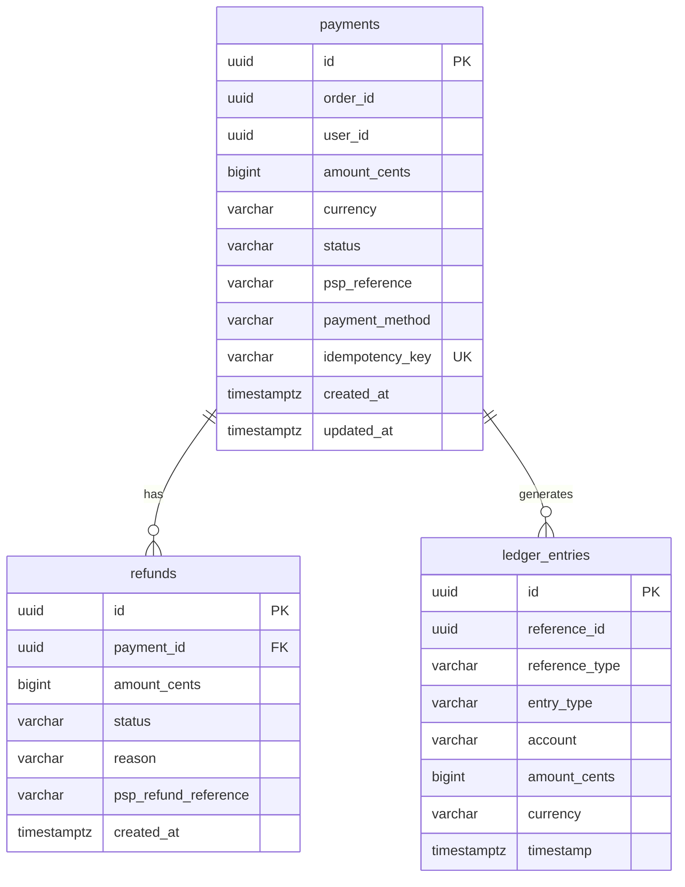

# InstaCommerce Database Schema & Data Dictionary

> **Repository:** `InstaCommerce` Monorepo  
> **Source of Truth:** `scripts/init-dbs.sql` and `services/*/src/main/resources/db/migration/`  
> **Architecture:** Strict Database-per-Service isolation across 17 PostgreSQL databases.

---

## 1. Overview & Fleet Database Topology

InstaCommerce enforces zero cross-database joins and zero shared tables. All 17 databases are provisioned in PostgreSQL 15 (locally via `scripts/init-dbs.sql` and in production via Google Cloud SQL PostgreSQL HA).



---

## 2. Cross-Cutting Database Patterns

### 2.1 The Transactional Outbox Table (`outbox_events`)
Stateful services implement the `outbox_events` table (standardized in Flyway migration `V11` to match the canonical `EventEnvelope`):

```sql
CREATE TABLE outbox_events (
    id             UUID PRIMARY KEY DEFAULT gen_random_uuid(),
    aggregate_type VARCHAR(64)  NOT NULL,
    aggregate_id   VARCHAR(255) NOT NULL,
    event_type     VARCHAR(128) NOT NULL,
    payload        JSONB        NOT NULL,
    schema_version VARCHAR(16)  NOT NULL DEFAULT 'v1',
    source_service VARCHAR(64)  NOT NULL,
    correlation_id VARCHAR(128),
    status         VARCHAR(20)  NOT NULL DEFAULT 'PENDING',
    created_at     TIMESTAMPTZ  NOT NULL DEFAULT now(),
    published_at   TIMESTAMPTZ,
    CONSTRAINT chk_outbox_status CHECK (status IN ('PENDING', 'PUBLISHED', 'FAILED'))
);

CREATE INDEX idx_outbox_events_status_created 
    ON outbox_events (status, created_at ASC) 
    WHERE status = 'PENDING';
```

### 2.2 Distributed Cron Scheduling (`shedlock`)
Services running background cleanup or reconciliation jobs implement ShedLock to coordinate single-leader execution across multi-replica Kubernetes deployments:

```sql
CREATE TABLE shedlock (
    name       VARCHAR(64)  PRIMARY KEY,
    lock_until TIMESTAMPTZ  NOT NULL,
    locked_at  TIMESTAMPTZ  NOT NULL,
    locked_by  VARCHAR(255) NOT NULL
);
```

---

## 3. Schema Data Dictionary (By Database)

---

### Database 1: `identity_db`
* **Owning Service:** `identity-service`
* **Migrations:** `V1__create_users.sql` through `V11__add_outbox_envelope_fields.sql`

#### Key Tables:
1. **`users`**:
   - `id (UUID PK)`: Unique user identifier.
   - `email (VARCHAR(255) UNIQUE)`: Lowercase normalized email.
   - `password_hash (VARCHAR(72))`: BCrypt password hash.
   - `roles (VARCHAR[] DEFAULT '{CUSTOMER}')`: Array of granted roles (`CUSTOMER`, `RIDER`, `PICKER`, `ADMIN`).
   - `status (VARCHAR(20) DEFAULT 'ACTIVE')`: `ACTIVE`, `SUSPENDED`, `DELETED`.
   - `failed_attempts (INT DEFAULT 0)`: Consecutive failed logins.
   - `locked_until (TIMESTAMPTZ)`: Lockout timestamp if failed attempts $\ge 10$.
   - `deleted_at (TIMESTAMPTZ)`: Populated upon GDPR right-to-erasure.
2. **`refresh_tokens`**:
   - `token_hash (VARCHAR(64) PRIMARY KEY)`: SHA-256 hash of plaintext token.
   - `user_id (UUID FK -> users.id)`: Owner user.
   - `expires_at (TIMESTAMPTZ)`: Expiry timestamp (30-day TTL).
   - `created_at (TIMESTAMPTZ)`: Timestamp issued.
3. **`user_audit_log`**:
   - `id (BIGSERIAL PK)`, `user_id (UUID)`, `action (VARCHAR(64))`, `metadata (JSONB)`, `ip_address (INET)`, `user_agent (TEXT)`, `trace_id (VARCHAR(64))`.

---

### Database 2: `order_db`
* **Owning Service:** `order-service`
* **Migrations:** `V1__create_orders.sql` through `V6__add_outbox_indexes.sql`



#### Key Tables:
1. **`orders`**:
   - `status`: Check constraint `PENDING`, `PLACED`, `PACKING`, `PACKED`, `OUT_FOR_DELIVERY`, `DELIVERED`, `CANCELLED`, `FAILED`.
   - `version (BIGINT)`: Hibernate optimistic locking counter (`@Version`).
   - `idempotency_key (VARCHAR(255) UNIQUE)`: Prevents duplicate order creation.
2. **`order_items`**:
   - `unit_price_cents (BIGINT)` & `line_total_cents (BIGINT)`: Explicit money storage in integer cents (currency default `INR`).

---

### Database 3: `payment_db`
* **Owning Service:** `payment-service`
* **Migrations:** `V1__create_payments.sql` through `V8__add_ledger_indexes.sql`



#### Key Tables:
1. **`payments`**:
   - `status`: `AUTHORIZE_PENDING`, `AUTHORIZED`, `CAPTURE_PENDING`, `CAPTURED`, `VOID_PENDING`, `VOIDED`, `FAILED`.
2. **`refunds`**:
   - `status`: `REFUND_PENDING`, `REFUNDED`, `FAILED`.
3. **`ledger_entries`**:
   - `entry_type`: `DEBIT` or `CREDIT`.
   - `account`: `PSP_CLEARING`, `MERCHANT_REVENUE`, `CUSTOMER_WALLET`, `REFUND_ESCROW`.
   - Balanced invariant: Every state change generates balanced debit and credit entries.
4. **`processed_webhook_events`**:
   - `event_id (VARCHAR(255) PRIMARY KEY)`: External gateway event ID for idempotency deduplication.
   - `processed_at (TIMESTAMPTZ)`.

---

### Database 4: `inventory_db`
* **Owning Service:** `inventory-service`
* **Migrations:** `V1__create_stock_items.sql` through `V4__add_reservation_ttl.sql`

#### Key Tables:
1. **`stock_items`**:
   - `id (UUID PK)`
   - `store_id (VARCHAR(64) NOT NULL)`
   - `sku (VARCHAR(64) NOT NULL)`
   - `quantity_available (INT NOT NULL CHECK (quantity_available >= 0))`
   - `quantity_reserved (INT NOT NULL DEFAULT 0)`
   - `reorder_threshold (INT NOT NULL DEFAULT 5)`
   - `updated_at (TIMESTAMPTZ)`
   - `CONSTRAINT uq_store_sku UNIQUE (store_id, sku)`
2. **`reservations`**:
   - `id (UUID PK)`: Referenced by checkout saga.
   - `store_id (VARCHAR(64) NOT NULL)`
   - `status (VARCHAR(20))`: `RESERVED`, `CONFIRMED`, `RELEASED`, `EXPIRED`.
   - `expires_at (TIMESTAMPTZ NOT NULL)`: 10-minute reservation TTL.
3. **`reservation_items`**:
   - `reservation_id (UUID FK -> reservations.id)`, `sku (VARCHAR(64))`, `quantity (INT)`.

---

### Database 5: `catalog_db`
* **Owning Service:** `catalog-service`
* **Key Tables:** `categories`, `brands`, `products`, `product_store_availability`, `outbox_events`.
* **Key Columns:** `sku (VARCHAR UK)`, `name (VARCHAR)`, `description (TEXT)`, `mrp_cents (BIGINT)`, `category_id (UUID FK)`.

---

### Database 6: `fulfillment_db`
* **Owning Service:** `fulfillment-service`
* **Key Tables:** `pick_tasks`, `pick_items`, `deliveries`, `riders`.
* **Key Columns:** `task_id (UUID PK)`, `order_id (UUID UK)`, `picker_id (UUID)`, `status (VARCHAR: CREATED, PICKING, PACKED, CANCELLED)`, `aisle_sequence (INT)`.

---

### Database 7: `warehouse_db`
* **Owning Service:** `warehouse-service`
* **Key Tables:** `stores`, `store_zones`, `bin_locations`, `store_capacity`.
* **Key Columns:** `store_id (VARCHAR PK)`, `geofence_polygon (POLYGON)`, `max_concurrent_pickers (INT)`, `is_open (BOOLEAN)`.

---

### Database 8: `rider_db`
* **Owning Service:** `rider-fleet-service`
* **Key Tables:** `riders`, `rider_shifts`, `rider_earnings`.
* **Key Columns:** `rider_id (UUID PK)`, `current_status (AVAILABLE, ASSIGNED, ON_DELIVERY, OFFLINE)`, `store_id (VARCHAR)`.

---

### Database 9: `pricing_db`
* **Owning Service:** `pricing-service`
* **Key Tables:** `price_quotes`, `promotions`, `coupons`, `coupon_redemptions`.
* **Key Columns:** `quote_id (UUID PK)`, `quote_token (VARCHAR(256) NOT NULL)`, `expires_at (TIMESTAMPTZ)`, `subtotal_cents (BIGINT)`, `discount_cents (BIGINT)`, `surge_cents (BIGINT)`.

---

### Database 10: `cart_db`
* **Owning Service:** `cart-service`
* **Key Tables:** `carts`, `cart_items`.
* **Key Columns:** `cart_id (UUID PK)`, `user_id (UUID UK)`, `store_id (VARCHAR)`, `updated_at (TIMESTAMPTZ)`. (Backed primarily by Redis in-memory hashes).

---

### Database 11: `search_db`
* **Owning Service:** `search-service`
* **Key Tables:** `search_index_metadata`, `trending_queries`, `search_analytics`.
* **Key Columns:** `query (VARCHAR PK)`, `search_count (BIGINT)`, `store_id (VARCHAR)`, `last_searched_at (TIMESTAMPTZ)`.

---

### Database 12: `routing_db`
* **Owning Service:** `routing-eta-service`
* **Key Tables:** `deliveries`, `delivery_tracking`, `distance_matrix_cache`.
* **Key Columns:** `origin_lat_long (POINT)`, `dest_lat_long (POINT)`, `duration_seconds (INT)`, `distance_meters (INT)`, `cached_at (TIMESTAMPTZ)`.

---

### Database 13: `notification_db`
* **Owning Service:** `notification-service`
* **Key Tables:** `notification_logs`, `notification_templates`, `user_device_tokens`.
* **Key Columns:** `id (UUID PK)`, `user_id (UUID)`, `channel (PUSH, SMS, EMAIL)`, `status (DELIVERED, FAILED)`, `event_id (VARCHAR(255) UK)`.

---

### Database 14: `wallet_db`
* **Owning Service:** `wallet-loyalty-service`
* **Key Tables:** `wallets`, `wallet_ledger_entries`, `loyalty_accounts`.
* **Key Columns:** `wallet_id (UUID PK)`, `user_id (UUID UK)`, `balance_cents (BIGINT CHECK (balance_cents >= 0))`.

---

### Database 15: `fraud_db`
* **Owning Service:** `fraud-detection-service`
* **Key Tables:** `fraud_signals`, `blocked_entities`, `velocity_counters`.
* **Key Columns:** `entity_type (IP, CARD_FINGERPRINT, DEVICE_ID, USER)`, `entity_value (VARCHAR)`, `reason (TEXT)`, `blocked_until (TIMESTAMPTZ)`.

---

### Database 16: `config_db`
* **Owning Service:** `config-feature-flag-service`
* **Key Tables:** `feature_flags`, `experiments`, `experiment_variants`.
* **Key Columns:** `flag_key (VARCHAR PK)`, `is_enabled (BOOLEAN)`, `rollout_percentage (INT)`, `cohort_filters (JSONB)`.

---

### Database 17: `audit_db`
* **Owning Service:** `audit-trail-service`
* **Key Tables:** `audit_events`.
* **Key Columns:** `id (BIGSERIAL PK)`, `actor_id (VARCHAR)`, `action (VARCHAR)`, `target_resource (VARCHAR)`, `diff_payload (JSONB)`, `timestamp (TIMESTAMPTZ)`. (Archived to GCP Object Lock Cloud Storage).
