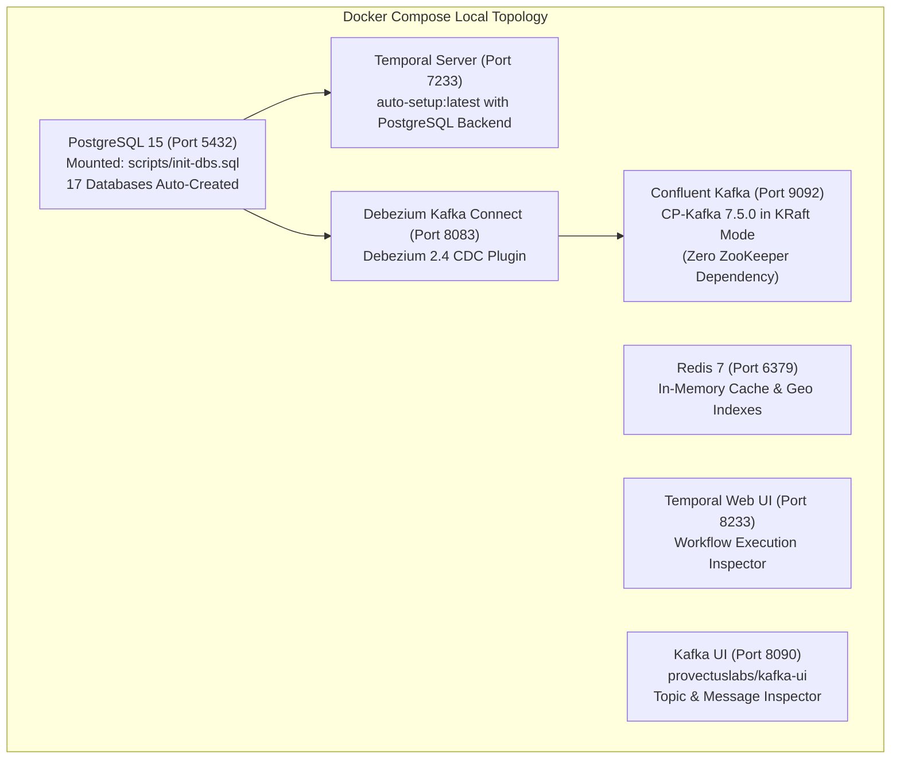
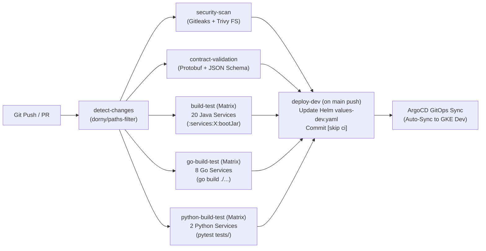
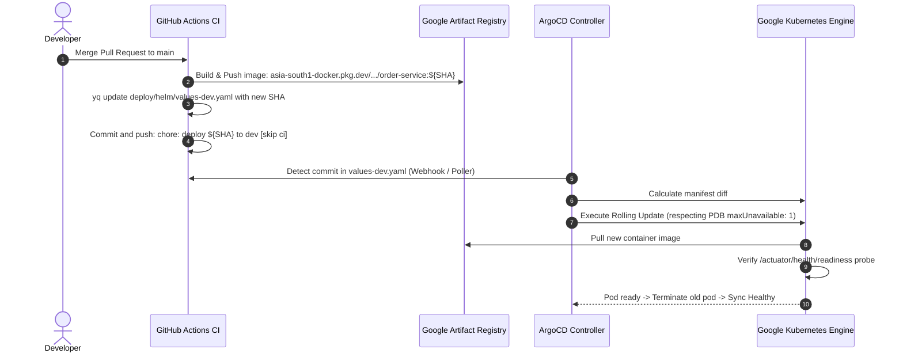

# InstaCommerce Deployment & Operations Guide

> **Repository:** `InstaCommerce` Monorepo  
> **Source of Truth:** `docker-compose.yml`, `.github/workflows/ci.yml`, `deploy/helm/`, `argocd/app-of-apps.yaml`, and `infra/terraform/`.

---

## 1. Local Development Setup (`docker-compose.yml`)

The root `docker-compose.yml` spins up a self-contained local platform environment without external cloud dependencies:



### Local Bootstrap Commands:
```bash
# 1. Start all core infrastructure containers
docker-compose up -d

# 2. Verify containers are healthy
docker-compose ps

# 3. Inspect PostgreSQL databases (verify 17 databases created)
docker exec -it instacommerce-postgres psql -U postgres -c "\l"

# 4. Access Local Web Dashboards:
# • Temporal UI: http://localhost:8233
# • Kafka UI:    http://localhost:8090
# • Debezium:    http://localhost:8083/connectors
```

---

## 2. CI/CD Pipeline Architecture (`.github/workflows/ci.yml`)

Our GitHub Actions pipeline enforces change detection, security scanning, contract validation, and matrix compilation:



### Path-Filtering Matrix Rules:
* **Service Scoping:** If a PR only modifies `services/order-service/**`, only `order-service` is tested and packaged into a Docker image.
* **Shared Library Blast Radius:**
  * Modifying `services/go-shared/**` triggers re-compilation of **all 8 Go services**.
  * Modifying `build.gradle.kts`, `settings.gradle.kts`, or `gradle/**` triggers re-compilation of **all 20 Java services**.
  * Modifying `contracts/**` triggers proto verification and JSON schema validation across the fleet.

---

## 3. Helm Chart Structure & Istio Service Mesh

All 30 microservices are deployed via a unified Helm chart located in [`deploy/helm/`](file:///Users/omkarkumar/InstaCommerce/deploy/helm):

```
deploy/helm/
├── Chart.yaml                  # Chart metadata (version 0.1.0)
├── values.yaml                 # Base configuration and service definitions
├── values-dev.yaml             # Development environment overrides
├── values-prod.yaml            # Production environment overrides
└── templates/
    ├── deployment.yaml         # Parametric deployment template
    ├── service.yaml            # ClusterIP service template
    ├── hpa.yaml                # HorizontalPodAutoscaler template (70% CPU target)
    ├── istio-virtualservice.yaml # Ingress routing rules
    ├── istio-request-auth.yaml # JWT validation rules
    └── istio-auth-policy.yaml  # mTLS and inter-service RBAC policies
```

### Ingress Routing & Domains
In `values.yaml`, Istio VirtualServices route traffic by hostname and path prefix:
* `api.instacommerce.dev`: Routes `/api/v1/*` to individual backend microservices.
* `m.instacommerce.dev`: Routes `/m/v1/*` and `/bff/mobile/v1/*` to `mobile-bff-service` (Port 8097).
* `admin.instacommerce.dev`: Routes `/admin/v1/*` to `admin-gateway-service` (Port 8080).

---

## 4. GitOps Delivery with ArgoCD (`argocd/`)

InstaCommerce utilizes the **App-of-Apps GitOps pattern** defined in [`argocd/app-of-apps.yaml`](file:///Users/omkarkumar/InstaCommerce/argocd/app-of-apps.yaml):



---

## 5. Terraform Infrastructure Modules (`infra/terraform/`)

Infrastructure as Code (IaC) is modularized under `infra/terraform/`:

| Module Directory | Provisioned GCP Resources |
|---|---|
| `modules/vpc` | Custom VPC, regional subnets, Cloud NAT, private Google access, secondary IP ranges for GKE pods and services. |
| `modules/gke` | Regional private GKE cluster, Workload Identity, shielded nodes, node autoscaling. |
| `modules/cloudsql` | PostgreSQL 15 HA instance, automated backups, private IP VPC peering, Point-In-Time-Recovery (PITR). |
| `modules/memorystore` | Redis 7 instance for caching, location telemetry, and session state. |
| `modules/bigquery` | Partitioned datasets (`raw`, `staging`, `marts`) for analytical pipelines. |
| `modules/iam` | Service account workload identity bindings mapping Kubernetes SAs to GCP IAM roles. |

---

## 6. Zero-Downtime Rollout & Rollback Strategy

1. **Pod Disruption Budgets (PDB):** Enforced across all deployments with `maxUnavailable: 1`.
2. **Graceful Shutdown:** Every Java service configures `server.shutdown: graceful` with a `timeout-per-shutdown-phase: 30s` to allow active HTTP connections and Kafka poll loops to drain before SIGKILL.
3. **Rollback Procedure:**
   ```bash
   # Revert Git commit in values-dev.yaml to trigger automatic ArgoCD self-heal rollback
   git revert <commit-sha> && git push origin main
   
   # Or execute immediate manual rollback in emergency via ArgoCD CLI:
   argocd app rollback instacommerce-dev
   ```
