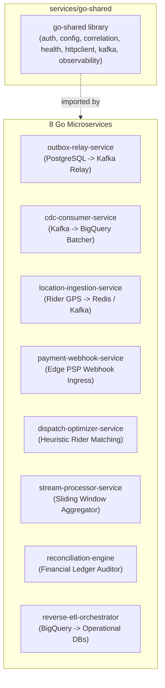

# InstaCommerce Go Services & Async Streaming Architecture

> **Repository:** `InstaCommerce` Monorepo  
> **Source of Truth:** `services/go-shared/` and `services/*/go.mod` (8 Go Microservices)  
> **Runtime:** Go 1.22

---

## 1. Overview of the Go Async Plane

While Java 21 / Spring Boot 4.0 hosts our transactional core domain models, **Go 1.22 powers our asynchronous streaming, real-time ingestion, and telemetry layer**. 

Go was selected specifically for:
1. **Zero-Garbage-Collection Stutter:** Rider location ingestion receives $> 10,000$ GPS pings/sec; Go's low-latency memory management prevents periodic JVM GC pauses from delaying telemetry processing.
2. **Minimal Footprint:** Go binaries compile to tiny scratch/alpine containers ($< 25\text{MB}$) that boot in $< 20\text{ms}$.
3. **High-Throughput I/O:** Goroutines and non-blocking network channels efficiently multiplex PostgreSQL `outbox_events` streaming, Debezium CDC ingestion into BigQuery, and external PSP webhooks.

---

## 2. The Foundation: `go-shared` Library

Located under `services/go-shared/pkg/`, this library provides the operational standards for all Go microservices:

| Package Path | Core Responsibility | Key Implementation Details |
|---|---|---|
| `pkg/auth` | JWT Auth Middleware | Verifies RS256 Bearer JWTs issued by `identity-service` against cached JWKS. |
| `pkg/config` | Environment Binding | Loads env vars with struct-tag validation and defaults. |
| `pkg/correlation` | Distributed Tracing | Injects and extracts `X-Correlation-ID` and W3C `traceparent` headers across HTTP and Kafka messages. |
| `pkg/health` | Standardized Probes | Exposes `/health/live` and `/health/ready` HTTP handlers for Kubernetes probes. |
| `pkg/httpclient` | Resilient Transport | Configures connection pooling, keep-alives, timeouts, and exponential backoff retries. |
| `pkg/kafka` | Producer & Consumer | Wrapper around `segmentio/kafka-go` and `IBM/sarama` with automated correlation injection and DLQ error routing. |
| `pkg/observability` | Logging & Metrics | Structured logging via standard library `log/slog` (JSON format) and OpenTelemetry trace exporter. |

---

## 3. Deep Dive into the 8 Go Services

---

### 1. `outbox-relay-service`
* **Module Path:** `services/outbox-relay-service` (Port `8101`)
* **Role:** Polls `outbox_events` tables across PostgreSQL databases using `SELECT ... FOR UPDATE SKIP LOCKED`, wraps payloads in `EventEnvelope`, produces to Kafka, and updates status to `PUBLISHED`.
* **Key Dependencies:** `github.com/jackc/pgx/v5` (connection pooling), `github.com/IBM/sarama` (idempotent producer).
* **Concurrency Pattern:** Worker pool per database; uses batch sizes of 500 rows with a 50ms tick.

---

### 2. `cdc-consumer-service`
* **Module Path:** `services/cdc-consumer-service` (Port `8102`)
* **Role:** Consumes Debezium CDC streams (`orders`, `payments`, `inventory`) from Kafka, deserializes JSON change envelopes, buffers rows in memory, and streams batches into Google BigQuery partitioned tables.
* **Key Dependencies:** `github.com/segmentio/kafka-go`, Google Cloud BigQuery client library.
* **Resilience:** Implements a Dead Letter Queue (`kafka_dlq_topic`). If BigQuery rejects a record due to schema drift, the poison-pill message is quarantined to DLQ while consumption continues.

---

### 3. `location-ingestion-service`
* **Module Path:** `services/location-ingestion-service` (Port `8103`)
* **Role:** High-concurrency telemetry endpoint receiving rider GPS updates every 3 seconds over WebSockets and HTTP.
* **Key Features:**
  - **Uber H3 Spatial Indexing:** Translates latitude/longitude into H3 hexagonal cell indices (Resolution 8/9).
  - **Redis Cache:** Immediately updates rider coordinates via `GEOADD` for sub-millisecond proximity queries.
  - **Kafka Batcher:** Aggregates location history ticks into batches before flushing to `rider.location.updates`.

---

### 4. `payment-webhook-service`
* **Module Path:** `services/payment-webhook-service` (Port `8104`)
* **Role:** Public edge ingress for Stripe and Razorpay asynchronous webhook notifications.
* **Key Features:**
  - **HMAC Signature Verification:** Verifies gateway cryptographic signatures before parsing payload.
  - **Redis Deduplication:** Uses Redis atomic keys (`SETNX payment_webhook:{eventId} EX 86400`) to guarantee idempotent processing.
  - **Event Translation:** Converts vendor webhook payloads into canonical `PaymentCaptured` / `PaymentDisputed` domain events on `payments.events`.

---

### 5. `dispatch-optimizer-service`
* **Module Path:** `services/dispatch-optimizer-service` (Port `8105`)
* **Role:** Solves the real-time order-to-rider matching and batching heuristic problem.
* **Key Features:**
  - **Stateless Compute:** Exposes synchronous `POST /optimize/assign`.
  - **Batching Solver:** Evaluates multi-order clustering (bundling orders going to the same apartment complex).
  - **Fallback:** 150ms timeout; if complex batching exceeds budget, falls back to nearest-idle-rider greedy heuristic.

---

### 6. `stream-processor-service`
* **Module Path:** `services/stream-processor-service` (Port `8106`)
* **Role:** Real-time sliding window calculations over Kafka streams.
* **Key Features:**
  - Tracks live dark-store fulfillment duration, rider assignment lag, and payment decline velocity.
  - Stores sliding window counters in Redis and exports operational Prometheus metrics at `/metrics`.

---

### 7. `reconciliation-engine`
* **Module Path:** `services/reconciliation-engine` (Port `8107`)
* **Role:** Automated financial auditor.
* **Key Features:**
  - Scheduled batch jobs using `github.com/robfig/cron/v3`.
  - Queries `ledger_entries` in `payment_db` and compares them against external bank settlement reports.
  - Emits `reconciliation.events` (`mismatch`, `summary`) when discrepancies exceed tolerances.

---

### 8. `reverse-etl-orchestrator`
* **Module Path:** `services/reverse-etl-orchestrator` (Port `8108`)
* **Role:** Synchronizes dimensional analytics from BigQuery back into operational datastores.
* **Key Features:**
  - Runs scheduled queries against BigQuery marts (Customer LTV, RFM segment scores, Dark Store efficiency).
  - Batches updates into operational PostgreSQL and Redis caches for use by `pricing-service` and `catalog-service`.

---

## 4. Common Go Architecture & Concurrency Standards

1. **Clean Architecture Separation:**
   - `internal/handler`: HTTP/WebSocket transport handling and request decoding.
   - `internal/service`: Core business logic and validations.
   - `internal/repository`: Datastore access (PostgreSQL `pgxpool`, Redis client, Kafka reader).
2. **Context Propagation:** Every network call and database query requires `context.Context` with explicit timeout cancellation.
3. **Graceful Shutdown:** All Go services capture `SIGTERM` / `SIGINT` signals and allow a 15-second grace window for active HTTP requests and Kafka offset commits to drain before process exit.
