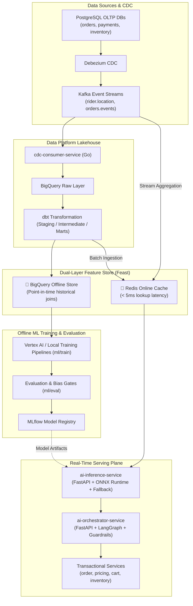
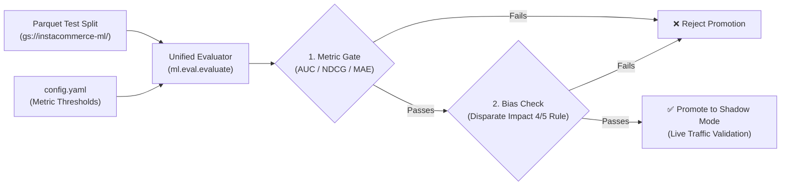
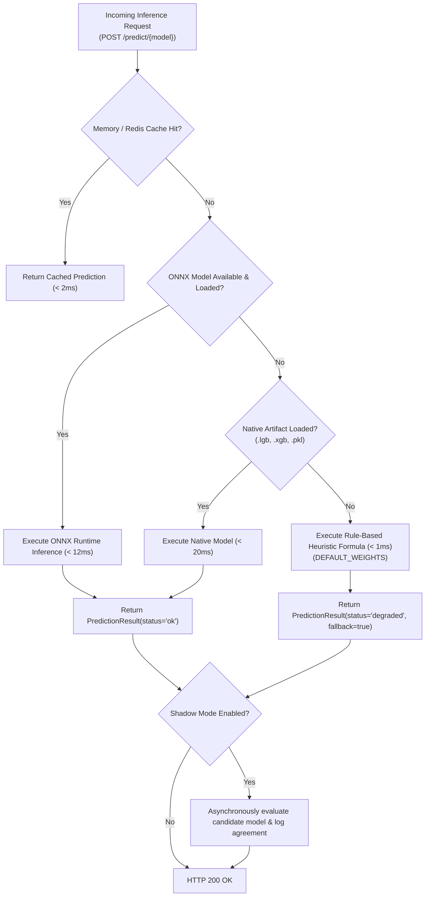
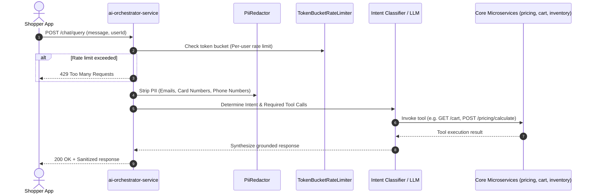
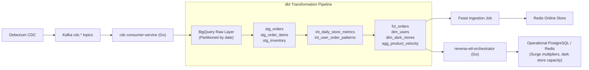

# InstaCommerce ML & AI Platform Architecture

> **Repository:** `InstaCommerce` Monorepo  
> **Source of Truth:** `ml/`, `services/ai-orchestrator-service/`, `services/ai-inference-service/`, `data-platform/`, and `docs/reviews/iter3/platform/ml-platform-productionization.md`.

---

## 1. Architectural Overview

The InstaCommerce AI & ML Platform provides intelligent decision-making capabilities across the entire quick-commerce customer journey. It consists of two complementary layers:

1. **The Machine Learning Engine (`ml/`):**
   - Offline training pipelines, evaluation gates, and experiment tracking (MLflow).
   - Dual-layer Feature Store (Feast on GCP with BigQuery offline and Redis online stores).
   - Artifact export pipelines producing native models (`.lgb`, `.xgb`, `.pkl`) and optimized ONNX Runtime binaries.
2. **The Real-Time Serving Plane (`services/ai-*`):**
   - [`services/ai-inference-service`](file:///Users/omkarkumar/InstaCommerce/services/ai-inference-service): High-throughput, sub-20ms model serving with automatic fallback to linear/logistic heuristics.
   - [`services/ai-orchestrator-service`](file:///Users/omkarkumar/InstaCommerce/services/ai-orchestrator-service): Agentic LangGraph workflow orchestrator with strict PII guardrails, rate limiting, and tool-calling interfaces to core transactional services.



---

## 2. Model Inventory & Production Targets

The platform maintains six specialized machine learning models plus an agentic workflow orchestrator:

| Model | Problem Formulation | Algorithm / Framework | Serving Engine | Target Latency | Promotion Target | Fallback Strategy |
|---|---|---|---|---|---|---|
| **Search Ranking** | Learning-to-Rank (LTR) | LightGBM (LambdaMART) → ONNX | `ai-inference-service` | `< 20 ms` | NDCG@10 ≥ 0.65 (+15% conversion) | Heuristic relevance score weighted by availability |
| **Fraud Detection** | Binary Classification | XGBoost Ensemble → ONNX | `ai-inference-service` | `< 15 ms` | AUC ≥ 0.88, Precision@95%Recall | Logistic risk score based on order value & chargebacks |
| **ETA Prediction** | Multi-Factor Regression | LightGBM Regression → ONNX | `ai-inference-service` | `< 10 ms` | MAE ≤ 1.5 min | Linear model (`distance * 2.3 + traffic * 3.1 + prep`) |
| **Demand Forecast** | Time-Series Forecasting | Prophet + Temporal Fusion Transformer | Batch / Cloud Composer | `< 50 ms` | MAPE ≤ 8.0% | 7-day trailing moving average |
| **Personalization** | Recommendation / Retrieval | Two-Tower NCF (PyTorch) → ONNX | `ai-inference-service` | `< 25 ms` | Hit@10 ≥ 0.40, NDCG@10 ≥ 0.35 | Global trending & dark-store popular items |
| **CLV Prediction** | Probabilistic Frequency/Monetary | BG/NBD + Gamma-Gamma | Batch / BigQuery | `< 30 ms` | Segment-level calibration | Historical average spend tier |
| **AI Orchestrator** | Agentic Workflow / NLP | LangGraph / LLM Client | `ai-orchestrator-service` | `< 50 ms` (router) | Intent accuracy ≥ 95% | Keyword-based intent classification router |

---

## 3. Dual-Layer Feature Store (Feast on GCP)

The feature store architecture ensures consistent feature computation between offline training and online real-time serving, completely eliminating online-offline training-serving skew.

### 3.1 Entities and Feature Groups

| Entity | Join Key | Feature Group | Stored Features | Update Cadence |
|---|---|---|---|---|
| **`user`** | `user_id` (UUID) | `user_features` | `order_count_30d`, `avg_basket_val`, `lifetime_value`, `churn_risk_score`, `preferred_category` | Daily batch sync |
| **`store`** | `store_id` (String) | `store_features` | `avg_picker_prep_time_s`, `active_order_volume`, `fulfillment_rate_7d`, `stockout_rate` | Hourly sync |
| **`product`** | `product_id` (UUID) | `product_features` | `view_count_24h`, `conversion_rate_7d`, `return_rate`, `stock_velocity_per_hour` | Hourly sync |
| **`rider`** | `rider_id` (UUID) | `rider_features` | `avg_delivery_time_min`, `acceptance_rate`, `rating`, `active_shift_duration_m` | Real-time stream sync |
| **`search_query`** | `query_hash` (String) | `search_features` | `query_frequency_7d`, `avg_click_position`, `zero_result_rate`, `conversion_rate` | Daily batch sync |

### 3.2 Dual-Layer Data Flow
- **Offline Store (BigQuery):** Retains full point-in-time event history. When models train via `ml/train/*/train.py`, feature values are joined as of historical event timestamps, preventing future data leakage.
- **Online Store (Redis):** Features are stored as Redis hashes with an explicit TTL (`_FEATURE_MAX_AGE_S = 3600s`). Real-time lookups complete in under 5ms. If features are older than 1 hour, predictors trigger automatic staleness alarms.

---

## 4. Offline Training & Evaluation Gates

Training pipelines are structured under [`ml/train/`](file:///Users/omkarkumar/InstaCommerce/ml/train/):

```
ml/
├── train/
│   ├── search_ranking/       # LambdaMART ranking pipeline
│   ├── fraud_detection/      # XGBoost fraud classification
│   ├── eta_prediction/       # Dark-store to customer transit regression
│   ├── demand_forecast/      # Dark-store inventory demand forecasting
│   ├── personalization/      # Two-Tower recommendation retrieval
│   └── clv_prediction/       # Lifetime value estimation
├── eval/
│   └── evaluate.py           # Unified evaluation & gate checking framework
└── serving/                  # Model loading, shadow validation, and monitoring
```

### 4.1 Automated Promotion Gates
Before any model artifact can be registered in the MLflow Model Registry or deployed to production, it must pass automated evaluation gates in [`ml/eval/evaluate.py`](file:///Users/omkarkumar/InstaCommerce/ml/eval/evaluate.py):



1. **Performance Metric Gates:** Minimum acceptable thresholds (e.g. `NDCG@10 >= 0.65`, `MAE <= 1.5`, `AUC >= 0.88`).
2. **Bias & Fairness Checks:** Evaluates demographic parity and equalized opportunity across rider cohorts and customer demographics using the four-fifths (80%) disparate impact rule.
3. **MLflow Tracking:** Automatically logs metrics, hyperparameters, Git commit SHA, and artifact hashes to MLflow (`MLFLOW_TRACKING_URI`).

---

## 5. High-Throughput Model Serving (`ai-inference-service`)

The inference service is implemented in Python 3.13 with FastAPI and ONNX Runtime. It serves predictions with strict sub-20ms SLAs.

### 5.1 Three-Tier Fallback Hierarchy

To ensure 99.99% availability for mission-critical paths (checkout fraud scoring, search ranking, and ETA generation), [`ai-inference-service/app/main.py`](file:///Users/omkarkumar/InstaCommerce/services/ai-inference-service/app/main.py) uses a tiered fallback execution pattern:



### 5.2 Heuristic Fallback Formulas
When model files are missing or unreadable, the service executes deterministic mathematical fallbacks (`DEFAULT_WEIGHTS`):
- **ETA Fallback:**  
  $$\text{ETA} = 4.5 + (2.3 \times \text{distance\_km}) + (0.6 \times \text{item\_count}) + (3.1 \times \text{traffic\_factor})$$
- **Ranking Fallback:**  
  $$\text{Score} = 0.15 + (0.55 \times \text{relevance}) + (0.35 \times \text{availability}) + (0.40 \times \text{affinity}) - (0.20 \times \text{price\_norm})$$
- **Fraud Fallback:**  
  $$\text{Logit} = -1.4 + (0.012 \times \text{amount}) + (4.8 \times \text{chargeback\_rate}) + (2.1 \times \text{device\_risk}) - (0.015 \times \text{account\_age})$$

### 5.3 Shadow Mode Traffic Comparison
Before a candidate model replaces a production model, it is deployed in **Shadow Mode** (`ShadowRunner`):
- Production and Shadow models run concurrently on live requests.
- Only the production model's response is returned to the client.
- The shadow model runs asynchronously with a strict 1-second timeout.
- Outputs are compared using a 10% relative tolerance window. If output agreement exceeds 95% over a 48-hour period with no latency regressions, the model is cleared for production promotion.

### 5.4 Drift Monitoring (Population Stability Index)
The serving layer tracks incoming feature distributions in real time using the **Population Stability Index (PSI)**:
- $\text{PSI} < 0.10$: Healthy distribution, no significant shift.
- $0.10 \le \text{PSI} \le 0.20$: Moderate drift; emits warning metric to Prometheus (`model_drift_psi`).
- $\text{PSI} > 0.20$: Significant distribution drift; raises automated alert to trigger Cloud Composer retrain pipeline.

---

## 6. Agentic AI Orchestration (`ai-orchestrator-service`)

The [`ai-orchestrator-service`](file:///Users/omkarkumar/InstaCommerce/services/ai-orchestrator-service) handles intelligent natural-language interactions, automated customer support resolution, and dynamic cross-domain operations.

### 6.1 Architecture & Guardrails
Built with FastAPI and LangGraph, the orchestrator incorporates strict security guardrails before processing any user input:



### 6.2 Key Guardrails:
1. **PII Redaction (`PiiRedactor`):** Automatically regex-redacts credit cards, social security numbers, phone numbers, and emails using placeholder tokens (`[REDACTED_CARD]`, `[REDACTED_PHONE]`).
2. **Token Bucket Rate Limiting:** Prevents resource exhaustion from runaway conversational loops.
3. **Structured Audit Publishing:** All tool invocations and user actions emit structured `AuditEvent` records to `audit_db` and Kafka for traceability.
4. **Deterministic Tool Boundaries:** The LLM cannot directly modify backend state; it invokes strictly typed REST endpoints (`ItemQuantity`, `product_id`) on the core services with token authentication.

---

## 7. Data Platform Lakehouse Integration

The Machine Learning and Analytics platforms are directly integrated with the InstaCommerce BigQuery Lakehouse:



- **dbt Modeling:** Raw CDC streams are modeled into immutable facts and dimensional marts under `data-platform/dbt/`.
- **Reverse ETL:** The Go-based [`services/reverse-etl-orchestrator`](file:///Users/omkarkumar/InstaCommerce/services/reverse-etl-orchestrator) continuously syncs derived customer affinities, dark-store prep capacity indices, and pricing surge multipliers back from BigQuery into Redis and operational PostgreSQL databases.
