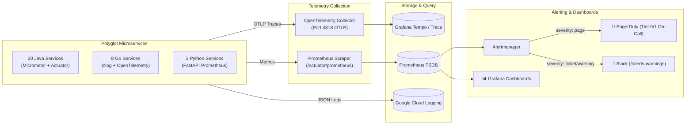

# InstaCommerce Monitoring, Alerting & Observability Guide

> **Repository:** `InstaCommerce` Monorepo  
> **Source of Truth:** `monitoring/prometheus-rules.yaml`, `deploy/helm/templates/`, and iter-3 SRE specifications.

---

## 1. Observability Architecture

InstaCommerce implements the three pillars of observability (Metrics, Traces, Structured Logs) across all 30 microservices:



---

## 2. Health Endpoint Standards Across Stacks

Every microservice exposes standardized probes for Kubernetes readiness and liveness:

| Stack | Readiness Probe | Liveness Probe | Metrics Endpoint |
|---|---|---|---|
| **Java (Spring Boot 4.0)** | `/actuator/health/readiness` | `/actuator/health/liveness` | `/actuator/prometheus` |
| **Go (`go-shared`)** | `/health/ready` | `/health/live` | `/metrics` |
| **Python (FastAPI)** | `/health` | `/health` | `/metrics` |

---

## 3. Google SRE Multi-Window Multi-Burn-Rate Model

InstaCommerce groups services into three operational tiers and alerts based on **error budget consumption rate** rather than static error thresholds (preventing alert fatigue and false positives):

### Service Tiers & SLO Targets:
* **Tier 0 (99.9% Availability):** `identity-service`, `checkout-orchestrator-service`, `payment-service`. (Monthly budget: 43 minutes downtime).
* **Tier 1 (99.5% Availability):** `order-service`, `inventory-service`, `fulfillment-service`, `cart-service`, `pricing-service`, `rider-fleet-service`, `routing-eta-service`.
* **Tier 2 (99.0% Availability):** `catalog-service`, `search-service`, `warehouse-service`, `notification-service`, `wallet-loyalty-service`, `fraud-detection-service`, `audit-trail-service`, `config-feature-flag-service`.

### Multi-Window Burn-Rate Alerts (`monitoring/prometheus-rules.yaml`):

```mermaid
flowchart TD
    BurnRate{"Error Budget Burn Rate"}
    
    BurnRate -->|14.4x over 1h (5m window)\nExhausts budget in ~5 hours| Critical["🚨 Severity: PAGE (PagerDuty)\nAlert: BurnRate_Tier0_Critical\nRuns on-call awake immediately"]
    
    BurnRate -->|6x over 6h (30m window)\nExhausts budget in ~12 hours| High["🚨 Severity: PAGE (PagerDuty)\nAlert: BurnRate_Tier0_High\nPaging alert before budget drained"]
    
    BurnRate -->|3x over 1d (1h window)\nExhausts budget in ~2.5 days| Medium["🎫 Severity: TICKET (Jira / Slack)\nAlert: BurnRate_Tier0_Medium\nWork-hours engineering ticket"]
```

### SLI Recording Rules:
* `sli:http_availability:rate5m`: Ratio of successful non-5xx HTTP requests over 5 minutes.
* `sli:http_latency:rate5m`: Ratio of requests completing under $500\text{ms}$ threshold.
* `sli:kafka_consumer_lag:max5m`: Maximum lag offset across consumer groups.

---

## 4. Operational & Infrastructure Alert Inventory

| Alert Name | PromQL Expression / Condition | Duration | Severity | Route |
|---|---|---|---|---|
| **`HighErrorRate`** | `rate(http_server_requests_seconds_count{status=~"5.."}[5m]) / rate(...) > 0.05` | 2 min | Critical | PagerDuty |
| **`HighLatencyP99`** | `histogram_quantile(0.99, rate(http_server_requests_seconds_bucket[5m])) > 0.8` | 5 min | Warning | Slack |
| **`KafkaConsumerLagHigh`** | `kafka_consumer_records_lag_max > 10000` | 5 min | Warning | Slack |
| **`KafkaConsumerLagCritical`** | `kafka_consumer_records_lag_max > 50000` | 2 min | Critical | PagerDuty |
| **`PodCrashLooping`** | `rate(kube_pod_container_status_restarts_total[15m]) > 3` | 5 min | Critical | PagerDuty |
| **`PostgresConnectionsHigh`** | `pg_stat_activity_count / pg_settings_max_connections > 0.85` | 5 min | Warning | Slack |
| **`LedgerDiscrepancyDetected`** | `instacommerce_ledger_unbalanced_cents != 0` | 1 min | Critical | PagerDuty |

---

## 5. Grafana Dashboard Inventory

1. **Executive SLO Overview:** Real-time error budget burn rates across Tier 0, Tier 1, and Tier 2 services.
2. **Order Lifecycle Funnel:** Conversion rate from Cart $\rightarrow$ Checkout $\rightarrow$ Packed $\rightarrow$ Delivered.
3. **Kafka Mesh & Consumer Lag:** Partition lag per consumer group, DLQ message velocity.
4. **Dark Store Operations:** Picker Units Per Hour (UPH), bin scan latency, store backlog counters.
5. **Payment & Ledger Health:** PSP authorization success rates, two-phase capture latency, refund volumes.
6. **Machine Learning Model Telemetry:** ONNX inference latency P99, heuristic fallback trigger rate, feature drift.
