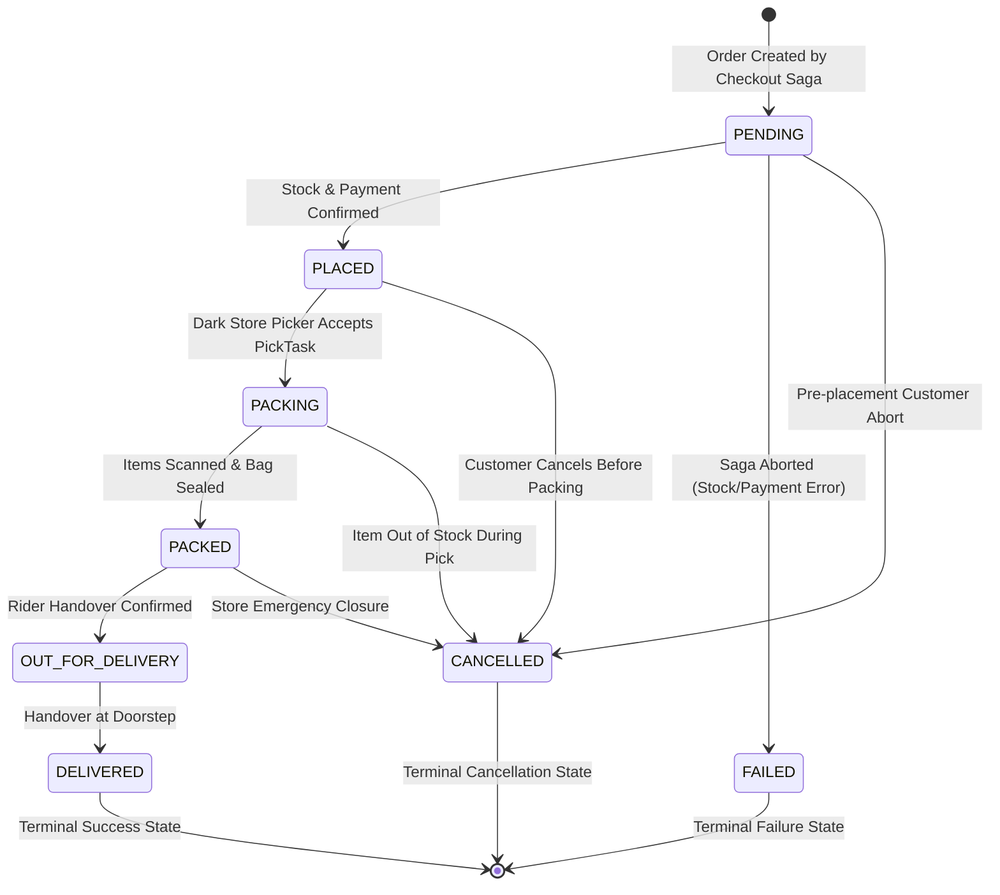
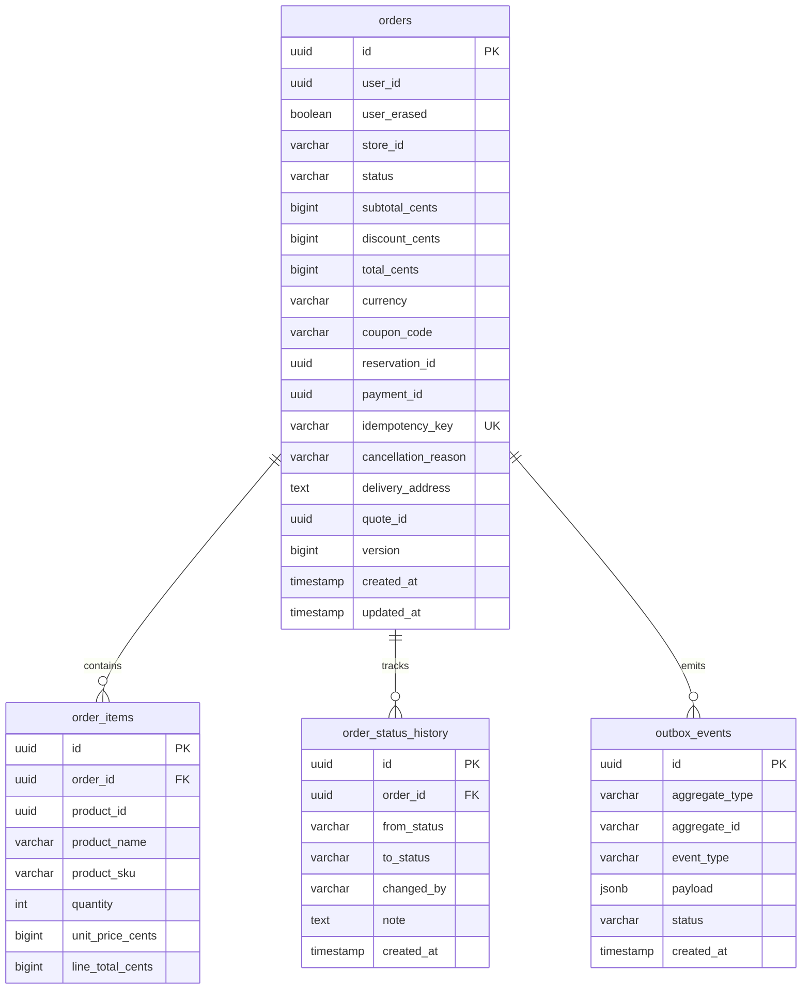
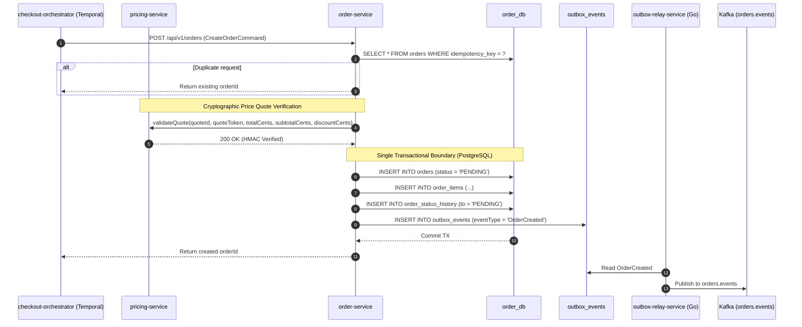
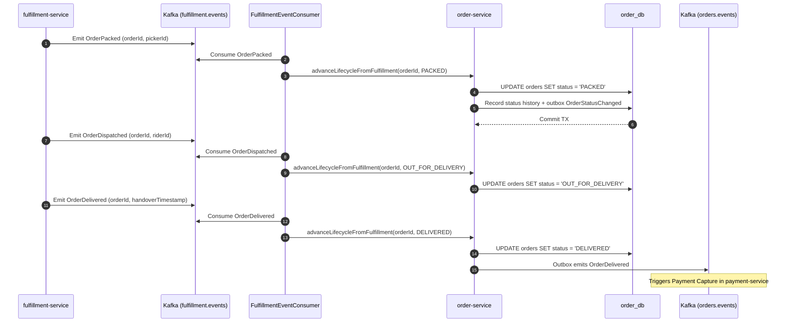

# InstaCommerce Order Lifecycle & State Machine Architecture

> **Repository:** `InstaCommerce` Monorepo  
> **Source of Truth:** [`services/order-service`](file:///Users/omkarkumar/InstaCommerce/services/order-service), [`OrderStateMachine.java`](file:///Users/omkarkumar/InstaCommerce/services/order-service/src/main/java/com/instacommerce/order/domain/statemachine/OrderStateMachine.java), [`OrderService.java`](file:///Users/omkarkumar/InstaCommerce/services/order-service/src/main/java/com/instacommerce/order/service/OrderService.java), and [`FulfillmentEventConsumer.java`](file:///Users/omkarkumar/InstaCommerce/services/order-service/src/main/java/com/instacommerce/order/consumer/FulfillmentEventConsumer.java).

---

## 1. Domain Overview

In a hyper-local 10–15 minute Quick Commerce model, the order lifecycle is aggressively time-compressed. From customer checkout submission to physical doorstep handover, state transitions occur within seconds and minutes across multiple independent subsystems (orchestration, dark-store warehouse picking, rider dispatch, and payment capture).

[`services/order-service`](file:///Users/omkarkumar/InstaCommerce/services/order-service) acts as the **Aggregate Root and System of Record** for the customer order. It enforces strict state machine invariants, manages optimistic locking, records append-only status progression histories, and emits transactional outbox events to Kafka.

---

## 2. Order State Machine Specification

The state machine is formally governed by [`com.instacommerce.order.domain.statemachine.OrderStateMachine`](file:///Users/omkarkumar/InstaCommerce/services/order-service/src/main/java/com/instacommerce/order/domain/statemachine/OrderStateMachine.java). Any state transition not explicitly declared in `TRANSITIONS` throws an `InvalidOrderStateException`.



### Transition Invariants & Guard Rules

| From State | Allowed Target States | Trigger Actor / Source | Business Invariant & Guard Condition |
|---|---|---|---|
| **`PENDING`** | `PLACED`, `FAILED`, `CANCELLED` | `checkout-orchestrator-service` | Initial ephemeral state created during checkout saga execution before final confirmation. |
| **`PLACED`** | `PACKING`, `CANCELLED` | `fulfillment-service` or Customer | Dark store receives order. **Customer cancellation is permitted** at this stage without fees. |
| **`PACKING`** | `PACKED`, `CANCELLED` | Dark Store Picker App / Ops | Picker begins picking physical items. **Customer cancellation is strictly blocked** (`InvalidOrderStateException`). |
| **`PACKED`** | `OUT_FOR_DELIVERY`, `CANCELLED` | Gig Delivery Rider App | Bag is sealed and placed in dispatch staging rack. Ops can still cancel if dark store closes or rider unavailable. |
| **`OUT_FOR_DELIVERY`** | `DELIVERED` | Delivery Rider App / GPS | Rider is in transit to customer. **Cancellation is prohibited**; the only valid progression is `DELIVERED`. |
| **`DELIVERED`** | *(Terminal)* | Delivery Rider App | Customer confirms handover. Triggers automated payment capture and loyalty cashback credits. |
| **`CANCELLED`** | *(Terminal)* | Customer / Ops / System | Emits `OrderCancelled` outbox event, releasing stock and voiding/refunding payments. |
| **`FAILED`** | *(Terminal)* | Checkout Saga Compensation | Occurs if saga aborts prior to order placement. Stock lock released. |

---

## 3. Domain Model & Database Schema

The order persistence model is isolated in PostgreSQL [`order_db`](file:///Users/omkarkumar/InstaCommerce/scripts/init-dbs.sql#L4), managed via Flyway migrations:



### Key Entity Features:
1. **Optimistic Locking:** The `@Version` field on [`Order.java`](file:///Users/omkarkumar/InstaCommerce/services/order-service/src/main/java/com/instacommerce/order/domain/model/Order.java#L117) prevents concurrent race conditions between picker status updates and customer cancellations.
2. **Idempotency Guarantee:** Unique constraint on `idempotency_key` ensures that network retries from the checkout orchestrator return the existing order without creating duplicate records.
3. **Audit Trail:** Every status mutation writes an immutable record to `order_status_history`, capturing `from_status`, `to_status`, `changed_by`, and timestamps.

---

## 4. End-to-End Order Creation Flow

Orders are instantiated strictly via the distributed **Temporal Checkout Saga**:



---

## 5. Asynchronous Lifecycle Progression (Choreography)

Once an order is created, its lifecycle advances asynchronously through events consumed from Kafka by [`FulfillmentEventConsumer.java`](file:///Users/omkarkumar/InstaCommerce/services/order-service/src/main/java/com/instacommerce/order/consumer/FulfillmentEventConsumer.java):



---

## 6. Order Cancellation & Compensation Logic

### 6.1 Customer-Initiated Cancellation
Customers can cancel an active order via `POST /api/v1/orders/{orderId}/cancel`:
- **Allowed States:** Only `PENDING` and `PLACED`.
- **Rejected States:** If the order is in `PACKING`, `PACKED`, or `OUT_FOR_DELIVERY`, the request is rejected with HTTP 400 Bad Request:
  ```json
  {
    "error": "INVALID_STATE",
    "message": "User cancellation is only allowed before packing starts."
  }
  ```

### 6.2 Ops / System-Initiated Cancellation
Internal support agents and automated failure monitors can cancel orders up until `PACKED` state (e.g. store power outage, extreme weather). Once an order transitions to `OUT_FOR_DELIVERY`, cancellation is strictly disabled across all interfaces.

### 6.3 Downstream Compensation Propagation
Upon successful cancellation, `order-service` writes an `OrderCancelled` event to its transactional outbox. Once published to `orders.events`:
1. [`services/inventory-service`](file:///Users/omkarkumar/InstaCommerce/services/inventory-service) consumes `OrderCancelled` and releases physical reservation locks.
2. [`services/payment-service`](file:///Users/omkarkumar/InstaCommerce/services/payment-service) consumes `OrderCancelled` and executes a void or refund against the pre-authorized PSP charge.
3. [`services/notification-service`](file:///Users/omkarkumar/InstaCommerce/services/notification-service) dispatches a push notification and SMS to the customer.

---

## 7. Data Privacy & GDPR Erasure (`IdentityEventConsumer`)

When a user exercises their GDPR Right-to-Erasure, [`IdentityEventConsumer.java`](file:///Users/omkarkumar/InstaCommerce/services/order-service/src/main/java/com/instacommerce/order/consumer/IdentityEventConsumer.java) intercepts the `UserErased` event on topic `identity.events`:

1. **Scrubbing Delivery PII:** Delivery street addresses, recipient phone numbers, and delivery notes are permanently anonymized.
2. **Retaining Audit Integrity:** Order amounts, transaction totals, and financial items are preserved (`user_erased = true`) to satisfy statutory tax, audit, and commercial accounting regulations.

---

## 8. REST API Reference

| Method | Endpoint | Authorization | Description |
|---|---|---|---|
| `POST` | `/api/v1/orders` | `ROLE_INTERNAL_SERVICE` | Called by Checkout Orchestrator Saga to create an order. |
| `GET` | `/api/v1/orders/{orderId}` | `ROLE_USER`, `ROLE_ADMIN` | Retrieves order details, items, and status progression history. |
| `GET` | `/api/v1/orders/{orderId}/status` | `ROLE_USER`, `ROLE_ADMIN` | Lightweight endpoint for mobile polling and tracking widgets. |
| `GET` | `/api/v1/orders` | `ROLE_USER` | Paginated listing of the authenticated user's order history. |
| `POST` | `/api/v1/orders/{orderId}/cancel` | `ROLE_USER` | Customer cancellation endpoint (allowed only before packing). |
| `PUT` | `/api/v1/orders/{orderId}/status` | `ROLE_ADMIN` | Operational override for dark-store supervisors. |
