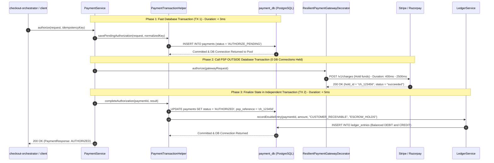
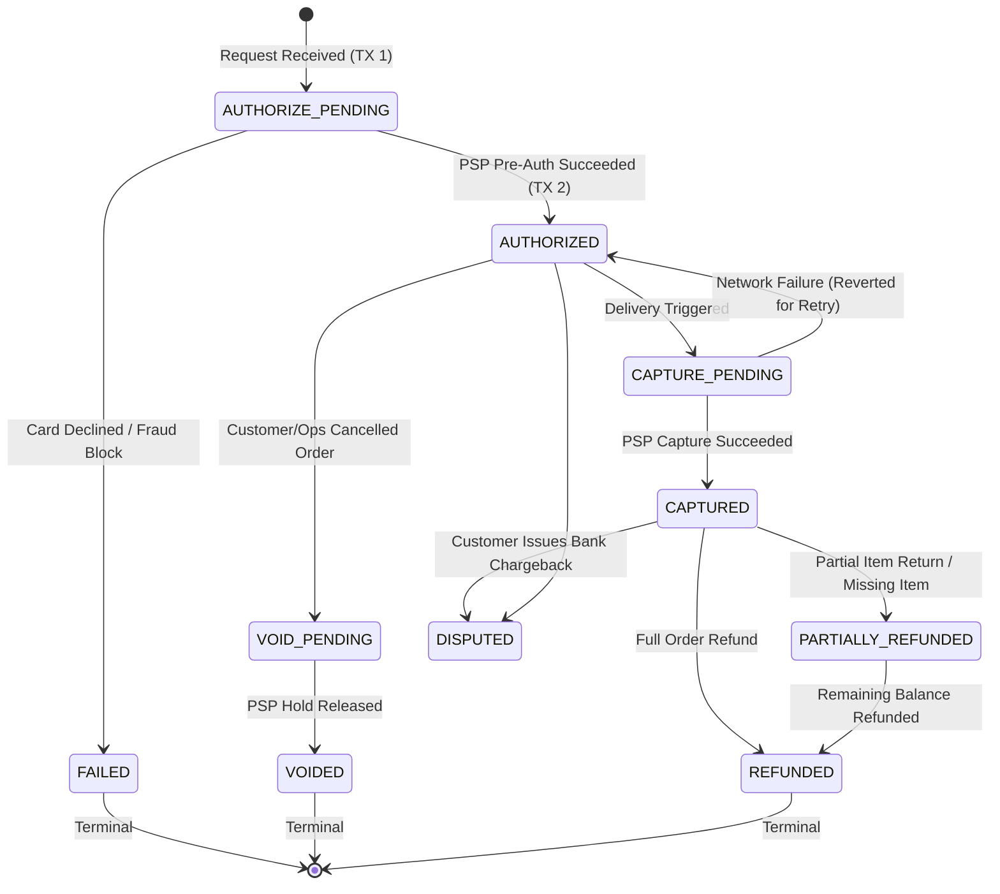
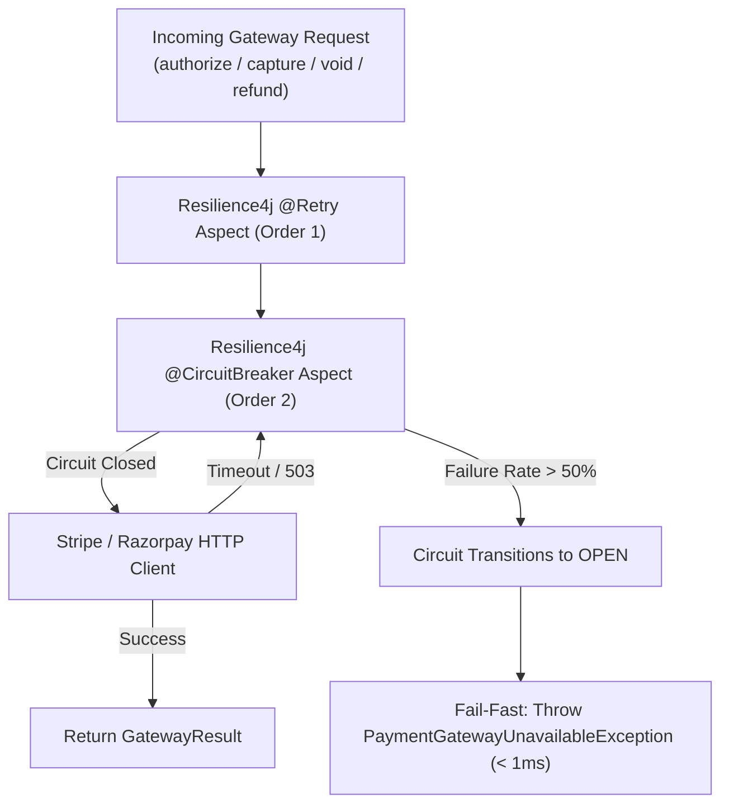
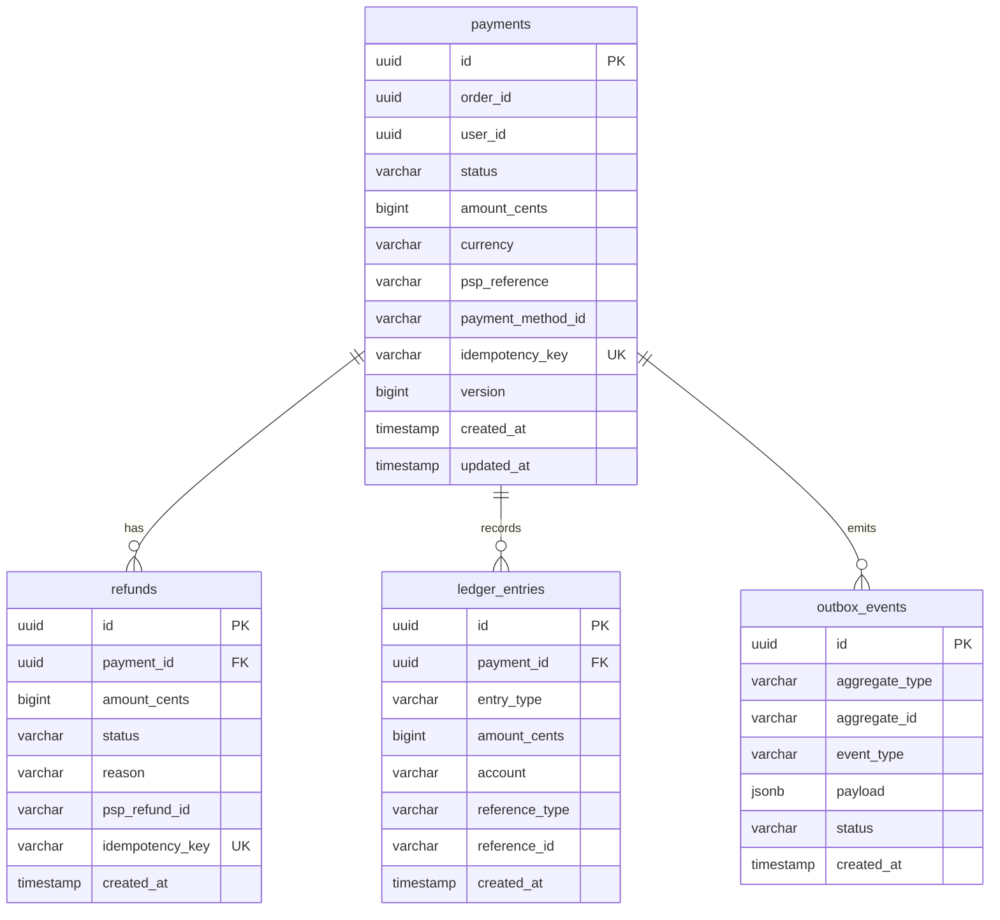

# InstaCommerce Payment System & Double-Entry Ledger Architecture

> **Repository:** `InstaCommerce` Monorepo  
> **Source of Truth:** [`services/payment-service`](file:///Users/omkarkumar/InstaCommerce/services/payment-service), [`PaymentService.java`](file:///Users/omkarkumar/InstaCommerce/services/payment-service/src/main/java/com/instacommerce/payment/service/PaymentService.java), [`PaymentTransactionHelper.java`](file:///Users/omkarkumar/InstaCommerce/services/payment-service/src/main/java/com/instacommerce/payment/service/PaymentTransactionHelper.java), [`LedgerService.java`](file:///Users/omkarkumar/InstaCommerce/services/payment-service/src/main/java/com/instacommerce/payment/service/LedgerService.java), [`RefundService.java`](file:///Users/omkarkumar/InstaCommerce/services/payment-service/src/main/java/com/instacommerce/payment/service/RefundService.java), and [`ResilientPaymentGatewayDecorator.java`](file:///Users/omkarkumar/InstaCommerce/services/payment-service/src/main/java/com/instacommerce/payment/gateway/ResilientPaymentGatewayDecorator.java).

---

## 1. Domain & Business Requirements

In Quick Commerce, payments follow a **Two-Phase Settlement Lifecycle**:
1. **Phase 1: Authorization on Checkout (Hold Funds):** When the customer submits checkout, funds are pre-authorized (card hold or UPI pre-debit). Funds are not captured immediately because items might be out of stock in the dark store, or the customer might cancel before picking.
2. **Phase 2: Capture on Handover (Settle Funds):** Once the order is packed and confirmed for physical delivery, the pre-authorized amount is captured. If the order is cancelled before packing, the authorization hold is voided at zero processing cost.

[`services/payment-service`](file:///Users/omkarkumar/InstaCommerce/services/payment-service) manages card authorizations, captures, voids, refunds, double-entry financial ledger accounting, and external PSP communication (Stripe, Razorpay) with sub-15ms internal latency.

---

## 2. Core Architectural Pattern: The Three-Phase PSP Pattern

### ⚠️ The Anti-Pattern: External Network Calls Inside Database Transactions
Wrapping external PSP HTTP calls inside a Spring `@Transactional` method is a catastrophic failure mode in payment architectures:
```java
// DANGEROUS ANTI-PATTERN: NEVER DO THIS
@Transactional
public PaymentResponse authorize(AuthorizeRequest req) {
    Payment p = paymentRepo.save(pending);  // Acquires DB connection & row lock
    PspResult res = stripeClient.charge();  // Latency: 1.5s - 5.0s (holds DB connection!)
    p.setStatus(res.status());
    return paymentRepo.save(p);             // Releases DB connection
}
```
If the external PSP experiences elevated latency or packet loss, active HikariCP connection pool threads become starved, exhausting PostgreSQL connections and causing total platform failure across all unrelated services.

### The InstaCommerce Solution: The Three-Phase Pattern
In [`PaymentService.java`](file:///Users/omkarkumar/InstaCommerce/services/payment-service/src/main/java/com/instacommerce/payment/service/PaymentService.java) and [`PaymentTransactionHelper.java`](file:///Users/omkarkumar/InstaCommerce/services/payment-service/src/main/java/com/instacommerce/payment/service/PaymentTransactionHelper.java), every gateway interaction strictly separates database transactions from external HTTP I/O:



---

## 3. Payment State Machine Specification

Governed by [`com.instacommerce.payment.domain.model.PaymentStatus`](file:///Users/omkarkumar/InstaCommerce/services/payment-service/src/main/java/com/instacommerce/payment/domain/model/PaymentStatus.java):



### State Definitions & Financial Semantics:
- **`AUTHORIZE_PENDING`:** Temporary row indicating an in-flight network call to the gateway.
- **`AUTHORIZED`:** Customer credit limit or balance locked by the issuing bank; zero cash movement has occurred.
- **`CAPTURE_PENDING`:** Capture request sent to PSP; intermediate transient state.
- **`CAPTURED`:** Funds officially settled and debited into InstaCommerce merchant accounts.
- **`VOID_PENDING` / `VOIDED`:** Authorization hold released without processing fees.
- **`PARTIALLY_REFUNDED` / `REFUNDED`:** Funds returned to customer following physical return or missing item claims.
- **`DISPUTED`:** Customer filed an unauthorized charge dispute with their credit card network.

---

## 4. Double-Entry Financial Ledger (`LedgerService`)

To maintain audit compliance, regulatory transparency, and fraud detection accuracy, every financial mutation creates immutable, balanced ledger records via [`LedgerService.java`](file:///Users/omkarkumar/InstaCommerce/services/payment-service/src/main/java/com/instacommerce/payment/service/LedgerService.java).

### 4.1 Double-Entry Principles
Money cannot appear or disappear; every transaction must record equal and opposite entries:
$$\sum \text{Debit} - \sum \text{Credit} = 0$$

| Business Event | Debit Account | Credit Account | Financial Meaning |
|---|---|---|---|
| **Payment Authorized** | `CUSTOMER_RECEIVABLE` | `ESCROW_HOLDS` | Customer funds reserved in escrow hold. |
| **Payment Captured** | `ESCROW_HOLDS` | `MERCHANT_REVENUE` | Escrow released; recognized as platform revenue. |
| **Payment Voided** | `ESCROW_HOLDS` | `CUSTOMER_RECEIVABLE` | Pre-auth hold cancelled; receivable eliminated. |
| **Refund Issued** | `MERCHANT_REVENUE` | `CUSTOMER_REFUND_PAYABLE` | Revenue reduced; credit payable to customer. |

### 4.2 Application & Database Ledger Deduplication
To guarantee that retried saga calls or network redeliveries never duplicate accounting balances:
1. **Application-Level Pre-Check:**
   ```java
   if (ledgerEntryRepository.existsByPaymentIdAndReferenceTypeAndReferenceId(paymentId, refType, refId)) {
       log.warn("Ledger dedup: skipping duplicate double-entry for payment={}", paymentId);
       return Collections.emptyList();
   }
   ```
2. **Partial Unique Index Safety Net (`V14__add_ledger_dedup_index.sql`):**
   A database-level unique constraint (`idx_ledger_entries_dedup`) on `(payment_id, reference_type, reference_id)` prevents concurrent race conditions.
3. **Transaction Isolation (`PROPAGATION_REQUIRES_NEW`):**
   Ledger writes run inside an isolated `TransactionTemplate` with `REQUIRES_NEW`. If a concurrent duplicate insert hits the unique constraint, the `DataIntegrityViolationException` is caught gracefully as an idempotent no-op without rolling back the parent business transaction.

---

## 5. Gateway Resilience & Circuit Breakers

External communication with Stripe/Razorpay is wrapped by [`ResilientPaymentGatewayDecorator.java`](file:///Users/omkarkumar/InstaCommerce/services/payment-service/src/main/java/com/instacommerce/payment/gateway/ResilientPaymentGatewayDecorator.java):



### Configuration Details:
- **Retry Aspect Ordering:** `Retry` (order 1) wraps `CircuitBreaker` (order 2), ensuring retried attempts cleanly re-evaluate circuit breaker state.
- **Fail-Fast Protection:** When Stripe suffers upstream outages, open circuit breakers reject subsequent calls immediately without stalling the worker threads.
- **Timeout Delegation:** Socket connect and read timeouts are delegated to the underlying HTTP client (`stripe.connect-timeout-ms = 2000`, `stripe.read-timeout-ms = 5000`).

---

## 6. Asynchronous Webhooks & Reconciliation

### 6.1 Edge Webhook Ingestion (`payment-webhook-service`)
Webhooks from Stripe and Razorpay arrive over the public internet at the Go-based [`services/payment-webhook-service`](file:///Users/omkarkumar/InstaCommerce/services/payment-webhook-service):
1. **HMAC Signature Check:** Validates `Stripe-Signature` against the configured secret key.
2. **Timestamp Replay Window:** Rejects webhooks with timestamps older than 300 seconds (`defaultSignatureTolerance = 300`).
3. **Redis Deduplication:** Records `webhook:dedupe:{eventId}` in Redis with 24-hour TTL (`86400s`).
4. **Kafka Publishing:** Enqueues validated events to `payments.events` and acknowledges HTTP 200 OK to the PSP in under 10ms.

### 6.2 Financial Reconciliation (`reconciliation-engine`)
The Go-based [`services/reconciliation-engine`](file:///Users/omkarkumar/InstaCommerce/services/reconciliation-engine) executes scheduled batch audits:
- Fetches bank settlement reports (CSV/JSON) via SFTP/API.
- Matches external settlement records against internal `ledger_entries` in `payment_db`.
- Detects discrepancies (unmatched charges, fee variations, missing captures) and emits alert events on `reconciliation.events`.

---

## 7. Database Persistence & Migrations (`payment_db`)

The payment database is isolated in PostgreSQL [`payment_db`](file:///Users/omkarkumar/InstaCommerce/scripts/init-dbs.sql#L5) with 19 Flyway migrations:



---

## 8. REST API Reference

| Method | Endpoint | Authorization | Description |
|---|---|---|---|
| `POST` | `/api/v1/payments/authorize` | `ROLE_INTERNAL_SERVICE` | Pre-authorizes customer card or UPI hold during checkout saga. |
| `POST` | `/api/v1/payments/{paymentId}/capture` | `ROLE_INTERNAL_SERVICE` | Settle pre-authorized funds on delivery confirmation. |
| `POST` | `/api/v1/payments/{paymentId}/void` | `ROLE_INTERNAL_SERVICE` | Releases pre-auth hold upon order cancellation. |
| `POST` | `/api/v1/payments/{paymentId}/refund` | `ROLE_ADMIN`, `ROLE_INTERNAL_SERVICE` | Issues partial or full refund with double-entry ledger adjustment. |
| `GET` | `/api/v1/payments/{paymentId}` | `ROLE_USER`, `ROLE_ADMIN` | Fetches payment details and ledger transaction history. |
