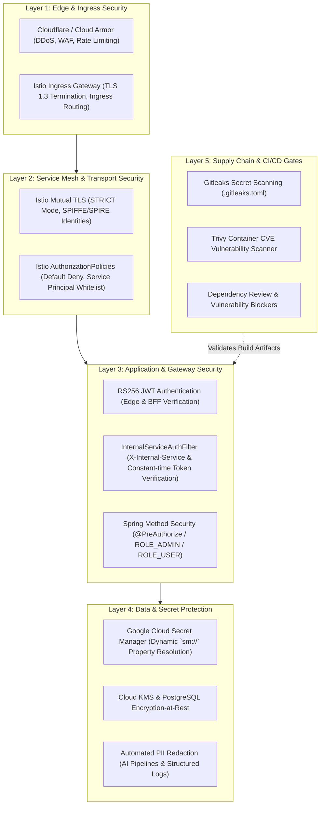
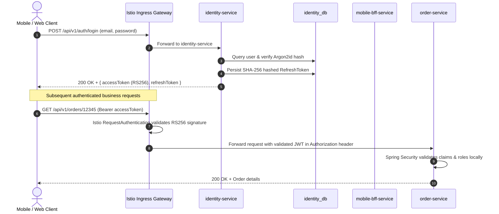
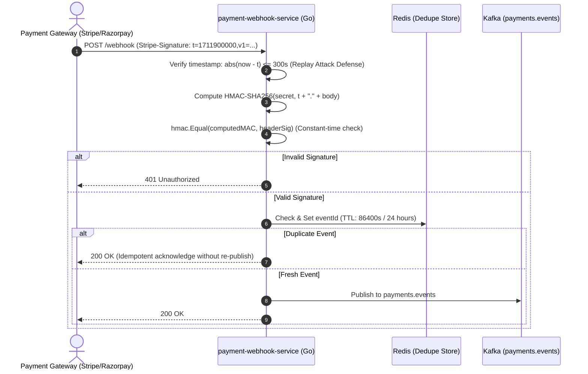
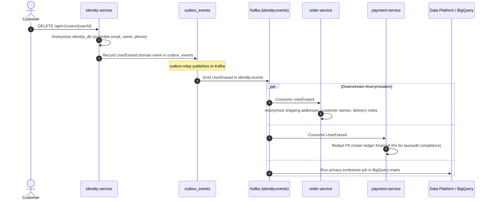

# InstaCommerce Security Architecture & Hardening Guide

> **Repository:** `InstaCommerce` Monorepo  
> **Source of Truth:** `services/identity-service/`, `services/order-service/src/main/java/com/instacommerce/order/security/`, `services/admin-gateway-service/`, `services/payment-webhook-service/`, `deploy/helm/values.yaml`, and `.gitleaks.toml`.

---

## 1. Overview & Defense-in-Depth Strategy

InstaCommerce implements a multi-layered **Defense-in-Depth** security posture designed for high-concurrency quick-commerce operations. No single defense mechanism is trusted exclusively; security boundaries are enforced across five distinct layers:



---

## 2. Identity & Authentication Primitives

The core identity provider is [`services/identity-service`](file:///Users/omkarkumar/InstaCommerce/services/identity-service), which acts as the centralized authority for user registration, authentication, credential validation, and cryptographic token issuance.

### 2.1 Credential Storage & Hashing
- Passwords are never stored in plaintext. They are salted and hashed using **Argon2id** (memory cost: 65536 KB, iterations: 3, parallelism: 1) with automatic fallback verification for legacy BCrypt hashes.
- Account lockout protections (`V8__add_lockout_and_fix_inet.sql`) automatically lock accounts after 5 consecutive failed login attempts within a 15-minute window.

### 2.2 Asymmetric Token Lifecycle (RS256)
Authentication relies on asymmetric RSA (2048-bit keypair) JWT tokens:
1. **Access Tokens:**
   - **Lifetime:** 15 minutes (`900s`).
   - **Algorithm:** `RS256` signed by `identity-service`'s private key.
   - **Claims:** `sub` (userId UUID), `email`, `roles` (`ROLE_USER`, `ROLE_ADMIN`, `ROLE_RIDER`), `iss` (`instacommerce-identity`), `exp`, `iat`.
   - **Verification:** Services verify signatures locally using the public key published at `/.well-known/jwks.json`, eliminating synchronous network calls to `identity-service` on every request.
2. **Refresh Tokens:**
   - **Lifetime:** 7 days (`604800s`).
   - **Storage:** Stored in the `refresh_tokens` table in `identity_db`. Only the SHA-256 digest of the token is persisted to prevent token compromise if the database is breached.
   - **Rotation:** Every refresh token exchange revokes the old token and issues a new paired access/refresh token.

### 2.3 JWT Authentication Flow



---

## 3. Internal Service-to-Service Authentication

Communication between internal microservices uses dual-layered defense: **Network Mesh mTLS** combined with **Application-Level Shared Secret Tokens**.

### 3.1 Istio STRICT Mutual TLS
In the Kubernetes cluster, all pod-to-pod network traffic is intercepted by Envoy sidecars. Istio enforces strict mTLS using SPIFFE/SPIRE identities:

```yaml
# deploy/helm/templates/peer-authentication.yaml
apiVersion: security.istio.io/v1beta1
kind: PeerAuthentication
metadata:
  name: default
  namespace: instacommerce
spec:
  mtls:
    mode: STRICT
```

### 3.2 Application-Level Defense: `InternalServiceAuthFilter`
Even with mTLS in place, each Spring Boot microservice enforces application-level caller authentication via [`InternalServiceAuthFilter`](file:///Users/omkarkumar/InstaCommerce/services/identity-service/src/main/java/com/instacommerce/identity/security/InternalServiceAuthFilter.java). This mitigates risks in the event of pod compromise within the mesh.

#### Key Mechanics:
1. **Headers:** Callers must supply:
   - `X-Internal-Service`: Canonical caller service name (e.g., `checkout-orchestrator-service`).
   - `X-Internal-Token`: Secret credential.
2. **Per-Service Token Precedence (ADR-010):**
   - The system checks `internal.service.allowed-callers` mapping first.
   - If a specific token exists for the caller, it is validated.
   - Falls back to `internal.service.token` for migration compatibility.
3. **Timing-Attack Resistance:**
   Token comparison is executed using `MessageDigest.isEqual()` constant-time byte comparison:
   ```java
   boolean isValid = MessageDigest.isEqual(
       perServiceToken.getBytes(StandardCharsets.UTF_8),
       token.getBytes(StandardCharsets.UTF_8)
   );
   ```
4. **Security Context Propagation:**
   Upon successful validation, the filter injects `ROLE_INTERNAL_SERVICE` into the `SecurityContextHolder`, allowing internal API access.

---

## 4. Authorization & Network Isolation

### 4.1 Istio AuthorizationPolicies (Default Deny)
The platform enforces a **Default Deny** ingress posture. Microservices can only receive incoming HTTP/gRPC calls from explicitly whitelisted caller service accounts.

```mermaid
flowchart LR
    Ingress["istio-ingressgateway"] -->|Allowed| BFF["mobile-bff-service"]
    Ingress -->|Allowed| AdminGW["admin-gateway-service"]
    Ingress -.->|DENIED (403)| Order["order-service"]

    BFF -->|Allowed| Checkout["checkout-orchestrator"]
    Checkout -->|Allowed| Order
    Checkout -->|Allowed| Inventory["inventory-service"]
    Checkout -->|Allowed| Payment["payment-service"]

    Inventory -.->|DENIED (403)| Payment
```

```yaml
# deploy/helm/values.yaml snippet
authorizationPolicies:
  - name: payment-service-internal
    selector:
      app: payment-service
    principals:
      - cluster.local/ns/instacommerce/sa/order-service
      - cluster.local/ns/instacommerce/sa/fulfillment-service
      - cluster.local/ns/instacommerce/sa/checkout-orchestrator-service

denyDefault:
  enabled: true
```

### 4.2 Application Role-Based Access Control (RBAC)
Endpoints are governed by Spring Boot method security and request matchers:

| Role | Target Persona | Accessible Path Prefixes |
|---|---|---|
| `ROLE_USER` | Authenticated Mobile / Web Shopper | `/api/v1/orders/**`, `/api/v1/cart/**`, `/api/v1/wallet/**` |
| `ROLE_ADMIN` | Dark Store Operations & Platform Admins | `/admin/v1/**` (via `admin-gateway-service`) |
| `ROLE_RIDER` | Gig Delivery Fleet Partners | `/api/v1/riders/**`, `/api/v1/deliveries/**` |
| `ROLE_INTERNAL_SERVICE` | Microservices orchestrating cross-domain flows | `/internal/v1/**`, `/api/v1/payments/authorize`, `/api/v1/inventory/reserve` |

```java
// Spring Security 6+ SecurityFilterChain configuration
@Bean
public SecurityFilterChain securityFilterChain(HttpSecurity http,
                                               JwtAuthenticationFilter jwtFilter,
                                               InternalServiceAuthFilter internalFilter) throws Exception {
    return http
        .csrf(csrf -> csrf.disable())
        .sessionManagement(sm -> sm.sessionCreationPolicy(SessionCreationPolicy.STATELESS))
        .authorizeHttpRequests(auth -> auth
            .requestMatchers("/actuator/health/**", "/.well-known/**").permitAll()
            .requestMatchers("/admin/v1/**").hasRole("ADMIN")
            .requestMatchers("/internal/**").hasRole("INTERNAL_SERVICE")
            .anyRequest().authenticated()
        )
        .addFilterBefore(internalFilter, UsernamePasswordAuthenticationFilter.class)
        .addFilterBefore(jwtFilter, UsernamePasswordAuthenticationFilter.class)
        .build();
}
```

---

## 5. Webhook Security & Signature Verification

Third-party webhooks (e.g., Stripe, Razorpay) enter via [`services/payment-webhook-service`](file:///Users/omkarkumar/InstaCommerce/services/payment-webhook-service). Because webhooks originate over the public internet, they must be rigorously defended against spoofing and replay attacks.



### Signature Verification Parameters:
- **Header:** `Stripe-Signature` (containing unix timestamp `t` and hex signature `v1`).
- **Replay Window:** 300 seconds (`defaultSignatureTolerance = 300`). Payloads older than 5 minutes are rejected immediately.
- **Deduplication:** Redis key `webhook:dedupe:{eventId}` with a 24-hour TTL (`86400s`).
- **Body Protection:** Enforces `defaultMaxBodyBytes = 1 << 20` (1 MB) to prevent denial-of-service memory exhaustion.

---

## 6. Secret Management & Infrastructure Hardening

### 6.1 Google Cloud Secret Manager Integration
No secrets, API keys, private keys, or database credentials are checked into Git or stored as plain Kubernetes environment variables.
- Spring Boot applications utilize `com.google.cloud:spring-cloud-gcp-starter-secretmanager:6.0.0`.
- Credentials in `application.yml` use dynamic GCP Secret Manager references:
  ```yaml
  spring:
    datasource:
      password: ${sm://db-password-order:${ORDER_DB_PASSWORD}}
  checkout:
    jwt:
      public-key: ${sm://jwt-rsa-public-key:${CHECKOUT_JWT_PUBLIC_KEY}}
  ```
- Kubernetes pods authenticate to GCP Secret Manager transparently via **Workload Identity**, mapping the Kubernetes Service Account (`KSA`) to a Google Cloud Service Account (`GSA`) with minimal IAM read permissions.

### 6.2 Secret Scanning via Gitleaks
To guarantee that credentials are never committed, CI runs **Gitleaks** against every commit and pull request:
- **Configuration:** [`.gitleaks.toml`](file:///Users/omkarkumar/InstaCommerce/.gitleaks.toml).
- **Rule Set:** Generic API keys, private keys, GCP service account JSONs, and JWT secrets.
- **Allowlist:** Strictly scoped to documentation placeholder examples.

---

## 7. Data Privacy & GDPR / CCPA Compliance

InstaCommerce complies with data privacy regulations including GDPR Right-to-Erasure ("Right to be Forgotten"):



### PII Protection in AI Pipelines:
The [`ai-orchestrator-service`](file:///Users/omkarkumar/InstaCommerce/services/ai-orchestrator-service/app/main.py) incorporates a built-in `PiiRedactor` that scrubs email addresses, Social Security Numbers, credit card numbers, and phone numbers before logging or forwarding payloads to third-party Large Language Model providers.

---

## 8. CI/CD Security Gates & Supply Chain Protection

The GitHub Actions workflow [`.github/workflows/ci.yml`](file:///Users/omkarkumar/InstaCommerce/.github/workflows/ci.yml) enforces mandatory security and supply-chain gates on every pull request prior to merge:

1. **Gitleaks Secret Scan (`security-scan`):**
   Fails the pipeline if any pattern matching known secret token structures, private keys, or API tokens is detected in git commits or diffs (configured via [`.gitleaks.toml`](file:///Users/omkarkumar/InstaCommerce/.gitleaks.toml)).
2. **Filesystem Vulnerability Scanning (`Trivy`):**
   Runs `aquasecurity/trivy-action` across the repository filesystem (`scan-type: fs`) targeting `CRITICAL` and `HIGH` severity vulnerabilities in third-party libraries and OS layers.
3. **Dependency Review Action (`dependency-review`):**
   Inspects PR dependency graph diffs across Gradle dependencies, Go modules (`go.sum`), and Python `requirements.txt` to block newly introduced dependencies with known security advisories.
4. **Contract & Schema Validation (`contract-validation`):**
   Validates all JSON event schemas under `contracts/src/main/resources/schemas/` are well-formed and executes automated diff checks against `contracts/src/main/proto/` to alert on breaking Protobuf field removals or type changes.
