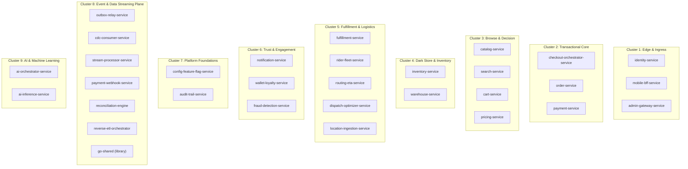

# InstaCommerce Comprehensive Service Catalog

> **Repository:** `InstaCommerce` Monorepo  
> **Source of Truth:** `settings.gradle.kts`, `services/*/go.mod`, `services/ai-*/requirements.txt`, `.github/workflows/ci.yml`, and `scripts/init-dbs.sql`.  
> **Total Services:** 30 Microservices + 1 Shared Library (`go-shared`)

---

## Service Cluster Map

---

## Detailed Service Specifications

---

### Cluster 1: Edge & Ingress

#### 1. `identity-service`
- **Language / Runtime:** Java 21 / Spring Boot 4.0.0
- **Module Path:** `:services:identity-service`
- **Default Port:** `8080`
- **Database:** PostgreSQL (`identity_db`) — 11 Flyway migrations
- **Status:** ✅ Active
- **Domain Purpose:** Central identity and authentication provider for customers, dark-store operators, riders, and administrators.
- **Key Entities / Models:** `User`, `Role`, `RefreshToken`, `UserAuditLog`, `OutboxEvent`
- **Key Endpoints:**
  - `POST /api/v1/auth/register` — Account creation
  - `POST /api/v1/auth/login` — Issues RS256 JWT access token and refresh token
  - `POST /api/v1/auth/refresh` — Token rotation
  - `DELETE /api/v1/users/{userId}` — Triggers GDPR right-to-erasure flow (`UserErased` event)
- **Kafka Topics:** Produces `identity.events` (events: `UserCreated`, `UserErased`, `UserSuspended`)
- **Notable Patterns:** RS256 JWT signing, password hashing via Argon2id/BCrypt, transactional outbox for user lifecycle events.

#### 2. `mobile-bff-service`
- **Language / Runtime:** Java 21 / Spring Boot 4.0.0
- **Module Path:** `:services:mobile-bff-service`
- **Default Port:** `8097` (Local `application.yml` and K8s containerPort)
- **Database:** Stateless (Caffeine local caching)
- **Status:** 🟡 Active Scaffold (Reactive WebFlux endpoints with resilience decorators)
- **Domain Purpose:** Backend-for-Frontend tailored for mobile iOS/Android apps. Orchestrates batch API calls to minimize mobile network roundtrips.
- **Key Endpoints:**
  - `GET /bff/mobile/v1/home` — Aggregates featured products, active banners, open store status, user cart snippet
  - `GET /m/v1/home` — Compact mobile home alias
- **Security:** Ingress rate limiting and JWT validation via Istio gateway.

#### 3. `admin-gateway-service`
- **Language / Runtime:** Java 21 / Spring Boot 4.0.0
- **Module Path:** `:services:admin-gateway-service`
- **Default Port:** `8099` (Local `application.yml`; `8080` in K8s)
- **Database:** Stateless
- **Status:** 🟡 Active Scaffold (Has comprehensive security & test coverage ~44%)
- **Domain Purpose:** Dedicated gateway for internal dark-store portal and executive admin consoles.
- **Key Endpoints:**
  - `/admin/v1/**` — Administrative routes secured by `ROLE_ADMIN`
  - `/actuator/**`, `/admin/health`, `/admin/metrics` — Unauthenticated health & telemetry probes
- **Security:** Strict Spring Security filters verifying `ROLE_ADMIN` JWT claims signed by identity provider (`instacommerce-admin` audience).

---

### Cluster 2: Transactional Core

#### 4. `checkout-orchestrator-service`
- **Language / Runtime:** Java 21 / Spring Boot 4.0.0
- **Module Path:** `:services:checkout-orchestrator-service`
- **Default Port:** `8089` (Local `application.yml`; `8080` in K8s)
- **Datastore:** PostgreSQL (`checkout` / `checkout_db`) for idempotency tables; connects to Temporal Cluster (port `7233`)
- **Status:** ✅ Active
- **Domain Purpose:** Distributed saga coordinator ensuring end-to-end atomic checkout across six downstream services.
- **Key Workflow / Activities:**
  - `CheckoutWorkflowImpl`: Orchestrates cart validation, pricing calculation, inventory stock reservation, payment authorization, order creation, coupon redemption, and stock/payment confirmation.
  - Activities: `CartActivity`, `PricingActivity`, `InventoryActivity`, `PaymentActivity`, `OrderActivity`, `CouponActivity`.
- **Key Entities:** `CheckoutIdempotencyKey`
- **Key Endpoints:**
  - `POST /api/v1/checkout` — Initiates Temporal checkout saga with stable workflow ID
  - `GET /api/v1/checkout/{workflowId}` — Inspects real-time checkout saga execution status
- **Notable Patterns:** Workflow-stable idempotency keys derived from `workflowId`, pre-registered compensations, ShedLock for background cleanup.

#### 5. `order-service`
- **Language / Runtime:** Java 21 / Spring Boot 4.0.0
- **Module Path:** `:services:order-service`
- **Default Port:** `8080`
- **Database:** PostgreSQL (`order_db`)
- **Status:** ✅ Active
- **Domain Purpose:** Order aggregate root, lifecycle state machine, and order history repository.
- **Key Entities:** `Order`, `OrderItem`, `OrderStatusHistory`, `AuditLog`, `OutboxEvent`
- **Order States:** `PENDING` → `PLACED` → `PACKING` → `PACKED` → `OUT_FOR_DELIVERY` → `DELIVERED` (Terminals: `CANCELLED`, `FAILED`)
- **Key Endpoints:**
  - `POST /api/v1/orders` — Creates order record (called by Checkout Saga)
  - `GET /api/v1/orders/{orderId}` — Fetches order status & full progression history
  - `POST /api/v1/orders/{orderId}/cancel` — Customer/Ops initiated cancellation
  - `PUT /api/v1/orders/{orderId}/status` — Status update endpoint
- **Kafka Topics:** Consumes `fulfillment.events` (lifecycle advancement), `identity.events` (GDPR user erasure). Produces `orders.events` (`OrderCreated`, `OrderPlaced`, `OrderStatusChanged`, `OrderCancelled`, `OrderDelivered`).
- **Notable Patterns:** Outbox pattern, optimistic locking (`@Version`), quote token verification with pricing service.

#### 6. `payment-service`
- **Language / Runtime:** Java 21 / Spring Boot 4.0.0
- **Module Path:** `:services:payment-service`
- **Default Port:** `8080`
- **Database:** PostgreSQL (`payment_db`)
- **Status:** ✅ Active (Comprehensive test coverage ~43%)
- **Domain Purpose:** Manages payment authorization, two-phase capture on delivery, voids on cancellation, refunds, and double-entry ledger.
- **Key Entities:** `Payment`, `Refund`, `LedgerEntry`, `ProcessedWebhookEvent`, `OutboxEvent`, `AuditLog`
- **Key Endpoints:**
  - `POST /api/v1/payments/authorize` — Reserves funds with PSP
  - `POST /api/v1/payments/{paymentId}/capture` — Captures pre-authorized amount
  - `POST /api/v1/payments/{paymentId}/void` — Releases auth lock
  - `POST /api/v1/payments/{paymentId}/refund` — Processes full/partial refund
- **Kafka Topics:** Produces `payments.events` (`PaymentAuthorized`, `PaymentCaptured`, `PaymentVoided`, `PaymentRefunded`, `PaymentDisputed`).
- **Notable Patterns:** PSP calls performed strictly outside DB transactions (`PaymentTransactionHelper`), double-entry ledger bookkeeping, background stale state reconciliation jobs.

---

### Cluster 3: Browse & Decision

#### 7. `catalog-service`
- **Language / Runtime:** Java 21 / Spring Boot 4.0.0
- **Module Path:** `:services:catalog-service`
- **Default Port:** `8080`
- **Database:** PostgreSQL (`catalog_db`)
- **Status:** ✅ Active
- **Domain Purpose:** Maintains the global product taxonomy, SKU definitions, dark-store catalog mappings, and brand metadata.
- **Key Entities:** `Product`, `Category`, `Brand`, `StoreProductMapping`, `OutboxEvent`
- **Key Endpoints:**
  - `GET /api/v1/catalog/products/{sku}` — Product detail lookup
  - `GET /api/v1/catalog/categories` — Taxonomy tree retrieval
  - `POST /api/v1/catalog/products` — Admin SKU registration
- **Kafka Topics:** Produces `catalog.events` (`ProductCreated`, `ProductUpdated`).

#### 8. `search-service`
- **Language / Runtime:** Java 21 / Spring Boot 4.0.0
- **Module Path:** `:services:search-service`
- **Default Port:** `8086`
- **Datastore:** Elasticsearch 8 + PostgreSQL (`search_db`)
- **Status:** ✅ Active
- **Domain Purpose:** High-performance product discovery, autocomplete, typo-tolerance, and facet navigation.
- **Key Entities:** `SearchDocument`, `TrendingQuery`, `SearchAnalyticsLog`
- **Key Endpoints:**
  - `GET /api/v1/search?q={query}&storeId={storeId}` — Filtered & ranked product search
  - `GET /api/v1/search/autocomplete?q={prefix}` — Sub-15ms prefix completion
- **Kafka Topics:** Consumes `catalog.events` (updates indices) and `inventory.events` (availability weighting).

#### 9. `cart-service`
- **Language / Runtime:** Java 21 / Spring Boot 4.0.0
- **Module Path:** `:services:cart-service`
- **Default Port:** `8088`
- **Datastore:** Redis 7 (Primary session cache) + PostgreSQL (`cart_db`)
- **Status:** ✅ Active
- **Domain Purpose:** Manages ephemeral shopping cart state, item increments, and store affinity.
- **Key Entities:** `Cart`, `CartItem`, `OutboxEvent`
- **Key Endpoints:**
  - `GET /api/v1/cart` — Retrieves active user cart
  - `POST /api/v1/cart/items` — Adds item / adjusts quantity
  - `DELETE /api/v1/cart` — Flushes cart upon successful checkout
- **Kafka Topics:** Produces `cart.events` (`CartUpdated`, `CartAbandoned`).

#### 10. `pricing-service`
- **Language / Runtime:** Java 21 / Spring Boot 4.0.0
- **Module Path:** `:services:pricing-service`
- **Default Port:** `8087`
- **Database:** PostgreSQL (`pricing_db`)
- **Status:** ✅ Active
- **Domain Purpose:** Dynamic calculation of base price, surge, dynamic delivery fees, and coupon evaluation.
- **Key Entities:** `PriceQuote`, `Promotion`, `Coupon`, `CouponRedemption`
- **Key Endpoints:**
  - `POST /api/v1/pricing/quote` — Generates cryptographically signed price quote (`quoteToken`)
  - `POST /api/v1/pricing/coupons/redeem` — Validates and locks coupon usage
  - `POST /api/v1/pricing/coupons/unredeem` — Compensates coupon usage on saga abort

---

### Cluster 4: Dark Store & Inventory

#### 11. `inventory-service`
- **Language / Runtime:** Java 21 / Spring Boot 4.0.0
- **Module Path:** `:services:inventory-service`
- **Default Port:** `8080`
- **Database:** PostgreSQL (`inventory_db`)
- **Status:** ✅ Active
- **Domain Purpose:** Manages real-time stock levels per dark store, optimistic reservations, stock confirmations, and stock releases.
- **Key Entities:** `StockItem`, `Reservation`, `ReservationItem`, `OutboxEvent`
- **Key Endpoints:**
  - `POST /api/v1/inventory/reserve` — Two-phase reservation for checkout saga
  - `POST /api/v1/inventory/confirm/{reservationId}` — Finalizes stock decrement
  - `POST /api/v1/inventory/release/{reservationId}` — Reverses stock lock on checkout failure
- **Kafka Topics:** Produces `inventory.events` (`StockReserved`, `StockConfirmed`, `StockReleased`, `LowStockAlert`).

#### 12. `warehouse-service`
- **Language / Runtime:** Java 21 / Spring Boot 4.0.0
- **Module Path:** `:services:warehouse-service`
- **Default Port:** `8090`
- **Database:** PostgreSQL (`warehouse_db`)
- **Status:** ✅ Active
- **Domain Purpose:** Dark-store facility layout management, operating hours, zone mapping, and picking bin allocations.
- **Key Entities:** `StoreHours`, `StoreCapacity`, `StoreZone`, `BinLocation`
- **Key Endpoints:**
  - `GET /api/v1/warehouse/stores/{storeId}/capacity` — Checks real-time dark store picker load
  - `POST /api/v1/warehouse/bins` — Configures item shelf/bin locations

---

### Cluster 5: Fulfillment & Logistics

#### 13. `fulfillment-service`
- **Language / Runtime:** Java 21 / Spring Boot 4.0.0
- **Module Path:** `:services:fulfillment-service`
- **Default Port:** `8080`
- **Database:** PostgreSQL (`fulfillment_db`)
- **Status:** ✅ Active
- **Domain Purpose:** Coordinates internal dark store pick & pack operations.
- **Key Entities:** `PickTask`, `PickItem`, `Delivery`, `Rider`, `OutboxEvent`
- **Key Endpoints:**
  - `POST /api/v1/fulfillment/tasks/{taskId}/pick` — Item scanned by picker
  - `POST /api/v1/fulfillment/tasks/{taskId}/pack` — Order packed and sealed
  - `POST /api/v1/fulfillment/deliveries/{id}/assign-rider` — Rider matched to order
- **Kafka Topics:** Consumes `orders.events` (`OrderPlaced`). Produces `fulfillment.events` (`PickTaskCreated`, `OrderPacked`, `RiderAssigned`, `OrderDispatched`, `OrderDelivered`).

#### 14. `rider-fleet-service`
- **Language / Runtime:** Java 21 / Spring Boot 4.0.0
- **Module Path:** `:services:rider-fleet-service`
- **Default Port:** `8091`
- **Database:** PostgreSQL (`rider_db`)
- **Status:** ✅ Active
- **Domain Purpose:** Manages delivery rider partner profiles, shift attendance, active availability states, and earnings.
- **Key Entities:** `Rider`, `RiderShift`, `RiderEarning`, `OutboxEvent`
- **Key Endpoints:**
  - `POST /api/v1/riders/{id}/check-in` — Rider shift start
  - `PUT /api/v1/riders/{id}/status` — Status transition (`AVAILABLE`, `ON_DELIVERY`, `OFFLINE`)
- **Kafka Topics:** Produces `rider.events` (`RiderOnboarded`, `RiderActivated`, `RiderSuspended`).

#### 15. `routing-eta-service`
- **Language / Runtime:** Java 21 / Spring Boot 4.0.0
- **Module Path:** `:services:routing-eta-service`
- **Default Port:** `8092`
- **Database:** PostgreSQL (`routing_db`)
- **Status:** ✅ Active
- **Domain Purpose:** Integration with mapping providers (Google Maps / Mapbox) to compute distance matrices and delivery ETAs.
- **Key Entities:** `Delivery`, `DeliveryTracking`, `RouteSegment`
- **Key Endpoints:**
  - `POST /api/v1/routing/eta` — Calculates pick-to-drop travel duration and distance
- **Kafka Topics:** Produces `routing.events` (`ETABreachRisk`).

#### 16. `dispatch-optimizer-service`
- **Language / Runtime:** Go 1.22
- **Module Path:** `services/dispatch-optimizer-service`
- **Deploy Key:** `dispatch-optimizer-service`
- **Default Port:** `8105`
- **Datastore:** Stateless / In-memory
- **Status:** ✅ Active
- **Domain Purpose:** Real-time optimization algorithm for assigning packed orders to riders using batch heuristic solver.
- **Key Endpoints:**
  - `POST /optimize/assign` — Synchronous compute endpoint for dark-store batch matching.

#### 17. `location-ingestion-service`
- **Language / Runtime:** Go 1.22
- **Module Path:** `services/location-ingestion-service`
- **Deploy Key:** `location-ingestion`
- **Default Port:** `8103`
- **Datastore:** Redis 7 (Geospatial) + Kafka
- **Status:** ✅ Active
- **Domain Purpose:** High-concurrency WebSocket/HTTP telemetry ingestion endpoint for rider coordinates.
- **Notable Features:** Uber H3 spatial index mapping, batching pipeline (`KafkaBatcher`), real-time Redis geo updates.
- **Kafka Topics:** Produces `rider.location.updates`.

---

### Cluster 6: Trust & Engagement

#### 18. `notification-service`
- **Language / Runtime:** Java 21 / Spring Boot 4.0.0
- **Module Path:** `:services:notification-service`
- **Default Port:** `8080`
- **Database:** PostgreSQL (`notification_db`)
- **Status:** ✅ Active
- **Domain Purpose:** Multi-channel notification engine (FCM Push, Twilio SMS, SendGrid Email).
- **Key Entities:** `NotificationLog`, `NotificationTemplate`
- **Kafka Topics:** Consumes `orders.events`, `fulfillment.events`, `payments.events`.

#### 19. `wallet-loyalty-service`
- **Language / Runtime:** Java 21 / Spring Boot 4.0.0
- **Module Path:** `:services:wallet-loyalty-service`
- **Default Port:** `8093`
- **Database:** PostgreSQL (`wallet_db`)
- **Status:** ✅ Active
- **Domain Purpose:** Customer digital wallet balance, cashback credits, and loyalty tier calculations.
- **Key Entities:** `Wallet`, `LoyaltyAccount`, `WalletLedgerEntry`

#### 20. `fraud-detection-service`
- **Language / Runtime:** Java 21 / Spring Boot 4.0.0
- **Module Path:** `:services:fraud-detection-service`
- **Default Port:** `8095`
- **Database:** PostgreSQL (`fraud_db`)
- **Status:** ✅ Active
- **Domain Purpose:** Evaluates transaction risk, card fraud velocity, device fingerprint anomalies, and promo abuse.
- **Key Entities:** `FraudSignal`, `BlockedEntity`, `VelocityCounter`
- **Kafka Topics:** Produces `fraud.events` (`FraudDetected`).

---

### Cluster 7: Platform Foundations

#### 21. `config-feature-flag-service`
- **Language / Runtime:** Java 21 / Spring Boot 4.0.0
- **Module Path:** `:services:config-feature-flag-service`
- **Default Port:** `8096`
- **Database:** PostgreSQL (`config_db`)
- **Status:** ✅ Active
- **Domain Purpose:** Centralized feature flag evaluation, circuit breakers, and A/B test variant assignment.
- **Key Entities:** `FeatureFlag`, `Experiment`, `ExperimentVariant`

#### 22. `audit-trail-service`
- **Language / Runtime:** Java 21 / Spring Boot 4.0.0
- **Module Path:** `:services:audit-trail-service`
- **Default Port:** `8094`
- **Database:** PostgreSQL (`audit_db`)
- **Status:** ✅ Active
- **Domain Purpose:** Append-only, immutable audit repository for regulatory compliance and administrative operations.
- **Key Entities:** `AuditEvent`
- **Kafka Topics:** Consumes all major `.events` topics for asynchronous archiving.

---

### Cluster 8: Event & Data Plane (Go Services)

#### 23. `go-shared` (Shared Library)
- **Language / Runtime:** Go 1.22
- **Module Path:** `services/go-shared`
- **Purpose:** Foundation library for all Go microservices.
- **Packages:** `auth`, `config`, `correlation`, `health`, `httpclient`, `kafka`, `observability`.

#### 24. `outbox-relay-service`
- **Language / Runtime:** Go 1.22
- **Module Path:** `services/outbox-relay-service`
- **Deploy Key:** `outbox-relay`
- **Default Port:** `8101`
- **Purpose:** Bridges transactional PostgreSQL `outbox_events` tables directly into Kafka topics.
- **Dependencies:** `jackc/pgx/v5`, `IBM/sarama`, OpenTelemetry.

#### 25. `cdc-consumer-service`
- **Language / Runtime:** Go 1.22
- **Module Path:** `services/cdc-consumer-service`
- **Deploy Key:** `cdc-consumer`
- **Default Port:** `8102`
- **Purpose:** Consumes Debezium CDC streams from Kafka, formats batches, and loads into BigQuery partitioned tables.
- **Dependencies:** `segmentio/kafka-go`, Google Cloud BigQuery client.

#### 26. `payment-webhook-service`
- **Language / Runtime:** Go 1.22
- **Module Path:** `services/payment-webhook-service`
- **Deploy Key:** `payment-webhook`
- **Default Port:** `8104`
- **Purpose:** High-throughput, edge-facing receiver for external PSP webhooks (Stripe/Razorpay).
- **Features:** Redis-backed event deduplication, signature verification, and domain event publishing to `payments.events`.

#### 27. `stream-processor-service`
- **Language / Runtime:** Go 1.22
- **Module Path:** `services/stream-processor-service`
- **Deploy Key:** `stream-processor-service`
- **Default Port:** `8106`
- **Purpose:** Real-time sliding window aggregation of order, payment, and delivery metrics.
- **Features:** Exposes operational Prometheus metrics and triggers automated dark-store alert thresholds.

#### 28. `reconciliation-engine`
- **Language / Runtime:** Go 1.22
- **Module Path:** `services/reconciliation-engine`
- **Deploy Key:** `reconciliation-engine`
- **Default Port:** `8107`
- **Purpose:** Scheduled batch comparison of internal payment ledger entries against external bank settlement reports.
- **Kafka Topics:** Produces `reconciliation.events` (`mismatch`, `summary`).

#### 29. `reverse-etl-orchestrator`
- **Language / Runtime:** Go 1.22
- **Module Path:** `services/reverse-etl-orchestrator`
- **Deploy Key:** `reverse-etl-orchestrator`
- **Default Port:** `8108`
- **Purpose:** Periodically exports dimensional marts from BigQuery back into operational stores (Redis / PostgreSQL).

---

### Cluster 9: AI & Machine Learning

#### 30. `ai-orchestrator-service`
- **Language / Runtime:** Python 3.13 / FastAPI
- **Module Path:** `services/ai-orchestrator-service`
- **Default Port:** `8100`
- **Status:** ✅ Active
- **Domain Purpose:** LangGraph workflow agent handling user support inquiries, replacement recommendations, and intent parsing.
- **Key Features:** Guardrails (injection defense, PII masking), human agent escalation handoffs.

#### 31. `ai-inference-service`
- **Language / Runtime:** Python 3.13 / FastAPI + ONNX Runtime
- **Module Path:** `services/ai-inference-service`
- **Default Port:** `8000`
- **Status:** ✅ Active
- **Domain Purpose:** Real-time, sub-20ms model serving for all operational ML pipelines.
- **Model Endpoints:**
  - `POST /predict/search-ranking` — LightGBM search re-ranking
  - `POST /predict/eta` — Dynamic traffic & dark-store ETA prediction
  - `POST /predict/fraud` — XGBoost payment risk scoring
  - `POST /predict/demand` — Dark-store SKU demand forecasting
  - `POST /predict/personalization` — Customer recommendation vectors
  - `POST /predict/clv` — Customer lifetime value prediction
- **Resilience:** Heuristic rule-based fallbacks embedded for every predictor.
