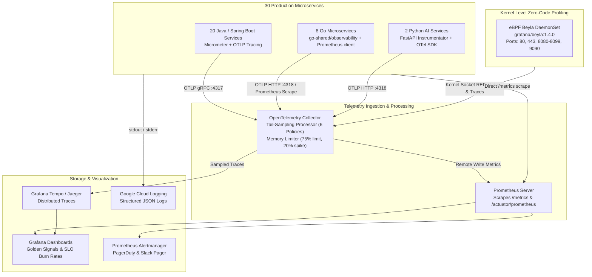

# InstaCommerce Observability Platform

Authoritative documentation for platform observability, telemetry ingestion, profiling, distributed tracing, and automated alerting across the 30 microservices of the InstaCommerce monorepo.

---

## 1. Architectural Topology

---

## 2. Components

### 2.1 eBPF Network Profiler (`grafana/beyla`)
- **Manifest:** [`deploy/helm/templates/observability/ebpf-network-profiler.yaml`](../../deploy/helm/templates/observability/ebpf-network-profiler.yaml)
- **Deployment Mode:** Kubernetes DaemonSet in `monitoring` namespace.
- **Role:** Hooks Linux kernel network sockets (`k8s.pod.name`) via eBPF probes. Provides zero-overhead HTTP/gRPC latency, error rates, and connection duration without altering application binaries.
- **Target Monitored Ports:** `80, 443, 8080, 8081, 8090, 8091, 8092, 8093, 8094, 8095, 8096, 8097, 8098, 8099, 9090`.

### 2.2 OpenTelemetry Collector & Tail-Sampling Engine
- **Manifest:** [`deploy/helm/templates/observability/otel-collector.yaml`](../../deploy/helm/templates/observability/otel-collector.yaml)
- **Architecture:** Multi-policy `tail_sampling` processor evaluating trace trees after a 10-second decision window.
- **Deterministic Sampling Rules:**
  1. **HTTP 5xx Errors (`error-http-status-filter`):** 100% sample rate for `http.status_code` in $[500, 599]$.
  2. **Error Spans (`error-status-code-filter`):** 100% sample rate when status code is `ERROR`.
  3. **Slow Traces (`high-latency-filter`):** 100% sample rate when total span latency $> 2000$ ms.
  4. **VIP Customer Traffic (`vip-customer-filter`):** 100% sample rate for `customer_tier` in `["vip", "VIP"]`.
  5. **Low-Latency Search Traffic (`search-probabilistic-filter`):** 0.1% probabilistic sample rate for fast `search-service` calls.
  6. **Baseline Traffic (`default-probabilistic-filter`):** 5.0% probabilistic sample rate for all remaining healthy traffic.

---

## 3. Alerts & Service-Level Objectives

- **SLO Definitions:** [`../slos/service-slos.md`](../slos/service-slos.md)
- **Prometheus Alert Rules:** [`slo-alerts.md`](slo-alerts.md) and [`monitoring/prometheus-rules.yaml`](../../monitoring/prometheus-rules.yaml)
- **Grafana Dashboard JSON:** [`grafana-slo-dashboard.json`](grafana-slo-dashboard.json)
- **Incident Response Runbooks:** Located in [`../runbooks/`](../runbooks/) and per-service [`../services/*/runbook.md`](../services/).
