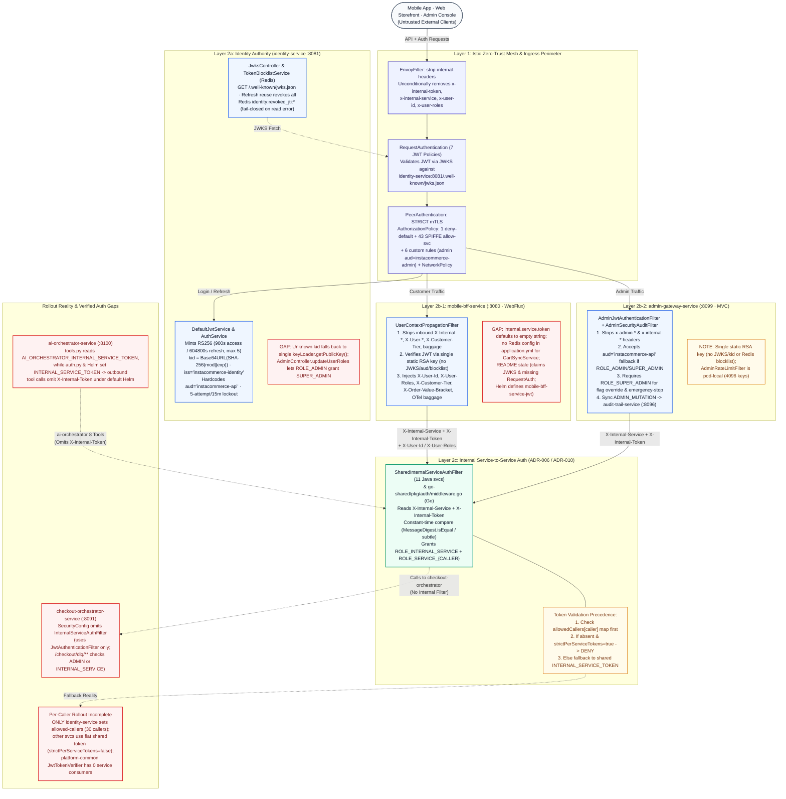
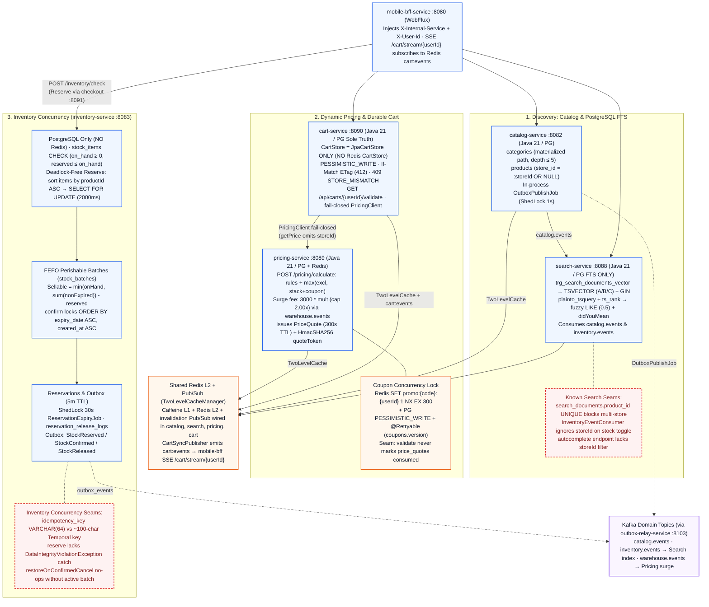
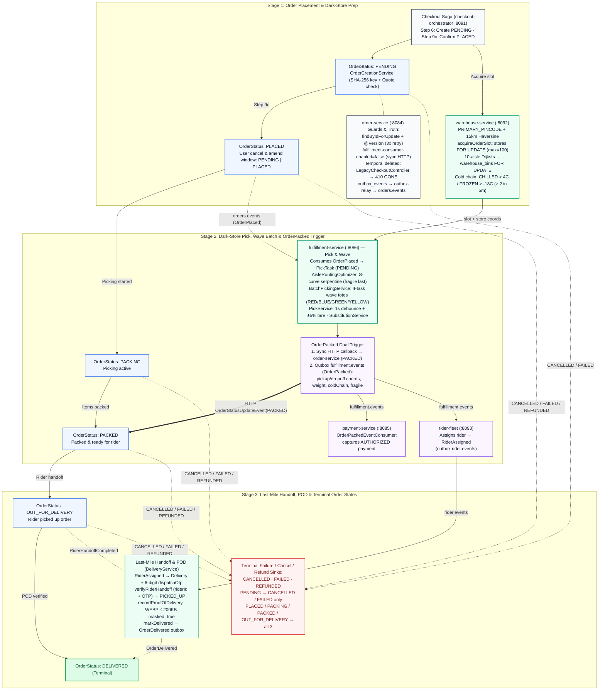
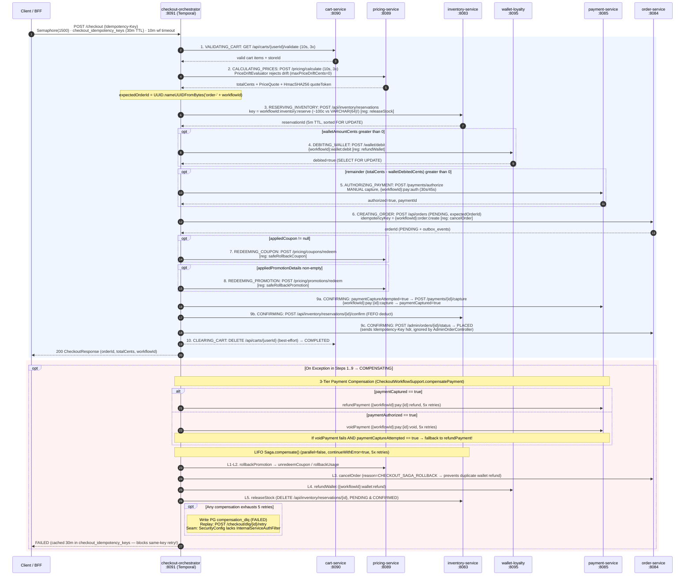
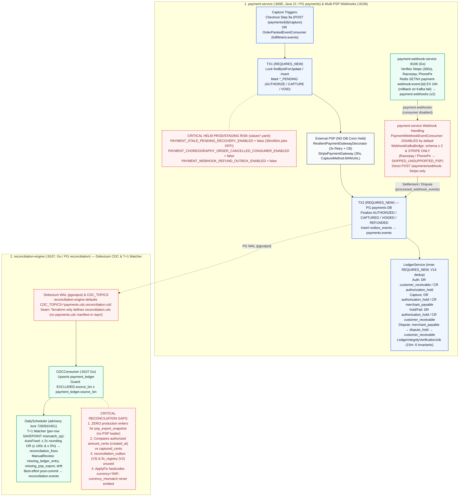
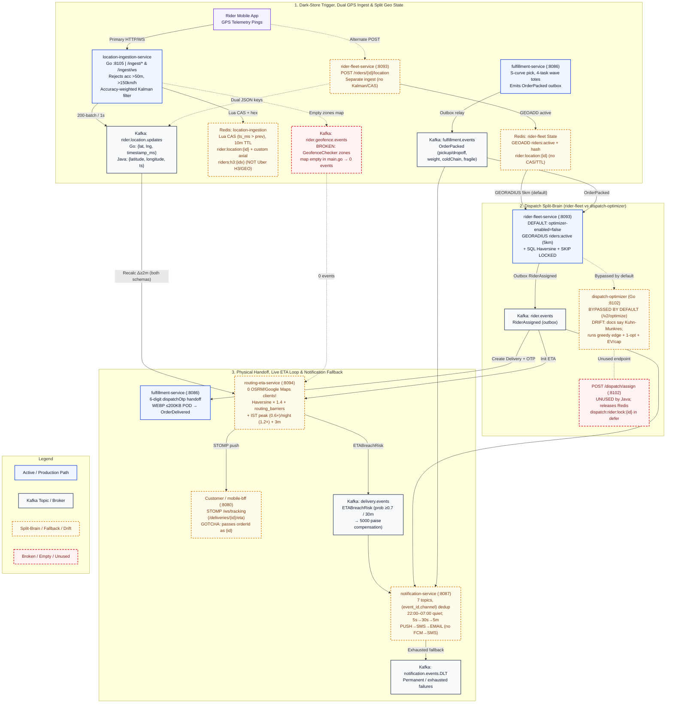

# InstaCommerce Engineer Onboarding Curriculum (Days 0–5)

> [!NOTE]
> **Part of the InstaCommerce Onboarding Suite:** [Onboarding Hub](./README.md) · **Day 0–5 Curriculum (this guide)** · [Hands-On Labs](./02-hands-on-labs.md) · [Role Learning Tracks](./03-role-learning-tracks.md) · [First-PR & Troubleshooting](./04-first-pr-and-troubleshooting.md) · [Domain Model & Event Catalog](./05-domain-model-and-event-catalog.md) · [Incident Drills & Readiness Exam](./06-incident-drills-and-readiness-exam.md) · [Service Dependency & CLI Cheatsheet](./07-service-dependency-and-command-cheatsheet.md) · [Code Walkthrough Atlas](./code-walkthrough/README.md)
>
> **Curriculum Scope & Repo-Truth Posture:** Starting from [Onboarding Hub](./README.md) and backed by the [Whole-System Code Walkthrough Atlas](./code-walkthrough/README.md) and [Repo-Truth Audit](../repo-truth/README.md), this curriculum is your progressive **Week-1 Engineering Guide** across InstaCommerce's **30 microservices**, **2 shared libraries**, **`contracts/`**, data/ML platforms, and GitOps stack.
>
> Every architecture claim, HTTP route, database invariant, diagram, and source link is anchored directly to checked-in code, SQL migrations, Helm overlays, and local scripts in this repository. Where legacy documentation or code comments diverge from runtime behavior, this guide tells you **what the code actually executes** so you never lose days debugging phantom infrastructure. Pair each day with [Hands-On Labs](./02-hands-on-labs.md), [Role Learning Tracks](./03-role-learning-tracks.md), [First PR & Troubleshooting](./04-first-pr-and-troubleshooting.md), [Domain Model & Event Catalog](./05-domain-model-and-event-catalog.md), [Incident Drills & Readiness Exam](./06-incident-drills-and-readiness-exam.md), and [Service Dependency & CLI Cheatsheet](./07-service-dependency-and-command-cheatsheet.md).

---

## Table of Contents

- [Visual Architecture Tour (8 Diagrams)](#visual-architecture-tour-8-diagrams)
- [Day 0 — First Principles & Architectural Mental Model](#day-0--first-principles--architectural-mental-model)
- [Day 1 — Local Dev Setup, Trust Boundaries & Shared Primitives](#day-1--local-dev-setup-trust-boundaries--shared-primitives)
  - [1.1 How Local Bootstrap Works (`dev-local.sh` & `docker-compose.yml`)](#11-how-local-bootstrap-works-dev-localsh--docker-composeyml)
  - [1.2 Trust Boundaries & Authentication Flow](#12-trust-boundaries--authentication-flow)
  - [1.3 Shared Contracts & Platform Primitives](#13-shared-contracts--platform-primitives)
- [Day 2 — Core Commerce & The Checkout Saga (Code Walkthrough)](#day-2--core-commerce--the-checkout-saga-code-walkthrough)
  - [2.1 Discovery -> Dynamic Pricing -> Durable Cart](#21-discovery---dynamic-pricing---durable-cart)
  - [2.2 Inventory Concurrency, FEFO & The Order FSM](#22-inventory-concurrency-fefo--the-order-fsm)
  - [2.3 The 10-Step Temporal Checkout Saga & 3-Tier Compensation](#23-the-10-step-temporal-checkout-saga--3-tier-compensation)
  - [2.4 Day-2 Code Reading Tour](#24-day-2-code-reading-tour)
- [Day 3 — Money, Risk, Fulfillment & Live Dispatch](#day-3--money-risk-fulfillment--live-dispatch)
  - [3.1 Payments, Double-Entry Ledger, Webhooks & Reconciliation](#31-payments-double-entry-ledger-webhooks--reconciliation)
  - [3.2 Dark Store Fulfillment, Live GPS & Dispatch Split-Brain](#32-dark-store-fulfillment-live-gps--dispatch-split-brain)
- [Day 0–3 Onboarding Checkpoints](#day-03-onboarding-checkpoints)
- [Day 4 — Event Backbone, Streaming, Lakehouse, ML & GenAI](#day-4--event-backbone-streaming-lakehouse-ml--genai)
  - [4.1 Why Five Distinct Data-Motion Pipelines Exist](#41-why-five-distinct-data-motion-pipelines-exist)
  - [4.2 Data Lakehouse Walkthrough (`data-platform/` & `data-platform-jobs/`)](#42-data-lakehouse-walkthrough-data-platform--data-platform-jobs)
  - [4.3 ML Platform & GenAI Walkthrough (`ml/`, `ai-inference-service`, `ai-orchestrator-service`)](#43-ml-platform--genai-walkthrough-ml-ai-inference-service-ai-orchestrator-service)
  - [4.4 Explicit "Live vs Scaffolded vs Broken" Map (Data, ML & GenAI)](#44-explicit-live-vs-scaffolded-vs-broken-map-data-ml--genai)
- [Day 5 — Shipping Code Safely: Testing, CI/CD, GitOps, SLOs & First-PR Playbook](#day-5--shipping-code-safely-testing-cicd-gitops-slos--first-pr-playbook)
  - [5.1 Narrow Validation Loops & LSP Navigation](#51-narrow-validation-loops--lsp-navigation)
  - [5.2 CI/CD, GitOps, Istio Zero-Trust & Terraform Gaps](#52-cicd-gitops-istio-zero-trust--terraform-gaps)
  - [5.3 SRE & On-Call Readiness](#53-sre--on-call-readiness)
  - [5.4 First-Week Engineer Checklist](#54-first-week-engineer-checklist)
  - [5.5 Consolidated Repo-Truth Gotcha Reference](#55-consolidated-repo-truth-gotcha-reference)
  - [5.6 Day 4–5 Checkpoints (Self-Test)](#56-day-45-checkpoints-self-test)

---

## Visual Architecture Tour (8 Diagrams)

Every module below includes its diagram inline as Mermaid alongside a pre-rendered high-DPI PNG under [`diagrams/`](./diagrams/). Jump directly to a module or open any diagram asset below:

| # | Architecture View | Curriculum Module | Rendered PNG | Mermaid Source |
|---|---|---|---|---|
| 1 | InstaCommerce 30-Service System Topology | [Day 0 — First Principles & Topology](#day-0--first-principles--architectural-mental-model) | [01-system-topology.png](./diagrams/01-system-topology.png) | [01-system-topology.mmd](./diagrams/01-system-topology.mmd) |
| 2 | Zero-Trust Security Boundary & Auth Flows | [Day 1 — Local Dev & Trust Boundaries](#12-trust-boundaries--authentication-flow) | [02-trust-and-auth.png](./diagrams/02-trust-and-auth.png) | [02-trust-and-auth.mmd](./diagrams/02-trust-and-auth.mmd) |
| 3 | Discovery, Pricing, Cart & Inventory Concurrency | [Day 2.1 — Discovery -> Durable Cart](#21-discovery---dynamic-pricing---durable-cart) | [03-browse-to-cart-concurrency.png](./diagrams/03-browse-to-cart-concurrency.png) | [03-browse-to-cart-concurrency.mmd](./diagrams/03-browse-to-cart-concurrency.mmd) |
| 4 | Temporal 10-Step Checkout Saga & 3-Tier Compensation | [Day 2.3 — Checkout Saga](#23-the-10-step-temporal-checkout-saga--3-tier-compensation) | [04-checkout-saga-compensation.png](./diagrams/04-checkout-saga-compensation.png) | [04-checkout-saga-compensation.mmd](./diagrams/04-checkout-saga-compensation.mmd) |
| 5 | Order State Machine & Dark-Store Physical Fulfillment | [Day 2.2 — Inventory FEFO & Order FSM](#22-inventory-concurrency-fefo--the-order-fsm) | [05-order-fsm-and-fulfillment.png](./diagrams/05-order-fsm-and-fulfillment.png) | [05-order-fsm-and-fulfillment.mmd](./diagrams/05-order-fsm-and-fulfillment.mmd) |
| 6 | 2-TX Payment Saga, Double-Entry Ledger & T+1 Reconciliation | [Day 3.1 — Payments, Ledger & Recon](#31-payments-double-entry-ledger-webhooks--reconciliation) | [06-money-ledger-reconciliation.png](./diagrams/06-money-ledger-reconciliation.png) | [06-money-ledger-reconciliation.mmd](./diagrams/06-money-ledger-reconciliation.mmd) |
| 7 | Live Rider Telemetry, Dispatch Split-Brain & ETA Loop | [Day 3.2 — Dark Store, GPS & Dispatch](#32-dark-store-fulfillment-live-gps--dispatch-split-brain) | [07-realtime-logistics-loop.png](./diagrams/07-realtime-logistics-loop.png) | [07-realtime-logistics-loop.mmd](./diagrams/07-realtime-logistics-loop.mmd) |
| 8 | Dual-Lane Event Backbone, Lakehouse, AI & Local-to-GKE GitOps | [Day 4 — Events, Data/ML & GenAI](#day-4--event-backbone-streaming-lakehouse-ml--genai) | [08-event-data-ai-gitops.png](./diagrams/08-event-data-ai-gitops.png) | [08-event-data-ai-gitops.mmd](./diagrams/08-event-data-ai-gitops.mmd) |

---

## Day 0 — First Principles & Architectural Mental Model

### Why 10-Minute Delivery Dictates Everything You Will Read

InstaCommerce is an ultra-local quick-commerce (q-commerce) backend designed around a **sub-10-minute delivery SLA** across **30 microservices**, **2 shared libraries**, a **`contracts/`** module, and data/ML/GitOps tooling ([README.md](../../README.md), [GLOSSARY.md](../../GLOSSARY.md)). Four physical and distributed-systems constraints explain almost every design boundary in the repository:

1. **Physics -> Spatial Partitioning Around Dark Stores (`store_id`)**
   - At an urban rider base speed of `25 km/h` (`~417 m/min`, configured in [RoutingProperties.java](../../services/routing-eta-service/src/main/java/com/instacommerce/routing/config/RoutingProperties.java)) plus ~`3 min` of warehouse pick/pack ([ETAService.java](../../services/routing-eta-service/src/main/java/com/instacommerce/routing/service/ETAService.java#L113-L117)), inventory cannot sit in regional distribution centers.
   - Instead, SKU availability, store capacity slots, bin locations, pick paths, and rider supply partition around hyperlocal **Dark Stores** (`store_id`). You will see `store_id` threaded from [catalog-service](../../services/catalog-service) and [inventory-service](../../services/inventory-service) through [warehouse-service](../../services/warehouse-service), [fulfillment-service](../../services/fulfillment-service), and [rider-fleet-service](../../services/rider-fleet-service).

2. **Flash Traffic Without Distributed Locks -> Temporal Sagas, Not 2PC**
   - Placing a single order coordinates at least five independent state owners: **Cart**, **Pricing/Promotions**, **Inventory**, **Wallet/Payment**, and **Order**. Running synchronous Two-Phase Commit (2PC) across five PostgreSQL databases and an external payment service provider (PSP) collapses under burst traffic and strands row locks whenever a pod restarts.
   - Instead, [checkout-orchestrator-service](../../services/checkout-orchestrator-service) runs a durable **Temporal Saga** ([CheckoutWorkflowImpl.java](../../services/checkout-orchestrator-service/src/main/java/com/instacommerce/checkout/workflow/CheckoutWorkflowImpl.java)) with deterministic idempotency keys, forward retries, LIFO compensating actions, and a replayable `compensation_dlq` table.

3. **Zero Dual-Write Divergence -> Transactional Outbox + WAL CDC**
   - Updating PostgreSQL and calling `kafkaTemplate.send()` inside the same request handler fails non-atomically: either the DB commits and Kafka loses the message, or Kafka publishes before the DB rolls back.
   - Stateful Java services therefore commit domain rows and `outbox_events` inside the **same local ACID PostgreSQL transaction** (`Propagation.MANDATORY` in [OutboxService.java](../../services/order-service/src/main/java/com/instacommerce/order/service/OutboxService.java)), while Go [outbox-relay-service](../../services/outbox-relay-service/relay.go) polls `FOR UPDATE SKIP LOCKED` and relays semantic domain events to Kafka. Separately, Debezium (`pgoutput` WAL) has checked-in Terraform connectors for `reconciliation.cdc` ([debezium-connector-reconciliation.tf](../../infra/terraform/debezium-connector-reconciliation.tf), capturing `reconciliation_runs` and `reconciliation_mismatches`), while [reconciliation-engine](../../services/reconciliation-engine/config.go#L63) expects `payments.cdc,reconciliation.cdc` by default (though no `payments.cdc` Debezium manifest is checked into the repo yet), and [cdc-consumer-service](../../services/cdc-consumer-service/consumer.go) streams Kafka topics into BigQuery.

4. **Polyglot Specialization (20 Java / 8 Go / 2 Python) + Pool Ceiling**
   - **20 Java 21 / Spring Boot 4.0.0 services** (plus `:contracts` and `:libs:platform-common` = 22 Gradle modules in [settings.gradle.kts](../../settings.gradle.kts#L10-L31)) own ACID business invariants, Flyway schemas, Temporal orchestration, and edge JWT gateways.
   - **8 Go 1.25 services** (plus `go-shared` in [go.work](../../go.work#L1-L13)) own memory-lean, high-throughput infrastructure daemons and numerical/spatial loops (`outbox-relay-service`, `cdc-consumer-service`, `stream-processor-service`, `location-ingestion-service`, `dispatch-optimizer-service`, `payment-webhook-service`, `reconciliation-engine`, `reverse-etl-orchestrator`).
   - **2 Python 3.12 FastAPI services** own ML feature/model serving ([ai-inference-service](../../services/ai-inference-service)) and guardrailed LangGraph agent workflows ([ai-orchestrator-service](../../services/ai-orchestrator-service)).
   - **Connection pool discipline:** In production, [HLD.md](../architecture/HLD.md) sizes the fleet for up to `200` pods × `20` Hikari connections funneled through PgBouncer into Cloud SQL (`max_connections=500`). Never open external HTTP calls (`Stripe`, downstream REST) while holding a PostgreSQL transaction/connection.

**InstaCommerce 30-Service System Topology** — *[Rendered PNG](./diagrams/01-system-topology.png) · [Mermaid Source](./diagrams/01-system-topology.mmd)*

```mermaid
flowchart LR
    %% InstaCommerce 30-Service System Topology (Landscape Architecture Map)
    classDef client fill:#F8FAFC,stroke:#475569,stroke-width:1.5px,color:#0F172A
    classDef java fill:#EFF6FF,stroke:#2563EB,stroke-width:1.6px,color:#0F172A
    classDef go fill:#ECFDF5,stroke:#059669,stroke-width:1.6px,color:#0F172A
    classDef python fill:#FFFBEB,stroke:#D97706,stroke-width:1.6px,color:#0F172A
    classDef infra fill:#F1F5F9,stroke:#334155,stroke-width:1.6px,color:#0F172A

    subgraph COL0["Ingress & Stack Legend"]
        direction TB
        C_ALL(["Mobile · Web · Admin<br/>External PSP Webhooks"]):::client
        ISTIO["Istio Ingress Gateway<br/>STRICT mTLS · EnvoyFilter<br/>RequestAuth JWKS<br/>43 SPIFFE Policies"]:::infra
        subgraph LEGEND["Stack Legend (30 Svcs)"]
            direction TB
            L_JAVA["Java 21 / Boot 4 (20)<br/>Ports :8080–:8099"]:::java
            L_GO["Go 1.25 + go-shared (8)<br/>Ports :8102–:8109"]:::go
            L_PY["Python 3.12 / FastAPI (2)<br/>Ports :8100–:8101"]:::python
        end
    end

    subgraph EDGE["1. Edge, Auth & Governance (Java 21 · 5)"]
        direction TB
        MBFF["mobile-bff-service :8080<br/>WebFlux · SSE /cart/stream<br/>Proxies AI Assist → :8100"]:::java
        AGW["admin-gateway-service :8099<br/>MVC · RBAC + Sync Audit"]:::java
        ID["identity-service :8081<br/>RS256/JWKS · Redis Blocklist"]:::java
        FLAGS["config-feature-flag-service :8098<br/>Murmur3 Flags · SSE /flags/stream"]:::java
        AUDIT["audit-trail-service :8096<br/>Hash-Chained PG + GCS<br/>(21 Kafka Topics)"]:::java
    end

    subgraph COMMERCE["2. Core Commerce & Saga (Java 21 · 6)"]
        direction TB
        CAT["catalog-service :8082<br/>SKUs · In-Process Outbox"]:::java
        SEARCH["search-service :8088<br/>PG tsvector GIN + Fuzzy"]:::java
        PRICE["pricing-service :8089<br/>HMAC PriceQuote · Redis NX"]:::java
        CART["cart-service :8090<br/>PG JpaCartStore · L2 Cache"]:::java
        INV["inventory-service :8083<br/>Sorted FOR UPDATE · FEFO"]:::java
        CHK["checkout-orchestrator-service :8091<br/>Temporal 10-Step Saga · DLQ"]:::java
    end

    subgraph FULFILL["3. Money, Risk & Fulfillment (Java 21 · 9)"]
        direction TB
        subgraph FUL_MONEY["Orders, Money & Risk (4)"]
            direction TB
            ORD["order-service :8084<br/>9-State FSM · Outbox"]:::java
            PAY["payment-service :8085<br/>2-TX Saga · Double-Entry Ledger"]:::java
            WAL["wallet-loyalty-service :8095<br/>Double-Entry Wallet · Points"]:::java
            FRAUD["fraud-detection-service :8097<br/>Fail-Closed Rules · Velocity"]:::java
        end
        subgraph FUL_PHYS["Dark Store, Delivery & Comms (5)"]
            direction TB
            WH["warehouse-service :8092<br/>Dark Store Cap · Cold Chain"]:::java
            FUL["fulfillment-service :8086<br/>S-Curve Pick · 4-Tote · OTP/POD"]:::java
            RIDER["rider-fleet-service :8093<br/>Redis GEO · SKIP LOCKED"]:::java
            ETA["routing-eta-service :8094<br/>Haversine×1.4 · STOMP WS"]:::java
            NOTIF["notification-service :8087<br/>7 Topics · PUSH→SMS→EMAIL"]:::java
        end
    end

    subgraph BACKBONE["Shared State & Event Backbone"]
        direction TB
        PG[("PostgreSQL 16 (39 Local DBs)<br/>Domain Truth + outbox_events")]:::infra
        TEMPORAL[("Temporal :7233<br/>Durable Saga History")]:::infra
        REDIS[("Redis 7 :6379<br/>L2 Cache · Pub/Sub<br/>GEO · Features")]:::infra
        KAFKA["Kafka KRaft :9092<br/>+ Debezium WAL :18083<br/>20+ Topics · CDC · DLTs"]:::infra
    end

    subgraph GODAEMONS["4. Go Async Daemons & Solvers (Go 1.25 · 8)"]
        direction TB
        subgraph GO_PIPE["Relay, CDC, Streams & Reverse ETL (4)"]
            direction TB
            OUTBOX["outbox-relay-service :8103<br/>SKIP LOCKED → Kafka (+13 domain)"]:::go
            CDCC["cdc-consumer-service :8104<br/>Kafka → BigQuery Sink"]:::go
            STREAM["stream-processor-service :8108<br/>Bloom/Redis Dedup · SLA Alerts"]:::go
            REV["reverse-etl-orchestrator :8109<br/>HTTP Push → Redis Lua Swap"]:::go
        end
        subgraph GO_OPS["Webhooks, Recon, GPS & Dispatch (4)"]
            direction TB
            PWH["payment-webhook-service :8106<br/>Stripe/Razorpay/PhonePe + Dedup"]:::go
            RECON["reconciliation-engine :8107<br/>CDC → T+1 Matcher<br/>(no payments.cdc TF connector)"]:::go
            LOC["location-ingestion-service :8105<br/>Kalman · Lua CAS · Axial Hex"]:::go
            DISP["dispatch-optimizer-service :8102<br/>Greedy+1-opt (Flagged Off)"]:::go
        end
    end

    subgraph AILAKE["5. GenAI (Python 3.12 · 2) & Lakehouse"]
        direction TB
        AIORCH["ai-orchestrator-service :8100<br/>Python 3.12 · LangGraph<br/>Guardrails · 8 Commerce Tools"]:::python
        AIINF["ai-inference-service :8101<br/>Python 3.12 · 7 ML Routes<br/>(Linear/Fallback Defaults)"]:::python
        LAKE["BigQuery Lakehouse & Offline ML<br/>dbt (Staging→Int→Marts)<br/>8 Airflow DAGs · 6 Beam Pipelines<br/>Great Expectations · 6 ML Trainers"]:::infra
    end

    %% Clean Single-Direction Left-to-Right Connections (wrapped short labels)
    C_ALL -->|"HTTPS / JWT"| ISTIO
    ISTIO -->|"Customer JWT"| MBFF
    ISTIO -->|"Admin JWT"| AGW
    ISTIO -->|"Auth / Tokens"| ID
    C_ALL -. "PSP Webhooks<br/>(:8106)" .-> PWH

    MBFF -->|"Browse / Quote<br/>& Cart"| CART
    MBFF -->|"POST /checkout"| CHK
    COMMERCE -->|"Saga: Order<br/>Pay · Wallet"| FULFILL

    COMMERCE -->|"Workflow<br/>History"| TEMPORAL
    FULFILL -->|"ACID +<br/>outbox_events"| PG
    FULFILL -->|"GEO & State"| REDIS
    FULFILL <-->|"Domain<br/>Events"| KAFKA

    PG -->|"Poll SKIP LOCKED"| OUTBOX
    KAFKA <-->|"Domain Topics<br/>& Webhooks"| PWH
    KAFKA <-->|"CDC Topics &<br/>rider.location"| RECON
    KAFKA -->|"8 Topics /<br/>Streaming Sink"| CDCC
    REDIS <-->|"Lua Features<br/>& Metrics"| REV

    CDCC -->|"Streaming<br/>Insert"| LAKE
    LAKE -. "HTTP Push Only<br/>(BQ/Kafka Unconfigured)" .-> REV
    REDIS -. "Features<br/>(default: none)" .-> AIINF
    MBFF -. "AI Assist<br/>(via Edge)" .-> AIORCH
```



### 30-Service Quick-Reference Registry

| Plane | Service | Stack | Port | Primary Data Store | Primary Role |
|---|---|---|---|---|---|
| **Edge** | `mobile-bff-service` | Java 21 / WebFlux | `8080` | Stateless (+ Redis Pub/Sub client) | Mobile screen aggregation, user header propagation, SSE `/cart/stream/{userId}` |
| **Edge** | `identity-service` | Java 21 / Boot 4 | `8081` | PostgreSQL (`identity_db`) + Redis | RS256 JWT minting, `/.well-known/jwks.json`, lockouts, Redis fail-closed revocation |
| **Edge** | `admin-gateway-service` | Java 21 / MVC | `8099` | Stateless | RBAC admin proxy + synchronous `ADMIN_MUTATION` forwarding to `audit-trail-service` |
| **Browse & Cart** | `catalog-service` | Java 21 / Boot 4 | `8082` | PostgreSQL (`catalog`) + Redis L2 | Categories (`depth <= 5`), store-scoped SKUs, in-process `OutboxPublishJob` |
| **Browse & Cart** | `search-service` | Java 21 / Boot 4 | `8088` | PostgreSQL (`search`, `tsvector`) + Redis L2 | Weighted FTS + `LIKE` fallback + autocomplete (no Elasticsearch) |
| **Browse & Cart** | `pricing-service` | Java 21 / Boot 4 | `8089` | PostgreSQL (`pricing`) + Redis L2 | Price rules, exclusive/stackable promos, Redis NX coupons, `HmacSHA256` `PriceQuote` |
| **Browse & Cart** | `cart-service` | Java 21 / Boot 4 | `8090` | PostgreSQL (`carts`) + Redis L2 | `JpaCartStore` durable cart, fail-closed `PricingClient`, `409 STORE_MISMATCH` |
| **Core Tx** | `inventory-service` | Java 21 / Boot 4 | `8083` | PostgreSQL (`inventory`) | Deadlock-free stock locks, FEFO perishable batches, 5m reservation TTL |
| **Core Tx** | `order-service` | Java 21 / Boot 4 | `8084` | PostgreSQL (`orders`) | 9-state Order FSM, `OutboxService`, `410 GONE` legacy checkout tombstone |
| **Core Tx** | `checkout-orchestrator-service` | Java 21 / Boot 4 | `8091` | Temporal + PostgreSQL (`checkout`) | Authoritative 10-step Temporal checkout saga + 3-tier payment comp + DLQ |
| **Money & Risk** | `payment-service` | Java 21 / Boot 4 | `8085` | PostgreSQL (`payments`) | 2-TX pending-state PSP saga, double-entry ledger, Stripe gateway |
| **Money & Risk** | `payment-webhook-service` | Go 1.25 | `8106` | Redis / in-mem dedup | Verifies Stripe, Razorpay & PhonePe webhooks -> `payment.webhooks` |
| **Money & Risk** | `reconciliation-engine` | Go 1.25 | `8107` | PostgreSQL (`reconciliation`) | Defaults `CDC_TOPICS="payments.cdc,reconciliation.cdc"` (`payments.cdc` unmanifested) -> T+1 mismatch checks |
| **Money & Risk** | `wallet-loyalty-service` | Java 21 / Boot 4 | `8095` | PostgreSQL (`wallets`) | `FOR UPDATE` wallet balance, double-entry ledger, loyalty points, 2% cashback |
| **Money & Risk** | `fraud-detection-service` | Java 21 / Boot 4 | `8097` | PostgreSQL (`fraud`) + opt. Redis | Fail-closed scoring (`AUTO_BLOCK`), rules, aligned velocity buckets, auto-blocklist |
| **Fulfillment** | `warehouse-service` | Java 21 / Boot 4 | `8092` | PostgreSQL (`warehouse`) | Dark store resolution (`PRIMARY_PINCODE` + 15km), capacity slots, bins, cold chain |
| **Fulfillment** | `fulfillment-service` | Java 21 / Boot 4 | `8086` | PostgreSQL (`fulfillment`) | S-curve picking, 4-order wave totes, 6-digit OTP handoff, masked WEBP POD |
| **Logistics** | `rider-fleet-service` | Java 21 / Boot 4 | `8093` | PostgreSQL (`rider_fleet`) + Redis GEO | Primary rider assignment (`GEORADIUS` + `SKIP LOCKED`), earnings, fatigue limits |
| **Logistics** | `location-ingestion-service` | Go 1.25 | `8105` | Redis (`rider:location:*`, `riders:h3:*`) | Kalman-filtered HTTP/WS GPS ingestion -> Lua CAS + batched `rider.location.updates` |
| **Logistics** | `dispatch-optimizer-service` | Go 1.25 | `8102` | Stateless + opt. Redis lock | Greedy edge-sort + 1-opt batching solver (`/v2/optimize/assign`, `/dispatch/assign`) |
| **Logistics** | `routing-eta-service` | Java 21 / Boot 4 | `8094` | PostgreSQL (`routing`) + STOMP | `Haversine * 1.4` + barrier/traffic/weather ETA, `/ws/tracking`, `ETABreachRisk` |
| **Logistics** | `notification-service` | Java 21 / Boot 4 | `8087` | PostgreSQL (`notification`) | 7-topic fanout, quiet hours (`22:00–07:00`), `PUSH -> SMS -> EMAIL` fallback |
| **Platform** | `audit-trail-service` | Java 21 / Boot 4 | `8096` | PostgreSQL (`audit_db`) + GCS | Consumes 21 topics into monthly partitioned, SHA-256 hash-chained `audit_events` |
| **Platform** | `config-feature-flag-service` | Java 21 / Boot 4 | `8098` | PostgreSQL (`feature_flags_db`) + Redis | Murmur3 flags & switchback experiments, Redis Pub/Sub + SSE `/flags/stream` |
| **Event & Data** | `outbox-relay-service` | Go 1.25 | `8103` | Reads service Postgres | Polls `outbox_events` (`SKIP LOCKED`) -> synchronous Kafka + `outbox.relay.dlq` |
| **Event & Data** | `cdc-consumer-service` | Go 1.25 | `8104` | BigQuery sink | Kafka -> BigQuery streaming inserts + schema evolution + `cdc.dlq` |
| **Event & Data** | `stream-processor-service` | Go 1.25 | `8108` | Redis + Prometheus | Bloom+Redis dedup, watermarks, zone SLA / SKU cascade / payment rate windows |
| **Event & Data** | `reverse-etl-orchestrator` | Go 1.25 | `8109` | PostgreSQL (`reverse_etl`) + Redis | HTTP JSON push -> Lua atomic `RENAME`/`PEXPIRE` Redis feature swap |
| **AI & ML** | `ai-orchestrator-service` | Python 3.12 / FastAPI | `8100` | Redis checkpoints | LangGraph workflow, PIIVault, injection/budget guardrails, allowlisted tools |
| **AI & ML** | `ai-inference-service` | Python 3.12 / FastAPI | `8101` | Optional Redis/ONNX | 7 ML inference routes (linear/fallback defaults unless ONNX artifacts mounted) |

> **Go Helm Key Mapping Gotcha:** Five Go modules use shortened Helm/CI release keys in [deploy/helm/values.yaml](../../deploy/helm/values.yaml) and [.github/workflows/ci.yml](../../.github/workflows/ci.yml): `cdc-consumer-service` → `cdc-consumer`, `location-ingestion-service` → `location-ingestion`, `outbox-relay-service` → `outbox-relay` (plus 13 per-domain `outbox-relay-<domain>` deployments on port `8103`), `payment-webhook-service` → `payment-webhook`, and `stream-processor-service` → `stream-processor`.

### ADR Reading Map (`001`–`015`) — Intent vs Code Reality

Read ADRs in [docs/adr/](../adr/README.md) by domain, and keep the **"Repo Reality"** column beside you so you don't assume every accepted ADR is 100% rolled out in runtime config:

| ADR | Title | Core Decision | Repo Reality Check (What Code Actually Does) |
|---|---|---|---|
| [ADR-001](../adr/001-checkout-authority.md) | Checkout Authority Consolidation | `checkout-orchestrator-service` is sole checkout authority; `order-service` legacy path returns `410 GONE`. | **Further than ADR:** Temporal SDK & workflow beans were completely deleted from `order-service`; [LegacyCheckoutController.java](../../services/order-service/src/main/java/com/instacommerce/order/controller/LegacyCheckoutController.java) unconditionally returns `410 GONE`. |
| [ADR-002](../adr/002-dispatch-authority.md) | Dispatch Authority Consolidation | `rider-fleet-service` is sole dispatch authority; `fulfillment-service` inline dispatch deprecated. | Aligned in `rider-fleet-service`; `fulfillment-service` consumes `RiderAssigned` from `rider.events`. |
| [ADR-003](../adr/003-kafka-dlt-naming.md) | Kafka DLT Naming Convention | Dead-letter topics must use `{source-topic}.DLT`; `JsonProcessingException` & `IllegalArgumentException` non-retryable. | **Partial drift:** Java services & `stream-processor` use `.DLT`, but Go `outbox-relay` uses `outbox.relay.dlq` and `cdc-consumer` uses `cdc.dlq`. |
| [ADR-004](../adr/004-event-envelope.md) | Event Envelope Standard | Canonical 9-field camelCase envelope (`eventId`, `eventType`, ...). | **Intentional compatibility bridge:** [EventEnvelope.java](../../contracts/src/main/java/com/instacommerce/contracts/events/EventEnvelope.java) & Go [envelope_json.go](../../services/go-shared/pkg/kafka/envelope_json.go) accept snake_case `@JsonAlias`es; Go `MarshalJSON` dual-emits `id`+`eventId` and `eventTime`+`timestamp`, while `outbox-relay` also flattens payload keys. |
| [ADR-005](../adr/005-durable-idempotency.md) | Durable Idempotency Standard | "Belt and suspenders": existence check + DB unique constraint on idempotency keys. | Followed in `order-service` (`uq_order_idempotency`) and `payment-service`; **missing `DataIntegrityViolationException` catch** in `inventory-service` `ReservationService.reserveInTransaction`. |
| [ADR-006](../adr/006-internal-service-auth.md) | Internal Service Auth Hardening | Constant-time `MessageDigest.isEqual` check; internal auth grants `ROLE_INTERNAL_SERVICE`, never `ROLE_ADMIN`. | Implemented in [SharedInternalServiceAuthFilter.java](../../libs/platform-common/src/main/java/com/instacommerce/platform/security/SharedInternalServiceAuthFilter.java) across 11 Java services; `checkout-orchestrator-service` `SecurityConfig` omits it. |
| [ADR-007](../adr/007-python-ci-standard.md) | Python Service CI Standard | Path-filtered `python-build-test` running `pytest`, `docker build`, and Trivy scan. | Implemented in `ci.yml`; note ADR mentions Python `3.14` while repo uses Python `3.12`. |
| [ADR-008](../adr/008-dispatch-optimizer-integration.md) | Dispatch Optimizer Integration | `rider-fleet-service` delegates to `dispatch-optimizer-service` `/v2/optimize/assign` behind a feature flag. | **Flag OFF by default:** `rider-fleet.dispatch.optimizer-enabled: false`, so default assignment runs Redis `GEORADIUS` + SQL `FOR UPDATE SKIP LOCKED`. |
| [ADR-009](../adr/009-ai-service-authentication.md) | AI Service Authentication | ASGI middleware on both Python AI services validating `X-Internal-Service`/`X-Internal-Token` via `hmac.compare_digest`. | Implemented inbound; outbound `ai-orchestrator` `tools.py` has a settings env-var name mismatch (`AI_ORCHESTRATOR_INTERNAL_SERVICE_TOKEN` vs `INTERNAL_SERVICE_TOKEN`, covered in Day 4). |
| [ADR-010](../adr/010-per-service-token-rollout.md) | Per-Service Token Rollout | Dual-mode `allowedCallers` map checked before shared token fallback; remove hardcoded dev secret. | Code mechanism exists in `platform-common` & `go-shared`, **but only `identity-service` populates `allowed-callers`**. |
| [ADR-011](../adr/011-admin-gateway-auth-model.md) | Admin-Gateway Auth Model | RS256 JWT validation with `aud == "instacommerce-admin"` and `ROLE_ADMIN`. | Because `identity-service` hardcodes `aud: "instacommerce-api"`, [AdminJwtAuthenticationFilter.java](../../services/admin-gateway-service/src/main/java/com/instacommerce/admingateway/security/AdminJwtAuthenticationFilter.java#L83-L91) bridges `instacommerce-api` when `ROLE_ADMIN` or `ROLE_SUPER_ADMIN` is present, and uses a single static public key (not JWKS). |
| [ADR-012](../adr/012-per-service-token-scoping.md) | Per-Service Token Scoping | 2-phase rollout of unique per-service tokens via K8s `service-tokens` secret, then retire shared fallback. | Phase 1 partial (`identity-service` wired; `strictPerServiceTokens` still `false` everywhere). |
| [ADR-013](../adr/013-feature-flag-cache-invalidation.md) | Feature-Flag Cache Invalidation | Caffeine L1 (30s) + post-commit Redis Pub/Sub `flag-updates:{key}` invalidation across pods. | Implemented in `config-feature-flag-service`, plus SSE `/flags/stream` (note CB opens on first startup Redis failure rather than 5s consecutive window). |
| [ADR-014](../adr/014-reconciliation-authority.md) | Reconciliation Authority Model | PostgreSQL-backed `reconciliation-engine` with Debezium CDC (`payments.cdc`) + `reconciliation_runs`. | DB ledger + `reconciliation.cdc` TF connectors exist, **but no `payments.cdc` Debezium manifest or `psp_export_snapshot` writer exists** yet and `reconciliation_outbox` is unused. |
| [ADR-015](../adr/015-slo-error-budget-policy.md) | SLO & Error-Budget Policy | Tiered availability/latency SLOs + multi-window burn-rate alerts + budget release gate. | Covered in detail in [Day 5](#53-sre--on-call-readiness); watch tier target discrepancies between docs vs `error-budget-policy.yaml`. |

---

## Day 1 — Local Dev Setup, Trust Boundaries & Shared Primitives

### 1.1 How Local Bootstrap Works (`dev-local.sh` & `docker-compose.yml`)

> **Hands-On Companion:** Follow [Lab 1–2 in `02-hands-on-labs.md`](./02-hands-on-labs.md) to boot the local stack step-by-step and verify healthy responses across services.

Do not start services one by one with ad-hoc environment variables. Use [scripts/dev-local.sh](../../scripts/dev-local.sh) alongside [docker-compose.yml](../../docker-compose.yml):

```bash
# 1. Start infra containers, generate ephemeral RSA-2048 keys + .local-dev/.env.local,
#    create 39 Postgres DBs/aliases, apply Go SQL migrations, create Temporal namespaces
./scripts/dev-local.sh up

# 2. Load local environment variables into your shell (for running single services/tests)
set -a && source .local-dev/.env.local && set +a

# 3. Optional: build :contracts:jar + bootJars and start the 10 core Java services
./scripts/dev-local.sh start-core

# 4. Inspect process/container state or run end-to-end infra smoke checks
./scripts/dev-local.sh status
./scripts/dev-local.sh smoke

# 5. Lifecycle cleanup
./scripts/dev-local.sh stop-core   # SIGTERM -> SIGKILL tracked Java PIDs
./scripts/dev-local.sh down        # Stop core services + docker compose down
./scripts/dev-local.sh reset       # Wipe pgdata volume + re-run 'up'
```

Understanding what happens under the hood saves hours of debugging:

1. **Ephemeral RSA-2048 Key Generation (`ensure_env`):**
   - [dev-local.sh](../../scripts/dev-local.sh#L55-L99) generates `.local-dev/jwt/private.pkcs8.pem` (`0600`) and `public.pem` (`0644`) via `openssl genpkey`.
   - Java services expect single-line base64-encoded DER strings (no `-----BEGIN...-----` headers or newlines). An inline Python block (`to_single_line_der_b64`) strips PEM headers/newlines and renders [.env.local.example](../../.env.local.example) into `.local-dev/.env.local`, populating `IDENTITY_JWT_PRIVATE_KEY`, `IDENTITY_JWT_PUBLIC_KEY`, `JWT_PUBLIC_KEY`, and all `*_JWT_PUBLIC_KEY` environment variables, plus `INTERNAL_SERVICE_TOKEN=local-dev-internal-token`.

2. **The `${sm://...}` Spring Cloud GCP Bypass:**
   - Every Java `application.yml` imports GCP Secret Manager optionally (`spring.config.import: optional:sm://`) and wraps secrets with a nested fallback placeholder—for example in [identity-service/application.yml](../../services/identity-service/src/main/resources/application.yml#L14-L51):
     ```yaml
     password: ${sm://db-password-identity:${IDENTITY_DB_PASSWORD}}
     public-key: ${sm://jwt-rsa-public-key:${IDENTITY_JWT_PUBLIC_KEY}}
     ```
   - Locally, [.env.local.example](../../.env.local.example#L53-L57) sets `SPRING_CLOUD_GCP_SECRETMANAGER_ENABLED=false` (alongside `OTEL_SDK_DISABLED=true`), so Spring skips GCP API calls and falls back cleanly to the local environment variables in `.local-dev/.env.local`.

3. **Docker Compose Infrastructure ([docker-compose.yml](../../docker-compose.yml)):**

| Container | Image | Host Port(s) | Purpose & Notes |
|---|---|---|---|
| `postgres` | `postgres:16-alpine` | `5432` | Auto-runs `./scripts/init-dbs.sql` on fresh volume init (`postgres`/`devpass`) |
| `redis` | `redis:7-alpine` | `6379` | Caches, Pub/Sub invalidations, token blocklist, rate limits, rider geo/hashes |
| `kafka` | `confluentinc/cp-kafka:7.5.0` | `9092` | KRaft dual listeners: `EXTERNAL://localhost:9092` (host) & `INTERNAL://kafka:29092` (containers) |
| `kafka-connect` | `debezium/connect:2.4` | `18083` (`-> 8083`) | Debezium WAL CDC connector runtime |
| `temporal` | `temporalio/auto-setup:1.24.2` | `7233` | Backed by `postgres`, configured via `scripts/temporal-dynamicconfig.yaml` |
| `temporal-ui` | `temporalio/ui:2.30.0` | `8233` (`-> 8080`) | Inspect `CheckoutWorkflow` execution histories & retries locally |
| `kafka-ui` | `provectuslabs/kafka-ui:v0.7.2` | `8070` (`-> 8080`) | Browse local topics, consumer lag, and Debezium connectors |

4. **39 PostgreSQL Databases + Dual-Alias Compatibility ([scripts/init-dbs.sql](../../scripts/init-dbs.sql)):**
   - Why are there **39** databases (`CREATE DATABASE`) for 30 services? Because some Java `application.yml` defaults use short names (`orders`, `payments`, `carts`, `inventory`), whereas Helm manifests use `*_db` (`order_db`, `payment_db`, `cart_db`, `inventory_db`). Both `init-dbs.sql` and `dev-local.sh` create **both** names (plus role `reconciliation` owning `reconciliation` and `reconciliation_db`) so either profile works out of the box.
   - `apply_go_service_schemas()` applies SQL migrations for `reconciliation-engine` (`services/reconciliation-engine/src/main/resources/db/migration`) and `reverse-etl-orchestrator` (`services/reverse-etl-orchestrator/db/migration`), recording applied filenames in `_dev_local_migrations` because Go services do not run Flyway at startup.

5. **Temporal Namespaces & `start-core`:**
   - `ensure_temporal_namespaces()` creates `instacommerce` and `reverse-etl`.
   - `cmd_start_core()` builds `:contracts:jar` and `:services:<svc>:bootJar` for the **10 `DEFAULT_CORE_SERVICES`** (`identity`, `catalog`, `inventory`, `order`, `payment`, `pricing`, `cart`, `checkout-orchestrator`, `mobile-bff`, `admin-gateway`), starts them with `-Xms128m -Xmx512m` writing logs to `.local-dev/logs/<svc>.log` and PIDs to `.local-dev/pids/<svc>.pid`, and polls `/actuator/health/readiness`. (You can also pass specific services: `./scripts/dev-local.sh start-core identity-service order-service`).
   - Across the polyglot fleet ([README.md](../../README.md#L503-L509)): Java Actuator exposes `/actuator/health/{readiness,liveness}` and `/actuator/prometheus`; Go `go-shared` exposes `/health/ready`, `/health/live`, and `/metrics`; Python FastAPI exposes `/health`.

---

### 1.2 Trust Boundaries & Authentication Flow

InstaCommerce layers **Istio Zero-Trust Mesh** outside and **Application JWT + Internal Service Tokens** inside:

**Zero-Trust Security Boundary, Auth & Shared Contracts** — *[Rendered PNG](./diagrams/02-trust-and-auth.png) · [Mermaid Source](./diagrams/02-trust-and-auth.mmd)*



#### Layer 1 — Istio Service Mesh
- **Transport:** [peer-authentication.yaml](../../deploy/helm/templates/istio/peer-authentication.yaml) enforces `STRICT` mTLS across the namespace.
- **Ingress Header Stripping:** [envoy-filter-strip-internal-headers.yaml](../../deploy/istio/envoy-filter-strip-internal-headers.yaml#L37-L41) targets `istio: ingressgateway` and unconditionally strips `x-internal-token`, `x-internal-service`, `x-user-id`, and `x-user-roles` before routing into the mesh so external callers cannot spoof trusted headers.
- **Mesh JWT & RBAC:** [request-authentication.yaml](../../deploy/helm/templates/istio/request-authentication.yaml) validates JWTs against `identity-service:8081/.well-known/jwks.json`, and [deny-default.yaml](../../deploy/helm/templates/istio/deny-default.yaml) pairs with 43 SPIFFE `allow-<svc>` policies and Kubernetes `NetworkPolicy` isolation.

#### Layer 2 — External Identity & Edge Gateways
- **`identity-service` (`:8081`):**
  - Endpoints: [AuthController.java](../../services/identity-service/src/main/java/com/instacommerce/identity/controller/AuthController.java) (`/auth`, `/api/v1/auth`: `/register`, `/login`, `/refresh`, `/revoke`, `/logout`), [UserController.java](../../services/identity-service/src/main/java/com/instacommerce/identity/controller/UserController.java) (`/users/me`), [AdminController.java](../../services/identity-service/src/main/java/com/instacommerce/identity/controller/AdminController.java), and [JwksController.java](../../services/identity-service/src/main/java/com/instacommerce/identity/security/JwksController.java) (`/.well-known/jwks.json`).
  - Token issuance & defenses: [DefaultJwtService.java](../../services/identity-service/src/main/java/com/instacommerce/identity/security/DefaultJwtService.java) mints RS256 access tokens (`900s` TTL) and refresh tokens (`604800s` TTL, max `5` per user) with `iss: "instacommerce-identity"` and hardcoded **`aud: "instacommerce-api"`**. [AuthService.java](../../services/identity-service/src/main/java/com/instacommerce/identity/service/AuthService.java) locks accounts for `15m` after `5` failed attempts (`AccountLocked` outbox), detects refresh-token replay atomically (`revokeIfNotRevoked`), and revokes all user sessions (`TokenReuseDetected`). [TokenBlocklistService.java](../../services/identity-service/src/main/java/com/instacommerce/identity/service/TokenBlocklistService.java) checks Redis `identity:revoked_jti:<jti>` and `identity:revoked_user_before:<userId>` **fail-closed** (`return true` on Redis read error).
- **`mobile-bff-service` (`:8080`, WebFlux):**
  - Routes in [MobileBffController.java](../../services/mobile-bff-service/src/main/java/com/instacommerce/mobilebff/controller/MobileBffController.java) (`/bff/mobile/v1`, `/m/v1`: `/home`, `/products/{id}`, `/cart/summary`, `/orders/{id}/tracking`, `/checkout/submit`, `/profile`, SSE `/cart/stream/{userId}`).
  - [UserContextPropagationFilter.java](../../services/mobile-bff-service/src/main/java/com/instacommerce/mobilebff/security/UserContextPropagationFilter.java#L44-L118) strips inbound `X-Internal-Service`/`X-Internal-Token` (and strips `X-User-*` / `baggage` when unauthenticated), validates the Bearer JWT, and injects `X-User-Id`, `X-User-Roles`, `X-Customer-Tier`, `X-Order-Value-Bracket`, and OTel `baggage`.
- **`admin-gateway-service` (`:8099`, MVC):**
  - [SecurityConfig.java](../../services/admin-gateway-service/src/main/java/com/instacommerce/admingateway/security/SecurityConfig.java) gates `/admin/v1/**` behind `ROLE_ADMIN`/`ROLE_SUPER_ADMIN` (requiring `ROLE_SUPER_ADMIN` on flag `/override` and `/emergency-stop`). [AdminJwtAuthenticationFilter.java](../../services/admin-gateway-service/src/main/java/com/instacommerce/admingateway/security/AdminJwtAuthenticationFilter.java#L83-L91) checks `instacommerce-admin` audience *or* permits `instacommerce-api` tokens that carry `ROLE_ADMIN`/`ROLE_SUPER_ADMIN` (bridging `identity-service`'s hardcoded `aud`). [AdminSecurityAuditFilter.java](../../services/admin-gateway-service/src/main/java/com/instacommerce/admingateway/security/AdminSecurityAuditFilter.java) intercepts `POST/PUT/DELETE/PATCH` and synchronously sends `ADMIN_MUTATION` events to `audit-trail-service` `POST /audit/events`.

#### Layer 3 — Service-to-Service Internal Auth
- **Java (`libs/platform-common`):** [SharedInternalServiceAuthFilter.java](../../libs/platform-common/src/main/java/com/instacommerce/platform/security/SharedInternalServiceAuthFilter.java#L95-L115) (used by **11** services) checks `X-Internal-Service` + `X-Internal-Token` in constant time via `MessageDigest.isEqual`. It checks `allowedCallers.get(serviceName)` first, rejects unknown callers if `strictPerServiceTokens=true`, and otherwise compares against `internal.service.token` (rejecting blank secrets). Accepted callers get `ROLE_INTERNAL_SERVICE` and `ROLE_SERVICE_<CALLER>`.
- **Go (`services/go-shared`):** [middleware.go](../../services/go-shared/pkg/auth/middleware.go#L45-L150) mirrors the exact protocol via `INTERNAL_SERVICE_ALLOWED_CALLERS` (JSON map), `INTERNAL_SERVICE_STRICT_PER_SERVICE`, and `INTERNAL_SERVICE_TOKEN` using `subtle.ConstantTimeCompare` (skipping `/health`, `/health/ready`, `/health/live`, `/metrics`).

> [!WARNING]
> **Day-1 Auth & Edge Traps (Verified in Code):**
> 1. **Incomplete per-service token rollout:** Only [identity-service/application.yml](../../services/identity-service/src/main/resources/application.yml#L105-L135) populates `internal.service.allowed-callers`; all other services still fall back to flat `INTERNAL_SERVICE_TOKEN` (`strictPerServiceTokens=false`), and [checkout-orchestrator-service SecurityConfig.java](../../services/checkout-orchestrator-service/src/main/java/com/instacommerce/checkout/security/SecurityConfig.java#L27-L43) omits `InternalServiceAuthFilter` altogether even though `/checkout/dlq/**` requires `ADMIN` or `INTERNAL_SERVICE`.
> 2. **JWT verification gaps:** Edge gateways (`mobile-bff`, `admin-gateway`, `config-feature-flag`) use single static RSA public keys rather than JWKS rotation, omit Redis `TokenBlocklistService` checks (revoked JWTs stay accepted up to 15m), and `libs/platform-common`'s strict [JwtTokenVerifier.java](../../libs/platform-common/src/main/java/com/instacommerce/platform/security/JwtTokenVerifier.java) has **0** service consumers. Worse, `identity-service` `DefaultJwtService` falls back to `keyLoader.getPublicKey()` on an unknown `kid`, and [AdminController.updateUserRoles](../../services/identity-service/src/main/java/com/instacommerce/identity/controller/AdminController.java#L78-L86) allows `ROLE_ADMIN` to grant `Role.SUPER_ADMIN`.
> 3. **Edge BFF bugs:** `mobile-bff-service` defaults `internal.service.token` to `""`, has no `spring.data.redis` block in `application.yml` (breaking `CartSyncService` SSE unless injected externally), and [ScreenAggregator.java](../../services/mobile-bff-service/src/main/java/com/instacommerce/mobilebff/aggregator/ScreenAggregator.java) passes `validOrderId` into `GET /deliveries/{id}/eta` where `routing-eta-service` expects delivery ID or `orderId` depending on endpoint.

---

### 1.3 Shared Contracts & Platform Primitives

> **Deep Walkthroughs:** Inspect the exact schemas and adoption matrices in [`contracts-and-proto.md`](./code-walkthrough/components/contracts-and-proto.md), [`platform-common-java.md`](./code-walkthrough/components/platform-common-java.md), and [`go-shared.md`](./code-walkthrough/components/go-shared.md) (plus [`02-system-lld.md`](./code-walkthrough/02-system-lld.md)).

1. **Event Contracts ([contracts/](../../contracts/src/main/java/com/instacommerce/contracts)):**
   - **Canonical Envelope:** [EventEnvelope.java](../../contracts/src/main/java/com/instacommerce/contracts/events/EventEnvelope.java#L17-L43) and [EventEnvelope.v1.json](../../contracts/src/main/resources/schemas/common/EventEnvelope.v1.json) define `id`, `eventType`, `aggregateType`, `aggregateId`, `eventTime`, `schemaVersion`, `sourceService`, `correlationId`, and `payload` while accepting legacy snake_case aliases via `@JsonAlias`. Go's [envelope_json.go](../../services/go-shared/pkg/kafka/envelope_json.go) mirrors this and dual-emits `id`+`eventId` and `eventTime`+`timestamp` on `MarshalJSON`.
   - **Topics:** [TopicNames.java](../../contracts/src/main/java/com/instacommerce/contracts/topics/TopicNames.java#L18-L80) defines **20** domain topics (`identity.events`, `orders.events`, `payments.events`, etc., plus `ROUTING_EVENTS = DELIVERY_EVENTS` and `ORDER_EVENTS`/`PAYMENT_EVENTS` singular aliases), **4** non-domain topics (`rider.location.updates`, `rider.geofence.events`, `payment.webhooks`, `outbox.relay.dlq`), and `.DLT` constants. Note that `contracts/` compiles 10 `.proto` files and generates `.pb.go` files into `services/go-shared/pkg/proto`, **but zero Go services import those gRPC stubs today**—sync inter-service calls are REST/HTTP.

2. **`libs/platform-common` (Adopted Selectively):**
   - [TwoLevelCacheManager.java](../../libs/platform-common/src/main/java/com/instacommerce/platform/cache/TwoLevelCacheManager.java#L30-L143): Coordinates local **Caffeine L1** with optional **Redis L2** and cluster-wide **Redis Pub/Sub invalidation** (`<instanceId>|<cacheName>:<keyPattern>`, skipping messages from its own `instanceId`). Adopted by **4** services: `cart`, `catalog`, `pricing`, and `search`.
   - [ProblemDetailFactory.java](../../libs/platform-common/src/main/java/com/instacommerce/platform/web/ProblemDetailFactory.java#L19-L110): RFC 7807 `application/problem+json` builder (`urn:instacommerce:problem:<code>` + `traceId`). Adopted by only **3** services (`admin-gateway`, `catalog`, `wallet-loyalty`); edge services still emit custom `ErrorResponse` JSON.

3. **`services/go-shared` ([services/go-shared/](../../services/go-shared)):**
   - Provides HTTP client resilience ([client.go](../../services/go-shared/pkg/httpclient/client.go): 30s timeout, 3 retries, circuit breaker, 5s DNS cache, `WithInternalAuth`, `otelhttp`), synchronous `RequiredAcks: -1` Kafka producer + commit-on-`nil` consumer (`pkg/kafka`), graceful readiness probes ([probes.go](../../services/go-shared/pkg/health/probes.go)), `X-Correlation-ID` (`pkg/correlation`), and OTel/Prometheus (`pkg/observability`).

4. **Feature Flags & Immutable Audit (`config-feature-flag-service` `:8098`, `audit-trail-service` `:8096`):**
   - [FlagEvaluationService.java](../../services/config-feature-flag-service/src/main/java/com/instacommerce/featureflag/service/FlagEvaluationService.java#L108-L137) evaluates `BOOLEAN`/`PERCENTAGE`/`USER_LIST`/`JSON` flags and switchback experiments deterministically with Guava `Hashing.murmur3_32_fixed()`, backed by local **Caffeine** caches (NOT `TwoLevelCacheManager`) invalidated across pods post-commit via Redis Pub/Sub `flag-updates:*` and pushed to clients on SSE `GET /flags/stream` ([FlagChangeStreamController.java](../../services/config-feature-flag-service/src/main/java/com/instacommerce/featureflag/controller/FlagChangeStreamController.java#L47)).
   - [AuditIngestionService.java](../../services/audit-trail-service/src/main/java/com/instacommerce/audit/service/AuditIngestionService.java#L31-L89) + [HashChainService.java](../../services/audit-trail-service/src/main/java/com/instacommerce/audit/service/HashChainService.java) consume **21** `TopicNames` topics ([DomainEventConsumer.java](../../services/audit-trail-service/src/main/java/com/instacommerce/audit/consumer/DomainEventConsumer.java)), serialize global SHA-256 hash chaining (`previous_hash` -> `event_hash`) under `pg_advisory_xact_lock`, store rows in monthly range-partitioned `audit_events` protected by `REVOKE UPDATE, DELETE` and PostgreSQL `RULE`s, and archive expired partitions to GCS (`ndjson.gz`) before `DETACH PARTITION ... CONCURRENTLY`.

---

## Day 2 — Core Commerce & The Checkout Saga (Code Walkthrough)

Follow a single customer order from discovery through durable checkout confirmation across six Java services. For line-by-line method traces, pair this walkthrough with [`03-system-end-to-end-flows.md`](./code-walkthrough/03-system-end-to-end-flows.md), [`checkout-orchestrator-service.md`](./code-walkthrough/services/checkout-orchestrator-service.md), and [`order-service.md`](./code-walkthrough/services/order-service.md) — then run the live saga trace in [`02-hands-on-labs.md`](./02-hands-on-labs.md).

### 2.1 Discovery -> Dynamic Pricing -> Durable Cart

**Discovery, Dynamic Pricing, Durable Cart & Inventory Concurrency** — *[Rendered PNG](./diagrams/03-browse-to-cart-concurrency.png) · [Mermaid Source](./diagrams/03-browse-to-cart-concurrency.mmd)*



1. **Catalog (`catalog-service`, `:8082`):**
   - Models materialized-path categories (`depth <= 5`) and store-scoped products (`(p.storeId = :storeId OR p.storeId IS NULL)`).
   - [ProductService.java](../../services/catalog-service/src/main/java/com/instacommerce/catalog/service/ProductService.java) writes `outbox_events` (`Propagation.MANDATORY`); unlike `order`, `cart`, `pricing`, and `inventory`, `catalog-service` runs an in-process ShedLock `OutboxPublishJob` every `1s` alongside `TwoLevelCacheManager` (`catalog:cache:invalidate`).

2. **Search (`search-service`, `:8088`):**
   - Uses **PostgreSQL Full-Text Search**—there is no Elasticsearch cluster.
   - Trigger `trg_search_documents_vector` in [V1__create_search_documents.sql](../../services/search-service/src/main/resources/db/migration/V1__create_search_documents.sql#L22-L37) maintains a GIN-indexed `search_vector TSVECTOR` weighting `name` (`A`), `brand` & `category` (`B`), and `description` (`C`).
   - [SearchService.java](../../services/search-service/src/main/java/com/instacommerce/search/service/SearchService.java#L47-L73) (`GET /search`, `/api/v1/search`) runs `plainto_tsquery('english', :query)` ranked by `ts_rank`, falls back on zero hits to `lower(name) LIKE '%token%'` (score `0.5`, populating `didYouMean`), and serves autocomplete (`GET /search/autocomplete`) via a `text_pattern_ops` index on `lower(name)`.

3. **Dynamic Pricing (`pricing-service`, `:8089`):**
   - `POST /pricing/calculate` in [PricingService.java](../../services/pricing-service/src/main/java/com/instacommerce/pricing/service/PricingService.java#L114-L160) loads active `PriceRule`s (`base_price_cents * multiplier`, `HALF_UP`), evaluates eligible promotions, chooses the maximum savings between the best exclusive promo vs. the best stackable promo + coupon, adds surge delivery fees (`3000 * surgeMultiplier` capped at `2.00x`, driven by `warehouse.events`), and delegates to [QuoteTokenService.java](../../services/pricing-service/src/main/java/com/instacommerce/pricing/service/QuoteTokenService.java#L34-L100) to persist a `300s` [PriceQuote.java](../../services/pricing-service/src/main/java/com/instacommerce/pricing/domain/PriceQuote.java) signed with `HmacSHA256` (`quoteToken`).
   - Coupon redemption ([CouponService.java](../../services/pricing-service/src/main/java/com/instacommerce/pricing/service/CouponService.java)) pairs Redis `SET promo:{code}:{userId} 1 NX EX 300` ([PromoReservationService.java](../../services/pricing-service/src/main/java/com/instacommerce/pricing/service/PromoReservationService.java#L43-L66)) with `PESSIMISTIC_WRITE`, `@Version` `@Retryable`, and partial unique `idx_coupon_single_use`.

4. **Cart (`cart-service`, `:8090`):**
   - [CartController.java](../../services/cart-service/src/main/java/com/instacommerce/cart/controller/CartController.java#L27-L160) exposes `/cart`, `/api/carts`, `/api/v1/cart` (with `GET /api/carts/{userId}/validate` used by checkout).
   - **Persistence truth:** `CartStore` has **only** [JpaCartStore.java](../../services/cart-service/src/main/java/com/instacommerce/cart/service/JpaCartStore.java#L24-L160) (PostgreSQL is the sole durable cart store, using `findByUserIdForUpdate` `PESSIMISTIC_WRITE`, optional `If-Match` ETag `412 PRECONDITION_FAILED`, and `409 STORE_MISMATCH`). Redis is strictly an L2 read cache (`TwoLevelCacheManager` on `@Cacheable("carts")`) plus `CartSyncPublisher` Pub/Sub (`cart:events`).
   - [CartService.java](../../services/cart-service/src/main/java/com/instacommerce/cart/service/CartService.java#L60-L160) ignores client-supplied item prices, calling `pricing-service` fail-closed on `addItem`, refreshing drifted prices on `validateCart`, enforcing caps (`50` distinct items, `10` qty/item, `10_000_000L` cents), and retrying concurrent conflicts `3x`.

---

### 2.2 Inventory Concurrency, FEFO & The Order FSM

**Order State Machine & Dark-Store Physical Fulfillment** — *[Rendered PNG](./diagrams/05-order-fsm-and-fulfillment.png) · [Mermaid Source](./diagrams/05-order-fsm-and-fulfillment.mmd)*



1. **Inventory Concurrency & FEFO (`inventory-service`, `:8083`):**
   - **PostgreSQL only** (zero Redis dependency). [V1__create_stock_items.sql](../../services/inventory-service/src/main/resources/db/migration/V1__create_stock_items.sql#L11-L15) enforces `CHECK (on_hand >= 0)`, `CHECK (reserved >= 0)`, and `CHECK (reserved <= on_hand)` at the DB layer alongside [StockItem.java](../../services/inventory-service/src/main/java/com/instacommerce/inventory/domain/model/StockItem.java#L121-L140).
   - **Deadlock-free reservation:** `POST /api/inventory/reservations` -> [ReservationService.java](../../services/inventory-service/src/main/java/com/instacommerce/inventory/service/ReservationService.java#L107-L147) verifies store open status via `warehouse-service`, checks `findByIdempotencyKey`, **sorts items deterministically by `productId`**, locks each row with `LockModeType.PESSIMISTIC_WRITE` (`2000ms` lock timeout), computes sellable stock via [FefoBatchAllocationService.java](../../services/inventory-service/src/main/java/com/instacommerce/inventory/service/FefoBatchAllocationService.java) (`min(onHand, sum(nonExpiredBatches)) - reserved` when perishable batches exist), increments `reserved += qty`, and persists a `PENDING` reservation (`5m` TTL, swept every `30s` by ShedLock `ReservationExpiryJob`) + `StockReserved` outbox row.
   - **Confirm / Cancel:** `confirm(id)` locks batches `FOR UPDATE` ordered by `expiry_date ASC, created_at ASC` (First-Expired, First-Out) and deducts `on_hand -= qty; reserved -= qty`. `cancel(id)` reverses both `PENDING` (`reserved -= qty`) and `CONFIRMED` (`on_hand += qty`), and partial releases deduplicate in `reservation_release_logs`.

2. **Order State Machine & Outbox (`order-service`, `:8084`):**
   - **9 States ([OrderStatus.java](../../services/order-service/src/main/java/com/instacommerce/order/domain/model/OrderStatus.java#L5-L22)):** `PENDING`, `PLACED`, `PACKING`, `PACKED`, `OUT_FOR_DELIVERY`, and four terminal states (`isTerminal() == true`): `DELIVERED`, `CANCELLED`, `FAILED`, `REFUNDED`.
   - **Transitions ([OrderStateMachine.java](../../services/order-service/src/main/java/com/instacommerce/order/domain/statemachine/OrderStateMachine.java#L9-L35)):** `PENDING -> {PLACED, FAILED, CANCELLED}`; each active fulfillment state (`PLACED`, `PACKING`, `PACKED`, `OUT_FOR_DELIVERY`) can advance one step or transition to `{CANCELLED, FAILED, REFUNDED}`. [OrderLifecycleService.java](../../services/order-service/src/main/java/com/instacommerce/order/service/OrderLifecycleService.java#L64-L120) guards updates with `findByIdForUpdate` (`PESSIMISTIC_WRITE`) + `3x` `@Retryable` on `@Version`, and restricts user cancels and amendments to `PENDING | PLACED`.
   - **Idempotency & Quote Check ([OrderController.java](../../services/order-service/src/main/java/com/instacommerce/order/controller/OrderController.java#L41-L76), [OrderCreationService.java](../../services/order-service/src/main/java/com/instacommerce/order/service/OrderCreationService.java#L55-L153)):** Reads `idempotencyKey` from the JSON body (`OrderCreateRequest`), SHA-256 hashes keys `> 64` chars, validates arithmetic totals and requires `quoteId`/`quoteToken` whenever discounts or coupons apply, catches `DataIntegrityViolationException` on `uq_order_idempotency`, and writes `PENDING` order + `outbox_events` (`Propagation.MANDATORY`).
   - **Legacy Tombstone:** [LegacyCheckoutController.java](../../services/order-service/src/main/java/com/instacommerce/order/controller/LegacyCheckoutController.java#L17-L25) returns `410 GONE` (`CHECKOUT_MOVED`) on `POST /checkout` & `/api/checkout`.

---

### 2.3 The 10-Step Temporal Checkout Saga & 3-Tier Compensation

**Temporal 10-Step Checkout Saga & 3-Tier Compensation** — *[Rendered PNG](./diagrams/04-checkout-saga-compensation.png) · [Mermaid Source](./diagrams/04-checkout-saga-compensation.mmd)*



[CheckoutController.java](../../services/checkout-orchestrator-service/src/main/java/com/instacommerce/checkout/controller/CheckoutController.java#L75-L147) (`POST /checkout`, `/api/v1/checkout`) enforces `Semaphore(1500)` backpressure (`429 Retry-After: 5`), verifies `principal == request.userId()`, checks `Idempotency-Key` in `checkout_idempotency_keys` (`30m` TTL via [CheckoutIdempotencyService.java](../../services/checkout-orchestrator-service/src/main/java/com/instacommerce/checkout/service/CheckoutIdempotencyService.java)), and launches Temporal workflow `checkout-{principal}-{idempotencyKey}` (`10m` execution timeout) on `CHECKOUT_ORCHESTRATOR_TASK_QUEUE`.

Inside [CheckoutWorkflowImpl.java](../../services/checkout-orchestrator-service/src/main/java/com/instacommerce/checkout/workflow/CheckoutWorkflowImpl.java#L100-L296) (`Saga(parallelCompensation=false, continueWithError=true)`), every step uses deterministic keys derived from `workflowId`:

1. **`VALIDATING_CART`:** `GET /api/carts/{userId}/validate` (rejects empty/invalid carts or non-positive quantities).
2. **`CALCULATING_PRICES`:** `POST /pricing/calculate`; `PriceDriftEvaluator` aborts if `actualTotal - expectedTotal > maxPriceDriftCents` (default `0`); derives `expectedOrderId = UUID.nameUUIDFromBytes("order-" + workflowId)`.
3. **`RESERVING_INVENTORY`:** `POST /api/inventory/reservations` (`idempotencyKey = workflowId + ":inventory:reserve"`); registers LIFO compensation `safeReleaseStock`.
4. **`DEBITING_WALLET` (if `walletAmountCents > 0`):** `POST /wallet/debit` (`{workflowId}:wallet:debit`); if declined, runs `saga.compensate()` immediately; else registers `safeRefundWallet`.
5. **`AUTHORIZING_PAYMENT` (if `total - wallet > 0`):** `POST /payments/authorize` (`{workflowId}:pay:auth`, `CaptureMethod.MANUAL`); handles `TOKEN_EXPIRED` or decline by compensating prior steps.
6. **`CREATING_ORDER`:** `POST /api/orders` (`{workflowId}:order:create`, `PENDING` order); registers `safeCancelOrder`.
7. **`REDEEMING_COUPON` (if applied):** `POST /pricing/coupons/redeem`; registers `safeRollbackCoupon`.
8. **`REDEEMING_PROMOTION` (per applied promotion):** `POST /pricing/promotions/redeem`; registers `safeRollbackPromotion`.
9. **`CONFIRMING`:**
   - **9a:** Sets `paymentCaptureAttempted = true` -> `POST /payments/{paymentId}/capture` (`{workflowId}:pay:{paymentId}:capture`) -> sets `paymentCaptured = true`.
   - **9b:** `POST /api/inventory/reservations/{id}/confirm`.
   - **9c:** `POST /admin/orders/{id}/status` (`PLACED`, sending `Idempotency-Key: {workflowId}:order:confirm`).
10. **`CLEARING_CART`:** Best-effort `DELETE /api/carts/{userId}` (swallows exceptions so a cache/delete hiccup never fails a placed order) -> returns `COMPLETED`.

**Failure & 3-Tier Payment Compensation ([CheckoutWorkflowSupport.java](../../services/checkout-orchestrator-service/src/main/java/com/instacommerce/checkout/workflow/CheckoutWorkflowSupport.java#L126-L160)):**
- On any exception, `compensatePayment` runs **first**:
  1. If `paymentCaptured` -> call `refundPayment`.
  2. Else -> call `voidPayment`.
  3. If `voidPayment` fails **and** `paymentCaptureAttempted == true` (for instance, a timeout during Step 9a where capture actually succeeded at Stripe) -> fall back to `refundPayment`.
- Then `saga.compensate()` unwinds LIFO: `rollbackPromotion` -> `rollbackCoupon` -> `cancelOrder(reason="CHECKOUT_SAGA_ROLLBACK")` -> `refundWallet` -> `releaseStock`.
- Any compensation exhausting `5` Temporal retries is saved by [CompensationDlqActivityImpl.java](../../services/checkout-orchestrator-service/src/main/java/com/instacommerce/checkout/workflow/activity/CompensationDlqActivityImpl.java) into [V3__create_compensation_dlq.sql](../../services/checkout-orchestrator-service/src/main/resources/db/migration/V3__create_compensation_dlq.sql) (`compensation_dlq`) for operator replay via `POST /checkout/dlq/{id}/retry` ([CompensationReplayService.java](../../services/checkout-orchestrator-service/src/main/java/com/instacommerce/checkout/service/CompensationReplayService.java)).

---

### 2.4 Day-2 Code Reading Tour

| Step | Class / SQL Migration | What to Notice |
|---|---|---|
| 1 | [V1__create_search_documents.sql](../../services/search-service/src/main/resources/db/migration/V1__create_search_documents.sql) | Weighted `tsvector` trigger (`A` name, `B` brand/category, `C` description), GIN index, and `product_id UNIQUE`. |
| 2 | [PricingService.java](../../services/pricing-service/src/main/java/com/instacommerce/pricing/service/PricingService.java) & [QuoteTokenService.java](../../services/pricing-service/src/main/java/com/instacommerce/pricing/service/QuoteTokenService.java) | Exclusive vs. stackable promo selection, `PromoReservationService` Redis `NX EX 300`, and `HmacSHA256` `PriceQuote`. |
| 3 | [JpaCartStore.java](../../services/cart-service/src/main/java/com/instacommerce/cart/service/JpaCartStore.java) | PostgreSQL is the sole `CartStore` (`PESSIMISTIC_WRITE`, `If-Match`, `STORE_MISMATCH`); Redis is only L2 cache. |
| 4 | [V1__create_stock_items.sql](../../services/inventory-service/src/main/resources/db/migration/V1__create_stock_items.sql) & [ReservationService.java](../../services/inventory-service/src/main/java/com/instacommerce/inventory/service/ReservationService.java) | DB `CHECK` invariants (`reserved <= on_hand`), deterministic `productId` sort before `FOR UPDATE`, FEFO batches. |
| 5 | [OrderStateMachine.java](../../services/order-service/src/main/java/com/instacommerce/order/domain/statemachine/OrderStateMachine.java) & [OrderCreationService.java](../../services/order-service/src/main/java/com/instacommerce/order/service/OrderCreationService.java) | 9 states (`REFUNDED` terminal), SHA-256 `idempotencyKey` normalization `>64` chars, `uq_order_idempotency` race catch. |
| 6 | [CheckoutWorkflowImpl.java](../../services/checkout-orchestrator-service/src/main/java/com/instacommerce/checkout/workflow/CheckoutWorkflowImpl.java) & [CheckoutWorkflowSupport.java](../../services/checkout-orchestrator-service/src/main/java/com/instacommerce/checkout/workflow/CheckoutWorkflowSupport.java) | 10 forward steps, `paymentCaptureAttempted` 3-tier fallback, LIFO `saga.compensate()`, `compensation_dlq`. |

> [!CAUTION]
> **Day-2 New-Hire Traps (Verified Bugs & Gotchas):**
> 1. **`inventory.reservations.idempotency_key` `VARCHAR(64)` overflow risk:** `CheckoutWorkflowImpl` sends `workflowId + ":inventory:reserve"` (`checkout-{UUID}-{UUID}:inventory:reserve`, ~100 chars), while [V2__create_reservations.sql](../../services/inventory-service/src/main/resources/db/migration/V2__create_reservations.sql#L5) defines `idempotency_key VARCHAR(64)` without SHA-256 normalization (unlike `OrderCreationService` and `PaymentService`).
> 2. **Inventory race & FEFO restore drift:** `ReservationService.reserveInTransaction` does not catch `DataIntegrityViolationException` on `uq_reservation_idempotency` (returning `409` on concurrent duplicate reserve instead of the existing reservation), and `FefoBatchAllocationService.restoreOnConfirmedCancel` no-ops if no active non-expired batch exists while `StockItem` increments `on_hand`.
> 3. **Search multi-store & `in_stock` drift:** Because `search_documents.product_id` is `UNIQUE`, a single SKU cannot hold per-store stock rows; [InventoryEventConsumer.java](../../services/search-service/src/main/java/com/instacommerce/search/kafka/InventoryEventConsumer.java) ignores `storeId` (one store's stockout marks the product out of stock everywhere), and `/autocomplete` ignores `storeId`.
> 4. **Failed checkout caching & metadata loss:** [CheckoutController.initiateCheckout](../../services/checkout-orchestrator-service/src/main/java/com/instacommerce/checkout/controller/CheckoutController.java#L136-L140) caches `FAILED` `CheckoutResponse` records for `30m` (blocking same-`Idempotency-Key` retries after transient declines), `checkout.dto.CartItem` omits `productName`/`sku`/`coldChain`/`fragile`/`tareWeightGrams` (causing `order-service` to fill synthetic `"Product <id>"`), and `OrderController` reads `idempotencyKey` from the JSON body while `AdminOrderController.updateStatus` ignores the `Idempotency-Key` header sent by checkout Step 9c.
> 5. **Who relays outbox rows?** `catalog-service` runs an in-process `OutboxPublishJob`; `pricing`, `cart`, `inventory`, and `order` have **no** `OutboxPublishJob`—their outbox events only move when Go `outbox-relay-service` is running. Meanwhile `catalog-service` still carries stale overlapping `PricingController`/`SearchController` classes.

---

## Day 3 — Money, Risk, Fulfillment & Live Dispatch

> **Deep Service Walkthroughs & Reference Maps:** See [`payment-service.md`](./code-walkthrough/services/payment-service.md), [`reconciliation-engine.md`](./code-walkthrough/services/reconciliation-engine.md), [`fulfillment-service.md`](./code-walkthrough/services/fulfillment-service.md), [`rider-fleet-service.md`](./code-walkthrough/services/rider-fleet-service.md), and [`location-ingestion-service.md`](./code-walkthrough/services/location-ingestion-service.md) in the [Code Walkthrough Atlas](./code-walkthrough/README.md), inspect the full double-entry ledger schemas and 3-way Redis GPS split-brain in [`05-domain-model-and-event-catalog.md`](./05-domain-model-and-event-catalog.md#13-cross-db-invariants-idempotency-normalization--verified-schema-drift), and practice payment/dispatch failure scenarios in [Drills 2 & 4 (`06-incident-drills-and-readiness-exam.md`)](./06-incident-drills-and-readiness-exam.md#3-five-interactive-on-call-incident-drills).

### 3.1 Payments, Double-Entry Ledger, Webhooks & Reconciliation

**2-TX Payment Saga, Double-Entry Ledger & T+1 Reconciliation** — *[Rendered PNG](./diagrams/06-money-ledger-reconciliation.png) · [Mermaid Source](./diagrams/06-money-ledger-reconciliation.mmd)*



1. **`payment-service` (`:8085`) — 2-TX Pending-State Saga & Double-Entry Ledger:**
   - **Why 2 transactions?** Calling Stripe synchronously (`30s` timeout) inside `@Transactional` exhausts Hikari pools (`50` max connections in `payment-service`). Therefore [PaymentService.java](../../services/payment-service/src/main/java/com/instacommerce/payment/service/PaymentService.java#L48-L147) and [PaymentTransactionHelper.java](../../services/payment-service/src/main/java/com/instacommerce/payment/service/PaymentTransactionHelper.java) execute:
     - **TX1 (`REQUIRES_NEW`):** Persist/lock row as `AUTHORIZE_PENDING`, `CAPTURE_PENDING`, or `VOID_PENDING`.
     - **External Call (no DB connection held):** `ResilientPaymentGatewayDecorator` (Retry `3x` + CB) -> [StripePaymentGateway.java](../../services/payment-service/src/main/java/com/instacommerce/payment/gateway/StripePaymentGateway.java). Transient failures intentionally leave `*_PENDING` rows intact for out-of-band recovery.
     - **TX2 (`REQUIRES_NEW`):** Finalize `AUTHORIZED`/`CAPTURED`/`VOIDED`, write `outbox_events` (`payments.events`), and call [LedgerService.java](../../services/payment-service/src/main/java/com/instacommerce/payment/service/LedgerService.java#L56-L93) (`recordDoubleEntry` in inner `REQUIRES_NEW` guarded by V14 `idx_ledger_entries_dedup`):
       - **Auth:** `DEBIT customer_receivable` / `CREDIT authorization_hold`.
       - **Capture:** `DEBIT authorization_hold` / `CREDIT merchant_payable` (`capturedCents`) + `PARTIAL_CAPTURE_RELEASE` `DEBIT authorization_hold` / `CREDIT customer_receivable` (`amountCents - capturedCents`).
       - **Void/Fail:** `DEBIT authorization_hold` / `CREDIT customer_receivable`.
   - **Integrity & Recovery:** [LedgerIntegrityVerificationJob.java](../../services/payment-service/src/main/java/com/instacommerce/payment/service/LedgerIntegrityVerificationJob.java) checks 6 accounting invariants every `15m`. [OrderPackedEventConsumer.java](../../services/payment-service/src/main/java/com/instacommerce/payment/consumer/OrderPackedEventConsumer.java#L48-L96) also consumes `OrderPacked` (`fulfillment.events`) to capture `AUTHORIZED` payments for `fulfilledAmountCents` if not yet captured.

   > [!CAUTION]
   > **Disabled Financial Safeguards in Helm:** Although [payment-service/application.yml](../../services/payment-service/src/main/resources/application.yml#L51-L69) defaults `stale-pending-enabled: true` ([StalePendingPaymentRecoveryJob.java](../../services/payment-service/src/main/java/com/instacommerce/payment/service/StalePendingPaymentRecoveryJob.java)) and `webhook.refund-outbox-enabled: true`, [deploy/helm/values.yaml](../../deploy/helm/values.yaml#L682-L686) and [deploy/helm/values-prod.yaml](../../deploy/helm/values-prod.yaml#L27-L29) explicitly set `PAYMENT_STALE_PENDING_RECOVERY_ENABLED="false"`, `PAYMENT_CHOREOGRAPHY_ORDER_CANCELLED_CONSUMER_ENABLED="false"`, and `PAYMENT_WEBHOOK_REFUND_OUTBOX_ENABLED="false"`. Crashed `*_PENDING` rows in staging/prod are **not** auto-reconciled unless recovered on retry or those flags are enabled!

2. **Multi-PSP Webhooks (`payment-webhook-service` `:8106`) vs Stripe-Only Bridge (`payment-service`):**
   - [webhook.go](../../services/payment-webhook-service/handler/webhook.go#L82-L96) and [verify.go](../../services/payment-webhook-service/handler/verify.go#L40-L140) verify **three** PSPs (`/payments/webhook`, `/webhooks/stripe`, `/webhooks/razorpay`, `/webhooks/phonepe`) with multi-secret rotation and a `300s` replay window, deduplicate atomically in Redis (`SETNX payment-webhook:event:<id> "1" EX 24h` in [dedup.go](../../services/payment-webhook-service/handler/dedup.go), rolling back on Kafka failure), and emit v2 `WebhookTransportEvent` payloads with verbatim `raw_psp_payload` to `payment.webhooks`.
   - Meanwhile inside `payment-service`, [PaymentWebhookEventConsumer.java](../../services/payment-service/src/main/java/com/instacommerce/payment/consumer/PaymentWebhookEventConsumer.java) is **disabled by default** (`payment.webhook.kafka-consumer-enabled: false`), and [WebhookKafkaBridge.java](../../services/payment-service/src/main/java/com/instacommerce/payment/consumer/WebhookKafkaBridge.java#L89-L99) accepts **only `"stripe"`** (`SKIPPED_UNSUPPORTED_PSP` for Razorpay/PhonePe). Direct Stripe webhooks continue hitting `payment-service`'s [WebhookController.java](../../services/payment-service/src/main/java/com/instacommerce/payment/controller/WebhookController.java).

3. **T+1 Reconciliation (`reconciliation-engine`, `:8107`):**
   - [config.go](../../services/reconciliation-engine/config.go#L63) defaults `CDC_TOPICS` to `"payments.cdc,reconciliation.cdc"`, and [parser.go](../../services/reconciliation-engine/pkg/cdc/parser.go) upserts CDC events into `payment_ledger` monotonically via `WHERE EXCLUDED.source_lsn >= payment_ledger.source_lsn`. Note that [debezium-connector-reconciliation.tf](../../infra/terraform/debezium-connector-reconciliation.tf) only defines connectors for `reconciliation.cdc` (`reconciliation_runs` / `reconciliation_mismatches`) today—there is **no checked-in Debezium connector manifest for `payments.cdc`** yet despite ADR-014 expectations.
   - [reconciler.go](../../services/reconciliation-engine/pkg/reconciliation/reconciler.go#L45-L160) runs an advisory-locked daily matcher classifying `missing_ledger_entry`, `missing_psp_export`, `<= 2c` rounding (`AutoFixed`), `<= 100c & <= 5%` (`AutoFixed`), or `ManualReview` using per-row `SAVEPOINT mismatch_sp`, with operator remediation via `POST /reconciliation/mismatches/{mismatchID}/fix`.
   - **Critical Gaps:** Zero production code writes to `psp_export_snapshot` (there is no PSP export loader despite `README.md` mentions); `reconciliation_outbox` is unused (events publish best-effort after `tx.Commit()`); matching compares authorized `amount_cents` by `created_at` instead of `captured_cents`; and `ApplyFix` in [queries.go](../../services/reconciliation-engine/pkg/reconciliation/queries.go#L171-L176) hardcodes `'INR'`.

4. **Wallet, Loyalty & Fraud (`wallet-loyalty-service` `:8095`, `fraud-detection-service` `:8097`):**
   - [WalletService.java](../../services/wallet-loyalty-service/src/main/java/com/instacommerce/wallet/service/WalletService.java#L58-L111) (`POST /wallet/debit`, `/wallet/credit`, `/wallet/topup`) acquires `SELECT ... FOR UPDATE` on `wallets` (`CHECK (balance_cents >= 0)`), records double-entry rows in [WalletLedgerService.java](../../services/wallet-loyalty-service/src/main/java/com/instacommerce/wallet/service/WalletLedgerService.java), and enforces `idx_wallet_txn_idempotent`. Crucially, [OrderEventConsumer.java](../../services/wallet-loyalty-service/src/main/java/com/instacommerce/wallet/kafka/OrderEventConsumer.java) earns points (`1/rupee`) + `2%` cashback on `OrderDelivered` and refunds wallet debits on cancellations **except** when `reason == "CHECKOUT_SAGA_ROLLBACK"` (avoiding double refund when Temporal already refunded Step 4).
   - [FraudScoringService.java](../../services/fraud-detection-service/src/main/java/com/instacommerce/fraud/service/FraudScoringService.java#L100-L160) (`POST /fraud/score`) runs in `AUTO_BLOCK` mode by default—failing **closed** (`BLOCK`/`REVIEW`) on dependency errors—evaluating blocklists, allowlists, optional Redis `fraud:score:<userId>` (`> 0.85`), and prioritized rules in [RuleEvaluationService.java](../../services/fraud-detection-service/src/main/java/com/instacommerce/fraud/service/RuleEvaluationService.java). [VelocityService.java](../../services/fraud-detection-service/src/main/java/com/instacommerce/fraud/service/VelocityService.java) aggregates Kafka outcomes (`OrderPlaced`, `PaymentFailed`, `PaymentDisputed`) into aligned time buckets (`60s`, `300s`, `3600s`, `86400s`), auto-blocklisting users at `>= 2` 30-day chargebacks.

---

### 3.2 Dark Store Fulfillment, Live GPS & Dispatch Split-Brain

**Live Rider Telemetry, Dispatch Split-Brain & ETA Loop** — *[Rendered PNG](./diagrams/07-realtime-logistics-loop.png) · [Mermaid Source](./diagrams/07-realtime-logistics-loop.mmd)*



1. **Dark Store Capacity & Cold Chain (`warehouse-service`, `:8092`):**
   - [ZoneService.java](../../services/warehouse-service/src/main/java/com/instacommerce/warehouse/service/ZoneService.java) resolves stores via `PRIMARY_PINCODE` + `15km` Haversine fallback; [CapacityService.java](../../services/warehouse-service/src/main/java/com/instacommerce/warehouse/service/CapacityService.java#L95-L139) locks `stores` `FOR UPDATE` (`currentPendingOrders < maxConcurrentOrders`, `100`), updates hourly buckets, and publishes `StoreCapacityThrottled`/`CapacityPaused` (`warehouse.events`); [StagingTelemetryService.java](../../services/warehouse-service/src/main/java/com/instacommerce/warehouse/service/StagingTelemetryService.java) enforces `CHILLED <= 4.00°C`, `FROZEN <= -18.00°C`, and insulated thermal bags + cold packs.

2. **S-Curve Pick, Wave Totes, OTP & POD (`fulfillment-service`, `:8086`):**
   - [PickService.java](../../services/fulfillment-service/src/main/java/com/instacommerce/fulfillment/service/PickService.java#L82-L111) creates pick tasks from `orders.events` ordered by [AisleRoutingOptimizer.java](../../services/fulfillment-service/src/main/java/com/instacommerce/fulfillment/service/AisleRoutingOptimizer.java#L24-L80) (S-curve serpentine alternating ascending/descending shelf & bin per aisle, fragile items moved last).
   - [BatchPickingService.java](../../services/fulfillment-service/src/main/java/com/instacommerce/fulfillment/service/BatchPickingService.java#L62-L115) (`POST /fulfillment/batches`) wave-locks up to `4` pending tasks into color-coded totes (`RED`, `BLUE`, `GREEN`, `YELLOW`; `TOTE-<COLOR>-<ORDER8>`). Packing emits `OrderPacked` outbox + HTTP status callback to `order-service`.
   - [SubstitutionService.java](../../services/fulfillment-service/src/main/java/com/instacommerce/fulfillment/service/SubstitutionService.java) handles missing/substituted items (calling `/inventory/adjust` post-commit while deferring payment refunds to `OrderModified` consumers).
   - [DeliveryService.java](../../services/fulfillment-service/src/main/java/com/instacommerce/fulfillment/service/DeliveryService.java#L93-L157) consumes `RiderAssigned`, generates a 6-digit `dispatchOtp` verified on `POST /fulfillment/orders/{orderId}/handoff`, requires masked `<= 200KB` `WEBP` proof-of-delivery on `/proof-of-delivery`, and emits `OrderDelivered` (`fulfillment.events`).

3. **Real-Time GPS & Dispatch Split-Brain (`location-ingestion` `:8105` vs `rider-fleet` `:8093` vs `dispatch-optimizer` `:8102`):**
   Understand why there are **two** telemetry pipelines and **two** dispatch paths on disk today:
   - **Go Telemetry ([ingest.go](../../services/location-ingestion-service/handler/ingest.go), [kalman.go](../../services/location-ingestion-service/handler/kalman.go), [store/redis.go](../../services/location-ingestion-service/store/redis.go#L27-L53)):** Exposes `/ingest`, `/ingest/location`, `/ingest/batch`, and WebSocket `/ingest/ws`. Drops `accuracy > 50m`, rejects teleports (`> 150 km/h`) and velocity spikes (`> 80 km/h` over `> 50m`), applies accuracy-weighted Kalman smoothing, executes a Lua CAS `timestamp_ms > existing` write into Redis `rider:location:<riderID>` (`10m` TTL via [config.go](../../services/location-ingestion-service/config.go#L25-L26)) + **custom axial hex sets** `riders:h3:<h3_index>` (not Uber H3 and not Redis GEO), and batch-flushes `rider.location.updates` (`lat`, `lng`, `timestamp_ms`). **Gap:** [main.go](../../services/location-ingestion-service/main.go#L99) initializes [GeofenceChecker](../../services/location-ingestion-service/handler/geofence.go) with an empty `zones` map, so `rider.geofence.events` stays empty at runtime.
   - **Java Telemetry ([RiderAvailabilityService.java](../../services/rider-fleet-service/src/main/java/com/instacommerce/riderfleet/service/RiderAvailabilityService.java#L102-L141)):** `POST /riders/{id}/location` writes **`GEOADD riders:active`**, overwrites the **same** `rider:location:<riderId>` hash without Lua CAS or TTL, and emits `latitude`/`longitude`/`timestamp` to `rider.location.updates`.
   - **Dispatch Authority ([RiderAssignmentService.java](../../services/rider-fleet-service/src/main/java/com/instacommerce/riderfleet/service/RiderAssignmentService.java#L99-L160)):** Because `rider-fleet.dispatch.optimizer-enabled` defaults to `false`, assignment queries **`GEORADIUS riders:active`** (or SQL Haversine fallback) + `FOR UPDATE SKIP LOCKED`, bypassing `dispatch-optimizer-service` entirely.
   - **Optimizer Reality ([routing.go](../../services/dispatch-optimizer-service/optimizer/routing.go#L83-L148), [matcher.go](../../services/dispatch-optimizer-service/optimizer/matcher.go)):** When enabled (`POST /v2/optimize/assign` in [assign_v2.go](../../services/dispatch-optimizer-service/handler/assign_v2.go)), `hungarianAssign`—despite docstrings claiming *"Kuhn-Munkres matching"*—runs a **greedy cost-sorted edge-assignment heuristic** with co-located batching (max 2/rider, EV battery floor `<15%`, weight/volume checks) + 1-opt relocation. Meanwhile `POST /dispatch/assign` ([dispatch.go](../../services/dispatch-optimizer-service/handler/dispatch.go#L71-L80)) is unused by Java callers and releases its Redis rider lock in `defer` before returning.

4. **ETA & Customer Notifications (`routing-eta-service` `:8094`, `notification-service` `:8087`):**
   - [ETAService.java](../../services/routing-eta-service/src/main/java/com/instacommerce/routing/service/ETAService.java#L92-L135) computes `Haversine * 1.4` + intersecting active `routing_barriers` + IST peak/night speed multipliers + `traffic_congestion_feeds` + `weather_conditions` + prep/dwell times (**zero** OSRM or Google Maps HTTP clients exist despite config mentions). [LocationUpdateConsumer.java](../../services/routing-eta-service/src/main/java/com/instacommerce/routing/consumer/LocationUpdateConsumer.java) handles both `lat/lng` and `latitude/longitude` payloads, pushes STOMP `/ws/tracking`, triggers `NEAR_DESTINATION` at `0.2 km` in [TrackingService.java](../../services/routing-eta-service/src/main/java/com/instacommerce/routing/service/TrackingService.java), and emits `ETABreachRisk` (`5000` paise compensation).
   - [NotificationEventConsumer.java](../../services/notification-service/src/main/java/com/instacommerce/notification/consumer/NotificationEventConsumer.java#L26-L72) (+ `IdentityEventConsumer`) listens to 7 topics, deduplicates via `(event_id, channel)` (using `status:<orderId>:<eventType>`), enforces `22:00–07:00` promo quiet hours (fail-open for transactional alerts), retries temporary errors (`5s -> 30s -> 5m`), and cascades permanent failures `PUSH -> SMS -> EMAIL` ([ChannelFallbackService.java](../../services/notification-service/src/main/java/com/instacommerce/notification/service/ChannelFallbackService.java)) before [NotificationDlqPublisher.java](../../services/notification-service/src/main/java/com/instacommerce/notification/infrastructure/retry/NotificationDlqPublisher.java) routes to `notification.events.DLT`. **Config trap:** base `application.yml` omits `notification.providers.fcm.*`, so `prod`/`gcp` without injected FCM credentials fails `PUSH` and auto-downgrades to `SMS`.

---

## Day 0–3 Onboarding Checkpoints

Test your understanding of Days 0–3 before moving to [Days 4–5](#day-4--event-backbone-streaming-lakehouse-ml--genai) or practicing in [Hands-On Labs](./02-hands-on-labs.md).

### Checkpoint 1 — Local Dev & Trust Boundaries (Day 1)
**Scenario:** You boot `checkout-orchestrator-service` (`:8091`) locally with `./scripts/dev-local.sh start-core` and try to call `GET /checkout/dlq` as an internal admin script sending `X-Internal-Service: admin-gateway-service` and `X-Internal-Token: local-dev-internal-token` (with no `Authorization: Bearer ...` JWT). Why does it fail, and what happens to a revoked customer JWT at `mobile-bff-service` (`:8080`) during the 15-minute access TTL?

> **Answer:**
> 1. Even though [CheckoutController.java](../../services/checkout-orchestrator-service/src/main/java/com/instacommerce/checkout/controller/CheckoutController.java#L235-L236) annotates `/checkout/dlq` with `@PreAuthorize("hasAnyRole('ADMIN', 'INTERNAL_SERVICE')")`, [checkout-orchestrator-service/SecurityConfig.java](../../services/checkout-orchestrator-service/src/main/java/com/instacommerce/checkout/security/SecurityConfig.java#L27-L43) only registers `jwtAuthenticationFilter` and **omits `SharedInternalServiceAuthFilter`**. Requests carrying only `X-Internal-Service`/`X-Internal-Token` receive `401` unless a valid JWT with `ROLE_ADMIN` is supplied.
> 2. At `mobile-bff-service`, [UserContextPropagationFilter.java](../../services/mobile-bff-service/src/main/java/com/instacommerce/mobilebff/security/UserContextPropagationFilter.java#L52-L98) validates the JWT signature locally against its static RSA public key and does **not** consult `identity-service`'s Redis [TokenBlocklistService.java](../../services/identity-service/src/main/java/com/instacommerce/identity/service/TokenBlocklistService.java), so a logged-out/revoked JWT continues passing edge verification until its `900s` `exp` expires.

### Checkpoint 2 — Checkout Saga Crash & Idempotency Edge Cases (Day 2)
**Scenario:** During `CheckoutWorkflowImpl`, Temporal times out waiting for `POST /payments/{id}/capture` (Step 9a) right after Stripe actually captured the funds, and `voidPayment` in compensation subsequently fails. Simultaneously, you inspect why `RESERVING_INVENTORY` sometimes fails on Postgres insert with a key-length error. Trace both behaviors in code.

> **Answer:**
> 1. Before Step 9a calls `paymentActivity.capturePayment(...)`, [CheckoutWorkflowImpl.java](../../services/checkout-orchestrator-service/src/main/java/com/instacommerce/checkout/workflow/CheckoutWorkflowImpl.java#L259-L264) sets `paymentCaptureAttempted = true`. In the `catch` block, [CheckoutWorkflowSupport.compensatePayment](../../services/checkout-orchestrator-service/src/main/java/com/instacommerce/checkout/workflow/CheckoutWorkflowSupport.java#L148-L160) sees `paymentCaptured == false` and tries `voidPayment`; when `voidPayment` fails and `paymentCaptureAttempted == true`, Tier 3 falls back to `refundPayment` (`{workflowId}:pay:{paymentId}:refund`). Only if that fails 5 retries does it land in `compensation_dlq`. Then `saga.compensate()` cancels the order with `reason="CHECKOUT_SAGA_ROLLBACK"` so `wallet-loyalty-service` does not issue a duplicate refund.
> 2. In Step 3, [CheckoutWorkflowImpl.java](../../services/checkout-orchestrator-service/src/main/java/com/instacommerce/checkout/workflow/CheckoutWorkflowImpl.java#L142-L143) passes `workflowId + ":inventory:reserve"` (`checkout-{UUID}-{UUID}:inventory:reserve`, ~100 chars), whereas `inventory-service` [V2__create_reservations.sql](../../services/inventory-service/src/main/resources/db/migration/V2__create_reservations.sql#L5) defines `idempotency_key VARCHAR(64)` and [ReservationService.java](../../services/inventory-service/src/main/java/com/instacommerce/inventory/service/ReservationService.java#L108) passes it raw without SHA-256 normalization (unlike [OrderCreationService.java](../../services/order-service/src/main/java/com/instacommerce/order/service/OrderCreationService.java#L56)).

### Checkpoint 3 — Money Path & Webhook Bridge (Day 3)
**Scenario:** A `payment-service` pod in production crashes immediately after calling Stripe `authorize` and receiving a `pspReference`, leaving a row in `AUTHORIZE_PENDING`. Later, a customer pays via Razorpay and `payment-webhook-service` logs `200 OK` and publishes to `payment.webhooks`. Explain what happens to **both** payments under current Helm production config.

> **Answer:**
> 1. Under [deploy/helm/values-prod.yaml](../../deploy/helm/values-prod.yaml#L27-L29), `PAYMENT_STALE_PENDING_RECOVERY_ENABLED="false"`, so [StalePendingPaymentRecoveryJob.java](../../services/payment-service/src/main/java/com/instacommerce/payment/service/StalePendingPaymentRecoveryJob.java) **does not run** in production. The orphaned `AUTHORIZE_PENDING` row will only reconcile if an idempotent retry hits [PaymentService.authorize](../../services/payment-service/src/main/java/com/instacommerce/payment/service/PaymentService.java#L66-L68) (`reconcilePendingAuthorization`).
> 2. [payment-webhook-service/handler/webhook.go](../../services/payment-webhook-service/handler/webhook.go#L90-L92) verifies the Razorpay signature, deduplicates in Redis (`SETNX ... EX 24h`), and publishes a v2 `WebhookTransportEvent` to `payment.webhooks`. However, `payment-service` defaults `payment.webhook.kafka-consumer-enabled: false` ([application.yml](../../services/payment-service/src/main/resources/application.yml#L58)), and even if enabled, [WebhookKafkaBridge.forward](../../services/payment-service/src/main/java/com/instacommerce/payment/consumer/WebhookKafkaBridge.java#L89-L93) only processes `"stripe"` and returns `SKIPPED_UNSUPPORTED_PSP` for Razorpay and PhonePe.

### Checkpoint 4 — Real-Time Telemetry & Dispatch Split-Brain (Day 3)
**Scenario:** Riders send GPS pings to `location-ingestion-service` (`:8105`), which writes to Redis and Kafka cleanly. Yet `rider-fleet-service` (`:8093`) throws `NoAvailableRiderException` during dispatch, and `routing-eta-service` (`:8094`) never receives geofence entry alerts. Why?

> **Answer:**
> 1. [location-ingestion-service/store/redis.go](../../services/location-ingestion-service/store/redis.go#L40-L51) writes `rider:location:<riderID>` hashes and custom axial hex sets (`riders:h3:<h3_index>`), **not** Redis GEO `riders:active`. Under default config (`rider-fleet.dispatch.optimizer-enabled: false`), [RiderAssignmentService.java](../../services/rider-fleet-service/src/main/java/com/instacommerce/riderfleet/service/RiderAssignmentService.java#L55) queries `GEORADIUS riders:active`—which is only populated when riders call `rider-fleet-service`'s separate `POST /riders/{id}/location` ([RiderAvailabilityService.java](../../services/rider-fleet-service/src/main/java/com/instacommerce/riderfleet/service/RiderAvailabilityService.java#L110)).
> 2. [location-ingestion-service/main.go](../../services/location-ingestion-service/main.go#L99) instantiates `handler.NewGeofenceChecker(h3Res)` with an empty `zones` map and never loads store polygons in production, so `rider.geofence.events` emits zero events to `routing-eta-service`.

---

## Day 4 — Event Backbone, Streaming, Lakehouse, ML & GenAI

> **Role-Focused Deep Dives & Event Catalog:** Pair Day 4 with [`data-platform-lakehouse.md`](./code-walkthrough/components/data-platform-lakehouse.md), [`ml-platform.md`](./code-walkthrough/components/ml-platform.md), [`ai-orchestrator-service.md`](./code-walkthrough/services/ai-orchestrator-service.md), and [`ai-inference-service.md`](./code-walkthrough/services/ai-inference-service.md), keep [`05-domain-model-and-event-catalog.md`](./05-domain-model-and-event-catalog.md#2-canonical-kafka-event-envelope--topic-catalog) open for the full `TopicNames.java` / `.DLT` / Redis keyspace map, practice [Drill 3 (`OutboxRelayBacklog & StreamConsumerLag`)](./06-incident-drills-and-readiness-exam.md#drill-3-outboxrelaybacklog--streamconsumerlag--open-pgxtx-pinning-volatile-retrycounts-topic-drift--offsettracker-stall), or jump into your stack track in [`03-role-learning-tracks.md`](./03-role-learning-tracks.md).

**Dual-Lane Event Backbone, Lakehouse, AI & Local-to-GKE GitOps** — *[Rendered PNG](./diagrams/08-event-data-ai-gitops.png) · [Mermaid Source](./diagrams/08-event-data-ai-gitops.mmd)*

```mermaid
flowchart TB
    classDef prod fill:#EFF6FF,stroke:#1D4ED8,stroke-width:1.8px,color:#0F172A
    classDef store fill:#F0FDF4,stroke:#15803D,stroke-width:1.8px,color:#0F172A
    classDef broker fill:#F8FAFC,stroke:#475569,stroke-width:2px,color:#0F172A
    classDef warn fill:#FFFBEB,stroke:#D97706,stroke-width:2px,stroke-dasharray:5 4,color:#78350F
    classDef broken fill:#FEF2F2,stroke:#DC2626,stroke-width:2.2px,stroke-dasharray:6 4,color:#7F1D1D

    subgraph BACKBONE["A. Dual-Lane Event Backbone, Lakehouse, ML & GenAI Runtime"]
        direction TB
        SvcPG["Java Service Postgres<br/>Domain rows + outbox_events<br/>(same local ACID transaction)"]:::store
        DebeziumPG["Reconciliation Postgres WAL<br/>pgoutput logical replication"]:::store
        OutboxRelay["outbox-relay-service (Go :8103 ×13)<br/>FOR UPDATE SKIP LOCKED (500ms/1s)<br/>WaitForAll; 3× → outbox.relay.dlq<br/>DRIFT: dual keys + flat payload"]:::warn
        Debezium["Debezium Connect (TF)<br/>debezium_reconciliation_* →<br/>reconciliation.cdc (no payments.cdc<br/>connector defined in repo)"]:::warn
        KafkaEvents["Kafka Domain &amp; CDC Topics<br/>orders/payments/fulfillment.events<br/>reconciliation.cdc (+ payments.cdc)"]:::broker

        StreamProc["stream-processor (Go :8108)<br/>8 topics (singular+plural), Bloom+<br/>Redis dedup; 800/300 watermarks →<br/>Redis/Prom ONLY (no BQ, .DLT)"]:::prod
        ReconEng["reconciliation-engine (Go :8107)<br/>Tails CDC → T+1 matcher<br/>GAP: 0 psp_export_snapshot writers;<br/>dead outbox; auth amt; 'INR'"]:::broken
        CDCConsumer["cdc-consumer-service (Go :8104)<br/>Kafka → BigQuery insertID + cdc.dlq<br/>BROKEN HELM: missing KAFKA_* &amp;<br/>BQ_* env vars → startup crash"]:::broken

        Lakehouse["BigQuery Lakehouse (asia-south1)<br/>DRIFT: cdc-consumer → 1 BQ_TABLE<br/>Beam (6 jobs) → analytics.*; raw.*<br/>vs dbt expecting 8 raw_cdc.* tables"]:::broken
        DbtAirflow["dbt (8→3→10) &amp; Airflow (8 DAGs)<br/>ExternalTask + KafkaLag (≤100)<br/>BROKEN GE: payments/inventory/<br/>users mismatch stg_*.sql cols"]:::warn
        OfflineML["Offline ML (ml/) &amp; Feature Store<br/>[T-30d, T-1d]; 6 trainers + ≥0.8 eval<br/>BROKEN: ml_feature_refresh needs<br/>entity_id/_updated_at; fraud leaks"]:::broken

        RevETL["reverse-etl-orchestrator (:8109)<br/>STUBBED: Kafka/Temporal UNCONFIGURED<br/>No BQ reader (HTTP POST push only)<br/>Lua atomic RENAME + PEXPIRE swap"]:::broken
        RedisFeat["Redis Operational Feature Store<br/>user:features:{id} (36h)<br/>fraud:score:{id} (36h)<br/>store:inventory:{id} (24h)"]:::store
        AIInfer["ai-inference-service (Py :8101)<br/>ml/serving/ unused; empty model dirs<br/>SCAFFOLDED: linear_score() &amp;<br/>_rule_based_fallback (mock ONNX)"]:::warn
        AIOrch["ai-orchestrator-service (Py :8100)<br/>LangGraph + PIIVault + $0.50 cap<br/>BROKEN AUTH: tools.py reads<br/>AI_ORCHESTRATOR_INTERNAL_<br/>SERVICE_TOKEN vs Helm; no LLM URL"]:::broken
        CoreTools["6 Core Java Svcs (HTTP Tools)<br/>search, catalog, pricing,<br/>inventory, cart, order"]:::prod
    end

    subgraph GITOPS["B. Developer-to-GKE GitOps Loop, Mesh & SLOs"]
        direction TB
        LocalDev["Local Dev &amp; Consistency Gate<br/>./scripts/dev-local.sh up/start-core<br/>39 PG DBs, Redis, Kafka, Temporal<br/>Ephemeral RSA-2048 + sm:// bypass<br/>consistency.sh --strict-docs (422/422)"]:::prod
        CICheck["GitHub Actions (ci.yml)<br/>paths-filter@v4 → build/test/scan<br/>Push SHA → Artifact Registry<br/>GAP: go-build-test lacks WIF<br/>(requires GCP_SA_KEY)"]:::warn
        GitOpsRepo["GitOps Config Mutation<br/>yq updates values-dev.yaml<br/>with github.sha [skip ci]<br/>(no staging/prod auto-promote)"]:::prod
        ArgoCD["ArgoCD Sync<br/>argocd/app-of-apps.yaml (1 App)<br/>syncs values.yaml + values-dev.yaml<br/>(canary YAMLs ref missing VS)"]:::warn
        GKEHelm["GKE + Helm + Istio Mesh<br/>STRICT mTLS, EnvoyFilter, JWKS,<br/>43 servicePolicies + 6 authz<br/>BROKEN: NetPol port:metrics vs<br/>name:http blocks Prom scrapes;<br/>13 outbox-relay-* omitted; TF 17 DBs"]:::broken
        SLOGate["SLOs &amp; Release Gate (ADR-015)<br/>Tier 0 99.9% / T1 99.5% / T2 99.0%<br/>Burn 14.4×/6×/3× + budget-gate.sh<br/>DRIFT: wave-40 queries Spring/ES<br/>on Go/Py/PG; 0 Grafana JSONs"]:::warn
    end

    subgraph LEGEND["Legend"]
        L1["Active / Production-Ready"]:::prod
        L2["Storage / Feature Store"]:::store
        L3["Kafka Topic / Broker"]:::broker
        L4["Scaffolded / Fallback / Drift"]:::warn
        L5["Broken / Unwired / Blocked"]:::broken
    end

    SvcPG -->|"Poll SKIP LOCKED"| OutboxRelay
    OutboxRelay -->|"Domain topics"| KafkaEvents
    DebeziumPG -->|"WAL pgoutput"| Debezium
    Debezium -->|"reconciliation.cdc"| KafkaEvents

    KafkaEvents -->|"8 topics"| StreamProc
    StreamProc -->|"Metrics + geo/SLA"| RedisFeat
    KafkaEvents -->|"CDC stream"| ReconEng
    KafkaEvents -. "Crashes under Helm" .-> CDCConsumer

    CDCConsumer -. "1 table vs dbt" .-> Lakehouse
    Lakehouse -->|"Broken GE / raw_cdc*"| DbtAirflow
    DbtAirflow -. "Missing cols" .-> OfflineML
    OfflineML -. "No BQ→RevETL wire" .-> RevETL
    RevETL -->|"HTTP push → Lua"| RedisFeat

    RedisFeat -->|"Batch (default none)"| AIInfer
    OfflineML -. "Unused ml/serving/" .- AIInfer
    RedisFeat -->|"LangGraph checkpoints"| AIOrch
    AIOrch -. "8 tools: omits X-Internal-Token" .-> CoreTools

    LocalDev -->|"git push"| CICheck
    CICheck -->|"SHA + yq"| GitOpsRepo
    GitOpsRepo -->|"Auto-sync"| ArgoCD
    ArgoCD -->|"Helm apply"| GKEHelm
    GKEHelm -. "Scrapes blocked" .-> SLOGate
    SLOGate -->|"Blocks &lt;0% budget"| CICheck
    SLOGate ~~~ LEGEND
```



### 4.1 Why Five Distinct Data-Motion Pipelines Exist

A common Day-4 question is: *"Why does InstaCommerce run `outbox-relay-service`, Debezium, `cdc-consumer-service`, `stream-processor-service`, AND `reverse-etl-orchestrator` instead of one Kafka-to-database connector?"*

Each solves a different failure mode across the **OLTP -> Streaming -> Lakehouse -> Online Feature** lifecycle:

| Component & Port | Source -> Sink | Core Mechanism & Guarantees | What It Is NOT / Critical Runtime Reality |
|---|---|---|---|
| [`outbox-relay-service`](../../services/outbox-relay-service/relay.go) (`:8103`, x13 per-domain Helm deployments + generic) | Service PostgreSQL `outbox_events` -> Kafka domain topics + `outbox.relay.dlq` | Polls `WHERE sent = false ORDER BY created_at LIMIT $1 FOR UPDATE SKIP LOCKED` (`500ms` Helm / `1s` default, batch `100`). Holds `pgx.Tx` open across synchronous `sarama.SyncProducer.SendMessage` (`RequiredAcks=WaitForAll`, `Idempotent=true`, `Net.MaxOpenRequests=1`, partition key = trimmed `AggregateID`). Marks `sent = true` on commit; breaks batch on transient error using in-memory `retryCounts`; quarantines invalid payloads or `>= 3` retries (`defaultMaxRetries`) to `outbox.relay.dlq`. | **Does NOT tail PostgreSQL WAL.** Also drifts from ADR-003/ADR-004: [`envelope.go`](../../services/outbox-relay-service/envelope.go#L199-L251) emits *both* camelCase + snake_case keys and flattens `payload` keys onto the envelope root; `topicMappings` routes `"notification"` -> `notifications.events` vs `TopicNames.NOTIFICATION_EVENTS` (`notification.events`). |
| Debezium Connect ([`debezium-connector-reconciliation.tf`](../../infra/terraform/debezium-connector-reconciliation.tf), [`docker-compose.yml`](../../docker-compose.yml) `:18083`) | PostgreSQL `pgoutput` logical replication WAL -> Kafka (`reconciliation.cdc`) | Captures row-level mutations (`public.reconciliation_runs`, `public.reconciliation_mismatches`) without requiring application `outbox_events` writes; uses `RegexRouter` + `ExtractNewRecordState` and `heartbeat.action.query` against `reconciliation_outbox` to stop replication-slot WAL bloat. | **Not used by `outbox-relay-service` or `cdc-consumer-service`.** Notice `debezium-connector-reconciliation.tf` defines connectors *only* for `reconciliation_runs`/`reconciliation_mismatches` -> `reconciliation.cdc` (and sits at repo root without `required_providers` wired into `environments/{dev,prod}`); **there is NO Debezium connector defined anywhere in the repo for `payments.cdc`** (even though `reconciliation-engine` defaults `CDC_TOPICS` to `"payments.cdc,reconciliation.cdc"`). |
| [`cdc-consumer-service`](../../services/cdc-consumer-service/consumer.go) (`:8104`) | Kafka (Debezium CDC + domain topics) -> BigQuery + `cdc.dlq` | `segmentio/kafka-go` reader (`CommitInterval: 0`) feeds bounded `batchCh` (`BatchSize * 2`, default `500` rows / `5s` timeout) to exert backpressure on `FetchMessage`. Deduplicates BigQuery streaming inserts via `insertID = "{topic}-{partition}-{offset}"` ([`transform.go`](../../services/cdc-consumer-service/transform.go#L102)), evolves schemas via [`SchemaEvolutionHandler`](../../services/cdc-consumer-service/schema_evolution.go) (`WithAutoDetectSchema(true)` + `30s` failure TTL), retries `5x` (`1s`–`30s` + jitter), and routes transform/row errors to `cdc.dlq` before `CommitMessages`. | **Does NOT read Postgres WAL directly** (it is a Kafka-to-BigQuery sink). **CRITICAL HELM BUG:** [`config.go`](../../services/cdc-consumer-service/config.go#L51-L74) exits on startup unless `KAFKA_BROKERS`, `KAFKA_TOPICS`, `BQ_PROJECT`, `BQ_DATASET`, and `BQ_TABLE` are set—none of which exist in [`deploy/helm/values.yaml`](../../deploy/helm/values.yaml#L1169-L1184) or env overlays. |
| [`stream-processor-service`](../../services/stream-processor-service/processor/stream.go) (`:8108`) | Kafka (8 topics, singular + plural pairs) -> Redis + Prometheus + `{topic}.DLT` | Two-phase dedup ([`dedup.go`](../../services/stream-processor-service/dedup/dedup.go)): `CheckDuplicatePayload` -> `MarkProcessedPayload` (`dedup:{topic}:event:{event_id}` or `{topic}:{partition}:{offset}`) over optional `BloomFilter(100000, 0.01)` + Redis `SetNX` (`24h` TTL, **fail-open** on Redis errors). `StreamDispatcher` buffers `1000` msgs (`HighWatermark=800` pauses fetch polling every `10ms`, `LowWatermark=300` resumes, `10` workers), tracks `WatermarkTracker` (`5m` allowed lateness / `5m` future skew), commits offsets monotonically per `(topic, partition)` via `offsetTracker` (halting on transient error), and routes permanent JSON/panic errors to `.DLT`. | **Writes ONLY to Redis and Prometheus—there is NO BigQuery sink**, despite the stale header comment in [`main.go`](../../services/stream-processor-service/main.go#L5). Note [`payment_processor.go`](../../services/stream-processor-service/processor/payment_processor.go) uses wall-clock `time.Now()` for its 5-minute `payment_success_rate` window. |
| [`reverse-etl-orchestrator`](../../services/reverse-etl-orchestrator/cmd/server/main.go) (`:8109` API, `:8110` health, `:9090` metrics) | HTTP POST `SyncRequest` JSON -> Redis operational keys (plus Postgres audit metadata) | `WorkerPool` (`Concurrency=10`), token-bucket `RateLimiter` (`1000 rps`), `RetryPolicy` (`MaxAttempts=3`), and Redis Lua scripts (`writeTempHashLua` + `atomicSwapTTLLua`, `RENAME` + `PEXPIRE` in [`worker.go`](../../services/reverse-etl-orchestrator/internal/subscription/worker.go#L14-L33)) atomically swap `user:features:{user_id}` (`36h`), `fraud:score:{user_id}` (`36h`), and `store:inventory:{store_id}` (`24h`). | **HTTP-push-to-Redis ONLY today.** `cmd/server/main.go` never initializes Kafka or Temporal (`"UNCONFIGURED"`), [`config.go`](../../services/reverse-etl-orchestrator/internal/config/config.go) never reads Helm's `WAREHOUSE_SOURCE_MODE: "mock"`, `REDIS_ADDR` is `""` in base Helm [`values.yaml`](../../deploy/helm/values.yaml#L1272), and `V1__create_reverse_etl_schema.sql` stores subscription/audit metadata only—never operational Postgres rows. |

#### Deep Dive: Stream Processor Real-Time Computations (`:8108`)

[`stream-processor-service`](../../services/stream-processor-service/main.go) subscribes to both singular and plural topic names (`order.events`, `orders.events`, `payment.events`, `payments.events`, `fulfillment.events`, `rider.events`, `rider.location.updates`, `inventory.events`) specifically to absorb producer naming drift across services. Inside its worker pool:

1. **SLA Monitoring ([`sla_monitor.go`](../../services/stream-processor-service/processor/sla_monitor.go)):** Maintains a `30 * time.Minute` sliding window per `zone_id`, exporting `sla_window_percent`, `sla_window_orders`, and firing `sla_alerts_total` when `< 90%` (`threshold: 0.90`) of deliveries meet the `10.0`-minute target (once `TotalOrders >= 5`).
2. **Inventory Velocity & Cascade Alerts ([`inventory_processor.go`](../../services/stream-processor-service/processor/inventory_processor.go)):** Tracks 1-hour sliding SKU velocity (`inventory_velocity_per_hour`) and emits `inventory_cascade_alerts_total` when a single dark store hits `> 10` SKUs at zero stock (`len(p.stockouts[storeID]) > 10`).
3. **Payment Success Rate ([`payment_processor.go`](../../services/stream-processor-service/processor/payment_processor.go)):** Maintains a 5-minute sliding window per `method` updating `payment_success_rate`, `payment_revenue_total_cents`, `payments_total`, `refunds_total`, and `payment_failures_by_code`.
4. **Rider State & Geo ([`rider_processor.go`](../../services/stream-processor-service/processor/rider_processor.go)):** Enforces state monotonicity (`staleState`), caches recent coordinates in an LRU (`50000`, `24h` TTL), and updates Redis `rider:status:{id}`, `riders:zone:{zone}:{status}`, `rider:location:{id}` (`10m` TTL), and `riders:geo:{zoneId}` (`GEOADD`, `24h` TTL).

---

### 4.2 Data Lakehouse Walkthrough (`data-platform/` & `data-platform-jobs/`)

InstaCommerce's analytical lakehouse targets BigQuery in `asia-south1` (`instacommerce` / `instacommerce-prod`), organized across four layers:

1. **dbt Modeling (`staging` -> `intermediate` -> `marts` in [`data-platform/dbt/`](../../data-platform/dbt/dbt_project.yml)):**
   - **8 `staging` views** declared in [`sources.yml`](../../data-platform/dbt/models/staging/sources.yml): `stg_orders`, `stg_payments`, `stg_deliveries`, `stg_inventory_movements`, `stg_cart_events`, `stg_products`, `stg_searches`, `stg_users` reading `raw_cdc.*` (plus `analytics.fact_experiment_exposures`).
   - **3 `intermediate` tables**: `int_order_deliveries` (`<= 10m` SLA calculation), `int_product_performance`, `int_user_order_history`.
   - **10 `marts` tables**: notably [`mart_order_fulfillment.sql`](../../data-platform/dbt/models/marts/mart_order_fulfillment.sql), which uses `materialized='incremental'`, daily `partition_by` on `order_date`, `cluster_by=["store_id", "status"]`, an `is_incremental()` watermark predicate (enforced by `check-monorepo-consistency.sh`), and a BigQuery PII policy tag on `user_id` in `marts/schema.yml`; plus `mart_experiment_conversions` (two-proportion z-test) and [`mart_store_performance.sql`](../../data-platform/dbt/models/marts/mart_store_performance.sql).
2. **Airflow Orchestration (`8` DAGs in `data-platform/airflow/dags/`):**
   - [`dbt_marts.py`](../../data-platform/airflow/dags/dbt_marts.py) illustrates the intended production gating pattern: an `ExternalTaskSensor` waits for `dbt_staging.dbt_test_staging` to succeed, then [`KafkaLagSensor`](../../data-platform/airflow/plugins/kafka_lag_sensor.py) checks that lag on `orders.events` is `<= 100` before `dbt run --select intermediate` -> `dbt run --select marts` -> `dbt test --select marts`.
   - Additional DAGs cover `dbt_staging`, `data_quality` (Great Expectations + daily revenue reconciliation), `historical_backfill`, `ml_feature_refresh`, `ml_training`, `monitoring_alerts`, and `search_ranking_retraining`.
3. **Apache Beam / Dataflow (`6` pipelines in `data-platform/streaming/pipelines/`):**
   - [`order_payment_join_pipeline.py`](../../data-platform/streaming/pipelines/order_payment_join_pipeline.py) performs a real-time stateful join between `orders.events` and `payments.events` keyed by `order_id` using `GlobalWindows` + `ReadModifyWriteStateSpec` + `TimerSpec` (`join_window_seconds=600` skew window), outputting joined records to `analytics.realtime_order_payments` and parse failures to side-output dead letters. `cart_events_pipeline.py` uses `Sessions(900)` session windows.
4. **Data Quality (`data-platform/quality/`):**
   - [`run_quality_checks.py`](../../data-platform/quality/run_quality_checks.py) evaluates 5 YAML suites (`orders`, `payments`, `daily_sales`, `inventory`, `users`) via `great_expectations` against BigQuery in prod, or via `--fixtures` using zero-dependency Python validators ([`validators.py`](../../data-platform/quality/validators.py)) in CI.

> [!WARNING]
> **Lakehouse Reality Check:** The 4 tools above were evolved across waves with **broken table-name and column contracts** between them:
> - `dbt` `sources.yml` reads 8 `raw_cdc.*` tables, `cdc-consumer-service` writes a single `BQ_DATASET.BQ_TABLE`, Beam writes `analytics.*`, and `data-platform-jobs` reads/writes `raw.*`.
> - Great Expectations suites fail against actual dbt models: [`payments_suite.yaml`](../../data-platform/quality/expectations/payments_suite.yaml) checks `method` (`CREDIT_CARD`/`DEBIT_CARD`) and `latency_ms`, while [`stg_payments.sql`](../../data-platform/dbt/models/staging/stg_payments.sql) defines `payment_method` (`CARD`) and no `latency_ms`; [`inventory_suite.yaml`](../../data-platform/quality/expectations/inventory_suite.yaml) checks `sku_id`/`event_type`/`quantity_on_hand`/`category`/`quantity_change`, while [`stg_inventory_movements.sql`](../../data-platform/dbt/models/staging/stg_inventory_movements.sql) uses `product_id`/`movement_type`/`quantity`/`quantity_before`/`quantity_after`; [`users_suite.yaml`](../../data-platform/quality/expectations/users_suite.yaml) checks `account_status` vs `stg_users.sql` `is_active`.
> - [`mart_store_performance.sql`](../../data-platform/dbt/models/marts/mart_store_performance.sql#L30) checks `p.status IN ('CAPTURED', 'COMPLETED')`, while [`staging/schema.yml`](../../data-platform/dbt/models/staging/schema.yml#L76) excludes `'COMPLETED'`.
> - [`inventory_events_pipeline.py`](../../data-platform/streaming/pipelines/inventory_events_pipeline.py#L93-L98) reads `quantityChange`/`quantityOnHand`, whereas `stream-processor-service` reads `quantity`/`prevQty`.

---

### 4.3 ML Platform & GenAI Walkthrough (`ml/`, `ai-inference-service`, `ai-orchestrator-service`)

#### Offline Features, Training & Fail-Closed Promotion Gates (`ml/`)

- **Offline-Online Parity Window ([`feature_definitions.py`](../../ml/features/feature_definitions.py)):** Quick-commerce user features (e.g., 30-day order count, conversion rate) suffer **target leakage** if "today's" partial orders are included in training features. `WINDOW_30D_EXCLUDING_TODAY` enforces `[T-30d, T-1d]` across SQL ([`user_features.sql`](../../ml/feature_store/sql/user_features.sql#L10-L15)), batch jobs (`data-platform-jobs/jobs/features.py`), and online parity checks ([`parity.py`](../../services/ai-inference-service/app/features/parity.py) `evaluate_feature_parity`, `max_drift_pct=1.0`).
- **Training & Evaluation Gates ([`metrics.py`](../../ml/eval/metrics.py)):** Six offline trainers live under `ml/train/` (`demand_forecast`, `eta_prediction`, `fraud_detection`, `clv_prediction`, `search_ranking`, `personalization`). `evaluate_promotion_gates` is **fail-closed** (`require_present=True` rejects models missing required metric keys), and `compute_fairness_metrics` rejects promotion whenever disparate impact (`min(rate) / max(rate)`) drops below `0.8`.
- **Two Offline Bugs to Watch For:**
  1. [`ml_feature_refresh.py`](../../data-platform/airflow/dags/ml_feature_refresh.py#L127-L146) fails at runtime because it passes `entity_id_field="entity_id"` to Vertex AI and queries `MAX(_updated_at)`, yet all 5 SQL files in `ml/feature_store/sql/*.sql` output domain IDs (`user_id`, `product_id`, etc.) + `feature_timestamp` and select from unbuilt `analytics.fact_*` / `analytics.dim_*` tables (such as `analytics.fact_support_tickets` in `user_features.sql`).
  2. [`ml/train/fraud_detection/train.py`](../../ml/train/fraud_detection/train.py#L272-L275) reuses the exact same `test_df` for `calibrate()`, `tune_threshold()`, and `evaluate()` (test-set leakage), and [`ml/train/personalization/train.py`](../../ml/train/personalization/train.py#L155-L203) documents "Two-Tower NCF" while implementing NumPy SGD matrix factorization.

#### Online ML Serving: `ai-inference-service` (`:8101`) vs `ml/serving/`

First, ignore `ml/serving/` when tracing runtime traffic—`services/ai-inference-service` **never imports `ml/serving/`**.

Inside [`services/ai-inference-service/app/core/inference.py`](../../services/ai-inference-service/app/core/inference.py#L823-L891), `serve_inference_request` runs a clean production harness around 7 model families (`eta`, `fraud`, `ranking`, `personalization`, `clv`, `demand`, `pricing`):
- `InternalServiceAuthMiddleware` (ADR-009/010) + W3C `traceparent` / OTel telemetry
- Feature health Z-score & missing-ratio checks (`ood_z_threshold=4.0`, `max_missing_feature_ratio=0.35`)
- `InferenceCache` (TTL `300s`, `1000` items) + SLA budget enforcement (`enforce_sync_sla`, though `strict_sla_timeout` defaults `False` so timeouts log without aborting)
- Async `maybe_run_shadow` shadow comparisons + `DynamicBatcher`

**However, look at [`app/core/config.py`](../../services/ai-inference-service/app/core/config.py#L59-L115) before assuming trained GBDT/ONNX models serve in default deployments:**
- `AI_INFERENCE_MODEL_ARTIFACT_DIR` and `AI_INFERENCE_ONNX_MODEL_DIR` default to `""`.
- `AI_INFERENCE_FEATURE_STORE_BACKEND` defaults to `"none"` (and only `/inference/batch` reads the feature store when `use_feature_store=True`).
- Default versions for `eta` (`eta-linear-v1`), `ranking` (`ranking-linear-v1`), and `fraud` (`fraud-logit-v1`) hit the `_LINEAR_VERSIONS` shortcut (`linear_score` over hardcoded `DEFAULT_WEIGHTS`), while non-linear routes leave `_model = None` and [`ManagedOnnxSession`](../../services/ai-inference-service/app/models/onnx_runner.py#L89-L121) with `_is_mock = True` (returning `first_val * 1.05`). Consequently, **all 7 model routes execute linear weights or deterministic `_rule_based_fallback` heuristics unless external model artifacts are mounted.**

#### GenAI Agent Orchestration: `ai-orchestrator-service` (`:8100`)

[`ai-orchestrator-service`](../../services/ai-orchestrator-service/app/main.py) wraps customer-support/shopping agent workflows in a **7-node LangGraph state machine** ([`app/graph/graph.py`](../../services/ai-orchestrator-service/app/graph/graph.py#L1-L35)):

```text
classify_intent -> check_policy --(needs_escalation)--> escalate -> END
                       |
                       v
                retrieve_context -> execute_tools -> respond -> validate_output --(needs_escalation)--> escalate -> END
                                                                       |
                                                                       v
                                                                      END
```

Notice how guardrails wrap the graph in [`ExecutionService.execute`](../../services/ai-orchestrator-service/app/api/execution.py#L53-L170) and [`app/graph/tools.py`](../../services/ai-orchestrator-service/app/graph/tools.py):

1. **Auth & Per-Pod Rate Limiting:** Outer [`InternalServiceAuthMiddleware`](../../services/ai-orchestrator-service/app/auth.py) validates `INTERNAL_SERVICE_ALLOWED_CALLERS` / `INTERNAL_SERVICE_TOKEN` (`hmac.compare_digest`), followed by [`enforce_agent_guardrails`](../../services/ai-orchestrator-service/app/middleware.py) (`120/min` IP, `30/min` user, `Semaphore(200)`). *Quirk:* [`main.py`](../../services/ai-orchestrator-service/app/main.py#L86-L93) omits `max_per_day`, so [`TokenBucketRateLimiter`](../../services/ai-orchestrator-service/app/guardrails/rate_limiter.py#L23) applies `_DEFAULT_PER_DAY = 50` even to IP buckets!
2. **Pre-Graph Security Gates:**
   - [`InjectionDetector`](../../services/ai-orchestrator-service/app/guardrails/injection.py#L56-L61) inspects patterns, role tags (`system:`, `<|im_start|>`), and Shannon entropy (`> 4.5` on `>= 20` chars). *Quirk:* line 61 compiles `r"issue\s+(a\s+)?(full\s+)?refund"`, blocking legitimate customer phrases like *"issue a full refund"*.
   - [`PIIVault`](../../services/ai-orchestrator-service/app/guardrails/pii.py#L57) redacts `EMAIL`, `SSN`, `CARD`, `OTP`, `PHONE`, and `ADDRESS` before graph execution and selectively restores `EMAIL`/`PHONE`/`ADDRESS` afterwards. *Quirk:* its optional-prefix PIN regex matches arbitrary 5–6 digit numbers (like order/SKU IDs) as `ADDRESS`.
3. **Budgets & Checkpoints:** [`RedisCheckpointSaver`](../../services/ai-orchestrator-service/app/graph/checkpoints.py) saves `AgentState` (`3600s` TTL, silent fallback to `InMemoryCheckpointSaver`), while [`AgentExecutionRunner`](../../services/ai-orchestrator-service/app/graph/runner.py#L25-L30) + [`RedisSessionBudgetStore`](../../services/ai-orchestrator-service/app/graph/budgets.py#L248) enforce **`0.50` USD per session** and **`25` session tool calls** (with per-request `tool_call_max=8` in [`app/config.py`](../../services/ai-orchestrator-service/app/config.py#L24)).
4. **SSRF/BOLA-Hardened `ToolRegistry` & Output Policy:** [`ToolRegistry`](../../services/ai-orchestrator-service/app/graph/tools.py#L87-L242) exposes 8 allowlisted tools across 6 Java services (`search`, `catalog`, `pricing`, `inventory`, `cart`, `order`), guarded by [`tool_validation.py`](../../services/ai-orchestrator-service/app/graph/tool_validation.py) (URL scheme, metadata IP `169.254.169.254` / SSRF block, `..` traversal check, path-prefix allowlist, `follow_redirects=False`), per-tool `CircuitBreaker` (`3` failures / `30s` reset), `6.0s` aggregate deadline, and BOLA user-ID checks on `cart.get` / `order.get`. [`OutputPolicy`](../../services/ai-orchestrator-service/app/guardrails/output_validator.py#L23-L28) enforces a **`₹15` (`1500` paise) refund cap**, **`30%` discount cap**, and UUID citation validation.
5. **Default LLM/RAG Mode & CRITICAL Outbound Auth Bug:** When `AI_ORCHESTRATOR_LLM_API_URL` (`llm_api_url`) is unset (default), [`CachedRetrievalProvider._fetch`](../../services/ai-orchestrator-service/app/core/llm.py#L50-L51) returns `[]` (falling back to 3 static `_KB` entries in [`response_node.py`](../../services/ai-orchestrator-service/app/graph/response_node.py#L14-L39)), `SemanticCache()` in `main.py` initializes without `settings.redis_url` (hashing 7 seed FAQs via MD5/SHA-1), and responses run deterministically without an LLM. **Even more importantly**, [`app/config.py`](../../services/ai-orchestrator-service/app/config.py#L8-L48) sets `env_prefix="AI_ORCHESTRATOR_"`, so `tools.py:236` looks for **`AI_ORCHESTRATOR_INTERNAL_SERVICE_TOKEN`**—whereas `auth.py` and Helm [`values.yaml`](../../deploy/helm/values.yaml#L824) inject **`INTERNAL_SERVICE_TOKEN`**. Under default Helm, outbound tool HTTP calls omit `X-Internal-Token` and fail with `401`/`403`!

---

### 4.4 Explicit "Live vs Scaffolded vs Broken" Map (Data, ML & GenAI)

Use this lookup before debugging any non-transactional pipeline so you never spend days hunting for an integration that does not exist in code:

| Status | Component / Path | Verified Runtime Behavior |
|---|---|---|
| **LIVE** | `outbox-relay-service` ([`relay.go`](../../services/outbox-relay-service/relay.go)) | Polls `outbox_events` (`SKIP LOCKED`), publishes synchronously (`WaitForAll` + `Idempotent`) keyed by `AggregateID`, quarantines `>= 3` failures to `outbox.relay.dlq`. (Caveat: emits dual camel/snake keys + flat payload; `"notification"` -> `notifications.events`.) |
| **LIVE** | `stream-processor-service` ([`stream.go`](../../services/stream-processor-service/processor/stream.go)) | Consumes 8 Kafka topics (singular + plural), Bloom+Redis dedup, 800/300 watermark backpressure, monotonic offset commits, `.DLT` routing, writes real-time SLA/velocity/cascade/payment/rider state to **Redis + Prometheus** (no BigQuery sink). |
| **LIVE** | `ml/features` & `ml/eval` ([`feature_definitions.py`](../../ml/features/feature_definitions.py), [`metrics.py`](../../ml/eval/metrics.py)) | `[T-30d, T-1d]` parity definitions, fail-closed `evaluate_promotion_gates`, and `>= 0.8` disparate-impact fairness checks run and pass `pytest ml`. |
| **LIVE (Harness)** | `ai-orchestrator-service` guardrails & tools ([`execution.py`](../../services/ai-orchestrator-service/app/api/execution.py), [`tools.py`](../../services/ai-orchestrator-service/app/graph/tools.py)) | LangGraph 7-node flow, `InjectionDetector`, `PIIVault`, `$0.50` / `25`-call Redis budgets, `OutputPolicy`, SSRF/BOLA tool validation, per-tool `CircuitBreaker`s, and `ai-orchestrator.events` audit publishing all work (modulo the env var mismatch and rate/regex quirks below). |
| **SCAFFOLDED / FALLBACK** | `ai-inference-service` ([`inference.py`](../../services/ai-inference-service/app/core/inference.py), [`config.py`](../../services/ai-inference-service/app/core/config.py)) | Auth, OTel, feature-health, SLA wrapper, and shadow runner are live, **but** empty `model_artifact_dir`/`onnx_model_dir` + `feature_store_backend="none"` mean all 7 routes default to linear weights or `_rule_based_fallback` (`ManagedOnnxSession._is_mock=True`). `ml/serving/` is unused. |
| **SCAFFOLDED / FALLBACK** | `ai-orchestrator-service` LLM & RAG ([`llm.py`](../../services/ai-orchestrator-service/app/core/llm.py), [`response_node.py`](../../services/ai-orchestrator-service/app/graph/response_node.py)) | When `llm_api_url=None` (default), intent is keyword matching, `CachedRetrievalProvider._fetch` returns `[]`, and responses come from deterministic templates + 3 `_KB` entries. |
| **SCAFFOLDED / STUBBED** | `reverse-etl-orchestrator` ([`main.go`](../../services/reverse-etl-orchestrator/cmd/server/main.go), [`worker.go`](../../services/reverse-etl-orchestrator/internal/subscription/worker.go)) | HTTP `POST` JSON push -> Lua atomic Redis swap works, **but** Kafka, Temporal, and BigQuery readers are `"UNCONFIGURED"` / missing, Helm sets `REDIS_ADDR: ""`, and `WAREHOUSE_SOURCE_MODE: "mock"` is unread in Go config. `docs/reverse-etl/sinks/*.yaml` are unreferenced. |
| **BROKEN (Helm Crash)** | `cdc-consumer-service` under Helm ([`config.go`](../../services/cdc-consumer-service/config.go), [`values.yaml`](../../deploy/helm/values.yaml#L1169-L1184)) | Go service logic is solid, **but** pod startup fails under `deploy/helm/values*.yaml` because required `KAFKA_BROKERS`, `KAFKA_TOPICS`, `BQ_PROJECT`, `BQ_DATASET`, and `BQ_TABLE` env vars are omitted. |
| **BROKEN (Auth Bug)** | `ai-orchestrator-service` outbound tools ([`tools.py`](../../services/ai-orchestrator-service/app/graph/tools.py#L236-L238), [`app/config.py`](../../services/ai-orchestrator-service/app/config.py#L8-L48)) | `tools.py` checks `AI_ORCHESTRATOR_INTERNAL_SERVICE_TOKEN` (`env_prefix="AI_ORCHESTRATOR_"`), whereas `auth.py` and Helm `values.yaml` set `INTERNAL_SERVICE_TOKEN` -> outbound calls omit `X-Internal-Token` and get `401`/`403` from Java services. |
| **BROKEN (Schema / SQL)** | Lakehouse & Feature Refresh ([`ml_feature_refresh.py`](../../data-platform/airflow/dags/ml_feature_refresh.py), [`sources.yml`](../../data-platform/dbt/models/staging/sources.yml), GE suites) | `ml_feature_refresh.py` expects `entity_id` and `_updated_at` absent from all `ml/feature_store/sql/*.sql` (which also query unbuilt `analytics.fact_*`/`dim_*`). `dbt` `raw_cdc.*` vs `cdc-consumer` single table vs Beam `analytics.*` vs `data-platform-jobs` `raw.*` disagree; GE `payments`/`inventory`/`users` suites mismatch `stg_*.sql` columns; `fraud_detection/train.py` leaks `test_df`; `reconciliation-engine` has 0 `psp_export_snapshot` writers. |

---

## Day 5 — Shipping Code Safely: Testing, CI/CD, GitOps, SLOs & First-PR Playbook

> **First-PR, Contract & Ops Playbooks:** Pair Day 5 with [`04-first-pr-and-troubleshooting.md`](./04-first-pr-and-troubleshooting.md), [`03-role-learning-tracks.md`](./03-role-learning-tracks.md), [Schema & Contract Verification Rules (`05 § 4`)](./05-domain-model-and-event-catalog.md#4-schema-evolution--contract-verification-rules), [Incident Drills & Readiness Exam (`06`)](./06-incident-drills-and-readiness-exam.md), [`infra-terraform-gitops.md`](./code-walkthrough/components/infra-terraform-gitops.md), and [`ci-observability-scripts.md`](./code-walkthrough/components/ci-observability-scripts.md).

### 5.1 Narrow Validation Loops & LSP Navigation

Per [`AGENTS.md`](../../AGENTS.md), **never** run `./gradlew test` across all 20 Java services during inner-loop development. Always run narrow, stack-specific checks plus the repo drift scanner:

| Stack / Scope | Fast Inner-Loop Command | Notes & Gotchas |
|---|---|---|
| **Contracts (Java + Go)** | `./gradlew :contracts:build :contracts:test` and `./scripts/generate-proto.sh` | CI verifies `git status --porcelain services/go-shared/pkg/proto/` is clean after `./scripts/generate-proto.sh`. |
| **Java 21 / Spring Boot 4** | `./gradlew :services:<service-name>:test --tests "com.instacommerce.<pkg>.<Class>.<method>"` | Also run `./gradlew :services:<service-name>:spotlessCheck` and `:bootJar` (both enforced in `ci.yml`). |
| **Go 1.25 (`go.work`)** | `cd services/<service-name> && go test -race ./...` (or `-run '^TestName$'`) | Also run `golangci-lint run --config ../../.golangci.yml` (enforces `govet` `nilness`, `errcheck` type assertions, `staticcheck`, `unused`, `ineffassign`, `misspell`). |
| **Python 3.12 (`ai-*`, `ml/`, `data-platform*`)** | `cd services/<python-service> && .venv/bin/pytest tests/test_file.py::test_fn -v` | Run `ruff check .` and `pyright` (configured in `pyproject.toml` and `pyrightconfig.json`). For GE fixtures: `python3 data-platform/quality/run_quality_checks.py --fixtures`. |
| **LSP Code Navigation** | `./scripts/lsp-walkthrough status` / `outline <file>` / `def <file> <line> [col]` / `refs <file> <line> [col]` / `check <path>` / `service <name>` | Wraps `gopls`, `pyright`, and `jdtls` ([`code_walkthrough.py`](../../scripts/lsp/code_walkthrough.py)). Use `outline` on 500+ line files before reading slices. |
| **Full Drift Gate** | `bash scripts/check-monorepo-consistency.sh --strict-docs` | Runs all **9 stages** (`422` checks). Mandatory before opening a PR touching services, ports, migrations, contracts, Helm, or docs. |

#### Why [`check-monorepo-consistency.sh`](../../scripts/check-monorepo-consistency.sh) Rejects Incomplete Changes (and What It Misses)

When a new engineer adds a microservice, Flyway migration, or port change, the consistency scanner fails across 9 deterministic gates if any canonical source of truth falls out of sync:

1. **CI `paths-filter` (Stage 1):** Checks that every directory in `services/*` and every module in `settings.gradle.kts` / `go.mod` appears in [`.github/workflows/ci.yml`](../../.github/workflows/ci.yml#L53-L97).
2. **Helm Keys & Istio Parity (Stage 2):** Verifies a hardcoded `helm_pairs` map in `check-monorepo-consistency.sh` against [`deploy/helm/values.yaml`](../../deploy/helm/values.yaml) (including the 5 shortened Go keys: `cdc-consumer`, `location-ingestion`, `outbox-relay`, `payment-webhook`, `stream-processor`), then calls [`verify-istio-mesh-policies.py`](../../scripts/verify-istio-mesh-policies.py) to ensure `istio.servicePolicies` (`43` keys) matches `.Values.services` (`43` keys) 1:1 with valid `allowFrom` targets.
3. **Toolchains & Dependabot (Stage 3):** Checks uniform `go 1.25.0`, Spring Boot `4.0.0` BOM, `:libs:platform-common`, and `.github/dependabot.yml` cooldowns + grouped Docker coverage for all 30 Dockerfiles.
4. **Flyway & Outbox Migrations (Stage 4):** Enforces an outbox migration across 10 transactional Java services, strictly unique sequential `V<n>__` versions, and zero `clean-on-validation-error: true`.
5. **Ports, READMEs, Helm Table & `CODEOWNERS` (Stage 5):** Parses [`GLOSSARY.md`](../../GLOSSARY.md) as port authority and checks parity across `services/<svc>/README.md`, Java `application.yml` (`port: ${SERVER_PORT:<port>}`), `deploy/helm/values.yaml`, [`deploy/helm/README.md`](../../deploy/helm/README.md), and explicit `/services/<svc>/` entries in [`.github/CODEOWNERS`](../../.github/CODEOWNERS).
6. **Contracts, Dockerfiles, ArgoCD, `k8s/` & Metrics (Stage 6):** Verifies `EventEnvelope.v1.json`, `TopicNames.java` `.DLT` constants, `protoc == protobuf-java` (`4.32.0`), 12 partitions in `debezium-connector-reconciliation.tf`, zero tracked Mach-O/ELF binaries, tracked `argocd/` tag pinning / Rollout ports / unique app names, standardized Dockerfile base images + `USER app` + matching `EXPOSE`/`HEALTHCHECK`, `docker-compose.yml`/`k8s/` ports, and canonical Micrometer `hikaricp_connections_*` names.
7. **`.agents` <-> `.github` Parity (Stage 7), dbt `ref()`/`source()`/`is_incremental()` (Stage 8), and `--strict-docs` Regex Drift Checks (Stage 9)** via [`consistency_checks.py`](../../scripts/consistency_checks.py).

> [!CAUTION]
> **Blind spots `check-monorepo-consistency.sh` does NOT validate:** Passing 422/422 does **not** verify `infra/terraform/`, Helm `NetworkPolicy` scrape port alignment (`port: metrics` vs `name: http`), `prometheus/rules/` metric names across Go/Python, missing Helm env vars in `cdc-consumer`, or gitignored `*-stale-bak/` directories (`argocd/applications-stale-bak/`, `monitoring/grafana-stale-bak/`).

---

### 5.2 CI/CD, GitOps, Istio Zero-Trust & Terraform Gaps

#### From `git push` to GKE

1. **Change Detection & Fan-Out ([`.github/workflows/ci.yml`](../../.github/workflows/ci.yml)):** `detect-changes` uses `dorny/paths-filter@v4`. Touching `contracts/**` or `libs/**` fans out **all 20 Java services**; touching `services/go-shared/**` fans out **all 8 Go services + `go-shared`**; pushing to `main`/`master` runs all matrices plus `contract-validation`, `data-platform-quality`, `ml-validation`, `helm-validation`, `repo-governance-lint`, `e2e-synthetic-test` (Playwright mock suite in `tests/e2e/`), `security-scan` (Gitleaks + Trivy), and `dependency-review` (PRs).
2. **Docker Build & Artifact Registry Caveat:** Images tag `${{ github.sha }}` to `asia-south1-docker.pkg.dev/instacommerce/images`. Notice that `build-test` (Java) and `python-build-test` authenticate via Workload Identity Federation (`google-github-actions/auth@v3`), **but [`go-build-test`](../../.github/workflows/ci.yml#L406-L413) only supports `docker/login-action@v4` with `secrets.GCP_SA_KEY`**—if only WIF is configured, Go image pushes fail.
3. **GitOps Commit & ArgoCD Sync ([`deploy-dev`](../../.github/workflows/ci.yml#L823-L892) -> [`argocd/app-of-apps.yaml`](../../argocd/app-of-apps.yaml)):**
   - `deploy-dev` translates the 5 Go Helm keys via `go_service_to_helm`, updates `.services["<helm_key>"].tag` in `deploy/helm/values-dev.yaml` with `mikefarah/yq@v4`, and pushes `chore: deploy <sha> to dev [skip ci]` (note: it skips the 13 `outbox-relay-*` keys absent from `values-dev.yaml`, and there is no automated staging/prod promotion job).
   - Despite its filename, [`argocd/app-of-apps.yaml`](../../argocd/app-of-apps.yaml) is a single `Application` (`name: instacommerce`, `path: deploy/helm`, `prune: true`, `selfHeal: true`) overlaying `values.yaml` + `values-dev.yaml`. `argocd/applications/staging.yaml` targets `values-staging.yaml`.
4. **Helm + Istio Mesh (`43` Service Policies):**
   - Base chart `deploy/helm/` renders `43` services (`20` Java + `8` Go + `2` Python + `13` per-domain `outbox-relay-*` on `:8103`), enforcing `runAsNonRoot/runAsUser: 1001`, `readOnlyRootFilesystem: true`, `drop: [ALL]`, `/tmp` `emptyDir`, Istio `PeerAuthentication` (`STRICT` mTLS), `EnvoyFilter` ([`envoy-filter-strip-internal-headers.yaml`](../../deploy/istio/envoy-filter-strip-internal-headers.yaml)), `7` `requestAuthentications`, `1` `deny-default` policy ([`deny-default.yaml`](../../deploy/helm/templates/istio/deny-default.yaml)) + `43` SPIFFE `allow-<svc>` policies ([`service-allow-policies.yaml`](../../deploy/helm/templates/istio/service-allow-policies.yaml) via `.Values.istio.servicePolicies`), `6` custom `.Values.istio.authorizationPolicies` ([`authorization-policy.yaml`](../../deploy/helm/templates/istio/authorization-policy.yaml), e.g., `ingress-admin-host-isolation`, `admin-gateway-rbac-policy`, `mobile-bff-access-policy`), and `NetworkPolicy` `default-deny-ingress` + `43` `<svc>-ingress` rules.

#### Know the Cloud Infra & Helm Drift Before Touching Production Configs

- **Terraform Provisioning Gaps ([`infra/terraform/`](../../infra/terraform/environments/dev/variables.tf)):**
  - `environments/{dev,prod}/variables.tf` provision only **`17` `databases`** (missing `checkout_db`, `reconciliation*`, `reverse_etl*`) and **`7` `service_accounts`** (leaving 23 services without Terraform-created SAs despite Helm `serviceaccount.yaml` binding `serviceAccountName: {{ $name }}`).
  - [`modules/iam/main.tf`](../../infra/terraform/modules/iam/main.tf) creates `google_service_account` resources **only—zero `workloadIdentityUser`, `cloudsql.client`, or `secretmanager.secretAccessor` IAM bindings**.
  - `modules/secret-manager/main.tf` defines 18 secret names (`internal-svc-token-*`, `jwt-public-key`) that mismatch Helm placeholders (`${sm://internal-service-token}`, `${sm://jwt-rsa-public-key}`). `dev/main.tf` calls `kubernetes_secrets` without a `kubernetes` provider; `prod/main.tf` omits `kubernetes_secrets`; `phases/phase-2/sf_canary_firewall_rules.tf` restricts egress to UDP `53` and TCP `443` (blocking Cloud SQL `5432`, Redis `6379`, Kafka `9092`).
- **Helm Overlay Traps (`deploy/helm/`):**
  - [`values.yaml`](../../deploy/helm/values.yaml#L494) leaves `cloudSqlInstance=PROJECT:REGION:INSTANCE` literal across Java services and passes literal `${sm://internal-service-token}` to Python pods (which have no Spring Cloud GCP resolver).
  - [`values.yaml`](../../deploy/helm/values.yaml#L1250) hardcodes `stream-processor` `REDIS_ADDR` to `instacommerce-redis-dev.redis.cache.goog:6379` with no override in [`values-prod.yaml`](../../deploy/helm/values-prod.yaml#L154-L162).
  - Both `values-dev.yaml` and `values-prod.yaml` omit the 13 `outbox-relay-*` keys, and [`deployment.yaml`](../../deploy/helm/templates/deployment.yaml#L1) never checks `.enabled`, so canary overlays (`values-canary-*.yaml`) still render all `43` services.

---

### 5.3 SRE & On-Call Readiness

#### ADR-015 Tiers, Burn-Rate Math & Release Error-Budget Gate

Authoritative runtime tiers live in [`monitoring/error-budget-policy.yaml`](../../monitoring/error-budget-policy.yaml) and [`monitoring/prometheus-rules.yaml`](../../monitoring/prometheus-rules.yaml) (implementing Google SRE multi-window burn-rate alerting from [`docs/adr/015-slo-error-budget-policy.md`](../adr/015-slo-error-budget-policy.md)):

| Tier | Services | 30-Day Availability SLO | Error Budget | P99 Target | Alertmanager Burn Windows ([`prometheus-rules.yaml`](../../monitoring/prometheus-rules.yaml#L125-L309)) |
|---|---|---|---|---|---|
| **Tier 0** | `identity-service`, `checkout-orchestrator-service`, `payment-service` | `99.9%` | `43.2 min` / 30d | `500ms` | `14.4x` (5m + 1h -> `page`), `6x` (30m + 6h -> `page`), `3x` (1h -> `ticket`); plus `CheckoutBurnRate_*` & `LatencyBurnRate_Tier0_Critical` |
| **Tier 1** | `order-service`, `inventory-service`, `fulfillment-service`, `cart-service`, `pricing-service`, `rider-fleet-service`, `routing-eta-service` | `99.5%` | `216 min` / 30d | `1000ms` | `14.4x` (5m + 1h -> `page`), `6x` (30m + 6h -> `page`) |
| **Tier 2** | `catalog-service`, `search-service`, `notification-service`, `wallet-loyalty-service`, `fraud-detection-service`, `warehouse-service`, `config-feature-flag-service`, `audit-trail-service`, `ai-orchestrator-service`, `ai-inference-service` | `99.0%` | `432 min` / 30d | `2000ms` | `14.4x` (5m + 1h -> `page`), `6x` (30m + 6h -> `ticket`) |

[`monitoring/alertmanager.yml`](../../monitoring/alertmanager.yml) routes `critical|page` alerts to both `pagerduty-tier0` (primary + 5-min backup escalation) and `#incidents`, routes `warning` to `#alerts`, and inhibits `warning` whenever `critical` fires for the same `service`. When budget remaining hits `0–25%`, policy prescribes a freeze; [`scripts/check-error-budget-gate.sh`](../../scripts/check-error-budget-gate.sh) hard-blocks promotion when 30-day budget drops `< 0%` unless `--emergency-override` supplies `--vp-token` `VP-ENG-OVERRIDE-HOTFIX` or `EMERGENCY_APPROVED`:

```bash
# Test error-budget gate locally with simulated availability
./scripts/check-error-budget-gate.sh --service payment-service --simulated-availability 0.9985
```

> [!NOTE]
> **SLO Doc Drift Alert:** [`docs/slos/service-slos.md`](../slos/service-slos.md) lists `99.95%` for `payment-service` and `99.9%` for `order-service`, whereas `error-budget-policy.yaml`, `prometheus-rules.yaml`, and `check-error-budget-gate.sh` enforce `99.9%` (Tier 0) and `99.5%` (Tier 1) respectively. Key operational runbooks live in [`docs/runbooks/database-failover.md`](../runbooks/database-failover.md) and [`docs/runbooks/jwks-key-rotation-runbook.md`](../runbooks/jwks-key-rotation-runbook.md).

---

#### 3 Concrete "First On-Call / Debugging Scenarios"

##### Scenario 1 — Checkout Latency Spike or Error Burst (`CheckoutBurnRate_Critical` / `LatencyBurnRate_Tier0_Critical`)

1. **Check Admission Backpressure & Stuck Idempotency Cache First:** Inspect [`CheckoutController.java`](../../services/checkout-orchestrator-service/src/main/java/com/instacommerce/checkout/controller/CheckoutController.java#L59-L106). Is `checkoutRateLimiter` (`Semaphore(1500)`, `checkout.concurrency.max-in-flight`) returning `429 RATE_LIMIT_EXCEEDED`? Did a transient failure populate `checkout_idempotency_keys` (`30m` TTL) with a cached `FAILED` response, causing client retries with the same `Idempotency-Key` to fail instantly?
2. **Isolate DB Pool Saturation vs Upstream PSP/Inventory Hang:** Query [`prometheus-rules.yaml`](../../monitoring/prometheus-rules.yaml#L91-L486) signals: `job:checkout_duration_seconds:p99`, `job:payment_duration_seconds:p99`, `hikaricp_connections_pending` (`HikariPoolDeadlock` > 5), `hikaricp_connections_timeout_total` (`HikariConnectionTimeout`), and `cloudsql_database_disk_write_latency_seconds` (`> 10ms`). If `inventory-service` is timing out, check `ReservationService` (`jakarta.persistence.lock.timeout = 2000` ms) and verify whether Temporal's `workflowId + ":inventory:reserve"` (`~100` chars) hit `inventory.reservations.idempotency_key` (`VARCHAR(64)`).
3. **Inspect Stuck Compensations & Disabled Recovery Jobs:** Check `compensation_dlq` via [`scripts/saga-dlq-retry.sh`](../../scripts/saga-dlq-retry.sh) (`--list`, `--retry <id>`, `--resolve <id>`). If payments are stranded in `AUTHORIZE_PENDING`/`CAPTURE_PENDING`, check [`deploy/helm/values-prod.yaml`](../../deploy/helm/values-prod.yaml#L27-L29): `PAYMENT_STALE_PENDING_RECOVERY_ENABLED`, `PAYMENT_CHOREOGRAPHY_ORDER_CANCELLED_CONSUMER_ENABLED`, and `PAYMENT_WEBHOOK_REFUND_OUTBOX_ENABLED` are all explicitly set to `"false"` in staging/prod Helm!

##### Scenario 2 — Outbox / Kafka Event Backlog (`KafkaPartitionLagHigh` / `KafkaLagBurnRate_Critical`)

1. **Distinguish Producer Relay Stall vs Consumer Backpressure:** Check `outbox-relay-service` Prometheus counters in [`telemetry.go`](../../services/outbox-relay-service/telemetry.go#L26-L43) (`outbox_relay_lag_seconds`, `outbox_relay_failures_total`, `outbox_relay_dlq_total`) alongside [`prometheus-rules.yaml`](../../monitoring/prometheus-rules.yaml#L311-L465) (`kafka_consumergroup_lag`, `kafka_consumergroup_current_offset == 0`).
2. **If `outbox_relay_lag_seconds` Is Climbing:** Query the owning service's PostgreSQL table `SELECT count(*), min(created_at) FROM outbox_events WHERE sent = false`. Remember how [`relayBatch`](../../services/outbox-relay-service/relay.go#L122-L279) works: it holds the PostgreSQL transaction open across synchronous `sarama.SyncProducer.SendMessage` (`WaitForAll`) and breaks the batch loop on transient Kafka failures (`OUTBOX_MAX_RETRIES`, default `3`), moving poison rows to `outbox.relay.dlq`. Also inspect [`deploy/helm/values.yaml`](../../deploy/helm/values.yaml#L863-L1168) for `OUTBOX_POLL_INTERVAL` (`500ms`) and `OUTBOX_BATCH_SIZE` (`100`)—and note that `values-dev.yaml` and `values-prod.yaml` omit the 13 `outbox-relay-*` keys. If `notification-service` misses events, check [`envelope.go`](../../services/outbox-relay-service/envelope.go#L62) (`"notification"` maps to `notifications.events`, whereas `TopicNames.java` uses `notification.events`).
3. **If `stream-processor-service` Lag Is Climbing:** Inspect `StreamDispatcher` backpressure in [`stream.go`](../../services/stream-processor-service/processor/stream.go#L250) (`HighWatermark=800` pauses Kafka fetch polling every `10ms` until `LowWatermark=300`) and check for a transient downstream error blocking monotonic `offsetTracker` commits on a `(topic, partition)`.

##### Scenario 3 — Silent Prometheus Blind Spots & AI Tool `401`/`403` Failures

1. **Why Grafana/Prometheus Shows Missing App Metrics:** If application pods are healthy but Prometheus has no `http_server_requests_seconds_count` or Go/Python metrics:
   - Check [`deploy/helm/templates/network-policy.yaml`](../../deploy/helm/templates/network-policy.yaml#L42-L54): ingress from `monitoring` / `prometheus` permits **`port: metrics`**, whereas [`deploy/helm/templates/deployment.yaml`](../../deploy/helm/templates/deployment.yaml#L65-L66) only names container port **`name: http`**, silently dropping Prometheus scrapes when NetworkPolicy is active.
   - Check [`monitoring/prometheus.yml`](../../monitoring/prometheus.yml): base config only scrapes `blackbox-http` (`9` static health endpoints) and empty `blackbox-grpc`—no Kubernetes pod SD scrape job exists.
   - Check [`prometheus/rules/wave-40-complete-slo-alerts.yml`](../../prometheus/rules/wave-40-complete-slo-alerts.yml): its rules query Spring's `http_server_requests_seconds_count` for Go (`outbox-relay-service`, `location-ingestion-service`, `stream-processor-service`, `dispatch-optimizer-service`) and Python (`ai-orchestrator-service`, `ai-inference-service`) services, and query `elasticsearch_indices_last_indexed_timestamp` for PostgreSQL-backed `search-service` (`go-shared` emits `<ns>_http_requests_total`, and `ai-orchestrator-service` exposes no `/metrics` route).
2. **Why `ai-orchestrator-service` Tool Calls Return `401`/`403` or Over-Block Users:**
   - First check env vars in the pod/Helm manifest: [`app/config.py`](../../services/ai-orchestrator-service/app/config.py#L8-L48) uses `env_prefix="AI_ORCHESTRATOR_"`, so [`ToolRegistry.call`](../../services/ai-orchestrator-service/app/graph/tools.py#L236-L238) only attaches `X-Internal-Service`/`X-Internal-Token` when `AI_ORCHESTRATOR_INTERNAL_SERVICE_TOKEN` is set—whereas [`app/auth.py`](../../services/ai-orchestrator-service/app/auth.py#L44) and [`deploy/helm/values.yaml`](../../deploy/helm/values.yaml#L824) set `INTERNAL_SERVICE_TOKEN`.
   - Next check `429` or `400` rejections in [`app/main.py`](../../services/ai-orchestrator-service/app/main.py#L86-L93) (`TokenBucketRateLimiter` applies `_DEFAULT_PER_DAY=50` to IP buckets when `max_per_day` is omitted) and [`injection.py`](../../services/ai-orchestrator-service/app/guardrails/injection.py#L61) (`KNOWN_PATTERNS` blocks `"issue a full refund"`).

---

### 5.4 First-Week Engineer Checklist

- **Day 0 (Mental Model & Environment):**
  - Read [`AGENTS.md`](../../AGENTS.md), [`GLOSSARY.md`](../../GLOSSARY.md), and `docs/adr/001`–`015` (pay special attention to ADR-001, ADR-004, ADR-006/010/012, and ADR-015).
  - Run `./scripts/lsp-walkthrough status` to verify `gopls`, `pyright`, and `jdtls` work in your workspace.
- **Day 1 (Local Stack & Auth Boot):**
  - Run `./scripts/dev-local.sh up` (starts Postgres 16 with 39 DBs/aliases via [`scripts/init-dbs.sql`](../../scripts/init-dbs.sql), Redis 7, Kafka KRaft `:9092`, Debezium `:18083`, Temporal `:7233`/UI `:8233`, generates ephemeral RSA-2048 keys in `.local-dev/.env.local`, disables GCP Secret Manager lookup).
  - Boot core Java services via `./scripts/dev-local.sh start-core` and confirm `/actuator/health/readiness`.
- **Day 2 (Core Commerce & Saga):**
  - Trace one request from `mobile-bff-service` (`:8080`) -> `cart-service` (`:8090`, `JpaCartStore`) -> `pricing-service` (`:8089`, `PriceQuote` HMAC) -> `checkout-orchestrator-service` (`:8091`, Temporal UI `:8233`) -> `inventory-service` (`:8083`) -> `order-service` (`:8084`).
  - Run one narrow Java test (`./gradlew :services:order-service:test --tests "..."`).
- **Day 3 (Money, Risk, Warehouse & Logistics):**
  - Trace `payment-service` 2-TX pending pattern + `LedgerService`, `payment-webhook-service` -> `payment.webhooks`, `fulfillment-service` S-curve pick + `OrderPacked`, and inspect `rider-fleet-service` vs `location-ingestion-service` vs `dispatch-optimizer-service` config flags.
- **Day 4 (Event Backbone, Lakehouse, ML & GenAI):**
  - Inspect `outbox-relay-service` + `stream-processor-service` (run `cd services/stream-processor-service && go test -race ./...`).
  - Run `.venv/bin/pytest -v ml` and `python3 data-platform/quality/run_quality_checks.py --fixtures` to observe live vs broken seams firsthand.
- **Day 5 (First-PR Pre-Flight Gate):**
  - Run narrow unit tests for your service (`gradlew` / `go test -race` / `pytest`) + linter (`spotlessCheck` / `golangci-lint` / `ruff` & `pyright`).
  - If editing `.proto` or schemas: run `./gradlew :contracts:build :contracts:test` and `./scripts/generate-proto.sh` (verify clean `git status` on `services/go-shared/pkg/proto/`).
  - Run `bash scripts/check-monorepo-consistency.sh --strict-docs` (if adding a service/port/migration, update `GLOSSARY.md`, `.github/workflows/ci.yml`, `deploy/helm/values.yaml`, `deploy/helm/README.md`, `services/<svc>/README.md`, `.github/CODEOWNERS`, `.github/dependabot.yml`, and `scripts/check-monorepo-consistency.sh` `helm_pairs`).
  - Run `./scripts/check-error-budget-gate.sh --service <your-service> --simulated-availability 0.999` (or `--dry-run`) to confirm Tier 0/1/2 policy compliance.

---

### 5.5 Consolidated Repo-Truth Gotcha Reference

| Area | Trap / Stale Claim | Verified Codebase Truth |
|---|---|---|
| **Checkout Authority** | ADR-001 mentions `order.checkout.direct-saga-enabled` flag in `order-service` | Temporal SDK was deleted from `order-service`; [`LegacyCheckoutController`](../../services/order-service/src/main/java/com/instacommerce/order/controller/LegacyCheckoutController.java) unconditionally returns `410 GONE`. |
| **Search & Cart Storage** | Old docs/alerts reference Elasticsearch & Redis-backed cart persistence | `search-service` uses PostgreSQL `tsvector` + GIN (`product_id UNIQUE`); `cart-service` has only `JpaCartStore` (Postgres truth + Redis L2 read cache). |
| **Inventory Key & Locks** | Temporal `workflowId + ":inventory:reserve"` (`~100` chars) | `inventory.reservations.idempotency_key` is `VARCHAR(64)` without SHA-256 hashing; `ReservationService.reserve` also lacks a `DataIntegrityViolationException` catch on races. |
| **Money Recovery & Bridges** | `payment-service` has `StalePending*RecoveryJob`, `OrderCancelledEventConsumer`, multi-PSP bridge | Helm `values.yaml` & `values-prod.yaml` set recovery, order-cancel consumer, and webhook-refund outbox flags to `"false"`; `WebhookKafkaBridge` drops non-Stripe PSPs (`SKIPPED_UNSUPPORTED_PSP`). |
| **Dispatch & ETA** | Docs say Hungarian/Kuhn-Munkres solver, OSRM/Google Maps, Redis GEO + geofences | `rider-fleet.dispatch.optimizer-enabled` defaults `false`; `hungarianAssign` is greedy edge-sort + 1-opt; `routing-eta` uses `Haversine * 1.4` + DB tables (0 HTTP routing clients); `location-ingestion` initializes an empty `zones` map (`rider.geofence.events` empty). |
| **Contracts & Envelope** | ADR-004 forbids snake_case aliases | `EventEnvelope.java`, `go-shared/pkg/kafka/envelope_json.go`, `outbox-relay`, and `ai-orchestrator` accept/dual-emit camelCase + snake_case; `go-shared/pkg/proto` has 0 Go consumers. |
| **Event & Data Plumbing** | Reverse ETL syncs BQ->Redis; `cdc-consumer` tails WAL; `stream-processor` sinks to BQ | `reverse-etl` only handles HTTP JSON push (`Kafka`/`Temporal` unconfigured); `cdc-consumer` reads Kafka->BQ (crashes under Helm missing env vars); `stream-processor` writes Redis+Prometheus only; `ml_feature_refresh.py` expects missing `entity_id`/`_updated_at`. |
| **AI & Observability** | `ai-inference` serves ONNX; `ai-orchestrator` calls tools via `INTERNAL_SERVICE_TOKEN`; Prom scrapes all pods | `ai-inference` defaults to linear/`_rule_based_fallback`; `ai-orchestrator` `tools.py` reads `AI_ORCHESTRATOR_INTERNAL_SERVICE_TOKEN`; `NetworkPolicy` allows `port: metrics` vs `deployment.yaml` `name: http`; `grafana-dashboards/` is empty (`0` files). |

---

### 5.6 Day 4–5 Checkpoints (Self-Test)

1. **Q:** *An engineer enables `outbox-relay-notification` and wonders why `notification-service` never sees relayed `notification` aggregate events—and why `stream-processor-service` logs show no BigQuery writes. What two codebase facts explain both?*
   - **A:** First, [`outbox-relay-service/envelope.go`](../../services/outbox-relay-service/envelope.go#L62) maps `"notification"` -> `"notifications.events"` (plural), whereas `TopicNames.NOTIFICATION_EVENTS` / `notification-service` uses `"notification.events"` (singular). Second, [`stream-processor-service`](../../services/stream-processor-service/main.go) only writes to Redis and Prometheus—despite its line-5 header comment, it has zero BigQuery client (`cdc-consumer-service` and Beam pipelines handle Kafka -> BigQuery).

2. **Q:** *Why does `cdc-consumer-service` fail immediately in Kubernetes under default Helm `values.yaml`, while `reverse-etl-orchestrator` starts cleanly yet never pulls anything from BigQuery or Kafka?*
   - **A:** `cdc-consumer-service` [`config.go`](../../services/cdc-consumer-service/config.go#L51-L74) requires `KAFKA_BROKERS`, `KAFKA_TOPICS`, `BQ_PROJECT`, `BQ_DATASET`, and `BQ_TABLE`, none of which are defined in [`deploy/helm/values.yaml`](../../deploy/helm/values.yaml#L1169-L1184). Conversely, `reverse-etl-orchestrator` [`cmd/server/main.go`](../../services/reverse-etl-orchestrator/cmd/server/main.go) starts HTTP/health/metrics servers without instantiating Kafka, Temporal, or warehouse clients (its `WAREHOUSE_SOURCE_MODE` Helm env var is never read in `internal/config/config.go`, and syncs only happen on incoming HTTP `POST` `SyncRequest` payloads).

3. **Q:** *You deploy a code change that makes `ai-orchestrator-service` invoke `order.get` and `cart.get`, and test a prompt saying "Please issue a full refund for order 123456". Name three distinct failures you can hit under default code and Helm config.*
   - **A:** (1) [`InjectionDetector`](../../services/ai-orchestrator-service/app/guardrails/injection.py#L61) immediately rejects `"issue a full refund"` as a prompt injection (`KNOWN_PATTERNS`); (2) [`PIIVault`](../../services/ai-orchestrator-service/app/guardrails/pii.py#L57) redacts 6-digit `123456` as `[PII_ADDRESS_0]`; and (3) even after bypassing injection/PII, [`ToolRegistry.call`](../../services/ai-orchestrator-service/app/graph/tools.py#L236-L238) checks `AI_ORCHESTRATOR_INTERNAL_SERVICE_TOKEN`, which is unset under default Helm (`INTERNAL_SERVICE_TOKEN`), so `order-service`/`cart-service` return `401`/`403`! (Plus after 50 requests from one IP, `TokenBucketRateLimiter` hits `_DEFAULT_PER_DAY=50` because `main.py` omitted `max_per_day`.)

4. **Q:** *You add a new Go microservice `returns-service` on port `8112`, pass `go test -race ./...`, and push a PR—what 6 places will make `bash scripts/check-monorepo-consistency.sh --strict-docs` fail, and what CI publish trap affects all Go services on `main`?*
   - **A:** The consistency script fails unless `returns-service` is registered in: (1) `.github/workflows/ci.yml` `paths-filter`; (2) `deploy/helm/values.yaml` (both `.services` and `.istio.servicePolicies`, plus `helm_pairs` inside `check-monorepo-consistency.sh`); (3) `.github/dependabot.yml` (Docker group + cooldown); (4) `GLOSSARY.md`, `services/returns-service/README.md`, `services/returns-service/Dockerfile` (`EXPOSE`/`HEALTHCHECK`/`USER app`), and `deploy/helm/README.md`; (5) `.github/CODEOWNERS`; and (6) `docker-compose.yml` / `k8s/` if referenced there. On `main`, [`ci.yml`](../../.github/workflows/ci.yml#L406-L413) `go-build-test` uses `docker/login-action@v4` with `secrets.GCP_SA_KEY` only (no Workload Identity Federation fallback like Java/Python), so WIF-only environments fail Go Docker push.

---

> [!TIP]
> **Ready for your first PR and on-call sign-off?** Practice the local exercises in [Hands-On Labs](./02-hands-on-labs.md), specialize with [Role Learning Tracks](./03-role-learning-tracks.md), follow [First-PR & Troubleshooting](./04-first-pr-and-troubleshooting.md), keep [Domain Model & Event Catalog](./05-domain-model-and-event-catalog.md) and [Service Dependency & CLI Cheatsheet](./07-service-dependency-and-command-cheatsheet.md) beside your IDE, complete the 5 drills + Q1–Q10 exam in [Incident Drills & Readiness Exam](./06-incident-drills-and-readiness-exam.md), browse per-service internals in the [Code Walkthrough Atlas](./code-walkthrough/README.md), and always run `bash scripts/check-monorepo-consistency.sh --strict-docs` before opening any cross-service pull request.

---

**Previous:** [Onboarding Hub](./README.md) | **Onboarding Hub:** [InstaCommerce Onboarding Hub](./README.md) | **Next:** [02 — Hands-On Engineering Labs](./02-hands-on-labs.md)
