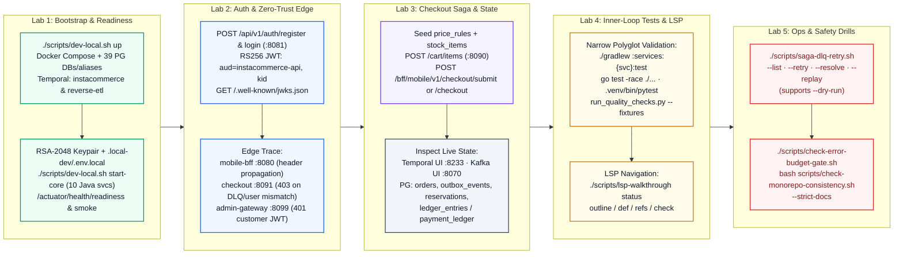
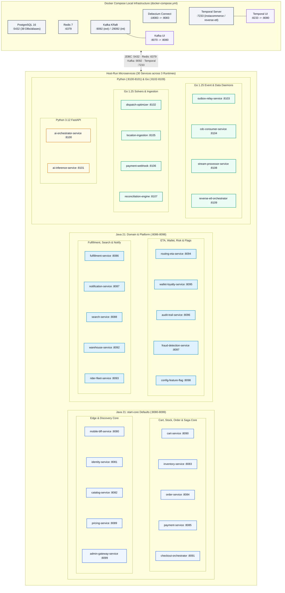

# 02 — InstaCommerce Hands-On Engineering Labs

> [!NOTE]
> **Part of the InstaCommerce Onboarding Suite:** [Onboarding Hub](./README.md) · [Day 0–5 Curriculum](./01-day0-to-day5-curriculum.md) · **Hands-On Labs (this guide)** · [Role Learning Tracks](./03-role-learning-tracks.md) · [First-PR & Troubleshooting](./04-first-pr-and-troubleshooting.md) · [Domain Model & Event Catalog](./05-domain-model-and-event-catalog.md) · [Incident Drills & Readiness Exam](./06-incident-drills-and-readiness-exam.md) · [Service Dependency & CLI Cheatsheet](./07-service-dependency-and-command-cheatsheet.md) · [Code Walkthrough Atlas](./code-walkthrough/README.md)
>
> **Audience:** New engineers onboarding onto the InstaCommerce polyglot monorepo (`20` Java 21 / Spring Boot `4.0.0` services, `8` Go `1.25` services, and `2` Python `3.12` / FastAPI services).
>
> **How to use these labs:** Run Labs 1 through 5 sequentially on a fresh workstation clone. Every command, port, route, SQL table, and script flag below is verified directly against the repository source tree. Where the checked-in runtime diverges from legacy documentation or has an open defect, the lab explicitly documents what happens today and links directly to the matching [Domain & Event Catalog (`05`)](./05-domain-model-and-event-catalog.md) and [Incident Drills (`06`)](./06-incident-drills-and-readiness-exam.md).

---

## Table of Contents

1. [End-to-End Lab Progression](#end-to-end-lab-progression)
2. [Local Infrastructure & Service Port Topology](#local-infrastructure--service-port-topology)
3. [Lab 1: Boot Local Stack & Verify Topology](#lab-1-boot-local-stack--verify-topology)
   - [1.1 Start Infrastructure & Generate Local Secrets](#11-start-infrastructure--generate-local-secrets)
   - [1.2 Inspect `.local-dev/.env.local` & RSA-2048 Keys](#12-inspect-local-devenvlocal--rsa-2048-keys)
   - [1.3 Verify 39 PostgreSQL Databases/Aliases & Temporal Namespaces](#13-verify-39-postgresql-databasesaliases--temporal-namespaces)
   - [1.4 Boot Core Java Services & Probe Health Endpoints](#14-boot-core-java-services--probe-health-endpoints)
4. [Lab 2: Auth & Zero-Trust Edge Trace](#lab-2-auth--zero-trust-edge-trace)
   - [2.1 Register, Login & Inspect JWKS / JWT Claims (`identity-service` `:8081`)](#21-register-login--inspect-jwks--jwt-claims-identity-service-8081)
   - [2.2 Trace `mobile-bff-service` (`:8080`) Header Sanitization & Context Propagation](#22-trace-mobile-bff-service-8080-header-sanitization--context-propagation)
   - [2.3 Verify Zero-Trust Boundaries on `checkout-orchestrator` (`:8091`), `admin-gateway` (`:8099`), and `order-service` (`:8084`)](#23-verify-zero-trust-boundaries-on-checkout-orchestrator-8091-admin-gateway-8099-and-order-service-8084)
5. [Lab 3: Checkout Saga & State Inspection](#lab-3-checkout-saga--state-inspection)
   - [3.1 Seed Local Preconditions & Add Cart Item](#31-seed-local-preconditions--add-cart-item)
   - [3.2 Trigger & Trace the Checkout Saga](#32-trigger--trace-the-checkout-saga)
   - [3.3 Inspect Temporal UI (`:8233`), PostgreSQL (`:5432`) & Kafka UI (`:8070`)](#33-inspect-temporal-ui-8233-postgresql-5432--kafka-ui-8070)
6. [Lab 4: Polyglot Inner-Loop Testing & LSP Navigation](#lab-4-polyglot-inner-loop-testing--lsp-navigation)
   - [4.1 Narrow Java Service Tests (Gradle)](#41-narrow-java-service-tests-gradle)
   - [4.2 Go Race-Detector Tests](#42-go-race-detector-tests)
   - [4.3 Python AI Service Pytest](#43-python-ai-service-pytest)
   - [4.4 Offline Data Quality Fixtures (`run_quality_checks.py`)](#44-offline-data-quality-fixtures-run_quality_checkspy)
   - [4.5 LSP Code Navigation & Diagnostics (`./scripts/lsp-walkthrough`)](#45-lsp-code-navigation--diagnostics-scriptslsp-walkthrough)
7. [Lab 5: Ops & Safety Drills](#lab-5-ops--safety-drills)
   - [5.1 Saga Compensation DLQ CLI (`scripts/saga-dlq-retry.sh`)](#51-saga-compensation-dlq-cli-scriptssaga-dlq-retrysh)
   - [5.2 ADR-015 Error Budget Gate (`scripts/check-error-budget-gate.sh`)](#52-adr-015-error-budget-gate-scriptscheck-error-budget-gatesh)
   - [5.3 Monorepo Consistency & Strict Documentation Gate](#53-monorepo-consistency--strict-documentation-gate)

---

## End-to-End Lab Progression

**Local Onboarding Lab Workflow (`Lab 1` to `Lab 5`)** — *[Rendered PNG](./diagrams/lab-workflow.png) · [Mermaid Source](./diagrams/lab-workflow.mmd)*



---

## Local Infrastructure & Service Port Topology

Before booting containers, inspect the host port layout across [`docker-compose.yml`](../../docker-compose.yml), [`GLOSSARY.md`](../../GLOSSARY.md#L55-L89), and [`scripts/dev-local.sh`](../../scripts/dev-local.sh#L22-L33).

**Local Docker Compose & Polyglot Service Port Map** — *[Rendered PNG](./diagrams/local-infra-ports.png) · [Mermaid Source](./diagrams/local-infra-ports.mmd)*



### Prerequisites Checklist

| Tool | Required By | Quick Verification |
|---|---|---|
| Docker Desktop / Engine (`docker compose`) | Lab 1, Lab 3 | `docker info && docker compose version` |
| Java `21` (`JAVA_HOME`) & Gradle wrapper | Lab 1, Lab 4 | `java -version && ./gradlew --version` |
| Go `1.25` | Lab 4 | `go version` |
| Python `3.12` + `PyYAML` | Lab 1, Lab 4, Lab 5 | `python3 --version && python3 -c "import yaml"` |
| `openssl`, `curl`, `jq` | Lab 1, Lab 2, Lab 3, Lab 5 | `command -v openssl curl jq` |
| LSP binaries (`gopls`, `pyright`, `jdtls`) | Lab 4 | `./scripts/lsp-walkthrough status` |

---

## Lab 1: Boot Local Stack & Verify Topology

**Objective:** Bootstrap Docker Compose dependencies, inspect the generated ephemeral RSA-2048 JWT keys and `.local-dev/.env.local`, verify all `39` PostgreSQL databases/aliases and Temporal namespaces, and confirm service readiness probes.

### 1.1 Start Infrastructure & Generate Local Secrets

[`scripts/dev-local.sh`](../../scripts/dev-local.sh#L212-L230) reads [`.env.local.example`](../../.env.local.example), generates an ephemeral local-only RSA-2048 keypair, boots [`docker-compose.yml`](../../docker-compose.yml), creates all PostgreSQL databases/roles, runs Go schema migrations, and registers Temporal namespaces.

```bash
./scripts/dev-local.sh up
```

Load the generated environment into your shell session:

```bash
set -a && source .local-dev/.env.local && set +a
```

### 1.2 Inspect `.local-dev/.env.local` & RSA-2048 Keys

Check permissions and contents produced by [`ensure_env`](../../scripts/dev-local.sh#L55-L99):

```bash
ls -la .local-dev .local-dev/jwt
openssl rsa -pubin -in .local-dev/jwt/public.pem -text -noout | head -n 5
grep -E '^(ENVIRONMENT|SPRING_PROFILES_ACTIVE|SPRING_CLOUD_GCP_SECRETMANAGER_ENABLED|OTEL_SDK_DISABLED|INTERNAL_SERVICE_TOKEN|TEMPORAL_NAMESPACE)=' .local-dev/.env.local
```

What to verify in the output:
1. `.local-dev/` and `.local-dev/jwt/` are `0700`; `.local-dev/.env.local` and `.local-dev/jwt/private.pkcs8.pem` are `0600`.
2. `public.pem` reports a `2048 bit` RSA public key.
3. Single-line Base64 DER strings (PEM headers stripped by [`to_single_line_der_b64`](../../scripts/dev-local.sh#L80-L85)) populate `IDENTITY_JWT_PRIVATE_KEY`, `IDENTITY_JWT_PUBLIC_KEY`, `JWT_PUBLIC_KEY`, and all service-specific `*_JWT_PUBLIC_KEY` variables.
4. `SPRING_CLOUD_GCP_SECRETMANAGER_ENABLED=false` ensures Spring Boot `${sm://...}` property expressions fall back to local env vars instead of calling GCP Secret Manager.
5. `INTERNAL_SERVICE_TOKEN=local-dev-internal-token` configures local service-to-service shared-token auth.

### 1.3 Verify 39 PostgreSQL Databases/Aliases & Temporal Namespaces

[`scripts/init-dbs.sql`](../../scripts/init-dbs.sql#L1-L60) (on fresh volume initialization) and [`ensure_postgres_roles_and_dbs`](../../scripts/dev-local.sh#L126-L155) (idempotent on every `up`) provision the `reconciliation` role plus **39** databases covering both canonical names and `*_db` aliases:

```bash
docker compose exec -T postgres psql -U postgres -lqt | cut -d \| -f 1 | awk '{$1=$1};NF' | grep -vE '^(postgres|template0|template1)$' | sort | wc -l
docker compose exec -T postgres psql -U reconciliation -d reconciliation -c "\dt"
```

> **Note:** On a brand-new `pgdata` volume, `init-dbs.sql` creates all 39 databases in [`scripts/init-dbs.sql`](../../scripts/init-dbs.sql#L13-L57) (`identity_db`, `orders`/`order_db`, `carts`/`cart_db`, `payments`/`payment_db`, `checkout`/`checkout_db`, `catalog`/`catalog_db`, `inventory`/`inventory_db`, `pricing`/`pricing_db`, `fulfillment`/`fulfillment_db`, `warehouse`/`warehouse_db`, `rider_fleet`/`rider_db`, `routing`/`routing_db`, `search`/`search_db`, `notification`/`notification_db`, `wallets`/`wallet_db`, `audit_db`/`audit`, `fraud`/`fraud_db`, `feature_flags_db`, `config_db`, `reconciliation`/`reconciliation_db`, `reverse_etl`/`reverse_etl_db`). Then `dev-local.sh up` runs [`apply_go_service_schemas`](../../scripts/dev-local.sh#L187-L200) so `reconciliation` and `reconciliation_db` already contain `reconciliation_runs`, `reconciliation_mismatches`, `reconciliation_fixes`, `payment_ledger`, and `psp_export_snapshot`.

Verify both Temporal namespaces created by [`ensure_temporal_namespaces`](../../scripts/dev-local.sh#L202-L210):

```bash
docker compose exec -T temporal temporal operator namespace describe --address temporal:7233 --namespace instacommerce
docker compose exec -T temporal temporal operator namespace describe --address temporal:7233 --namespace reverse-etl
```

### 1.4 Boot Core Java Services & Probe Health Endpoints

[`cmd_start_core`](../../scripts/dev-local.sh#L304-L384) builds `bootJar` artifacts for the `10` [`DEFAULT_CORE_SERVICES`](../../scripts/dev-local.sh#L22-L33) (`mobile-bff-service:8080`, `identity-service:8081`, `catalog-service:8082`, `inventory-service:8083`, `order-service:8084`, `payment-service:8085`, `pricing-service:8089`, `cart-service:8090`, `checkout-orchestrator-service:8091`, `admin-gateway-service:8099`), launches them with `-Xms128m -Xmx512m`, and polls `/actuator/health/readiness`:

```bash
# Start all 10 core Java services (or pass specific service[:port] args if memory-constrained)
./scripts/dev-local.sh start-core

# Inspect live status & run infrastructure + Kafka dual-listener + service smoke checks
./scripts/dev-local.sh status
./scripts/dev-local.sh smoke
```

If your workstation has constrained RAM, start only the services needed for Labs 2–3 by passing explicit specs:

```bash
./scripts/dev-local.sh start-core \
  identity-service:8081 \
  mobile-bff-service:8080 \
  pricing-service:8089 \
  cart-service:8090 \
  inventory-service:8083 \
  order-service:8084 \
  payment-service:8085 \
  checkout-orchestrator-service:8091 \
  admin-gateway-service:8099
```

Verify readiness probe conventions across runtimes:

```bash
# Java Spring Boot Actuator readiness (200 UP + DB probe where applicable)
curl -fsS http://localhost:8081/actuator/health/readiness | jq .
curl -fsS http://localhost:8080/actuator/health/readiness | jq .
curl -fsS http://localhost:8091/actuator/health/readiness | jq .
curl -fsS http://localhost:8099/actuator/health/readiness | jq .

# Debezium Connect REST API & Temporal / Kafka UIs
curl -fsS http://localhost:18083/connectors
```

When running Go or Python services directly on the host, their health endpoints follow [`AGENTS.md`](../../AGENTS.md#L139):
- **Go services** (via `services/go-shared/pkg/health`, e.g., [`outbox-relay-service/main.go`](../../services/outbox-relay-service/main.go#L72-L88) and [`reconciliation-engine/main.go`](../../services/reconciliation-engine/main.go#L200-L204)): `GET /health/ready`, `GET /health/live`, and `GET /health` (with `/ready` legacy alias on `reconciliation-engine`).
- **Python FastAPI services** ([`ai-orchestrator-service/app/main.py`](../../services/ai-orchestrator-service/app/main.py#L138-L150) and [`ai-inference-service/app/main.py`](../../services/ai-inference-service/app/main.py#L205-L223)): `GET /health`, `GET /health/ready`, and `GET /health/live`.

To stop services later without wiping Postgres data: `./scripts/dev-local.sh stop-core` or `./scripts/dev-local.sh down` (use `./scripts/dev-local.sh reset` to wipe volumes and re-initialize).

> **Lab 1 Debugging & Domain Map:**
> - **DB & Redis map (`05`):** Cross-check the `39` PostgreSQL DBs/aliases and `20` DB-backed vs `10` stateless services in [`05 § 1.1–1.2`](./05-domain-model-and-event-catalog.md#11-database-per-service-isolation-20-db-backed--10-statelessexternal-services) and the Redis keyspace in [`05 § 3.1`](./05-domain-model-and-event-catalog.md#31-service-by-service-redis-keyspace-catalog).
> - **Incident & Boot Drills (`06` / `04`):** If readiness probes stay down, `checkout-orchestrator` omits DB health, or `sm://` placeholders fail, follow [`06 Drill 5 (DatabaseFailover & JWKSKeyRotation)`](./06-incident-drills-and-readiness-exam.md#drill-5-databasefailover--jwkskeyrotation--regional-cloud-sql-promotion--dual-key-jwks-vs-static-edge-keys) and [`04 FAQ Q1–Q3`](./04-first-pr-and-troubleshooting.md#q1-kafka-connection-fails-unknownhostexception-kafka-or-connection-refused-on-9092--29092).

---

## Lab 2: Auth & Zero-Trust Edge Trace

**Objective:** Mint an RS256 customer JWT via `identity-service`, inspect `kid` and `aud: "instacommerce-api"` claims against the JWKS endpoint, trace header sanitization/propagation inside `mobile-bff-service`, and observe zero-trust enforcement differences on `checkout-orchestrator-service` and `admin-gateway-service`.

### 2.1 Register, Login & Inspect JWKS / JWT Claims (`identity-service` `:8081`)

[`AuthController.java`](../../services/identity-service/src/main/java/com/instacommerce/identity/controller/AuthController.java#L20-L49) exposes `/auth/*` and `/api/v1/auth/*`. [`RegisterRequest.java`](../../services/identity-service/src/main/java/com/instacommerce/identity/dto/request/RegisterRequest.java#L10-L20) enforces at least 8 characters with 1 uppercase letter and 1 digit. [`AuthService.register`](../../services/identity-service/src/main/java/com/instacommerce/identity/service/AuthService.java#L87-L126) assigns `Role.CUSTOMER` and writes `audit_log` + `outbox_events` (`UserRegistered`) in the same transaction.

```bash
export LAB_EMAIL="lab.user.$(date +%s)@instacommerce.dev"
export LAB_PASS="QuickCommerce1"

# Register a new customer (returns 201 Created with AuthResponse)
curl -fsS -X POST http://localhost:8081/api/v1/auth/register \
  -H "Content-Type: application/json" \
  -d "{\"email\":\"${LAB_EMAIL}\",\"password\":\"${LAB_PASS}\"}" | jq .

# Login with optional deviceInfo (rate-limited at 5 req / 60s per IP; locks out after 5 failures)
LOGIN_JSON=$(curl -fsS -X POST http://localhost:8081/api/v1/auth/login \
  -H "Content-Type: application/json" \
  -d "{\"email\":\"${LAB_EMAIL}\",\"password\":\"${LAB_PASS}\",\"deviceInfo\":\"macbook-lab2\"}")

export ACCESS_TOKEN=$(echo "$LOGIN_JSON" | jq -r '.accessToken')
export REFRESH_TOKEN=$(echo "$LOGIN_JSON" | jq -r '.refreshToken')
echo "$LOGIN_JSON" | jq '{tokenType, expiresIn}'
```

Inspect the published JWKS at [`JwksController.java`](../../services/identity-service/src/main/java/com/instacommerce/identity/security/JwksController.java#L14-L37) and decode the JWT header and payload produced by [`DefaultJwtService.generateAccessToken`](../../services/identity-service/src/main/java/com/instacommerce/identity/security/DefaultJwtService.java#L31-L48):

```bash
# Public JWKS keyset
curl -fsS http://localhost:8081/.well-known/jwks.json | jq .

# Decode JWT header & claims (extracts USER_ID and verifies kid matches JWKS)
python3 - "$ACCESS_TOKEN" <<'PY'
import base64, json, sys

hdr_b64, pay_b64, _ = sys.argv[1].split(".")
def decode(seg):
    return json.loads(base64.urlsafe_b64decode(seg + "=" * (-len(seg) % 4)))

header = decode(hdr_b64)
payload = decode(pay_b64)
print("HEADER:", json.dumps(header, indent=2))
print("PAYLOAD:", json.dumps(payload, indent=2))
PY

export USER_ID=$(python3 -c 'import base64,json,sys; p=sys.argv[1].split(".")[1]; print(json.loads(base64.urlsafe_b64decode(p+"="*(-len(p)%4)))["sub"])' "$ACCESS_TOKEN")
echo "USER_ID=$USER_ID"
```

Confirm these exact JWT invariants:
- **Header:** `alg: "RS256"`, `kid: "<SHA-256 Base64URL of RSA modulus + exponent>"` (matching [`JwtKeyLoader.computeKeyId`](../../services/identity-service/src/main/java/com/instacommerce/identity/security/JwtKeyLoader.java#L146-L155) and `/.well-known/jwks.json`).
- **Payload:** `iss: "instacommerce-identity"`, `sub: "<USER_ID>"`, `aud: "instacommerce-api"`, `roles: ["CUSTOMER"]`, `iat_ms`, `jti`, `iat`, `exp` (900s default TTL).

### 2.2 Trace `mobile-bff-service` (`:8080`) Header Sanitization & Context Propagation

[`MobileBffSecurityConfig.java`](../../services/mobile-bff-service/src/main/java/com/instacommerce/mobilebff/config/MobileBffSecurityConfig.java#L26-L47) leaves `/bff/mobile/v1/home`, `/m/v1/home`, and `GET /bff/mobile/v1/products/**` open (`permitAll`), while requiring authentication for `/bff/mobile/v1/cart/summary`, `/bff/mobile/v1/profile`, `/bff/mobile/v1/checkout/submit`, and `/bff/mobile/v1/cart/stream/**`.

Test unauthenticated vs. authenticated BFF paths and watch [`UserContextPropagationFilter`](../../services/mobile-bff-service/src/main/java/com/instacommerce/mobilebff/security/UserContextPropagationFilter.java#L43-L118):

```bash
# 1. Public home aggregation works anonymously
curl -i -s http://localhost:8080/bff/mobile/v1/home | head -n 15

# 2. Protected BFF endpoint rejects unauthenticated callers — even if client spoofs X-User-Id / X-Internal-Token!
curl -i -s http://localhost:8080/bff/mobile/v1/cart/summary \
  -H "X-User-Id: 00000000-0000-0000-0000-000000000999" \
  -H "X-Internal-Service: order-service" \
  -H "X-Internal-Token: fake-token" | head -n 15

# 3. Authenticated caller passes UserContextPropagationFilter (propagates verified X-User-Id, X-User-Roles, baggage)
curl -fsS http://localhost:8080/bff/mobile/v1/cart/summary \
  -H "Authorization: Bearer ${ACCESS_TOKEN}" | jq .
```

Under the hood, [`UserContextPropagationFilter.filter`](../../services/mobile-bff-service/src/main/java/com/instacommerce/mobilebff/security/UserContextPropagationFilter.java#L44-L103):
- Strips client-supplied `X-Internal-Service` and `X-Internal-Token` unconditionally.
- When `Bearer` JWT validation fails or is absent, calls `stripUntrustedHeaders()` to drop `X-User-Id`, `X-User-Roles`, `X-Customer-Tier`, `X-Order-Value-Bracket`, and `baggage`.
- When valid, overwrites `X-User-Id`, `X-User-Roles`, `X-Customer-Tier`, `X-Order-Value-Bracket`, and `baggage` (`customer_tier=...,order_value_bracket=...`) from verified JWT claims before calling downstream services via [`ScreenAggregator`](../../services/mobile-bff-service/src/main/java/com/instacommerce/mobilebff/aggregator/ScreenAggregator.java#L544-L554).

### 2.3 Verify Zero-Trust Boundaries on `checkout-orchestrator` (`:8091`), `admin-gateway` (`:8099`), and `order-service` (`:8084`)

Execute these four probes against downstream gateways and observe the exact security responses:

```bash
# 1. Unauthenticated checkout -> 401 AUTHENTICATION_REQUIRED (CheckoutController / SecurityConfig)
curl -i -s -X POST http://localhost:8091/api/v1/checkout \
  -H "Content-Type: application/json" \
  -d "{\"userId\":\"${USER_ID}\",\"paymentMethodId\":\"pm_card\",\"deliveryAddressId\":\"addr-1\"}" | head -n 15

# 2. Cross-user impersonation attempt with valid CUSTOMER JWT -> 403 FORBIDDEN ("Cannot checkout for another user")
curl -i -s -X POST http://localhost:8091/api/v1/checkout \
  -H "Authorization: Bearer ${ACCESS_TOKEN}" \
  -H "Content-Type: application/json" \
  -d "{\"userId\":\"00000000-0000-0000-0000-000000000999\",\"paymentMethodId\":\"pm_card\",\"deliveryAddressId\":\"addr-1\"}" | head -n 15

# 3. CUSTOMER JWT calling Saga DLQ operator endpoint -> 403 Forbidden (requires ADMIN or INTERNAL_SERVICE)
curl -i -s http://localhost:8091/checkout/dlq \
  -H "Authorization: Bearer ${ACCESS_TOKEN}" | head -n 15

# 4. admin-gateway :8099 permits /admin/health, but rejects CUSTOMER JWT (aud=instacommerce-api) with 401 TOKEN_INVALID!
curl -fsS http://localhost:8099/admin/health | jq .
curl -i -s http://localhost:8099/admin/v1/dashboard \
  -H "Authorization: Bearer ${ACCESS_TOKEN}" \
  -H "X-Admin-User: spoofed" \
  -H "X-Internal-Token: fake" | head -n 15

# 5. Decommissioned direct checkout on order-service -> 410 GONE (CHECKOUT_MOVED)
curl -i -s -X POST http://localhost:8084/checkout \
  -H "Authorization: Bearer ${ACCESS_TOKEN}" | head -n 15
```

Why does `/admin/v1/dashboard` return **`401 TOKEN_INVALID`** (and not `403`) for your customer JWT?
- Per [ADR-011](../adr/011-admin-gateway-auth-model.md#L29-L36), admin operations target `aud: "instacommerce-admin"`.
- During migration, [`admin-gateway-service/DefaultJwtService`](../../services/admin-gateway-service/src/main/java/com/instacommerce/admingateway/security/DefaultJwtService.java#L35-L70) accepts `instacommerce-admin,instacommerce-api` at signature parsing time, and then [`AdminJwtAuthenticationFilter`](../../services/admin-gateway-service/src/main/java/com/instacommerce/admingateway/security/AdminJwtAuthenticationFilter.java#L82-L106) enforces a hard bridge rule: if the token lacks `instacommerce-admin` AND lacks `ROLE_ADMIN`/`ROLE_SUPER_ADMIN`, it throws `JwtException("Token lacks required admin role for audience [instacommerce-api]")` (`401 TOKEN_INVALID`). It also strips all client-supplied `X-Admin-*` and `X-Internal-*` headers before filter evaluation.

> **Lab 2 Debugging & Domain Map:**
> - **DB, Kafka & Redis map (`05`):** Inspect `identity_db` tables (`users`, `refresh_tokens`, `outbox_events`) in [`05 § 1.2`](./05-domain-model-and-event-catalog.md#identity-catalog-search--pricing), `identity.events` in [`05 § 2.3`](./05-domain-model-and-event-catalog.md#23-complete-kafka-topic-partition-key--consumer-matrix), and Redis keys (`identity:ratelimit:*`, `identity:failed_logins:*`, `identity:revoked_jti:*`, `identity:revoked_user_before:*`) in [`05 § 3.1`](./05-domain-model-and-event-catalog.md#31-service-by-service-redis-keyspace-catalog).
> - **Incident Drill (`06`):** If tokens return unexpected `401 TOKEN_INVALID` after key changes or edge services reject valid `kid`s, trace [`06 Drill 5 Part B (JWKSKeyRotation & Static Edge Keys)`](./06-incident-drills-and-readiness-exam.md#drill-5-databasefailover--jwkskeyrotation--regional-cloud-sql-promotion--dual-key-jwks-vs-static-edge-keys) and [`06 Q2`](./06-incident-drills-and-readiness-exam.md#q2-zero-trust-edge-sanitization-legacy-order-service-endpoint--blank-storeid-fallback).

---

## Lab 3: Checkout Saga & State Inspection

**Objective:** Populate a minimal local product price rule and inventory stock row, execute the 10-step Temporal Checkout Saga ([`CheckoutWorkflowImpl`](../../services/checkout-orchestrator-service/src/main/java/com/instacommerce/checkout/workflow/CheckoutWorkflowImpl.java#L100-L296)), and inspect live distributed state across Temporal UI (`:8233`), PostgreSQL (`:5432`), and Kafka UI (`:8070`).

### 3.1 Seed Local Preconditions & Add Cart Item

Because local Postgres databases start empty (only Flyway DDL migrations run), insert one active rule into `pricing.price_rules` (used fail-closed by [`CartService.addItem`](../../services/cart-service/src/main/java/com/instacommerce/cart/service/CartService.java#L60-L66) and [`ProductPriceLookupService`](../../services/pricing-service/src/main/java/com/instacommerce/pricing/service/ProductPriceLookupService.java#L25-L30)) and one stock row into `inventory.stock_items` (note: [`V11__alter_store_id_to_uuid.sql`](../../services/inventory-service/src/main/resources/db/migration/V11__alter_store_id_to_uuid.sql#L5-L12) requires `store_id` to be a `UUID`; `00000000-0000-0000-0000-000000000001` matches [`CartValidationResult.DEFAULT_STORE_ID`](../../services/checkout-orchestrator-service/src/main/java/com/instacommerce/checkout/dto/CartValidationResult.java#L15)):

```bash
export PRODUCT_ID="11111111-1111-1111-1111-111111111111"
export STORE_ID="00000000-0000-0000-0000-000000000001"

# Seed active price rule in pricing DB (19900 cents = INR 199.00)
docker compose exec -T postgres psql -U postgres -d pricing -c \
  "INSERT INTO price_rules (product_id, base_price_cents, effective_from, rule_type, multiplier, active)
   VALUES ('${PRODUCT_ID}', 19900, NOW() - INTERVAL '1 day', 'STANDARD', 1.00, true)
   ON CONFLICT DO NOTHING;"

# Seed sellable inventory in inventory DB
docker compose exec -T postgres psql -U postgres -d inventory -c \
  "INSERT INTO stock_items (product_id, store_id, on_hand, reserved)
   VALUES ('${PRODUCT_ID}', '${STORE_ID}', 50, 0)
   ON CONFLICT (product_id, store_id) DO UPDATE SET on_hand = 50, reserved = 0;"
```

Add the item to your cart on `cart-service` (`:8090`) using [`AddItemRequest`](../../services/cart-service/src/main/java/com/instacommerce/cart/dto/request/AddItemRequest.java#L9-L25) and verify [`GET /cart`](../../services/cart-service/src/main/java/com/instacommerce/cart/controller/CartController.java#L35-L42):

```bash
curl -fsS -X POST http://localhost:8090/cart/items \
  -H "Authorization: Bearer ${ACCESS_TOKEN}" \
  -H "Content-Type: application/json" \
  -d "{\"productId\":\"${PRODUCT_ID}\",\"productName\":\"Organic Milk 1L\",\"unitPriceCents\":19900,\"quantity\":2,\"storeId\":\"${STORE_ID}\"}" | jq .

curl -fsS http://localhost:8090/cart \
  -H "Authorization: Bearer ${ACCESS_TOKEN}" | jq .
```

### 3.2 Trigger & Trace the Checkout Saga

You can enter either through `mobile-bff-service` (`POST http://localhost:8080/bff/mobile/v1/checkout/submit`) or directly against [`CheckoutController`](../../services/checkout-orchestrator-service/src/main/java/com/instacommerce/checkout/controller/CheckoutController.java#L75-L147) (`POST http://localhost:8091/checkout`). Passing `?async=true` returns HTTP `202` immediately with the deterministic `workflowId` (`checkout-<USER_ID>-<Idempotency-Key>`):

```bash
export IDEM_KEY="lab3-run-$(date +%s)"

# Option A: Submit asynchronously directly to checkout-orchestrator-service (:8091)
CHK_RESP=$(curl -s -X POST "http://localhost:8091/checkout?async=true" \
  -H "Authorization: Bearer ${ACCESS_TOKEN}" \
  -H "Idempotency-Key: ${IDEM_KEY}" \
  -H "Content-Type: application/json" \
  -d "{
    \"userId\": \"${USER_ID}\",
    \"paymentMethodId\": \"pm_card_visa\",
    \"deliveryAddressId\": \"addr-blr-koramangala-01\",
    \"dropoffLat\": 12.9352,
    \"dropoffLng\": 77.6245
  }")
echo "$CHK_RESP" | jq .
export WORKFLOW_ID=$(echo "$CHK_RESP" | jq -r '.workflowId')

# Poll Temporal workflow query state via CheckoutController
curl -fsS "http://localhost:8091/checkout/${WORKFLOW_ID}/status" \
  -H "Authorization: Bearer ${ACCESS_TOKEN}" | jq .
```

Or submit synchronously via `mobile-bff-service` (`:8080`) using a fresh `Idempotency-Key`:

```bash
curl -s -X POST http://localhost:8080/bff/mobile/v1/checkout/submit \
  -H "Authorization: Bearer ${ACCESS_TOKEN}" \
  -H "Idempotency-Key: bff-lab3-$(date +%s)" \
  -H "Content-Type: application/json" \
  -d "{
    \"userId\": \"${USER_ID}\",
    \"paymentMethodId\": \"pm_card_visa\",
    \"deliveryAddressId\": \"addr-blr-koramangala-01\"
  }" | jq .
```

> **Verified Repo-Truth Trap (`VARCHAR(64)` in `inventory.reservations`):**
> Inspect [`CheckoutWorkflowImpl.java`](../../services/checkout-orchestrator-service/src/main/java/com/instacommerce/checkout/workflow/CheckoutWorkflowImpl.java#L142-L144) alongside [`V2__create_reservations.sql`](../../services/inventory-service/src/main/resources/db/migration/V2__create_reservations.sql#L3-L11). Step 3 sends `idempotencyKey = workflowId + ":inventory:reserve"`, where `checkout-<36-char-UUID>-<key>:inventory:reserve` always exceeds `VARCHAR(64)`. On an unmodified schema, Postgres rejects the `INSERT INTO reservations`, Temporal retries `3x`, `CheckoutWorkflowImpl` transitions to `COMPENSATING` (verifiable directly in Temporal UI `:8233`), and `CheckoutController` caches the `FAILED` response for `30` minutes in `checkout_idempotency_keys`. Notice how [`OrderCreationService`](./code-walkthrough/services/order-service.md) avoids this by SHA-256 hashing keys longer than `64` chars, whereas [`ReservationService`](../../services/inventory-service/src/main/java/com/instacommerce/inventory/service/ReservationService.java#L131-L136) inserts the raw key. Note also that under `SPRING_PROFILES_ACTIVE=local`, `payment-service` activates [`MockPaymentGateway`](../../services/payment-service/src/main/java/com/instacommerce/payment/gateway/MockPaymentGateway.java#L7-L13) (`mock_pi_<uuid>`), so payment authorization and capture run completely offline without Stripe keys.

### 3.3 Inspect Temporal UI (`:8233`), PostgreSQL (`:5432`) & Kafka UI (`:8070`)

1. **Temporal UI (`http://localhost:8233`)**:
   - Open `http://localhost:8233` and select namespace **`instacommerce`**.
   - Filter by Workflow ID `checkout-...` (`WORKFLOW_ID`) to inspect the event history: `WorkflowExecutionStarted`, `ActivityTaskScheduled`/`Completed`/`Failed` (`ValidateCart`, `CalculatePrice`, `ReserveStock`, `AuthorizePayment`, `CreateOrder`, `CapturePayment`, `ConfirmStock`, `ConfirmOrder`), or LIFO `COMPENSATING` activities.

2. **PostgreSQL State Across Services (`:5432`)**:
   - Note that in local Postgres, `orders`, `inventory`, `payments`, `checkout`, and `reconciliation` are separate **databases** (for example, the `reservations` table lives inside the `inventory` database—often written shorthand as `inventory.reservations`).

```bash
# Order service DB: orders + transactional outbox_events
docker compose exec -T postgres psql -U postgres -d orders -c \
  "SELECT id, user_id, store_id, status, total_cents, payment_id, reservation_id, created_at FROM orders ORDER BY created_at DESC LIMIT 5;"
docker compose exec -T postgres psql -U postgres -d orders -c \
  "SELECT id, aggregate_type, aggregate_id, event_type, sent, created_at FROM outbox_events ORDER BY created_at DESC LIMIT 5;"

# Checkout DB: idempotency cache + saga compensation DLQ
docker compose exec -T postgres psql -U postgres -d checkout -c \
  "SELECT idempotency_key, created_at, expires_at FROM checkout_idempotency_keys ORDER BY created_at DESC LIMIT 5;"
docker compose exec -T postgres psql -U postgres -d checkout -c \
  "SELECT id, workflow_id, activity_name, status, retry_count, created_at FROM compensation_dlq ORDER BY created_at DESC LIMIT 5;"

# Inventory DB: reservations + stock_items + outbox_events
docker compose exec -T postgres psql -U postgres -d inventory -c \
  "SELECT id, store_id, status, idempotency_key, expires_at FROM reservations ORDER BY created_at DESC LIMIT 5;"
docker compose exec -T postgres psql -U postgres -d inventory -c \
  "SELECT product_id, store_id, on_hand, reserved FROM stock_items;"

# Payment DB: payments + double-entry ledger_entries
docker compose exec -T postgres psql -U postgres -d payments -c \
  "SELECT id, order_id, amount_cents, captured_cents, status, psp_reference FROM payments ORDER BY created_at DESC LIMIT 5;"
docker compose exec -T postgres psql -U postgres -d payments -c \
  "SELECT id, payment_id, entry_type, amount_cents, account, reference_type, reference_id FROM ledger_entries ORDER BY id DESC LIMIT 10;"

# Reconciliation DB: CDC payment_ledger & T+1 runs (populated when Debezium + reconciliation-engine run)
docker compose exec -T postgres psql -U reconciliation -d reconciliation -c \
  "SELECT transaction_id, payment_id, order_id, status, amount_cents, source_lsn FROM payment_ledger ORDER BY created_at DESC LIMIT 5;"
```

3. **Kafka UI (`http://localhost:8070`)**:
   - Open `http://localhost:8070` -> cluster **`local`** -> **Topics** to inspect domain topics (`orders.events`, `inventory.events`, `payments.events`, `orders.dlq`, and `.DLT` dead-letter topics).
   - **Why `outbox_events.sent` remains `false` during `start-core`:** Java services commit domain mutations and `outbox_events` rows in the same local ACID transaction; the Go [`outbox-relay-service`](../../services/outbox-relay-service/main.go) (`:8103`) polls `outbox_events WHERE sent = false FOR UPDATE SKIP LOCKED` and relays them to Kafka (`localhost:9092`). When only the 10 Java core services are running, `outbox_events` rows queue cleanly in Postgres until you start `outbox-relay-service`.

> **Lab 3 Debugging & Domain Map:**
> - **DB, Kafka & Redis map (`05`):** Cross-check `carts`, `price_quotes`, `stock_items`, `reservations`, `orders`, `outbox_events`, `payments`, and `ledger_entries` in [`05 § 1.2`](./05-domain-model-and-event-catalog.md#cart-checkout-saga-inventory--orders), the `VARCHAR(64)` overflow & ledger invariants in [`05 § 1.3`](./05-domain-model-and-event-catalog.md#13-cross-db-invariants-idempotency-normalization--verified-schema-drift), `outbox-relay` envelope flattening + topic matrix in [`05 § 2.1–2.3`](./05-domain-model-and-event-catalog.md#2-canonical-kafka-event-envelope--topic-catalog), and `cart:carts::*` / `pricing:*` / `promo:*` keys in [`05 § 3.1`](./05-domain-model-and-event-catalog.md#31-service-by-service-redis-keyspace-catalog).
> - **Incident Drills (`06`):** If `ReserveStock` fails or retries return cached `"FAILED"` responses, work through [`06 Drill 1 (CheckoutBurnRate_Critical)`](./06-incident-drills-and-readiness-exam.md#drill-1-checkoutburnrate_critical--flash-sale-backpressure-poisoned-failed-cache-hikari-deadlock--varchar64-overflow); for `AUTHORIZE_PENDING` or empty `payment_ledger` / `psp_export_snapshot` rows see [`06 Drill 2`](./06-incident-drills-and-readiness-exam.md#drill-2-paymentstuckpending--reconciliationmismatch--disabled-prod-recovery-dropped-razorpay-webhooks--empty-psp_export_snapshot); for `outbox_events.sent = false` pileups see [`06 Drill 3`](./06-incident-drills-and-readiness-exam.md#drill-3-outboxrelaybacklog--streamconsumerlag--open-pgxtx-pinning-volatile-retrycounts-topic-drift--offsettracker-stall).

---

## Lab 4: Polyglot Inner-Loop Testing & LSP Navigation

**Objective:** Practice fast, targeted verification across Java, Go, Python AI, and Data Quality without triggering slow full-monorepo builds, and navigate symbols with `./scripts/lsp-walkthrough`.

### 4.1 Narrow Java Service Tests (Gradle)

Never run `./gradlew test` across all 20 Java services during inner-loop iteration ([`AGENTS.md`](../../AGENTS.md#L44-L47)). Target the specific module, class, or method:

```bash
# Run a single test class in order-service
./gradlew :services:order-service:test --tests "com.instacommerce.order.controller.OrderControllerTest"

# Run a single security slice test in checkout-orchestrator-service
./gradlew :services:checkout-orchestrator-service:test --tests "com.instacommerce.checkout.security.CheckoutSecurityConfigTest"
```

### 4.2 Go Race-Detector Tests

[`AGENTS.md`](../../AGENTS.md#L79-L88) requires testing Go services package-by-package with `-race`:

```bash
# Run targeted unit test with Go race detector
(cd services/outbox-relay-service && go test -race -v ./... -run '^TestBuildEventMessage$')

# Run all unit tests in outbox-relay-service with -race
(cd services/outbox-relay-service && go test -race ./...)
```

### 4.3 Python AI Service Pytest

Per [`.github/workflows/ci.yml`](../../.github/workflows/ci.yml#L467-L505) and [`AGENTS.md`](../../AGENTS.md#L92-L99), Python services target Python `3.12` and run `pytest` from inside each service directory using a local `.venv` (create one once if not already present):

```bash
# ai-orchestrator-service (:8100)
(
  cd services/ai-orchestrator-service
  if [ ! -x .venv/bin/pytest ]; then
    python3 -m venv .venv && .venv/bin/pip install -r requirements.txt pytest httpx pytest-asyncio
  fi
  PYTHONPATH=../..:. .venv/bin/pytest tests/test_health.py -v
)

# ai-inference-service (:8101)
(
  cd services/ai-inference-service
  if [ ! -x .venv/bin/pytest ]; then
    python3 -m venv .venv && .venv/bin/pip install -r requirements.txt pytest httpx pytest-asyncio
  fi
  PYTHONPATH=../..:. .venv/bin/pytest tests/test_health.py -v
)
```

### 4.4 Offline Data Quality Fixtures (`run_quality_checks.py`)

[`data-platform/quality/run_quality_checks.py`](../../data-platform/quality/run_quality_checks.py#L266-L364) validates Great Expectations YAML suites (`daily_sales_suite.yaml`, `inventory_suite.yaml`, `orders_suite.yaml`, `payments_suite.yaml`, `users_suite.yaml`) offline against local JSON fixtures without requiring GCP credentials:

```bash
# Run all 5 data quality expectation suites against synthetic fixtures
(cd data-platform/quality && python3 run_quality_checks.py --fixtures)

# Target a single suite (e.g., orders_suite.yaml -> orders_validation)
(cd data-platform/quality && python3 run_quality_checks.py --suite orders --fixtures)
```

### 4.5 LSP Code Navigation & Diagnostics (`./scripts/lsp-walkthrough`)

Always inspect file outlines before reading large files ([`AGENTS.md`](../../AGENTS.md#L33-L40), [`scripts/lsp/code_walkthrough.py`](../../scripts/lsp/code_walkthrough.py#L600-L651)):

```bash
# 1. Verify gopls, pyright, and jdtls availability
./scripts/lsp-walkthrough status

# 2. Print symbol outline (classes, endpoints, methods, event emissions)
./scripts/lsp-walkthrough outline services/checkout-orchestrator-service/src/main/java/com/instacommerce/checkout/controller/CheckoutController.java

# 3. Jump to definition and list all cross-file references via gopls (1-based line and column)
./scripts/lsp-walkthrough def services/outbox-relay-service/main.go 66 18
./scripts/lsp-walkthrough refs services/outbox-relay-service/main.go 66 18

# 4. Run static diagnostics or tour a whole service
./scripts/lsp-walkthrough check services/outbox-relay-service
./scripts/lsp-walkthrough service checkout-orchestrator-service
```

> **Lab 4 Debugging & Domain Map:**
> - **DB, Kafka & Redis map (`05`):** When writing tests that touch domain entities, Kafka topics, or cache eviction, verify constraints and `.DLT`/`.dlq` conventions in [`05 § 2.3–2.4`](./05-domain-model-and-event-catalog.md#23-complete-kafka-topic-partition-key--consumer-matrix) and contract rules in [`05 § 4`](./05-domain-model-and-event-catalog.md#4-schema-evolution--contract-verification-rules).
> - **Incident & Toolchain Drills (`06` / `04`):** To see the exact production failure modes behind Go `-race` tests (`outbox-relay`, `stream-processor`, `location-ingestion`), review [`06 Drill 3`](./06-incident-drills-and-readiness-exam.md#drill-3-outboxrelaybacklog--streamconsumerlag--open-pgxtx-pinning-volatile-retrycounts-topic-drift--offsettracker-stall) and [`06 Drill 4`](./06-incident-drills-and-readiness-exam.md#drill-4-darkstoresaturation--dispatchnoavailablerider--capacity-pause-surge-cascade--gps-split-brain); for Spotless, `-race` CGO, or `PYTHONPATH` errors see [`04 FAQ Q4–Q6`](./04-first-pr-and-troubleshooting.md#q4-ci-build-test-fails-at-spotlesscheck-or--xlint-compilation-warnings).

---

## Lab 5: Ops & Safety Drills

**Objective:** Exercise the operational safety tooling used during stuck saga compensations, SLO burn-rate freezes, and pre-PR drift verification.

### 5.1 Saga Compensation DLQ CLI (`scripts/saga-dlq-retry.sh`)

[`scripts/saga-dlq-retry.sh`](../../scripts/saga-dlq-retry.sh#L24-L54) operates on [`CheckoutController`](../../services/checkout-orchestrator-service/src/main/java/com/instacommerce/checkout/controller/CheckoutController.java#L235-L307) (`/checkout/dlq`, `/checkout/dlq/{id}/retry`, `/checkout/dlq/{id}/resolve`) and Kafka `orders.dlq` replay. Always inspect with `--dry-run` before mutating state:

```bash
# Show CLI flags and defaults
./scripts/saga-dlq-retry.sh --help

# Safe dry-run drills (zero HTTP or Kafka mutation)
./scripts/saga-dlq-retry.sh --retry 4b5f483b-3162-4217-bc2d-5221b2507851 --dry-run
./scripts/saga-dlq-retry.sh --resolve 4b5f483b-3162-4217-bc2d-5221b2507851 --note "Verified stock released manually" --dry-run
./scripts/saga-dlq-retry.sh --replay --dry-run
```

> **Ops Security Note:** [`checkout-orchestrator-service/SecurityConfig.java`](../../services/checkout-orchestrator-service/src/main/java/com/instacommerce/checkout/security/SecurityConfig.java#L36) restricts `/checkout/dlq/**` to `hasAnyRole('ADMIN', 'INTERNAL_SERVICE')`, whereas [`saga-dlq-retry.sh`](../../scripts/saga-dlq-retry.sh#L126-L148) currently sends unauthenticated `curl` requests. Against a live service, `--list` without `--dry-run` returns HTTP `401` unless you curl `/checkout/dlq` directly with a bearer token carrying `ROLE_ADMIN` or `ROLE_INTERNAL_SERVICE`.

### 5.2 ADR-015 Error Budget Gate (`scripts/check-error-budget-gate.sh`)

[`scripts/check-error-budget-gate.sh`](../../scripts/check-error-budget-gate.sh#L75-L165) implements [ADR-015](../adr/015-slo-error-budget-policy.md) and [`monitoring/error-budget-policy.yaml`](../../monitoring/error-budget-policy.yaml#L4-L44):
- **Tier 0** (`99.90%` / `43.2m` monthly budget): `identity-service`, `checkout-orchestrator-service`, `payment-service`
- **Tier 1** (`99.50%` / `216m`): `order-service`, `inventory-service`, `fulfillment-service`, `cart-service`, `pricing-service`, `rider-fleet-service`, `routing-eta-service`
- **Tier 2** (`99.00%` / `432m`): all remaining services

Run the three safety drills locally:

```bash
# 1. Dry-run mode when Prometheus is unreachable locally (simulates 100.000% availability -> PASS)
./scripts/check-error-budget-gate.sh --service checkout-orchestrator-service --dry-run

# 2. Simulate Tier 0 budget exhaustion (0.998 vs 0.999 target -> -100.00% remaining -> exit 1 BLOCKED)
./scripts/check-error-budget-gate.sh --service checkout-orchestrator-service --simulated-availability 0.998 || echo "Blocked as expected (exit $?)"

# 3. Emergency hotfix override with VP approval token (exit 0)
./scripts/check-error-budget-gate.sh \
  --service checkout-orchestrator-service \
  --simulated-availability 0.998 \
  --emergency-override \
  --vp-token VP-ENG-OVERRIDE-HOTFIX
```

### 5.3 Monorepo Consistency & Strict Documentation Gate

Before opening any pull request, run [`scripts/check-monorepo-consistency.sh`](../../scripts/check-monorepo-consistency.sh#L335-L360) with `--strict-docs`. It verifies all 9 drift categories across CI `paths-filter` matrices, Helm & Istio `servicePolicies`, Java/Go toolchains & Dependabot coverage, Flyway sequential versions & `outbox_events` presence, `CODEOWNERS` & canonical [`GLOSSARY.md`](../../GLOSSARY.md) ports, Protobuf/ArgoCD/Dockerfile alignment, `.agents`/`.github` skill parity, dbt refs, and [`consistency_checks.py`](../../scripts/consistency_checks.py#L153-L221) doc-drift checks:

```bash
bash scripts/check-monorepo-consistency.sh --strict-docs
```

Expected result on a clean tree: **0 failures** (`Monorepo is consistent and aligned with standards!`).

> **Lab 5 Debugging & Domain Map:**
> - **Dead-Letter & Schema Map (`05`):** Distinguish PostgreSQL `compensation_dlq`, `orders.dlq`, `outbox.relay.dlq`, `cdc.dlq`, and ADR-003 `.DLT` topics in [`05 § 2.4`](./05-domain-model-and-event-catalog.md#24-dead-letter-semantics-dlt-vs-dlq--verified-topiccdc-drift) and [`05 § 4`](./05-domain-model-and-event-catalog.md#4-schema-evolution--contract-verification-rules).
> - **SLO & Incident Runbooks (`06`):** Map the ADR-015 error-budget freeze mechanics and Prometheus burn-rate alerts in [`06 § 1 Alerting, Escalation & Error-Budget Mechanics`](./06-incident-drills-and-readiness-exam.md#1-alerting-escalation--error-budget-mechanics) and practice authenticated DLQ retries in [`06 Drill 1`](./06-incident-drills-and-readiness-exam.md#drill-1-checkoutburnrate_critical--flash-sale-backpressure-poisoned-failed-cache-hikari-deadlock--varchar64-overflow).

---

**Previous:** [01 — Day 0–5 Engineering Curriculum](./01-day0-to-day5-curriculum.md) | **Onboarding Hub:** [InstaCommerce Onboarding Hub](./README.md) | **Next:** [03 — Role-Based 5-Day Learning Tracks](./03-role-learning-tracks.md)
