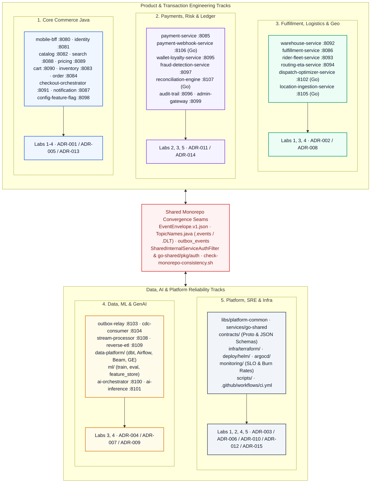

# 03 — InstaCommerce Role-Based 5-Day Learning Tracks

> [!NOTE]
> **Part of the InstaCommerce Onboarding Suite:** [Onboarding Hub](./README.md) · [Day 0–5 Curriculum](./01-day0-to-day5-curriculum.md) · [Hands-On Labs](./02-hands-on-labs.md) · **Role Learning Tracks (this guide)** · [First-PR & Troubleshooting](./04-first-pr-and-troubleshooting.md) · [Domain Model & Event Catalog](./05-domain-model-and-event-catalog.md) · [Incident Drills & Readiness Exam](./06-incident-drills-and-readiness-exam.md) · [Service Dependency & CLI Cheatsheet](./07-service-dependency-and-command-cheatsheet.md) · [Code Walkthrough Atlas](./code-walkthrough/README.md)
>
> **Purpose:** Map every onboarding engineer to a focused 5-day curriculum covering the exact microservices, shared components, ADRs, domain tables/topics, hands-on labs, and Day-5 exam scenarios owned by their team—without requiring you to read all `30` service walkthroughs in a single sitting.
>
> **Prerequisites:** Read the [Whole-System Code Walkthrough Atlas](./code-walkthrough/README.md) overview and keep [`GLOSSARY.md`](../../GLOSSARY.md) plus [`05-domain-model-and-event-catalog.md`](./05-domain-model-and-event-catalog.md) open as your domain and contract references.

---

## Table of Contents

1. [Role-to-Subsystem Ownership Map](#role-to-subsystem-ownership-map)
   - [Role Quick Selector](#role-quick-selector)
2. [Track 1: Core Commerce Java Engineer](#track-1-core-commerce-java-engineer)
3. [Track 2: Payments, Risk & Ledger Engineer](#track-2-payments-risk--ledger-engineer)
4. [Track 3: Fulfillment, Logistics & Geo Engineer](#track-3-fulfillment-logistics--geo-engineer)
5. [Track 4: Data, ML & GenAI Engineer](#track-4-data-ml--genai-engineer)
6. [Track 5: Platform, SRE & Infra Engineer](#track-5-platform-sre--infra-engineer)
7. [Onboarding Completion Checklist](#onboarding-completion-checklist)

---

## Role-to-Subsystem Ownership Map

**Role-to-Subsystem Ownership & Shared Convergence Seams** — *[Rendered PNG](./diagrams/role-tracks-map.png) · [Mermaid Source](./diagrams/role-tracks-map.mmd)*

### Role Quick Selector

| Role Track | CODEOWNERS Teams | Primary Runtime(s) | Core Walkthroughs | Required ADRs | Mandatory Labs | Domain Catalog (`05`) & Exam/Drills (`06`) |
|---|---|---|---|---|---|---|
| **[1. Core Commerce Java](#track-1-core-commerce-java-engineer)** | `@instacommerce/core-checkout`, `@instacommerce/search-catalog`, `@instacommerce/identity`, `@instacommerce/engagement` | Java 21 / Spring Boot `4.0.0` (WebFlux + MVC + Temporal) | `mobile-bff`, `identity`, `catalog`, `search`, `pricing`, `cart`, `inventory`, `order`, `checkout-orchestrator`, `notification`, `config-feature-flag` | `001`, `004`, `005`, `013` | [Lab 1](./02-hands-on-labs.md#lab-1-boot-local-stack--verify-topology)–[Lab 4](./02-hands-on-labs.md#lab-4-polyglot-inner-loop-testing--lsp-navigation) | [`05` Commerce Tables/Topics](./05-domain-model-and-event-catalog.md#identity-catalog-search--pricing) · [`06` Q1–Q2](./06-incident-drills-and-readiness-exam.md#track-1-core-commerce-java-engineer-q1q2) & [Drill 1](./06-incident-drills-and-readiness-exam.md#drill-1-checkoutburnrate_critical--flash-sale-backpressure-poisoned-failed-cache-hikari-deadlock--varchar64-overflow) |
| **[2. Payments, Risk & Ledger](#track-2-payments-risk--ledger-engineer)** | `@instacommerce/payment-eng`, `@instacommerce/payments` | Java 21 + Go `1.25` | `payment`, `payment-webhook`, `wallet-loyalty`, `fraud-detection`, `reconciliation-engine`, `audit-trail`, `admin-gateway` | `005`, `006`, `011`, `014` | [Lab 2](./02-hands-on-labs.md#lab-2-auth--zero-trust-edge-trace), [Lab 3](./02-hands-on-labs.md#lab-3-checkout-saga--state-inspection), [Lab 5](./02-hands-on-labs.md#lab-5-ops--safety-drills) | [`05` Money/Ledger Tables](./05-domain-model-and-event-catalog.md#payments-wallets-fraud--governance) · [`06` Q3–Q4](./06-incident-drills-and-readiness-exam.md#track-2-payments-risk--ledger-engineer-q3q4) & [Drill 2](./06-incident-drills-and-readiness-exam.md#drill-2-paymentstuckpending--reconciliationmismatch--disabled-prod-recovery-dropped-razorpay-webhooks--empty-psp_export_snapshot) |
| **[3. Fulfillment, Logistics & Geo](#track-3-fulfillment-logistics--geo-engineer)** | `@instacommerce/logistics` | Java 21 + Go `1.25` | `warehouse`, `fulfillment`, `rider-fleet`, `routing-eta`, `dispatch-optimizer`, `location-ingestion` | `002`, `004`, `008` | [Lab 1](./02-hands-on-labs.md#lab-1-boot-local-stack--verify-topology), [Lab 3](./02-hands-on-labs.md#lab-3-checkout-saga--state-inspection), [Lab 4](./02-hands-on-labs.md#lab-4-polyglot-inner-loop-testing--lsp-navigation) | [`05` Geo/GPS Split-Brain](./05-domain-model-and-event-catalog.md#34-deep-dive-the-3-way-rider-gps-split-brain--reverse-etl-gap) · [`06` Q5–Q6](./06-incident-drills-and-readiness-exam.md#track-3-fulfillment-logistics--geo-engineer-q5q6) & [Drill 4](./06-incident-drills-and-readiness-exam.md#drill-4-darkstoresaturation--dispatchnoavailablerider--capacity-pause-surge-cascade--gps-split-brain) |
| **[4. Data, ML & GenAI](#track-4-data-ml--genai-engineer)** | `@instacommerce/data-ml` | Go `1.25` + Python `3.12` (FastAPI / LangGraph) + SQL/dbt | `outbox-relay`, `cdc-consumer`, `stream-processor`, `reverse-etl-orchestrator`, `ai-orchestrator`, `ai-inference`, `data-platform-lakehouse`, `ml-platform` | `003`, `004`, `007`, `009` | [Lab 3](./02-hands-on-labs.md#lab-3-checkout-saga--state-inspection), [Lab 4](./02-hands-on-labs.md#lab-4-polyglot-inner-loop-testing--lsp-navigation) | [`05` Topics/DLT & Redis](./05-domain-model-and-event-catalog.md#2-canonical-kafka-event-envelope--topic-catalog) · [`06` Q7–Q8](./06-incident-drills-and-readiness-exam.md#track-4-data-ml--genai-engineer-q7q8) & [Drill 3](./06-incident-drills-and-readiness-exam.md#drill-3-outboxrelaybacklog--streamconsumerlag--open-pgxtx-pinning-volatile-retrycounts-topic-drift--offsettracker-stall) |
| **[5. Platform, SRE & Infra](#track-5-platform-sre--infra-engineer)** | `@instacommerce/platform`, `@instacommerce/platform-infra`, `@instacommerce/sre` | Java 21 + Go `1.25` + Terraform / Helm / Bash | `platform-common-java`, `go-shared`, `contracts-and-proto`, `infra-terraform-gitops`, `ci-observability-scripts`, `admin-gateway`, `config-feature-flag`, `audit-trail` | `003`, `006`, `010`, `012`, `015` | [Lab 1](./02-hands-on-labs.md#lab-1-boot-local-stack--verify-topology), [Lab 2](./02-hands-on-labs.md#lab-2-auth--zero-trust-edge-trace), [Lab 4](./02-hands-on-labs.md#lab-4-polyglot-inner-loop-testing--lsp-navigation), [Lab 5](./02-hands-on-labs.md#lab-5-ops--safety-drills) | [`05` DBs/Contracts/Redis](./05-domain-model-and-event-catalog.md#4-schema-evolution--contract-verification-rules) · [`06` Q9–Q10](./06-incident-drills-and-readiness-exam.md#track-5-platform-sre--infra-engineer-q9q10) & [Drill 5](./06-incident-drills-and-readiness-exam.md#drill-5-databasefailover--jwkskeyrotation--regional-cloud-sql-promotion--dual-key-jwks-vs-static-edge-keys) |

---

## Track 1: Core Commerce Java Engineer

**Domain Focus:** Edge BFF & identity authentication, dark-store discovery, dynamic pricing & promotions, optimistic/pessimistic cart mutations, deadlock-free inventory locking, and Temporal checkout saga orchestration.

> **Domain Map (`05`) & Exam/Drills (`06`):** Reference [`05 § 1.2` (`Identity, Catalog, Search, Pricing, Cart, Inventory, Orders`)](./05-domain-model-and-event-catalog.md#identity-catalog-search--pricing), the [`VARCHAR(64)` overflow invariant (`05 § 1.3`)](./05-domain-model-and-event-catalog.md#13-cross-db-invariants-idempotency-normalization--verified-schema-drift), Kafka topics `identity.events` / `catalog.events` / `cart.events` / `pricing.events` / `inventory.events` / `orders.events` ([`05 § 2.3`](./05-domain-model-and-event-catalog.md#23-complete-kafka-topic-partition-key--consumer-matrix)), and Redis `TwoLevelCache` + `promo:*` keys ([`05 § 3.1`](./05-domain-model-and-event-catalog.md#31-service-by-service-redis-keyspace-catalog)). Before graduating Day 5, pass **[Exam Track 1 (Q1–Q2)](./06-incident-drills-and-readiness-exam.md#track-1-core-commerce-java-engineer-q1q2)** and complete **[Drill 1 (`CheckoutBurnRate_Critical`)](./06-incident-drills-and-readiness-exam.md#drill-1-checkoutburnrate_critical--flash-sale-backpressure-poisoned-failed-cache-hikari-deadlock--varchar64-overflow)** + **[Drill 5 Part B (`JWKS & Edge Static Keys`)](./06-incident-drills-and-readiness-exam.md#drill-5-databasefailover--jwkskeyrotation--regional-cloud-sql-promotion--dual-key-jwks-vs-static-edge-keys)**.

| Day | Focus & Readings | Hands-On Labs & Verification |
|---|---|---|
| **Day 1** | **Whole-System Model & Local Stack** — Read [01-system-hld.md](./code-walkthrough/01-system-hld.md), [02-system-lld.md](./code-walkthrough/02-system-lld.md), and [platform-common-java.md](./code-walkthrough/components/platform-common-java.md). Understand `store_id` partitioning, PgBouncer 500-connection limits, and `TwoLevelCacheManager`. | Complete **[Lab 1](./02-hands-on-labs.md#lab-1-boot-local-stack--verify-topology)**: boot Postgres/Redis/Kafka/Temporal, verify all `39` DBs and `10` core Java readiness probes. |
| **Day 2** | **Edge Gateway, Auth & Feature Flags** — Read [mobile-bff-service.md](./code-walkthrough/services/mobile-bff-service.md), [identity-service.md](./code-walkthrough/services/identity-service.md), [config-feature-flag-service.md](./code-walkthrough/services/config-feature-flag-service.md), and [ADR-013](../adr/013-feature-flag-cache-invalidation.md). Trace `UserContextPropagationFilter`, RS256 JWKS rotation, and Murmur3/Redis Pub/Sub flag invalidation. | Complete **[Lab 2](./02-hands-on-labs.md#lab-2-auth--zero-trust-edge-trace)**: mint JWTs, decode `kid`/`aud: "instacommerce-api"`, and test header stripping on `mobile-bff-service`. |
| **Day 3** | **Discovery, Pricing & Cart Concurrency** — Read [catalog-service.md](./code-walkthrough/services/catalog-service.md), [search-service.md](./code-walkthrough/services/search-service.md), [pricing-service.md](./code-walkthrough/services/pricing-service.md), [cart-service.md](./code-walkthrough/services/cart-service.md), and [notification-service.md](./code-walkthrough/services/notification-service.md). Focus on `PriceRule` (`HALF_UP`), HMAC `PriceQuote` signing, `If-Match` ETag cart concurrency, and `409 STORE_MISMATCH`. | Seed `pricing.price_rules` and exercise `POST /cart/items` + `GET /cart` in **[Lab 3.1](./02-hands-on-labs.md#31-seed-local-preconditions--add-cart-item)**. |
| **Day 4** | **Inventory, Order FSM & Checkout Saga** — Read [inventory-service.md](./code-walkthrough/services/inventory-service.md), [order-service.md](./code-walkthrough/services/order-service.md), [checkout-orchestrator-service.md](./code-walkthrough/services/checkout-orchestrator-service.md), [03-system-end-to-end-flows.md](./code-walkthrough/03-system-end-to-end-flows.md), [ADR-001](../adr/001-checkout-authority.md), [ADR-004](../adr/004-event-envelope.md), and [ADR-005](../adr/005-durable-idempotency.md). Trace sorted `SELECT FOR UPDATE`, FEFO batches, `410 GONE` `LegacyCheckoutController`, and the 10-step Temporal saga + LIFO unwind. | Complete **[Lab 3.2–3.3](./02-hands-on-labs.md#32-trigger--trace-the-checkout-saga)**: run a checkout workflow, inspect Temporal UI (`:8233`), `orders` / `outbox_events` / `inventory.reservations`, and diagnose the `VARCHAR(64)` reservation key bug. |
| **Day 5** | **Contracts, Inner-Loop Tests & Pre-PR Gate** — Read [contracts-and-proto.md](./code-walkthrough/components/contracts-and-proto.md). Review `EventEnvelope.v1.json` and `TopicNames.java` `.events`/`.DLT` pairing. | Complete **[Lab 4](./02-hands-on-labs.md#lab-4-polyglot-inner-loop-testing--lsp-navigation)** (`OrderControllerTest`, `CheckoutSecurityConfigTest`, `./scripts/lsp-walkthrough outline`) and run `bash scripts/check-monorepo-consistency.sh --strict-docs` from **[Lab 5.3](./02-hands-on-labs.md#53-monorepo-consistency--strict-documentation-gate)**. |

---

## Track 2: Payments, Risk & Ledger Engineer

**Domain Focus:** Avoiding held PostgreSQL transactions during PSP calls (2-TX pending pattern), double-entry ledgers, webhook HMAC/signature deduplication, synchronous fraud scoring, immutable SHA-256 audit chains, and T+1 settlement reconciliation.

> **Domain Map (`05`) & Exam/Drills (`06`):** Reference [`05 § 1.2` (`Payments, Wallets, Fraud, Audit` & `reconciliation-engine`)](./05-domain-model-and-event-catalog.md#payments-wallets-fraud--governance), double-entry ledger & `psp_export_snapshot` invariants ([`05 § 1.3`](./05-domain-model-and-event-catalog.md#13-cross-db-invariants-idempotency-normalization--verified-schema-drift)), topics `payments.events` / `wallet.events` / `fraud.events` / `payment.webhooks` / `reconciliation.events` / `reconciliation.cdc` ([`05 § 2.3`](./05-domain-model-and-event-catalog.md#23-complete-kafka-topic-partition-key--consumer-matrix)), and Redis `payment-webhook:event:*` / `fraud:score:*` keys ([`05 § 3.1`](./05-domain-model-and-event-catalog.md#31-service-by-service-redis-keyspace-catalog)). Before graduating Day 5, pass **[Exam Track 2 (Q3–Q4)](./06-incident-drills-and-readiness-exam.md#track-2-payments-risk--ledger-engineer-q3q4)** and complete **[Drill 2 (`PaymentStuckPending & ReconciliationMismatch`)](./06-incident-drills-and-readiness-exam.md#drill-2-paymentstuckpending--reconciliationmismatch--disabled-prod-recovery-dropped-razorpay-webhooks--empty-psp_export_snapshot)**.

| Day | Focus & Readings | Hands-On Labs & Verification |
|---|---|---|
| **Day 1** | **Architecture, Pool Ceiling & Zero-Trust Auth** — Read [01-system-hld.md](./code-walkthrough/01-system-hld.md), [02-system-lld.md](./code-walkthrough/02-system-lld.md), [ADR-005](../adr/005-durable-idempotency.md), and [ADR-006](../adr/006-internal-service-auth.md). Focus on why Cloud SQL `max_connections=500` forbids holding DB locks across PSP HTTP calls. | Complete **[Lab 1](./02-hands-on-labs.md#lab-1-boot-local-stack--verify-topology)** and **[Lab 2](./02-hands-on-labs.md#lab-2-auth--zero-trust-edge-trace)** (especially `admin-gateway` `AdminJwtAuthenticationFilter` `401` audience checks). |
| **Day 2** | **2-TX Pending Payment Saga & Double-Entry Ledger** — Read [payment-service.md](./code-walkthrough/services/payment-service.md) and [ADR-001](../adr/001-checkout-authority.md). Trace `AUTHORIZE_PENDING` -> Stripe / `MockPaymentGateway` -> `AUTHORIZED` -> `OrderPacked` capture (`LedgerService` `DEBIT`/`CREDIT` entries, `idx_ledger_entries_dedup`, and stale pending recovery jobs). | Execute **[Lab 3](./02-hands-on-labs.md#lab-3-checkout-saga--state-inspection)** and query `payments` + `ledger_entries` in Postgres `payments` DB; inspect `MockPaymentGateway` behavior under `SPRING_PROFILES_ACTIVE=local`. |
| **Day 3** | **PSP Webhooks & Wallet / Loyalty** — Read [payment-webhook-service.md](./code-walkthrough/services/payment-webhook-service.md), [wallet-loyalty-service.md](./code-walkthrough/services/wallet-loyalty-service.md), and [go-shared.md](./code-walkthrough/components/go-shared.md). Study Stripe/Razorpay/PhonePe HMAC verification + Redis `SETNX` deduplication, split-tender `SELECT FOR UPDATE`, and the `CHECKOUT_SAGA_ROLLBACK` double-refund guard. | Run Go race tests (`go test -race ./...`) in `services/payment-webhook-service` and Java tests in `:services:payment-service:test` (see **[Lab 4](./02-hands-on-labs.md#lab-4-polyglot-inner-loop-testing--lsp-navigation)**). |
| **Day 4** | **Fraud Detection, Audit Chain & Admin Gateway** — Read [fraud-detection-service.md](./code-walkthrough/services/fraud-detection-service.md), [audit-trail-service.md](./code-walkthrough/services/audit-trail-service.md), [admin-gateway-service.md](./code-walkthrough/services/admin-gateway-service.md), and [ADR-011](../adr/011-admin-gateway-auth-model.md). Trace fail-closed `AUTO_BLOCK`, `>= 2` chargebacks auto-blocklist, and `pg_advisory_xact_lock` SHA-256 hash chaining. | Trace `AdminDashboardController` `/admin/v1/fraud/*`, `/admin/v1/audit/*`, and `/admin/v1/reconciliation/*` routes alongside **[Lab 2.3](./02-hands-on-labs.md#23-verify-zero-trust-boundaries-on-checkout-orchestrator-8091-admin-gateway-8099-and-order-service-8084)**. |
| **Day 5** | **T+1 Reconciliation Engine & DLQ Operations** — Read [reconciliation-engine.md](./code-walkthrough/services/reconciliation-engine.md), [checkout-orchestrator-service.md](./code-walkthrough/services/checkout-orchestrator-service.md), and [ADR-014](../adr/014-reconciliation-authority.md). Note the monotonic `source_lsn` CDC upsert, `SAVEPOINT` matcher, and missing `psp_export_snapshot` writer gap. | Run **[Lab 5.1](./02-hands-on-labs.md#51-saga-compensation-dlq-cli-scriptssaga-dlq-retrysh)** (`saga-dlq-retry.sh --dry-run`), **[Lab 5.2](./02-hands-on-labs.md#52-adr-015-error-budget-gate-scriptscheck-error-budget-gatesh)** for Tier 0 `payment-service`, and inspect `payment_ledger` in `reconciliation` DB. |

---

## Track 3: Fulfillment, Logistics & Geo Engineer

**Domain Focus:** Hyperlocal 10-minute dark-store SLA physics, warehouse assignment and cold-chain alerts, wave picking + `OrderPacked` triggers, dual rider-dispatch split-brain (Redis GEO + `SKIP LOCKED` vs. Go bipartite optimizer), Kalman/H3 GPS ingestion, and WebSocket ETA tracking.

> **Domain Map (`05`) & Exam/Drills (`06`):** Reference [`05 § 1.2` (`Warehouse, Fulfillment, Fleet & Routing`)](./05-domain-model-and-event-catalog.md#warehouse-fulfillment-fleet-routing-reconciliation--reverse-etl), `store_id` column drift ([`05 § 1.3`](./05-domain-model-and-event-catalog.md#13-cross-db-invariants-idempotency-normalization--verified-schema-drift)), topics `warehouse.events` / `fulfillment.events` / `rider.events` / `delivery.events` / `rider.location.updates` / `rider.geofence.events` ([`05 § 2.3`](./05-domain-model-and-event-catalog.md#23-complete-kafka-topic-partition-key--consumer-matrix)), and the **3-way Rider GPS split-brain** + Lua CAS/mutex scripts ([`05 § 3.2` & `§ 3.4`](./05-domain-model-and-event-catalog.md#34-deep-dive-the-3-way-rider-gps-split-brain--reverse-etl-gap)). Before graduating Day 5, pass **[Exam Track 3 (Q5–Q6)](./06-incident-drills-and-readiness-exam.md#track-3-fulfillment-logistics--geo-engineer-q5q6)** and complete **[Drill 4 (`DarkStoreSaturation & DispatchNoAvailableRider`)](./06-incident-drills-and-readiness-exam.md#drill-4-darkstoresaturation--dispatchnoavailablerider--capacity-pause-surge-cascade--gps-split-brain)**.

| Day | Focus & Readings | Hands-On Labs & Verification |
|---|---|---|
| **Day 1** | **Quick-Commerce Delivery Physics & System Flows** — Read [01-system-hld.md](./code-walkthrough/01-system-hld.md) and [03-system-end-to-end-flows.md](./code-walkthrough/03-system-end-to-end-flows.md) (`Flow 3`). Understand why `25 km/h` speed + `3m` warehouse prep mandates dark-store `store_id` locality and async post-order execution. | Complete **[Lab 1](./02-hands-on-labs.md#lab-1-boot-local-stack--verify-topology)** to stand up Postgres, Redis, Kafka, and Temporal infrastructure. |
| **Day 2** | **Dark Store Topology & Warehouse Picking** — Read [warehouse-service.md](./code-walkthrough/services/warehouse-service.md) and [fulfillment-service.md](./code-walkthrough/services/fulfillment-service.md). Trace `PRIMARY_PINCODE` + `15km` store resolution, capacity slot locking (`100`), 10-aisle Dijkstra vs. S-curve picking, 4-tote wave batching, `OrderPacked`, 6-digit OTP handoff, and `<= 200KB` WEBP proof-of-delivery. | Trace `inventory` + `orders` state transitions in **[Lab 3](./02-hands-on-labs.md#lab-3-checkout-saga--state-inspection)** and outline `FulfillmentController` / `PickService` via `./scripts/lsp-walkthrough outline`. |
| **Day 3** | **Rider Fleet & Dispatch Authority** — Read [rider-fleet-service.md](./code-walkthrough/services/rider-fleet-service.md), [dispatch-optimizer-service.md](./code-walkthrough/services/dispatch-optimizer-service.md), [ADR-002](../adr/002-dispatch-authority.md), and [ADR-008](../adr/008-dispatch-optimizer-integration.md). Compare `GEORADIUS riders:active` + `SKIP LOCKED` default assignment against `dispatch-optimizer-service` (`optimizer-enabled=false` split-brain). | Run targeted unit & race tests in `services/rider-fleet-service` and `services/dispatch-optimizer-service` following **[Lab 4.1–4.2](./02-hands-on-labs.md#41-narrow-java-service-tests-gradle)**. |
| **Day 4** | **High-Frequency GPS Telemetry & ETA Estimation** — Read [location-ingestion-service.md](./code-walkthrough/services/location-ingestion-service.md), [routing-eta-service.md](./code-walkthrough/services/routing-eta-service.md), and [go-shared.md](./code-walkthrough/components/go-shared.md). Inspect Kalman filtering, Lua CAS updates on `rider:location:*` and `riders:h3:*`, `Haversine * 1.4` + barrier/weather/IST multipliers, and `/ws/tracking` STOMP broadcasts. | Run `go test -race ./...` and `./scripts/lsp-walkthrough def/refs` on `services/location-ingestion-service` and `services/dispatch-optimizer-service` (**[Lab 4.5](./02-hands-on-labs.md#45-lsp-code-navigation--diagnostics-scriptslsp-walkthrough)**). |
| **Day 5** | **Cross-Boundary Events & Consistency Verification** — Read [contracts-and-proto.md](./code-walkthrough/components/contracts-and-proto.md) and [ADR-004](../adr/004-event-envelope.md). Verify how `fulfillment.events`, `rider.events`, `rider.location.updates`, and `delivery.events` align with `TopicNames.java` and `outbox-relay-service`. | Run `bash scripts/check-monorepo-consistency.sh --strict-docs` and `./scripts/check-error-budget-gate.sh --service fulfillment-service --dry-run` (**[Lab 5](./02-hands-on-labs.md#lab-5-ops--safety-drills)**). |

---

## Track 4: Data, ML & GenAI Engineer

**Domain Focus:** Transactional outbox relay & Debezium WAL CDC, real-time Kafka windowing, BigQuery lakehouse (`dbt` staging -> intermediate -> marts + Airflow + Beam + Great Expectations), offline ML training/eval gates, Redis Reverse ETL feature stores, and guardrailed FastAPI / LangGraph services.

> **Domain Map (`05`) & Exam/Drills (`06`):** Reference `reverse_etl` & stateless sink boundaries ([`05 § 1.1`](./05-domain-model-and-event-catalog.md#11-database-per-service-isolation-20-db-backed--10-statelessexternal-services)), `EventEnvelope.v1.json`, `outbox-relay` payload flattening, `.DLT` vs `.dlq`, and `notifications.events` / singular topic drift ([`05 § 2.1–2.4`](./05-domain-model-and-event-catalog.md#2-canonical-kafka-event-envelope--topic-catalog)), plus `stream-processor`, `reverse-etl` Lua atomic swap (`REDIS_ADDR=""`), `ai-inference`, and `ai-orchestrator` Redis keys ([`05 § 3.1–3.4`](./05-domain-model-and-event-catalog.md#3-complete-redis-keyspace-lua-scripts--split-brain-topology)). Before graduating Day 5, pass **[Exam Track 4 (Q7–Q8)](./06-incident-drills-and-readiness-exam.md#track-4-data-ml--genai-engineer-q7q8)** and complete **[Drill 3 (`OutboxRelayBacklog & StreamConsumerLag`)](./06-incident-drills-and-readiness-exam.md#drill-3-outboxrelaybacklog--streamconsumerlag--open-pgxtx-pinning-volatile-retrycounts-topic-drift--offsettracker-stall)**.

| Day | Focus & Readings | Hands-On Labs & Verification |
|---|---|---|
| **Day 1** | **Event Backbone & Envelope Contracts** — Read [contracts-and-proto.md](./code-walkthrough/components/contracts-and-proto.md), [outbox-relay-service.md](./code-walkthrough/services/outbox-relay-service.md), [ADR-003](../adr/003-kafka-dlt-naming.md), and [ADR-004](../adr/004-event-envelope.md). Learn `EventEnvelope.v1.json`, `outbox-relay` payload flattening + dual headers, and `.events` / `.DLT` conventions. | Complete **[Lab 3.3](./02-hands-on-labs.md#33-inspect-temporal-ui-8233-postgresql-5432--kafka-ui-8070)** (inspect `outbox_events` + Kafka UI `:8070`) and run `outbox-relay-service` `-race` tests in **[Lab 4.2](./02-hands-on-labs.md#42-go-race-detector-tests)**. |
| **Day 2** | **CDC Sink & Streaming Pipelines** — Read [cdc-consumer-service.md](./code-walkthrough/services/cdc-consumer-service.md), [stream-processor-service.md](./code-walkthrough/services/stream-processor-service.md), and [03-system-end-to-end-flows.md](./code-walkthrough/03-system-end-to-end-flows.md) (`Flow 4`). Note `batchCh` backpressure, `insertID` dedup, Bloom+Redis `SetNX` dedup, and `stream-processor`'s Redis/Prometheus-only sink reality. | Run `go test -race ./...` in `services/cdc-consumer-service` and `services/stream-processor-service`, and inspect Debezium Connect (`:18083`) from **[Lab 1](./02-hands-on-labs.md#lab-1-boot-local-stack--verify-topology)**. |
| **Day 3** | **Lakehouse: dbt, Airflow, Beam & Great Expectations** — Read [data-platform-lakehouse.md](./code-walkthrough/components/data-platform-lakehouse.md). Trace the `8` staging -> `3` intermediate -> `10` mart dbt models, `8` Airflow DAGs (`KafkaLagSensor`), `6` Beam pipelines, and schema-drift seams (`raw_cdc.*` vs `stg_*.sql`). | Run `python3 run_quality_checks.py --fixtures` and `pytest test_quality_checks.py -v` in **[Lab 4.4](./02-hands-on-labs.md#44-offline-data-quality-fixtures-run_quality_checkspy)**. |
| **Day 4** | **Offline ML Training, Eval Gates & Reverse ETL** — Read [ml-platform.md](./code-walkthrough/components/ml-platform.md) and [reverse-etl-orchestrator.md](./code-walkthrough/services/reverse-etl-orchestrator.md). Study `feature_definitions.py` (`[T-30d, T-1d]`), the `6` trainers, fail-closed eval gates (`fairness >= 0.8`), and `reverse-etl-orchestrator` `WorkerPool(10)` + Lua `RENAME`/`PEXPIRE` swap (`HTTP` push only today). | Run `PYTHONPATH=. pytest -v ml/tests` and verify `reverse-etl` Temporal namespace + `reverse_etl` DB migrations created in **[Lab 1.3](./02-hands-on-labs.md#13-verify-39-postgresql-databasesaliases--temporal-namespaces)**. |
| **Day 5** | **AI Orchestrator (LangGraph) & AI Inference Serving** — Read [ai-orchestrator-service.md](./code-walkthrough/services/ai-orchestrator-service.md), [ai-inference-service.md](./code-walkthrough/services/ai-inference-service.md), [ADR-007](../adr/007-python-ci-standard.md), and [ADR-009](../adr/009-ai-service-authentication.md). Trace the 7-node LangGraph (`InjectionDetector`, `PIIVault`, `0.50 USD` / 25-call cap), 7 inference routes, feature parity Z-score checks, and fallback defaults. | Run `.venv/bin/pytest` in `ai-orchestrator-service` & `ai-inference-service` plus `pyright` via `./scripts/lsp-walkthrough check` (**[Lab 4.3 & 4.5](./02-hands-on-labs.md#43-python-ai-service-pytest)**), then run `bash scripts/check-monorepo-consistency.sh --strict-docs`. |

---

## Track 5: Platform, SRE & Infra Engineer

**Domain Focus:** Shared Java/Go security & resilience libraries, Wire Contracts/Protobuf governance, Terraform GCP modules, Umbrella Helm + Istio zero-trust mesh, GitHub Actions `paths-filter` CI, ArgoCD GitOps sync, and ADR-015 multi-window burn-rate gates.

> **Domain Map (`05`) & Exam/Drills (`06`):** Reference `17` CloudSQL Terraform DBs vs `39` local DBs ([`05 § 1.1`](./05-domain-model-and-event-catalog.md#11-database-per-service-isolation-20-db-backed--10-statelessexternal-services)), ADR-003 `.DLT`/`.dlq` & `cdc-consumer` Helm env gaps ([`05 § 2.4`](./05-domain-model-and-event-catalog.md#24-dead-letter-semantics-dlt-vs-dlq--verified-topiccdc-drift)), Redis Pub/Sub vs Caffeine-only service splits ([`05 § 3.1–3.3`](./05-domain-model-and-event-catalog.md#3-complete-redis-keyspace-lua-scripts--split-brain-topology)), and [Schema Evolution & Contract Rules (`05 § 4`)](./05-domain-model-and-event-catalog.md#4-schema-evolution--contract-verification-rules). Before graduating Day 5, pass **[Exam Track 5 (Q9–Q10)](./06-incident-drills-and-readiness-exam.md#track-5-platform-sre--infra-engineer-q9q10)**, review **[Alerting, Escalation & Error-Budget Mechanics (`06 § 1`)](./06-incident-drills-and-readiness-exam.md#1-alerting-escalation--error-budget-mechanics)**, and complete **[Drill 5 (`DatabaseFailover & JWKSKeyRotation`)](./06-incident-drills-and-readiness-exam.md#drill-5-databasefailover--jwkskeyrotation--regional-cloud-sql-promotion--dual-key-jwks-vs-static-edge-keys)** (plus [Drills 1–4](./06-incident-drills-and-readiness-exam.md#3-five-interactive-on-call-incident-drills)).

| Day | Focus & Readings | Hands-On Labs & Verification |
|---|---|---|
| **Day 1** | **Monorepo Topology, Bootstrap & Drift Governance** — Read [01-system-hld.md](./code-walkthrough/01-system-hld.md), [ci-observability-scripts.md](./code-walkthrough/components/ci-observability-scripts.md), and [`.github/CODEOWNERS`](../../.github/CODEOWNERS). Inspect how `settings.gradle.kts`, `go.work`, `GLOSSARY.md`, `deploy/helm/values.yaml`, and `.github/workflows/ci.yml` stay synchronized. | Complete **[Lab 1](./02-hands-on-labs.md#lab-1-boot-local-stack--verify-topology)** and run `bash scripts/check-monorepo-consistency.sh --strict-docs` (**[Lab 5.3](./02-hands-on-labs.md#53-monorepo-consistency--strict-documentation-gate)**). |
| **Day 2** | **Shared Security, Caching & HTTP Libraries** — Read [platform-common-java.md](./code-walkthrough/components/platform-common-java.md), [go-shared.md](./code-walkthrough/components/go-shared.md), [ADR-006](../adr/006-internal-service-auth.md), [ADR-010](../adr/010-per-service-token-rollout.md), and [ADR-012](../adr/012-per-service-token-scoping.md). Trace `SharedInternalServiceAuthFilter`, `go-shared/pkg/auth`, `pkg/httpclient` (CB + 5s DNS cache), and `ProblemDetailFactory`. | Complete **[Lab 2](./02-hands-on-labs.md#lab-2-auth--zero-trust-edge-trace)** and trace cross-language auth filters with `./scripts/lsp-walkthrough` (**[Lab 4.5](./02-hands-on-labs.md#45-lsp-code-navigation--diagnostics-scriptslsp-walkthrough)**). |
| **Day 3** | **Contracts, Protobuf & Schema Compatibility** — Read [contracts-and-proto.md](./code-walkthrough/components/contracts-and-proto.md), [ADR-003](../adr/003-kafka-dlt-naming.md), and [ADR-004](../adr/004-event-envelope.md). Inspect `SchemaCompatibilityValidator`, `TopicNames.java`, `91` JSON schemas, `10` `.proto` files, and the unused `generateGoProto` (`pkg/proto`) gap. | Run `./gradlew :contracts:build` and `./scripts/lsp-walkthrough check contracts` (**[Lab 4](./02-hands-on-labs.md#lab-4-polyglot-inner-loop-testing--lsp-navigation)**). |
| **Day 4** | **Terraform, Helm, Istio Mesh & ArgoCD Reality** — Read [infra-terraform-gitops.md](./code-walkthrough/components/infra-terraform-gitops.md), [admin-gateway-service.md](./code-walkthrough/services/admin-gateway-service.md), and [audit-trail-service.md](./code-walkthrough/services/audit-trail-service.md). Audit `deploy/helm/values.yaml` (5 shortened Go Helm keys + `43` Istio policies), `argocd/app-of-apps.yaml`, and documented infra gaps (NetworkPolicy `metrics` scrape port, literal `PROJECT:REGION:INSTANCE`, canary `.enabled` no-op, Terraform DB/SA/IAM/secret mismatches). | Inspect Istio policy check via `python3 scripts/consistency_checks.py istio-policies` and review [`docs/runbooks/jwks-key-rotation-runbook.md`](../runbooks/jwks-key-rotation-runbook.md) & [`docs/runbooks/database-failover.md`](../runbooks/database-failover.md). |
| **Day 5** | **Observability, Multi-Window Burn Rates & Incident Drills** — Read [ADR-015](../adr/015-slo-error-budget-policy.md), [`monitoring/error-budget-policy.yaml`](../../monitoring/error-budget-policy.yaml), and [`docs/slos/service-slos.md`](../slos/service-slos.md). Compare `prometheus-rules.yaml` (`14.4x`/`6x`/`3x` burn rates) against documented drift (`wave-40` metric names and empty `grafana-dashboards/`). | Complete **[Lab 5.1 & 5.2](./02-hands-on-labs.md#lab-5-ops--safety-drills)**: run `saga-dlq-retry.sh --dry-run`, `check-error-budget-gate.sh` (dry-run, simulated exhaustion block, VP override), and `(cd monitoring/synthetics && pytest -v)`. |

---

## Onboarding Completion Checklist

Before shipping your first feature or taking on-call shadow shifts, confirm you can complete all five checkpoints independently:

1. **Local Environment:** Boot Postgres (`39` DBs/aliases), Redis, Kafka, Debezium, Temporal (`instacommerce`, `reverse-etl`), and targeted Java services via `./scripts/dev-local.sh`, then verify health probes cleanly.
2. **Edge & Zero-Trust Verification:** Register/login on `identity-service`, decode `kid` and `aud: "instacommerce-api"`, and explain why `mobile-bff-service`, `checkout-orchestrator-service`, and `admin-gateway-service` accept or reject the same token differently.
3. **End-to-End State Correlation:** Trace a checkout workflow ID across Temporal UI (`:8233`), Postgres (`orders`, `outbox_events`, `inventory` `reservations`, `payments` `ledger_entries`), and Kafka UI (`:8070`).
4. **Fast Inner Loop:** Run narrow tests (`./gradlew :services:<svc>:test --tests ...`, `go test -race ./...`, `.venv/bin/pytest`, `run_quality_checks.py --fixtures`) and navigate code with `./scripts/lsp-walkthrough` instead of scanning entire files blindly.
5. **Pre-PR & Ops Safety:** Simulate an ADR-015 error-budget block with `scripts/check-error-budget-gate.sh`, dry-run `scripts/saga-dlq-retry.sh`, and pass `bash scripts/check-monorepo-consistency.sh --strict-docs`.
6. **Domain Verification & Readiness Exam:** Cross-check your owned tables, Kafka topics, and Redis keys in [`05-domain-model-and-event-catalog.md`](./05-domain-model-and-event-catalog.md), and complete your track's incident drill(s) plus `2` role-track scenarios (Q1–Q10) in [`06-incident-drills-and-readiness-exam.md`](./06-incident-drills-and-readiness-exam.md#4-day-5-production-readiness-exam-10-role-track-scenarios).

---

**Previous:** [02 — Hands-On Engineering Labs](./02-hands-on-labs.md) | **Onboarding Hub:** [InstaCommerce Onboarding Hub](./README.md) | **Next:** [04 — First-PR Playbook & Troubleshooting](./04-first-pr-and-troubleshooting.md)
