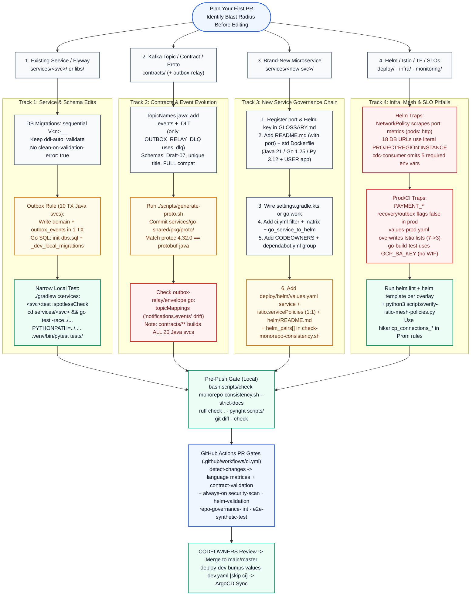
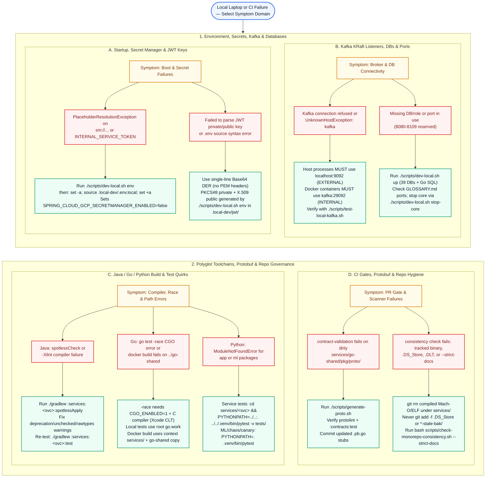

# First-PR Playbook & Troubleshooting Guide

> [!NOTE]
> **Part of the InstaCommerce Onboarding Suite:** [Onboarding Hub](./README.md) · [Day 0–5 Curriculum](./01-day0-to-day5-curriculum.md) · [Hands-On Labs](./02-hands-on-labs.md) · [Role Learning Tracks](./03-role-learning-tracks.md) · **First-PR & Troubleshooting (this guide)** · [Domain Model & Event Catalog](./05-domain-model-and-event-catalog.md) · [Incident Drills & Readiness Exam](./06-incident-drills-and-readiness-exam.md) · [Service Dependency & CLI Cheatsheet](./07-service-dependency-and-command-cheatsheet.md) · [Code Walkthrough Atlas](./code-walkthrough/README.md)
>
> Every checklist, file path, flag, and CI rule below is verified directly against [`scripts/check-monorepo-consistency.sh`](../../scripts/check-monorepo-consistency.sh), [`scripts/consistency_checks.py`](../../scripts/consistency_checks.py), [`scripts/consistency_checks_extra.py`](../../scripts/consistency_checks_extra.py), [`.github/workflows/ci.yml`](../../.github/workflows/ci.yml), [`.github/CODEOWNERS`](../../.github/CODEOWNERS), [`.github/dependabot.yml`](../../.github/dependabot.yml), [`deploy/helm/values.yaml`](../../deploy/helm/values.yaml), and [`docs/onboarding/code-walkthrough/components/ci-observability-scripts.md`](./code-walkthrough/components/ci-observability-scripts.md).

---

## Table of Contents

1. [First-PR Decision Tree & CI Blast-Radius Map](#1-first-pr-decision-tree--ci-blast-radius-map)
2. [How to Make Safe Changes (Step-by-Step Checklists)](#2-how-to-make-safe-changes-step-by-step-checklists)
   - [2.1 Modifying an Existing Service or Flyway Migration](#21-modifying-an-existing-service-or-flyway-migration)
   - [2.2 Adding or Evolving a Kafka Topic / JSON Schema / Protobuf Contract](#22-adding-or-evolving-a-kafka-topic--json-schema--protobuf-contract)
   - [2.3 Onboarding a Brand-New Microservice](#23-onboarding-a-brand-new-microservice)
   - [2.4 Touching Helm, Istio, Terraform, or SLO Rules (Known Pitfalls)](#24-touching-helm-istio-terraform-or-slo-rules-known-pitfalls)
3. [Laptop & CI Troubleshooting FAQ](#3-laptop--ci-troubleshooting-faq)
4. [Pre-Push & Release Gate Quick Reference](#4-pre-push--release-gate-quick-reference)

---

## 1. First-PR Decision Tree & CI Blast-Radius Map

Before editing files, classify your change against `.github/workflows/ci.yml`'s `detect-changes` job, the 422-check consistency scanner, and the [`07` File-Ownership Map](./07-service-dependency-and-command-cheatsheet.md#2-where-does-this-change-go-decision--file-ownership-map) so you know which local tests, codegen steps, and governance files must move together.

**First-PR Blast Radius & Verification Decision Tree** — *[Rendered PNG](./diagrams/first-pr-decision-tree.png) · [Mermaid Source](./diagrams/first-pr-decision-tree.mmd)*



### CI Path-Filter Blast Radius ([`.github/workflows/ci.yml`](../../.github/workflows/ci.yml#L50-L185))

| Path Modified | CI Jobs Triggered by `detect-changes` | Fan-Out & Notes |
|---|---|---|
| `services/<java-svc>/**` | `build-test` (`<java-svc>` only) | Runs `./gradlew :services:<svc>:build`, `:spotlessCheck`, `:bootJar` |
| `contracts/**` | `contract-validation`, `build-test` (**all 20 Java services**), `data-platform-quality` | Protolint, `:contracts:test`, `generate-proto.sh` drift check, JSON/proto compat checks |
| `build.gradle.kts`, `settings.gradle.kts`, `gradle/**`, `libs/**` | `build-test` (**all 20 Java services**) | `java-shared` filter expands `changed_services` to the entire Java fleet |
| `services/*/src/main/resources/db/migration/**` | `build-test` (service) + `data-platform-quality` | Schema changes alert data-platform checks |
| `services/<go-svc>/**` | `go-build-test` (`<go-svc>` only) | Runs `go build ./...`, `golangci-lint v1.64`, `go test -race` |
| `services/go-shared/**` | `go-build-test` (**all 9 Go modules**) | Expands `changed_go_services` to `go-shared` + 8 Go services |
| `services/ai-{orchestrator,inference}-service/**` | `python-build-test` | Runs `ruff check .`, `pyright`, and `pytest` across service + `ml`, `data-platform/*`, `monitoring/synthetics`, `tests/chaos` |
| `data-platform/**`, `data-platform-jobs/**` | `data-platform-quality` | Runs GE `--fixtures`, `pytest`, `ruff`, and dbt YAML `yaml.safe_load` |
| `ml/**` | `ml-validation` | Runs `ruff check ml`, `pyright ml`, `PYTHONPATH=. pytest -v ml` |
| `monitoring/synthetics/**`, `tests/chaos/**` | **Not filtered** in `detect-changes`! | `python-build-test` runs them only when an AI service changes; run them manually locally |
| **Always on every PR / push** | `security-scan`, `dependency-review` (PR), `helm-validation`, `repo-governance-lint`, `e2e-synthetic-test` | Gitleaks + Trivy FS, Helm lint/template + `verify-istio-mesh-policies.py`, Ruff + Pyright + `check-monorepo-consistency.sh`, Playwright Chromium |

---

## 2. How to Make Safe Changes (Step-by-Step Checklists)

### 2.1 Modifying an Existing Service or Flyway Migration

Follow this workflow whenever modifying Java, Go, or Python service code or database schemas (and cross-check owned tables, FK/unique invariants, and schema rules in [`05 § 1.2–1.3`](./05-domain-model-and-event-catalog.md#12-complete-postgresql-schema--constraint-inventory) and [`05 § 4 Schema Evolution & Contract Verification Rules`](./05-domain-model-and-event-catalog.md#4-schema-evolution--contract-verification-rules)):

1. **Navigate without blowing context (`AGENTS.md` token protocol):**
   - For any file over 500 lines, inspect symbols first with `./scripts/lsp-walkthrough outline <file_path>`, then read only the target method range.
   - Check the service's walkthrough under [`docs/onboarding/code-walkthrough/services/`](./code-walkthrough/README.md#4-microservice-code-walkthroughs-30-services) for locking invariants, flags, and known pitfalls before coding.

2. **Flyway migration rules (18 DB-backed Java services):**
   - **Always append a new forward migration** (`V<n>__<snake_case_description>.sql`) under `services/<svc>/src/main/resources/db/migration/` — never edit an already-merged migration file because Flyway checksum validation will fail on existing environments.
   - **Keep versions strictly sequential and unique:** `check-monorepo-consistency.sh` ([lines 171–178](../../scripts/check-monorepo-consistency.sh#L171-L178)) fails if two files share a `V[0-9]+__` prefix (e.g., `payment-service` has a legacy `V11_1__`; do not repeat underscores in version numbers for new migrations).
   - **Keep Hibernate in validation mode:** All 18 DB-backed Java services set `spring.jpa.hibernate.ddl-auto: validate` and `open-in-view: false`. Your Flyway SQL DDL must match JPA `@Entity`/`@Column` types and constraints exactly.
   - **Never enable `clean-on-validation-error: true`:** [`check-monorepo-consistency.sh`](../../scripts/check-monorepo-consistency.sh#L180-L183) fails if `clean-on-validation-error: true` appears in any `services/*/src/main/resources/application*.yml`.

3. **Transactional Outbox rules (`10` transactional Java services):**
   - [`check-monorepo-consistency.sh`](../../scripts/check-monorepo-consistency.sh#L155-L169) requires an `outbox` migration in `order-service`, `payment-service`, `inventory-service`, `fulfillment-service`, `catalog-service`, `rider-fleet-service`, `cart-service`, `wallet-loyalty-service`, `warehouse-service`, and `pricing-service`.
   - **Atomic persistence:** Write domain state changes and `outbox_events` rows inside the **same local `@Transactional` boundary** (`Propagation.MANDATORY` in `OutboxService`). Never call `KafkaTemplate.send()` or external HTTP APIs inside an open DB transaction.
   - **Envelope columns:** Ensure `outbox_events` populates `event_id`, `schema_version`, `source_service`, `correlation_id`, and `event_timestamp` (see [`V10__add_outbox_envelope_fields.sql`](../../services/order-service/src/main/resources/db/migration/V10__add_outbox_envelope_fields.sql)) alongside `aggregate_type`, `aggregate_id`, `event_type`, and `payload`.
   - **Avoid `REQUIRES_NEW` self-deadlock:** Never hold a `FOR UPDATE` row lock in an outer `@Transactional` method and call a helper annotated with `Propagation.REQUIRES_NEW` that locks the same row (a live bug documented in [`payment-service`'s `OrderPackedEventConsumer`](./code-walkthrough/services/payment-service.md#9-must-fix-code-risks--documentation-drift)).

4. **Local `init-dbs.sql` and Go SQL migrations:**
   - Local PostgreSQL initialization lives in [`scripts/init-dbs.sql`](../../scripts/init-dbs.sql) and [`scripts/dev-local.sh`](../../scripts/dev-local.sh#L126-L155), which create **`39` databases/aliases** (both bare service defaults such as `orders` and Helm `*_db` names such as `order_db`, plus the `reconciliation` role). Note that [`scripts/README.md`](../../scripts/README.md) still mentions an older 17-database list — trust `init-dbs.sql`.
   - Go services do **not** run Flyway at startup:
     - `reconciliation-engine` stores SQL migrations in [`services/reconciliation-engine/src/main/resources/db/migration/`](../../services/reconciliation-engine/src/main/resources/db/migration/) (`V1`–`V5`).
     - `reverse-etl-orchestrator` stores SQL migrations in [`services/reverse-etl-orchestrator/db/migration/`](../../services/reverse-etl-orchestrator/db/migration/) (`V1__create_reverse_etl_schema.sql`).
     - Locally, `./scripts/dev-local.sh up` applies both directories into both bare and `*_db` databases and tracks applied filenames in `_dev_local_migrations`.
   - **`.gitignore` trap for `.sql` files:** [`.gitignore`](../../.gitignore#L244-L247) ignores all `*.sql` files except `!scripts/init-dbs.sql`, `!services/**/src/main/resources/db/migration/*.sql`, and `!data-platform/dbt/**/*.sql`. Verify `git status` shows any new migration file!

5. **Run narrow inner-loop tests before pushing:**
   ```bash
   # Java (single class/method + formatting check; avoid ./gradlew test across all 20 services)
   ./gradlew :services:<svc>:test --tests "com.instacommerce.<pkg>.<TestClass>"
   ./gradlew :services:<svc>:spotlessCheck :services:<svc>:bootJar

   # Go (single service with race detector + linter)
   cd services/<svc> && go test -race ./... && golangci-lint run --config ../../.golangci.yml

   # Python (AI services require repo root on PYTHONPATH; see FAQ § 3.6)
   cd services/<py-svc> && PYTHONPATH=../..:. ../../.venv/bin/pytest -v tests/
   ruff check services/<py-svc> && pyright services/<py-svc>
   ```

---

### 2.2 Adding or Evolving a Kafka Topic / JSON Schema / Protobuf Contract

Every async Kafka event and gRPC/Protobuf definition lives in [`contracts/`](../../contracts/build.gradle.kts) and is gated by [`contract-validation`](../../.github/workflows/ci.yml#L541-L668) plus [`TopicSchemaAlignmentTest`](../../contracts/src/test/java/com/instacommerce/contracts/topics/TopicSchemaAlignmentTest.java) and [`EventEnvelopeContractTest`](../../contracts/src/test/java/com/instacommerce/contracts/events/EventEnvelopeContractTest.java). Keep [`05 § 4 Schema Evolution & Contract Verification Rules`](./05-domain-model-and-event-catalog.md#4-schema-evolution--contract-verification-rules) and the full topic/DLT catalog in [`05 § 2.3–2.4`](./05-domain-model-and-event-catalog.md#23-complete-kafka-topic-partition-key--consumer-matrix) open alongside these steps:

1. **Register topic and `.DLT` constants in [`TopicNames.java`](../../contracts/src/main/java/com/instacommerce/contracts/topics/TopicNames.java):**
   - Add `public static final String <DOMAIN>_EVENTS = "<domain>.events";`.
   - **Mandatory ADR-003 `.DLT` pair:** Add `public static final String <DOMAIN>_DLT = <DOMAIN>_EVENTS + DLT_SUFFIX;` (`".DLT"`). Both [`consistency_checks.py`](../../scripts/consistency_checks.py#L224-L233) (`topic-dlt`) and `EventEnvelopeContractTest` fail if any `.events` constant lacks a matching `.DLT` constant. Only `OUTBOX_RELAY_DLQ` (`"outbox.relay.dlq"`) is permitted to end in `.dlq`.
   - Note that `TopicNames.NOTIFICATION_EVENTS` is `"notification.events"` (singular), while `OUTBOX_RELAY_DLQ`, `PAYMENT_WEBHOOKS`, and `RIDER_LOCATION_UPDATES` do not end in `.events`.

2. **Add or evolve JSON Event Schemas (`contracts/src/main/resources/schemas/`):**
   - **Directory alignment:** `TopicSchemaAlignmentTest` maps every `*.events` constant in `TopicNames` to `contracts/src/main/resources/schemas/<domain>/` (`promotion` aliases to `pricing/`) and fails unless that folder exists and contains at least one `.json` file.
   - **Draft-07 & `title` rules (`SchemaValidityTest` & `SchemaUniquenessTest`):**
     - Declare `"$schema": "http://json-schema.org/draft-07/schema#"`.
     - Set `"title"` equal to the filename prefix (`"OrderPlaced"` for `OrderPlaced.v1.json`) — **`title` must be globally unique across all 91+ schemas** (enforced by both JUnit and `ci.yml`).
     - Set `"type"` (`"object"`, `"array"`, or `"string"` with `"enum"`), and define every `"required"` field inside `"properties"`.
   - **FULL backwards compatibility (`SchemaCompatibilityValidator` + `ci.yml` PR diff gate):**
     - In existing `v1` schemas, you may only add **optional** fields (not listed in `"required"`), or widen enums if downstream consumers tolerate unknown values.
     - **CI fails** if a PR removes a `"required"` field, adds a brand-new field directly into `"required"` (that wasn't in old `"properties"`), changes a property's `"type"`, deletes an `"enum"` value, or tightens `additionalProperties` to `false`. For breaking payload changes, introduce `*.v2.json` alongside `*.v1.json`.
   - Add positive and negative fixture assertions in [`DomainPayloadFixtures.java`](../../contracts/src/test/java/com/instacommerce/contracts/schemas/DomainPayloadFixtures.java) / [`DomainPayloadContractTest.java`](../../contracts/src/test/java/com/instacommerce/contracts/schemas/DomainPayloadContractTest.java).

3. **Evolve `.proto` contracts (`contracts/src/main/proto/`) & regenerate Go stubs:**
   - Place definitions under `contracts/src/main/proto/<domain>/v1/*.proto` and validate style with `protolint` (`v0.58.0` in CI).
   - **Never remove or change existing field types in place:** `ci.yml` ([lines 656–668](../../.github/workflows/ci.yml#L656-L668)) diffs PR changes against `origin/<base_ref>` and fails if any field declaration line is deleted/modified without a `v2/` package bump.
   - Keep `com.google.protobuf:protoc` (`4.32.0`) in [`contracts/build.gradle.kts`](../../contracts/build.gradle.kts#L34) identical to `com.google.protobuf:protobuf-java` (`4.32.0`) in root [`build.gradle.kts`](../../build.gradle.kts#L100) (`check-monorepo-consistency.sh` lines 258–264).
   - **Always regenerate and commit Go stubs:**
     ```bash
     ./gradlew :contracts:build :contracts:test
     ./scripts/generate-proto.sh
     ```
     `ci.yml` ([lines 573–581](../../.github/workflows/ci.yml#L573-L581)) re-runs `./scripts/generate-proto.sh` and **fails if `git status --porcelain services/go-shared/pkg/proto/` is non-empty**. (Note: today `0` Java and `0` Go services import generated gRPC stubs at runtime; all live S2S calls use HTTP/REST + JSON, though CI strictly enforces stub sync.)

4. **Check the `outbox-relay-service` [`envelope.go`](../../services/outbox-relay-service/envelope.go) gotchas (CRITICAL!):**
   - **Aggregate-to-topic routing ([`envelope.go#L35-L67`, `#L162-L197`](../../services/outbox-relay-service/envelope.go#L35-L67)):** When `OUTBOX_TOPIC` env var is unset, `resolveKafkaTopic()` lowercases `aggregate_type`, converts non-alphanumeric chars (including hyphens!) to `_`, looks it up in `topicMappings`, and otherwise falls back to `<normalized>.events` (e.g., `"ai-orchestrator"` becomes `"ai_orchestrator.events"`, **not** `"ai-orchestrator.events"`!). Always add new aggregate aliases to `topicMappings` or set `OUTBOX_TOPIC` in Helm.
   - **Verified `notifications.events` vs `notification.events` drift ([`envelope.go#L62`](../../services/outbox-relay-service/envelope.go#L62)):** `TopicNames.NOTIFICATION_EVENTS` is `"notification.events"` (singular), whereas `topicMappings` in `envelope.go` maps `"notification"` and `"notifications"` to **`"notifications.events"` (plural)**. Verify whether your relay instance overrides `OUTBOX_TOPIC` before wiring a consumer.
   - **Dual-key + flattened payload emission ([`envelope.go#L199-L251`](../../services/outbox-relay-service/envelope.go#L199-L251)):** `buildEventMessage()` emits both camelCase (`eventId`, `eventTime`, `sourceService`, `correlationId`) and snake_case (`event_id`, `event_time`, `source_service`, `correlation_id`) AND flattens top-level `payload` keys onto the root JSON object. Conversely, Go consumers using [`go-shared/pkg/kafka/envelope_json.go`](../../services/go-shared/pkg/kafka/envelope_json.go#L42-L52) recognize `eventTime`/`timestamp`/`event_time` but omit `occurred_at` and `event_timestamp` aliases accepted by Java [`EventEnvelope.java`](../../contracts/src/main/java/com/instacommerce/contracts/events/EventEnvelope.java#L30).

---

### 2.3 Onboarding a Brand-New Microservice

[`scripts/check-monorepo-consistency.sh`](../../scripts/check-monorepo-consistency.sh), [`consistency_checks.py`](../../scripts/consistency_checks.py), [`consistency_checks_extra.py`](../../scripts/consistency_checks_extra.py), and [`verify-istio-mesh-policies.py`](../../scripts/verify-istio-mesh-policies.py) enforce **every single artifact below**. Missing any one fails `repo-governance-lint` or `helm-validation` in CI.

1. **Reserve a unique port & register in [`GLOSSARY.md`](../../GLOSSARY.md#L55-L89):**
   - Ports `8080`–`8109` are already assigned (`:8110` is `reverse-etl-orchestrator`'s `HEALTH_ADDR`, `:9090` its `METRICS_ADDR`, `:9102` the synthetic canary). Pick an unassigned port (`>= 8111`) that does not collide with [`docker-compose.yml`](../../docker-compose.yml) host ports (`5432`, `6379`, `7233`, `8070`, `8233`, `9092`, `18083`).
   - Add the service row to Section 3 of `GLOSSARY.md`:
     ``| `<svc>` | <Stack> | <port> | <Primary Storage> | <Kafka Topic or —> | `<helm-key>` |``
   - `parse_glossary_ports()` reads this table as the canonical authority for Dockerfile, `application.yml`, `deploy/helm/values.yaml`, `deploy/helm/README.md`, `k8s/`, and ArgoCD port checks.

2. **Create `services/<svc>/README.md` documenting `<port>`:**
   - [`check_service_artifacts_and_governance`](../../scripts/check-monorepo-consistency.sh#L191-L202) requires `services/<svc>/README.md` to exist and contain the exact `<port>` string from `GLOSSARY.md`.

3. **Create a compliant `services/<svc>/Dockerfile`:**
   - [`verify_dockerfile_ports`](../../scripts/consistency_checks_extra.py#L63-L97) and [`verify_dockerfile_base_images`](../../scripts/consistency_checks_extra.py#L330-L377) enforce:
     - **Java:** runtime stage `FROM eclipse-temurin:21-jre-alpine`, `USER app`, `ENV SERVER_PORT=<port>`, `EXPOSE <port>`, `HEALTHCHECK` hitting `http://localhost:${SERVER_PORT}/actuator/health/liveness`.
     - **Go:** multi-stage `FROM golang:1.25-alpine AS build` -> `FROM alpine:3.23`, `USER app`, `ENV PORT=<port>` (or `SERVER_PORT=<port>`), `EXPOSE <port>`, `HEALTHCHECK` hitting `http://localhost:${PORT}/health` (or `HEALTH_ADDR`).
     - **Python:** `FROM python:3.12-slim`, `USER app`, `ENV SERVER_PORT=<port>`, `EXPOSE <port>`, `HEALTHCHECK` hitting `http://localhost:${SERVER_PORT}/health`.

4. **Wire the language build & health endpoints:**
   - **Java:** Add `include("services:<svc>")` to [`settings.gradle.kts`](../../settings.gradle.kts), inherit the Spring Boot `4.0.0` BOM from root [`build.gradle.kts`](../../build.gradle.kts), set ``server.port: ${SERVER_PORT:<port>}`` and `ddl-auto: validate` in `src/main/resources/application.yml`, expose `/actuator/health/readiness` and `/actuator/health/liveness`, and add Flyway migrations (`outbox_events` required if transactional).
   - **Go:** Set `go 1.25.0` in `services/<svc>/go.mod`, add `replace github.com/instacommerce/go-shared => ../go-shared` if importing `go-shared`, add `./services/<svc>` to root [`go.work`](../../go.work), and register `/health`, `/health/ready`, `/health/live` using `go-shared/pkg/health`.
   - **Python:** Pin Python `3.12`, expose `/health`, add the service path to [`pyrightconfig.json`](../../pyrightconfig.json) (and note [`check-monorepo-consistency.sh`](../../scripts/check-monorepo-consistency.sh#L77-L85) currently hardcodes the two Python services in `check_ci_workflow` alongside scanning every `services/*` directory against `.github/workflows/ci.yml`).

5. **Register in [`.github/workflows/ci.yml`](../../.github/workflows/ci.yml):**
   - Add `<svc>: 'services/<svc>/**'` under `detect-changes` `filters:`.
   - Append `<svc>` to `all_services` (`set-matrix`), `all_go_services` (`set-go-matrix`), or `all_python_services` (`set-python-matrix`) and add its `[[ "${{ steps.filter.outputs.<svc> }}" == "true" ]]` condition.
   - If `<helm-key>` differs from `<svc>`, add `["<svc>"]="<helm-key>"` to `go_service_to_helm` in `deploy-dev` ([lines 842–851](../../.github/workflows/ci.yml#L842-L851)).

6. **Register in [`deploy/helm/values.yaml`](../../deploy/helm/values.yaml) & `helm_pairs` in [`scripts/check-monorepo-consistency.sh`](../../scripts/check-monorepo-consistency.sh#L94-L120):**
   - Add `services.<helm-key>` in `deploy/helm/values.yaml` with `port: <port>` matching `GLOSSARY.md` (and set `readinessPath: /health/ready`, `livenessPath: /health/live` for Go/Python; add tag/replicas overrides in `values-dev.yaml`, `values-staging.yaml`, `values-prod.yaml`).
   - **Do not forget `helm_pairs`:** Add `"<svc>:<helm-key>"` to the `helm_pairs=(...)` array at `scripts/check-monorepo-consistency.sh#L94-L105`, or check #2 (`Microservice '<svc>' mapped to Helm deployment configuration`) will fail.

7. **Add Istio allow-list (`istio.servicePolicies` in [`deploy/helm/values.yaml`](../../deploy/helm/values.yaml#L188-L478)):**
   - Add `<helm-key>: { allowFrom: [...] }` referencing only `istio-ingressgateway` or valid `.Values.services` keys. [`verify-istio-mesh-policies.py`](../../scripts/verify-istio-mesh-policies.py#L14-L30) enforces an exact `1:1` bijection between `.Values.services` and `.Values.istio.servicePolicies`.

8. **Update [`deploy/helm/README.md`](../../deploy/helm/README.md#L83-L130):**
   - Add ``| `<helm-key>` | <port> | <port> | ... |`` to the Service Port Mapping table ([enforced at `check-monorepo-consistency.sh#L220-L224`](../../scripts/check-monorepo-consistency.sh#L220-L224)).

9. **Assign ownership in [`.github/CODEOWNERS`](../../.github/CODEOWNERS):**
   - Add `/services/<svc>/ @instacommerce/<team>` ([enforced at `check-monorepo-consistency.sh#L229-L233`](../../scripts/check-monorepo-consistency.sh#L229-L233)).

10. **Add Dependabot coverage in [`.github/dependabot.yml`](../../.github/dependabot.yml):**
    - Add `"/services/<svc>"` to the matching `docker` group (`docker-java-services`, `docker-go-services`, or `docker-python-services`), plus `gomod` or `pip` directories if Go/Python. [`check_dependabot`](../../scripts/consistency_checks.py#L51-L89) fails on any uncovered `services/*/Dockerfile`, missing `cooldown`, or ungrouped `docker` entries.

11. **Wire local DBs, manifests & SLOs (if stateful/routed):**
    - Add database + `*_db` alias to [`scripts/init-dbs.sql`](../../scripts/init-dbs.sql), [`scripts/dev-local.sh`](../../scripts/dev-local.sh#L138-L144), and [`.env.local.example`](../../.env.local.example), plus Terraform `cloudsql` / `iam` / `secret-manager` entries.
    - Pin non-`:latest` image tags in `argocd/`/`k8s/`, match `GLOSSARY.md` ports in any `k8s/` or `argocd/` Rollout manifests, and add the service tier to [`monitoring/error-budget-policy.yaml`](../../monitoring/error-budget-policy.yaml).

---

### 2.4 Touching Helm, Istio, Terraform, or SLO Rules (Known Pitfalls)

When editing [`deploy/helm/`](../../deploy/helm/values.yaml), [`infra/terraform/`](../../infra/terraform/environments/dev/main.tf), [`monitoring/`](../../monitoring/prometheus-rules.yaml), or [`prometheus/`](../../prometheus/rules/wave-40-complete-slo-alerts.yml), watch for these verified repository traps (and review how each impacts paging, burn-rate gates, and production recovery in [`06 § 1 Alerting, Escalation & Error-Budget Mechanics`](./06-incident-drills-and-readiness-exam.md#1-alerting-escalation--error-budget-mechanics) and [`06 § 3 Incident Drills`](./06-incident-drills-and-readiness-exam.md#3-five-interactive-on-call-incident-drills)):

| Area | Verified Pitfall / Bug | Evidence & Safe Handling |
|---|---|---|
| **Helm `NetworkPolicy`** | Ingress from `monitoring` allows **`port: metrics`**, while every Pod/Service only declares **`name: http`** (`svc.port`). With `default-deny-ingress`, Prometheus scrapes are blocked; `otel-collector` (`4317`/`4318`) also lacks `NetworkPolicy` & `servicePolicies` rules. | [`network-policy.yaml#L52-L66`](../../deploy/helm/templates/network-policy.yaml#L52-L66), [`deployment.yaml#L64-L66`](../../deploy/helm/templates/deployment.yaml#L64-L66). Do not assume `/metrics` or `/actuator/prometheus` scrapes reach pods until port names and mesh policies are aligned. |
| **Cloud SQL & Secret Placeholders** | All 18 DB-backed Java services in `values.yaml` hardcode literal **`PROJECT:REGION:INSTANCE`** in `SPRING_DATASOURCE_URL`; Terraform `cloudsql` provisions 17 DBs (omitting `checkout_db`, `reconciliation`, `reverse_etl`), `vpc` omits PSA peering, `iam` provisions 7/43 SAs with **0** WI/Cloud SQL IAM bindings, and `secret-manager` lacks 25 `sm://` keys. | [`values.yaml#L494`](../../deploy/helm/values.yaml#L494), [`infra-terraform-gitops.md#L135-L204`](./code-walkthrough/components/infra-terraform-gitops.md#L135-L204). Python/Java pods also get literal `${sm://internal-service-token}` on 5 entries (`values.yaml#L807,#L824,#L841,#L1345,#L1380`), and Python has no `sm://` resolver. |
| **`PAYMENT_*` Prod Disabled Flags** | `values.yaml`, `values-staging.yaml`, and `values-prod.yaml` force `PAYMENT_CHOREOGRAPHY_ORDER_CANCELLED_CONSUMER_ENABLED: "false"`, `PAYMENT_WEBHOOK_REFUND_OUTBOX_ENABLED: "false"`, and `PAYMENT_STALE_PENDING_RECOVERY_ENABLED: "false"` (only `values-dev.yaml` sets `"true"`). | [`values.yaml#L682-L686`](../../deploy/helm/values.yaml#L682-L686), [`values-prod.yaml#L27-L29`](../../deploy/helm/values-prod.yaml#L27-L29), [`values-dev.yaml#L18-L20`](../../deploy/helm/values-dev.yaml#L18-L20). Also beware `OrderPackedEventConsumer` (ON by default) acquiring a `FOR UPDATE` lock across a `REQUIRES_NEW` call. |
| **`cdc-consumer` & Redis Env Gaps** | `cdc-consumer` omits all 5 required env vars (`KAFKA_BROKERS`, `KAFKA_TOPICS`, `BQ_PROJECT`, `BQ_DATASET`, `BQ_TABLE`) across `values*.yaml`, causing immediate `os.Exit(1)` crash loops at pod boot. `stream-processor` hardcodes `instacommerce-redis-dev` in prod/staging; `location-ingestion` omits `REDIS_ADDR` (falls back to `localhost:6379`). | [`values.yaml#L1169-L1251`](../../deploy/helm/values.yaml#L1169-L1251), [`cdc-consumer-service.md#L380`](./code-walkthrough/services/cdc-consumer-service.md#L380). Always supply all 5 `cdc-consumer` vars in deployment overlays or tests. |
| **Istio Prod List Overwrite & Canary `.enabled` No-Op** | Helm replaces YAML lists instead of merging: `values-prod.yaml` overwrites `istio.requestAuthentications` (`7 -> 3`, dropping JWT verification on `payment`/`order`/`checkout`/`inventory`) and `istio.authorizationPolicies` (`6 -> 3`, dropping `payment-service-internal`, `inventory-service-internal`, `admin-gateway-deny-unauthenticated`). Meanwhile `deployment.yaml` never checks `$svc.enabled`, so `values-canary-*.yaml` still deploys all 43 services. | [`values-prod.yaml#L183-L248`](../../deploy/helm/values-prod.yaml#L183-L248), [`deployment.yaml#L1`](../../deploy/helm/templates/deployment.yaml#L1). If adding an Istio rule in `values.yaml`, also repeat it in `values-prod.yaml`! |
| **Go `GCP_SA_KEY` & Python WIF CI Gap** | `go-build-test` declares `permissions: contents: read` (no `id-token: write`) and pushes Docker images using `secrets.GCP_SA_KEY`, whereas `check-cloud-creds` accepts WIF (`WIP + SA`) alone; `python-build-test` uses WIF `google-github-actions/auth@v3` without `id-token: write`. | [`.github/workflows/ci.yml#L186-L204`](../../.github/workflows/ci.yml#L186-L204), [`#L362-L413`](../../.github/workflows/ci.yml#L362-L413), [`#L528-L534`](../../.github/workflows/ci.yml#L528-L534). |
| **SLO & Prometheus Metric Drift** | `wave-40-complete-slo-alerts.yml` queries Spring `http_server_requests_seconds_count`, phantom `slo_target`, `elasticsearch_indices_last_indexed_timestamp` (`search-service` uses Postgres `tsvector`), and wrong metric names for Go/Python (`kafka_consumer_lag` instead of `cdc_consumer_lag`). `check-monorepo-consistency.sh` bans stale Hikari names (`hikaricp_{active_connections,max_connections,pending_threads,connection_timeout_total}`). | [`ci-observability-scripts.md#L340-L364`](./code-walkthrough/components/ci-observability-scripts.md#L340-L364), [`check-monorepo-consistency.sh#L277-L279`](../../scripts/check-monorepo-consistency.sh#L277-L279). Also note `docs/slos/service-slos.md` (`8.6m`/`2.2m`, `order-service` `99.9%`) diverges from `monitoring/error-budget-policy.yaml` (`43.2m`/`216m`, `order-service` Tier 1 `99.5%`). |

**Mandatory Helm & Istio validation before pushing:**
```bash
helm lint deploy/helm/
for f in deploy/helm/values*.yaml; do
  helm template instacommerce deploy/helm/ -f deploy/helm/values.yaml -f "$f" > /dev/null
done
python3 scripts/verify-istio-mesh-policies.py
```

---

## 3. Laptop & CI Troubleshooting FAQ

**Laptop & CI Troubleshooting Triage Tree** — *[Rendered PNG](./diagrams/troubleshooting-triage.png) · [Mermaid Source](./diagrams/troubleshooting-triage.mmd)*



### Q1. Kafka connection fails (`UnknownHostException: kafka` or connection refused on `:9092` / `:29092`)

- **Why:** [`docker-compose.yml`](../../docker-compose.yml#L34-L35) runs Kafka in single-node KRaft mode with **dual advertised listeners**:
  - `EXTERNAL://localhost:9092` for processes running directly on your macOS/Linux host (Spring Boot, Go daemons, CLI tools).
  - `INTERNAL://kafka:29092` for containers on the Docker Compose network (`kafka-connect`, `kafka-ui`, containerized services).
- **Fix:**
  - Host processes must set `KAFKA_BOOTSTRAP_SERVERS=localhost:9092` / `KAFKA_BROKERS=localhost:9092` (set automatically in `.local-dev/.env.local`).
  - Containerized processes inside Compose must connect to `kafka:29092`.
  - Verify both listeners end-to-end with [`./scripts/test-local-kafka.sh`](../../scripts/test-local-kafka.sh).

### Q2. Spring Boot fails at startup with `PlaceholderResolutionException` on `${sm://...}` or `INTERNAL_SERVICE_TOKEN`

- **Why:**
  1. Every Java `application.yml` configures `spring.config.import: optional:sm://` and nested placeholders such as `${sm://db-password-order:${ORDER_DB_PASSWORD}}`. Without GCP ADC credentials, Secret Manager lookups fail unless disabled locally.
  2. Eleven Java services (`admin-gateway`, `cart`, `checkout-orchestrator`, `fulfillment`, `identity`, `inventory`, `order`, `payment`, `pricing`, `rider-fleet`, `wallet-loyalty`) declare `internal.service.token: ${INTERNAL_SERVICE_TOKEN}` **without** a default colon (`:`), so booting directly from an IDE or bare shell without exporting env vars crashes Spring Boot placeholder resolution.
  3. In Python, `ai-orchestrator-service` reads `AI_ORCHESTRATOR_INTERNAL_SERVICE_TOKEN` in [`config.py`](../../services/ai-orchestrator-service/app/config.py#L8-L48) (`tools.py`), whereas [`auth.py`](../../services/ai-orchestrator-service/app/auth.py#L44) reads `INTERNAL_SERVICE_TOKEN` — export both if testing tool calls locally.
- **Fix:** Generate and source `.local-dev/.env.local`, which sets `SPRING_CLOUD_GCP_SECRETMANAGER_ENABLED=false`, `OTEL_SDK_DISABLED=true`, DB passwords (`devpass`), and `INTERNAL_SERVICE_TOKEN`:
  ```bash
  ./scripts/dev-local.sh env
  set -a && source .local-dev/.env.local && set +a
  ```

### Q3. `Failed to parse JWT private/public key` or shell `source` fails on PEM keys

- **Why:** [`JwtKeyLoader`](../../libs/platform-common/src/main/java/com/instacommerce/platform/security/JwtKeyLoader.java#L85-L151) parses **PKCS#8** RSA private keys (`PKCS8EncodedKeySpec`, header `BEGIN PRIVATE KEY`, NOT PKCS#1 `BEGIN RSA PRIVATE KEY`) and **X.509** RSA public keys (`X509EncodedKeySpec`). Multi-line PEM blocks break `.env` shell sourcing, and unstripped headers or whitespace cause Base64/line-splitting errors when passed as env vars.
- **Fix:** Let [`scripts/dev-local.sh`](../../scripts/dev-local.sh#L66-L97) generate `.local-dev/jwt/{private.pkcs8.pem,public.pem}` and strip headers/newlines into single-line Base64 DER inside `.local-dev/.env.local` (`IDENTITY_JWT_PRIVATE_KEY` and `*_JWT_PUBLIC_KEY`). Never commit `.local-dev/` keys.

### Q4. CI `build-test` fails at `:spotlessCheck` or `-Xlint` compilation warnings

- **Why:** Root [`build.gradle.kts`](../../build.gradle.kts#L27-L40) applies `com.diffplug.spotless:8.11.0` (`removeUnusedImports()`, `trimTrailingWhitespace()`, `endWithNewline()`) and Java 21 compiler flags `-Xlint:deprecation`, `-Xlint:unchecked`, and `-Xlint:rawtypes` across all 22 subprojects.
- **Fix:**
  ```bash
  ./gradlew :services:<svc>:spotlessApply --no-daemon
  ./gradlew :services:<svc>:spotlessCheck :services:<svc>:build --no-daemon
  ```

### Q5. `go test -race` fails with CGO errors, or `docker build services/<go-svc>` fails on `../go-shared`

- **Why:**
  1. Go's `-race` detector requires `CGO_ENABLED=1` and a working C toolchain (`clang`/`gcc`; on macOS install Xcode Command Line Tools via `xcode-select --install`), even though production Go `Dockerfile`s compile static binaries with `CGO_ENABLED=0`.
  2. Locally, root [`go.work`](../../go.work) links all 9 modules (`./services/go-shared` + 8 services), so `cd services/<svc> && go test -race ./...` sees local `go-shared` edits. However, every Go `go.mod` contains `replace github.com/instacommerce/go-shared => ../go-shared`, so running `docker build services/<svc>` standalone fails when `COPY . .` excludes `../go-shared` (notice [`ci.yml`](../../.github/workflows/ci.yml#L418-L435) uses `awk` to inject `COPY go-shared /go-shared` and builds with `services/` as the Docker context).
- **Fix:** Ensure `CGO_ENABLED=1` is not overridden when running `-race` locally, and mirror `ci.yml`'s `services/` build context when testing Go Docker builds locally.

### Q6. Python `.venv/bin/pytest` fails with `ModuleNotFoundError: No module named 'app'` or `'ml'`

- **Why:** Root [`pyproject.toml`](../../pyproject.toml#L18-L20) sets `pythonpath = [".", "data-platform-jobs"]` for repo-root pytest runs (`ml`, `data-platform/`, `monitoring/synthetics`, `tests/chaos`). Meanwhile `services/ai-orchestrator-service/tests/conftest.py` and `services/ai-inference-service/tests/conftest.py` execute `from app.main import app`, and `ai-inference-service` also references root packages (`ml`).
- **Fix:** Match the exact `PYTHONPATH` and working directory used in [`.github/workflows/ci.yml`](../../.github/workflows/ci.yml#L486-L507):
  ```bash
  # AI FastAPI services
  cd services/ai-orchestrator-service && PYTHONPATH=../..:. ../../.venv/bin/pytest -v tests/
  cd services/ai-inference-service && PYTHONPATH=../..:. ../../.venv/bin/pytest -v tests/

  # Repo-root Python suites (ml, quality, airflow, synthetics, chaos)
  PYTHONPATH=. .venv/bin/pytest -v ml
  PYTHONPATH=. .venv/bin/pytest -v monitoring/synthetics/tests/test_checkout_canary.py
  PYTHONPATH=. .venv/bin/pytest -v tests/chaos/test_chaos_recovery.py
  ```

### Q7. `.DS_Store`, tracked binaries, `*-stale-bak/`, or `--strict-docs` failures

- **`.DS_Store` & `*-stale-bak/`:** macOS Finder creates `.DS_Store` files, and the repo contains untracked stale backup directories (`argocd/applications-stale-bak/`, `monitoring/grafana-stale-bak/`, `docs/services/*-stale-bak/`). All of these are ignored in [`.gitignore`](../../.gitignore#L89-L287) — never run `git add -f` on them, and never copy ports/metrics from `*-stale-bak/` directories (they preserve pre-remediation bugs excluded from `git ls-files`).
- **Tracked Mach-O / ELF binary in `services/`:** Running `go build` without `-o /tmp/...` inside `services/<svc>/` drops a compiled binary inside the service folder. [`check-monorepo-consistency.sh`](../../scripts/check-monorepo-consistency.sh#L254-L256) runs `git ls-files services/ | xargs file | grep -E "Mach-O|ELF"` and fails if one is tracked. Remove it with `git rm <binary>` (and put binaries in `/tmp/` or add `.out`).
- **`--strict-docs` drift warnings/failures:** [`scripts/consistency_checks.py`](../../scripts/consistency_checks.py#L153-L221) checks `README.md`, `docs/README.md`, `GLOSSARY.md`, `docs/architecture/HLD.md`, `AGENTS.md`, and `docs/repo-truth/*.md` for hardcoded local `/Users/<name>/` paths and banned stale claims (such as Elasticsearch search, Spring Boot 3, Go 1.22, PostgreSQL 15, Python 3.13, `7 Go`, `17 DBs`, `28 deployed services`, or `not runtime-enforced`). Always use repo-relative links!

---

## 4. Pre-Push & Release Gate Quick Reference

Run this final verification sweep before opening or updating your PR:

```bash
# 1. Full 9-stage, 422-check monorepo consistency + strict doc-drift gate
bash scripts/check-monorepo-consistency.sh --strict-docs

# 2. Python lint & script typechecks matching repo-governance-lint
ruff check .
pyright scripts/lsp/
pyright scripts/

# 3. Helm & Istio validation (if deploy/helm/ or services/ changed)
helm lint deploy/helm/
python3 scripts/verify-istio-mesh-policies.py

# 4. Playwright synthetic E2E suite (always-on PR gate)
(cd tests/e2e && npx tsc --noEmit && npx playwright test --project=chromium)

# 5. Optional ADR-015 error-budget release gate simulation (see 06 § 1 for escalation & freeze rules)
./scripts/check-error-budget-gate.sh --service order-service --dry-run

# 6. Diff hygiene (catches whitespace errors and accidental untracked artifacts)
git diff --check && git status --short
```

> **Escalation, SLO, CLI & Schema Cross-Checks:** Before shipping schema/contract changes, verify compatibility against [`05 § 4 Schema Evolution & Contract Verification Rules`](./05-domain-model-and-event-catalog.md#4-schema-evolution--contract-verification-rules). For exact `scripts/`, `psql`, `redis-cli`, Kafka, and narrow test flags, keep [`07 § 3 Daily Developer CLI & scripts/ Master Cheat Sheet`](./07-service-dependency-and-command-cheatsheet.md#3-daily-developer-cli--scripts-master-cheat-sheet) open. Before promoting services under active burn-rate alerts or checking Alertmanager routing, review [`06 § 1 Alerting, Escalation & Error-Budget Mechanics`](./06-incident-drills-and-readiness-exam.md#1-alerting-escalation--error-budget-mechanics) and [`06 § 3 Interactive On-Call Incident Drills`](./06-incident-drills-and-readiness-exam.md#3-five-interactive-on-call-incident-drills).

---

**Previous:** [03 — Role-Based 5-Day Learning Tracks](./03-role-learning-tracks.md) | **Onboarding Hub:** [InstaCommerce Onboarding Hub](./README.md) | **Next:** [05 — Domain Model, Kafka Event Catalog & Redis Keyspace](./05-domain-model-and-event-catalog.md)
