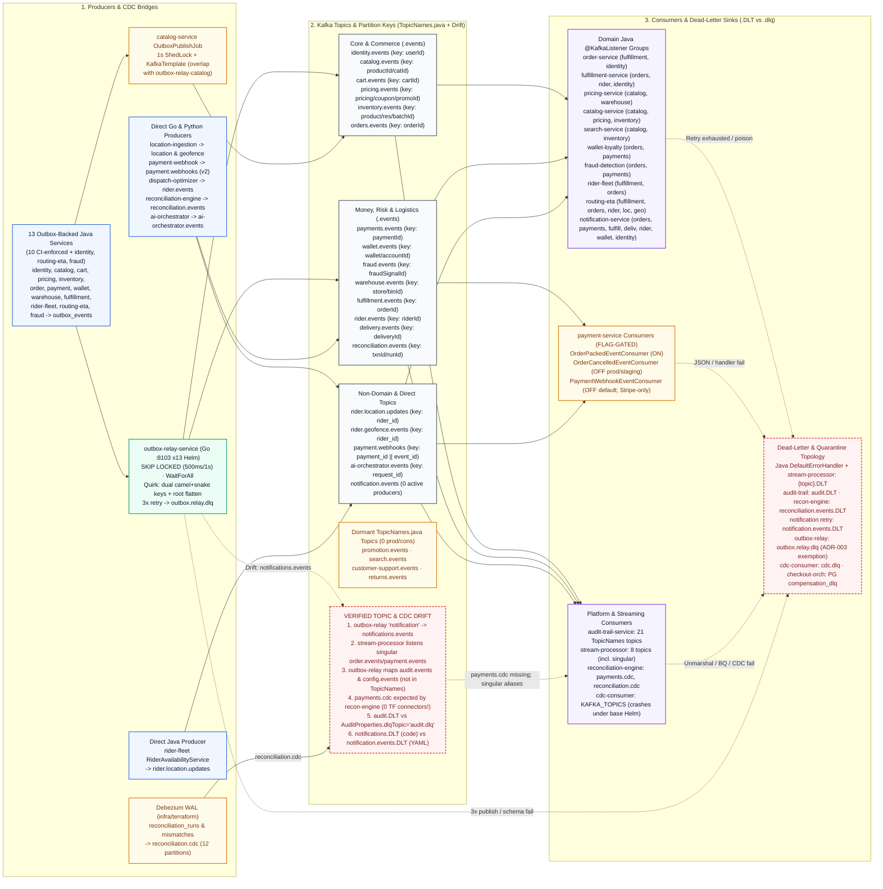
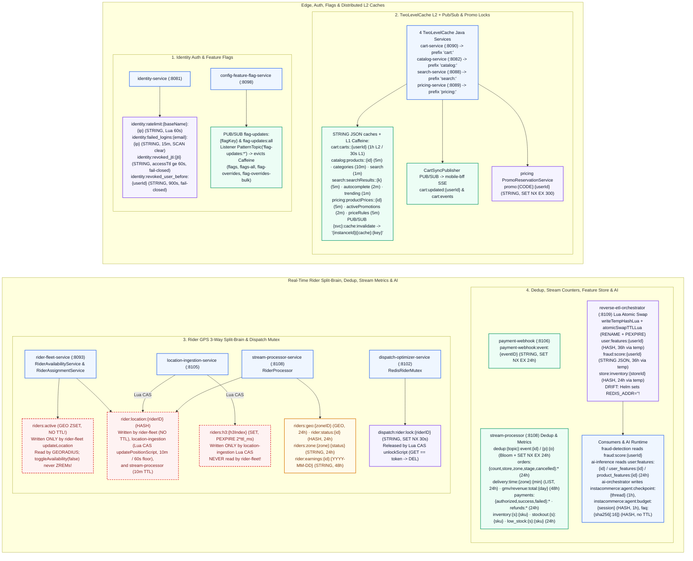

# 05 — Domain Model, Kafka Event Catalog & Redis Keyspace

> [!NOTE]
> **Part of the InstaCommerce Onboarding Suite:** [Onboarding Hub](./README.md) · [Day 0–5 Curriculum](./01-day0-to-day5-curriculum.md) · [Hands-On Labs](./02-hands-on-labs.md) · [Role Learning Tracks](./03-role-learning-tracks.md) · [First-PR & Troubleshooting](./04-first-pr-and-troubleshooting.md) · **Domain Model & Event Catalog (this guide)** · [Incident Drills & Readiness Exam](./06-incident-drills-and-readiness-exam.md) · [Service Dependency & CLI Cheatsheet](./07-service-dependency-and-command-cheatsheet.md) · [Code Walkthrough Atlas](./code-walkthrough/README.md)
>
> Every table name, column constraint, Kafka topic, partition key, dead-letter queue, Redis key pattern, TTL, and Lua script in this reference is verified directly against Flyway/Go SQL migrations, `contracts/`, and service source code under `services/` and `libs/platform-common/`.

---

## Table of Contents

1. [Cross-Service Domain Data Ownership & Entity-Relationship Map](#1-cross-service-domain-data-ownership--entity-relationship-map)
   - [1.1 Database-per-Service Isolation (`20` DB-Backed + `10` Stateless/External Services)](#11-database-per-service-isolation-20-db-backed--10-statelessexternal-services)
   - [1.2 Complete PostgreSQL Schema & Constraint Inventory](#12-complete-postgresql-schema--constraint-inventory)
   - [1.3 Cross-DB Invariants, Idempotency Normalization & Verified Schema Drift](#13-cross-db-invariants-idempotency-normalization--verified-schema-drift)
2. [Canonical Kafka Event Envelope & Topic Catalog](#2-canonical-kafka-event-envelope--topic-catalog)
   - [2.1 `EventEnvelope.v1.json`, Dual-Emit & `outbox-relay` Payload Flattening](#21-eventenvelopev1json-dual-emit--outbox-relay-payload-flattening)
   - [2.2 Outbox Relay Architecture vs. `catalog-service` `OutboxPublishJob`](#22-outbox-relay-architecture-vs-catalog-service-outboxpublishjob)
   - [2.3 Complete Kafka Topic, Partition Key & Consumer Matrix](#23-complete-kafka-topic-partition-key--consumer-matrix)
   - [2.4 Dead-Letter Semantics (`.DLT` vs. `.dlq`) & Verified Topic/CDC Drift](#24-dead-letter-semantics-dlt-vs-dlq--verified-topiccdc-drift)
3. [Complete Redis Keyspace, Lua Scripts & Split-Brain Topology](#3-complete-redis-keyspace-lua-scripts--split-brain-topology)
   - [3.1 Service-by-Service Redis Keyspace Catalog](#31-service-by-service-redis-keyspace-catalog)
   - [3.2 Atomic Lua Scripts & Pub/Sub Cache Invalidation Protocol](#32-atomic-lua-scripts--pubsub-cache-invalidation-protocol)
   - [3.3 Caffeine-Only Services vs. `TwoLevelCacheManager` L1/L2 Services](#33-caffeine-only-services-vs-twolevelcachemanager-l1l2-services)
   - [3.4 Deep Dive: The 3-Way Rider GPS Split-Brain & `reverse-etl` Gap](#34-deep-dive-the-3-way-rider-gps-split-brain--reverse-etl-gap)
4. [Schema Evolution & Contract Verification Rules](#4-schema-evolution--contract-verification-rules)

---

## 1. Cross-Service Domain Data Ownership & Entity-Relationship Map

InstaCommerce enforces strict **database-per-service ownership** across isolated PostgreSQL 16 databases: there are **zero cross-database foreign keys**. Intra-service parent/child tables use SQL `FOREIGN KEY ... REFERENCES` constraints, whereas cross-service links (`user_id`, `product_id`, `store_id`, `quote_id`, `reservation_id`, `order_id`, `payment_id`, `rider_id`) are logical UUID or string references reconciled asynchronously via outbox domain events or orchestrated synchronously by Temporal ([`CheckoutWorkflowImpl.java`](../../services/checkout-orchestrator-service/src/main/java/com/instacommerce/checkout/workflow/CheckoutWorkflowImpl.java)).

**Cross-Service Domain Entity-Relationship Map** — *[Rendered PNG](./diagrams/domain-er-map.png) · [Mermaid Source](./diagrams/domain-er-map.mmd)*

```mermaid
---
config:
  er:
    useMaxWidth: false
---
erDiagram
    %% Cross-Service Domain Entity-Relationship Map (isolated Postgres DBs: solid = SQL FK, dashed = logical UUID link)
    direction LR

    USERS {
        uuid id PK
        varchar email UK
        varchar status "ACTIVE | SUSPENDED | DELETED"
        int failed_attempts
    }
    REFRESH_TOKENS {
        uuid id PK
        uuid user_id FK
        varchar token_hash UK
        boolean revoked
    }
    CARTS {
        uuid id PK
        uuid user_id UK "logical -> users.id"
        varchar store_id
        timestamptz expires_at "now + 24h"
    }
    CART_ITEMS {
        uuid id PK
        uuid cart_id FK
        uuid product_id "UK(cart_id,product_id)"
        int quantity "CHECK gt 0"
    }
    PRODUCTS {
        uuid id PK
        varchar sku UK
        uuid category_id FK
        uuid store_id
        bigint base_price_cents "CHECK gt 0"
    }
    PRICE_QUOTES {
        uuid id PK
        uuid user_id "logical -> users.id"
        varchar content_hash "SHA-256"
        bigint total_cents
        timestamptz expires_at
    }
    PROMOTIONS {
        uuid id PK
        varchar discount_type
        boolean stackable_with_coupon
        int max_redemptions_per_user
    }
    COUPONS {
        uuid id PK
        varchar code UK
        uuid promotion_id FK
        bigint version
    }
    STOCK_ITEMS {
        uuid id PK
        uuid product_id "UK(product_id,store_id)"
        uuid store_id "logical -> stores.id"
        int on_hand "CHECK ge 0"
        int reserved "CHECK reserved le on_hand"
    }
    STOCK_BATCHES {
        uuid id PK
        uuid store_id "UK(store,product,batch)"
        uuid product_id
        timestamptz expiry_date "FEFO ASC"
        int quantity
    }
    RESERVATIONS {
        uuid id PK
        varchar idempotency_key UK "VARCHAR(64) overflow bug"
        uuid store_id
        enum status "PENDING | CONFIRMED | CANCELLED | EXPIRED"
    }
    RESERVATION_LINE_ITEMS {
        uuid id PK
        uuid reservation_id FK
        uuid product_id
        int quantity "CHECK gt 0"
    }
    ORDERS {
        uuid id PK
        uuid user_id "logical -> users.id"
        uuid quote_id "logical -> price_quotes.id"
        uuid reservation_id "logical -> reservations.id"
        uuid payment_id "logical -> payments.id"
        varchar idempotency_key UK "SHA-256 if gt 64c"
        enum status "PENDING..DELIVERED | REFUNDED | CANCELLED"
    }
    ORDER_ITEMS {
        uuid id PK
        uuid order_id FK
        uuid product_id
        varchar product_sku
        int quantity "CHECK gt 0"
    }
    OUTBOX_EVENTS {
        uuid id PK
        uuid event_id "EventEnvelope v1"
        varchar aggregate_type
        varchar aggregate_id "Kafka partition key"
        varchar event_type
        boolean sent "idx_outbox_unsent"
    }
    PAYMENTS {
        uuid id PK
        uuid order_id "logical -> orders.id"
        bigint amount_cents "CHECK gt 0"
        bigint captured_cents
        bigint refunded_cents "CHECK le captured"
        varchar idempotency_key UK
        enum status "AUTHORIZE_PENDING..REFUNDED | DISPUTED"
    }
    REFUNDS {
        uuid id PK
        uuid payment_id FK
        varchar psp_refund_id UK
        varchar idempotency_key UK
        bigint amount_cents "CHECK gt 0"
    }
    LEDGER_ENTRIES {
        bigserial id PK
        uuid payment_id FK
        enum entry_type "DEBIT | CREDIT"
        varchar account "V14 UK(payment,ref_type,ref_id,type)"
        bigint amount_cents
    }
    WALLETS {
        uuid id PK
        uuid user_id UK "logical -> users.id"
        bigint balance_cents "CHECK ge 0"
        bigint version
    }
    WALLET_TRANSACTIONS {
        uuid id PK
        uuid wallet_id FK
        varchar reference_type "UK(ref_type,ref_id)"
        varchar reference_id
        bigint amount_cents "CHECK gt 0"
    }
    WALLET_LEDGER_ENTRIES {
        uuid id PK
        uuid wallet_id FK
        varchar debit_account
        varchar credit_account
        varchar transaction_type
    }
    STORES {
        uuid id PK
        varchar status
        int max_concurrent_orders "default 100"
        int current_pending_orders
        boolean surge_mode_enabled
    }
    PICK_TASKS {
        uuid id PK
        uuid order_id UK "logical -> orders.id"
        uuid store_id "logical -> stores.id"
        uuid batch_id "logical -> pick_batches.id"
        enum status "PENDING..COMPLETED | CANCELLED"
    }
    FULFILLMENT_DELIVERIES {
        uuid id PK
        uuid order_id UK "logical -> orders.id"
        uuid rider_id FK
        enum status "PENDING..DELIVERED | FAILED"
    }
    RIDERS {
        uuid id PK
        varchar phone UK
        uuid store_id "logical -> stores.id"
        varchar status
        int consecutive_deliveries
    }
    RIDER_ASSIGNMENTS {
        uuid id PK
        uuid order_id "V13 UK(order_id) WHERE ACTIVE"
        uuid rider_id FK
        uuid store_id
        varchar status "ACTIVE | COMPLETED | CANCELLED"
    }
    ROUTING_DELIVERIES {
        uuid id PK
        uuid order_id UK "logical -> orders.id"
        uuid rider_id "logical -> riders.id"
        uuid store_id
        enum status "PENDING..DELIVERED | FAILED"
    }
    DELIVERY_TRACKING {
        uuid id PK "PK(id,recorded_at) RANGE partitioned"
        uuid delivery_id FK
        decimal latitude
        decimal longitude
    }
    PAYMENT_LEDGER {
        varchar transaction_id PK "CDC from payments"
        varchar payment_id
        varchar order_id
        bigint amount_cents
        bigint source_lsn "monotone LSN guard"
    }
    RECONCILIATION_RUNS {
        bigserial run_id PK
        date run_date UK
        varchar status "PENDING..COMPLETED | PARTIAL_FAILED"
    }
    RECONCILIATION_MISMATCHES {
        bigserial mismatch_id PK
        bigint run_id FK
        varchar transaction_id
        numeric discrepancy_amount "STORED generated"
    }
    AUDIT_EVENTS {
        uuid id PK "PK(id,created_at) monthly RANGE"
        varchar source_service
        varchar resource_id
        bigint sequence_number "global SHA-256 chain"
        varchar event_hash
    }

    USERS ||--o{ REFRESH_TOKENS : "owns"
    USERS ||..o| CARTS : "user_id"
    CARTS ||--|{ CART_ITEMS : "contains"
    PRODUCTS ||..o{ CART_ITEMS : "product_id"
    PROMOTIONS ||--o{ COUPONS : "issues"
    USERS ||..o{ PRICE_QUOTES : "user_id"
    PRODUCTS ||..o{ STOCK_ITEMS : "product_id"
    STOCK_ITEMS ||..o{ STOCK_BATCHES : "store_product"
    RESERVATIONS ||--|{ RESERVATION_LINE_ITEMS : "locks"
    STORES ||..o{ STOCK_ITEMS : "store_id"
    COUPONS ||..o{ ORDERS : "coupon_code"
    USERS ||..o{ ORDERS : "user_id"
    STORES ||..o{ ORDERS : "store_id"
    PRICE_QUOTES ||..o| ORDERS : "quote_id"
    RESERVATIONS ||..o| ORDERS : "reservation_id"
    ORDERS ||--|{ ORDER_ITEMS : "contains"
    ORDERS ||..o{ OUTBOX_EVENTS : "1 TX (13 DBs)"
    ORDERS ||..o{ PAYMENTS : "order_id"
    PAYMENTS ||--o{ REFUNDS : "settles"
    PAYMENTS ||--o{ LEDGER_ENTRIES : "double-entry"
    USERS ||..o| WALLETS : "user_id"
    WALLETS ||--o{ WALLET_TRANSACTIONS : "records"
    WALLETS ||--o{ WALLET_LEDGER_ENTRIES : "double-entry"
    ORDERS ||..o| PICK_TASKS : "order_id"
    STORES ||..o{ PICK_TASKS : "store_id"
    ORDERS ||..o| FULFILLMENT_DELIVERIES : "order_id"
    RIDERS ||--o{ RIDER_ASSIGNMENTS : "dispatches"
    ORDERS ||..o{ RIDER_ASSIGNMENTS : "order_id"
    ORDERS ||..o| ROUTING_DELIVERIES : "order_id"
    ROUTING_DELIVERIES ||--o{ DELIVERY_TRACKING : "tracks"
    PAYMENTS ||..o| PAYMENT_LEDGER : "CDC target"
    RECONCILIATION_RUNS ||--o{ RECONCILIATION_MISMATCHES : "flags"
    PAYMENT_LEDGER ||..o{ RECONCILIATION_MISMATCHES : "txn_id"
    OUTBOX_EVENTS ||..o{ AUDIT_EVENTS : "21 topics"
```



### 1.1 Database-per-Service Isolation (`20` DB-Backed + `10` Stateless/External Services)

Local development initializes **`39` PostgreSQL databases/aliases** in [`scripts/init-dbs.sql`](../../scripts/init-dbs.sql#L1-L60) (both bare service defaults such as `orders` and Helm `*_db` names such as `order_db`, plus the `reconciliation` role):

- **18 Flyway-backed Java services** (`spring.jpa.hibernate.ddl-auto: validate`, `open-in-view: false`): `audit-trail-service` (`7` migrations), `cart-service` (`8`), `catalog-service` (`15`), `checkout-orchestrator-service` (`3`), `config-feature-flag-service` (`8`), `fraud-detection-service` (`11`), `fulfillment-service` (`16`), `identity-service` (`13`), `inventory-service` (`15`), `notification-service` (`6`), `order-service` (`15`), `payment-service` (`21`), `pricing-service` (`11`), `rider-fleet-service` (`14`), `routing-eta-service` (`10`), `search-service` (`6`), `wallet-loyalty-service` (`13`), `warehouse-service` (`11`).
- **2 Go SQL-migration services** (applied locally by `scripts/dev-local.sh up` and tracked in `_dev_local_migrations`, not Flyway at app startup): `reconciliation-engine` (`5` migrations in [`services/reconciliation-engine/src/main/resources/db/migration/`](../../services/reconciliation-engine/src/main/resources/db/migration/V1__create_reconciliation_schema.sql)) and `reverse-etl-orchestrator` (`1` migration in [`services/reverse-etl-orchestrator/db/migration/V1__create_reverse_etl_schema.sql`](../../services/reverse-etl-orchestrator/db/migration/V1__create_reverse_etl_schema.sql)).
- **10 services without owned PostgreSQL tables:** `mobile-bff-service` (`:8080`), `admin-gateway-service` (`:8099`), `dispatch-optimizer-service` (`:8102`), `outbox-relay-service` (`:8103`, reads other services' `outbox_events`), `cdc-consumer-service` (`:8104`, writes BigQuery), `location-ingestion-service` (`:8105`, Redis + Kafka), `payment-webhook-service` (`:8106`, Redis + Kafka), `stream-processor-service` (`:8108`, Redis + Prometheus), `ai-orchestrator-service` (`:8100`, Redis checkpoints/budgets/FAQ), `ai-inference-service` (`:8101`, Redis/BQ feature store).

> [!TIP]
> **CloudSQL Terraform vs. Local `init-dbs.sql`:** [`scripts/init-dbs.sql`](../../scripts/init-dbs.sql#L13-L57) creates `checkout_db`, `reconciliation`, and `reverse_etl`, whereas the Terraform CloudSQL module currently provisions only `17` `*_db` databases and omits those three schemas (documented in [Infrastructure & GitOps Walkthrough](./code-walkthrough/components/infra-terraform-gitops.md)).

### 1.2 Complete PostgreSQL Schema & Constraint Inventory

All `18` Flyway-backed services and `2` Go SQL services below include their complete table sets (many services also co-locate `outbox_events`, `shedlock`, and local `audit_log` tables, noted per row).

#### Identity, Catalog, Search & Pricing

| Service (Walkthrough) | Owned Tables & Migrations | Key Columns, Foreign Keys & Constraints |
|---|---|---|
| [`identity-service`](./code-walkthrough/services/identity-service.md) | `users`, `refresh_tokens`, `notification_preferences`, `audit_log`, `outbox_events`, `shedlock` ([`V1`](../../services/identity-service/src/main/resources/db/migration/V1__create_users.sql)–[`V13`](../../services/identity-service/src/main/resources/db/migration/V13__widen_audit_log_trace_id.sql)) | `users`: `uq_users_email`, `chk_users_status IN ('ACTIVE','SUSPENDED','DELETED')`, `roles VARCHAR[]`, `failed_attempts INT`, `locked_until TIMESTAMPTZ`, `deleted_at`. `refresh_tokens`: `FK user_id -> users(id) ON DELETE CASCADE`, `uq_refresh_token_hash`. `notification_preferences`: `PK/FK user_id -> users(id) ON DELETE CASCADE`. |
| [`catalog-service`](./code-walkthrough/services/catalog-service.md) | `categories`, `products`, `product_images`, `pricing_rules`, `coupons`, `coupon_usages`, `audit_log`, `outbox_events`, `shedlock` ([`V1`](../../services/catalog-service/src/main/resources/db/migration/V1__create_categories.sql)–[`V15`](../../services/catalog-service/src/main/resources/db/migration/V15__add_category_version_and_depth.sql)) | `categories`: self-FK `parent_id -> categories(id) ON DELETE SET NULL`, `uq_category_slug`, materialized `path` + `depth` + `version`. `products`: `uq_product_sku`, `uq_product_slug`, `chk_price_positive (base_price_cents > 0)`, `FK category_id -> categories(id)`, `store_id UUID` (`V11`), `is_perishable`, `temperature_zone`, `vat_rate_bps`, GIN `search_vector` (`trg_products_search`). `pricing_rules` & `coupons` here are legacy V3/V4 tables; active quote/promo logic lives in `pricing-service`. |
| [`search-service`](./code-walkthrough/services/search-service.md) | `search_documents`, `trending_queries`, `shedlock` ([`V1`](../../services/search-service/src/main/resources/db/migration/V1__create_search_documents.sql)–[`V6`](../../services/search-service/src/main/resources/db/migration/V6__add_lower_name_text_pattern_index.sql)) | `search_documents`: `product_id UUID UNIQUE`, `store_id UUID` (`V5`), `price_cents`, `in_stock`, GIN `search_vector` via `trg_search_documents_vector`, `text_pattern_ops` on `name` & `lower(name)`. `trending_queries`: `query VARCHAR(512) UNIQUE`, `hit_count`. |
| [`pricing-service`](./code-walkthrough/services/pricing-service.md) | `price_rules`, `promotions`, `coupons`, `coupon_redemptions`, `promotion_redemptions`, `price_quotes`, `outbox_events`, `shedlock` ([`V1`](../../services/pricing-service/src/main/resources/db/migration/V1__create_price_rules.sql)–[`V11`](../../services/pricing-service/src/main/resources/db/migration/V11__add_promotion_stacking_and_priority.sql)) | `price_quotes` (`V7`): `user_id`, `content_hash` (SHA-256 of totals/itemCount), `subtotal_cents`, `discount_cents`, `total_cents`, `coupon_code`, `expires_at` (signed via HMAC-SHA256 in [`QuoteTokenService.java#L34-L129`](../../services/pricing-service/src/main/java/com/instacommerce/pricing/service/QuoteTokenService.java#L34-L129)). `coupons`: `code UNIQUE`, `FK promotion_id -> promotions(id)`, `version`. `coupon_redemptions`: `FK coupon_id -> coupons(id)`, `idx_coupon_redemption_order UNIQUE (coupon_id, order_id)`, partial `idx_coupon_single_use (coupon_id, user_id) WHERE single_use = true`. `promotion_redemptions`: `FK promotion_id -> promotions(id)`, `UNIQUE (promotion_id, user_id, order_id)`. |

#### Cart, Checkout Saga, Inventory & Orders

| Service (Walkthrough) | Owned Tables & Migrations | Key Columns, Foreign Keys & Constraints |
|---|---|---|
| [`cart-service`](./code-walkthrough/services/cart-service.md) | `carts`, `cart_items`, `outbox_events`, `shedlock` ([`V1`](../../services/cart-service/src/main/resources/db/migration/V1__create_carts.sql)–[`V8`](../../services/cart-service/src/main/resources/db/migration/V8__add_store_id_to_carts.sql)) | `carts`: `uq_cart_user (user_id)`, `store_id VARCHAR(64)` (`V8`), `expires_at` (default `now() + 24h`), `version`. `cart_items`: `FK cart_id -> carts(id) ON DELETE CASCADE`, `uq_cart_product (cart_id, product_id)`, `chk_cart_item_qty (quantity > 0)`. |
| [`checkout-orchestrator-service`](./code-walkthrough/services/checkout-orchestrator-service.md) | `checkout_idempotency_keys`, `compensation_dlq`, `shedlock` ([`V1`](../../services/checkout-orchestrator-service/src/main/resources/db/migration/V1__create_checkout_idempotency_keys.sql)–[`V3`](../../services/checkout-orchestrator-service/src/main/resources/db/migration/V3__create_compensation_dlq.sql)) | `checkout_idempotency_keys`: `idx_idempotency_key UNIQUE (idempotency_key VARCHAR(255))`, `checkout_response TEXT`, `expires_at`. `compensation_dlq`: `workflow_id`, `activity_name`, `target_id`, `status` (default `'FAILED'`), `retry_count` — PostgreSQL DLQ for failed Temporal saga compensations. |
| [`inventory-service`](./code-walkthrough/services/inventory-service.md) | `stock_items`, `reservations`, `reservation_line_items`, `reservation_release_logs`, `stock_adjustment_log`, `stock_batches`, `sku_safety_stock_buffers`, `inbound_asns`, `asn_line_items`, `audit_log`, `outbox_events`, `shedlock` ([`V1`](../../services/inventory-service/src/main/resources/db/migration/V1__create_stock_items.sql)–[`V15`](../../services/inventory-service/src/main/resources/db/migration/V15__add_reservation_partial_release_logs.sql)) | `stock_items`: `uq_stock_product_store (product_id, store_id UUID)`, `chk_on_hand_non_negative`, `chk_reserved_non_negative`, `chk_reserved_le_on_hand (reserved <= on_hand)`, `is_frozen`, `version`. `stock_batches` (`V13`): `uq_store_product_batch (store_id, product_id, batch_number)`, `expiry_date` (FEFO `ASC`). `reservations`: `uq_reservation_idempotency (idempotency_key VARCHAR(64))`, `status` enum `('PENDING','CONFIRMED','CANCELLED','EXPIRED')`. `reservation_line_items`: `FK reservation_id -> reservations(id) ON DELETE CASCADE`, `chk_qty_positive`. `reservation_release_logs` (`V15`): `FK reservation_id -> reservations(id) ON DELETE CASCADE`, `uq_reservation_release_key (reservation_id, release_key)`. `asn_line_items`: `FK asn_id -> inbound_asns(id) ON DELETE CASCADE`. |
| [`order-service`](./code-walkthrough/services/order-service.md) | `orders`, `order_items`, `order_status_history`, `audit_log`, `outbox_events`, `shedlock` ([`V1`](../../services/order-service/src/main/resources/db/migration/V1__create_orders.sql)–[`V15`](../../services/order-service/src/main/resources/db/migration/V15__add_wallet_amount_and_item_metadata.sql)) | `orders`: `order_status` enum (`'PENDING','PLACED','PACKING','PACKED','OUT_FOR_DELIVERY','DELIVERED','CANCELLED','FAILED','REFUNDED'` via `V14`), `uq_order_idempotency (idempotency_key VARCHAR(64))`, `store_id VARCHAR(50)`, `quote_id` (`V11`), `reservation_id`, `payment_id`, `wallet_amount_cents` (`V15`), `sla_deadline_at`, `sla_breached_at`, `user_erased`. `order_items` & `order_status_history`: `FK order_id -> orders(id) ON DELETE CASCADE`. |

#### Payments, Wallets, Fraud & Governance

| Service (Walkthrough) | Owned Tables & Migrations | Key Columns, Foreign Keys & Constraints |
|---|---|---|
| [`payment-service`](./code-walkthrough/services/payment-service.md) | `payments`, `refunds`, `ledger_entries`, `processed_webhook_events`, `audit_log`, `outbox_events`, `shedlock` ([`V1`](../../services/payment-service/src/main/resources/db/migration/V1__create_payments.sql)–[`V20`](../../services/payment-service/src/main/resources/db/migration/V20__add_outbox_events_retention_index.sql)) | `payments`: `payment_status` enum (`AUTHORIZE_PENDING`, `AUTHORIZED`, `CAPTURE_PENDING`, `VOID_PENDING`, `CAPTURED`, `VOIDED`, `PARTIALLY_REFUNDED`, `REFUNDED`, `FAILED`, `DISPUTED`), `uq_payment_idempotency (idempotency_key VARCHAR(64))`, `chk_amount_positive`, `chk_refund_le_captured`. `refunds`: `FK payment_id -> payments(id)`, `uq_refund_idempotency`, `idx_refunds_psp_refund_id UNIQUE WHERE psp_refund_id IS NOT NULL`, `chk_refund_positive`. `ledger_entries`: `FK payment_id -> payments(id)`, `ledger_entry_type` `('DEBIT','CREDIT')`, `V14` `idx_ledger_entries_dedup UNIQUE (payment_id, reference_type, reference_id, entry_type) WHERE reference_id IS NOT NULL`. `processed_webhook_events`: PK `event_id`, `V19` `uq_processed_webhook_ref_event UNIQUE (external_payment_reference, psp_event_id)`. |
| [`wallet-loyalty-service`](./code-walkthrough/services/wallet-loyalty-service.md) | `wallets`, `wallet_transactions`, `wallet_ledger_entries`, `loyalty_accounts`, `loyalty_transactions`, `referral_codes`, `referral_redemptions`, `outbox_events`, `shedlock` ([`V1`](../../services/wallet-loyalty-service/src/main/resources/db/migration/V1__create_wallets.sql)–[`V13`](../../services/wallet-loyalty-service/src/main/resources/db/migration/V13__fix_wallet_ledger_transaction_type_check.sql)) | `wallets`: `user_id UUID UNIQUE`, `balance_cents >= 0`, `version`. `wallet_transactions`: `FK wallet_id -> wallets(id)`, `idx_wallet_txn_idempotent UNIQUE (reference_type, reference_id)`, `CHECK (reference_type IN ('ORDER','REFUND','TOPUP','CASHBACK','REFERRAL','PROMOTION','ADMIN_ADJUSTMENT'))` (`V11`). `wallet_ledger_entries`: `FK wallet_id -> wallets(id)`, double-entry `debit_account`/`credit_account` (`user_wallet:{userId}` vs `platform_float`/`merchant_settlement`/`marketing_budget`, [`WalletLedgerService.java#L119-L136`](../../services/wallet-loyalty-service/src/main/java/com/instacommerce/wallet/service/WalletLedgerService.java#L119-L136)). `loyalty_transactions`: `FK account_id -> loyalty_accounts(id)`, `idx_loyalty_txn_idempotent UNIQUE (reference_type, reference_id)`. `referral_redemptions`: `FK referral_code_id -> referral_codes(id)`, `referred_user_id UNIQUE`. |
| [`fraud-detection-service`](./code-walkthrough/services/fraud-detection-service.md) | `fraud_rules`, `fraud_signals`, `velocity_counters`, `blocked_entities`, `allowlisted_entities`, `outbox_events`, `shedlock` ([`V1`](../../services/fraud-detection-service/src/main/resources/db/migration/V1__create_fraud_rules.sql)–[`V11`](../../services/fraud-detection-service/src/main/resources/db/migration/V11__add_chargeback_and_refund_failure_counters.sql)) | `fraud_rules`: `chk_rule_type`, `chk_action IN ('ALLOW','FLAG','BLOCK','REVIEW')`. `velocity_counters`: `uq_velocity_window (entity_type, entity_id, counter_type, window_start)`, `chk_counter_type` (`ORDERS_5M..REFUND_FAILURES_24H`). `blocked_entities` & `allowlisted_entities`: partial unique indexes `(entity_type, entity_value) WHERE active = true`. |
| [`config-feature-flag-service`](./code-walkthrough/services/config-feature-flag-service.md) | `feature_flags`, `flag_overrides`, `flag_audit_log`, `experiments`, `experiment_variants`, `experiment_exposures`, `shedlock` ([`V1`](../../services/config-feature-flag-service/src/main/resources/db/migration/V1__create_feature_flags.sql)–[`V8`](../../services/config-feature-flag-service/src/main/resources/db/migration/V8__allow_emergency_stop_audit_action.sql)) | `feature_flags`: `uq_feature_flags_key`, `chk_flag_type`, `chk_rollout_percentage (0..100)`. `flag_overrides`: `FK flag_id -> feature_flags(id) ON DELETE CASCADE`, `uq_flag_overrides_flag_user`. `experiment_variants` & `experiment_exposures`: `FK experiment_id -> experiments(id) ON DELETE CASCADE`. |
| [`notification-service`](./code-walkthrough/services/notification-service.md) | `notification_log`, `device_tokens`, `audit_log`, `shedlock` ([`V1`](../../services/notification-service/src/main/resources/db/migration/V1__create_notification_log.sql)–[`V6`](../../services/notification-service/src/main/resources/db/migration/V6__add_notification_template_context.sql)) | `notification_log`: `uq_notification_dedup UNIQUE (event_id, channel)`, partial retry index `WHERE status = 'RETRY_PENDING'`. `device_tokens`: `uq_device_tokens_token UNIQUE (token)`. |
| [`audit-trail-service`](./code-walkthrough/services/audit-trail-service.md) | `audit_events` (monthly `PARTITION BY RANGE (created_at)`), `audit_archive_manifests`, `shedlock` ([`V1`](../../services/audit-trail-service/src/main/resources/db/migration/V1__create_audit_events.sql)–[`V7`](../../services/audit-trail-service/src/main/resources/db/migration/V7__add_hash_version_and_role_guard.sql)) | `audit_events`: `pk_audit_events PRIMARY KEY (id, created_at)`, `chk_actor_type IN ('USER','SYSTEM','ADMIN')`, `REVOKE UPDATE, DELETE` + `DO INSTEAD NOTHING` rules (`V4`), `sequence_number` (`audit_chain_seq`), `event_hash` + `previous_hash` (`V5`, serialized via `pg_advisory_xact_lock`). |

#### Warehouse, Fulfillment, Fleet, Routing, Reconciliation & Reverse ETL

| Service (Walkthrough) | Owned Tables & Migrations | Key Columns, Foreign Keys & Constraints |
|---|---|---|
| [`warehouse-service`](./code-walkthrough/services/warehouse-service.md) | `stores`, `store_zones`, `store_hours`, `store_capacity`, `warehouse_bins`, `staging_temperature_telemetry`, `store_blackout_windows`, `outbox_events`, `shedlock` ([`V1`](../../services/warehouse-service/src/main/resources/db/migration/V1__create_stores.sql)–[`V11`](../../services/warehouse-service/src/main/resources/db/migration/V11__add_surge_mode_and_blackout_windows.sql)) | `stores`: `max_concurrent_orders` (`100`), `current_pending_orders`, `surge_mode_enabled`, `surge_eta_extension_minutes`, `surge_threshold_percent`. Child tables (`store_zones` `uq_store_zone_pincode`, `store_hours` `uq_store_day`, `store_capacity` `uq_store_date_hour`, `warehouse_bins` `uq_warehouse_bins_location`, `staging_temperature_telemetry`, `store_blackout_windows` `chk_blackout_window_range`) all cascade `FK store_id -> stores(id) ON DELETE CASCADE`. |
| [`fulfillment-service`](./code-walkthrough/services/fulfillment-service.md) | `pick_tasks`, `pick_items`, `pick_batches`, `riders`, `deliveries`, `audit_log`, `outbox_events`, `shedlock` ([`V1`](../../services/fulfillment-service/src/main/resources/db/migration/V1__create_pick_tasks.sql)–[`V16`](../../services/fulfillment-service/src/main/resources/db/migration/V16__add_order_weight_grams.sql)) | `pick_tasks`: `uq_pick_order (order_id)`, `store_id UUID` (`V13`), unconstrained `batch_id UUID` (`V11`). `pick_items`: `FK pick_task_id -> pick_tasks(id) ON DELETE CASCADE`. `deliveries`: `uq_delivery_order (order_id)`, `FK rider_id -> riders(id)`, `delivery_status` enum (`ASSIGNED..FAILED` + `V10` `PENDING`, `RIDER_ASSIGNED`, `EN_ROUTE`, `NEAR_DESTINATION`). |
| [`rider-fleet-service`](./code-walkthrough/services/rider-fleet-service.md) | `riders`, `rider_shifts`, `rider_availability`, `rider_earnings`, `rider_ratings`, `rider_assignments`, `outbox_events`, `shedlock` ([`V1`](../../services/rider-fleet-service/src/main/resources/db/migration/V1__create_riders.sql)–[`V14`](../../services/rider-fleet-service/src/main/resources/db/migration/V14__add_assignment_earnings_metadata.sql)) | `riders`: `phone UNIQUE`, `store_id UUID`, `consecutive_deliveries`, `max_capacity_grams`. `rider_availability`: `rider_id UNIQUE REFERENCES riders(id)`. `rider_assignments`: `FK rider_id -> riders(id)`, `V13` partial unique index `uk_rider_assignments_active_order UNIQUE (order_id) WHERE status = 'ACTIVE'`. `rider_earnings`: `FK rider_id -> riders(id)`, `uk_rider_earnings_order_id UNIQUE (order_id)`. `rider_ratings`: `order_id UNIQUE`, `CHECK (rating BETWEEN 1 AND 5)`. |
| [`routing-eta-service`](./code-walkthrough/services/routing-eta-service.md) | `deliveries`, `delivery_tracking` (`PARTITION BY RANGE (recorded_at)`), `routing_barriers`, `weather_conditions`, `traffic_congestion_feeds`, `outbox_events`, `shedlock` ([`V1`](../../services/routing-eta-service/src/main/resources/db/migration/V1__create_deliveries.sql)–[`V10`](../../services/routing-eta-service/src/main/resources/db/migration/V10__add_outbox_events_retention_index.sql)) | `deliveries`: `uq_delivery_order (order_id)`, `delivery_status` enum (`PENDING`, `RIDER_ASSIGNED`, `PICKED_UP`, `EN_ROUTE`, `NEAR_DESTINATION`, `DELIVERED`, `FAILED` + `V8` `ASSIGNED`, `IN_TRANSIT`). `delivery_tracking`: `FK delivery_id -> deliveries(id)`, `PRIMARY KEY (id, recorded_at)`. `weather_conditions`: `store_id UNIQUE`. `traffic_congestion_feeds`: `zone_id UNIQUE`. |
| [`reconciliation-engine`](./code-walkthrough/services/reconciliation-engine.md) | `reconciliation_runs`, `reconciliation_mismatches`, `reconciliation_fixes`, `reconciliation_fix_registry`, `reconciliation_outbox`, `payment_ledger`, `psp_export_snapshot` ([`V1`](../../services/reconciliation-engine/src/main/resources/db/migration/V1__create_reconciliation_schema.sql)–[`V5`](../../services/reconciliation-engine/src/main/resources/db/migration/V5__allow_partial_failed_status.sql)) | `reconciliation_runs`: `run_date UNIQUE`, `CHECK (status IN ('PENDING','IN_PROGRESS','COMPLETED','PARTIAL_FAILED','FAILED'))` (`V5`). `reconciliation_mismatches`: `FK run_id -> reconciliation_runs(run_id) ON DELETE CASCADE`, generated `discrepancy_amount = ledger_amount - psp_amount STORED`. `reconciliation_fixes`: `FK mismatch_id -> reconciliation_mismatches(mismatch_id) ON DELETE CASCADE`. `payment_ledger`: `PK transaction_id`, `source_lsn` monotone guard (`EXCLUDED.source_lsn >= payment_ledger.source_lsn`). `psp_export_snapshot`: `uq_psp_export_snapshot_txn_date (transaction_id, export_date)`. |
| [`reverse-etl-orchestrator`](./code-walkthrough/services/reverse-etl-orchestrator.md) | `subscriptions`, `reverse_etl_sync_audit` ([`V1`](../../services/reverse-etl-orchestrator/db/migration/V1__create_reverse_etl_schema.sql)) | `subscriptions`: `PK subscription_id`, `state CHECK (state IN ('DRAFT','VALIDATED','ACTIVE','PAUSED','ARCHIVED'))`, `source_events JSONB`. `reverse_etl_sync_audit`: `PK job_id`, `sync_type`, `rows_processed`, `status`, `duration_ms`. |

### 1.3 Cross-DB Invariants, Idempotency Normalization & Verified Schema Drift

1. **Idempotency Key `VARCHAR(64)` Overflow Bug (`inventory-service` vs. `order-service` / `payment-service`):**
   - [`CheckoutWorkflowImpl.java`](../../services/checkout-orchestrator-service/src/main/java/com/instacommerce/checkout/workflow/CheckoutWorkflowImpl.java#L142-L143) constructs `workflowId + ":inventory:reserve"` (`~100+` chars) from the `~93`-char `checkout-{principal}-{uuid}` workflow ID.
   - [`OrderCreationService.java`](../../services/order-service/src/main/java/com/instacommerce/order/service/OrderCreationService.java#L56-L83) and [`IdempotencyKeys.java`](../../services/payment-service/src/main/java/com/instacommerce/payment/service/IdempotencyKeys.java#L32-L52) SHA-256 hash any key exceeding `64` chars into `64` lowercase hex chars and catch `DataIntegrityViolationException` on `uq_order_idempotency` / `uq_payment_idempotency`.
   - **Verified Bug:** [`ReservationService.java`](../../services/inventory-service/src/main/java/com/instacommerce/inventory/service/ReservationService.java#L107-L147) passes `request.idempotencyKey()` raw into `reservations.idempotency_key VARCHAR(64)` ([`V2__create_reservations.sql#L5`](../../services/inventory-service/src/main/resources/db/migration/V2__create_reservations.sql#L5)) without SHA-256 truncation and without catching `DataIntegrityViolationException`.
2. **Double-Entry Financial Ledgers (`payment-service` & `wallet-loyalty-service`):**
   - `payment-service` [`LedgerService.java#L55-L93`](../../services/payment-service/src/main/java/com/instacommerce/payment/service/LedgerService.java#L55-L93) writes balanced `DEBIT`/`CREDIT` pairs in an inner `REQUIRES_NEW` transaction guarded by `V14` `idx_ledger_entries_dedup` (`customer_receivable`, `authorization_hold`, `merchant_payable`, `dispute_hold`).
   - `wallet-loyalty-service` [`WalletLedgerService.java#L58-L136`](../../services/wallet-loyalty-service/src/main/java/com/instacommerce/wallet/service/WalletLedgerService.java#L58-L136) writes balanced `wallet_ledger_entries` (`user_wallet:{userId}` against `platform_float`, `merchant_settlement`, or `marketing_budget`) in the same `MANDATORY` transaction as `wallets.balance_cents` (`CHECK balance_cents >= 0`).
3. **`store_id` Column Type Drift:** `warehouse-service`, `inventory-service` (`V11`), `fulfillment-service` (`V13`), `rider-fleet-service`, `routing-eta-service`, `catalog-service` (`products.store_id` `V11`), and `search-service` (`V5`) store `store_id` as `UUID`, whereas `order-service` (`orders.store_id VARCHAR(50)`), `catalog-service` (`pricing_rules.store_id VARCHAR(50)`), and `cart-service` (`carts.store_id VARCHAR(64)`) remain `VARCHAR`.
4. **Reconciliation Schema Dead Tables & Hardcoded Currency:** `reconciliation-engine` defines `reconciliation_outbox` (`V3`) and `reconciliation_fix_registry` (`V2`) in PostgreSQL, neither of which is written on the hot reconciliation path (only `heartbeat.action.query` touches `reconciliation_outbox WHERE id = -1`), and `psp_export_snapshot` has **zero** production ingestion writers in the repo.

---

## 2. Canonical Kafka Event Envelope & Topic Catalog

All asynchronous Kafka contracts are centralized in [`contracts/`](../../contracts/build.gradle.kts), including [`TopicNames.java`](../../contracts/src/main/java/com/instacommerce/contracts/topics/TopicNames.java), [`EventEnvelope.v1.json`](../../contracts/src/main/resources/schemas/common/EventEnvelope.v1.json), [`EventEnvelope.java`](../../contracts/src/main/java/com/instacommerce/contracts/events/EventEnvelope.java), and `91` Draft-07 JSON schemas across `21` directories (plus `10` dormant `.proto` packages with `0` Java/Go runtime callers — see [Contracts & Proto Walkthrough](./code-walkthrough/components/contracts-and-proto.md)).

**Complete Kafka Topic, Partition Key & Dead-Letter Topology** — *[Rendered PNG](./diagrams/kafka-topic-catalog.png) · [Mermaid Source](./diagrams/kafka-topic-catalog.mmd)*



### 2.1 `EventEnvelope.v1.json`, Dual-Emit & `outbox-relay` Payload Flattening

Every domain event conforms to [`EventEnvelope.v1.json`](../../contracts/src/main/resources/schemas/common/EventEnvelope.v1.json#L1-L52), which requires `id`, `eventType`, `aggregateType`, `aggregateId`, `eventTime`, `schemaVersion`, `payload`, and `anyOf: ["source_service", "sourceService"]` with `"additionalProperties": true`:

- **Java Consumer Normalization ([`EventEnvelope.java#L16-L43`](../../contracts/src/main/java/com/instacommerce/contracts/events/EventEnvelope.java#L16-L43)):** `@JsonIgnoreProperties(ignoreUnknown = true)` plus `@JsonAlias` (`id` accepts `eventId`/`event_id`; `eventTime` accepts `event_time`/`timestamp`/`occurred_at`/`event_timestamp`; `sourceService` accepts `source_service`; `correlationId` accepts `correlation_id`).
- **Go Shared Codec ([`envelope_json.go`](../../services/go-shared/pkg/kafka/envelope_json.go)):** `UnmarshalJSON` accepts camelCase and snake_case aliases; `MarshalJSON` dual-emits `id` + `eventId` and `eventTime` + `timestamp`.
- **Go Outbox Relay Serialization ([`envelope.go#L199-L251`](../../services/outbox-relay-service/envelope.go#L199-L251)):** `buildEventMessage` writes **both** camelCase and snake_case metadata keys (`eventId`/`event_id`, `aggregateType`/`aggregate_type`, `aggregateId`/`aggregate_id`, `eventType`/`event_type`, `eventTime`/`event_time`, `schemaVersion`/`schema_version`, `sourceService`/`source_service`, `correlationId`/`correlation_id`, `id`, `timestamp`) **and flattens** non-colliding top-level `payload` keys directly onto the JSON root.

### 2.2 Outbox Relay Architecture vs. `catalog-service` `OutboxPublishJob`

- **Transactional Outbox (`13` Java DBs):** Services call `OutboxService.publish` / `recordEvent` under `@Transactional(propagation = Propagation.MANDATORY)` ([`Order OutboxService.java#L22-L37`](../../services/order-service/src/main/java/com/instacommerce/order/service/OutboxService.java#L22-L37)), inserting into `outbox_events` with partial index `idx_outbox_unsent ON outbox_events (sent) WHERE sent = false`.
- **Go `outbox-relay-service` (`13` Helm deployments):** [`deploy/helm/values.yaml#L883-L1164`](../../deploy/helm/values.yaml#L883-L1164) deploys one dedicated `outbox-relay-*` release per outbox DB (`500ms` poll in Helm vs. `1s` default in [`config.go#L15`](../../services/outbox-relay-service/config.go#L15), `OUTBOX_BATCH_SIZE=100`, `OUTBOX_MAX_RETRIES=3`). Each poll opens a `pgx.Tx`, locks rows via `FOR UPDATE SKIP LOCKED`, publishes synchronously via Sarama `WaitForAll` keyed by `aggregate_id` ([`relay.go#L55-L259`](../../services/outbox-relay-service/relay.go#L55-L259)), and marks `sent = true`.
- **Catalog Dual-Publisher Overlap:** `catalog-service` also runs a ShedLock-guarded 1-second poller [`OutboxPublishJob.java#L29-L50`](../../services/catalog-service/src/main/java/com/instacommerce/catalog/service/OutboxPublishJob.java#L29-L50) -> [`KafkaOutboxEventPublisher.java#L37-L55`](../../services/catalog-service/src/main/java/com/instacommerce/catalog/service/KafkaOutboxEventPublisher.java#L37-L55) directly to `catalog.events` alongside Helm's `outbox-relay-catalog`.

### 2.3 Complete Kafka Topic, Partition Key & Consumer Matrix

[`TopicNames.java`](../../contracts/src/main/java/com/instacommerce/contracts/topics/TopicNames.java#L18-L80) defines **`20` distinct domain `.events` topics** (`L18`–`L37`, plus `ORDER_EVENTS`, `PAYMENT_EVENTS`, and `ROUTING_EVENTS` aliases), **`3` non-domain topics** (`rider.location.updates`, `payment.webhooks`, and `rider.geofence.events`, making **`21`** `.events` topics total), **`1` `.dlq` constant** (`outbox.relay.dlq`), and **`23` `*_DLT` constants** covering **`22` distinct `.DLT` topics** (`RIDER_GEOFENCE_DLT` and `RIDER_GEOFENCE_EVENTS_DLT` both alias `"rider.geofence.events.DLT"`):

| Topic | Producers & Source | Partition Key | Consumers & Consumer Groups | Dead-Letter / Notes |
|---|---|---|---|---|
| `identity.events` | `identity-service` -> `outbox-relay-identity` | `userId` (`aggregate_id`) | `order-service` (`order-service-erasure`), `fulfillment-service` (`fulfillment-service-erasure`), `notification-service` (`notification-service`), `audit-trail-service` | `.DLT` / `audit.DLT` |
| `catalog.events` | `catalog-service` -> `OutboxPublishJob` + `outbox-relay-catalog` | `productId` / `categoryId` | `catalog-service` (`catalog-cache-invalidator`), `pricing-service` (`pricing-service-catalog`), `search-service` (`search-service`), `audit-trail-service` | `.DLT` / `audit.DLT` |
| `cart.events` | `cart-service` -> `outbox-relay-cart` | `cartId` | `audit-trail-service` | `audit.DLT` |
| `pricing.events` | `pricing-service` -> `outbox-relay-pricing` | `couponId` / `promotionId` | `catalog-service` (`catalog-cache-invalidator`), `audit-trail-service` | `.DLT` / `audit.DLT` |
| `inventory.events` | `inventory-service` -> `outbox-relay-inventory` | `productId` / `reservationId` / `batchId` / `storeId:productId` | `catalog-service` (`catalog-cache-invalidator`), `search-service` (`search-service`), `stream-processor-service` (`stream-processor`), `audit-trail-service` | `.DLT` / `audit.DLT` |
| `orders.events` *(alias `ORDER_EVENTS`)* | `order-service` -> `outbox-relay-order` | `orderId` | `fulfillment-service`, `rider-fleet-service`, `routing-eta-service`, `wallet-loyalty-service`, `fraud-detection-service` (`fraud-detection-orders`), `notification-service`, `payment-service` (`OrderCancelledEventConsumer`, **OFF** in prod/staging), `stream-processor-service` (also listens `order.events`), `audit-trail-service` | `.DLT` / `audit.DLT` (`wallet` `OrderEventConsumer` logs without DLT) |
| `payments.events` *(alias `PAYMENT_EVENTS`)* | `payment-service` -> `outbox-relay-payment` | `paymentId` | `wallet-loyalty-service` (`wallet-loyalty-service`), `fraud-detection-service` (`fraud-detection-payments`), `notification-service`, `stream-processor-service` (also listens `payment.events`), `audit-trail-service` | `.DLT` / `audit.DLT` |
| `wallet.events` | `wallet-loyalty-service` -> `outbox-relay-wallet-loyalty` | `walletId` / `loyaltyAccountId` | `notification-service`, `audit-trail-service` | `.DLT` / `audit.DLT` |
| `fraud.events` | `fraud-detection-service` -> `outbox-relay-fraud-detection` | `signalId` | `audit-trail-service` | `audit.DLT` |
| `warehouse.events` | `warehouse-service` -> `outbox-relay-warehouse` | `storeId` / `binId` | `pricing-service` (`pricing-service-warehouse`), `audit-trail-service` | `.DLT` / `audit.DLT` |
| `fulfillment.events` | `fulfillment-service` -> `outbox-relay-fulfillment` | `orderId` | `order-service` (`order-service-fulfillment`), `payment-service` (`payment-service-order-packed`), `rider-fleet-service`, `routing-eta-service`, `notification-service`, `stream-processor-service`, `audit-trail-service` | `.DLT` / `audit.DLT` |
| `rider.events` | `rider-fleet-service` -> `outbox-relay-rider-fleet` **+** `dispatch-optimizer-service` direct | `riderId` | `fulfillment-service`, `routing-eta-service`, `notification-service`, `stream-processor-service`, `audit-trail-service` | `.DLT` / `audit.DLT` |
| `delivery.events` *(alias `ROUTING_EVENTS`)* | `routing-eta-service` -> `outbox-relay-routing-eta` | `deliveryId` | `notification-service`, `audit-trail-service` | `.DLT` / `audit.DLT` |
| `reconciliation.events` | `reconciliation-engine` [`EventPublisher`](../../services/reconciliation-engine/pkg/reconciliation/event_publisher.go#L83-L166) | `transaction_id` / `run-{id}` | `audit-trail-service` | `reconciliation.events.DLT` / `audit.DLT` |
| `ai-orchestrator.events` | `ai-orchestrator-service` [`AuditPublisher`](../../services/ai-orchestrator-service/app/audit.py#L148-L154) | `request_id` (`aggregateId`) | `audit-trail-service` | `audit.DLT` (falls back to structured log if `aiokafka` absent) |
| `notification.events` | *(0 active producers; see § 2.4)* | — | `audit-trail-service` | `notification.events.DLT` |
| `promotion.events`, `search.events`, `customer-support.events`, `returns.events` | *(Dormant: 0 active runtime producers)* | — | `audit-trail-service` (subscribed in [`DomainEventConsumer.java#L54-L56`](../../services/audit-trail-service/src/main/java/com/instacommerce/audit/consumer/DomainEventConsumer.java#L54-L56)) | JSON schemas exist in `contracts/` |
| `rider.location.updates` | `location-ingestion-service` (`LocationBatcher`), `rider-fleet-service` (`RiderAvailabilityService`) | `rider_id` / `riderId` | `routing-eta-service` (`routing-eta-service`), `stream-processor-service` (`stream-processor`) | `rider.location.updates.DLT` (stream-processor & Spring) |
| `rider.geofence.events` | `location-ingestion-service` [`GeofencePublisher`](../../services/location-ingestion-service/handler/types.go#L166-L180) (inactive if `zones` empty) | `rider_id` (`aggregateId`) | `routing-eta-service` (`routing-eta-service`), `audit-trail-service` | `rider.geofence.events.DLT` / `audit.DLT` |
| `payment.webhooks` | `payment-webhook-service` [`publishEvent`](../../services/payment-webhook-service/handler/kafka.go#L70-L109) (`v2`, Stripe/Razorpay/PhonePe) | `payment_id \|\| event.ID` | `payment-service` [`PaymentWebhookEventConsumer`](../../services/payment-service/src/main/java/com/instacommerce/payment/consumer/PaymentWebhookEventConsumer.java#L31-L51) (**OFF by default**; Stripe-only) | `payment.webhooks.DLT` if enabled |
| `reconciliation.cdc` | Debezium WAL [`debezium-connector-reconciliation.tf`](../../infra/terraform/debezium-connector-reconciliation.tf#L15-L114) | Debezium table PK | `reconciliation-engine` [`CDCConsumer`](../../services/reconciliation-engine/pkg/cdc/payment_ledger_consumer.go#L75-L149) (`CDC_TOPICS=payments.cdc,reconciliation.cdc`) | `reconciliation.events.DLT` |

### 2.4 Dead-Letter Semantics (`.DLT` vs. `.dlq`) & Verified Topic/CDC Drift

- **ADR-003 `.DLT` vs. `.dlq` Rule ([`EventEnvelopeContractTest.java#L149-L175`](../../contracts/src/test/java/com/instacommerce/contracts/events/EventEnvelopeContractTest.java#L149-L175)):**
  - All consumer-side Spring `DeadLetterPublishingRecoverer` beans, `stream-processor-service` (`msg.Topic + ".DLT"` at [`main.go#L373`](../../services/stream-processor-service/main.go#L373)), and `reconciliation-engine` (`reconciliation.events.DLT`) publish poison pills to `{topic}.DLT`.
  - Only `outbox-relay-service` (`outbox.relay.dlq`, explicitly exempted in `TopicNames.OUTBOX_RELAY_DLQ`) and `cdc-consumer-service` (`cdc.dlq` default at [`config.go#L44`](../../services/cdc-consumer-service/config.go#L44)) use `.dlq`.
  - `checkout-orchestrator-service` uses a PostgreSQL `compensation_dlq` table (`V3`), not a Kafka DLT.
- **Verified Topic, Config & CDC Drift:**
  1. **`notifications.events` vs. `notification.events`:** [`outbox-relay-service/envelope.go#L62`](../../services/outbox-relay-service/envelope.go#L62) maps `"notification"` / `"notifications"` to plural `"notifications.events"`, whereas [`TopicNames.java#L25`](../../contracts/src/main/java/com/instacommerce/contracts/topics/TopicNames.java#L25) defines singular `"notification.events"`.
  2. **`audit.events` / `config.events` & Singular Legacy Topics:** `outbox-relay` maps `"audit"` -> `"audit.events"` and `"config"` -> `"config.events"` (neither is in `TopicNames.java`), while `stream-processor-service` subscribes to both singular (`order.events`, `payment.events`) and plural (`orders.events`, `payments.events`) topics ([`main.go#L178-L216`](../../services/stream-processor-service/main.go#L178-L216)).
  3. **Missing `payments.cdc` Connector:** `reconciliation-engine` defaults `CDC_TOPICS="payments.cdc,reconciliation.cdc"`, but Terraform only defines `reconciliation.cdc` ([`debezium-connector-reconciliation.tf`](../../infra/terraform/debezium-connector-reconciliation.tf#L1-L114)); `payments` WAL CDC is unprovisioned in-repo.
  4. **DLT Property Drift (`audit-trail` & `notification`):** [`AuditProperties.java#L13`](../../services/audit-trail-service/src/main/java/com/instacommerce/audit/config/AuditProperties.java#L13) declares `dlqTopic = "audit.dlq"` (unused), whereas `DomainEventConsumer` reads `audit.dlt-topic` defaulting to `"audit.DLT"`; [`NotificationProperties.java#L14`](../../services/notification-service/src/main/java/com/instacommerce/notification/config/NotificationProperties.java#L14) defaults `dltTopic = "notifications.DLT"` while [`application.yml#L60`](../../services/notification-service/src/main/resources/application.yml#L60) sets `notification.events.DLT`.
  5. **Flag-Disabled & Crashing Consumers:** `payment-service` disables `OrderCancelledEventConsumer` in Helm `values.yaml` / `values-prod.yaml` (`"false"`) and keeps `PaymentWebhookEventConsumer` off by default (plus [`WebhookKafkaBridge.java#L89-L93`](../../services/payment-service/src/main/java/com/instacommerce/payment/consumer/WebhookKafkaBridge.java#L89-L93) skips non-Stripe PSPs as `SKIPPED_UNSUPPORTED_PSP`). Meanwhile `cdc-consumer` omits required `KAFKA_TOPICS` and `BQ_*` env vars in base Helm [`values.yaml#L1168-L1185`](../../deploy/helm/values.yaml#L1168-L1185), causing startup exit unless overridden.

---

## 3. Complete Redis Keyspace, Lua Scripts & Split-Brain Topology

InstaCommerce shares a single Redis 7 namespace (`DB 0` by default) across auth enforcement, distributed `TwoLevelCacheManager` L2 caches, Pub/Sub invalidation/sync channels, distributed locks, webhook/stream deduplication, real-time counters, online ML feature stores, and LangGraph agent checkpoints.

**Complete Redis Keyspace, Lua Scripts & Rider Split-Brain Map** — *[Rendered PNG](./diagrams/redis-keyspace-map.png) · [Mermaid Source](./diagrams/redis-keyspace-map.mmd)*



### 3.1 Service-by-Service Redis Keyspace Catalog

| Service | Key / Channel Pattern | Redis Type | TTL | Writer -> Reader & Fallback |
|---|---|---|---|---|
| `identity-service` | `identity:ratelimit:{baseName}:{ip}` | `STRING` (int) | `60s` (`loginLimiter` / `registerLimiter`) | [`RateLimitService.java#L78-L96`](../../services/identity-service/src/main/java/com/instacommerce/identity/service/RateLimitService.java#L78-L96) Lua `RATE_LIMIT_SCRIPT`; Caffeine fallback |
| `identity-service` | `identity:failed_logins:{email}:{ip}` | `STRING` (int) | `15m` (`LOCKOUT_DURATION_MINUTES`) | [`AuthService.java#L133-L240`](../../services/identity-service/src/main/java/com/instacommerce/identity/service/AuthService.java#L133-L240); cleared via `SCAN` on delete; DB `locked_until` fallback |
| `identity-service` | `identity:revoked_jti:{jti}` | `STRING` (`"1"`) | `max(60s, ttlSeconds)` (`900s` default) | [`TokenBlocklistService.java#L24-L127`](../../services/identity-service/src/main/java/com/instacommerce/identity/service/TokenBlocklistService.java#L24-L127); **fails closed** on Redis lookup error |
| `identity-service` | `identity:revoked_user_before:{userId}` | `STRING` (epoch ms) | `accessTtlSeconds` (`900s` default) | [`TokenBlocklistService.java#L25-L176`](../../services/identity-service/src/main/java/com/instacommerce/identity/service/TokenBlocklistService.java#L25-L176); **fails closed** on Redis error |
| `cart-service` | `cart:carts::{userId}` | `STRING` (JSON) | `1h` L2 / `30s` L1 | [`cart/CacheConfig.java#L56-L85`](../../services/cart-service/src/main/java/com/instacommerce/cart/config/CacheConfig.java#L56-L85) (`TwoLevelCacheManager`); Caffeine fallback |
| `cart-service` | `cart:cache:invalidate`, `cart:updated:{userId}`, `cart:events` | `PUB/SUB` | Ephemeral | `TwoLevelCache` (`cart:cache:invalidate`); [`CartSyncPublisher.java#L51-L54`](../../services/cart-service/src/main/java/com/instacommerce/cart/service/CartSyncPublisher.java#L51-L54) -> `mobile-bff` [`CartSyncService.java#L54`](../../services/mobile-bff-service/src/main/java/com/instacommerce/mobilebff/service/CartSyncService.java#L54) SSE |
| `catalog-service` | `catalog:products::{id}`, `catalog:categories::{k}`, `catalog:search::{k}` + `catalog:cache:invalidate` | `STRING` (JSON) + `PUB/SUB` | L2: `5m` / `10m` / `1m`; L1: `15s` / `30s` / `10s` | [`catalog/CacheConfig.java#L48-L86`](../../services/catalog-service/src/main/java/com/instacommerce/catalog/config/CacheConfig.java#L48-L86) |
| `search-service` | `search:searchResults::{k}`, `search:autocomplete::{k}`, `search:trending::{limit}` + `search:cache:invalidate` | `STRING` (JSON) + `PUB/SUB` | L2: `5m` / `2m` / `1m`; L1: `15s` / `20s` / `15s` | [`search/CacheConfig.java#L48-L82`](../../services/search-service/src/main/java/com/instacommerce/search/config/CacheConfig.java#L48-L82) |
| `pricing-service` | `pricing:productPrices::{id}`, `pricing:activePromotions::all`, `pricing:priceRules::{k}` + `pricing:cache:invalidate` | `STRING` (JSON) + `PUB/SUB` | L2: `5m` / `2m` / `5m`; L1: `15s` / `30s` / `15s` | [`pricing/CacheConfig.java#L56-L89`](../../services/pricing-service/src/main/java/com/instacommerce/pricing/config/CacheConfig.java#L56-L89) |
| `pricing-service` | `promo:{CODE}:{userId}` | `STRING` (`"1"`) | `300s` (`SET NX EX`) | [`PromoReservationService.java#L26-L112`](../../services/pricing-service/src/main/java/com/instacommerce/pricing/service/PromoReservationService.java#L26-L112); local `ConcurrentHashMap` fallback |
| `config-feature-flag-service` | `flag-updates:{flagKey}`, `flag-updates:all` | `PUB/SUB` (`PatternTopic("flag-updates:*")`) | Ephemeral | [`FlagCacheEventListener.java#L37-L56`](../../services/config-feature-flag-service/src/main/java/com/instacommerce/featureflag/config/FlagCacheEventListener.java#L37-L56) -> [`FlagCacheInvalidator.java#L92-L176`](../../services/config-feature-flag-service/src/main/java/com/instacommerce/featureflag/config/FlagCacheInvalidator.java#L92-L176) evicts Caffeine (`30s` / `10s` TTL) |
| `location-ingestion-service` | `rider:location:{riderID}` (`REDIS_KEY_PREFIX`), `riders:h3:{h3Index}` | `HASH`, `SET` | `10m` config (`60s` floor in `store/redis.go`); H3 set `2 * ttl` | [`store/redis.go#L23-L107`](../../services/location-ingestion-service/store/redis.go#L23-L107) Lua CAS `updatePositionScript`; `geofence:{riderId}:{zoneId}` uses in-memory `3m` default |
| `rider-fleet-service` | `riders:active`, `rider:location:{riderId}` | `GEO` (`ZSET`), `HASH` | **None** (no `EXPIRE` set!) | [`RiderAvailabilityService.java#L110-L116`](../../services/rider-fleet-service/src/main/java/com/instacommerce/riderfleet/service/RiderAvailabilityService.java#L110-L116) -> [`RiderAssignmentService.java#L285-L286`](../../services/rider-fleet-service/src/main/java/com/instacommerce/riderfleet/service/RiderAssignmentService.java#L285-L286); PG `SKIP LOCKED` fallback |
| `dispatch-optimizer-service` | `dispatch:rider:lock:{riderID}` | `STRING` (token) | `30s` (`DefaultRiderLockTTL`) | [`redis_lock.go#L21-L88`](../../services/dispatch-optimizer-service/handler/redis_lock.go#L21-L88) `SET NX` + Lua `unlockScript`; in-memory fallback if `REDIS_ADDR`/`REDIS_HOST` unset |
| `payment-webhook-service` | `payment-webhook:event:{eventID}` | `STRING` (`"1"`) | `24h` (`SET NX EX`) | [`dedup.go#L12-L263`](../../services/payment-webhook-service/handler/dedup.go#L12-L263); in-memory `10k` map if `REDIS_ADDR` unset; `503` on runtime Redis failure |
| `stream-processor-service` | `dedup:{topic}:event:{event_id}` / `dedup:{topic}:{partition}:{offset}` | `STRING` (`1`) | `24h` (`SET NX EX`) | [`dedup.go#L25-L246`](../../services/stream-processor-service/dedup/dedup.go#L25-L246) + Bloom filter (`100k`, `0.01`); **fails open** on Redis error |
| `stream-processor-service` | `orders:count:{min}`, `orders:store:{id}:{min}`, `orders:zone:{id}:{min}`, `orders:stage:{type}:{min}`, `orders:cancelled:{zone}:{min}`, `delivery:time:{zone}:{min}`, `gmv:total:{day}` | `STRING` (`INCR`/`INCRBY`), `LIST` (`LPUSH`) | `24h` (`48h` for `gmv:total:*`) | [`order_processor.go#L20-L260`](../../services/stream-processor-service/processor/order_processor.go#L20-L260) |
| `stream-processor-service` | `payments:{authorized,success,failed}:{method}:{min}`, `refunds:{initiated,completed}:{min}`, `revenue:total:{day}` | `STRING` (`INCR`/`INCRBY`) | `24h` (`48h` for `revenue:total:*`) | [`payment_processor.go#L186-L231`](../../services/stream-processor-service/processor/payment_processor.go#L186-L231) |
| `stream-processor-service` | `inventory:{storeId}:{skuId}`, `stockout:{storeId}:{skuId}`, `low_stock:{storeId}:{skuId}` | `STRING` (`SET`/`DEL`) | `24h` | [`inventory_processor.go#L197-L231`](../../services/stream-processor-service/processor/inventory_processor.go#L197-L231) |
| `stream-processor-service` | `rider:status:{id}` (`HASH`), `riders:zone:{zone}:{status}` (`STRING`), `rider:earnings:{id}:{day}` (`STRING`), `rider:location:{id}` (`HASH`), `riders:geo:{zone}` (`GEO`) | `HASH`, `STRING`, `GEO` | `24h` (`48h` earnings; `10m` `rider:location:*`) | [`rider_processor.go#L265-L331`](../../services/stream-processor-service/processor/rider_processor.go#L265-L331) |
| `reverse-etl-orchestrator` | `user:features:{userId}` (`temp:{jobId}:{userId}`), `fraud:score:{userId}` (`temp:...`), `store:inventory:{storeId}` (`temp:...`) | `HASH`, `STRING` JSON, `HASH` | `36h` (`user:features`, `fraud:score`), `24h` (`store:inventory`) | [`worker.go#L14-L320`](../../services/reverse-etl-orchestrator/internal/subscription/worker.go#L14-L320) & [`worker_inventory.go#L135-L157`](../../services/reverse-etl-orchestrator/internal/subscription/worker_inventory.go#L135-L157); **Helm sets `REDIS_ADDR: ""`** |
| `fraud-detection-service` | `fraud:score:{userId}` | `STRING` (JSON or float) | Read-only (`36h` writer TTL) | [`FraudScoringService.java#L243-L261`](../../services/fraud-detection-service/src/main/java/com/instacommerce/fraud/service/FraudScoringService.java#L243-L261); falls back to DB rules + metric `fraud.scoring.errors` |
| `ai-inference-service` | `user:features:{user_id}` (`HASH`), `user_features:{user_id}` (`STRING` JSON), `product_features:{product_id}` (`STRING` JSON), `{prefix}:{entity_id}` | `HASH`, `STRING` | `24h` on `set_*` (`86400s`) | [`redis_client.py#L130-L280`](../../services/ai-inference-service/app/features/redis_client.py#L130-L280); in-memory fallback |
| `ai-orchestrator-service` | `instacommerce:agent:checkpoint:{thread_id}`, `instacommerce:agent:budget:{session_id}`, `faq:{sha256[:16]}` | `STRING` JSON, `HASH`, `HASH` | `1h` (`3600s`) checkpoints & budgets; **none** on `faq:*` | [`checkpoints.py#L101-L206`](../../services/ai-orchestrator-service/app/graph/checkpoints.py#L101-L206), [`budgets.py#L251-L345`](../../services/ai-orchestrator-service/app/graph/budgets.py#L251-L345), [`semantic_cache.py#L112-L186`](../../services/ai-orchestrator-service/app/cache/semantic_cache.py#L112-L186) (`KEYS b"faq:*"` scan) |

### 3.2 Atomic Lua Scripts & Pub/Sub Cache Invalidation Protocol

Five production Lua scripts enforce cross-command atomicity in Redis:

1. **`identity-service` Fixed-Window Rate Limiter ([`RateLimitService.java#L25-L32`](../../services/identity-service/src/main/java/com/instacommerce/identity/service/RateLimitService.java#L25-L32)):** `RATE_LIMIT_SCRIPT` executes `INCR KEYS[1]` and sets `EXPIRE KEYS[1] ARGV[1]` only when `current == 1`, preventing orphan keys without a multi-step race.
2. **`location-ingestion-service` Monotone GPS CAS + H3 Indexing ([`store/redis.go#L27-L53`](../../services/location-ingestion-service/store/redis.go#L27-L53)):** `updatePositionScript` checks `HGET KEYS[1] timestamp_ms` to reject out-of-order GPS pings (`<= existing`), writes `lat`/`lng`/`timestamp_ms`/telemetry fields, sets `PEXPIRE KEYS[1] ttl_ms`, removes `rider_id` from `riders:h3:{old_h3}`, adds to `riders:h3:{new_h3}`, and sets `PEXPIRE 2 * ttl_ms`.
3. **`dispatch-optimizer-service` Token-Checked Lock Release ([`redis_lock.go#L21-L27`](../../services/dispatch-optimizer-service/handler/redis_lock.go#L21-L27)):** `unlockScript` verifies `GET KEYS[1] == ARGV[1]` before `DEL KEYS[1]`, preventing an expired dispatch worker from deleting another worker's `30s` lock.
4. **`reverse-etl-orchestrator` Chunked Temp Hash Write ([`worker.go#L14-L21`](../../services/reverse-etl-orchestrator/internal/subscription/worker.go#L14-L21)):** `writeTempHashLua` deletes `KEYS[1]`, batch-inserts fields in chunks of `1000` (`500` KV pairs) to avoid Lua stack/unpack limits, and applies `PEXPIRE`.
5. **`reverse-etl-orchestrator` Atomic Swap + TTL ([`worker.go#L22-L33`](../../services/reverse-etl-orchestrator/internal/subscription/worker.go#L22-L33)):** `atomicSwapTTLLua` atomically runs `RENAME tempKey targetKey` + `PEXPIRE targetKey ttl_ms` (or refreshes TTL on retry if `tempKey` was already swapped).

**`TwoLevelCacheManager` Pub/Sub Broadcast ([`TwoLevelCacheManager.java#L100-L123`](../../libs/platform-common/src/main/java/com/instacommerce/platform/cache/TwoLevelCacheManager.java#L100-L123), [`TwoLevelCache.java#L143-L152`](../../libs/platform-common/src/main/java/com/instacommerce/platform/cache/TwoLevelCache.java#L143-L152)):** On every `@CacheEvict` or `clear()`, `TwoLevelCache` evicts local Caffeine + Redis L2 and publishes `{instanceId}|{cacheName}:{keyPattern}` to `{svc}:cache:invalidate`. Peer pods parse `originIdx = payload.indexOf('|')`, ignore self-originated messages, and call `twoLevelCache.evictLocal(keyPattern)` on their local Caffeine maps.

### 3.3 Caffeine-Only Services vs. `TwoLevelCacheManager` L1/L2 Services

Not every Java `@Cacheable` service writes to Redis! Even when `spring.data.redis` properties exist in `application.yml` (such as `fraud-detection-service` for `fraud:score:{userId}`), Spring `CacheManager` beans in these `6` services use **JVM-local Caffeine only**:

- `warehouse-service`: [`CacheConfig.java`](../../services/warehouse-service/src/main/java/com/instacommerce/warehouse/config/CacheConfig.java) (`stores`, `store-zones`, `store-hours`; `5m`, max `2000`)
- `fraud-detection-service`: [`CacheConfig.java`](../../services/fraud-detection-service/src/main/java/com/instacommerce/fraud/config/CacheConfig.java) (`fraudRules` `5m`, `blocklist` `60s`)
- `fulfillment-service`: [`CacheConfig.java`](../../services/fulfillment-service/src/main/java/com/instacommerce/fulfillment/config/CacheConfig.java) (`storeCoordinates` `15m`)
- `wallet-loyalty-service`: [`CacheConfig.java`](../../services/wallet-loyalty-service/src/main/java/com/instacommerce/wallet/config/CacheConfig.java) (`walletBalance` Spring default/Caffeine)
- `config-feature-flag-service`: [`CacheConfig.java`](../../services/config-feature-flag-service/src/main/java/com/instacommerce/featureflag/config/CacheConfig.java#L29-L41) (Caffeine `flags`, `flags-all`, `flag-overrides` `30s`; `flag-overrides-bulk` `10s`; Redis used solely for `flag-updates:*` Pub/Sub)
- `routing-eta-service`: `@Cacheable("eta")` in Caffeine (`10s` TTL, `100k` entries); `rider-fleet-service` and `mobile-bff-service` configure Caffeine with zero `@Cacheable` annotations.

### 3.4 Deep Dive: The 3-Way Rider GPS Split-Brain & `reverse-etl` Gap

> [!WARNING]
> **Critical Production Seam — Rider GPS Split-Brain:** Three separate services maintain incompatible Redis structures for active riders:
> 1. **`rider-fleet-service` ([`RiderAvailabilityService.java#L110-L116`](../../services/rider-fleet-service/src/main/java/com/instacommerce/riderfleet/service/RiderAvailabilityService.java#L110-L116) & [`RiderAssignmentService.java#L285-L286`](../../services/rider-fleet-service/src/main/java/com/instacommerce/riderfleet/service/RiderAssignmentService.java#L285-L286)):** Writes `GEOADD riders:active` and `HSET rider:location:{id}` with **no TTL**, never calls `ZREM riders:active` in `toggleAvailability(..., false)`, and queries `GEORADIUS riders:active` as its primary dispatch index (cross-checked against PostgreSQL `rider_availability`).
> 2. **`location-ingestion-service` ([`store/redis.go#L27-L53`](../../services/location-ingestion-service/store/redis.go#L27-L53)):** Writes `HSET rider:location:{id}` (`10m` config / `60s` floor TTL) and `SADD riders:h3:{h3Index}` (`2 * ttl` TTL) via Lua CAS, and **never** writes `riders:active`. When rider apps stream pings via `:8105` instead of `:8093`, `GEORADIUS riders:active` misses them (or retains stale offline riders indefinitely!).
> 3. **`stream-processor-service` ([`rider_processor.go#L314-L331`](../../services/stream-processor-service/processor/rider_processor.go#L314-L331)):** Consumes `rider.location.updates` and writes `rider:location:{id}` (`10m` TTL) **plus** a third geospatial index `GEOADD riders:geo:{zoneID}` (`24h` TTL) that neither `rider-fleet-service` nor `location-ingestion-service` reads.

Additionally, `reverse-etl-orchestrator` ships [`deploy/helm/values.yaml#L1272`](../../deploy/helm/values.yaml#L1272) with `REDIS_ADDR: ""` and `WAREHOUSE_SOURCE_MODE: "mock"`, leaving `user:features:{userId}`, `fraud:score:{userId}`, and `store:inventory:{storeId}` unpopulated by default unless overridden in production configuration.

---

## 4. Schema Evolution & Contract Verification Rules

Before merging any PR that alters database tables, Kafka topics, JSON schemas, or `.proto` definitions (see full checklists in [`04-first-pr-and-troubleshooting.md`](./04-first-pr-and-troubleshooting.md#2-how-to-make-safe-changes-step-by-step-checklists)):

1. **PostgreSQL & Flyway:** Never modify a merged `V<n>__*.sql` file; append sequential forward migrations and keep `ddl-auto: validate` (`clean-on-validation-error: true` is forbidden). Beware `.gitignore` rules ignoring `*.sql` outside `!services/**/src/main/resources/db/migration/*.sql`. Go SQL changes in `reconciliation-engine` or `reverse-etl-orchestrator` require manual rollout coordination because they do not run Flyway at boot.
2. **Kafka Topics & JSON Schemas:** Register both `.events` and `.DLT` constants in [`TopicNames.java`](../../contracts/src/main/java/com/instacommerce/contracts/topics/TopicNames.java), add a matching Draft-07 schema directory under `contracts/src/main/resources/schemas/`, maintain `FULL` compatibility per [`SchemaCompatibilityValidator.java`](../../contracts/src/main/java/com/instacommerce/contracts/schemas/SchemaCompatibilityValidator.java#L16-L99), and verify alignment with:
   ```bash
   ./gradlew :contracts:build :contracts:test && ./scripts/generate-proto.sh
   bash scripts/check-monorepo-consistency.sh --strict-docs
   ```
3. **Contracts Blast Radius:** Touching `contracts/**` triggers CI's `contract-validation`, `data-platform-quality`, and full `20`-service Java `build-test` matrix in [`.github/workflows/ci.yml`](../../.github/workflows/ci.yml). To see how `VARCHAR(64)` overflows, `notifications.events` drift, missing `payments.cdc` connectors, and the Redis GPS split-brain manifest during production incidents, walk through [`06-incident-drills-and-readiness-exam.md`](./06-incident-drills-and-readiness-exam.md#3-five-interactive-on-call-incident-drills).

---

**Previous:** [04 — First-PR Playbook & Troubleshooting](./04-first-pr-and-troubleshooting.md) | **Onboarding Hub:** [InstaCommerce Onboarding Hub](./README.md) | **Next:** [06 — Incident Drills & Day-5 Production Readiness Exam](./06-incident-drills-and-readiness-exam.md)
