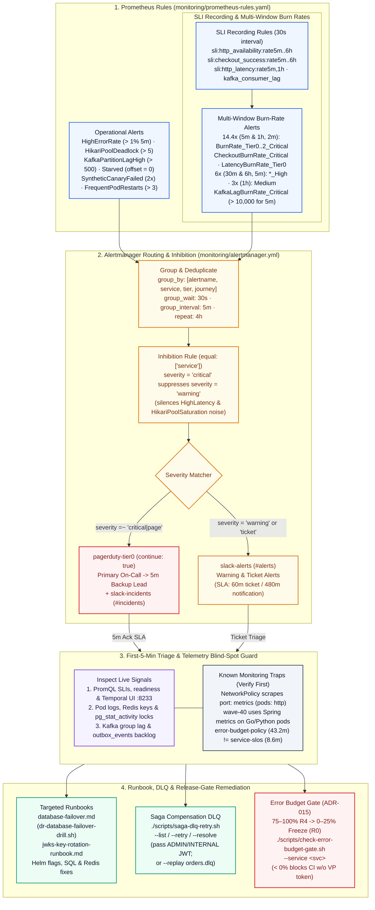
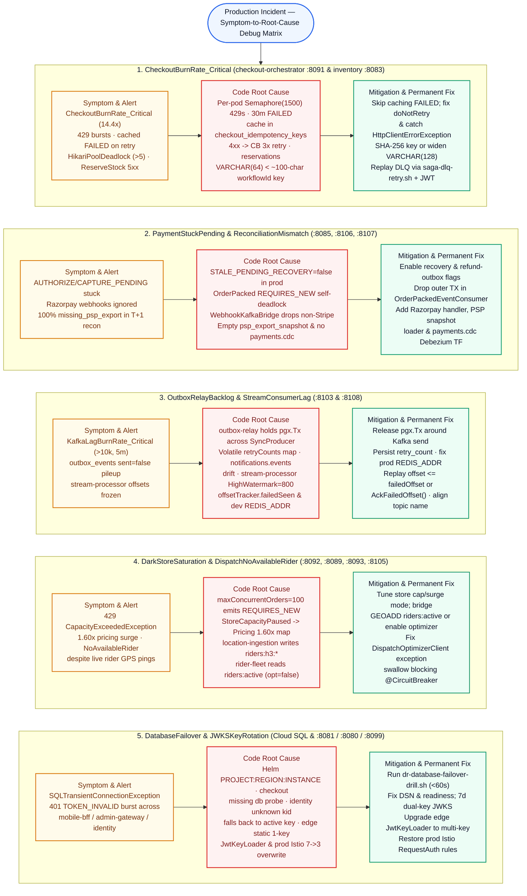

# 06 — Incident Drills & Day-5 Production Readiness Exam

> [!NOTE]
> **Part of the InstaCommerce Onboarding Suite:** [Onboarding Hub](./README.md) · [Day 0–5 Curriculum](./01-day0-to-day5-curriculum.md) · [Hands-On Labs](./02-hands-on-labs.md) · [Role Learning Tracks](./03-role-learning-tracks.md) · [First-PR & Troubleshooting](./04-first-pr-and-troubleshooting.md) · [Domain Model & Event Catalog](./05-domain-model-and-event-catalog.md) · **Incident Drills & Readiness Exam (this guide)** · [Service Dependency & CLI Cheatsheet](./07-service-dependency-and-command-cheatsheet.md) · [Code Walkthrough Atlas](./code-walkthrough/README.md)
>
> Every alert name, PromQL threshold, Helm flag, SQL table/column, script option, and code defect below is verified directly against [`monitoring/prometheus-rules.yaml`](../../monitoring/prometheus-rules.yaml), [`monitoring/alertmanager.yml`](../../monitoring/alertmanager.yml), [`monitoring/error-budget-policy.yaml`](../../monitoring/error-budget-policy.yaml), [`docs/runbooks/database-failover.md`](../runbooks/database-failover.md), [`docs/runbooks/jwks-key-rotation-runbook.md`](../runbooks/jwks-key-rotation-runbook.md), [`scripts/saga-dlq-retry.sh`](../../scripts/saga-dlq-retry.sh), [`scripts/check-error-budget-gate.sh`](../../scripts/check-error-budget-gate.sh), [`deploy/helm/values-prod.yaml`](../../deploy/helm/values-prod.yaml), and the checked-in service code under [`services/`](../../services/).

---

## Table of Contents

1. [Alerting, Escalation & Error-Budget Mechanics](#1-alerting-escalation--error-budget-mechanics)
2. [Symptom-to-Root-Cause Debug Matrix](#2-symptom-to-root-cause-debug-matrix)
3. [Five Interactive On-Call Incident Drills](#3-five-interactive-on-call-incident-drills)
   - [Drill 1: CheckoutBurnRate_Critical — Flash-Sale Backpressure, Poisoned FAILED Cache, Hikari Deadlock & VARCHAR(64) Overflow](#drill-1-checkoutburnrate_critical--flash-sale-backpressure-poisoned-failed-cache-hikari-deadlock--varchar64-overflow)
   - [Drill 2: PaymentStuckPending & ReconciliationMismatch — Disabled Prod Recovery, Dropped Razorpay Webhooks & Empty psp_export_snapshot](#drill-2-paymentstuckpending--reconciliationmismatch--disabled-prod-recovery-dropped-razorpay-webhooks--empty-psp_export_snapshot)
   - [Drill 3: OutboxRelayBacklog & StreamConsumerLag — Open pgx.Tx Pinning, Volatile retryCounts, Topic Drift & offsetTracker Stall](#drill-3-outboxrelaybacklog--streamconsumerlag--open-pgxtx-pinning-volatile-retrycounts-topic-drift--offsettracker-stall)
   - [Drill 4: DarkStoreSaturation & DispatchNoAvailableRider — Capacity Pause Surge Cascade & GPS Split-Brain](#drill-4-darkstoresaturation--dispatchnoavailablerider--capacity-pause-surge-cascade--gps-split-brain)
   - [Drill 5: DatabaseFailover & JWKSKeyRotation — Regional Cloud SQL Promotion & Dual-Key JWKS vs. Static Edge Keys](#drill-5-databasefailover--jwkskeyrotation--regional-cloud-sql-promotion--dual-key-jwks-vs-static-edge-keys)
4. [Day-5 Production Readiness Exam (10 Role-Track Scenarios)](#4-day-5-production-readiness-exam-10-role-track-scenarios)
   - [Track 1: Core Commerce Java Engineer (Q1–Q2)](#track-1-core-commerce-java-engineer-q1q2)
   - [Track 2: Payments, Risk & Ledger Engineer (Q3–Q4)](#track-2-payments-risk--ledger-engineer-q3q4)
   - [Track 3: Fulfillment, Logistics & Geo Engineer (Q5–Q6)](#track-3-fulfillment-logistics--geo-engineer-q5q6)
   - [Track 4: Data, ML & GenAI Engineer (Q7–Q8)](#track-4-data-ml--genai-engineer-q7q8)
   - [Track 5: Platform, SRE & Infra Engineer (Q9–Q10)](#track-5-platform-sre--infra-engineer-q9q10)

---

## 1. Alerting, Escalation & Error-Budget Mechanics

Before running your first on-call shadow shift, internalize how InstaCommerce turns raw telemetry into pages, suppresses cascading noise, and enforces [ADR-015](../adr/015-slo-error-budget-policy.md) deployment freezes.

**Incident Alerting, Escalation & Budget-Gate Flow** — *[Rendered PNG](./diagrams/incident-escalation-flow.png) · [Mermaid Source](./diagrams/incident-escalation-flow.mmd)*



### 1.1 Canonical SLO Tiers, Burn Rates & Alertmanager Rules

| Tier / Scope | Services (`error-budget-policy.yaml`) | Availability SLO (`30d` Budget) | P99 Latency Target | Critical / High Burn-Rate Triggers (`prometheus-rules.yaml`) |
|---|---|---|---|---|
| **Tier 0** | `identity-service`, `checkout-orchestrator-service`, `payment-service` | `99.90%` (`43.2m` / 30d) | `500ms` | [`BurnRate_Tier0_Critical`](../../monitoring/prometheus-rules.yaml#L128-L145) (`14.4x` `5m`+`1h`, `2m` `page`); [`CheckoutBurnRate_Critical`](../../monitoring/prometheus-rules.yaml#L183-L197) (`14.4x`); [`LatencyBurnRate_Tier0_Critical`](../../monitoring/prometheus-rules.yaml#L297-L308) (`14.4x`); [`BurnRate_Tier0_High`](../../monitoring/prometheus-rules.yaml#L148-L164) (`6x` `30m`+`6h`, `5m` `page`); [`BurnRate_Tier0_Medium`](../../monitoring/prometheus-rules.yaml#L167-L179) (`3x` `1h`, `30m` `ticket`) |
| **Tier 1** | `order-service`, `inventory-service`, `fulfillment-service`, `cart-service`, `pricing-service`, `rider-fleet-service`, `routing-eta-service` | `99.50%` (`216m` / 30d) | `1000ms` | [`BurnRate_Tier1_Critical`](../../monitoring/prometheus-rules.yaml#L219-L235) (`14.4 * 0.005`, `2m` `page`); [`BurnRate_Tier1_High`](../../monitoring/prometheus-rules.yaml#L238-L254) (`6 * 0.005`, `5m` `page`) |
| **Tier 2** | `catalog`, `search`, `notification`, `wallet-loyalty`, `fraud-detection`, `warehouse`, `config-feature-flag`, `audit-trail`, `ai-orchestrator`, `ai-inference` | `99.00%` (`432m` / 30d) | `2000ms` | [`BurnRate_Tier2_Critical`](../../monitoring/prometheus-rules.yaml#L259-L275) (`14.4 * 0.01`, `2m` `page`); [`BurnRate_Tier2_High`](../../monitoring/prometheus-rules.yaml#L278-L294) (`6 * 0.01`, `5m` `ticket`) |
| **Operational & Kafka** | Cross-cutting DB, JVM, Kafka, Blackbox, Synthetic Canary | — | — | [`KafkaLagBurnRate_Critical`](../../monitoring/prometheus-rules.yaml#L311-L319) (`> 10000` `5m` `page`), [`HighErrorRate`](../../monitoring/prometheus-rules.yaml#L326-L338) (`> 1%` `5m` `critical`), [`HikariPoolDeadlock`](../../monitoring/prometheus-rules.yaml#L411-L419) (`pending > 5` `1m` `critical`), [`SyntheticCanaryFailed`](../../monitoring/prometheus-rules.yaml#L511-L520) (`>= 2` `1m` `page`) |

**Routing, Inhibition & Budget-Gate Policy:**
- **Routing ([`monitoring/alertmanager.yml#L6-L71`](../../monitoring/alertmanager.yml#L6-L71)):** Alerts group by `['alertname', 'service', 'tier', 'journey']` (`group_wait: 30s`, `group_interval: 5m`, `repeat_interval: 4h`). Any `severity =~ "^(critical|page)$"` hits **`pagerduty-tier0`** (`continue: true`, escalating from primary to backup lead after 5 minutes) **and** **`slack-incidents`** (`#incidents`), while `severity = "warning"` routes to **`slack-alerts`** (`#alerts`).
- **Inhibition ([`monitoring/alertmanager.yml#L65-L71`](../../monitoring/alertmanager.yml#L65-L71)):** A firing `severity = "critical"` alert suppresses `severity = "warning"` alerts with the same `service` label (for example, `HikariPoolDeadlock` suppresses `HikariPoolSaturation` and `HighLatency` on that service). Notice that `severity = "page"` does **not** inhibit `severity = "warning"` because `source_matchers` matches `severity = "critical"` strictly!
- **Error-Budget Gate ([`monitoring/error-budget-policy.yaml#L46-L71`](../../monitoring/error-budget-policy.yaml#L46-L71) & [`scripts/check-error-budget-gate.sh`](../../scripts/check-error-budget-gate.sh#L76-L165)):** Remaining budget `75–100%` allows normal development (`R4`), `50–75%` limits to `R3` (`#alerts`), `25–50%` limits to `R2` + review (`#incidents`), and `0–25%` enforces a **`freeze`** (`deploy_allowed: false`, `R0`, PagerDuty + weekly exec briefing). In CI, [`check-error-budget-gate.sh`](../../scripts/check-error-budget-gate.sh#L140-L162) blocks promotion (`exit 1`) once 30-day remaining budget drops below `0%` unless invoked with `--emergency-override --vp-token VP-ENG-OVERRIDE-HOTFIX` (or `EMERGENCY_APPROVED`).

> [!WARNING]
> **Verified Observability Blind Spots (Always Cross-Check Before Trusting Green Dashboards):**
> 1. **Prometheus Scrape Block in Helm:** [`deploy/helm/templates/network-policy.yaml#L52-L54`](../../deploy/helm/templates/network-policy.yaml#L52-L54) permits monitoring scrapes only on named port `port: metrics`, whereas [`deploy/helm/templates/deployment.yaml#L65-L66`](../../deploy/helm/templates/deployment.yaml#L65-L66) and `service.yaml` expose only `name: http`. Under `default-deny-ingress`, Prometheus scrapes fail unless port names and `istio.servicePolicies` are aligned.
> 2. **Phantom Metric Drift in `wave-40`:** [`prometheus/rules/wave-40-complete-slo-alerts.yml`](../../prometheus/rules/wave-40-complete-slo-alerts.yml) queries Spring's `http_server_requests_seconds_count` for Go/Python services (`outbox-relay-service`, `stream-processor-service`, `reconciliation-engine`, `ai-orchestrator-service`, `ai-inference-service`), `reconciliation_job_failures_total` (actual in `telemetry.go`: `reconciliation_{mismatches,fixed,manual_review}_total`), and `elasticsearch_indices_last_indexed_timestamp` (`search-service` uses PostgreSQL `tsvector`).
> 3. **SLO Table Drift:** [`docs/slos/service-slos.md#L7-L27`](../slos/service-slos.md#L7-L27) lists `8.6 min` for `checkout`/`order` (`99.9%`) and `99.95%` (`2.2 min`) / `300ms` for `payment-service`, whereas the authoritative [`monitoring/error-budget-policy.yaml#L5-L27`](../../monitoring/error-budget-policy.yaml#L5-L27) and `check-error-budget-gate.sh` define Tier 0 (`43.2m`, `500ms`) and place `order-service` in Tier 1 (`99.5%`, `216m`).

---

## 2. Symptom-to-Root-Cause Debug Matrix

Use this matrix during the first 2 minutes of an incident to jump from the firing alert or customer symptom straight to the exact code path, verified production defect, and remediation tool.

**On-Call Symptom-to-Root-Cause Debug Matrix** — *[Rendered PNG](./diagrams/oncall-debug-matrix.png) · [Mermaid Source](./diagrams/oncall-debug-matrix.mmd)*



---

## 3. Five Interactive On-Call Incident Drills

Each drill simulates a real PagerDuty page grounded in InstaCommerce's checked-in source code, Helm values, SQL schemas, and operational tooling. Work through **Symptom -> Investigation -> Root Cause -> Mitigation & Permanent Fix** before peeking at the code walkthrough citations, and keep [`05-domain-model-and-event-catalog.md`](./05-domain-model-and-event-catalog.md) open for complete PostgreSQL constraints, Kafka topic/DLT mappings, and Redis keyspace details.

---

### Drill 1: `CheckoutBurnRate_Critical` — Flash-Sale Backpressure, Poisoned `FAILED` Cache, Hikari Deadlock & `VARCHAR(64)` Overflow

#### 1. Symptom & Alert Profile
- **Firing Alerts:**
  - [`CheckoutBurnRate_Critical`](../../monitoring/prometheus-rules.yaml#L183-L197) (`severity: page`, `tier: "0"`, `journey: checkout`): `(1 - sli:checkout_success:rate5m) > (14.4 * 0.001)` and `(1 - sli:checkout_success:rate1h) > (14.4 * 0.001)` for `2m` (`1.44%`+ HTTP `5xx` error rate on `checkout-orchestrator-service`).
  - Often accompanied by [`SyntheticCanaryFailed`](../../monitoring/prometheus-rules.yaml#L511-L520) (`>= 2` consecutive canary failures) and [`HikariPoolDeadlock`](../../monitoring/prometheus-rules.yaml#L411-L419) (`hikaricp_connections_pending > 5` for `1m`).
- **Customer & Telemetry Symptoms:**
  - During a flash-sale spike, mobile clients report HTTP `429` (`RATE_LIMIT_EXCEEDED: Flash sale checkout spike backpressure active`) and subsequent retries with the **same** `Idempotency-Key` immediately return HTTP `200` with `"status": "FAILED"` even after traffic subsides.
  - Temporal UI (`:8233`) shows `ReserveStock` failing `3x`, triggering `COMPENSATING` unwinds and queuing records into `compensation_dlq`.

#### 2. Investigation Commands, SQL & Logs
Run these checks against Kubernetes / Prometheus / PostgreSQL (or your local compose stack):

```bash
# 1. Check pod saturation, HTTP 429 rate-limiter logs, and Hikari pending threads
kubectl logs -l app=checkout-orchestrator-service -n instacommerce --since=15m \
  | grep -E "Checkout request rate limit exceeded|WorkflowException|HikariPool"

# 2. Query PromQL burn rate and Hikari pending connections
curl -fsSG "http://prometheus.monitoring:9090/api/v1/query" \
  --data-urlencode 'query=1 - sli:checkout_success:rate5m' | jq '.data.result'
curl -fsSG "http://prometheus.monitoring:9090/api/v1/query" \
  --data-urlencode 'query=hikaricp_connections_pending{service=~"checkout-orchestrator-service|inventory-service|payment-service"} > 5' | jq '.data.result'

# 3. Inspect poisoned FAILED idempotency rows and stuck saga compensations in checkout DB
psql "$CHECKOUT_DB_URL" -c "
  SELECT idempotency_key, left(checkout_response, 120) AS response_preview, created_at, expires_at
  FROM checkout_idempotency_keys
  WHERE checkout_response LIKE '%FAILED%'
  ORDER BY created_at DESC LIMIT 10;"

psql "$CHECKOUT_DB_URL" -c "
  SELECT id, workflow_id, activity_name, target_id, status, retry_count, left(reason, 120) AS reason
  FROM compensation_dlq
  WHERE status = 'FAILED'
  ORDER BY created_at DESC LIMIT 10;"

# 4. Inspect inventory reservation failures / length errors in inventory DB & logs
psql "$INVENTORY_DB_URL" -c "
  SELECT count(*), max(length(idempotency_key)) AS max_key_len
  FROM reservations
  WHERE created_at > NOW() - INTERVAL '1 hour';"
```

#### 3. Root Cause in Code (Four Compounding Defects)
1. **Per-Pod `Semaphore(1500)` Backpressure Without Cluster Awareness ([`CheckoutController.java#L66-L89`](../../services/checkout-orchestrator-service/src/main/java/com/instacommerce/checkout/controller/CheckoutController.java#L66-L89)):**
   `CheckoutController` caps in-flight synchronous checkouts using an in-JVM `new Semaphore(1500)` (`checkout.concurrency.max-in-flight`). Because `values-prod.yaml` runs `replicas: 2` (`3000` cluster slots total), overloaded pods reject bursts with HTTP `429` + `Retry-After: 5`. Notice `429` does not trip `sli:checkout_success` (which filters `status=~"5.."`), but client retry storms and long synchronous `workflow.checkout(request)` holds pin Tomcat threads until downstream failures escalate to `5xx`.
2. **30-Minute Poisoned `FAILED` Idempotency Cache ([`CheckoutController.java#L136-L142`](../../services/checkout-orchestrator-service/src/main/java/com/instacommerce/checkout/controller/CheckoutController.java#L136-L142), [`CheckoutIdempotencyService.java#L23-L56`](../../services/checkout-orchestrator-service/src/main/java/com/instacommerce/checkout/service/CheckoutIdempotencyService.java#L23-L56)):**
   `CheckoutController` saves **every** synchronous `CheckoutResponse`—including `"FAILED: ..."`—into `checkout_idempotency_keys` with `IDEMPOTENCY_TTL = Duration.ofMinutes(30)`. Any client retrying a failed checkout with the same `Idempotency-Key` receives the cached `FAILED` payload with HTTP `200` for 30 minutes (`findValidResponse` deletes rows only after `expiresAt` passes). Conversely, `?async=true` (`#L120-L124`) returns `202 STARTED` and never caches completion.
3. **`HikariPoolDeadlock` + Temporal/Resilience4j `4xx` Amplification ([`CheckoutWorkflowSupport.java#L23-L68`](../../services/checkout-orchestrator-service/src/main/java/com/instacommerce/checkout/workflow/CheckoutWorkflowSupport.java#L23-L68), [`inventory-service/application.yml#L22-L28`](../../services/inventory-service/src/main/resources/application.yml#L22-L28)):**
   `CheckoutWorkflowSupport` sets `doNotRetry` to `com.instacommerce.checkout.exception.{InsufficientStockException,PaymentDeclinedException}` (which do not exist in `checkout-orchestrator-service`) and `pricing-service` exception FQCNs. Because `InventoryActivityImpl`, `PaymentActivityImpl`, and `CouponActivityImpl` do not catch `HttpClientErrorException`, deterministic HTTP `4xx` rejections fall into Resilience4j `@CircuitBreaker` fallbacks, wrap as `ServiceUnavailableException`, trip circuit breakers (`failureRateThreshold: 50`), and trigger `3x` Temporal retries—amplifying DB pool demand across `checkout` (`maximum-pool-size: 20`), `inventory` (`maximum-pool-size: 60`, `connection-timeout: 3000`, `validation-timeout: 3000`), and `payment` (`maximum-pool-size: 50`). Worse, `checkout-orchestrator-service`'s readiness probe (`application.yml#L93-L94`) checks `readinessState` only (omitting `db`), so DB-starved pods remain in endpoints.
4. **Inventory `VARCHAR(64)` Overflow ([`CheckoutWorkflowImpl.java#L142-L143`](../../services/checkout-orchestrator-service/src/main/java/com/instacommerce/checkout/workflow/CheckoutWorkflowImpl.java#L142-L143), [`V2__create_reservations.sql#L5`](../../services/inventory-service/src/main/resources/db/migration/V2__create_reservations.sql#L5), [`ReservationService.java#L131-L136`](../../services/inventory-service/src/main/java/com/instacommerce/inventory/service/ReservationService.java#L131-L136)):**
   `CheckoutController.java#L107` constructs `workflowId = "checkout-" + principal + "-" + idempotencyKey` (`~82+` chars when both are UUIDs), and Step 3 forwards `workflowId + ":inventory:reserve"` (`~100` chars) as `ReserveRequest.idempotencyKey`. Unlike `order-service`'s [`OrderCreationService.normalizeIdempotencyKey`](../../services/order-service/src/main/java/com/instacommerce/order/service/OrderCreationService.java#L219-L237) (which SHA-256 hashes keys longer than `64` chars), `inventory-service` inserts the raw string into `reservations.idempotency_key VARCHAR(64)`, causing Postgres value-too-long errors, `3x` Temporal retries, `COMPENSATING` rollbacks, and `compensation_dlq` entries.

#### 4. Immediate Mitigation + Permanent Fix
- **Immediate Mitigation:**
  1. Purge poisoned `FAILED` idempotency cache entries so affected customers can retry immediately:
     ```sql
     DELETE FROM checkout_idempotency_keys
     WHERE checkout_response LIKE '%"status":"FAILED"%'
       AND created_at > NOW() - INTERVAL '30 minutes';
     ```
  2. Inspect and replay stuck compensations using [`scripts/saga-dlq-retry.sh`](../../scripts/saga-dlq-retry.sh#L125-L171). **Security caveat:** [`SecurityConfig.java`](../../services/checkout-orchestrator-service/src/main/java/com/instacommerce/checkout/security/SecurityConfig.java#L36) requires `hasAnyRole('ADMIN', 'INTERNAL_SERVICE')` on `/checkout/dlq/**`, while `saga-dlq-retry.sh` sends unauthenticated `curl` calls. Dry-run with the script, then pass an admin/internal bearer JWT directly (or port-forward + token):
     ```bash
     ./scripts/saga-dlq-retry.sh --retry <dlq-id> --dry-run
     curl -fsS -H "Authorization: Bearer ${ADMIN_JWT}" http://localhost:8091/checkout/dlq | jq .
     curl -fsS -X POST -H "Authorization: Bearer ${ADMIN_JWT}" "http://localhost:8091/checkout/dlq/<dlq-id>/retry" | jq .
     ```
  3. Check ADR-015 budget status before rolling a hotfix (`./scripts/check-error-budget-gate.sh --service checkout-orchestrator-service`; use `--emergency-override --vp-token VP-ENG-OVERRIDE-HOTFIX` if 30d budget is `< 0%`).
- **Permanent Fix:**
  1. In `CheckoutController.initiateCheckout`, persist `checkout_idempotency_keys` **only** when `"COMPLETED".equalsIgnoreCase(result.status())` (do not cache transient `FAILED` responses for `30m`).
  2. In `inventory-service`, append a forward Flyway migration `ALTER TABLE reservations ALTER COLUMN idempotency_key TYPE VARCHAR(255)` **and** apply `OrderCreationService.normalizeIdempotencyKey` (`SHA-256` hex for keys `> 64` chars) in `ReservationService`.
  3. Catch `HttpClientErrorException` in `InventoryActivityImpl` / `PaymentActivityImpl` / `CouponActivityImpl` outside `@CircuitBreaker` and align `CheckoutWorkflowSupport` `doNotRetry` exception names; add `db` to `checkout-orchestrator-service`'s `management.endpoint.health.group.readiness.include`.
  4. Validate narrowly:
     ```bash
     ./gradlew :services:checkout-orchestrator-service:test --tests "com.instacommerce.checkout.controller.CheckoutControllerTest"
     ./gradlew :services:inventory-service:test --tests "com.instacommerce.inventory.service.FefoAndPartialReleaseTest"
     ```

---

### Drill 2: `PaymentStuckPending & ReconciliationMismatch` — Disabled Prod Recovery, Dropped Razorpay Webhooks & Empty `psp_export_snapshot`

#### 1. Symptom & Alert Profile
- **Firing Alerts / Symptoms:**
  - Finance / Ops reports orders stuck awaiting payment confirmation or capture (`AUTHORIZE_PENDING`, `CAPTURE_PENDING`, `VOID_PENDING` aging past `30m`), and customer refunds initiated via PSP webhook never update `orders` or `wallet-loyalty-service`.
  - Razorpay webhook callbacks return `202 Accepted` at the edge (`payment-webhook-service` `:8106`), yet `payments` rows never transition.
  - Daily T+1 `reconciliation-engine` (`:8107`) runs classify **100%** of ledger rows as `missing_psp_export` (`manual_review_required = true`), while Prometheus/Grafana fails to fire `wave-40` reconciliation alerts.

#### 2. Investigation Commands, SQL & Logs
```bash
# 1. Inspect Helm prod feature flags disabling recovery & webhook outbox
grep -n -E "PAYMENT_.*ENABLED" deploy/helm/values-prod.yaml deploy/helm/values.yaml deploy/helm/values-dev.yaml

# 2. Query stuck pending payments & lock-timeout consumer failures in payments DB
psql "$PAYMENT_DB_URL" -c "
  SELECT id, order_id, status, amount_cents, captured_cents, psp_reference, created_at, updated_at
  FROM payments
  WHERE status IN ('AUTHORIZE_PENDING', 'CAPTURE_PENDING', 'VOID_PENDING')
    AND updated_at < NOW() - INTERVAL '30 minutes'
  ORDER BY created_at ASC LIMIT 25;"

kubectl logs -l app=payment-service -n instacommerce --since=30m \
  | grep -E "SKIPPED_UNSUPPORTED_PSP|OrderPackedEventConsumer|LockTimeoutException|CannotAcquireLockException"

# 3. Verify payment-webhook-service (:8106) and reconciliation DB (:8107) state
kubectl logs -l app=payment-webhook -n instacommerce --since=30m | grep -E "razorpay|publish|dedupe"

psql "$RECONCILIATION_DB_URL" -c "
  SELECT run_id, run_date, status, mismatch_count, auto_fixed_count, manual_review_count
  FROM reconciliation_runs ORDER BY run_date DESC LIMIT 5;"

psql "$RECONCILIATION_DB_URL" -c "
  SELECT count(*) AS snapshot_rows, max(export_date) AS latest_export_date FROM psp_export_snapshot;"

psql "$RECONCILIATION_DB_URL" -c "
  SELECT discrepancy_reason, count(*) FROM reconciliation_mismatches GROUP BY discrepancy_reason;"
```

#### 3. Root Cause in Code (Four Interlocking Gaps)
1. **Prod Helm Disables Recovery & Refund Outbox ([`deploy/helm/values-prod.yaml#L27-L29`](../../deploy/helm/values-prod.yaml#L27-L29), [`StalePendingPaymentRecoveryJob.java#L35-L85`](../../services/payment-service/src/main/java/com/instacommerce/payment/service/StalePendingPaymentRecoveryJob.java#L35-L85)):**
   `values-prod.yaml` (and `values.yaml#L682-L686`, `values-staging.yaml#L57-L59`) sets `PAYMENT_STALE_PENDING_RECOVERY_ENABLED: "false"`, `PAYMENT_WEBHOOK_REFUND_OUTBOX_ENABLED: "false"`, and `PAYMENT_CHOREOGRAPHY_ORDER_CANCELLED_CONSUMER_ENABLED: "false"` (only `values-dev.yaml#L18-L20` enables them). Because `StalePendingPaymentRecoveryJob` is gated by `@ConditionalOnProperty(prefix = "payment.recovery", name = "stale-pending-enabled", havingValue = "true")`, the `@Scheduled` ShedLock reconciler never registers in prod—leaving any `*_PENDING` payment whose synchronous PSP HTTP call timed out or lost its webhook permanently stuck.
2. **Self-Deadlock & Missing `.DLT` in `OrderPackedEventConsumer` ([`OrderPackedEventConsumer.java#L52-L96`](../../services/payment-service/src/main/java/com/instacommerce/payment/consumer/OrderPackedEventConsumer.java#L52-L96), [`PaymentTransactionHelper.java#L111-L114`](../../services/payment-service/src/main/java/com/instacommerce/payment/service/PaymentTransactionHelper.java#L111-L114), [`KafkaConfig.java#L17-L34`](../../services/payment-service/src/main/java/com/instacommerce/payment/config/KafkaConfig.java#L17-L34)):**
   `OrderPackedEventConsumer` is **ON by default** (`matchIfMissing = true`), opens an outer `@Transactional` on `onFulfillmentEvent`, locks the `Payment` row via `findByOrderIdForUpdate(orderId)`, and calls `paymentService.capture(...)`, whose `PaymentTransactionHelper.saveCapturePending` opens `Propagation.REQUIRES_NEW` and requests `findByIdForUpdate(paymentId)` on a second Hikari connection—blocking on the outer TX's row lock until `jakarta.persistence.lock.timeout: 5000` (`payment-service/application.yml#L32`) expires! Worse, `KafkaConfig` only registers `DeadLetterPublishingRecoverer` (`.DLT`) when `order-cancelled-consumer-enabled` OR `webhook.kafka-consumer-enabled` is `true`—both `false` in prod.
3. **Razorpay Dropped Silently by `WebhookKafkaBridge` ([`payment-webhook-service/handler/webhook.go#L173-L230`](../../services/payment-webhook-service/handler/webhook.go#L173-L230), [`WebhookKafkaBridge.java#L29-L99`](../../services/payment-service/src/main/java/com/instacommerce/payment/consumer/WebhookKafkaBridge.java#L29-L99), [`PaymentWebhookEventConsumer.java#L31-L66`](../../services/payment-service/src/main/java/com/instacommerce/payment/consumer/PaymentWebhookEventConsumer.java#L31-L66)):**
   Go `payment-webhook-service` verifies Razorpay HMAC signatures at `/webhooks/razorpay`, deduplicates in Redis, emits enriched v2 `WebhookTransportEvent` payloads to `payment.webhooks`, and returns `202 Accepted` (`values.yaml` also omits a `VirtualService` ingress route for `payment-webhook`). On the Java side, `PAYMENT_WEBHOOK_KAFKA_CONSUMER_ENABLED` defaults to `false`; even when enabled, `WebhookKafkaBridge.forward` checks `if (!PSP_STRIPE.equals(event.psp()))` and returns `Result.SKIPPED_UNSUPPORTED_PSP`, causing `PaymentWebhookEventConsumer` to log INFO and **commit the Kafka offset**, permanently discarding Razorpay events.
4. **Empty `psp_export_snapshot` & Missing `payments.cdc` Connector ([`reconciler.go#L105-L111,L260-L279`](../../services/reconciliation-engine/pkg/reconciliation/reconciler.go#L105-L111), [`V4__create_payment_ledger_and_psp_snapshot.sql#L22-L35`](../../services/reconciliation-engine/src/main/resources/db/migration/V4__create_payment_ledger_and_psp_snapshot.sql#L22-L35), [`reconciliation-engine.md#L266-L279`](./code-walkthrough/services/reconciliation-engine.md#L266-L279)):**
   `DBReconciler.queryPSPEntries` reads `psp_export_snapshot WHERE export_date = $1`, and `CDCConsumer` defaults `CDCTopics` to `["payments.cdc", "reconciliation.cdc"]`. However, **no writer anywhere in the repository populates `psp_export_snapshot`**, Terraform [`debezium-connector-reconciliation.tf`](../../infra/terraform/debezium-connector-reconciliation.tf#L40) omits `payments.cdc` entirely and applies `ExtractNewRecordState` without `add.fields=op,table,lsn`, and `queryLedgerEntries` compares authorized `amount_cents` by `created_at` instead of settled `captured_cents` (while `wave-40` alerts query nonexistent `reconciliation_job_failures_total`).

#### 4. Immediate Mitigation + Permanent Fix
- **Immediate Mitigation:**
  1. Reconcile stuck `*_PENDING` payments in `payments` DB after checking real PSP status via Stripe/Razorpay dashboards, and flip `PAYMENT_STALE_PENDING_RECOVERY_ENABLED: "true"` and `PAYMENT_WEBHOOK_REFUND_OUTBOX_ENABLED: "true"` in `deploy/helm/values-prod.yaml` (starting conservatively with `PAYMENT_STALE_PENDING_RECOVERY_THRESHOLD_MINUTES: "60"` and `BATCH_SIZE: "25"` per [`payment-service/README.md`](../../services/payment-service/README.md#L781)).
  2. Temporarily disable `OrderPackedEventConsumer` (`PAYMENT_CHOREOGRAPHY_ORDER_PACKED_CONSUMER_ENABLED=false`) if lock timeouts cascade across Hikari connections (`CheckoutWorkflowImpl` Step 9a still synchronously captures on `CONFIRMING`).
  3. Replay un-processed Razorpay webhook payloads from `payment.webhooks` using a separate diagnostic consumer group (`kafka-console-consumer --bootstrap-server "$KAFKA_BROKERS" --topic payment.webhooks --from-beginning`) once a Razorpay handler is deployed, or load daily settlement CSVs into `psp_export_snapshot` before triggering `POST /reconciliation/run` on `:8107`.
- **Permanent Fix:**
  1. Remove `@Transactional` from `OrderPackedEventConsumer.onFulfillmentEvent` (do an unlocked pre-check or delegate locking cleanly inside `PaymentService.capture`), and remove the `@ConditionalOnExpression` gate on `KafkaConfig` so `.DLT` error handling covers `OrderPackedEventConsumer` unconditionally.
  2. Implement a `RazorpayWebhookEventHandler` routed from `WebhookKafkaBridge` when `"razorpay".equals(event.psp())`, and enable `PAYMENT_WEBHOOK_KAFKA_CONSUMER_ENABLED: "true"` + add `payment-webhook` to Helm `VirtualService`.
  3. Add a scheduled settlement importer populating `psp_export_snapshot`, add `payments.cdc` Debezium Terraform config with `transforms.unwrap.add.fields=op,table,lsn`, align `queryLedgerEntries` to `captured_cents`, and wire `reconciliation-engine` DB/Kafka env vars in Helm.
  4. Validate narrowly:
     ```bash
     ./gradlew :services:payment-service:test --tests "com.instacommerce.payment.service.StalePendingPaymentRecoveryJobTest"
     (cd services/payment-webhook-service && go test -race ./...)
     (cd services/reconciliation-engine && go test -race ./...)
     ```

---

### Drill 3: `OutboxRelayBacklog & StreamConsumerLag` — Open `pgx.Tx` Pinning, Volatile `retryCounts`, Topic Drift & `offsetTracker` Stall

#### 1. Symptom & Alert Profile
- **Firing Alerts:**
  - [`KafkaLagBurnRate_Critical`](../../monitoring/prometheus-rules.yaml#L311-L319) (`severity: page`): `sli:kafka_consumer_lag:max5m > 10000` for `5m` on consumer group `stream-processor` or downstream domain groups.
  - [`KafkaPartitionLagHigh`](../../monitoring/prometheus-rules.yaml#L447-L455) (`> 500` for `3m`) and [`KafkaPartitionStarved`](../../monitoring/prometheus-rules.yaml#L457-L465) (`current_offset == 0` for `5m`).
- **System Symptoms:**
  - `outbox_events WHERE sent = false` piles up in service DBs while `outbox-relay` holds Postgres transactions `"idle in transaction"` for tens of seconds, causing Hikari contention on upstream Java services.
  - `stream-processor-service` (`:8108`) logs `"backpressure: channel reached 80% capacity, pausing kafka consumer fetch"`, and a partition's committed offset stops advancing indefinitely even after healthy messages arrive.

#### 2. Investigation Commands, SQL & Logs
```bash
# 1. Check outbox backlog & long-running open relay transactions in PostgreSQL
psql "$ORDER_DB_URL" -c "
  SELECT count(*) AS unsent_count, min(created_at) AS oldest_unsent,
         extract(epoch from (now() - min(created_at))) AS max_lag_seconds
  FROM outbox_events WHERE sent = false;"

psql "$ORDER_DB_URL" -c "
  SELECT pid, usename, application_name, state, now() - xact_start AS tx_age, left(query, 100)
  FROM pg_stat_activity
  WHERE state <> 'idle' AND datname = current_database()
  ORDER BY xact_start ASC LIMIT 10;"

# 2. Inspect outbox-relay (:8103) and stream-processor (:8108) logs & Prometheus metrics
kubectl logs -l app=outbox-relay-order -n instacommerce --since=15m \
  | grep -E "failed to publish message|event sent to DLQ|relay batch failed"

kubectl logs -l app=stream-processor -n instacommerce --since=15m \
  | grep -E "backpressure: channel reached 80%|stream handler error|commit error"

curl -fsS http://localhost:8103/metrics | grep -E "outbox_relay_(events|failures|dlq|lag)"
curl -fsS http://localhost:8108/metrics | grep -E "dedup_|stream_watermark_|order_processing_errors|payment_processing_errors"

# 3. Verify stream-processor Redis target in Helm (dev Redis trap!) and consumer group lag
grep -n -A8 "stream-processor:" deploy/helm/values.yaml deploy/helm/values-prod.yaml
kafka-consumer-groups --bootstrap-server "$KAFKA_BROKERS" --describe --group stream-processor
```

#### 3. Root Cause in Code (Four Verified Failure Modes)
1. **Open `pgx.Tx` Held Across `sarama.SyncProducer` ([`relay.go#L147-L278`](../../services/outbox-relay-service/relay.go#L147-L278), [`kafka.go#L147-L154`](../../services/outbox-relay-service/kafka.go#L147-L154)):**
   `relayBatch` begins a Postgres transaction (`s.db.Begin(ctx)`), selects `LIMIT 100` (`OUTBOX_BATCH_SIZE`) rows with `FOR UPDATE SKIP LOCKED`, and keeps `tx` open while synchronously calling `s.producer.SendMessage(message)` (`RequiredAcks: WaitForAll`, `Idempotent: true`, `Retry.Max = 10`, `WriteTimeout >= 5s`) for every event in the batch. Whenever Kafka experiences broker throttling or under-replicated partitions, Postgres connections and row locks stay pinned for `100 × timeout`, triggering `commitCtx` (`10s`) failures (`#L184,L273`) or starving upstream writers.
2. **Volatile In-Memory `retryCounts` Map ([`relay.go#L36-L37,L87-L103,L236-L256`](../../services/outbox-relay-service/relay.go#L36-L37)):**
   `relayService` tracks per-event retries in a process-local `retryCounts map[string]int` rather than a database column. On `replicas: 2` (`values-prod.yaml#L73`) or after an OOMKill/restart, `attempts` resets to `0` or rotates between pods, so poison/unpublishable rows loop forever without reaching `OUTBOX_MAX_RETRIES` (`3`) to quarantine into `outbox.relay.dlq`.
3. **`notifications.events` vs. `notification.events` Drift & Prod Helm Relay Omission ([`envelope.go#L62`](../../services/outbox-relay-service/envelope.go#L62), [`TopicNames.java#L25`](../../contracts/src/main/java/com/instacommerce/contracts/topics/TopicNames.java#L25), [`values-prod.yaml#L72-L80`](../../deploy/helm/values-prod.yaml#L72-L80)):**
   `envelope.go#L62` maps `"notification"` / `"notifications"` to **`"notifications.events"` (plural)**, whereas `TopicNames.NOTIFICATION_EVENTS` is **`"notification.events"` (singular)**. Separately, `values.yaml` defines `13` per-domain `outbox-relay-*` deployments (omitted in `values-dev.yaml` and `values-prod.yaml`), none for `notification-service`, and all `13` mount `outbox-relay-db-secrets` which Terraform does not create.
4. **`HighWatermark=800` Backpressure, `offsetTracker.failedSeen` Freeze & Dev `REDIS_ADDR` ([`stream.go#L30-L39,L249-L306`](../../services/stream-processor-service/processor/stream.go#L30-L39), [`offset_tracker.go#L61-L181`](../../services/stream-processor-service/processor/offset_tracker.go#L61-L181), [`values.yaml#L1250`](../../deploy/helm/values.yaml#L1250)):**
   - `DefaultStreamConfig()` sets `BufferSize: 1000`, `HighWatermark: 800` (`80%`), `LowWatermark: 300` (`30%`), and `WorkerCount: 10`. If Redis writes stall—note **`values.yaml#L1250` hardcodes `REDIS_ADDR: "instacommerce-redis-dev.redis.cache.goog:6379"` with zero override in `values-prod.yaml#L154-L162`**!—the channel hits `800`, sets `sd.paused.Swap(true)`, and halts Kafka consumer fetches.
   - When `runHandlerSafely` returns `false` on a transient error (e.g., Redis error or failed `.DLT` write), `offsetTracker.resolve` (`offset_tracker.go#L125-L140`) sets `pt.failedSeen = true`, `pt.failedOffset = msg.Offset`, marks all queued entries `> failedOffset` as `discarded`, and causes `enqueue()` (`#L65-L70`) to return `nil` for every offset `> failedOffset`. **No subsequent offset on that partition can ever commit** until either a consumer rebalance/restart replays an offset `<= pt.failedOffset` (triggering `resetFailedLocked()`) or `AckFailedOffset()` (`#L150-L181`) is called. Meanwhile, `replicas: 2` (`values-prod.yaml#L155`) splits in-memory `SLAMonitor` / `PaymentProcessor` / `InventoryProcessor` sliding windows (and Bloom filters) across two pods!

#### 4. Immediate Mitigation + Permanent Fix
- **Immediate Mitigation:**
  1. Fix `stream-processor` `REDIS_ADDR` in `values-prod.yaml` (and `values-staging.yaml`) to point to the environment's Memorystore host (`instacommerce-redis-prod.redis.cache.goog:6379`) and roll the deployment—restarting or rebalancing clears in-memory `pt.failedSeen` and replays from the last committed offset `<= failedOffset`.
  2. For persistent `outbox_events` poison rows stalling `relayBatch`, inspect `created_at` of the oldest `sent = false` row, verify if `OUTBOX_TOPIC` or `DLQ_TOPIC` (`outbox.relay.dlq`) is failing Kafka ACLs/brokers, and inspect `outbox.relay.dlq` before replaying valid records (`--dry-run` / `kafka-console-consumer`).
- **Permanent Fix:**
  1. Refactor `outbox-relay-service/relay.go` to **claim** rows with a short-lived DB update or lease (`status = 'PROCESSING'`, `locked_until`), release the `pgx.Tx` **before** calling `SyncProducer.SendMessage`, persist `retry_count` in PostgreSQL, and reconcile `envelope.go#L62` (`"notification.events"` vs `"notifications.events"`) with [`TopicNames.java`](../../contracts/src/main/java/com/instacommerce/contracts/topics/TopicNames.java#L25).
  2. In `stream-processor-service`, add bounded retry + backoff before marking `offsetFailed`, or route exhausted transient failures to `{topic}.DLT` so a single partition cannot wedge indefinitely; migrate sliding windows from pod RAM to Redis when `replicas > 1`.
  3. Validate narrowly:
     ```bash
     (cd services/outbox-relay-service && go test -race ./...)
     (cd services/stream-processor-service && go test -race ./processor -run '^TestStreamDispatcherMonotonicOffsetCommitWhenEarlierStalls$')
     ```

---

### Drill 4: `DarkStoreSaturation & DispatchNoAvailableRider` — Capacity Pause Surge Cascade & GPS Split-Brain

#### 1. Symptom & Alert Profile
- **Firing Alerts / Customer Symptoms:**
  - During peak evening dinner rush, a dark store begins rejecting checkout/cart validations with HTTP `429` (`CapacityExceededException`) while quotes from `pricing-service` (`:8089`) simultaneously spike to a **`1.60x`** delivery-fee multiplier (`"Peak Store Capacity Surge"`, e.g. INR `48.00` instead of INR `30.00`).
  - Meanwhile, packed orders from `fulfillment-service` (`OrderPacked` on `fulfillment.events`) fail rider assignment with **`NoAvailableRiderException`**, routing orders into `fulfillment.events.DLT` after `3` retries—even though dozens of riders are actively streaming live GPS coordinates!

#### 2. Investigation Commands, SQL & Logs
```bash
# 1. Inspect dark store capacity limits & pending counters in warehouse DB
psql "$WAREHOUSE_DB_URL" -c "
  SELECT id, name, status, current_pending_orders, max_concurrent_orders,
         capacity_orders_per_hour, surge_mode_enabled, surge_eta_extension_minutes, surge_threshold_percent
  FROM stores
  WHERE status = 'ACTIVE'
  ORDER BY (current_pending_orders::float / NULLIF(max_concurrent_orders, 0)) DESC LIMIT 10;"

psql "$WAREHOUSE_DB_URL" -c "
  SELECT store_id, date, hour, current_orders, max_orders
  FROM store_capacity
  WHERE date = CURRENT_DATE
  ORDER BY hour DESC, current_orders DESC LIMIT 10;"

# 2. Check StoreCapacityPaused / StoreCapacityThrottled logs & pricing-service surge state
kubectl logs -l app=warehouse-service -n instacommerce --since=15m \
  | grep -E "reached 100% capacity|entering throttled/surge state|hourly order capacity"
kubectl logs -l app=pricing-service -n instacommerce --since=15m \
  | grep -E "Recorded warehouse capacity|Recorded warehouse surge"

# 3. Inspect Redis GPS split-brain: location-ingestion (riders:h3:*) vs rider-fleet (riders:active)
redis-cli -h "$REDIS_HOST" ZCARD riders:active
redis-cli -h "$REDIS_HOST" --scan --pattern "riders:h3:*" | head -n 10
redis-cli -h "$REDIS_HOST" --scan --pattern "rider:*:location" | head -n 5
redis-cli -h "$REDIS_HOST" --scan --pattern "rider:location:*" | head -n 5

# 4. Inspect rider-fleet config, fallback SQL coordinates, and optimizer logs
kubectl logs -l app=rider-fleet-service -n instacommerce --since=15m \
  | grep -E "NoAvailableRiderException|Dispatch optimizer|Redis GEORADIUS|Haversine nearest-neighbor"

psql "$RIDER_DB_URL" -c "
  SELECT count(*) AS total_avail,
         count(*) FILTER (WHERE is_available) AS avail_true,
         count(*) FILTER (WHERE is_available AND current_lat IS NOT NULL AND current_lng IS NOT NULL) AS sql_eligible
  FROM rider_availability;"
```

#### 3. Root Cause in Code (Three Interacting Failures)
1. **Store Saturation -> `Propagation.REQUIRES_NEW` Outbox -> `PricingService` `1.60x` Surge ([`V9__add_bins_telemetry_and_capacity_limits.sql#L4`](../../services/warehouse-service/src/main/resources/db/migration/V9__add_bins_telemetry_and_capacity_limits.sql#L4), [`CapacityService.java#L94-L139,L227-L236`](../../services/warehouse-service/src/main/java/com/instacommerce/warehouse/service/CapacityService.java#L94-L139), [`WarehouseEventConsumer.java#L36-L118`](../../services/pricing-service/src/main/java/com/instacommerce/pricing/consumer/WarehouseEventConsumer.java#L36-L118), [`StoreSurgeStateStore.java#L30,L163-L192`](../../services/pricing-service/src/main/java/com/instacommerce/pricing/service/StoreSurgeStateStore.java#L30)):**
   `stores.max_concurrent_orders` defaults to **`100`**. When `currentPendingOrders >= maxConcurrentOrders` (or hourly `store_capacity` hits cap), `CapacityService.acquireOrderSlot` delegates to `CapacityAlertPublisher.publishCapacityPaused` (`Propagation.REQUIRES_NEW`) so `StoreCapacityPaused` commits to `outbox_events` even while the outer transaction throws `CapacityExceededException` (`429`) and rolls back `current_pending_orders++`. `outbox-relay-warehouse` publishes to `warehouse.events`; `pricing-service`'s `WarehouseEventConsumer` writes `StoreSurgeStateStore` (pod-local `ConcurrentHashMap`, `DEFAULT_TTL = 15m`), setting `DEFAULT_PAUSED_MULTIPLIER = 1.60` (`SurgePricingService` caps at `MAX_SURGE_MULTIPLIER = 2.00` over `BASE_DELIVERY_FEE_CENTS = 3000`). Because `StoreSurgeStateStore` is pod-local memory and `values-prod.yaml` runs `replicas: 2`, pods can disagree on surge state after restarts or skewed partitions.
2. **GPS Keyspace Split-Brain (`riders:h3:*` vs. `riders:active`) ([`location-ingestion-service/store/redis.go#L27-L53,L105-L107`](../../services/location-ingestion-service/store/redis.go#L27-L53), [`RiderAvailabilityService.java#L102-L120`](../../services/rider-fleet-service/src/main/java/com/instacommerce/riderfleet/service/RiderAvailabilityService.java#L102-L120), [`RiderAssignmentService.java#L55,L197-L242`](../../services/rider-fleet-service/src/main/java/com/instacommerce/riderfleet/service/RiderAssignmentService.java#L55)):**
   - Go `location-ingestion-service` (`:8105`) ingests rider WebSocket/HTTP pings via `updatePositionScript` into `rider:location:{id}` (when `REDIS_KEY_PREFIX="rider:location:"`, `10m` TTL) and custom planar axial hex sets **`riders:h3:{idx}`** (`20m` TTL). It **never** calls `GEOADD riders:active`, AND `deploy/helm/values.yaml#L1186-L1201` omits `REDIS_ADDR`, `KAFKA_BROKERS`, and `INTERNAL_SERVICE_TOKEN` for `location-ingestion` (plus `H3_RESOLUTION=0` omits `h3_index` from Kafka `LocationEvent`s!).
   - Java `rider-fleet-service` (`:8093`) defaults `rider-fleet.dispatch.optimizer-enabled` to **`false`** (`application.yml#L61`), so `RiderAssignmentService.resolveEligibleRider` skips `dispatch-optimizer-service` (`:8102`) and runs `GEORADIUS riders:active` (`5.0 km`). Only Java's `POST /riders/{id}/location` writes `riders:active` (with no CAS and no TTL!).
3. **Blind SQL Fallback & Swallowed Optimizer Exceptions ([`RiderAvailabilityRepository.java#L60-L61`](../../services/rider-fleet-service/src/main/java/com/instacommerce/riderfleet/repository/RiderAvailabilityRepository.java#L60-L61), [`DispatchOptimizerClient.java#L34-L53`](../../services/rider-fleet-service/src/main/java/com/instacommerce/riderfleet/client/DispatchOptimizerClient.java#L34-L53)):**
   When `GEORADIUS riders:active` returns empty, `RiderAssignmentService` falls back to `findEligibleNearestCandidates`, which requires `ra.current_lat IS NOT NULL AND ra.current_lng IS NOT NULL`. Because `RiderAvailabilityService.updateLocation` intentionally avoids touching Postgres (`Issue #584`), `current_lat`/`current_lng` remain `NULL` unless seeded manually—causing `NoAvailableRiderException`. Meanwhile, even if `optimizer-enabled=true` is flipped on, `DispatchOptimizerClient.requestAssignment` catches `Exception` inside the `@CircuitBreaker` method body and returns `Optional.empty()`, preventing Spring AOP from tripping the circuit breaker, while `RiderAssignmentSupport.buildOptimizerRiderState` (`#L88`) hardcodes `battery_percent = 100.0` and vehicle capacities disagree (`25kg`/`100kg` Java vs `20kg`/`60kg` Go).

#### 4. Immediate Mitigation + Permanent Fix
- **Immediate Mitigation:**
  1. Raise store concurrency cap or toggle surge mode intentionally via `warehouse-service` (`PUT /admin/stores/{id}/surge-mode` or `UPDATE stores SET max_concurrent_orders = 150 WHERE id = ...` if physical picker capacity allows), and release stale `current_pending_orders` from cancelled/stuck orders.
  2. Unblock rider dispatch immediately by ensuring riders send pings through `rider-fleet-service`'s `POST /riders/{id}/location` (populating `riders:active`) **or** setting `RIDER_DISPATCH_OPTIMIZER_ENABLED=true` (with `REDIS_ADDR` + `INTERNAL_SERVICE_TOKEN` wired on `location-ingestion`) so `RiderAssignmentSupport` reads `rider:location:{id}` `lat`/`lng` and delegates to `dispatch-optimizer-service` (`:8102`). Replay failed assignments from `fulfillment.events.DLT`.
- **Permanent Fix:**
  1. Add `GEOADD riders:active` (with TTL pruning) inside `location-ingestion-service/store/redis.go` (and supply `REDIS_ADDR`, `KAFKA_BROKERS`, `INTERNAL_SERVICE_TOKEN` in `values.yaml`), or reconcile `rider-fleet` to query `riders:h3:*` / `dispatch-optimizer` as authoritative per [ADR-008](../adr/008-dispatch-optimizer-integration.md).
  2. Remove the inner `try/catch` in `DispatchOptimizerClient.requestAssignment` so Resilience4j `@CircuitBreaker` counts timeouts and invokes `requestAssignmentFallback`, and back `StoreSurgeStateStore` with Redis so `pricing-service` replicas share surge state.
  3. Validate narrowly:
     ```bash
     ./gradlew :services:warehouse-service:test --tests "com.instacommerce.warehouse.service.CapacityServiceTest"
     ./gradlew :services:rider-fleet-service:test --tests "com.instacommerce.riderfleet.service.RiderAssignmentServiceTest"
     (cd services/location-ingestion-service && go test -race ./...)
     ```

---

### Drill 5: `DatabaseFailover & JWKSKeyRotation` — Regional Cloud SQL Promotion & Dual-Key JWKS vs. Static Edge Keys

#### 1. Symptom & Alert Profile
- **Firing Alerts / Incident Triggers:**
  - **Part A (DB Zone Failure / Failover):** [`CloudSQLWALDiskWriteLatencyHigh`](../../monitoring/prometheus-rules.yaml#L478-L486) (`> 10ms` for `3m`), [`HikariConnectionTimeout`](../../monitoring/prometheus-rules.yaml#L436-L444) (`rate(hikaricp_connections_timeout_total[5m]) > 0`), and `BurnRate_Tier0_Critical` across `order`, `payment`, `inventory`, `cart`, `identity`.
  - **Part B (JWT Key Rotation / Leak):** [`IdentitySigningKeyAging`](../runbooks/jwks-key-rotation-runbook.md#L137-L145) (`> 75 days`) or an immediate post-rotation `401 TOKEN_INVALID` storm across `mobile-bff-service` (`:8080`), `admin-gateway-service` (`:8099`), and downstream services (`checkout`, `order`, `payment`, `inventory`).

#### 2. Investigation Commands, SQL & Logs
```bash
# --- Part A: Cloud SQL Failover Readiness & Pool Verification ---
# 1. Inspect replica failover readiness and check Helm DSN placeholders (known trap!)
gcloud sql instances describe instacommerce-postgres-standby \
  --format="value(replicaConfiguration.failoverTarget,state)"

grep -n "PROJECT:REGION:INSTANCE" deploy/helm/values.yaml | head -n 10

# 2. Dry-run the automated failover drill script before live promotion
./scripts/dr-database-failover-drill.sh --dry-run

# 3. Verify readiness probes across Tier 0/1 services (note checkout-orchestrator omits db!)
curl -fsS http://localhost:8081/actuator/health/readiness | jq .
curl -fsS http://localhost:8083/actuator/health/readiness | jq .
curl -fsS http://localhost:8091/actuator/health/readiness | jq .

# --- Part B: JWKS & Edge Token Verification Diagnosis ---
# 4. Inspect active & grace public keys exposed by identity-service
curl -fsS http://localhost:8081/.well-known/jwks.json | jq '.keys[] | {kid, alg, kty}'

# 5. Decode failing customer/admin JWT header (kid) & claims (iss, aud, exp)
python3 - "$ACCESS_TOKEN" <<'PY'
import base64, json, sys
h, p, _ = sys.argv[1].split(".")
dec = lambda s: json.loads(base64.urlsafe_b64decode(s + "=" * (-len(s) % 4)))
print("HEADER:", dec(h))
print("CLAIMS:", {k: dec(p).get(k) for k in ("iss", "aud", "sub", "roles", "exp")})
PY

# 6. Check edge static keyloaders and Istio prod RequestAuthentication rules
kubectl logs -l app=mobile-bff-service -n instacommerce --since=10m | grep -E "JWT|SignatureException|401"
grep -n -A25 "requestAuthentications:" deploy/helm/values-prod.yaml
```

#### 3. Root Cause in Code & Runbook Architecture
- **Part A — Database Failover ([`docs/runbooks/database-failover.md`](../runbooks/database-failover.md#L4-L68), [`scripts/dr-database-failover-drill.sh`](../../scripts/dr-database-failover-drill.sh#L39-L75)):**
  1. **Failover Mechanics (`RPO < 1.0s`, `RTO < 60s`):** Promoting `instacommerce-postgres-standby` and flipping Cloud DNS `postgres.internal.instacommerce.net` (`--ttl=5`) relies on HikariCP (`max-lifetime: 1800000` = `30m`, `connection-timeout: 5000` / `3000`, `validation-timeout: 3000` on `inventory-service`) evicting broken TCP sockets and opening fresh connections without pod restarts.
  2. **Three Checked-In Infra/Probe Traps:**
     - All 18 DB-backed Java services in [`deploy/helm/values.yaml#L494`](../../deploy/helm/values.yaml#L494) hardcode literal `PROJECT:REGION:INSTANCE` in `SPRING_DATASOURCE_URL` (`cloudSqlInstance=PROJECT:REGION:INSTANCE`), while Terraform `cloudsql` provisions only `17` DBs (omitting `checkout_db`, `reconciliation`, `reverse_etl`), `vpc` omits PSA peering, and `iam` lacks `roles/cloudsql.client` and Workload Identity bindings.
     - `checkout-orchestrator-service` ([`application.yml#L93-L94`](../../services/checkout-orchestrator-service/src/main/resources/application.yml#L93-L94)) configures `group.readiness.include: readinessState` **without `db`** (unlike `identity`, `inventory`, `payment`), masking DB reconnection failures behind HTTP `200 UP` readiness probes.
     - `identity-service` (`values.yaml#L484-L615`) omits `REDIS_HOST`; if `StringRedisTemplate` points at unreachable `localhost:6379`, `TokenBlocklistService` fails closed (`401 TOKEN_REVOKED`) on every login/token verification.
- **Part B — JWKS Key Rotation & Static Edge Keys ([`docs/runbooks/jwks-key-rotation-runbook.md`](../runbooks/jwks-key-rotation-runbook.md#L13-L129), [`identity-service/DefaultJwtService.java#L51-L69`](../../services/identity-service/src/main/java/com/instacommerce/identity/security/DefaultJwtService.java#L51-L69), [`mobile-bff/JwtKeyLoader.java#L13-L30`](../../services/mobile-bff-service/src/main/java/com/instacommerce/mobilebff/security/JwtKeyLoader.java#L13-L30), [`admin-gateway/JwtKeyLoader.java#L13-L22`](../../services/admin-gateway-service/src/main/java/com/instacommerce/admingateway/security/JwtKeyLoader.java#L13-L22)):**
  1. **`identity-service` Unknown `kid` Fallback:** `identity-service` loads `activePublicKey` + `previousPublicKeys` into `JwtKeyLoader` (`JwtKeyLoader.java#L43-L66`) and exposes all of them at `GET /.well-known/jwks.json`. However, `identity-service`'s `DefaultJwtService.validateAccessToken` (`#L53-L64`) falls back to `return keyLoader.getPublicKey()` whenever `keyLoader.getVerificationKey(kid)` returns `null`! By contrast, `libs/platform-common`'s [`JwtTokenVerifier.verify`](../../libs/platform-common/src/main/java/com/instacommerce/platform/security/JwtTokenVerifier.java#L48-L60) explicitly throws `JwtException("Unknown JWT key id: " + kid)`.
  2. **Edge Services Pin a Single Static Public Key (`No previousPublicKeys`, No JWKS Fetch):** Even when `identity-service` executes the 7-day dual-key grace rotation (`Key N` active, `Key N-1` in `previousPublicKeys`), **`mobile-bff-service`, `admin-gateway-service`, `order-service`, `payment-service`, `inventory-service`, and `checkout-orchestrator-service` each define their own local `JwtKeyLoader` holding a single `RSAPublicKey` parsed from `${sm://jwt-rsa-public-key}` at pod startup**. None of them poll `/.well-known/jwks.json`, and none read `previousPublicKeys`! Swapping `sm://jwt-rsa-public-key` to `Key N` and restarting edge pods immediately rejects all still-valid `Key N-1` tokens (up to `15m` access TTL), while leaving edge pods on `Key N-1` rejects every newly minted `Key N` token!
  3. **Prod Istio List Overwrite (`7 -> 3`) & `mobile-bff` `ALLOW` Union:** [`values-prod.yaml#L183-L205`](../../deploy/helm/values-prod.yaml#L183-L205) overwrites `istio.requestAuthentications` (`7 -> 3`), keeping Envoy JWKS checks only on `ingressgateway`, `mobile-bff`, and `admin-gateway` (dropping `payment`, `order`, `checkout`, `inventory`) and overwriting `authorizationPolicies` (`6 -> 3`). Meanwhile `allow-mobile-bff-service` (`values.yaml#L373-L376`) unconditionally allows `istio-ingressgateway`, creating an additive `ALLOW` union around `mobile-bff-access-policy`.

#### 4. Immediate Mitigation + Permanent Fix
- **Immediate Mitigation (DB Failover):**
  1. Execute [`./scripts/dr-database-failover-drill.sh`](../../scripts/dr-database-failover-drill.sh) with `--primary`, `--standby`, and `--project` to promote standby and swing `postgres.internal.instacommerce.net` (`ttl=5`).
  2. Confirm Hikari pools drain stale sockets (`sum(rate(http_server_requests_seconds_count{status=~"5.."}[5m])) == 0`) and manually bounce any `checkout-orchestrator-service` pod whose Hikari pool hung (`kubectl rollout restart deployment/checkout-orchestrator-service`) since its readiness probe omits `db`.
- **Immediate Mitigation (JWKS Rotation / Compromise):**
  1. **Planned 90-day rotation:** Before flipping `identity-service` signing to `Key N`, roll all static-key verifiers (`mobile-bff`, `admin-gateway`, core Java services) to accept `Key N-1` + `Key N` (or stage `Key N` verification before signing with `Key N`), and keep `Key N-1` in `identity.jwt.previousPublicKeys` for `7` days per [`jwks-key-rotation-runbook.md#L91-L112`](../runbooks/jwks-key-rotation-runbook.md#L91-L112).
  2. **Emergency compromise revocation:** Follow [`jwks-key-rotation-runbook.md#L116-L128`](../runbooks/jwks-key-rotation-runbook.md#L116-L128): deploy fresh `Key N+1` with `previousPublicKeys: []`, restart gateway pods (`mobile-bff`, `admin-gateway`) to flush static keys/JWKS caches, and revoke active sessions in `identity_db`:
     ```sql
     UPDATE refresh_tokens SET revoked_at = NOW() WHERE revoked_at IS NULL;
     ```
- **Permanent Fix:**
  1. Replace per-service single-key `JwtKeyLoader` classes in `mobile-bff-service`, `admin-gateway-service`, `order-service`, `payment-service`, `inventory-service`, and `checkout-orchestrator-service` with [`libs/platform-common`'s multi-key `JwtKeyLoader` + `JwtTokenVerifier`](../../libs/platform-common/src/main/java/com/instacommerce/platform/security/JwtTokenVerifier.java#L43-L71) (or live JWKS refresh) and fix `identity-service/DefaultJwtService.java#L56-L63` to reject unknown `kid`s instead of falling back to `keyLoader.getPublicKey()`.
  2. Fix `PROJECT:REGION:INSTANCE`, provision `checkout_db`/`reconciliation`/`reverse_etl` + PSA peering + IAM bindings in Terraform, add `db` to `checkout-orchestrator` readiness, and merge the 4 missing `RequestAuthentication` + 3 `AuthorizationPolicy` rules into `values-prod.yaml`.
  3. Validate narrowly:
     ```bash
     ./gradlew :libs:platform-common:test --tests "com.instacommerce.platform.security.JwtTokenVerifierTest"
     ./gradlew :services:identity-service:test --tests "com.instacommerce.identity.service.AuthServiceRefreshAndLockoutTest"
     ./scripts/dr-database-failover-drill.sh --dry-run
     ```

---

## 4. Day-5 Production Readiness Exam (10 Role-Track Scenarios)

Each engineer graduating from Week-1 onboarding must pass the two scenarios for their [role track](./03-role-learning-tracks.md) (and review the remaining 8 for cross-plane awareness). Try answering each scenario using only the linked code before expanding `<details>` answers.

---

### Track 1: Core Commerce Java Engineer (Q1–Q2)

#### Q1. Temporal Checkout Saga Failure Storm & Poisoned Retry Cache
During a sale, `checkout-orchestrator-service` (`:8091`) receives valid `POST /checkout` requests carrying UUID `Idempotency-Key` headers. Step 3 (`ReserveStock`) fails in Postgres, Temporal retries `3x`, `CheckoutWorkflowImpl` runs `COMPENSATING`, and when the customer immediately retries with the same `Idempotency-Key`, they receive HTTP `200` with `"status": "FAILED"` for the next 30 minutes. Meanwhile, invalid coupon `4xx` responses trip the `pricingService` Resilience4j circuit breaker.
1. Explain the exact length overflow causing Step 3 (`ReserveStock`) to fail and how `order-service` avoids the same bug.
2. Why does the client's retry receive HTTP `200` `"FAILED"` for 30 minutes, and why do deterministic `4xx` coupon/payment/inventory rejections trip circuit breakers and retry `3x` in Temporal?

<details>
<summary><strong>Verified Answer (Q1)</strong></summary>

1. **Inventory `VARCHAR(64)` Overflow vs. Order SHA-256 Normalization:**
   [`CheckoutController.java#L107`](../../services/checkout-orchestrator-service/src/main/java/com/instacommerce/checkout/controller/CheckoutController.java#L107) builds `workflowId = "checkout-" + principal + "-" + idempotencyKey` (`~82+` chars for UUIDs). [`CheckoutWorkflowImpl.java#L142-L143`](../../services/checkout-orchestrator-service/src/main/java/com/instacommerce/checkout/workflow/CheckoutWorkflowImpl.java#L142-L143) passes `workflowId + ":inventory:reserve"` (`~100` chars) to `inventory-service`, where [`V2__create_reservations.sql#L5`](../../services/inventory-service/src/main/resources/db/migration/V2__create_reservations.sql#L5) defines `reservations.idempotency_key VARCHAR(64)` and [`ReservationService.java#L131-L136`](../../services/inventory-service/src/main/java/com/instacommerce/inventory/service/ReservationService.java#L131-L136) inserts the raw key. By contrast, [`OrderCreationService.normalizeIdempotencyKey`](../../services/order-service/src/main/java/com/instacommerce/order/service/OrderCreationService.java#L219-L237) SHA-256 hashes keys exceeding 64 characters.
2. **30m `FAILED` Cache & `doNotRetry` Mismatch:**
   - [`CheckoutController.java#L136-L142`](../../services/checkout-orchestrator-service/src/main/java/com/instacommerce/checkout/controller/CheckoutController.java#L136-L142) persists every synchronous `CheckoutResponse` (including `"FAILED"`) into `checkout_idempotency_keys` with `IDEMPOTENCY_TTL = Duration.ofMinutes(30)` ([`CheckoutIdempotencyService.java#L23,L34-L56`](../../services/checkout-orchestrator-service/src/main/java/com/instacommerce/checkout/service/CheckoutIdempotencyService.java#L23)); subsequent retries hit `findValidResponse` and return HTTP `200` with the cached failure.
   - [`CheckoutWorkflowSupport.java#L23-L32`](../../services/checkout-orchestrator-service/src/main/java/com/instacommerce/checkout/workflow/CheckoutWorkflowSupport.java#L23-L32) registers nonexistent `com.instacommerce.checkout.exception.{InsufficientStockException,PaymentDeclinedException}` and `pricing-service` exception classes in `doNotRetry`, while `InventoryActivityImpl`, `PaymentActivityImpl`, and `CouponActivityImpl` fail to catch `HttpClientErrorException` before Resilience4j `@CircuitBreaker` intercepts—turning deterministic `4xx` errors into `ServiceUnavailableException`, tripping circuit breakers, and triggering `3x` Temporal retries.

</details>

---

#### Q2. Zero-Trust Edge Sanitization, Legacy `order-service` Endpoint & Blank `storeId` Fallback
A security reviewer flags three edge-to-core anomalies: (a) a malicious mobile caller sends `X-User-Id`, `X-Internal-Service: order-service`, and `X-Internal-Token` headers to `mobile-bff-service` (`:8080`) alongside an invalid JWT; (b) an older client posts directly to `order-service:8084/checkout`; (c) a cart validation response returns with a blank `storeId` during checkout.
1. What does `mobile-bff-service`'s `UserContextPropagationFilter` do with those headers, and what HTTP status does `order-service:8084/checkout` return?
2. What silently happens inside `checkout-orchestrator-service` if `CartValidationResult.storeId()` is blank?

<details>
<summary><strong>Verified Answer (Q2)</strong></summary>

1. **Header Sanitization & Legacy Checkout Removal:**
   - [`UserContextPropagationFilter`](../../services/mobile-bff-service/src/main/java/com/instacommerce/mobilebff/security/UserContextPropagationFilter.java#L44-L103) unconditionally strips `X-Internal-Service` and `X-Internal-Token` and, when JWT validation fails or is absent, calls `stripUntrustedHeaders()` to drop `X-User-Id`, `X-User-Roles`, `X-Customer-Tier`, `X-Order-Value-Bracket`, and `baggage`. Only valid JWTs populate verified claims downstream (and Istio [`envoy-filter-strip-internal-headers.yaml`](../../deploy/istio/envoy-filter-strip-internal-headers.yaml) is intended at gateway, though note it sits outside `deploy/helm/templates/`).
   - `order-service` has **zero** Temporal SDK: `LegacyCheckoutController` unconditionally rejects `POST /checkout` with HTTP **`410 GONE`** (`CHECKOUT_MOVED`), directing callers to `checkout-orchestrator-service` (`:8091`).
2. **Silent `DEFAULT_STORE_ID` Masking:**
   [`CartValidationResult.java#L15-L29`](../../services/checkout-orchestrator-service/src/main/java/com/instacommerce/checkout/dto/CartValidationResult.java#L15-L29) silently substitutes `DEFAULT_STORE_ID` (`00000000-0000-0000-0000-000000000001`) whenever `storeId` is null or blank rather than failing validation—routing inventory reservation and order creation against the fallback sentinel UUID.

</details>

---

### Track 2: Payments, Risk & Ledger Engineer (Q3–Q4)

#### Q3. `OrderPackedEventConsumer` Lock Contention & Unrecovered Pending Payments
`payment-service` (`:8085`) logs `jakarta.persistence.LockTimeoutException` (`5000ms`) whenever `fulfillment.events` emits `OrderPacked`, and those failed Kafka messages never appear in `fulfillment.events.DLT`. Meanwhile, orders whose Stripe `authorize` timed out remain in `AUTHORIZE_PENDING` indefinitely in production.
1. Trace the exact transaction/connection deadlock inside `OrderPackedEventConsumer` -> `PaymentService.capture`.
2. Why are failed `OrderPacked` records missing from `.DLT`, and why do `AUTHORIZE_PENDING` rows never recover in prod?

<details>
<summary><strong>Verified Answer (Q3)</strong></summary>

1. **`REQUIRES_NEW` Row-Lock Self-Deadlock:**
   [`OrderPackedEventConsumer.onFulfillmentEvent`](../../services/payment-service/src/main/java/com/instacommerce/payment/consumer/OrderPackedEventConsumer.java#L52-L96) (`@ConditionalOnProperty(..., matchIfMissing = true)`) starts an outer `@Transactional` on the Kafka listener thread, locks the `Payment` row via `paymentRepository.findByOrderIdForUpdate(orderId)`, and calls `paymentService.capture(...)`. Inside `capture`, [`PaymentTransactionHelper.saveCapturePending`](../../services/payment-service/src/main/java/com/instacommerce/payment/service/PaymentTransactionHelper.java#L111-L114) starts a `Propagation.REQUIRES_NEW` transaction on a second HikariCP connection and calls `findByIdForUpdate(paymentId)`—which blocks waiting for the row lock still held by its own outer transaction until `jakarta.persistence.lock.timeout: 5000` ([`payment-service/application.yml#L32`](../../services/payment-service/src/main/resources/application.yml#L32)) fires!
2. **Missing `.DLT` Error Handler & Disabled Prod Recovery:**
   - [`KafkaConfig.java#L17-L34`](../../services/payment-service/src/main/java/com/instacommerce/payment/config/KafkaConfig.java#L17-L34) only instantiates `DefaultErrorHandler` + `DeadLetterPublishingRecoverer` when `payment.choreography.order-cancelled-consumer-enabled` OR `payment.webhook.kafka-consumer-enabled` is `true`—both are `"false"` in [`deploy/helm/values-prod.yaml#L27-L29`](../../deploy/helm/values-prod.yaml#L27-L29) and `application.yml#L58`.
   - `values-prod.yaml#L29` also overrides `application.yml` by setting `PAYMENT_STALE_PENDING_RECOVERY_ENABLED: "false"` (alongside `PAYMENT_WEBHOOK_REFUND_OUTBOX_ENABLED: "false"`), disabling [`StalePendingPaymentRecoveryJob`](../../services/payment-service/src/main/java/com/instacommerce/payment/service/StalePendingPaymentRecoveryJob.java#L35).

</details>

---

#### Q4. Razorpay Webhook Black Hole & Empty T+1 Reconciliation
`payment-webhook-service` (`:8106`) accepts a Razorpay `payment.captured` webhook with HTTP `202`, deduplicates it in Redis, and produces it to `payment.webhooks`. Yet `payment-service` never captures or records the webhook, and the next morning `reconciliation-engine` (`:8107`) flags every ledger row as `missing_psp_export`.
1. Trace every hop where the Razorpay event is lost or disabled between `payment-webhook-service` and `payment-service`.
2. Why does `reconciliation-engine` report `missing_psp_export` for every row and miss live updates from the `payments` database?

<details>
<summary><strong>Verified Answer (Q4)</strong></summary>

1. **Razorpay Loss Hops:**
   - At ingress, [`deploy/helm/values.yaml#L29-L77`](../../deploy/helm/values.yaml#L29-L77) omits any `VirtualService` route for `payment-webhook` (even though `servicePolicies` lists `istio-ingressgateway`).
   - Inside `payment-service`, `PAYMENT_WEBHOOK_KAFKA_CONSUMER_ENABLED` defaults to `false` ([`application.yml#L58`](../../services/payment-service/src/main/resources/application.yml#L58)). Even if enabled, [`WebhookKafkaBridge.forward`](../../services/payment-service/src/main/java/com/instacommerce/payment/consumer/WebhookKafkaBridge.java#L29-L93) accepts only `PSP_STRIPE = "stripe"` and returns `Result.SKIPPED_UNSUPPORTED_PSP` for `"razorpay"`, after which [`PaymentWebhookEventConsumer.java#L62-L65`](../../services/payment-service/src/main/java/com/instacommerce/payment/consumer/PaymentWebhookEventConsumer.java#L62-L65) commits the Kafka offset without routing to `.DLT`.
2. **Reconciliation `psp_export_snapshot` & Debezium Gaps:**
   - [`DBReconciler.queryPSPEntries`](../../services/reconciliation-engine/pkg/reconciliation/reconciler.go#L260-L279) reads `psp_export_snapshot WHERE export_date = $1`, and **no service or batch loader in the repository writes rows into `psp_export_snapshot`** (`V4`), causing `detectMismatches` to emit `missing_psp_export` for every row in `payment_ledger`.
   - Furthermore, [`infra/terraform/debezium-connector-reconciliation.tf#L40`](../../infra/terraform/debezium-connector-reconciliation.tf#L40) defines only `reconciliation.cdc` (no `payments.cdc` connector for `CDCConsumer`'s default `payments.cdc` topic), applies `ExtractNewRecordState` without `add.fields=op,table,lsn` (stripping routing fields inspected by `payment_ledger_consumer.go`), and `queryLedgerEntries` compares authorized `amount_cents` rather than `captured_cents`.

</details>

---

### Track 3: Fulfillment, Logistics & Geo Engineer (Q5–Q6)

#### Q5. Dark-Store Saturation Rollback & `StoreSurgeStateStore` Divergence
A dark store hits `currentPendingOrders == 100` (`maxConcurrentOrders = 100`). `CapacityService.acquireOrderSlot` throws `CapacityExceededException` (HTTP `429`), rolling back the order slot acquisition. Immediately afterward, `pricing-service` (`:8089`) applies a `1.60x` delivery-fee multiplier on pod 1, while pod 2 continues returning `1.00x`.
1. Why did `StoreCapacityPaused` still publish to Kafka even though `acquireOrderSlot` threw an exception and rolled back `current_pending_orders++`?
2. Why did pod 1 jump to `1.60x` while pod 2 stayed at `1.00x`?

<details>
<summary><strong>Verified Answer (Q5)</strong></summary>

1. **`Propagation.REQUIRES_NEW` Alert Survival:**
   In [`CapacityService.acquireOrderSlot`](../../services/warehouse-service/src/main/java/com/instacommerce/warehouse/service/CapacityService.java#L112-L138), when `currentPending >= maxConcurrent` (or `incrementHourlyOrderCount` returns `false`), it invokes `capacityAlertPublisher.publishCapacityPaused(...)`, which is annotated with `Propagation.REQUIRES_NEW`. That inner transaction commits the `StoreCapacityPaused` row into `outbox_events` independently before `CapacityExceededException` rolls back the outer transaction (`current_pending_orders++`).
2. **`1.60x` Multiplier & Pod-Local `ConcurrentHashMap`:**
   `outbox-relay-warehouse` publishes `StoreCapacityPaused` to `warehouse.events`, where [`WarehouseEventConsumer`](../../services/pricing-service/src/main/java/com/instacommerce/pricing/consumer/WarehouseEventConsumer.java#L36-L118) writes into [`StoreSurgeStateStore`](../../services/pricing-service/src/main/java/com/instacommerce/pricing/service/StoreSurgeStateStore.java#L30-L192). `StoreSurgeStateStore` applies `DEFAULT_PAUSED_MULTIPLIER = 1.60` (`DEFAULT_TTL = 15m`), but stores states exclusively in an in-JVM `ConcurrentHashMap`! Because [`deploy/helm/values-prod.yaml#L43`](../../deploy/helm/values-prod.yaml#L43) runs `replicas: 2` (`groupId = "pricing-service-warehouse"`), Kafka delivers a given store key's `StoreCapacityPaused` event to only one consumer pod (or a restarted pod loses state), creating cross-pod multiplier divergence.

</details>

---

#### Q6. Rider GPS Split-Brain & Unresponsive `@CircuitBreaker`
Riders stream GPS pings to Go `location-ingestion-service` (`:8105`), which acknowledges `202 {status: "accepted"}`. Yet `rider-fleet-service` (`:8093`) repeatedly throws `NoAvailableRiderException` on `OrderPacked`. When SRE flips `RIDER_DISPATCH_OPTIMIZER_ENABLED=true` and `dispatch-optimizer-service` (`:8102`) returns HTTP `500`, SRE notices the `dispatchOptimizer` Resilience4j circuit breaker never transitions to `OPEN`.
1. Explain the Redis keyspace split-brain and why the PostgreSQL Haversine fallback also returns 0 riders.
2. Why does the `dispatchOptimizer` circuit breaker stay `CLOSED` when `:8102` returns `500`s?

<details>
<summary><strong>Verified Answer (Q6)</strong></summary>

1. **Redis Keyspace Split-Brain + Empty SQL Fallback:**
   - Go [`location-ingestion-service/store/redis.go#L27-L53,L105-L107`](../../services/location-ingestion-service/store/redis.go#L27-L53) writes `rider:location:{id}` (`10m` TTL) and custom planar axial hex sets `riders:h3:{idx}` (`20m` TTL) via Lua CAS—**never** `GEOADD riders:active` (and Helm [`values.yaml#L1186-L1201`](../../deploy/helm/values.yaml#L1186-L1201) omits `REDIS_ADDR`, `KAFKA_BROKERS`, and `INTERNAL_SERVICE_TOKEN` for `location-ingestion`).
   - With `rider-fleet.dispatch.optimizer-enabled: false` (default in [`application.yml#L61`](../../services/rider-fleet-service/src/main/resources/application.yml#L61)), [`RiderAssignmentService.resolveEligibleRider`](../../services/rider-fleet-service/src/main/java/com/instacommerce/riderfleet/service/RiderAssignmentService.java#L55-L242) queries `GEORADIUS riders:active` (`5.0 km`, populated only by Java `POST /riders/{id}/location`), finds empty/stale results, and falls back to [`RiderAvailabilityRepository.findEligibleNearestCandidates`](../../services/rider-fleet-service/src/main/java/com/instacommerce/riderfleet/repository/RiderAvailabilityRepository.java#L60-L61), which filters `AND ra.current_lat IS NOT NULL AND ra.current_lng IS NOT NULL`—columns intentionally left `NULL` by `RiderAvailabilityService.updateLocation` (`Issue #584`).
2. **Swallowed Exception Defeating `@CircuitBreaker`:**
   [`DispatchOptimizerClient.requestAssignment`](../../services/rider-fleet-service/src/main/java/com/instacommerce/riderfleet/client/DispatchOptimizerClient.java#L34-L53) wraps `restClient.post()...` in `try { ... } catch (Exception ex) { return Optional.empty(); }`. Because Spring AOP `@CircuitBreaker` only records exceptions that escape the proxy boundary, catching `Exception` inside the method prevents failure counting, state transition to `OPEN`, and invocation of `requestAssignmentFallback`.

</details>

---

### Track 4: Data, ML & GenAI Engineer (Q7–Q8)

#### Q7. Streaming Dead-Letter Wipeout & Broken Feature Refresh Pipeline
Two data pipelines fail silently in production: (a) Apache Beam `rider_location_pipeline.py` routes **100%** of `rider.location.updates` messages to its GCS dead-letter bucket; (b) Airflow `ml_feature_refresh.py` fails to materialize features into Vertex AI Feature Store.
1. What exact JSON contract mismatches between `location-ingestion-service` / `outbox-relay-service` and the Beam/Airflow pipelines break `rider_location_pipeline.py` (and `order_events_pipeline.py`)?
2. Identify the three disconnected seams inside `ml_feature_refresh.py` and `ml/feature_store/sql/*.sql`.

<details>
<summary><strong>Verified Answer (Q7)</strong></summary>

1. **Beam Streaming Contract Breaks (and `LocationEvent` Drift):**
   - `location-ingestion-service/handler/batcher.go` emits flat `LocationEvent` JSON (`rider_id`, `lat`, `lng`, `timestamp_ms`, `speed`, `h3_index`—empty when `H3_RESOLUTION=0`—`ingested_at`) **without** a `payload` wrapper and **without** `zone_id` (plus `rider-fleet-service` emits `{rider_id, latitude, longitude, timestamp}`). `RiderLocationParser` in `data-platform/streaming/pipelines/rider_location_pipeline.py` requires `zone_id`, routing 100% of live pings to GCS dead-letter (and `ZoneUtilizationAggregator` sums across six 10s sub-windows without deduplicating `rider_id`).
   - Similarly, `OrderDelivered.v1.json` emits `deliveryDurationMinutes` on `fulfillment.events` without `zoneId` or `deliverySeconds`, while `order_events_pipeline.py` subscribes only to `orders.events` and reads `deliverySeconds`/`delivery_seconds`. And `outbox-relay-service/envelope.go#L62` routes notifications to `"notifications.events"` instead of `TopicNames.NOTIFICATION_EVENTS` (`"notification.events"`).
2. **`ml_feature_refresh.py` Triple Broken Seam ([`data-platform-lakehouse.md#L333-L336`](./code-walkthrough/components/data-platform-lakehouse.md#L333-L336)):**
   - The 5 SQL files (`ml/feature_store/sql/{user,product,rider,search,store}_features.sql`) query `analytics.fact_*` and `analytics.dim_*` tables that **do not exist** in dbt (dbt builds `staging.*`, `intermediate.*`, `marts.*`).
   - `_push_to_online_store` calls `entity_type.ingest_from_bq(..., entity_id_field="entity_id")`, whereas the 5 SQL scripts project `user_id`, `product_id`, `rider_id`, `query_hash`, and `store_id`.
   - `_validate_feature_freshness` queries `MAX(_updated_at)`, whereas all 5 feature SQLs emit `feature_timestamp` (and `monitoring_alerts.py` checks Feature Store in `us-central1` while `ml_feature_refresh.py` targets `asia-south1`).

</details>

---

#### Q8. AI Orchestrator `401`/Quota Outage & Inference Silent Fallback
After deploying `ai-orchestrator-service` (`:8100`) and `ai-inference-service` (`:8101`) via Helm: (a) every LangGraph tool call (`order.get`, `cart.get`) fails downstream auth, legitimate BFF traffic receives `429 daily_quota_exceeded` after 50 requests, and customers asking *"Can I get a full refund on my milk?"* get blocked as prompt-injection escalations; (b) `ai-inference-service` logs `method="rule_based"` on every `/inference/*` call.
1. Diagnose all three `ai-orchestrator-service` issues down to exact env vars/constants/regexes.
2. Why does `ai-inference-service` silently serve `_rule_based_fallback` / `DEFAULT_WEIGHTS` and skip feature hydration on single-item routes?

<details>
<summary><strong>Verified Answer (Q8)</strong></summary>

1. **`ai-orchestrator-service` Auth, Quota & Guardrail Traps ([`ai-orchestrator-service.md#L239-L245`](./code-walkthrough/services/ai-orchestrator-service.md#L239-L245)):**
   - **Env-prefix auth bug:** `Settings` sets `env_prefix = "AI_ORCHESTRATOR_"` (`app/config.py#L8,L48`), so `ToolRegistry.call` (`app/graph/tools.py`) looks for `AI_ORCHESTRATOR_INTERNAL_SERVICE_TOKEN`. However, `app/auth.py#L44` reads unprefixed `INTERNAL_SERVICE_TOKEN`, and `deploy/helm/values.yaml#L824` injects literal `${sm://internal-service-token}` (which Python cannot resolve!).
   - **Hidden `50/day` quota:** `app/main.py#L86-L93` constructs both IP and user `TokenBucketRateLimiter` instances without overriding `max_per_day`, falling back to `_DEFAULT_PER_DAY = 50` in `app/guardrails/rate_limiter.py#L23,L110`.
   - **False-positive injection & PIN redaction:** `app/guardrails/injection.py#L61` matches `r"issue\s+(a\s+)?(full\s+)?refund"` (escalation `CRITICAL`), and `app/guardrails/pii.py#L57` treats 5–6 digit numbers with optional `PIN` as `[PII_ADDRESS_N]`.
2. **`ai-inference-service` Fallback Mode ([`ai-inference-service.md#L225-L247`](./code-walkthrough/services/ai-inference-service.md#L225-L247)):**
   `app/core/config.py#L59-L70` defaults `AI_INFERENCE_FEATURE_STORE_BACKEND="none"`, `AI_INFERENCE_MODEL_ARTIFACT_DIR=""`, and `AI_INFERENCE_ONNX_MODEL_DIR=""`. Without mounted artifacts, domain models (`_model = None`) execute deterministic `_rule_based_fallback` (`method="rule_based"`), ONNX runs in `_is_mock=True` (`onnx_fallback`), linear routes use hardcoded `DEFAULT_WEIGHTS`, and only `/inference/batch` and `/drift/check` hydrate stored features from `feature_store`.

</details>

---

### Track 5: Platform, SRE & Infra Engineer (Q9–Q10)

#### Q9. Telemetry Blackout, Prod Istio Overwrite & Error-Budget Release Gate
A production incident hits `payment-service` and `order-service`, yet Prometheus has zero pod scrape metrics, `otel-collector` drops all spans, and Envoy stops verifying JWTs on `payment-service`, `order-service`, `checkout-orchestrator-service`, and `inventory-service`. After mitigation, `payment-service`'s 30-day availability sits at `99.85%`.
1. Identify the exact Helm/Istio bugs breaking Prometheus scraping, `otel-collector`, and production `RequestAuthentication`.
2. Will `./scripts/check-error-budget-gate.sh --service payment-service --simulated-availability 0.9985` pass or block CI, what is the exact remaining budget `%`, and how do you lawfully bypass it for a hotfix?

<details>
<summary><strong>Verified Answer (Q9)</strong></summary>

1. **Helm `NetworkPolicy`, OTel Self-Block & Prod Istio List Overwrite ([`infra-terraform-gitops.md#L244-L253`](./code-walkthrough/components/infra-terraform-gitops.md#L244-L253)):**
   - [`deploy/helm/templates/network-policy.yaml#L52-L54`](../../deploy/helm/templates/network-policy.yaml#L52-L54) permits Prometheus scraping only on named port `port: metrics`, while [`deployment.yaml#L65-L66`](../../deploy/helm/templates/deployment.yaml#L65-L66) and `service.yaml` expose only `name: http`; under `default-deny-ingress`, scrapes drop.
   - `otel-collector` (`otel-collector.yaml#L114`) deploys inside `{{ .Release.Namespace }}` with no entry in `istio.servicePolicies` and no `NetworkPolicy` rule for ports `4317`/`4318`.
   - Helm replaces YAML lists rather than merging them: [`deploy/helm/values-prod.yaml#L183-L248`](../../deploy/helm/values-prod.yaml#L183-L248) overwrites `istio.requestAuthentications` from `7` entries down to `3` (`ingressgateway`, `mobile-bff-service`, `admin-gateway-service`)—dropping JWT rules on `payment`, `order`, `checkout`, and `inventory`—and overwrites `authorizationPolicies` from `6` down to `3`.
2. **ADR-015 Budget Gate Math & VP Override ([`scripts/check-error-budget-gate.sh#L76-L162`](../../scripts/check-error-budget-gate.sh#L76-L162)):**
   `payment-service` is **Tier 0** (`SLO_TARGET = 0.999`, allowed unavailability `0.001`). At `0.9985` availability, actual unavailability is `0.0015` (`1.5x` the `30d` budget), giving **`-50.00%` budget remaining** (`exit 1`, **`DEPLOYMENT BLOCKED`**). An emergency hotfix requires `--emergency-override --vp-token VP-ENG-OVERRIDE-HOTFIX` (or `EMERGENCY_APPROVED`).

</details>

---

#### Q10. Regional Cloud SQL Provisioning, JWKS Rotation Blast Radius & Consistency Scanner
You are preparing a pre-prod DR failover (`dr-database-failover-drill.sh`) and a 90-day JWKS signing key rotation (`jwks-key-rotation-runbook.md`), plus reviewing a PR that adds a new Go microservice `courier-telemetry-service`.
1. Why will a fresh Terraform + Helm deploy fail to connect Java/Go services to Cloud SQL even before a failover, and why does rotating `identity-service` JWT keys with `previousPublicKeys` still trigger `401`s at `mobile-bff-service` (`:8080`) and `admin-gateway-service` (`:8099`)?
2. Name at least four files/checks enforced by [`scripts/check-monorepo-consistency.sh`](../../scripts/check-monorepo-consistency.sh) + [`scripts/verify-istio-mesh-policies.py`](../../scripts/verify-istio-mesh-policies.py) when onboarding a new Go microservice.

<details>
<summary><strong>Verified Answer (Q10)</strong></summary>

1. **Cloud SQL Infra Gaps & Static Edge `JwtKeyLoader` ([`infra-terraform-gitops.md#L137-L203`](./code-walkthrough/components/infra-terraform-gitops.md#L137-L203)):**
   - **Cloud SQL / TF / Helm gaps:** `deploy/helm/values.yaml` hardcodes literal `PROJECT:REGION:INSTANCE` on all 18 Java DB services; Terraform `modules/vpc` omits Private Services Access (`google_service_networking_connection`); `modules/cloudsql` provisions only `17` DBs (omitting `checkout_db`, `reconciliation`, `reverse_etl`) and no `google_sql_user`; `modules/iam` provisions only `7` of `43` SAs with **zero** `roles/cloudsql.client`, `roles/secretmanager.secretAccessor`, or `roles/iam.workloadIdentityUser` bindings; and `secret-manager` omits `25` `sm://` secret IDs (including all 18 `db-password-*`).
   - **JWKS vs. Edge static keys:** While `identity-service` publishes both `Key N` and `Key N-1` (`previousPublicKeys`) at `/.well-known/jwks.json` (and note [`identity-service/DefaultJwtService.java#L56-L63`](../../services/identity-service/src/main/java/com/instacommerce/identity/security/DefaultJwtService.java#L56-L63) falls back to `keyLoader.getPublicKey()` on unknown `kid`s!), [`mobile-bff/JwtKeyLoader.java#L13-L30`](../../services/mobile-bff-service/src/main/java/com/instacommerce/mobilebff/security/JwtKeyLoader.java#L13-L30) and [`admin-gateway/JwtKeyLoader.java#L13-L22`](../../services/admin-gateway-service/src/main/java/com/instacommerce/admingateway/security/JwtKeyLoader.java#L13-L22) (plus core Java services) parse only a single static `*.jwt.public-key` at boot with zero `previousPublicKeys` and zero JWKS polling—causing `401` rejections on whichever key generation (`N-1` or `N`) is not currently injected in their env/pod.
2. **Consistency Scanner Enforcement (`422` checks):**
   Any new Go microservice must update: (1) [`GLOSSARY.md`](../../GLOSSARY.md) canonical port table + `services/<svc>/README.md` (with matching port) + `Dockerfile` (`FROM golang:1.25-alpine`, `FROM alpine:3.23`, `USER app`, matching port); (2) [`go.work`](../../go.work) + [`.github/workflows/ci.yml`](../../.github/workflows/ci.yml) (`detect-changes`, `set-go-matrix`, and `go_service_to_helm` if shortened); (3) [`deploy/helm/values.yaml`](../../deploy/helm/values.yaml) `services.<helm-key>` + `istio.servicePolicies.<helm-key>` (`1:1` bijection verified by `verify-istio-mesh-policies.py`) + [`deploy/helm/README.md`](../../deploy/helm/README.md) port table + `helm_pairs` in [`scripts/check-monorepo-consistency.sh#L94-L105`](../../scripts/check-monorepo-consistency.sh#L94-L105); (4) [`.github/CODEOWNERS`](../../.github/CODEOWNERS) + [`.github/dependabot.yml`](../../.github/dependabot.yml) grouped `docker` and `gomod` entries with `cooldown`. Always verify cleanly with `bash scripts/check-monorepo-consistency.sh --strict-docs`.

</details>

---

**Previous:** [05 — Domain Model, Kafka Event Catalog & Redis Keyspace](./05-domain-model-and-event-catalog.md) | **Onboarding Hub:** [InstaCommerce Onboarding Hub](./README.md) | **Next:** [07 — 30-Service Runtime Dependency Matrix & Developer Command Cheatsheet](./07-service-dependency-and-command-cheatsheet.md)
