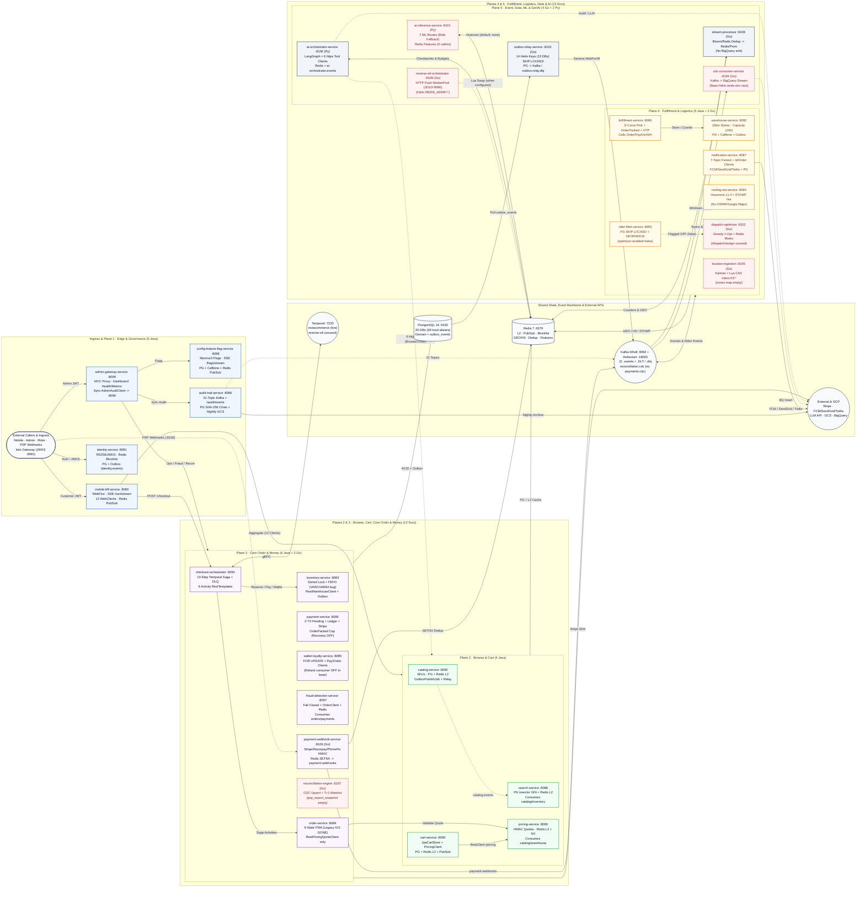

# 07 — 30-Service Runtime Dependency Matrix & Developer Command Cheatsheet

> [!NOTE]
> **Part of the InstaCommerce Onboarding Suite:** [Onboarding Hub](./README.md) · [Day 0–5 Curriculum](./01-day0-to-day5-curriculum.md) · [Hands-On Labs](./02-hands-on-labs.md) · [Role Learning Tracks](./03-role-learning-tracks.md) · [First-PR & Troubleshooting](./04-first-pr-and-troubleshooting.md) · [Domain Model & Event Catalog](./05-domain-model-and-event-catalog.md) · [Incident Drills & Readiness Exam](./06-incident-drills-and-readiness-exam.md) · **Service Dependency & Command Cheatsheet (this guide)** · [Code Walkthrough Atlas](./code-walkthrough/README.md)
>
> Every inbound/outbound dependency, HTTP/gRPC/Kafka/Temporal binding, port, datastore, health/metrics endpoint, script flag, and repo-truth gap in this cheatsheet is verified directly against source files under [`services/`](../../services/), [`contracts/`](../../contracts/), [`scripts/`](../../scripts/), [`deploy/`](../../deploy/), [`docker-compose.yml`](../../docker-compose.yml), and [`.env.local.example`](../../.env.local.example).

---

## Table of Contents

1. [30-Service Runtime Dependency Matrix](#1-30-service-runtime-dependency-matrix)
   - [1.1 Plane 1 — Edge & Governance (`5` Java Services)](#11-plane-1--edge--governance-5-java-services)
   - [1.2 Plane 2 — Browse & Cart (`4` Java Services)](#12-plane-2--browse--cart-4-java-services)
   - [1.3 Plane 3 — Core Order & Money (`6` Java + `2` Go Services)](#13-plane-3--core-order--money-6-java--2-go-services)
   - [1.4 Plane 4 — Fulfillment & Logistics (`5` Java + `2` Go Services)](#14-plane-4--fulfillment--logistics-5-java--2-go-services)
   - [1.5 Plane 5 — Event, Data, ML & GenAI (`4` Go + `2` Python Services)](#15-plane-5--event-data-ml--genai-4-go--2-python-services)
   - [1.6 Cross-Cutting Runtime Invariants](#16-cross-cutting-runtime-invariants)
2. ["Where Does This Change Go?" Decision & File-Ownership Map](#2-where-does-this-change-go-decision--file-ownership-map)
3. [Daily Developer CLI & `scripts/` Master Cheat Sheet](#3-daily-developer-cli--scripts-master-cheat-sheet)
   - [3.1 Complete `scripts/` Inventory & Verified Flags](#31-complete-scripts-inventory--verified-flags)
   - [3.2 Local Infrastructure Shell Snippets (`docker compose`, `psql`, `redis-cli`, Kafka, `temporal`)](#32-local-infrastructure-shell-snippets-docker-compose-psql-redis-cli-kafka-temporal)
   - [3.3 Narrow Language Validation & Build Loops](#33-narrow-language-validation--build-loops)
   - [3.4 Health, Readiness, Liveness & Prometheus Metrics Curls](#34-health-readiness-liveness--prometheus-metrics-curls)

---

## 1. 30-Service Runtime Dependency Matrix

The diagram and five plane tables below trace the **actual runtime edges** wired in checked-in code across all `30` microservices (`:8080`–`:8109`) — separating live synchronous HTTP/gRPC calls and active Kafka/Temporal pipelines from dormant configuration properties, disabled Helm consumers, and split-brain seams.

**30-Service Runtime Dependency Matrix** — *[Rendered PNG](./diagrams/service-dependency-matrix.png) · [Mermaid Source](./diagrams/service-dependency-matrix.mmd)*



### 1.1 Plane 1 — Edge & Governance (`5` Java Services)

| Service (`Port` / Helm Key) | Inbound Callers & Protocols | Outbound Sync Targets & Async Producers | Datastore / Cache / Health & Metrics | Verified Repo-Truth Gaps |
|---|---|---|---|---|
| **[`mobile-bff-service`](../../services/mobile-bff-service)**<br/>`:8080` (`mobile-bff-service`)<br/>Java 21 / WebFlux | **HTTP/REST & SSE:** Istio Gateway (`/bff/mobile/v1/**`, `/m/v1/**`, `/bff/mobile/v1/cart/stream/{userId}` SSE); `admin-gateway-service` (Istio `allowFrom`).<br/>**Redis PubSub:** Subscribes `cart:updated:{userId}` via `CartSyncService`. | **Outbound Sync (`12` `WebClient` beans in [`UpstreamClientFactory.java`](../../services/mobile-bff-service/src/main/java/com/instacommerce/mobilebff/client/UpstreamClientFactory.java)):** `CATALOG_SERVICE_URL` (`:8082`), `SEARCH_SERVICE_URL` (`:8088`), `FEATURE_FLAG_SERVICE_URL` (`:8098`), `CART_SERVICE_URL` (`:8090`), `ORDER_SERVICE_URL` (`:8084`), `IDENTITY_SERVICE_URL` (`:8081`), `WALLET_LOYALTY_SERVICE_URL` (`:8095`), `PRICING_SERVICE_URL` (`:8089`), `INVENTORY_SERVICE_URL` (`:8083`), `FULFILLMENT_SERVICE_URL` (`:8086`), `ROUTING_ETA_SERVICE_URL` (`:8094`), `CHECKOUT_ORCHESTRATOR_SERVICE_URL` (`:8091`).<br/>**Async Producers:** None. | **DB:** Stateless (none).<br/>**Cache:** Caffeine configured (0 `@Cacheable`); reactive Redis Pub/Sub.<br/>**Health/Metrics:** `/actuator/health/readiness`, `/actuator/health/liveness`, `/actuator/prometheus`, `/actuator/metrics`. | Base Helm [`values.yaml#L1413-L1421`](../../deploy/helm/values.yaml#L1413-L1421) sets only 7 of 12 `*_SERVICE_URL` env vars (relying on `application.yml` defaults for `pricing`, `inventory`, `fulfillment`, `routing-eta`, `checkout-orchestrator`). `JwtKeyLoader` loads a single static `MOBILE_BFF_JWT_PUBLIC_KEY` with no JWKS refresh (`0` `previousPublicKeys`). |
| **[`identity-service`](../../services/identity-service)**<br/>`:8081` (`identity-service`)<br/>Java 21 / Boot 4 | **HTTP/REST:** Istio Gateway (`/api/v1/auth/**`, `/api/v1/users/**`, `/auth/**`, `/users/me/**`, `/.well-known/jwks.json`), `mobile-bff-service` (`GET /users/{id}`), `notification-service` (`GET /admin/users/{id}`), `AdminController`. | **Outbound Sync:** None.<br/>**Async Outbox:** Writes `outbox_events` (`UserErasureRequested`, auth/user events) -> `outbox-relay-identity` -> `identity.events`. | **DB:** PostgreSQL `identity_db` (`V1`–`V13`).<br/>**Cache/Redis:** `identity:ratelimit:*` (Lua 60s), `identity:failed_logins:*` (15m), `identity:revoked_jti:*` & `identity:revoked_user_before:*` (**fail-closed** on Redis error).<br/>**Health/Metrics:** `/actuator/health/readiness` (`readinessState,db`), `/actuator/prometheus`. | `DefaultJwtService` falls back to `keyLoader.getPublicKey()` when a token carries an unknown `kid`; Helm `servicePolicies` allows calls from `checkout-orchestrator`, `order`, `fulfillment`, `ai-orchestrator` even though none currently have an outbound client to `:8081`. |
| **[`audit-trail-service`](../../services/audit-trail-service)**<br/>`:8096` (`audit-trail-service`)<br/>Java 21 / Boot 4 | **HTTP/REST:** `admin-gateway-service` (`POST /audit/events`, `GET /admin/audit/events`, `GET /admin/audit/integrity/verify`).<br/>**Kafka Consumer:** [`DomainEventConsumer`](../../services/audit-trail-service/src/main/java/com/instacommerce/audit/consumer/DomainEventConsumer.java#L42-L68) subscribes to **all `21` topics** in `TopicNames` (`groupId=${AUDIT_KAFKA_GROUP:audit-trail-service}`, `concurrency=3`). | **Outbound Sync:** Nightly `@Scheduled` GCS archive export ([`ArchiveExportPipelineService`](../../services/audit-trail-service/src/main/java/com/instacommerce/audit/service/ArchiveExportPipelineService.java)) to `audit.archive.bucket-name`.<br/>**Async Producers:** DLT only (`AUDIT_DLT_TOPIC:audit.DLT`). | **DB:** PostgreSQL `audit_db` (alias `audit`; `V1`–`V7`, monthly partitions + `pg_advisory_xact_lock` SHA-256 chain).<br/>**Cache:** None.<br/>**Health/Metrics:** `/actuator/health/readiness` (`readinessState,db`), `/actuator/prometheus`. | [`AuditProperties`](../../services/audit-trail-service/src/main/java/com/instacommerce/audit/config/AuditProperties.java#L13) declares unused `dlqTopic="audit.dlq"` while `DomainEventConsumer` sends poison pills to `audit.DLT`. GCS archive defaults to `instacommerce-audit-archive-dev` unless overridden. |
| **[`config-feature-flag-service`](../../services/config-feature-flag-service)**<br/>`:8098` (`config-feature-flag-service`)<br/>Java 21 / Boot 4 | **HTTP/REST & SSE:** `mobile-bff-service` (`GET /flags`), `admin-gateway-service` (`/admin/flags/**`), SSE `/flags/stream` (`FlagChangeStreamController`), `AdminExperimentController`, `ExperimentEvaluationController`. | **Outbound Sync:** None.<br/>**Async Pub/Sub:** Redis `flag-updates:{flagKey}` & `flag-updates:all` (`PatternTopic("flag-updates:*")` listener invalidates Caffeine across pods). | **DB:** PostgreSQL `feature_flags_db` (alias `config_db`; `V1`–`V8`, no `outbox_events`).<br/>**Cache:** Caffeine (`flags`, `flags-all`, `flag-overrides` 30s; `flag-overrides-bulk` 10s) + Redis Pub/Sub (`FEATURE_FLAG_REDIS_ENABLED=true` in Helm, `false` in `.env.local.example`).<br/>**Health/Metrics:** `/actuator/health/readiness`, `/actuator/prometheus`. | Helm `servicePolicies` permits `11` callers (`checkout`, `fulfillment`, `rider-fleet`, `routing-eta`, `fraud`, `pricing`, `order`, `payment`, `ai-orchestrator`), yet **only** `mobile-bff-service` and `admin-gateway-service` wire HTTP clients to `:8098`; `outbox-relay` `"config.events"` mapping has no backing outbox table here. |
| **[`admin-gateway-service`](../../services/admin-gateway-service)**<br/>`:8099` (`admin-gateway-service`)<br/>Java 21 / MVC | **HTTP/REST:** Istio Gateway (`/admin/v1/**`, requires `aud=instacommerce-admin` + `ADMIN`/`SUPER_ADMIN`). | **Outbound Sync (`RestTemplate` in [`AdminDashboardController`](../../services/admin-gateway-service/src/main/java/com/instacommerce/admingateway/controller/AdminDashboardController.java) + [`DashboardAggregationService`](../../services/admin-gateway-service/src/main/java/com/instacommerce/admingateway/service/DashboardAggregationService.java) + [`AdminAuditClient`](../../services/admin-gateway-service/src/main/java/com/instacommerce/admingateway/audit/AdminAuditClient.java)):** `FEATURE_FLAG_SERVICE_URL` (`:8098`), `RECONCILIATION_ENGINE_URL` (`:8107`), `FRAUD_DETECTION_SERVICE_URL` (`:8097`), `AUDIT_TRAIL_BASE_URL` / `AUDIT_TRAIL_SERVICE_URL` (`:8096`), plus health/metrics polling of `ORDER_SERVICE_URL` (`:8084`), `PAYMENT_SERVICE_URL` (`:8085`), `FULFILLMENT_SERVICE_URL` (`:8086`).<br/>**Async Producers:** None (sync HTTP audit only). | **DB:** Stateless (none).<br/>**Cache:** In-memory `AdminRateLimitFilter`.<br/>**Health/Metrics:** `/actuator/health/readiness`, `/actuator/prometheus`, `/admin/v1/dashboard`. | Base Helm `values.yaml` omits `FRAUD_DETECTION_SERVICE_URL` (falls back to `http://fraud-detection-service:8097` in `application.yml`). `JwtKeyLoader` reads single static key `ADMIN_GATEWAY_JWT_PUBLIC_KEY`. |

### 1.2 Plane 2 — Browse & Cart (`4` Java Services)

| Service (`Port` / Helm Key) | Inbound Callers & Protocols | Outbound Sync Targets & Async Producers | Datastore / Cache / Health & Metrics | Verified Repo-Truth Gaps |
|---|---|---|---|---|
| **[`catalog-service`](../../services/catalog-service)**<br/>`:8082` (`catalog-service`)<br/>Java 21 / Boot 4 | **HTTP/REST:** Istio Gateway (`/api/v1/products/**`, `/api/v1/categories/**`), `mobile-bff-service`, `ai-orchestrator-service` (`catalog.get_product`, `catalog.list_products`), `AdminProductController`/`AdminCategoryController`.<br/>**Kafka Consumer:** [`CatalogCacheInvalidationConsumer`](../../services/catalog-service/src/main/java/com/instacommerce/catalog/kafka/CatalogCacheInvalidationConsumer.java) (`catalog.events`, `pricing.events`, `inventory.events`, group `catalog-cache-invalidator`). | **Outbound Sync:** None.<br/>**Async Outbox (`DUAL`):** Writes `outbox_events`, published by **both** in-process [`OutboxPublishJob`](../../services/catalog-service/src/main/java/com/instacommerce/catalog/service/OutboxPublishJob.java) (`KafkaOutboxEventPublisher`, 1s ShedLock) **and** Helm `outbox-relay-catalog` -> `catalog.events`. | **DB:** PostgreSQL `catalog` (alias `catalog_db`; `V1`–`V15`).<br/>**Cache:** `TwoLevelCacheManager` Caffeine + Redis L2 (`catalog:products::*`, `categories`, `search`) + Redis Pub/Sub `catalog:cache:invalidate`.<br/>**Health/Metrics:** `/actuator/health/readiness` (`readinessState,db`), `/actuator/prometheus`. | **Dual-publisher overlap:** `OutboxPublishJob` (`@ConditionalOnBean(KafkaOutboxEventPublisher.class)`) and `outbox-relay-catalog` can both race/double-publish `outbox_events` rows if deployed simultaneously without disabling one. |
| **[`search-service`](../../services/search-service)**<br/>`:8088` (`search-service`)<br/>Java 21 / Boot 4 | **HTTP/REST:** Istio Gateway (`/api/v1/search/**`), `mobile-bff-service` (`GET /search/trending`), `ai-orchestrator-service` (`GET /search`).<br/>**Kafka Consumer:** `CatalogEventConsumer` (`catalog.events`), `InventoryEventConsumer` (`inventory.events`), group `search-service`. | **Outbound Sync:** None.<br/>**Async Producers:** Error-handler DLT only (`*.DLT`). | **DB:** PostgreSQL `search` (alias `search_db`; `V1`–`V6`, `tsvector` + GIN FTS + `text_pattern_ops`, **not** Elasticsearch).<br/>**Cache:** `TwoLevelCacheManager` (`search:searchResults::*`, `autocomplete`, `trending`) + Pub/Sub `search:cache:invalidate`.<br/>**Health/Metrics:** `/actuator/health/readiness` (`readinessState,db`), `/actuator/prometheus`. | Legacy docs/wave-40 rules reference Elasticsearch, which does **not** exist in code. `search_documents.product_id` has a `UNIQUE` constraint (single-store/latest index overwrite trap). `search.events` has 0 runtime producers. |
| **[`pricing-service`](../../services/pricing-service)**<br/>`:8089` (`pricing-service`)<br/>Java 21 / Boot 4 | **HTTP/REST:** Istio Gateway (`/api/v1/pricing/**`), `mobile-bff-service`, `cart-service` (`PricingClient`), `checkout-orchestrator-service` (`PricingActivity`, `CouponActivity`, `PromotionActivity`), `order-service` (`POST /pricing/quotes/validate`), `ai-orchestrator-service` (`pricing.calculate`, `pricing.get_product`).<br/>**Kafka Consumer:** `CatalogEventConsumer` (`catalog.events`, group `pricing-service-catalog`), `WarehouseEventConsumer` (`warehouse.events`, group `pricing-service-warehouse`). | **Outbound Sync:** None.<br/>**Async Outbox:** Writes `outbox_events` (`Coupon*`, `Promotion*`, price updates) -> `outbox-relay-pricing` -> `pricing.events`. | **DB:** PostgreSQL `pricing` (alias `pricing_db`; `V1`–`V11`).<br/>**Cache/Redis:** `TwoLevelCacheManager` (`pricing:productPrices::*`, `activePromotions`, `priceRules`) + Pub/Sub `pricing:cache:invalidate`; `PromoReservationService` writes `promo:{CODE}:{userId}` (`SET NX EX 300`).<br/>**Health/Metrics:** `/actuator/health/readiness`, `/actuator/prometheus`. | `WarehouseEventConsumer` updates `StoreSurgeStateStore` in JVM memory only (`ConcurrentHashMap`), so pod restarts lose surge state until the next `warehouse.events` surge message. |
| **[`cart-service`](../../services/cart-service)**<br/>`:8090` (`cart-service`)<br/>Java 21 / Boot 4 | **HTTP/REST:** Istio Gateway (`/api/v1/cart/**`, `/cart/**`, `/api/carts/**`), `mobile-bff-service`, `checkout-orchestrator-service` (`CartActivity`), `ai-orchestrator-service` (`cart.get`). | **Outbound Sync:** [`PricingClient`](../../services/cart-service/src/main/java/com/instacommerce/cart/client/PricingClient.java) -> `pricing-service` (`PRICING_SERVICE_URL:http://pricing-service:8089`, `/pricing/products/{id}` & `/batch`, fail-closed CircuitBreaker).<br/>**Async Outbox & Pub/Sub:** Writes `outbox_events` -> `outbox-relay-cart` -> `cart.events`; `CartSyncPublisher` -> Redis Pub/Sub `cart:updated:{userId}`, `cart:events`. | **DB:** PostgreSQL `carts` (alias `cart_db`; `V1`–`V8`, `JpaCartStore` `PESSIMISTIC_WRITE` is sole persistence truth).<br/>**Cache:** `TwoLevelCacheManager` (`cart:carts::{userId}` 1h L2 / 30s L1) + `cart:cache:invalidate`.<br/>**Health/Metrics:** `/actuator/health/readiness`, `/actuator/prometheus`. | Legacy `GLOSSARY.md`/docs imply Redis primary cart storage; actual code persists exclusively in PostgreSQL (`JpaCartStore`) and uses Redis only as L2 read cache + SSE sync bus. |

### 1.3 Plane 3 — Core Order & Money (`6` Java + `2` Go Services)

| Service (`Port` / Helm Key) | Inbound Callers & Protocols | Outbound Sync Targets & Async Producers | Datastore / Cache / Health & Metrics | Verified Repo-Truth Gaps |
|---|---|---|---|---|
| **[`inventory-service`](../../services/inventory-service)**<br/>`:8083` (`inventory-service`)<br/>Java 21 / Boot 4 | **HTTP/REST:** Istio Gateway (`/api/v1/inventory/**`, `/inventory/**`), `mobile-bff-service`, `checkout-orchestrator-service` (`InventoryActivity`), `fulfillment-service` (`POST /inventory/adjust`), `ai-orchestrator-service` (`POST /inventory/check`). | **Outbound Sync:** [`RestWarehouseClient`](../../services/inventory-service/src/main/java/com/instacommerce/inventory/client/RestWarehouseClient.java) -> `warehouse-service` (`WAREHOUSE_SERVICE_URL` / `warehouse.service.url:http://localhost:8092`, `GET /stores/{id}/open`, `/stores/{id}`).<br/>**Async Outbox:** `outbox_events` -> `outbox-relay-inventory` -> `inventory.events`. | **DB:** PostgreSQL `inventory` (alias `inventory_db`; `V1`–`V15`, sorted `SELECT FOR UPDATE`, FEFO `stock_batches`).<br/>**Cache:** Local Caffeine inside `RestWarehouseClient` (`storeStatusCache`).<br/>**Health/Metrics:** `/actuator/health/readiness` (`readinessState,db`), `/actuator/prometheus`. | **Critical `VARCHAR(64)` bug:** `reservations.idempotency_key` is `VARCHAR(64)` without SHA-256 normalization, overflowing on `~100`-char Temporal keys (`workflowId + ":inventory:reserve"`). `RestWarehouseClient` uses `@Value("${warehouse.service.url:http://localhost:8092}")` (omitted in base Helm `values.yaml`). |
| **[`order-service`](../../services/order-service)**<br/>`:8084` (`order-service`)<br/>Java 21 / Boot 4 | **HTTP/REST:** Istio Gateway (`/api/v1/orders/**`), `mobile-bff-service`, `checkout-orchestrator-service` (`OrderActivity`), `fulfillment-service`, `wallet-loyalty-service`, `fraud-detection-service`, `notification-service`, `admin-gateway-service`, `ai-orchestrator-service` (`order.get`).<br/>**Kafka Consumers:** `IdentityEventConsumer` (`identity.events`, `order-service-erasure`); `FulfillmentEventConsumer` (`fulfillment.events`, **disabled** in `values.yaml`/`values-prod.yaml`, `true` in `application-local.yml`). | **Outbound Sync:** **ONLY** [`RestPricingQuoteClient`](../../services/order-service/src/main/java/com/instacommerce/order/client/RestPricingQuoteClient.java) -> `pricing-service` (`PRICING_SERVICE_URL`, `POST /pricing/quotes/validate`).<br/>**Async Outbox:** `outbox_events` (`OrderPlaced`, `OrderCancelled`, etc.) -> `outbox-relay-order` -> `orders.events`. | **DB:** PostgreSQL `orders` (alias `order_db`; `V1`–`V15`, 9-state `OrderStatus` FSM, SHA-256 `idempotency_key`).<br/>**Cache:** None.<br/>**Health/Metrics:** `/actuator/health/readiness`, `/actuator/prometheus`. | **Two major doc drifts:** (1) `LegacyCheckoutController` (`/checkout`, `/api/checkout`) unconditionally returns **`410 GONE`** (zero Temporal SDK). (2) `values.yaml` & `OrderProperties.java` declare `inventory`, `cart`, and `payment` client URLs, yet **zero** Java classes in `order-service` invoke them. |
| **[`checkout-orchestrator-service`](../../services/checkout-orchestrator-service)**<br/>`:8091` (`checkout-orchestrator-service`)<br/>Java 21 / Temporal | **HTTP/REST:** Istio Gateway (`/api/v1/checkout/**`), `mobile-bff-service` (`POST /checkout`), `/checkout/dlq/**` (`ADMIN`/`INTERNAL_SERVICE` via `saga-dlq-retry.sh`).<br/>**Temporal Worker:** Polls `CHECKOUT_ORCHESTRATOR_TASK_QUEUE` (`instacommerce` namespace) from Temporal `:7233`. | **Outbound Sync:** **Temporal gRPC** (`TEMPORAL_SERVICE_ADDRESS:temporal:7233` in Helm / `localhost:7233` local). **6 Activity `RestTemplate` beans** ([`RestClientConfig.java`](../../services/checkout-orchestrator-service/src/main/java/com/instacommerce/checkout/config/RestClientConfig.java)): `CART_SERVICE_URL` (`:8090`), `PRICING_SERVICE_URL` (`:8089`), `INVENTORY_SERVICE_URL` (`:8083`), `PAYMENT_SERVICE_URL` (`:8085`), `ORDER_SERVICE_URL` (`:8084`), `WALLET_SERVICE_URL` (`:8095`).<br/>**Async Producers:** None (durable Temporal history + `compensation_dlq` table). | **DB:** PostgreSQL `checkout` (alias `checkout_db`; `V1`–`V3`: `checkout_idempotency`, ShedLock, `compensation_dlq`).<br/>**Temporal:** `instacommerce` namespace.<br/>**Health/Metrics:** `/actuator/health/readiness`, `/actuator/prometheus`. | `scripts/saga-dlq-retry.sh` issues unauthenticated `curl` calls against `/checkout/dlq`, returning `401` unless a Bearer token with `ADMIN`/`INTERNAL_SERVICE` role is added; Terraform `modules/cloudsql` omits provisioning `checkout_db`. |
| **[`payment-service`](../../services/payment-service)**<br/>`:8085` (`payment-service`)<br/>Java 21 / Boot 4 | **HTTP/REST:** Istio Gateway (`/api/v1/payments/**` + Istio internal authz), `checkout-orchestrator-service` (`PaymentActivity`), `fulfillment-service` (`POST /payments/{id}/refund`), `wallet-loyalty-service` (`GET /api/v1/payments/{ref}`), `admin-gateway-service`, PSP direct webhook (`/payments/webhook`).<br/>**Kafka Consumers:** `OrderPackedEventConsumer` (`fulfillment.events`, **ON** by default); `OrderCancelledEventConsumer` (`orders.events`, **OFF** in base/prod Helm); `PaymentWebhookEventConsumer` (`payment.webhooks`, **OFF** by default). | **Outbound Sync:** [`StripePaymentGateway`](../../services/payment-service/src/main/java/com/instacommerce/payment/gateway/StripePaymentGateway.java) -> Stripe API (active outside `test,local`; `MockPaymentGateway` under `local,test`).<br/>**Async Outbox:** `outbox_events` (`PaymentAuthorized`, `PaymentCaptured`, `PaymentRefunded`, etc.) -> `outbox-relay-payment` -> `payments.events`. | **DB:** PostgreSQL `payments` (alias `payment_db`; `V1`–`V21`, 2-TX pending pattern, double-entry `ledger_entries`).<br/>**Cache:** None.<br/>**Health/Metrics:** `/actuator/health/readiness`, `/actuator/prometheus`. | Helm `values.yaml` & `values-prod.yaml` set `PAYMENT_CHOREOGRAPHY_ORDER_CANCELLED_CONSUMER_ENABLED="false"`, `PAYMENT_WEBHOOK_REFUND_OUTBOX_ENABLED="false"`, and `PAYMENT_STALE_PENDING_RECOVERY_ENABLED="false"`. `WebhookKafkaBridge` skips non-Stripe PSPs (`SKIPPED_UNSUPPORTED_PSP`). |
| **[`wallet-loyalty-service`](../../services/wallet-loyalty-service)**<br/>`:8095` (`wallet-loyalty-service`)<br/>Java 21 / Boot 4 | **HTTP/REST:** Istio Gateway (`/api/v1/wallet/**`, `/api/v1/loyalty/**`, `/api/v1/referral/**`), `mobile-bff-service`, `checkout-orchestrator-service` (`WalletActivity`).<br/>**Kafka Consumers:** [`OrderEventConsumer`](../../services/wallet-loyalty-service/src/main/java/com/instacommerce/wallet/kafka/OrderEventConsumer.java) (`orders.events`, active); [`PaymentEventConsumer`](../../services/wallet-loyalty-service/src/main/java/com/instacommerce/wallet/kafka/PaymentEventConsumer.java) (`payments.events`, gated by `WALLET_CONSUMER_PAYMENT_REFUND_ENABLED`: `"false"` in base `values.yaml`, `"true"` in `values-prod.yaml` & `local`). | **Outbound Sync:** [`PaymentClient`](../../services/wallet-loyalty-service/src/main/java/com/instacommerce/wallet/client/PaymentClient.java) -> `payment-service` (`PAYMENT_SERVICE_URL:http://localhost:8085`); [`RestOrderLookupClient`](../../services/wallet-loyalty-service/src/main/java/com/instacommerce/wallet/client/RestOrderLookupClient.java) -> `order-service` (`ORDER_SERVICE_URL:http://localhost:8084`, `/admin/orders/{id}`).<br/>**Async Outbox:** `outbox_events` -> `outbox-relay-wallet-loyalty` -> `wallet.events`. | **DB:** PostgreSQL `wallets` (alias `wallet_db`; `V1`–`V13`, `SELECT FOR UPDATE` + `wallet_ledger_entries`).<br/>**Cache:** Caffeine (`walletBalance`).<br/>**Health/Metrics:** `/actuator/health/readiness`, `/actuator/prometheus`. | `OrderEventConsumer` catches/logs failures internally without propagating to a `.DLT` topic; base `values.yaml` disables `PaymentEventConsumer` while `values-prod.yaml` enables it. |
| **[`fraud-detection-service`](../../services/fraud-detection-service)**<br/>`:8097` (`fraud-detection-service`)<br/>Java 21 / Boot 4 | **HTTP/REST:** Istio Gateway (`/api/v1/fraud/**`), `admin-gateway-service` (`/admin/fraud/**`).<br/>**Kafka Consumers:** `OrderEventConsumer` (`orders.events`, `fraud-detection-orders`); [`PaymentEventConsumer`](../../services/fraud-detection-service/src/main/java/com/instacommerce/fraud/consumer/PaymentEventConsumer.java) (`payments.events`, `fraud-detection-payments`). | **Outbound Sync:** [`RestOrderLookupClient`](../../services/fraud-detection-service/src/main/java/com/instacommerce/fraud/client/RestOrderLookupClient.java) -> `order-service` (`ORDER_SERVICE_URL:http://localhost:8084`, `GET /admin/orders/{orderId}`).<br/>**Async Outbox:** `outbox_events` -> `outbox-relay-fraud-detection` -> `fraud.events`. | **DB:** PostgreSQL `fraud` (alias `fraud_db`; `V1`–`V11`, fail-closed `AUTO_BLOCK`, `>= 2` 30d chargeback auto-blocklist).<br/>**Cache/Redis:** Caffeine (`fraudRules` 5m, `blocklist` 60s) + optional Redis read `fraud:score:{userId}`.<br/>**Health/Metrics:** `/actuator/health/readiness`, `/actuator/prometheus`. | `fraud:score:{userId}` in Redis is written by `reverse-etl-orchestrator`, which defaults to `REDIS_ADDR=""` in base Helm; `admin-gateway` calls `/admin/fraud/*` while Istio `servicePolicies` lists `checkout`/`payment`/`order` (none call `/fraud` synchronously). |
| **[`payment-webhook-service`](../../services/payment-webhook-service)**<br/>`:8106` (`payment-webhook`)<br/>Go 1.25 | **HTTP/REST:** Istio Gateway / PSPs (`POST /payments/webhook`, `/webhooks/stripe`, `/webhooks/razorpay`, `/webhooks/phonepe`). | **Outbound Sync:** None.<br/>**Async Kafka:** Direct `segmentio/kafka-go` producer (`KAFKA_TOPIC:payment.webhooks`, v2 `raw_psp_payload` envelope). | **DB:** Stateless (none; note `GLOSSARY.md` mentions PostgreSQL in error).<br/>**Redis:** `payment-webhook:event:{eventID}` (`24h` `SET NX EX`, in-memory `10k` fallback if `REDIS_ADDR` unset; `503` on runtime Redis error).<br/>**Health/Metrics:** `/health`, `/health/live`, `/health/ready`, `/ready`, `/metrics`. | Base `values.yaml` omits `REDIS_ADDR` and `KAFKA_BROKERS` (`UnconfiguredKafkaProducer` + in-memory dedup unless overridden). `payment-service` disables `PaymentWebhookEventConsumer` by default and skips Razorpay/PhonePe in `WebhookKafkaBridge`. |
| **[`reconciliation-engine`](../../services/reconciliation-engine)**<br/>`:8107` (`reconciliation-engine`)<br/>Go 1.25 | **HTTP/REST:** `admin-gateway-service` (`/reconciliation/runs`, `/reconciliation/pending`, `/pending`, `/reconciliation/runs/{id}/mismatches`, `/review`, `/fix`).<br/>**Kafka Consumer:** `CDCConsumer` (`CDC_TOPICS=payments.cdc,reconciliation.cdc`, group `reconciliation-cdc-consumer`). | **Outbound Sync:** None.<br/>**Async Kafka:** Direct Sarama `EventPublisher` -> `KAFKA_TOPIC:reconciliation.events` (DLT `CDC_DLT_TOPIC:reconciliation.events.DLT`). | **DB:** PostgreSQL `reconciliation` (alias `reconciliation_db`; `5` SQL files applied manually or by `dev-local.sh` — **no** Flyway binary at boot).<br/>**Cache:** None.<br/>**Health/Metrics:** `/health`, `/health/live`, `/health/ready`, `/ready`, `/metrics`. | **Missing CDC & PSP writers:** Terraform only provisions `reconciliation.cdc` (`debezium-connector-reconciliation.tf`) with **zero** `payments.cdc` connector; `psp_export_snapshot` and `reconciliation_fix_registry` have **zero** runtime writers. `modules/cloudsql` omits `reconciliation` DB. |

### 1.4 Plane 4 — Fulfillment & Logistics (`5` Java + `2` Go Services)

| Service (`Port` / Helm Key) | Inbound Callers & Protocols | Outbound Sync Targets & Async Producers | Datastore / Cache / Health & Metrics | Verified Repo-Truth Gaps |
|---|---|---|---|---|
| **[`warehouse-service`](../../services/warehouse-service)**<br/>`:8092` (`warehouse-service`)<br/>Java 21 / Boot 4 | **HTTP/REST:** Istio Gateway (`/api/v1/stores/**`), `inventory-service` (`GET /stores/{id}/open`, `/stores/{id}`), `fulfillment-service` (`GET /stores/{id}`), `AdminStoreController`, `BinController`, `StoreLayoutController`, `StagingTelemetryController`. | **Outbound Sync:** None.<br/>**Async Outbox:** `outbox_events` (`StoreSurgeModeChanged`, `StoreCapacityThrottled`, `StoreCapacityPaused`) -> `outbox-relay-warehouse` -> `warehouse.events`. | **DB:** PostgreSQL `warehouse` (alias `warehouse_db`; `V1`–`V11`, `15km` store resolution, 100-order capacity slot lock, 10-aisle Dijkstra).<br/>**Cache:** Caffeine-only (`stores`, `store-zones`, `store-hours`, 5m).<br/>**Health/Metrics:** `/actuator/health/readiness`, `/actuator/prometheus`. | None of `order-service`, `rider-fleet-service`, or `routing-eta-service` call `:8092` directly despite Helm `allowFrom` entries. |
| **[`fulfillment-service`](../../services/fulfillment-service)**<br/>`:8086` (`fulfillment-service`)<br/>Java 21 / Boot 4 | **HTTP/REST:** Istio Gateway (`/api/v1/fulfillment/**`), `mobile-bff-service` (`GET /orders/{orderId}/tracking`), `admin-gateway-service`, `PickController`, `DeliveryController`.<br/>**Kafka Consumers:** [`OrderEventConsumer`](../../services/fulfillment-service/src/main/java/com/instacommerce/fulfillment/consumer/OrderEventConsumer.java) (`orders.events`), [`RiderEventConsumer`](../../services/fulfillment-service/src/main/java/com/instacommerce/fulfillment/consumer/RiderEventConsumer.java) (`rider.events`), `IdentityEventConsumer` (`identity.events`, `fulfillment-service-erasure`). | **Outbound Sync (`RestTemplate`):** `ORDER_SERVICE_URL` (`:8084`, `POST /admin/orders/{id}/status`), `PAYMENT_SERVICE_URL` (`:8085`, `POST /payments/{id}/refund`), `INVENTORY_SERVICE_URL` (`:8083`, `POST /inventory/adjust`), `WAREHOUSE_SERVICE_URL` (`:8092`, `GET /stores/{id}`).<br/>**Async Outbox:** `outbox_events` (`OrderPacked`, `OrderDispatched`, `OrderDelivered`) -> `outbox-relay-fulfillment` -> `fulfillment.events`. | **DB:** PostgreSQL `fulfillment` (alias `fulfillment_db`; `V1`–`V16`, S-curve pick, 4-tote wave batching, 6-digit OTP, `<= 200KB` WEBP POD).<br/>**Cache:** Caffeine-only (`storeCoordinates` 15m).<br/>**Health/Metrics:** `/actuator/health/readiness`, `/actuator/prometheus`. | `RestOrderClient` status updates are gated by `FULFILLMENT_CHOREOGRAPHY_ORDER_STATUS_CALLBACK_ENABLED` (`true` in base Helm), while `order-service`'s `FulfillmentEventConsumer` is `false` in Helm — relying exclusively on sync REST callbacks to `order-service`. |
| **[`notification-service`](../../services/notification-service)**<br/>`:8087` (`notification-service`)<br/>Java 21 / Boot 4 | **HTTP/REST:** Istio Gateway (`/api/v1/notifications/**`, `DeviceTokenController`).<br/>**Kafka Consumers:** `IdentityEventConsumer` (`identity.events`, concurrency 3); `NotificationEventConsumer` (`orders.events`, `payments.events`, `fulfillment.events`, `delivery.events`, `rider.events`, `wallet.events`, concurrency 3, group `notification-service`). | **Outbound Sync:** `RestUserDirectoryClient` -> `IDENTITY_SERVICE_URL` (`:8081`, `/admin/users/{id}`); `RestOrderLookupClient` -> `ORDER_SERVICE_URL` (`:8084`, `/admin/orders/{id}`); external `FcmPushNotificationProvider`, `SendGridEmailProvider`, `TwilioSmsProvider` (under `prod,gcp` profile; local noop when placeholder keys + `local`).<br/>**Async Producers:** Error DLT (`NOTIFICATION_DLT_TOPIC:notification.events.DLT`). | **DB:** PostgreSQL `notification` (alias `notification_db`; `V1`–`V6`, `(event_id, channel)` dedup, quiet hours, NO `outbox_events`).<br/>**Cache:** None.<br/>**Health/Metrics:** `/actuator/health/readiness`, `/actuator/prometheus`. | **Topic & DLT drift:** `NotificationProperties` defaults `dltTopic="notifications.DLT"` while `application.yml` sets `notification.events.DLT`. `notification.events` has `0` active producers (`outbox-relay` maps `"notification"` -> `"notifications.events"`). |
| **[`rider-fleet-service`](../../services/rider-fleet-service)**<br/>`:8093` (`rider-fleet-service`)<br/>Java 21 / Boot 4 | **HTTP/REST:** Istio Gateway (`/api/v1/riders/**`), `RiderController`, `RiderAssignmentController`, `AdminRiderController`.<br/>**Kafka Consumer:** `FulfillmentEventConsumer` (`fulfillment.events`, `orders.events`, group `rider-fleet-service`). | **Outbound Sync:** [`DispatchOptimizerClient`](../../services/rider-fleet-service/src/main/java/com/instacommerce/riderfleet/client/DispatchOptimizerClient.java) -> `RIDER_DISPATCH_OPTIMIZER_URL` (`:8102`, `POST /v2/optimize/assign`, **only when `optimizer-enabled=true`**).<br/>**Async Producers:** `outbox_events` (`RiderAssigned`, etc.) -> `outbox-relay-rider-fleet` -> `rider.events`; direct `KafkaTemplate` in `RiderAvailabilityService` -> `rider.location.updates`. | **DB:** PostgreSQL `rider_fleet` (alias `rider_db`; `V1`–`V14`, `FOR UPDATE SKIP LOCKED` fallback).<br/>**Redis:** Writes `GEO riders:active` & `HASH rider:location:{id}` (**no TTL!**), queries `GEORADIUS riders:active`.<br/>**Health/Metrics:** `/actuator/health/readiness`, `/actuator/prometheus`. | **Two critical split-brains:** (1) `RIDER_DISPATCH_OPTIMIZER_ENABLED` defaults to `false`, leaving `dispatch-optimizer-service` idle. (2) Writes `riders:active` with no TTL and never `ZREM`s on offline toggle, while `location-ingestion` writes `riders:h3:*` instead. `RIDER_RECOVERY_STUCK_ENABLED` defaults `false`. |
| **[`routing-eta-service`](../../services/routing-eta-service)**<br/>`:8094` (`routing-eta-service`)<br/>Java 21 / Boot 4 | **HTTP/REST & WS:** Istio Gateway (`/api/v1/deliveries/**`, `/api/v1/tracking/**`), `mobile-bff-service`, STOMP WebSocket `/ws/tracking`.<br/>**Kafka Consumers:** [`FulfillmentEventConsumer`](../../services/routing-eta-service/src/main/java/com/instacommerce/routing/consumer/FulfillmentEventConsumer.java) (`fulfillment.events`, `orders.events`), `RiderEventConsumer` (`rider.events`), `LocationUpdateConsumer` (`rider.location.updates`, concurrency 3), `GeofenceEventConsumer` (`rider.geofence.events`). | **Outbound Sync:** **None** (zero OSRM/Google Maps HTTP clients; computes `Haversine * 1.4` + DB barriers/weather/traffic in [`ETAService`](../../services/routing-eta-service/src/main/java/com/instacommerce/routing/service/ETAService.java)).<br/>**Async Outbox:** `outbox_events` (`ETABreachRisk`, delivery events) -> `outbox-relay-routing-eta` -> `delivery.events`. | **DB:** PostgreSQL `routing` (alias `routing_db`; `V1`–`V10`).<br/>**Cache:** Caffeine-only (`eta`, 10s, 100k entries).<br/>**Health/Metrics:** `/actuator/health/readiness`, `/actuator/prometheus`. | `GLOSSARY.md` lists `OSRM` storage, yet **zero** OSRM or Google Maps clients exist in code (`GOOGLE_MAPS_API_KEY` in `.env.local.example` is unused). `GeofenceEventConsumer` receives zero events because `location-ingestion`'s `zones` map is empty. |
| **[`dispatch-optimizer-service`](../../services/dispatch-optimizer-service)**<br/>`:8102` (`dispatch-optimizer-service`)<br/>Go 1.25 | **HTTP/REST:** Protected by `InternalAuthMiddleware`: `/optimize/assign`, `/v2/optimize/assign` (target of `rider-fleet-service` when enabled), `/dispatch/assign`, `/dispatch/response`. | **Outbound Sync:** None.<br/>**Async Kafka:** `KafkaEventPublisher` (`segmentio/kafka-go`) on `/dispatch/assign` & `/dispatch/response` -> `rider.events` when `KAFKA_BROKERS` set (`NoopEventPublisher` otherwise). | **DB:** Stateless.<br/>**Redis:** Optional `dispatch:rider:lock:{riderID}` (`30s` `SET NX` + Lua `unlockScript`; in-memory mutex fallback when `REDIS_ADDR`/`REDIS_HOST` unset).<br/>**Health/Metrics:** `/health`, `/health/live`, `/health/ready`, `/metrics`. | Base `values.yaml` omits `KAFKA_BROKERS` & `REDIS_ADDR`. `rider-fleet.dispatch.optimizer-enabled` defaults `false`, leaving `/v2/optimize/assign`, `/dispatch/assign`, and `/dispatch/response` uncalled in default deployments. `hungarianAssign` is greedy sorted-edge + 1-opt. |
| **[`location-ingestion-service`](../../services/location-ingestion-service)**<br/>`:8105` (`location-ingestion`)<br/>Go 1.25 | **HTTP/REST & WS:** Protected by `InternalAuthMiddleware`: `/ingest`, `/ingest/location`, `/ingest/batch`, `/batch`, `/ingest/ws` (WebSocket). | **Outbound Sync:** None.<br/>**Async Kafka:** `LocationBatcher` (`segmentio/kafka-go`) -> `rider.location.updates`; `KafkaGeofencePublisher` -> `rider.geofence.events`. | **DB:** Stateless.<br/>**Redis:** Lua CAS `updatePositionScript` writes `HASH rider:location:{id}` (10m / 60s floor) + `SET riders:h3:{idx}` (`2*ttl`); in-memory geofence dedup.<br/>**Health/Metrics:** `/health`, `/health/live`, `/health/ready`, `/ready`, `/metrics`. | **Two runtime disconnects:** (1) `NewGeofenceChecker` initializes an empty `zones` map with no config loader (`rider.geofence.events` never fires). (2) Writes `riders:h3:*` instead of `riders:active`, causing dispatch split-brain with `rider-fleet-service`. Base Helm omits `REDIS_ADDR` & `KAFKA_BROKERS`. |

### 1.5 Plane 5 — Event, Data, ML & GenAI (`4` Go + `2` Python Services)

| Service (`Port` / Helm Key) | Inbound Callers & Protocols | Outbound Sync Targets & Async Producers | Datastore / Cache / Health & Metrics | Verified Repo-Truth Gaps |
|---|---|---|---|---|
| **[`outbox-relay-service`](../../services/outbox-relay-service)**<br/>`:8103` (`outbox-relay` + `13` per-domain `outbox-relay-*`)<br/>Go 1.25 | **DB Poller:** Polls `outbox_events` (`FOR UPDATE SKIP LOCKED`, `OUTBOX_POLL_INTERVAL=500ms` Helm / `1s` code default, `OUTBOX_BATCH_SIZE=100`) across `13` PostgreSQL DBs. | **Outbound Sync:** PostgreSQL (`pgx`).<br/>**Async Kafka:** Sarama `SyncProducer` (`WaitForAll`) keyed by `aggregate_id` -> canonical `.events` topics (or `DLQ_TOPIC:outbox.relay.dlq` after `OUTBOX_MAX_RETRIES=3`). | **DB:** Reads source service PostgreSQL DBs (`DATABASE_URL` / `POSTGRES_DSN`).<br/>**Cache:** In-memory `retryCounts` map (lost on restart).<br/>**Health/Metrics:** `/health`, `/health/live`, `/health/ready`, `/ready`, `/metrics`. | Holds an open `pgx.Tx` across synchronous Sarama `WaitForAll` broker roundtrips. [`envelope.go#L61-L63`](../../services/outbox-relay-service/envelope.go#L61-L63) maps `"notification"` -> `"notifications.events"` (plural) vs `TopicNames` singular `"notification.events"`, and maps `"audit"`/`"config"` to unowned topics. |
| **[`cdc-consumer-service`](../../services/cdc-consumer-service)**<br/>`:8104` (`cdc-consumer`)<br/>Go 1.25 | **Kafka Consumer:** `segmentio/kafka-go` reader subscribing to `KAFKA_TOPICS` (required CSV, `KAFKA_GROUP_ID=cdc-consumer-service`). | **Outbound Sync:** BigQuery Streaming Insert API (`cloud.google.com/go/bigquery` -> `BQ_PROJECT.BQ_DATASET.BQ_TABLE`, `insertID` dedup, `SchemaEvolutionHandler`).<br/>**Async Kafka:** `KAFKA_DLQ_TOPIC:cdc.dlq`. | **DB/Sink:** BigQuery streaming sink.<br/>**Cache:** In-memory `batchCh` backpressure.<br/>**Health/Metrics:** `/health`, `/health/live`, `/health/ready`, `/ready`, `/metrics`. | **Crashes under base Helm:** [`deploy/helm/values.yaml#L1169-L1185`](../../deploy/helm/values.yaml#L1169-L1185) omits required `KAFKA_BROKERS`, `KAFKA_TOPICS`, `BQ_PROJECT`, `BQ_DATASET`, and `BQ_TABLE` ([`config.go#L51-L74`](../../services/cdc-consumer-service/config.go#L51-L74) fails fast at boot). |
| **[`stream-processor-service`](../../services/stream-processor-service)**<br/>`:8108` (`stream-processor`)<br/>Go 1.25 | **Kafka Consumer:** Subscribes to `order.events`, `orders.events`, `payment.events`, `payments.events`, `rider.events`, `fulfillment.events`, `inventory.events`, `rider.location.updates` (group `CONSUMER_GROUP_ID:stream-processor`). | **Outbound Sync:** None.<br/>**Async Kafka:** Error DLT (`{msg.Topic}.DLT`). | **DB:** None (**zero** BigQuery sink despite legacy docs).<br/>**Redis:** Bloom + `SET NX EX 24h` `dedup:*` (**fails open**), `orders:*`, `payments:*`, `inventory:*`, `rider:status:*`, `riders:geo:{zone}` (`24h`), `rider:location:{id}` (`10m`).<br/>**Health/Metrics:** `/health`, `/health/live`, `/health/ready`, `/ready`, `/metrics`. | Subscribes to both singular and plural topic aliases (`order.events` + `orders.events`). `watermark` (`HighWatermark=800`) + `offsetTracker` (`failedSeen`) can stall partition commits under poison bursts. `riders:geo:{zone}` is never read by `rider-fleet-service`. |
| **[`reverse-etl-orchestrator`](../../services/reverse-etl-orchestrator)**<br/>`:8109` (`reverse-etl-orchestrator`)<br/>Go 1.25 | **HTTP/REST:** `/api/v1/subscriptions/**`, `/subscriptions/**` protected by `InternalAuthMiddleware` (HTTP push sync triggers). | **Outbound Sync:** PostgreSQL (`pgx`) + optional Redis Lua atomic temp-hash swap (`writeTempHashLua` + `atomicSwapTTLLua`).<br/>**Async Producers:** None (`Kafka` / `Temporal` / `BigQuery` unused at runtime). | **DB:** PostgreSQL `reverse_etl` (alias `reverse_etl_db`; `1` SQL migration).<br/>**Redis:** `user:features:{id}` (36h), `fraud:score:{id}` (36h), `store:inventory:{id}` (24h).<br/>**Health/Metrics:** `:8109` (`/health*`, `/metrics`), **dedicated `:8110`** (`/health*`), **dedicated `:9090`** (`/metrics`). | Base [`values.yaml#L1271-L1275`](../../deploy/helm/values.yaml#L1271-L1275) sets `REDIS_ADDR: ""` and `WAREHOUSE_SOURCE_MODE: "mock"`; `main.go` boots **zero** Temporal worker/client (`reverse-etl` namespace & `health/handler.go` check are placeholders) and **zero** Kafka/BigQuery consumers. |
| **[`ai-orchestrator-service`](../../services/ai-orchestrator-service)**<br/>`:8100` (`ai-orchestrator-service`)<br/>Python 3.12 / FastAPI + LangGraph | **HTTP/REST:** `POST /agent/invoke`, `/assist`, `/agent/assist`, `/agent/substitute`, `/agent/recommend` (gated by `InternalServiceAuthMiddleware` + `50/day` default IP/user rate limiter). | **Outbound Sync (`httpx` [`tools.py`](../../services/ai-orchestrator-service/app/graph/tools.py) + [`llm.py`](../../services/ai-orchestrator-service/app/core/llm.py)):** `search-service:8088`, `catalog-service:8082`, `pricing-service:8089`, `inventory-service:8083`, `cart-service:8090`, `order-service:8084` (`8` allowlisted read tools); optional external `LLM_API_URL`.<br/>**Async Kafka:** `aiokafka` `AuditEventPublisher` -> `ai-orchestrator.events` (log fallback if `aiokafka` absent). | **DB:** None.<br/>**Redis:** `instacommerce:agent:checkpoint:{thread}` (`1h`), `instacommerce:agent:budget:{session}` (`1h`), `faq:{sha256[:16]}` (no TTL, uses `KEYS b"faq:*"`).<br/>**Health/Metrics:** `/health`, `/health/ready`, `/health/live`, `/agent/health` (**NO `/metrics` endpoint**). | **Critical env-var mismatch:** `tools.py` reads `Settings.internal_service_token` (`AI_ORCHESTRATOR_INTERNAL_SERVICE_TOKEN`), whereas `auth.py` and Helm `values.yaml` set `INTERNAL_SERVICE_TOKEN` — tool calls omit `X-Internal-Token` unless both are exported. `TokenBucketRateLimiter` defaults to `50/day`; `injection.py` blocks `"issue a full refund"`. |
| **[`ai-inference-service`](../../services/ai-inference-service)**<br/>`:8101` (`ai-inference-service`)<br/>Python 3.12 / FastAPI | **HTTP/REST:** `/inference/{eta,ranking,fraud,demand,personalization,clv,pricing}`, `/inference/batch`, `/inference/dynamic-batch`, `/models`, `/shadow/stats`, `/drift/check`.<br/>*(Zero runtime service callers wired in repo today.)* | **Outbound Sync:** Optional BigQuery/Redis feature hydration in `/inference/batch` & `/drift/check` when `AI_INFERENCE_FEATURE_STORE_BACKEND` is configured (`"none"` by default).<br/>**Async Producers:** None. | **DB:** None.<br/>**Cache/Redis:** In-memory `InferenceCache` (1000 items, 300s) + optional Redis `user:features:*`, `user_features:*`, `product_features:*` (24h).<br/>**Health/Metrics:** `/health`, `/health/ready`, `/health/live`, `/metrics`. | Defaults (`AI_INFERENCE_FEATURE_STORE_BACKEND="none"`, `AI_INFERENCE_MODEL_ARTIFACT_DIR=""`, `AI_INFERENCE_ONNX_MODEL_DIR=""`) run deterministic `_rule_based_fallback` / hardcoded `DEFAULT_WEIGHTS` / `_is_mock=True` ONNX. `0` Java/Go/Python services call `:8101` at runtime. |

### 1.6 Cross-Cutting Runtime Invariants

- **Zero Service-to-Service gRPC Today:** Although [`contracts/src/main/proto/`](../../contracts/src/main/proto) holds `10` `.proto` files and `./scripts/generate-proto.sh` compiles Go stubs into `services/go-shared/pkg/proto`, **zero** Java or Go microservices import or serve gRPC endpoints between services (`checkout-orchestrator-service` <-> Temporal `:7233` is the sole gRPC dependency).
- **Internal Auth Precedence:** All 20 Java services (via `SharedInternalServiceAuthFilter` or service-local equivalents), Go internal HTTP endpoints (via `go-shared/pkg/auth`), and both Python services authenticate internal calls using `X-Internal-Service` + `X-Internal-Token`. Eleven Java services (`admin-gateway`, `cart`, `checkout-orchestrator`, `fulfillment`, `identity`, `inventory`, `order`, `payment`, `pricing`, `rider-fleet`, `wallet-loyalty`) declare `internal.service.token: ${INTERNAL_SERVICE_TOKEN}` without a default and fail startup unless `.local-dev/.env.local` is sourced.
- **Outbox Relay Topology:** `13` Java services persist `outbox_events` inside local ACID transactions and rely on `13` domain-specific Helm deployments of `outbox-relay-service` (`outbox-relay-{order,payment,cart,fulfillment,inventory,identity,catalog,rider-fleet,warehouse,pricing,wallet-loyalty,fraud-detection,routing-eta}` plus base `outbox-relay`, `14` total Helm keys).
- **Helm Monitoring Scrape Bug:** [`deploy/helm/templates/network-policy.yaml#L52-L54`](../../deploy/helm/templates/network-policy.yaml#L52-L54) allows Prometheus scrapes only on `port: metrics`, whereas [`service.yaml#L14-L16`](../../deploy/helm/templates/service.yaml#L14-L16) and `deployment.yaml` name the container port `http` — blocking scrapes when `networkPolicy.enabled: true`.

---

## 2. "Where Does This Change Go?" Decision & File-Ownership Map

Use this task-routing table before opening an editor so you change the true runtime owner, update every downstream schema/Helm/CI file in the same PR, and avoid dead or tombstoned paths.

| Engineering Task / Feature Change | Owning Service(s) / Module(s) | Contracts, Migrations & Config Touchpoints | CI (`ci.yml`) & `CODEOWNERS` Teams | Role Track (`03`) & Deep Walkthrough |
|---|---|---|---|---|
| **Mobile home feed, PDP aggregation, cart summary, SSE `/cart/stream`** | `services/mobile-bff-service` (`:8080`) | `MobileBffController`, `HomeAggregator`, `ScreenAggregator`, `CartSyncService`; base Helm `values.yaml#L1405-L1425` | `mobile-bff-service` filter; `@instacommerce/engagement` | [Track 1](./03-role-learning-tracks.md#track-1-core-commerce-java-engineer) · [`mobile-bff-service.md`](./code-walkthrough/services/mobile-bff-service.md) |
| **User registration, login, RS256 JWT / JWKS, token blocklist, GDPR erasure** | `services/identity-service` (`:8081`), `libs/platform-common` (JWT helpers) | `services/identity-service/src/main/resources/db/migration/V*.sql`; `identity.events`; `deploy/helm/values.yaml` `istio.requestAuthentications` (mind `values-prod.yaml` list overwrite!) | `identity-service` (or `java-shared` -> all 20 Java svcs); `@instacommerce/identity`, `@instacommerce/platform` | [Track 1](./03-role-learning-tracks.md#track-1-core-commerce-java-engineer) · [`identity-service.md`](./code-walkthrough/services/identity-service.md) · [`platform-common-java.md`](./code-walkthrough/components/platform-common-java.md) |
| **Feature flags, Murmur3 bucketing, switchback experiments, SSE `/flags/stream`** | `services/config-feature-flag-service` (`:8098`) | `V*.sql` in `config-feature-flag-service`; Redis Pub/Sub `flag-updates:*` (`FEATURE_FLAG_REDIS_ENABLED`); admin proxy in `admin-gateway-service` | `config-feature-flag-service`; `@instacommerce/platform` | [Track 1](./03-role-learning-tracks.md#track-1-core-commerce-java-engineer) / [Track 5](./03-role-learning-tracks.md#track-5-platform-sre--infra-engineer) · [`config-feature-flag-service.md`](./code-walkthrough/services/config-feature-flag-service.md) |
| **Product SKU, category hierarchy, full-text search & autocomplete** | `services/catalog-service` (`:8082`), `services/search-service` (`:8088`) | Flyway `V*.sql` in `catalog` & `search` (PG `tsvector`, **not** ES); `catalog.events` + `CatalogEventConsumer`; beware `OutboxPublishJob` vs `outbox-relay-catalog` | `catalog-service`, `search-service`; `@instacommerce/search-catalog` | [Track 1](./03-role-learning-tracks.md#track-1-core-commerce-java-engineer) · [`catalog-service.md`](./code-walkthrough/services/catalog-service.md) · [`search-service.md`](./code-walkthrough/services/search-service.md) |
| **Dynamic pricing, surge multiplier, coupons, HMAC `PriceQuote`** | `services/pricing-service` (`:8089`) *(surge events from `warehouse-service`)* | `pricing` `V*.sql`; `pricing.events`; Redis `promo:{CODE}:{userId}` lock; `StoreSurgeStateStore` | `pricing-service`; `@instacommerce/search-catalog` | [Track 1](./03-role-learning-tracks.md#track-1-core-commerce-java-engineer) · [`pricing-service.md`](./code-walkthrough/services/pricing-service.md) |
| **Shopping cart mutations, `If-Match` ETag, `409 STORE_MISMATCH`** | `services/cart-service` (`:8090`) | `carts` `V*.sql` (`JpaCartStore`); `cart.events`; Redis L2 + `cart:updated:{userId}` | `cart-service`; `@instacommerce/core-checkout` | [Track 1](./03-role-learning-tracks.md#track-1-core-commerce-java-engineer) · [`cart-service.md`](./code-walkthrough/services/cart-service.md) |
| **Stock reservation, sorted locks, FEFO expiry batches** | `services/inventory-service` (`:8083`) | `inventory` `V*.sql` (fix `reservations.idempotency_key VARCHAR(64)` via new `V16__`); `inventory.events` | `inventory-service`; `@instacommerce/platform` | [Track 1](./03-role-learning-tracks.md#track-1-core-commerce-java-engineer) · [`inventory-service.md`](./code-walkthrough/services/inventory-service.md) |
| **Checkout saga steps, LIFO compensation, `compensation_dlq`, order FSM** | `services/checkout-orchestrator-service` (`:8091`), `services/order-service` (`:8084`) | `CheckoutWorkflowImpl` & activities (`checkout` `V*.sql`); `OrderStatus` & `orders` `V*.sql`; `orders.events` *(do **not** touch tombstoned `LegacyCheckoutController`)* | `checkout-orchestrator-service`, `order-service`; `@instacommerce/core-checkout` | [Track 1](./03-role-learning-tracks.md#track-1-core-commerce-java-engineer) · [`checkout-orchestrator-service.md`](./code-walkthrough/services/checkout-orchestrator-service.md) · [`order-service.md`](./code-walkthrough/services/order-service.md) |
| **Payment auth/capture/refund, double-entry ledger, PSP webhooks, T+1 recon** | `payment-service` (`:8085`), `payment-webhook-service` (`:8106`), `wallet-loyalty-service` (`:8095`), `reconciliation-engine` (`:8107`) | `payments`/`wallets` Flyway `V*.sql`; Go SQL in `services/reconciliation-engine/.../db/migration/`; `values.yaml` & `values-prod.yaml` recovery/consumer flags; `WebhookKafkaBridge` | `payment-*`, `wallet-loyalty-service`, `reconciliation-engine`; `@instacommerce/payment-eng`, `@instacommerce/payments` | [Track 2](./03-role-learning-tracks.md#track-2-payments-risk--ledger-engineer) · [`payment-service.md`](./code-walkthrough/services/payment-service.md) · [`reconciliation-engine.md`](./code-walkthrough/services/reconciliation-engine.md) |
| **Fraud rules/blocklists, compliance SHA-256 audit chain, admin dashboard** | `fraud-detection-service` (`:8097`), `audit-trail-service` (`:8096`), `admin-gateway-service` (`:8099`) | `fraud` / `audit_db` `V*.sql`; `fraud.events`, `audit.DLT`; `AdminDashboardController` | `fraud-detection-*`, `audit-trail-*`, `admin-gateway-*`; `@instacommerce/payments`, `@instacommerce/platform` | [Track 2](./03-role-learning-tracks.md#track-2-payments-risk--ledger-engineer) · [`fraud-detection-service.md`](./code-walkthrough/services/fraud-detection-service.md) · [`audit-trail-service.md`](./code-walkthrough/services/audit-trail-service.md) |
| **Dark-store onboarding/capacity, S-curve picking, `OrderPacked`, rider dispatch, GPS, ETA, notifications** | `warehouse` (`:8092`), `fulfillment` (`:8086`), `rider-fleet` (`:8093`), `dispatch-optimizer` (`:8102`), `location-ingestion` (`:8105`), `routing-eta` (`:8094`), `notification` (`:8087`) | `warehouse`/`fulfillment`/`rider_fleet`/`routing`/`notification` `V*.sql`; `RIDER_DISPATCH_OPTIMIZER_ENABLED`, `riders:active` vs `riders:h3:*` split-brain; `geofence.go` `zones` | Logistics Java/Go filters; `@instacommerce/logistics`, `@instacommerce/engagement` | [Track 3](./03-role-learning-tracks.md#track-3-fulfillment-logistics--geo-engineer) · [`fulfillment-service.md`](./code-walkthrough/services/fulfillment-service.md) · [`rider-fleet-service.md`](./code-walkthrough/services/rider-fleet-service.md) |
| **Add/evolve Kafka topic, JSON event schema, or `.proto` contract** | `contracts/` (`EventEnvelope.java`, `TopicNames.java`, `schemas/`, `proto/`) + `services/outbox-relay-service/envelope.go` | Draft-07 schema + `.events`/`.DLT` constant in `TopicNames.java`; run `./scripts/generate-proto.sh` -> commit `services/go-shared/pkg/proto/`; check `topicMappings` | `contracts` filter (**rebuilds all 20 Java services + `data-platform-quality`**); `@instacommerce/platform` | [First-PR § 2.2](./04-first-pr-and-troubleshooting.md#22-adding-or-evolving-a-kafka-topic--json-schema--protobuf-contract) · [`contracts-and-proto.md`](./code-walkthrough/components/contracts-and-proto.md) |
| **Outbox relay, CDC->BQ, stream windows, reverse ETL, dbt/Airflow/Beam/GE** | `outbox-relay` (`:8103`), `cdc-consumer` (`:8104`), `stream-processor` (`:8108`), `reverse-etl` (`:8109`), `data-platform/`, `data-platform-jobs/` | `data-platform/dbt/models/{staging,intermediate,marts}/`, `data-platform/airflow/dags/`, `data-platform/quality/expectations/`, `reverse-etl` `REDIS_ADDR` / `cdc-consumer` Helm env | `data-platform`, Go filters, `migrations`; `@instacommerce/data-ml`, `@instacommerce/platform` | [Track 4](./03-role-learning-tracks.md#track-4-data-ml--genai-engineer) · [`data-platform-lakehouse.md`](./code-walkthrough/components/data-platform-lakehouse.md) |
| **ML offline training/eval gates, online inference, LangGraph agent/guardrails** | `ml/`, `services/ai-inference-service` (`:8101`), `services/ai-orchestrator-service` (`:8100`) | `ml/train/`, `ml/eval/`, `ml/feature_store/`; `ai-orchestrator` `app/config.py` (`AI_ORCHESTRATOR_*`), `app/guardrails/`, `app/graph/tools.py` | `ml`, `ai-orchestrator-service`, `ai-inference-service`; `@instacommerce/data-ml` | [Track 4](./03-role-learning-tracks.md#track-4-data-ml--genai-engineer) · [`ml-platform.md`](./code-walkthrough/components/ml-platform.md) · [`ai-orchestrator-service.md`](./code-walkthrough/services/ai-orchestrator-service.md) |
| **New microservice, Helm/Istio policies, Terraform, SLO/alerts, CI** | `deploy/helm/`, `argocd/`, `infra/terraform/`, `monitoring/`, `.github/workflows/ci.yml` | Update `GLOSSARY.md`, `settings.gradle.kts` / `go.work`, `services/<svc>/README.md` + `Dockerfile`, `deploy/helm/{values.yaml,README.md}`, `istio.servicePolicies`, `ci.yml`, `CODEOWNERS`, `dependabot.yml`, `scripts/check-monorepo-consistency.sh` | `helm-validation`, `repo-governance-lint`; `@instacommerce/platform-infra`, `@instacommerce/sre` | [Track 5](./03-role-learning-tracks.md#track-5-platform-sre--infra-engineer) · [First-PR § 2.3–2.4](./04-first-pr-and-troubleshooting.md#23-onboarding-a-brand-new-microservice) · [`infra-terraform-gitops.md`](./code-walkthrough/components/infra-terraform-gitops.md) |

---

## 3. Daily Developer CLI & `scripts/` Master Cheat Sheet

### 3.1 Complete `scripts/` Inventory & Verified Flags

Every executable and support file under [`scripts/`](../../scripts/) is cataloged below (note that [`scripts/README.md`](../../scripts/README.md) documents only 3 of these utilities and refers to container `instacommerce-postgres`, whereas [`docker-compose.yml`](../../docker-compose.yml) uses compose service name `postgres` via `docker compose exec -T postgres`).

| Script Path | Purpose & Key Flags / Options | Verified Defaults & Caveats |
|---|---|---|
| [`scripts/dev-local.sh`](../../scripts/dev-local.sh) | Local stack manager:<br>`up` · `down` · `reset` · `status` · `env [--export]` · `start-core [svc[:port]...]` · `stop-core` · `smoke` | Generates ephemeral RSA-2048 keys (`.local-dev/jwt/`), renders `.local-dev/.env.local`, seeds `39` PG DBs/aliases, applies Go SQL (`_dev_local_migrations`), creates Temporal `instacommerce` + `reverse-etl` namespaces, and starts `10` core Java services by default. Override timeout via `DEV_LOCAL_WAIT_SECS=120` or service list via `CORE_SERVICES`. |
| [`scripts/check-monorepo-consistency.sh`](../../scripts/check-monorepo-consistency.sh) | 9-stage (`422`-check) drift scanner:<br>`bash scripts/check-monorepo-consistency.sh [--strict-docs]` | Invokes [`scripts/consistency_checks.py`](../../scripts/consistency_checks.py) (`istio-policies`, `dependabot`, `argocd-apps`, `argocd-ports`, `argocd-tags`, `dockerfile-ports`, `dockerfile-base-images`, `k8s-compose-ports`, `dbt-refs`, `topic-dlt`, `doc-drift`) and [`scripts/consistency_checks_extra.py`](../../scripts/consistency_checks_extra.py). `--strict-docs` turns stage-9 doc drift from warning into hard failure. |
| [`scripts/lsp-walkthrough`](../../scripts/lsp-walkthrough) | Polyglot AST/LSP CLI (`scripts/lsp/code_walkthrough.py`):<br>`status` · `outline <file>` · `def <file> <line> [col]` · `refs <file> <line> [col]` · `check <path> [--json]` · `walkthrough <file>` · `service <name>` | Always run `outline` on 500+ line files before reading slices (`AGENTS.md`). Backed by `scripts/lsp/{ast_parser,code_walkthrough,lsp_client,test_code_walkthrough}.py`. |
| [`scripts/saga-dlq-retry.sh`](../../scripts/saga-dlq-retry.sh) | Checkout `compensation_dlq` & Kafka DLQ CLI:<br>`-l, --list` · `-r, --retry <ID>` · `-s, --resolve <ID>` · `--replay` · `--url <URL>` · `--group <GROUP>` · `--dlq-topic <T>` · `--target-topic <T>` · `-n, --note <TEXT>` · `-d, --dry-run` | Defaults: `--url http://localhost:8091`, `--dlq-topic orders.dlq`, `--target-topic orders.events`, `--group saga-dlq-replay-group`. **Repo-truth trap:** `/checkout/dlq/**` requires `ADMIN`/`INTERNAL_SERVICE` JWT, which the script does not attach; `--replay` uses `kafka-console-consumer`/`producer`. |
| [`scripts/check-error-budget-gate.sh`](../../scripts/check-error-budget-gate.sh) | ADR-015 30d SLO freeze gate:<br>`--service <name>` (required) · `--prometheus-url <url>` · `--emergency-override` · `--vp-token <token>` · `--simulated-availability <val>` · `--dry-run` | Tiers: Tier 0 (`0.999`: `identity`, `checkout-orchestrator`, `payment`), Tier 1 (`0.995`: `order`, `inventory`, `fulfillment`, `cart`, `pricing`, `rider-fleet`, `routing-eta`), Tier 2 (`0.990`: others). Valid override tokens: `VP-ENG-OVERRIDE-HOTFIX` or `EMERGENCY_APPROVED`. |
| [`scripts/dr-database-failover-drill.sh`](../../scripts/dr-database-failover-drill.sh) | Cloud SQL replica promotion drill:<br>`--primary <inst>` · `--standby <inst>` · `--project <proj>` · `--dry-run` | Defaults: `instacommerce-postgres-primary`, `instacommerce-postgres-standby`, `instacommerce-prod`, `DB_HOST=postgres.internal.instacommerce.net`, `ALLOW_MOCK=false`. Pass `--dry-run` locally. |
| [`scripts/generate-proto.sh`](../../scripts/generate-proto.sh) | Compile `contracts/src/main/proto/*.proto` -> `services/go-shared/pkg/proto` and verify `go build ./pkg/proto/...` | Searches PATH or `~/.gradle/caches` for `protoc` (`4.32.0` must match `protobuf-java`). Run `./gradlew :contracts:build` first if `protoc` is missing. |
| [`scripts/test-local-kafka.sh`](../../scripts/test-local-kafka.sh) | Checks `localhost:9092` (host) and `kafka:29092` (`docker compose exec -T kafka kafka-broker-api-versions`) | Invoked automatically by `./scripts/dev-local.sh smoke`. |
| [`scripts/verify-istio-mesh-policies.py`](../../scripts/verify-istio-mesh-policies.py) | Verifies `deploy/helm/values.yaml` & `values-prod.yaml` Istio `RequestAuthentication`, `AuthorizationPolicy`, and `1:1` `servicePolicies` bijection | Called by `consistency_checks.py istio-policies`; enforces `>= 3` auth rules in `values-prod.yaml` (masks the `7 -> 3` list overwrite gap!). |
| [`scripts/init-dbs.sql`](../../scripts/init-dbs.sql) | Seeds `39` PostgreSQL DBs/aliases + `reconciliation` role (`devpass`) on fresh Postgres volume init | Mounted into `postgres` container (`/docker-entrypoint-initdb.d/01-init.sql`) and re-ensured by `dev-local.sh up`. |
| [`scripts/temporal-dynamicconfig.yaml`](../../scripts/temporal-dynamicconfig.yaml) | Temporal local dev dynamic config (`forceSearchAttributesCacheRefreshOnRead: true`, `enableClientVersionCheck: true`) | Mounted read-only at `/etc/temporal/config/dynamicconfig/dev.yaml` in `docker-compose.yml`. |
| [`scripts/deploy-dbt-docs.sh`](../../scripts/deploy-dbt-docs.sh) | `./scripts/deploy-dbt-docs.sh [target_bucket]` (`gs://instacommerce-docs-internal/dbt`) | Runs `dbt docs generate --target prod` in `data-platform/dbt` (or generates placeholder HTML/JSON) and uploads via `gsutil`. |
| [`scripts/deploy-wave40-phase3-slo.sh`](../../scripts/deploy-wave40-phase3-slo.sh) | `./scripts/deploy-wave40-phase3-slo.sh {deploy|rollback|validate}` | Targets `prometheus/rules/wave-40-complete-slo-alerts.yml` and `docs/observability/grafana-dashboards/` (note: `grafana-dashboards/` is empty and `wave-40` uses stale Spring metrics on Go/Python pods). |
| [`scripts/phase-2-sf-canary-deploy.sh`](../../scripts/phase-2-sf-canary-deploy.sh)<br/>[`scripts/phase-2-sf-verify.sh`](../../scripts/phase-2-sf-verify.sh)<br/>[`scripts/phase-2-sf-rollback.sh`](../../scripts/phase-2-sf-rollback.sh) | SF canary automation:<br>Deploy: `[--dry-run] [--skip-tf] [--skip-k8s]`<br>Verify: `[--detailed] [--watch] [--interval N]`<br>Rollback: `[--force] [--keep-namespace]` | Legacy Wave 40 Phase 2 scripts; hardcode `REPO_ROOT` local path and `sf-canary` namespace (`us-west-1`) + `scripts/phase-2-grafana-dashboard.json`. |
| [`scripts/wave34_helm_values_updater.py`](../../scripts/wave34_helm_values_updater.py) | `python3 scripts/wave34_helm_values_updater.py <path-to-values.yaml>` | Wave 34 utility injecting per-service `service-tokens` env `secretKeyRef` blocks into `values.yaml`. |
| [`scripts/sync-cursor-plugins.sh`](../../scripts/sync-cursor-plugins.sh) | Syncs official Cursor plugins (`pstack`, `thermos`, `cursor-team-kit`, etc.) into `~/.gemini/config/plugins`, `~/.cursor/plugins/local`, `.agents/` | Interactive developer workstation tooling; clones `cursor/plugins` into `/tmp/`. |
| [`scripts/runner_publish_issues.py`](../../scripts/runner_publish_issues.py) | Publishes 207 Wave 0–7 issues via `gh api` from `issues_data_w{0_w1,2_w3,4_w5,6_w7}.py` | One-time GitHub milestone/issue seeding script. |

### 3.2 Local Infrastructure Shell Snippets (`docker compose`, `psql`, `redis-cli`, Kafka, `temporal`)

```bash
# ── 1. Bootstrap & Shell Environment ─────────────────────────────────────────
./scripts/dev-local.sh up
set -a && source .local-dev/.env.local && set +a
./scripts/dev-local.sh start-core                      # All 10 core Java services (or pass e.g. identity-service order-service)
./scripts/dev-local.sh status && ./scripts/dev-local.sh smoke

# ── 2. Docker Compose Direct Operations ──────────────────────────────────────
docker compose up -d                                   # Start postgres, redis, kafka, kafka-connect, temporal, temporal-ui, kafka-ui
docker compose ps
docker compose logs -f --tail=100 temporal kafka

# ── 3. PostgreSQL 16 (:5432, 39 DBs/aliases) ─────────────────────────────────
docker compose exec -T postgres psql -U postgres -c "\l"
docker compose exec -T postgres psql -U postgres -d orders -c "SELECT id, status, created_at FROM orders ORDER BY created_at DESC LIMIT 10;"
docker compose exec -T postgres psql -U postgres -d orders -c "SELECT id, aggregate_type, aggregate_id, event_type, sent FROM outbox_events WHERE sent = false;"
docker compose exec -T postgres psql -U postgres -d checkout -c "SELECT id, workflow_id, step_name, status, retry_count FROM compensation_dlq ORDER BY created_at DESC LIMIT 10;"
docker compose exec -T postgres psql -U postgres -d reconciliation -c "SELECT filename, applied_at FROM _dev_local_migrations ORDER BY filename;"
docker compose exec -T postgres psql -U postgres -c "SELECT datname, state, count(*) FROM pg_stat_activity GROUP BY 1,2 ORDER BY 3 DESC;"

# ── 4. Redis 7 (:6379) ───────────────────────────────────────────────────────
docker compose exec -T redis redis-cli PING
docker compose exec -T redis redis-cli --scan --pattern "identity:revoked_*"
docker compose exec -T redis redis-cli GEORADIUS riders:active 77.5946 12.9716 5 km WITHDIST
docker compose exec -T redis redis-cli HGETALL "rider:location:<rider-id>"
docker compose exec -T redis redis-cli SMEMBERS "riders:h3:<h3-index>"
docker compose exec -T redis redis-cli PUBSUB CHANNELS "*"
docker compose exec -T redis redis-cli SUBSCRIBE "cart:updated:*" "flag-updates:*"

# ── 5. Kafka KRaft (:9092 external / kafka:29092 internal) + Debezium (:18083) ─
# docker-compose.yml uses confluentinc/cp-kafka:7.5.0 (kafka-* CLI inside container; UI at http://localhost:8070)
docker compose exec -T kafka kafka-broker-api-versions --bootstrap-server kafka:29092 | head -n 5
docker compose exec -T kafka kafka-topics --bootstrap-server kafka:29092 --list
docker compose exec -T kafka kafka-consumer-groups --bootstrap-server kafka:29092 --all-groups --describe
docker compose exec -T kafka kafka-console-consumer --bootstrap-server kafka:29092 --topic orders.events --from-beginning --max-messages 5
docker compose exec -T kafka kafka-console-consumer --bootstrap-server kafka:29092 --topic outbox.relay.dlq --from-beginning --max-messages 5
curl -s http://localhost:18083/connectors | jq .
# Optional if host has Redpanda `rpk` installed locally:
# rpk topic list -X brokers=localhost:9092
# rpk topic consume orders.events -n 5 -X brokers=localhost:9092

# ── 6. Temporal (:7233 gRPC / UI http://localhost:8233) ──────────────────────
docker compose exec -T temporal temporal operator cluster health --address temporal:7233
docker compose exec -T temporal temporal operator namespace list --address temporal:7233
docker compose exec -T temporal temporal workflow list --address temporal:7233 --namespace instacommerce
docker compose exec -T temporal temporal workflow show --address temporal:7233 --namespace instacommerce --workflow-id "<workflow-id>"
```

### 3.3 Narrow Language Validation & Build Loops

> [!IMPORTANT]
> Never run `./gradlew test` across all `20` Java services for routine service edits (`AGENTS.md`). Always run narrow per-service / per-package loops and `go build -o /tmp/...` so no Mach-O/ELF binaries get left inside `services/`.

```bash
# ── Contracts & Protobuf ─────────────────────────────────────────────────────
./gradlew :contracts:build :contracts:test --no-daemon
./scripts/generate-proto.sh
git diff --exit-code services/go-shared/pkg/proto/

# ── Java 21 / Spring Boot 4.0.0 (narrow single-service loop) ─────────────────
./gradlew :services:order-service:test --tests "com.instacommerce.order.service.OrderCreateTransactionBoundaryTest" --no-daemon
./gradlew :services:order-service:spotlessApply :services:order-service:spotlessCheck :services:order-service:bootJar --no-daemon
./gradlew :services:order-service:bootRun                 # Requires: set -a && source .local-dev/.env.local && set +a

# ── Go 1.25 + go-shared (package-targeted with race detector) ────────────────
(cd services/outbox-relay-service && go test -race -v ./... -run '^TestSpecificName$')
(cd services/outbox-relay-service && golangci-lint run --config ../../.golangci.yml)
(cd services/outbox-relay-service && go build -o /tmp/outbox-relay ./...)

# ── Python 3.12 / FastAPI AI Services ────────────────────────────────────────
(cd services/ai-orchestrator-service && PYTHONPATH=../..:. ../../.venv/bin/pytest -v tests/)
(cd services/ai-inference-service && PYTHONPATH=../..:. ../../.venv/bin/pytest -v tests/)
ruff check .
pyright scripts/ services/ai-orchestrator-service services/ai-inference-service

# ── Data Platform, ML, Chaos, Synthetics, E2E & Helm ─────────────────────────
python3 data-platform/quality/run_quality_checks.py --fixtures
PYTHONPATH=. .venv/bin/pytest -v ml
PYTHONPATH=. .venv/bin/pytest -v monitoring/synthetics/tests/test_checkout_canary.py
PYTHONPATH=. .venv/bin/pytest -v tests/chaos/test_chaos_recovery.py
(cd data-platform/dbt && dbt deps && dbt run --select staging)
(cd tests/e2e && npx tsc --noEmit && npx playwright test --project=chromium)
helm lint deploy/helm/
python3 scripts/verify-istio-mesh-policies.py
bash scripts/check-monorepo-consistency.sh --strict-docs
```

### 3.4 Health, Readiness, Liveness & Prometheus Metrics Curls

```bash
# ── Java Services (:8080–:8099) ──────────────────────────────────────────────
# Readiness, liveness & Prometheus scrape paths:
for port in 8080 8081 8082 8083 8084 8085 8086 8087 8088 8089 8090 8091 8092 8093 8094 8095 8096 8097 8098 8099; do
  printf ":%s -> %s\n" "$port" "$(curl -s -o /dev/null -w '%{http_code}' http://localhost:${port}/actuator/health/readiness)"
done
curl -s http://localhost:8084/actuator/health | jq .
curl -s http://localhost:8084/actuator/health/liveness | jq .
curl -s http://localhost:8084/actuator/prometheus | head -n 20
curl -s http://localhost:8084/actuator/metrics/http.server.requests | jq .

# ── Go Services (:8102–:8108; single HTTP port for health + metrics) ─────────
# Standard routes via go-shared/pkg/health: /health, /health/ready, /health/live, plus /metrics
# (All except dispatch-optimizer also alias /ready)
for port in 8102 8103 8104 8105 8106 8107 8108; do
  printf ":%s ready=%s metrics=%s\n" \
    "$port" \
    "$(curl -s -o /dev/null -w '%{http_code}' http://localhost:${port}/health/ready)" \
    "$(curl -s -o /dev/null -w '%{http_code}' http://localhost:${port}/metrics)"
done

# ── reverse-etl-orchestrator (3 Listeners: API :8109, Health :8110, Metrics :9090) ─
curl -s http://localhost:8110/health/ready | jq .          # Dedicated health server (:8110)
curl -s http://localhost:8109/health/ready | jq .          # API router also serves /health* & /metrics
curl -s http://localhost:9090/metrics | head -n 20         # Dedicated Prometheus server (:9090)

# ── Python AI Services (:8100 & :8101) ───────────────────────────────────────
curl -s http://localhost:8100/health/ready | jq .          # ai-orchestrator-service (NOTE: NO /metrics route!)
curl -s http://localhost:8100/agent/health | jq .
curl -s http://localhost:8101/health | jq .                # ai-inference-service (models & feature store status)
curl -s http://localhost:8101/metrics | head -n 20         # Prometheus metrics
curl -s http://localhost:8101/models | jq .
curl -s http://localhost:8101/shadow/stats | jq .
```

---

## Navigation

| Previous | Onboarding Hub | Next |
|---|---|---|
| **[06 — Incident Drills & Readiness Exam](./06-incident-drills-and-readiness-exam.md)** | **[InstaCommerce Onboarding Hub](./README.md)** | **[Code Walkthrough Atlas](./code-walkthrough/README.md)** |
