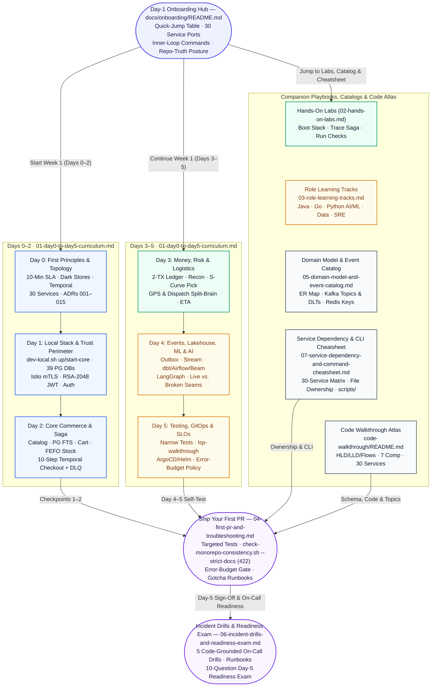

# InstaCommerce Engineering Onboarding Hub

> **Welcome to InstaCommerce!** Start here on Day 1 to orient yourself across our **30 microservices** (`20` Java 21 / Spring Boot 4.0.0, `8` Go 1.25 + `go-shared`, `2` Python 3.12 / FastAPI), **`contracts/`**, **`libs/platform-common`**, data lakehouse, ML platform, and GitOps stack.
>
> Everything in `docs/onboarding/` is verified directly against checked-in source code, SQL migrations, Helm charts, and local scripts. If you want the progressive Week-1 roadmap, start with **[Day 0–5 Engineering Curriculum](./01-day0-to-day5-curriculum.md)**; if you want to jump straight into a service or lab, use the navigation table below.

---

## 1. Onboarding Journey at a Glance

**InstaCommerce Engineering Onboarding Journey** — *[Rendered PNG](./diagrams/onboarding-journey.png) · [Mermaid Source](./diagrams/onboarding-journey.mmd)*



---

## 2. Quick-Jump Navigation Table

| Goal | Start Here | What You Will Accomplish |
|---|---|---|
| **First Day Setup** | **[Day 1 Local Bootstrap](./01-day0-to-day5-curriculum.md#day-1--local-dev-setup-trust-boundaries--shared-primitives)** · [`dev-local.sh`](../../scripts/dev-local.sh) · [`docker-compose.yml`](../../docker-compose.yml) · [`.env.local.example`](../../.env.local.example) | Start Postgres 16 (`39` DBs/aliases), Redis 7, Kafka KRaft (`:9092`), Debezium (`:18083`), and Temporal (`:7233` / UI `:8233`); generate ephemeral RSA-2048 JWT keys and `.local-dev/.env.local`; boot the `10` core Java services; verify `lsp-walkthrough status` |
| **Understand Architecture** | **[Day 0–5 Curriculum](./01-day0-to-day5-curriculum.md)** · **[Whole-System HLD](./code-walkthrough/01-system-hld.md)** · **[LLD](./code-walkthrough/02-system-lld.md)** · **[E2E Flows](./code-walkthrough/03-system-end-to-end-flows.md)** · [ADRs `001`–`015`](../adr/README.md) | Learn why a sub-10-minute delivery SLA drives `store_id` dark-store partitioning, 10-step Temporal checkout sagas (not 2PC), transactional outbox + WAL CDC, PgBouncer pool ceilings, and where ADRs diverge from runtime code |
| **Run Hands-On Labs** | **[`02-hands-on-labs.md`](./02-hands-on-labs.md)** · [Day 0–3 Checkpoints](./01-day0-to-day5-curriculum.md#day-03-onboarding-checkpoints) · [Day 4–5 Self-Test](./01-day0-to-day5-curriculum.md#56-day-45-checkpoints-self-test) | Exercise the local stack end to end: authenticate via `identity-service`, trace a Temporal checkout saga and compensation history, inspect Kafka/outbox events, run GE `--fixtures` and narrow tests, and trigger the drift scanner |
| **Pick Your Role Track** | **[`03-role-learning-tracks.md`](./03-role-learning-tracks.md)** | Follow curated reading and coding tracks tailored to your team: **Java Core Commerce & Money**, **Go Event/Logistics Daemons**, **Python AI/ML**, **Data Lakehouse (dbt/Airflow/Beam)**, or **Platform / SRE / GitOps** |
| **Ship Your First PR** | **[`04-first-pr-and-troubleshooting.md`](./04-first-pr-and-troubleshooting.md)** · [Day 5 Playbook](./01-day0-to-day5-curriculum.md#day-5--shipping-code-safely-testing-cicd-gitops-slos--first-pr-playbook) · [`AGENTS.md`](../../AGENTS.md) · [`check-monorepo-consistency.sh`](../../scripts/check-monorepo-consistency.sh) | Run narrow inner-loop tests + linters, regenerate Go/Java contracts when touching `.proto`, pass all `9` stages (`422` checks) of `check-monorepo-consistency.sh --strict-docs`, verify ADR-015 error-budget gates, and avoid common CI/Helm traps |
| **Explore ER, Kafka Topics & Redis Keyspace** | **[`05-domain-model-and-event-catalog.md`](./05-domain-model-and-event-catalog.md)** | Inspect the cross-service Entity-Relationship map, Flyway schemas and locking constraints, canonical `TopicNames.java` Kafka topics + `.DLT`/`.dlq` bridges, and Redis keyspace/TTL/Lua inventory (including `riders:active` vs `riders:h3:*` split-brain) |
| **Practice Incident Drills & Readiness Exam** | **[`06-incident-drills-and-readiness-exam.md`](./06-incident-drills-and-readiness-exam.md)** | Walk through `5` code-grounded on-call incident drills (`CheckoutBurnRate_Critical`, stuck payments/recon, outbox/stream lag, dark-store saturation/dispatch, DB failover/JWKS rotation) and complete the `10`-question Day-5 production readiness exam |
| **30-Service Dependencies, Ownership & CLI Cheatsheet** | **[`07-service-dependency-and-command-cheatsheet.md`](./07-service-dependency-and-command-cheatsheet.md)** | Inspect the 30-service inbound/outbound runtime dependency matrix, "Where Does This Change Go?" file-ownership table, complete `scripts/` flags, and daily `psql` / `redis-cli` / Kafka / Gradle / Go / pytest commands |
| **Deep Code Walkthroughs for 30 Services & 7 Components** | **[`code-walkthrough/README.md`](./code-walkthrough/README.md)** · [30 Service Guides](./code-walkthrough/services/) · [7 Component Guides](./code-walkthrough/components/) | Dive into package trees, Spring/Go/FastAPI filter chains, Flyway/SQL locking invariants, Kafka topics, `11` system diagrams, `14` component diagrams, `90` per-service diagrams, and verified code-level bugs across every module |

---

## 3. Essential Reference Card

> [!WARNING]
> **Repo-Truth Warning — Always Trust Code & SQL Over Legacy Docs:**
> Several legacy `README.md` files, code comments, Helm overlays, and Prometheus rules describe target designs that are disabled, partial, or differently implemented on disk today:
> - **Checkout & Search:** `order-service` has **zero** Temporal SDK (`LegacyCheckoutController` unconditionally returns `410 GONE`); `search-service` runs **PostgreSQL `tsvector` + GIN**, not Elasticsearch; `cart-service` persists solely in PostgreSQL (`JpaCartStore`), using Redis only as L2 read cache.
> - **Payments & Reconciliation:** Helm (`values.yaml` / `values-prod.yaml`) disables `payment-service` stale-pending recovery, order-cancelled choreography consumer, and webhook-refund outbox (`"false"`); `WebhookKafkaBridge` drops non-Stripe PSPs (`SKIPPED_UNSUPPORTED_PSP`); `reconciliation-engine` has **no** `payments.cdc` Terraform Debezium manifest and **zero** `psp_export_snapshot` writers.
> - **Dispatch & ETA:** `rider-fleet.dispatch.optimizer-enabled` defaults to `false` (assignment runs Redis `GEORADIUS` + SQL `SKIP LOCKED`); `location-ingestion-service` writes custom axial hex sets (`riders:h3:*`) and an empty geofence `zones` map; `routing-eta-service` uses `Haversine * 1.4` + DB tables (**zero** OSRM/Google Maps clients).
> - **Data, AI & Observability:** `cdc-consumer-service` crashes under base Helm (`KAFKA_*` / `BQ_*` env vars omitted); `reverse-etl-orchestrator` is HTTP-push-only; `ai-inference-service` falls back to linear/`_rule_based_fallback` heuristics; `ai-orchestrator-service` `tools.py` reads `AI_ORCHESTRATOR_INTERNAL_SERVICE_TOKEN` while Helm injects `INTERNAL_SERVICE_TOKEN`; `NetworkPolicy` allows `port: metrics` while `deployment.yaml` exposes `name: http`.
>
> Review the full [Consolidated Repo-Truth Gotcha Reference](./01-day0-to-day5-curriculum.md#55-consolidated-repo-truth-gotcha-reference) and [Repo-Truth Audit](../repo-truth/README.md) before debugging unfamiliar behavior.

### 3.1 Microservice & Infrastructure Ports (`GLOSSARY.md` Authority)

#### Application Services (`30` Total: `:8080`–`:8109`)

| Plane | Service (`services/<name>`) | Stack | Port | Helm Key (`values.yaml`) | Walkthrough |
|---|---|---|---|---|---|
| **Edge & Gov** | `mobile-bff-service` | Java 21 / WebFlux | `8080` | `mobile-bff-service` | [Guide](./code-walkthrough/services/mobile-bff-service.md) |
| **Edge & Gov** | `identity-service` | Java 21 / Boot 4 | `8081` | `identity-service` | [Guide](./code-walkthrough/services/identity-service.md) |
| **Edge & Gov** | `audit-trail-service` | Java 21 / Boot 4 | `8096` | `audit-trail-service` | [Guide](./code-walkthrough/services/audit-trail-service.md) |
| **Edge & Gov** | `config-feature-flag-service` | Java 21 / Boot 4 | `8098` | `config-feature-flag-service` | [Guide](./code-walkthrough/services/config-feature-flag-service.md) |
| **Edge & Gov** | `admin-gateway-service` | Java 21 / MVC | `8099` | `admin-gateway-service` | [Guide](./code-walkthrough/services/admin-gateway-service.md) |
| **Browse & Cart** | `catalog-service` | Java 21 / Boot 4 | `8082` | `catalog-service` | [Guide](./code-walkthrough/services/catalog-service.md) |
| **Browse & Cart** | `search-service` | Java 21 / Boot 4 | `8088` | `search-service` | [Guide](./code-walkthrough/services/search-service.md) |
| **Browse & Cart** | `pricing-service` | Java 21 / Boot 4 | `8089` | `pricing-service` | [Guide](./code-walkthrough/services/pricing-service.md) |
| **Browse & Cart** | `cart-service` | Java 21 / Boot 4 | `8090` | `cart-service` | [Guide](./code-walkthrough/services/cart-service.md) |
| **Core Tx** | `inventory-service` | Java 21 / Boot 4 | `8083` | `inventory-service` | [Guide](./code-walkthrough/services/inventory-service.md) |
| **Core Tx** | `order-service` | Java 21 / Boot 4 | `8084` | `order-service` | [Guide](./code-walkthrough/services/order-service.md) |
| **Core Tx** | `checkout-orchestrator-service` | Java 21 / Temporal | `8091` | `checkout-orchestrator-service` | [Guide](./code-walkthrough/services/checkout-orchestrator-service.md) |
| **Money & Risk** | `payment-service` | Java 21 / Boot 4 | `8085` | `payment-service` | [Guide](./code-walkthrough/services/payment-service.md) |
| **Money & Risk** | `wallet-loyalty-service` | Java 21 / Boot 4 | `8095` | `wallet-loyalty-service` | [Guide](./code-walkthrough/services/wallet-loyalty-service.md) |
| **Money & Risk** | `fraud-detection-service` | Java 21 / Boot 4 | `8097` | `fraud-detection-service` | [Guide](./code-walkthrough/services/fraud-detection-service.md) |
| **Money & Risk** | `payment-webhook-service` | Go 1.25 | `8106` | `payment-webhook` | [Guide](./code-walkthrough/services/payment-webhook-service.md) |
| **Money & Risk** | `reconciliation-engine` | Go 1.25 | `8107` | `reconciliation-engine` | [Guide](./code-walkthrough/services/reconciliation-engine.md) |
| **Fulfillment** | `fulfillment-service` | Java 21 / Boot 4 | `8086` | `fulfillment-service` | [Guide](./code-walkthrough/services/fulfillment-service.md) |
| **Fulfillment** | `notification-service` | Java 21 / Boot 4 | `8087` | `notification-service` | [Guide](./code-walkthrough/services/notification-service.md) |
| **Fulfillment** | `warehouse-service` | Java 21 / Boot 4 | `8092` | `warehouse-service` | [Guide](./code-walkthrough/services/warehouse-service.md) |
| **Logistics** | `rider-fleet-service` | Java 21 / Boot 4 | `8093` | `rider-fleet-service` | [Guide](./code-walkthrough/services/rider-fleet-service.md) |
| **Logistics** | `routing-eta-service` | Java 21 / Boot 4 | `8094` | `routing-eta-service` | [Guide](./code-walkthrough/services/routing-eta-service.md) |
| **Logistics** | `dispatch-optimizer-service` | Go 1.25 | `8102` | `dispatch-optimizer-service` | [Guide](./code-walkthrough/services/dispatch-optimizer-service.md) |
| **Logistics** | `location-ingestion-service` | Go 1.25 | `8105` | `location-ingestion` | [Guide](./code-walkthrough/services/location-ingestion-service.md) |
| **Event & Data** | `outbox-relay-service` | Go 1.25 | `8103` | `outbox-relay` (+13 per-domain) | [Guide](./code-walkthrough/services/outbox-relay-service.md) |
| **Event & Data** | `cdc-consumer-service` | Go 1.25 | `8104` | `cdc-consumer` | [Guide](./code-walkthrough/services/cdc-consumer-service.md) |
| **Event & Data** | `stream-processor-service` | Go 1.25 | `8108` | `stream-processor` | [Guide](./code-walkthrough/services/stream-processor-service.md) |
| **Event & Data** | `reverse-etl-orchestrator` | Go 1.25 | `8109` (`:8110` health, `:9090` metrics) | `reverse-etl-orchestrator` | [Guide](./code-walkthrough/services/reverse-etl-orchestrator.md) |
| **AI & ML** | `ai-orchestrator-service` | Python 3.12 / FastAPI | `8100` | `ai-orchestrator-service` | [Guide](./code-walkthrough/services/ai-orchestrator-service.md) |
| **AI & ML** | `ai-inference-service` | Python 3.12 / FastAPI | `8101` | `ai-inference-service` | [Guide](./code-walkthrough/services/ai-inference-service.md) |

#### Local Docker Compose Infrastructure ([`docker-compose.yml`](../../docker-compose.yml))

| Container | Host Port | Purpose |
|---|---|---|
| `postgres` | `5432` | PostgreSQL 16 (`39` local DBs/aliases seeded by [`scripts/init-dbs.sql`](../../scripts/init-dbs.sql)) |
| `redis` | `6379` | Redis 7 (L2 cache, Pub/Sub invalidation, token blocklist, rate limits, rider GEO/hex state) |
| `kafka` | `9092` | KRaft broker (`EXTERNAL://localhost:9092`, `INTERNAL://kafka:29092`) |
| `kafka-connect` | `18083` | Debezium Connect 2.4 WAL CDC runtime |
| `temporal` | `7233` | Temporal workflow gRPC server (`instacommerce` & `reverse-etl` namespaces) |
| `temporal-ui` | `8233` | Temporal Web UI for inspecting `CheckoutWorkflow` execution history |
| `kafka-ui` | `8070` | Kafka UI for inspecting topics, consumer lag, and connectors |

---

### 3.2 Essential Day-1 & Inner-Loop Commands

```bash
# 1. Local infrastructure & core stack (writes ephemeral RSA keys + .local-dev/.env.local)
./scripts/dev-local.sh up
set -a && source .local-dev/.env.local && set +a
./scripts/dev-local.sh start-core        # Starts 10 core Java services (or pass explicit names)
./scripts/dev-local.sh status && ./scripts/dev-local.sh smoke

# 2. LSP code navigation (run outline on 500+ line files before reading slices)
./scripts/lsp-walkthrough status
./scripts/lsp-walkthrough outline services/checkout-orchestrator-service/src/main/java/com/instacommerce/checkout/workflow/CheckoutWorkflowImpl.java

# 3. Narrow stack validation loops (never run ./gradlew test across all 20 Java services)
./gradlew :contracts:build :contracts:test && ./scripts/generate-proto.sh
./gradlew :services:order-service:test --tests "com.instacommerce.order.service.OrderCreateTransactionBoundaryTest"
./gradlew :services:order-service:spotlessCheck :services:order-service:bootJar

cd services/outbox-relay-service && go test -race ./... && golangci-lint run --config ../../.golangci.yml
cd services/ai-orchestrator-service && .venv/bin/pytest -v && ruff check . && pyright
python3 data-platform/quality/run_quality_checks.py --fixtures

# 4. Pre-PR monorepo drift & SLO error-budget gates
bash scripts/check-monorepo-consistency.sh --strict-docs
./scripts/check-error-budget-gate.sh --service payment-service --simulated-availability 0.9985
```

---

### 3.3 Canonical References & Governance

- [Repository README](../../README.md) · [Ubiquitous Language & Glossary (`GLOSSARY.md`)](../../GLOSSARY.md) · [Agent Operating System (`AGENTS.md`)](../../AGENTS.md)
- [Documentation Hub](../README.md) · [Architecture Decision Records (`001`–`015`)](../adr/README.md) · [Repo-Truth Audit](../repo-truth/README.md)
- [Module Registry (`settings.gradle.kts`)](../../settings.gradle.kts) · [Go Workspace (`go.work`)](../../go.work) · [CI Workflows (`.github/workflows/ci.yml`)](../../.github/workflows/ci.yml) · [Helm Values (`deploy/helm/values.yaml`)](../../deploy/helm/values.yaml)

---

**Next:** [01 — Day 0–5 Engineering Curriculum](./01-day0-to-day5-curriculum.md) · [Code Walkthrough Atlas](./code-walkthrough/README.md)
