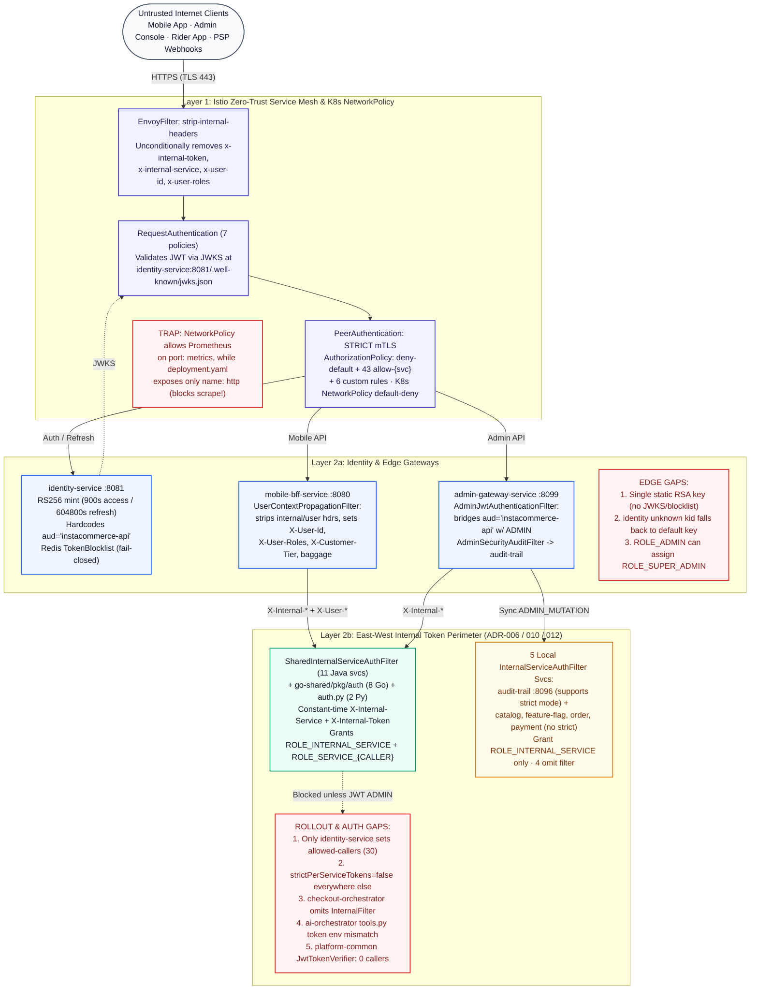
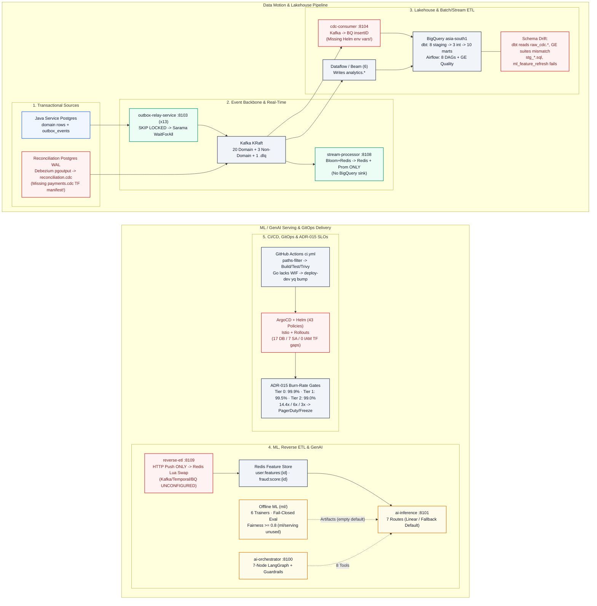

# 01 — InstaCommerce Whole-System High-Level Design (HLD)

> [!NOTE]
> **Part of the InstaCommerce Onboarding Suite:** [Onboarding Hub](../README.md) · [Code Walkthrough Atlas](./README.md) · [Domain & Event Catalog (`05`)](../05-domain-model-and-event-catalog.md) · [Incident Drills & Exam (`06`)](../06-incident-drills-and-readiness-exam.md) · [Dependency Matrix & Cheatsheet (`07`)](../07-service-dependency-and-command-cheatsheet.md)

> **Reading Goal:** Understand *why* InstaCommerce is decomposed into 30 microservices across 3 runtimes, how its bounded contexts and trust perimeters isolate failure under 10-minute quick-commerce bursts, and where architectural intent (ADRs and HLD docs) diverges from checked-in runtime code.

---

## 1. First Principles: How 10-Minute Delivery Physics Dictates the Architecture

InstaCommerce is an ultra-local quick-commerce backend targeting a **sub-10-minute delivery SLA** ([`GLOSSARY.md`](../../../GLOSSARY.md#L12)). Four physical and distributed-systems constraints explain almost every structural boundary in the monorepo:

1. **Delivery Physics → Hyperlocal Dark-Store Partitioning (`store_id`)**
   - At a configured urban rider base speed of `25 km/h` (`~417 m/min` in [`RoutingProperties.java`](../../../services/routing-eta-service/src/main/java/com/instacommerce/routing/config/RoutingProperties.java)) plus `3` minutes of warehouse preparation time ([`ETAService.java`](../../../services/routing-eta-service/src/main/java/com/instacommerce/routing/service/ETAService.java#L113-L118)), end-to-end fulfillment only closes inside a few kilometers.
   - Inventory, zone eligibility, store concurrency caps, aisle pick graphs, and rider dispatch therefore partition by **Dark Store** (`store_id`). You trace `store_id` from [`catalog-service`](../../../services/catalog-service/src/main/java/com/instacommerce/catalog/repository/ProductRepository.java) and [`inventory-service`](../../../services/inventory-service/src/main/java/com/instacommerce/inventory/domain/model/StockItem.java) down through [`warehouse-service`](../../../services/warehouse-service/src/main/java/com/instacommerce/warehouse/service/CapacityService.java), [`fulfillment-service`](../../../services/fulfillment-service/src/main/java/com/instacommerce/fulfillment/service/PickService.java), and [`rider-fleet-service`](../../../services/rider-fleet-service/src/main/java/com/instacommerce/riderfleet/service/RiderAssignmentService.java).
2. **Flash-Sale Contention Without Distributed Locks → Temporal Sagas, Not 2PC**
   - Placing a single order mutates state across five autonomous owners: **Cart**, **Pricing/Promotions**, **Inventory**, **Wallet/Payment**, and **Order**. Running synchronous Two-Phase Commit (2PC) across five PostgreSQL databases and an external payment service provider (PSP) collapses under flash bursts and strands row locks when pods crash or restart.
   - Instead, [`checkout-orchestrator-service`](../../../services/checkout-orchestrator-service/src/main/java/com/instacommerce/checkout/workflow/CheckoutWorkflowImpl.java#L43-L296) executes a durable **Temporal Saga** using deterministic `workflowId`-derived idempotency keys, bounded forward retries, LIFO **Compensating Actions**, and a PostgreSQL `compensation_dlq` safety net.
3. **Eliminating Dual-Write Divergence → Transactional Outbox + Debezium WAL CDC**
   - Mutating PostgreSQL and calling `kafkaTemplate.send()` inside the same request fails non-atomically: either the DB commits and Kafka loses the message, or Kafka publishes before the DB rolls back.
   - Stateful Java services write domain tables and `outbox_events` inside the **same local ACID transaction** (`Propagation.MANDATORY` in [`OrderCreationService.java`](../../../services/order-service/src/main/java/com/instacommerce/order/service/OrderCreationService.java) / [`OutboxService.java`](../../../services/order-service/src/main/java/com/instacommerce/order/service/OutboxService.java)), while Go [`outbox-relay-service`](../../../services/outbox-relay-service/relay.go#L122-L279) polls `FOR UPDATE SKIP LOCKED` to publish semantic domain events. Separately, Debezium (`pgoutput` logical replication) tails raw Postgres WAL logs for row-level replication (`reconciliation.cdc` in [`debezium-connector-reconciliation.tf`](../../../infra/terraform/debezium-connector-reconciliation.tf)), and [`cdc-consumer-service`](../../../services/cdc-consumer-service/consumer.go) streams Kafka topics into BigQuery.
4. **Polyglot Runtime Specialization + Connection-Pool Discipline**
   - **20 Java 21 / Spring Boot `4.0.0` services** ([`settings.gradle.kts`](../../../settings.gradle.kts)) own transactional invariants, Flyway schemas, Temporal orchestration, and JWT/RBAC gateways.
   - **8 Go `1.25` services** ([`go.work`](../../../go.work)) own memory-lean, high-throughput infrastructure daemons and spatial/numerical solvers (`outbox-relay-service`, `cdc-consumer-service`, `stream-processor-service`, `location-ingestion-service`, `dispatch-optimizer-service`, `payment-webhook-service`, `reconciliation-engine`, `reverse-etl-orchestrator`).
   - **2 Python `3.12` FastAPI services** own ML inference serving (`ai-inference-service`) and guardrailed LangGraph agent workflows (`ai-orchestrator-service`).
   - **PgBouncer / Cloud SQL 500-Connection Ceiling:** [`HLD.md`](../../architecture/HLD.md#L820-L830) sizes production capacity for `200` pods × `20` HikariCP connections (`4,000` logical connections) multiplexed via PgBouncer down to `~400` real PostgreSQL connections under Cloud SQL's `max_connections=500` ceiling. Consequently, **services must never hold a database transaction open across an external HTTP/PSP call** (enforced most visibly by [`PaymentService.java`](../../../services/payment-service/src/main/java/com/instacommerce/payment/service/PaymentService.java#L47-L87)'s 2-TX pending pattern).

**Whole-System Bounded Contexts, 30 Services & Pool Ceiling** — *[Rendered PNG](./diagrams/system/01-hld-bounded-contexts.png) · [Mermaid Source](./diagrams/system/01-hld-bounded-contexts.mmd)*

```mermaid
flowchart TB
    classDef client fill:#F8FAFC,stroke:#475569,stroke-width:1.5px,color:#0F172A
    classDef java fill:#EFF6FF,stroke:#2563EB,stroke-width:1.6px,color:#0F172A
    classDef go fill:#ECFDF5,stroke:#059669,stroke-width:1.6px,color:#0F172A
    classDef py fill:#FFFBEB,stroke:#D97706,stroke-width:1.6px,color:#0F172A
    classDef infra fill:#F1F5F9,stroke:#334155,stroke-width:1.6px,color:#0F172A
    classDef warn fill:#FEF2F2,stroke:#DC2626,stroke-width:1.6px,color:#7F1D1D

    subgraph ROW1["Ingress, Edge Gateways & Core Discovery / Checkout"]
        direction LR
        subgraph COL_L["Clients & Perimeter"]
            direction TB
            CLI(["Mobile · Web · Admin · Rider · PSP"]):::client
            ISTIO["Istio Ingress Gateway<br/>STRICT mTLS · EnvoyFilter · 43 SPIFFE"]:::infra
            PHYS["10-Min SLA Physics<br/>25 km/h (~417 m/min) + ~3m pick<br/>Partitions state by store_id"]:::warn
            CLI --> ISTIO ~~~ PHYS
        end

        subgraph BC_EDGE["1. Edge & Governance (Java 21 · 5)"]
            direction TB
            MBFF["mobile-bff :8080 (WebFlux · SSE)"]:::java
            ID["identity :8081 (RS256/JWKS · Redis)"]:::java
            AGW["admin-gateway :8099 (MVC · Audit)"]:::java
            FLAGS["config-feature-flag :8098 (Murmur3 · SSE)"]:::java
            AUDIT["audit-trail :8096 (21 Topics · PG + GCS)"]:::java
            MBFF ~~~ ID ~~~ AGW ~~~ FLAGS ~~~ AUDIT
        end

        subgraph BC_CORE["2. Discovery & Checkout Saga (Java 21 · 6)"]
            direction LR
            subgraph CORE_A["Discovery & Cart"]
                direction TB
                CAT["catalog :8082 (Tree · In-Proc Outbox)"]:::java
                SRCH["search :8088 (PG tsvector GIN + Fuzzy)"]:::java
                PRC["pricing :8089 (Promos · HMAC Quote)"]:::java
                CAT ~~~ SRCH ~~~ PRC
            end
            subgraph CORE_B["Cart, Stock & Saga"]
                direction TB
                CART["cart :8090 (PG JpaCartStore · Redis L2)"]:::java
                INV["inventory :8083 (Sorted FOR UPDATE · FEFO)"]:::java
                CHK["checkout-orchestrator :8091<br/>Temporal 10-Step Saga · DLQ (Not 2PC)"]:::java
                CART ~~~ INV ~~~ CHK
            end
        end
    end

    subgraph ROW2["Execution, Money, Real-Time Go Backbone, AI & Shared Persistence"]
        direction LR
        subgraph BC_EXEC["3. Money, Fulfillment & Logistics (Java 9 + Go 3)"]
            direction LR
            subgraph EXEC_M["Orders, Money & Risk"]
                direction TB
                ORD["order :8084 (9-State FSM · 410 Legacy)"]:::java
                PAY["payment :8085 (2-TX PSP · Ledger)"]:::java
                WAL["wallet-loyalty :8095 (FOR UPDATE · Cashback)"]:::java
                FRD["fraud-detection :8097 (AUTO_BLOCK)"]:::java
                ORD ~~~ PAY ~~~ WAL ~~~ FRD
            end
            subgraph EXEC_F["Dark Store & Delivery"]
                direction TB
                WH["warehouse :8092 (15km · Dijkstra · Cold)"]:::java
                FUL["fulfillment :8086 (S-Curve · 4-Tote · OTP)"]:::java
                RDR["rider-fleet :8093 (GEORADIUS + SKIP LOCKED)"]:::java
                ETA["routing-eta :8094 (Haversine x1.4 · STOMP)"]:::java
                WH ~~~ FUL ~~~ RDR ~~~ ETA
            end
            subgraph EXEC_G["Comms, Webhooks & Go Solvers"]
                direction TB
                NTF["notification :8087 (7 Topics · Fallback)"]:::java
                PWH["payment-webhook :8106 (Go · 3 PSPs)"]:::go
                RECON["reconciliation-engine :8107 (Go · T+1)"]:::go
                DOPT["dispatch-optimizer :8102 (Go · Greedy+1-opt)"]:::go
                NTF ~~~ PWH ~~~ RECON ~~~ DOPT
            end
        end

        subgraph BC_DATA_AI["4. Event Backbone, Lakehouse & AI (Go 5 + Py 2)"]
            direction LR
            subgraph DA_GO["Go Pipelines & Telemetry"]
                direction TB
                OBR["outbox-relay :8103 (Go · x13 · SKIP LOCKED)"]:::go
                LOC["location-ingestion :8105 (Go · Kalman · H3)"]:::go
                STR["stream-processor :8108 (Go · Redis/Prom)"]:::go
                CDC["cdc-consumer :8104 (Go · Kafka -> BQ)"]:::go
                OBR ~~~ LOC ~~~ STR ~~~ CDC
            end
            subgraph DA_AI["Reverse ETL & Python AI"]
                direction TB
                RETL["reverse-etl :8109 (Go · HTTP -> Redis Lua)"]:::go
                AIO["ai-orchestrator :8100 (Py · LangGraph)"]:::py
                AII["ai-inference :8101 (Py · Fallback Default)"]:::py
                RETL ~~~ AIO ~~~ AII
            end
        end

        subgraph INFRA_CAP["5. Shared Persistence & Pool Ceiling"]
            direction TB
            PG["Cloud SQL PostgreSQL 16<br/>PgBouncer: 200 pods x 20 Hikari<br/>= 4,000 logical -> ~400 PG (500 max)"]:::infra
            CACHE["Redis 7 / Memorystore<br/>L2 Caches · Pub/Sub · GEO · H3"]:::infra
            BUS["Kafka KRaft + Temporal :7233<br/>20 Domain + 3 Non-Domain + 1 .dlq + WAL"]:::infra
            PG ~~~ CACHE ~~~ BUS
        end
    end

    ISTIO -->|"External HTTPS"| BC_EDGE
    BC_EDGE -->|"REST + Internal Auth"| BC_CORE
    BC_CORE -->|"Temporal Activities"| BC_EXEC
    BC_EXEC -. "outbox_events + WAL" .-> BC_DATA_AI
    BC_CORE & BC_EXEC -->|"PgBouncer + Redis"| INFRA_CAP
    BC_DATA_AI -->|"Kafka / Redis / BQ"| INFRA_CAP
```

---

## 2. Bounded Contexts & Complete 30-Service Polyglot Registry

Authoritative service IDs, Gradle/Go module names, ports, and Helm keys are cross-checked across [`settings.gradle.kts`](../../../settings.gradle.kts), [`go.work`](../../../go.work), [`GLOSSARY.md`](../../../GLOSSARY.md#L55-L89), [`deploy/helm/values.yaml`](../../../deploy/helm/values.yaml), and [`scripts/check-monorepo-consistency.sh`](../../../scripts/check-monorepo-consistency.sh#L94-L105).

| Bounded Context | Service | Stack | Port | Primary Data Store | Helm Key | Walkthrough |
|---|---|---|---|---|---|---|
| **Edge & Trust** | `mobile-bff-service` | Java 21 / WebFlux | `8080` | Stateless (+ Redis Pub/Sub) | `mobile-bff-service` | [Guide](./services/mobile-bff-service.md) |
| **Edge & Trust** | `identity-service` | Java 21 / Boot 4 | `8081` | PostgreSQL + Redis | `identity-service` | [Guide](./services/identity-service.md) |
| **Edge & Trust** | `admin-gateway-service` | Java 21 / MVC | `8099` | Stateless | `admin-gateway-service` | [Guide](./services/admin-gateway-service.md) |
| **Platform Gov** | `audit-trail-service` | Java 21 / Boot 4 | `8096` | PostgreSQL + GCS | `audit-trail-service` | [Guide](./services/audit-trail-service.md) |
| **Platform Gov** | `config-feature-flag-service` | Java 21 / Boot 4 | `8098` | PostgreSQL + Redis | `config-feature-flag-service` | [Guide](./services/config-feature-flag-service.md) |
| **Discovery & Cart** | `catalog-service` | Java 21 / Boot 4 | `8082` | PostgreSQL + Redis L2 | `catalog-service` | [Guide](./services/catalog-service.md) |
| **Discovery & Cart** | `search-service` | Java 21 / Boot 4 | `8088` | PostgreSQL (`tsvector`) + Redis L2 | `search-service` | [Guide](./services/search-service.md) |
| **Discovery & Cart** | `pricing-service` | Java 21 / Boot 4 | `8089` | PostgreSQL + Redis L2 | `pricing-service` | [Guide](./services/pricing-service.md) |
| **Discovery & Cart** | `cart-service` | Java 21 / Boot 4 | `8090` | PostgreSQL + Redis L2 | `cart-service` | [Guide](./services/cart-service.md) |
| **Core Tx & Saga** | `inventory-service` | Java 21 / Boot 4 | `8083` | PostgreSQL | `inventory-service` | [Guide](./services/inventory-service.md) |
| **Core Tx & Saga** | `order-service` | Java 21 / Boot 4 | `8084` | PostgreSQL | `order-service` | [Guide](./services/order-service.md) |
| **Core Tx & Saga** | `checkout-orchestrator-service` | Java 21 / Temporal | `8091` | Temporal + PostgreSQL | `checkout-orchestrator-service` | [Guide](./services/checkout-orchestrator-service.md) |
| **Money & Risk** | `payment-service` | Java 21 / Boot 4 | `8085` | PostgreSQL | `payment-service` | [Guide](./services/payment-service.md) |
| **Money & Risk** | `payment-webhook-service` | Go 1.25 | `8106` | Redis / in-mem dedup | `payment-webhook` | [Guide](./services/payment-webhook-service.md) |
| **Money & Risk** | `reconciliation-engine` | Go 1.25 | `8107` | PostgreSQL | `reconciliation-engine` | [Guide](./services/reconciliation-engine.md) |
| **Money & Risk** | `wallet-loyalty-service` | Java 21 / Boot 4 | `8095` | PostgreSQL | `wallet-loyalty-service` | [Guide](./services/wallet-loyalty-service.md) |
| **Money & Risk** | `fraud-detection-service` | Java 21 / Boot 4 | `8097` | PostgreSQL + opt. Redis | `fraud-detection-service` | [Guide](./services/fraud-detection-service.md) |
| **Fulfillment** | `warehouse-service` | Java 21 / Boot 4 | `8092` | PostgreSQL | `warehouse-service` | [Guide](./services/warehouse-service.md) |
| **Fulfillment** | `fulfillment-service` | Java 21 / Boot 4 | `8086` | PostgreSQL | `fulfillment-service` | [Guide](./services/fulfillment-service.md) |
| **Logistics** | `rider-fleet-service` | Java 21 / Boot 4 | `8093` | PostgreSQL + Redis GEO | `rider-fleet-service` | [Guide](./services/rider-fleet-service.md) |
| **Logistics** | `location-ingestion-service` | Go 1.25 | `8105` | Redis (`rider:location:*`, `riders:h3:*`) | `location-ingestion` | [Guide](./services/location-ingestion-service.md) |
| **Logistics** | `dispatch-optimizer-service` | Go 1.25 | `8102` | Stateless + opt. Redis lock | `dispatch-optimizer-service` | [Guide](./services/dispatch-optimizer-service.md) |
| **Logistics** | `routing-eta-service` | Java 21 / Boot 4 | `8094` | PostgreSQL + STOMP | `routing-eta-service` | [Guide](./services/routing-eta-service.md) |
| **Logistics** | `notification-service` | Java 21 / Boot 4 | `8087` | PostgreSQL | `notification-service` | [Guide](./services/notification-service.md) |
| **Event & Data** | `outbox-relay-service` | Go 1.25 | `8103` | Reads service Postgres | `outbox-relay` (+13 per-domain) | [Guide](./services/outbox-relay-service.md) |
| **Event & Data** | `cdc-consumer-service` | Go 1.25 | `8104` | BigQuery sink | `cdc-consumer` | [Guide](./services/cdc-consumer-service.md) |
| **Event & Data** | `stream-processor-service` | Go 1.25 | `8108` | Redis + Prometheus | `stream-processor` | [Guide](./services/stream-processor-service.md) |
| **Event & Data** | `reverse-etl-orchestrator` | Go 1.25 | `8109` | PostgreSQL + Redis | `reverse-etl-orchestrator` | [Guide](./services/reverse-etl-orchestrator.md) |
| **AI & ML** | `ai-orchestrator-service` | Python 3.12 / FastAPI | `8100` | Redis checkpoints | `ai-orchestrator-service` | [Guide](./services/ai-orchestrator-service.md) |
| **AI & ML** | `ai-inference-service` | Python 3.12 / FastAPI | `8101` | Optional Redis/ONNX | `ai-inference-service` | [Guide](./services/ai-inference-service.md) |

> [!NOTE]
> **43 Helm Deployments for 30 Services:** Five Go modules use shortened Helm keys (`cdc-consumer`, `location-ingestion`, `outbox-relay`, `payment-webhook`, `stream-processor`), and [`deploy/helm/values.yaml`](../../../deploy/helm/values.yaml#L863-L1168) instantiates `13` additional per-domain `outbox-relay-<domain>` deployments on port `8103`, yielding `43` entries under `.Values.services` and `.Values.istio.servicePolicies`.

---

## 3. Istio Zero-Trust Mesh & Application Security Perimeter

InstaCommerce layers an **Istio Service Mesh + Kubernetes NetworkPolicy** perimeter around **application-level JWT and Internal Service Token filters**:

**Istio Zero-Trust Mesh & Internal Auth Perimeter** — *[Rendered PNG](./diagrams/system/02-hld-trust-and-network.png) · [Mermaid Source](./diagrams/system/02-hld-trust-and-network.mmd)*

1. **Layer 1 — Mesh & Network Perimeter ([`deploy/helm/templates/istio/`](../../../deploy/helm/templates/istio/deny-default.yaml), [`deploy/istio/`](../../../deploy/istio/envoy-filter-strip-internal-headers.yaml)):**
   - [`peer-authentication.yaml`](../../../deploy/helm/templates/istio/peer-authentication.yaml) enforces `STRICT` mTLS across workloads.
   - [`envoy-filter-strip-internal-headers.yaml`](../../../deploy/istio/envoy-filter-strip-internal-headers.yaml#L37-L41) targets `istio: ingressgateway` and unconditionally strips `x-internal-token`, `x-internal-service`, `x-user-id`, and `x-user-roles` before routing into the mesh.
   - [`request-authentication.yaml`](../../../deploy/helm/templates/istio/request-authentication.yaml) configures `7` JWKS validation policies pointing at `identity-service:8081/.well-known/jwks.json`, paired with `deny-default` + `43` SPIFFE `allow-<svc>` [`AuthorizationPolicy`](../../../deploy/helm/templates/istio/service-allow-policies.yaml) rules + `6` custom rules + [`network-policy.yaml`](../../../deploy/helm/templates/network-policy.yaml).
2. **Layer 2a — External Identity & Edge Gateways:**
   - [`DefaultJwtService.java`](../../../services/identity-service/src/main/java/com/instacommerce/identity/security/DefaultJwtService.java#L31-L48) (`identity-service`, `:8081`) mints RS256 access tokens (`900s` TTL) and refresh tokens (`604800s` TTL, max `5` per user) with `iss: "instacommerce-identity"` and **hardcoded `aud: "instacommerce-api"`**, backed by [`TokenBlocklistService.java`](../../../services/identity-service/src/main/java/com/instacommerce/identity/service/TokenBlocklistService.java) (fail-closed on Redis read errors).
   - [`UserContextPropagationFilter.java`](../../../services/mobile-bff-service/src/main/java/com/instacommerce/mobilebff/security/UserContextPropagationFilter.java#L44-L118) (`mobile-bff-service`, `:8080`) strips inbound `X-Internal-*` (and `X-User-*`/`baggage` when unauthenticated), validates the Bearer token, and injects `X-User-Id`, `X-User-Roles`, `X-Customer-Tier`, `X-Order-Value-Bracket`, and OTel `baggage`.
   - [`AdminJwtAuthenticationFilter.java`](../../../services/admin-gateway-service/src/main/java/com/instacommerce/admingateway/security/AdminJwtAuthenticationFilter.java#L82-L91) (`admin-gateway-service`, `:8099`) enforces `ROLE_ADMIN`/`ROLE_SUPER_ADMIN`, bridges `instacommerce-api` audience tokens when admin roles are present (due to `identity-service`'s hardcoded `aud`), and synchronously posts `ADMIN_MUTATION` audit records to `audit-trail-service` via [`AdminSecurityAuditFilter.java`](../../../services/admin-gateway-service/src/main/java/com/instacommerce/admingateway/security/AdminSecurityAuditFilter.java).
3. **Layer 2b — East-West Internal Auth (ADR-006 / ADR-010 / ADR-012):**
   - [`SharedInternalServiceAuthFilter.java`](../../../libs/platform-common/src/main/java/com/instacommerce/platform/security/SharedInternalServiceAuthFilter.java#L95-L115) (used by **11** Java services) and [`middleware.go`](../../../services/go-shared/pkg/auth/middleware.go#L76-L150) (Go) validate `X-Internal-Service` + `X-Internal-Token` in constant time, checking `allowedCallers` before falling back to `INTERNAL_SERVICE_TOKEN` when `strictPerServiceTokens=false`.

> [!WARNING]
> **Critical Trust & Perimeter Gaps Verified in Code:**
> - `deploy/helm/templates/network-policy.yaml` allows Prometheus ingress on `port: metrics`, while `deployment.yaml` only names container port `name: http` (blocking scrapes when NetworkPolicy is active).
> - Only `identity-service` configures `internal.service.allowed-callers`; `strictPerServiceTokens` remains `false` elsewhere, and [`checkout-orchestrator-service` `SecurityConfig.java`](../../../services/checkout-orchestrator-service/src/main/java/com/instacommerce/checkout/security/SecurityConfig.java#L27-L43) omits `InternalServiceAuthFilter` entirely.
> - `ai-orchestrator-service` [`tools.py`](../../../services/ai-orchestrator-service/app/graph/tools.py#L236-L238) reads `AI_ORCHESTRATOR_INTERNAL_SERVICE_TOKEN`, while `auth.py` and Helm set `INTERNAL_SERVICE_TOKEN`—causing outbound AI tool calls to omit `X-Internal-Token` under default Helm.
> - Edge services (`mobile-bff`, `admin-gateway`, `config-feature-flag`, `audit-trail`) verify single static RSA keys without JWKS rotation or Redis blocklist checks (`JwtTokenVerifier` in `platform-common` has `0` consumers), `DefaultJwtService` falls back to `keyLoader.getPublicKey()` on unknown `kid`, and `identity-service` `AdminController.updateUserRoles` lets `ROLE_ADMIN` grant `Role.SUPER_ADMIN`.

---

## 4. Data Lakehouse, ML/GenAI & GitOps Macro Architecture

**Data Lakehouse, ML/GenAI & GitOps Macro Topology** — *[Rendered PNG](./diagrams/system/03-hld-data-ml-gitops.png) · [Mermaid Source](./diagrams/system/03-hld-data-ml-gitops.mmd)*

### 4.1 Event Backbone, Lakehouse & AI Separation

- **Transactional Outbox vs. Debezium WAL vs. Streaming:** `outbox-relay-service` (`:8103`) publishes semantic domain events from service `outbox_events` tables, Debezium captures raw PostgreSQL `pgoutput` WAL rows (`reconciliation.cdc` in Terraform; `payments.cdc` is expected by `reconciliation-engine` but has no checked-in connector manifest), `stream-processor-service` (`:8108`) updates real-time Redis + Prometheus windows only (no BigQuery sink), and `cdc-consumer-service` (`:8104`) + Dataflow Beam pipelines write to BigQuery.
- **Lakehouse & ML (`data-platform/`, `ml/`):** BigQuery (`asia-south1`) hosts dbt (`8` staging views → `3` intermediate → `10` marts including partitioned/clustered `mart_order_fulfillment` with PII policy tag), `8` Airflow DAGs (gated by `ExternalTaskSensor` + `KafkaLagSensor`), `5` Great Expectations suites, and `6` offline ML trainers with fail-closed promotion and `>= 0.8` disparate-impact fairness gates in [`metrics.py`](../../../ml/eval/metrics.py).
- **Online AI (`:8100`, `:8101`):** `ai-inference-service` (`:8101`) wraps `7` model routes in OTel, Z-score feature health, and shadow execution, while `ai-orchestrator-service` (`:8100`) runs a 7-node LangGraph workflow with `InjectionDetector`, `PIIVault`, Redis budgets (`0.50 USD` / `25` tool calls), `OutputPolicy`, and SSRF/BOLA-validated tool execution.

### 4.2 CI/CD, GitOps & ADR-015 SLO Tiers

Authoritative SLO definitions live in [`monitoring/error-budget-policy.yaml`](../../../monitoring/error-budget-policy.yaml#L4-L45) and [`monitoring/prometheus-rules.yaml`](../../../monitoring/prometheus-rules.yaml#L125-L309), enforced before release via [`scripts/check-error-budget-gate.sh`](../../../scripts/check-error-budget-gate.sh):

| Tier | Services | 30-Day Availability | Error Budget | P99 Target | Multi-Window Burn Alerts |
|---|---|---|---|---|---|
| **Tier 0** | `identity`, `checkout-orchestrator`, `payment` | `99.9%` | `43.2 min` | `500 ms` | `14.4x` (5m+1h `page`), `6x` (30m+6h `page`), `3x` (1h `ticket`) |
| **Tier 1** | `order`, `inventory`, `fulfillment`, `cart`, `pricing`, `rider-fleet`, `routing-eta` | `99.5%` | `216 min` | `1000 ms` | `14.4x` (5m+1h `page`), `6x` (30m+6h `page`) |
| **Tier 2** | `catalog`, `search`, `notification`, `wallet-loyalty`, `fraud-detection`, `warehouse`, `config-feature-flag`, `audit-trail`, `ai-orchestrator`, `ai-inference` | `99.0%` | `432 min` | `2000 ms` | `14.4x` (5m+1h `page`), `6x` (30m+6h `ticket`) |

---

## 5. Candid Repo-Truth Ledger: Production-Ready vs. Scaffolded vs. Drifted

`bash scripts/check-monorepo-consistency.sh --strict-docs` passes **422/422** checks across 9 stages, yet deep source inspection reveals critical operational and doc-vs-code seams:

| Category | Verified Codebase Reality |
|---|---|
| **ADR-001 Checkout Authority** | Temporal SDK was deleted from `order-service`; [`LegacyCheckoutController.java`](../../../services/order-service/src/main/java/com/instacommerce/order/controller/LegacyCheckoutController.java#L17-L25) always returns `410 GONE` (`CHECKOUT_MOVED`), superseding ADR-001's `order.checkout.direct-saga-enabled` flag. |
| **Disabled Payment & Dispatch Safeguards** | Helm [`values.yaml`](../../../deploy/helm/values.yaml#L682-L686) and [`values-prod.yaml`](../../../deploy/helm/values-prod.yaml#L27-L29) disable `PAYMENT_STALE_PENDING_RECOVERY_ENABLED`, `PAYMENT_CHOREOGRAPHY_ORDER_CANCELLED_CONSUMER_ENABLED`, and `PAYMENT_WEBHOOK_REFUND_OUTBOX_ENABLED`; `WebhookKafkaBridge` skips Razorpay/PhonePe (`SKIPPED_UNSUPPORTED_PSP`); `rider-fleet.dispatch.optimizer-enabled` defaults `false`. |
| **Real-Time Logistics Split-Brain** | `location-ingestion-service` writes `rider:location:{id}` + custom axial hex sets `riders:h3:*` with an empty runtime `zones` map (`rider.geofence.events` stays empty), while `rider-fleet-service` writes/reads Redis `GEOADD`/`GEORADIUS riders:active`. `dispatch-optimizer` `hungarianAssign` is greedy edge-sort + 1-opt (not Kuhn-Munkres), and `routing-eta` uses `Haversine * 1.4` + DB tables (0 OSRM/GMaps clients). |
| **Broken Data / ML / Reverse ETL Seams** | `cdc-consumer` crashes under default Helm (missing `KAFKA_BROKERS`/`KAFKA_TOPICS`/`BQ_*`); `reverse-etl` only handles HTTP JSON push (`Kafka`/`Temporal`/`BQ` unconfigured); `dbt` `raw_cdc.*` vs. `cdc-consumer` single table vs. Beam `analytics.*` vs. GE suites mismatch; `ml_feature_refresh.py` expects missing `entity_id`/`_updated_at`; `ai-inference` runs linear/`_rule_based_fallback` defaults (`ml/serving` unused). |
| **Terraform, Helm & Observability Gaps** | Terraform provisions only `17` DBs, `7` SAs, `0` IAM bindings, and `18` mismatched Secret Manager names; Helm leaves `PROJECT:REGION:INSTANCE` literal, passes `${sm://...}` literally to Python pods, points prod `stream-processor` at dev Redis, and ignores canary `.enabled`; `wave-40-complete-slo-alerts.yml` queries Spring/ES metrics on Go/Python/PG services; `docs/observability/grafana-dashboards/` has `0` files; `docs/slos/service-slos.md` (`99.95%`/`99.9%`) drifts from `error-budget-policy.yaml` (`99.9%`/`99.5%`). |

---

**Previous:** [Code Walkthrough Atlas](./README.md) | **Atlas Hub:** [Code Walkthrough Atlas](./README.md) | **Next:** [02 — Whole-System LLD](./02-system-lld.md)
