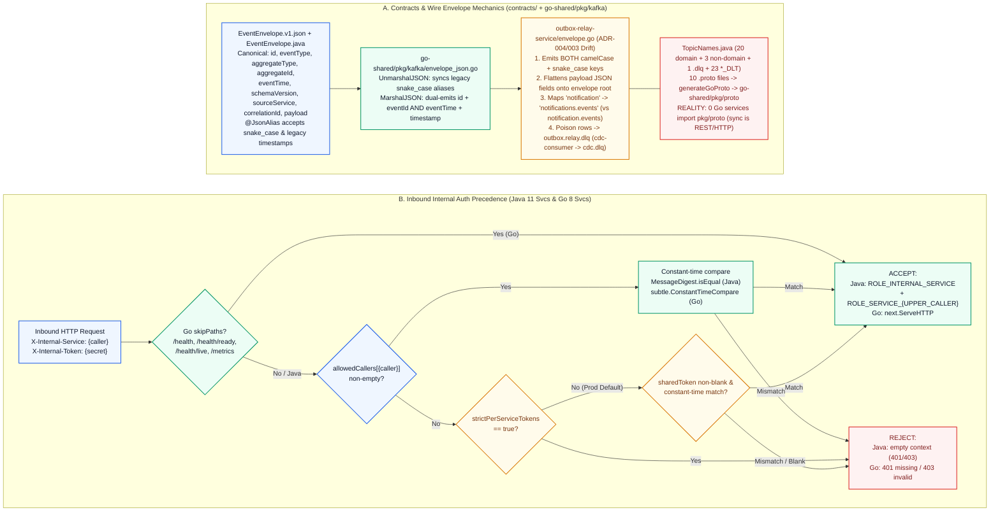
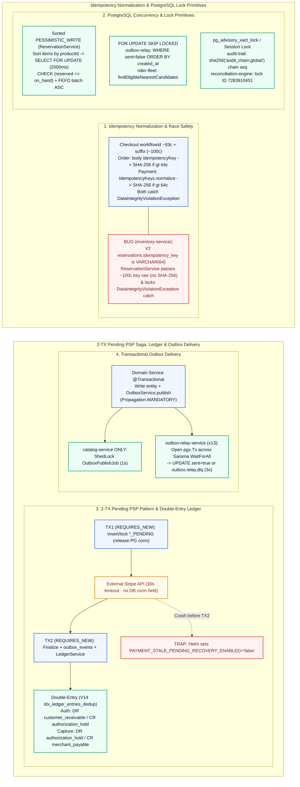
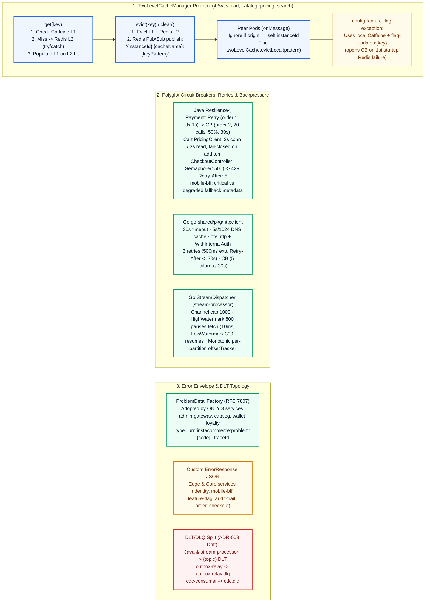

# 02 — InstaCommerce Whole-System Low-Level Design (LLD)

> [!NOTE]
> **Part of the InstaCommerce Onboarding Suite:** [Onboarding Hub](../README.md) · [Code Walkthrough Atlas](./README.md) · [Domain & Event Catalog (`05`)](../05-domain-model-and-event-catalog.md) · [Incident Drills & Exam (`06`)](../06-incident-drills-and-readiness-exam.md) · [Dependency Matrix & Cheatsheet (`07`)](../07-service-dependency-and-command-cheatsheet.md)

> **Reading Goal:** Examine the cross-cutting code primitives shared across all 30 services—wire event envelopes and topic contracts, Java/Go inbound internal-auth filter precedence, idempotency normalization and `VARCHAR(64)` failure modes, PostgreSQL lock ordering, 2-TX pending PSP sagas, `TwoLevelCacheManager` Pub/Sub invalidation, Resilience4j/Go circuit breakers, and RFC 7807 vs. custom error envelopes.

---

## 1. Contracts, Event Envelopes & Protobuf vs. REST Reality

**Wire Contracts, Envelope Bridges & Auth Precedence** — *[Rendered PNG](./diagrams/system/04-lld-contracts-and-auth-internals.png) · [Mermaid Source](./diagrams/system/04-lld-contracts-and-auth-internals.mmd)*

### 1.1 `EventEnvelope.v1.json`, Dual-Emit & `outbox-relay` Payload Flattening

The canonical domain event contract lives in [`EventEnvelope.v1.json`](../../../contracts/src/main/resources/schemas/common/EventEnvelope.v1.json#L1-L52) and [`EventEnvelope.java`](../../../contracts/src/main/java/com/instacommerce/contracts/events/EventEnvelope.java#L17-L43). Although [ADR-004](../../adr/004-event-envelope.md) prescribes camelCase keys, actual serializers and deserializers maintain a deliberate compatibility bridge:

1. **Java Deserialization (`EventEnvelope.java`):** Accepts both camelCase and legacy snake_case keys via `@JsonAlias` (`id` ← `{"eventId", "event_id"}`, `eventTime` ← `{"event_time", "timestamp", "occurred_at", "event_timestamp"}`, `sourceService` ← `{"source_service", "sourceService"}`, `correlationId` ← `{"correlation_id", "correlationId"}`).
2. **Go Shared Codec ([`envelope_json.go`](../../../services/go-shared/pkg/kafka/envelope_json.go#L10-L90)):** `UnmarshalJSON` normalizes legacy snake_case fields (`LegacyEventID`, `LegacyEventTime`, `LegacySourceService`, `LegacyCorrelationID`, etc.), while `MarshalJSON` calls `syncAliases()` and **actively dual-emits** both `id`+`eventId` and `eventTime`+`timestamp`.
3. **Go `outbox-relay-service` Wire Quirks ([`envelope.go`](../../../services/outbox-relay-service/envelope.go#L35-L67), [`#L199-L251`](../../../services/outbox-relay-service/envelope.go#L199-L251)):**
   - `buildEventMessage` writes **both** camelCase and snake_case outer metadata keys (`eventId`/`event_id`, `aggregateType`/`aggregate_type`, `eventTime`/`event_time`, `schemaVersion`/`schema_version`, `sourceService`/`source_service`, `correlationId`/`correlation_id`, plus `id` and `timestamp`).
   - It additionally **flattens** top-level keys from `payload` directly onto the root JSON envelope when those keys do not collide with metadata keys ([`envelope.go#L232-L238`](../../../services/outbox-relay-service/envelope.go#L232-L238)).
   - Its `topicMappings` table routes `"notification"` and `"notifications"` to `"notifications.events"` ([`envelope.go#L62`](../../../services/outbox-relay-service/envelope.go#L62)), whereas [`TopicNames.java`](../../../contracts/src/main/java/com/instacommerce/contracts/topics/TopicNames.java#L25) and `notification-service` expect singular `"notification.events"`.

### 1.2 `TopicNames.java` & `.proto` vs. REST Reality

- [`TopicNames.java`](../../../contracts/src/main/java/com/instacommerce/contracts/topics/TopicNames.java#L18-L80) defines **20** distinct domain `.events` topics (`identity.events` through `delivery.events`, with `ROUTING_EVENTS = DELIVERY_EVENTS` plus `ORDER_EVENTS`/`PAYMENT_EVENTS` aliases = **23** domain constants), **3** non-domain topics (`rider.location.updates`, `rider.geofence.events` — making **21** distinct `.events` topics total — and `payment.webhooks`), **1** `.dlq` constant (`outbox.relay.dlq`), and **23** `*_DLT` constants covering **22** distinct `.DLT` topics enforced by `scripts/consistency_checks.py`.
- `contracts/` compiles **10** `.proto` packages (`cart`, `catalog`, `common`, `fulfillment`, `inventory`, `order`, `payment`, `rider`, `routing`, `wallet`) via `protoc:4.32.0` / `grpc-java:1.75.0` and generates Go stubs into `services/go-shared/pkg/proto` via Gradle `generateGoProto` ([`scripts/generate-proto.sh`](../../../scripts/generate-proto.sh)). **Code reality:** `0` Go services import `pkg/proto`; all synchronous service-to-service traffic in the runtime codebase runs over HTTP/REST.

---

## 2. Internal Service Auth Filter Chains (Java & Go)

Both Java (`libs/platform-common`) and Go (`services/go-shared`) enforce an identical header contract (`X-Internal-Service` and `X-Internal-Token`) with constant-time secret comparison and dual-mode migration support ([ADR-006](../../adr/006-internal-service-auth.md), [ADR-010](../../adr/010-per-service-token-rollout.md), [ADR-012](../../adr/012-per-service-token-scoping.md)):

| Dimension | Java ([`SharedInternalServiceAuthFilter.java`](../../../libs/platform-common/src/main/java/com/instacommerce/platform/security/SharedInternalServiceAuthFilter.java#L30-L116)) | Go ([`middleware.go`](../../../services/go-shared/pkg/auth/middleware.go#L27-L150)) |
|---|---|---|
| **Health/Metrics Bypass** | Handled by Spring `SecurityFilterChain` route matchers (`/actuator/**`) | `skipPaths`: `/health`, `/health/ready`, `/health/live`, `/metrics` |
| **Per-Caller Map Lookup** | `allowedCallers.get(serviceName)` checked first (`MessageDigest.isEqual`) | `allowedCallers[callingService]` parsed from `INTERNAL_SERVICE_ALLOWED_CALLERS` JSON (`subtle.ConstantTimeCompare`) |
| **Strict Mode Rejection** | If caller absent from map and `strictPerServiceTokens == true` → reject | If caller absent from map and `INTERNAL_SERVICE_STRICT_PER_SERVICE == "true"` → `403` |
| **Legacy Shared Fallback** | Compares `sharedToken` if non-blank (`MessageDigest.isEqual`) | Compares `INTERNAL_SERVICE_TOKEN` if non-empty (logs deprecation warning) |
| **Granted Authorities / Response** | Sets `ROLE_INTERNAL_SERVICE` + `ROLE_SERVICE_<UPPER_CALLER>` | Returns `401` (missing headers) or `403` (invalid token) JSON |

**Production Adoption Reality:**
- `SharedInternalServiceAuthFilter` is wired into **11** Java `SecurityConfig` classes (`cart`, `fraud-detection`, `fulfillment`, `identity`, `inventory`, `notification`, `pricing`, `rider-fleet`, `routing-eta`, `wallet-loyalty`, `warehouse`). **5** services use service-local `InternalServiceAuthFilter` implementations granting only `ROLE_INTERNAL_SERVICE` (`audit-trail-service`, `catalog-service`, `config-feature-flag-service`, `order-service`, `payment-service`), where [`audit-trail-service`'s `InternalServiceAuthFilter.java`](../../../services/audit-trail-service/src/main/java/com/instacommerce/audit/security/InternalServiceAuthFilter.java#L39) **does** support `strictPerServiceTokens` (unlike `catalog`, `config-feature-flag`, `order`, and `payment`). The remaining **4** Java services omit internal-token filters (`mobile-bff-service`, `admin-gateway-service`, [`search-service`](../../../services/search-service/src/main/java/com/instacommerce/search/config/SecurityConfig.java#L31-L50), and `checkout-orchestrator-service`).
- Only [`identity-service/application.yml`](../../../services/identity-service/src/main/resources/application.yml) populates `internal.service.allowed-callers`; `strictPerServiceTokens` defaults `false` elsewhere.
- [`checkout-orchestrator-service` `SecurityConfig.java`](../../../services/checkout-orchestrator-service/src/main/java/com/instacommerce/checkout/security/SecurityConfig.java#L27-L43) registers `jwtAuthenticationFilter` and **omits `InternalServiceAuthFilter`**, rejecting internal-token-only requests to `/checkout/dlq/**` with `401`.
- In `libs/platform-common`, strict [`JwtTokenVerifier.java`](../../../libs/platform-common/src/main/java/com/instacommerce/platform/security/JwtTokenVerifier.java) has **`0` consumers** across `services/**`.

---

## 3. Idempotency, Locking, 2-TX Pending PSP & Outbox Patterns

**Idempotency, Locking, 2-TX Pending PSP & Outbox** — *[Rendered PNG](./diagrams/system/05-lld-concurrency-locking-outbox.png) · [Mermaid Source](./diagrams/system/05-lld-concurrency-locking-outbox.mmd)*

### 3.1 `Idempotency-Key` Header vs. JSON Body & the `VARCHAR(64)` Bug

- **Header vs. Body Split:** [`CheckoutController.java`](../../../services/checkout-orchestrator-service/src/main/java/com/instacommerce/checkout/controller/CheckoutController.java#L79-L107) reads the `Idempotency-Key` HTTP header (`checkout-{principal}-{idempotencyKey}`, `~93` chars for UUIDs). In contrast, [`OrderController.java`](../../../services/order-service/src/main/java/com/instacommerce/order/controller/OrderController.java#L50-L67) reads `idempotencyKey` from the JSON `OrderCreateRequest` body, and [`AdminOrderController.java`](../../../services/order-service/src/main/java/com/instacommerce/order/controller/AdminOrderController.java#L46-L56) ignores the `Idempotency-Key` HTTP header sent by checkout Step 9c.
- **SHA-256 Normalization (`> 64` chars) vs. `inventory-service` Bug:**
  - [`OrderCreationService.java`](../../../services/order-service/src/main/java/com/instacommerce/order/service/OrderCreationService.java#L56-L83) and [`IdempotencyKeys.java`](../../../services/payment-service/src/main/java/com/instacommerce/payment/service/IdempotencyKeys.java#L32-L52) deterministically SHA-256 hash keys exceeding `64` characters to 64 lowercase hex characters before lookup/insert, and `OrderCreationService` catches `DataIntegrityViolationException` on `uq_order_idempotency`.
  - **Verified Bug:** [`CheckoutWorkflowImpl.java`](../../../services/checkout-orchestrator-service/src/main/java/com/instacommerce/checkout/workflow/CheckoutWorkflowImpl.java#L142-L143) sends `workflowId + ":inventory:reserve"` (`~100+` chars) to `inventory-service`, whose [`V2__create_reservations.sql`](../../../services/inventory-service/src/main/resources/db/migration/V2__create_reservations.sql#L5) defines `idempotency_key VARCHAR(64)` and [`ReservationService.java`](../../../services/inventory-service/src/main/java/com/instacommerce/inventory/service/ReservationService.java#L107-L147) neither normalizes keys `> 64` chars nor catches `DataIntegrityViolationException` on `uq_reservation_idempotency`.

### 3.2 PostgreSQL Locking Primitives Across Hot Paths

| Mechanism | Service & Symbol | Exact SQL / Locking Semantics |
|---|---|---|
| **Sorted `PESSIMISTIC_WRITE`** | [`ReservationService.java`](../../../services/inventory-service/src/main/java/com/instacommerce/inventory/service/ReservationService.java#L113-L129) | Sorts `items` by `productId` before `LockModeType.PESSIMISTIC_WRITE` (`2000ms` lock timeout) to eliminate AB-BA deadlocks across concurrent multi-item checkouts; guarded by `CHECK (reserved <= on_hand)`. |
| **`FOR UPDATE SKIP LOCKED`** | [`relay.go`](../../../services/outbox-relay-service/relay.go#L55-L63) & [`RiderAssignmentService.java`](../../../services/rider-fleet-service/src/main/java/com/instacommerce/riderfleet/service/RiderAssignmentService.java#L94) | Prevents worker/pod head-of-line lock blocking: `outbox-relay-service` claims `WHERE sent = false ORDER BY created_at LIMIT $1 FOR UPDATE SKIP LOCKED`; `rider-fleet-service` locks eligible nearby riders without blocking concurrent dispatchers. |
| **`pg_advisory_xact_lock` / Advisory Lock** | [`HashChainService.java`](../../../services/audit-trail-service/src/main/java/com/instacommerce/audit/service/HashChainService.java#L40-L57) & [`scheduler.go`](../../../services/reconciliation-engine/pkg/reconciliation/scheduler.go#L17-L43) | `audit-trail-service` serializes global SHA-256 `audit_chain_seq` linking via transaction-scoped `pg_advisory_xact_lock(sha256("audit_chain:audit_events_global_chain"))`; `reconciliation-engine` guards daily batch matching with lock ID `7283910451`. |

### 3.3 2-TX Pending PSP Pattern & Double-Entry Accounting

Holding a PostgreSQL connection open across a `30s` Stripe HTTP call starves HikariCP under PgBouncer (`max_connections=500`). [`PaymentService.java`](../../../services/payment-service/src/main/java/com/instacommerce/payment/service/PaymentService.java#L47-L180) and [`PaymentTransactionHelper.java`](../../../services/payment-service/src/main/java/com/instacommerce/payment/service/PaymentTransactionHelper.java#L41-L120) split each PSP mutation into three phases:

1. **TX1 (`Propagation.REQUIRES_NEW`):** Persist `AUTHORIZE_PENDING` or lock `findByIdForUpdate` and mark `CAPTURE_PENDING`/`VOID_PENDING`, committing immediately to release the DB connection.
2. **External PSP Call (No DB Transaction Held):** `ResilientPaymentGatewayDecorator` invokes `StripePaymentGateway`. Transient errors intentionally leave `*_PENDING` rows intact.
3. **TX2 (`Propagation.REQUIRES_NEW`):** Finalize `AUTHORIZED`/`CAPTURED`/`VOIDED`, write `outbox_events`, and invoke [`LedgerService.recordDoubleEntry`](../../../services/payment-service/src/main/java/com/instacommerce/payment/service/LedgerService.java#L55-L94) (inner `REQUIRES_NEW` protected by `idx_ledger_entries_dedup`) across four ledger accounts:
   - **Authorize:** `DEBIT customer_receivable` / `CREDIT authorization_hold`
   - **Capture:** `DEBIT authorization_hold` / `CREDIT merchant_payable` (`capturedCents`) + `PARTIAL_CAPTURE_RELEASE` (`DEBIT authorization_hold` / `CREDIT customer_receivable` for uncaptured delta)
   - **Void / Failure:** `DEBIT authorization_hold` / `CREDIT customer_receivable`

Similarly, [`WalletService.java`](../../../services/wallet-loyalty-service/src/main/java/com/instacommerce/wallet/service/WalletService.java#L57-L111) locks `wallets` via `SELECT ... FOR UPDATE`, enforces `balance_cents >= 0`, records double-entry `wallet_ledger_entries` (`user_wallet:{userId}` vs. `platform_float` / `merchant_settlement` / `marketing_budget`), and writes `outbox_events`.

### 3.4 Transactional Outbox Delivery Split

[`OutboxService.java`](../../../services/order-service/src/main/java/com/instacommerce/order/service/OutboxService.java#L22-L37) uses `@Transactional(propagation = Propagation.MANDATORY)` so callers can never write an outbox row outside an active local ACID transaction. Only `catalog-service` runs an in-process ShedLock [`OutboxPublishJob.java`](../../../services/catalog-service/src/main/java/com/instacommerce/catalog/service/OutboxPublishJob.java#L29-L50); `pricing`, `cart`, `inventory`, `order`, `payment`, `wallet`, `fraud`, `warehouse`, `fulfillment`, and `rider-fleet` rely on Go [`outbox-relay-service`](../../../services/outbox-relay-service/relay.go#L122-L279), which holds a `pgx.Tx` open across synchronous `sarama.SyncProducer.SendMessage` (`RequiredAcks=WaitForAll`, `Idempotent=true`) before updating `sent = true` or quarantining `>= 3` failures to `outbox.relay.dlq`.

---

## 4. Two-Level Caching, Resilience4j/Go CBs & Error Envelopes

**Two-Level Cache, Circuit Breakers & Error Topology** — *[Rendered PNG](./diagrams/system/06-lld-resilience-and-error-topology.png) · [Mermaid Source](./diagrams/system/06-lld-resilience-and-error-topology.mmd)*

### 4.1 `TwoLevelCacheManager` L1 + L2 + Pub/Sub Protocol

Adopted by **4** Java services (`cart`, `catalog`, `pricing`, `search`), [`TwoLevelCacheManager.java`](../../../libs/platform-common/src/main/java/com/instacommerce/platform/cache/TwoLevelCacheManager.java#L30-L143) and [`TwoLevelCache.java`](../../../libs/platform-common/src/main/java/com/instacommerce/platform/cache/TwoLevelCache.java#L52-L153) coordinate local Caffeine L1, Redis L2, and cluster-wide Pub/Sub invalidation:

1. **Read (`get`):** Checks Caffeine L1 first; on miss, reads `RedisCache` L2 (catching Redis exceptions cleanly so L2 outages degrade rather than crash) and backfills L1 on L2 hit.
2. **Write (`put`):** Populates L1 and Redis L2 **without** publishing Pub/Sub invalidations, preventing self-echo invalidation churn across pods.
3. **Evict (`evict` / `clear`):** Invalidates L1 + Redis L2, then sends `"{instanceId}|{cacheName}:{keyPattern}"` over `StringRedisTemplate.convertAndSend(invalidationChannel, ...)`.
4. **Peer Reception (`onMessage`):** Every pod subscribes via `RedisMessageListenerContainer` (`DisposableBean.destroy` cleans up on shutdown), parses `originIdx = payload.indexOf('|')`, drops messages matching its own UUID `instanceId`, and calls `twoLevelCache.evictLocal(keyPattern)` on all peer pods.

*(Contrast: [`FlagEvaluationService.java`](../../../services/config-feature-flag-service/src/main/java/com/instacommerce/featureflag/service/FlagEvaluationService.java#L31-L84) in `config-feature-flag-service` uses local Caffeine caches directly—NOT `TwoLevelCacheManager`—with custom post-commit `flag-updates:{key}` Pub/Sub.)*

### 4.2 Polyglot Circuit Breakers, Retries & Backpressure

- **Java Resilience4j:**
  - [`ResilientPaymentGatewayDecorator.java`](../../../services/payment-service/src/main/java/com/instacommerce/payment/gateway/ResilientPaymentGatewayDecorator.java#L22-L97) stacks `@Retry(order = 1)` outside `@CircuitBreaker(order = 2)` so retries re-enter the circuit breaker on each attempt, delegating HTTP timeouts to the Stripe SDK rather than unused `resilience4j.timelimiter` YAML.
  - [`PricingClient.java`](../../../services/cart-service/src/main/java/com/instacommerce/cart/client/PricingClient.java#L45-L93) (`2s` connect / `3s` read) wraps lookups in `@CircuitBreaker` + `@Retry` and fails closed on `addItem` (`503 PRICING_UNAVAILABLE`).
  - [`CheckoutController.java`](../../../services/checkout-orchestrator-service/src/main/java/com/instacommerce/checkout/controller/CheckoutController.java#L72-L89) enforces pod-level `Semaphore(1500)` returning `429` + `Retry-After: 5`, while [`ScreenAggregator.java`](../../../services/mobile-bff-service/src/main/java/com/instacommerce/mobilebff/aggregator/ScreenAggregator.java#L98-L148) distinguishes critical (`catalog`, `order`) vs. degradable (`pricing`, `inventory`, `fulfillment`, `routingEta`) circuit breakers.
- **Go Resilience & Backpressure:**
  - [`go-shared/pkg/httpclient/client.go`](../../../services/go-shared/pkg/httpclient/client.go#L134-L160) & [`circuit_breaker.go`](../../../services/go-shared/pkg/httpclient/circuit_breaker.go#L35-L100) provide `30s` HTTP timeout, `5s` / `1024`-entry DNS cache, `3` retries (`500ms` base exponential backoff, honoring `Retry-After <= 30s`), `5`-failure / `30s`-reset CB, `otelhttp`, and `WithInternalAuth`.
  - [`StreamDispatcher`](../../../services/stream-processor-service/processor/stream.go#L29-L110) buffers `1000` messages, pauses Kafka fetch polling every `10ms` at `HighWatermark = 800`, resumes at `LowWatermark = 300`, and commits per-`(topic, partition)` offsets monotonically via `offsetTracker`.

### 4.3 `ProblemDetailFactory` (RFC 7807) vs. Custom Edge Errors

- [`ProblemDetailFactory.java`](../../../libs/platform-common/src/main/java/com/instacommerce/platform/web/ProblemDetailFactory.java#L19-L110) constructs RFC 7807 `application/problem+json` responses (`type: urn:instacommerce:problem:<code>`, `timestamp`, `traceId` resolved from MDC or `X-B3-TraceId`/`X-Trace-Id`/`traceparent`/`X-Request-Id`, and `errors`), **but only `3` services adopt it** (`admin-gateway-service`, `catalog-service`, `wallet-loyalty-service`).
- Edge and core services such as [`identity-service/GlobalExceptionHandler.java`](../../../services/identity-service/src/main/java/com/instacommerce/identity/exception/GlobalExceptionHandler.java#L23-L80), `mobile-bff-service`, `config-feature-flag-service`, and `audit-trail-service` return custom `ErrorResponse` JSON structures, requiring clients and BFF aggregators to normalize error payloads across boundaries.

---

**Previous:** [01 — Whole-System HLD](./01-system-hld.md) | **Atlas Hub:** [Code Walkthrough Atlas](./README.md) | **Next:** [03 — Five E2E Code Flows](./03-system-end-to-end-flows.md)
