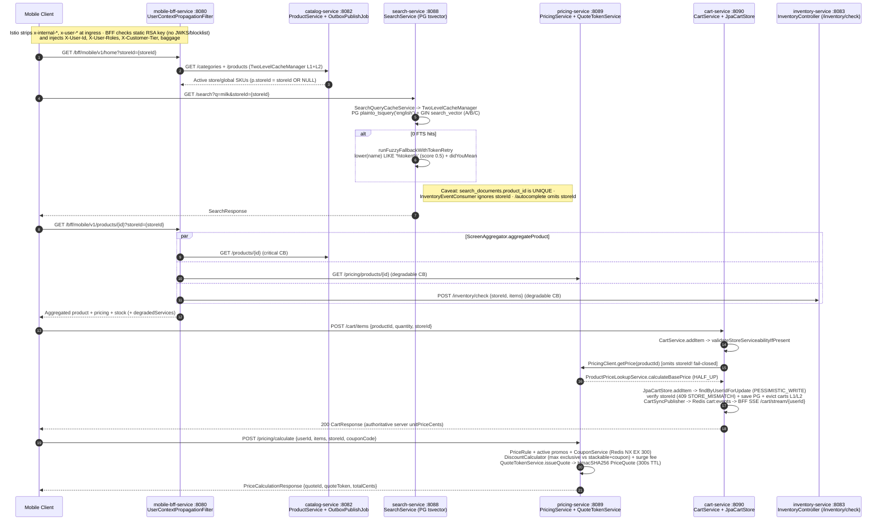
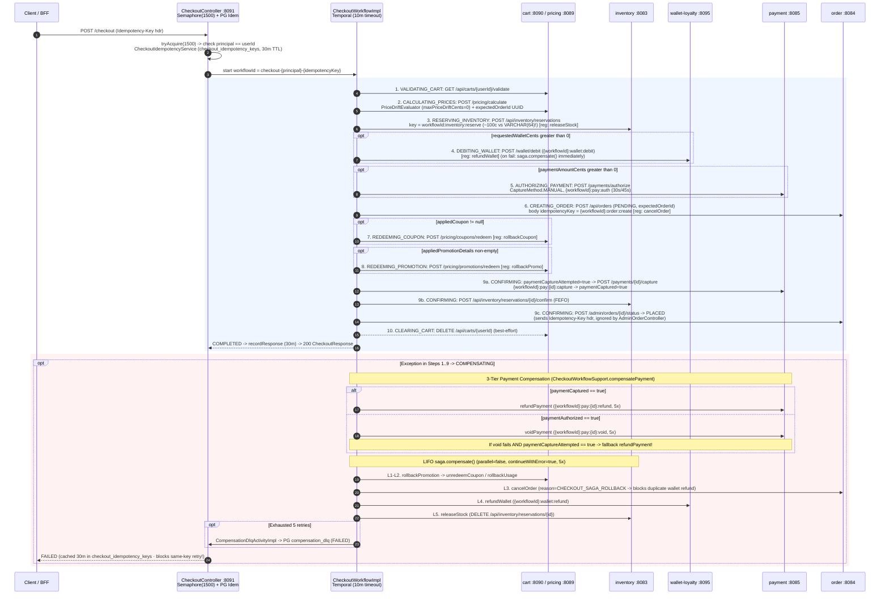
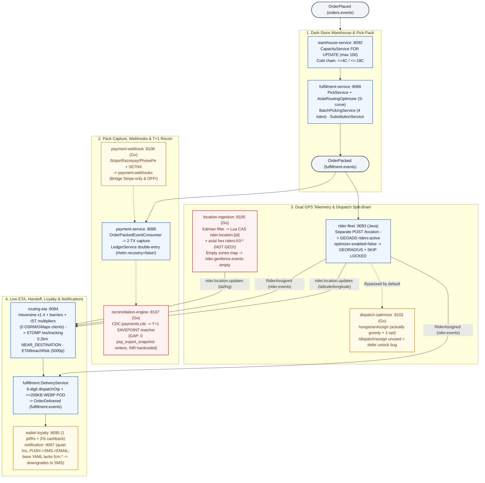
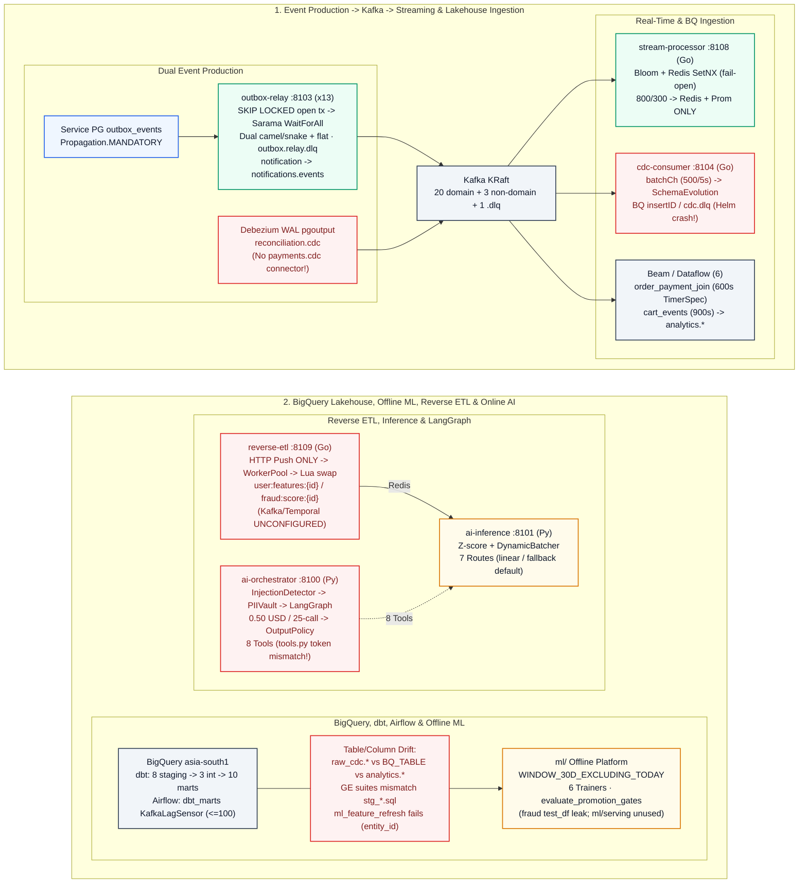
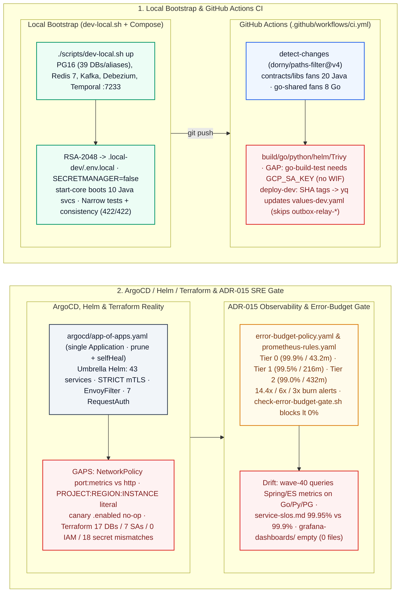

# 03 — InstaCommerce Five End-to-End Code-Level Flows

> [!NOTE]
> **Part of the InstaCommerce Onboarding Suite:** [Onboarding Hub](../README.md) · [Code Walkthrough Atlas](./README.md) · [Domain & Event Catalog (`05`)](../05-domain-model-and-event-catalog.md) · [Incident Drills & Exam (`06`)](../06-incident-drills-and-readiness-exam.md) · [Dependency Matrix & Cheatsheet (`07`)](../07-service-dependency-and-command-cheatsheet.md)

> **Reading Goal:** Trace five complete production journeys across controllers, service classes, exact method names, PostgreSQL tables, Redis keys, Kafka topics, Temporal workflows, BigQuery/dbt pipelines, and GitOps/SRE gates—grounded strictly in verified source files.

---

## Flow 1: Browse → Search → Pricing → Cart → Inventory Check

**Flow 1: Discovery, Search, Pricing, Cart & Stock Check** — *[Rendered PNG](./diagrams/system/07-flow-browse-cart.png) · [Mermaid Source](./diagrams/system/07-flow-browse-cart.mmd)*

1. **Ingress & Mobile BFF Context Propagation (`:8080`):**
   - Istio [`envoy-filter-strip-internal-headers.yaml`](../../../deploy/istio/envoy-filter-strip-internal-headers.yaml#L37-L41) strips inbound `x-internal-*` and `x-user-*` headers at the ingress gateway.
   - [`UserContextPropagationFilter.filter`](../../../services/mobile-bff-service/src/main/java/com/instacommerce/mobilebff/security/UserContextPropagationFilter.java#L44-L118) validates the Bearer JWT via `mobile-bff`'s static RSA public key (note: no JWKS rotation or Redis blocklist check) and mutates downstream headers to inject `X-User-Id`, `X-User-Roles`, `X-Customer-Tier`, `X-Order-Value-Bracket`, and OTel `baggage`.
   - [`MobileBffController.home`](../../../services/mobile-bff-service/src/main/java/com/instacommerce/mobilebff/controller/MobileBffController.java#L57-L64) sanitizes `storeId` (`^[a-zA-Z0-9_-]{1,64}$`) and calls `HomeAggregator.aggregate`.
2. **Dark-Store Scoped Catalog (`catalog-service`, `:8082`):**
   - `ProductRepository.findActiveByOptionalCategoryAndStore` filters `(p.storeId = :storeId OR p.storeId IS NULL)` over `products` and `categories` (materialized `path`, `depth <= 5`), cached via `TwoLevelCacheManager` (`catalog:` Redis L2 + Caffeine L1 + Pub/Sub `catalog:cache:invalidate`).
   - Catalog writes append `ProductChangedEvent` into `outbox_events` (`Propagation.MANDATORY`), relayed every `1s` by ShedLock [`OutboxPublishJob.publishPendingEvents`](../../../services/catalog-service/src/main/java/com/instacommerce/catalog/service/OutboxPublishJob.java#L29-L50) to `TopicNames.CATALOG_EVENTS` (`catalog.events`).
3. **PostgreSQL FTS Search (`search-service`, `:8088`):**
   - [`SearchService.search`](../../../services/search-service/src/main/java/com/instacommerce/search/service/SearchService.java#L47-L64) delegates to `SearchQueryCacheService.executeSearch` (`TwoLevelCacheManager` `search:` L2 + Pub/Sub `search:cache:invalidate`).
   - Queries run `plainto_tsquery('english', :query)` against `search_documents.search_vector` (GIN-indexed weighted `TSVECTOR` maintained by trigger `trg_search_documents_vector`), falling back on zero hits to `lower(name) LIKE '%token%'` (score `0.5`) with `didYouMean`.
   - **Code Reality Caveat:** `search_documents.product_id` is `UNIQUE`, `InventoryEventConsumer` ignores `storeId` when toggling `in_stock`, and [`SearchService.autocomplete`](../../../services/search-service/src/main/java/com/instacommerce/search/service/SearchService.java#L71-L73) omits `storeId`.
4. **Product Detail Fan-Out (`mobile-bff-service` → `catalog`, `pricing`, `inventory`):**
   - [`ScreenAggregator.aggregateProduct`](../../../services/mobile-bff-service/src/main/java/com/instacommerce/mobilebff/aggregator/ScreenAggregator.java#L89-L149) fans out in parallel (`Mono.zip`) across `GET /products/{id}` (critical CB), `GET /pricing/products/{id}` (degradable CB), and `POST /inventory/check` with `{storeId, items}` (degradable CB).
5. **Cart Mutation & Authoritative Pricing (`cart-service`, `:8090` → `pricing-service`, `:8089`):**
   - [`CartService.addItem`](../../../services/cart-service/src/main/java/com/instacommerce/cart/service/CartService.java#L60-L81) ignores client prices and calls [`PricingClient.getPrice`](../../../services/cart-service/src/main/java/com/instacommerce/cart/client/PricingClient.java#L60-L83) (`@CircuitBreaker` + `@Retry` over `GET /pricing/products/{productId}`—note it **omits `storeId`**, whereas [`PricingService.calculatePrice(productId, storeId)`](../../../services/pricing-service/src/main/java/com/instacommerce/pricing/service/PricingService.java#L67-L75) applies store surge only when `storeId` is supplied).
   - `JpaCartStore.addItem` (PostgreSQL is the sole `CartStore`) acquires `findByUserIdForUpdate` (`PESSIMISTIC_WRITE`), enforces single-store consistency (`409 STORE_MISMATCH`), persists `carts` + `cart_items` + `outbox_events`, evicts `@Cacheable("carts")` (`TwoLevelCacheManager`), and emits `CartSyncPublisher` messages to Redis `cart:events` consumed by `mobile-bff` SSE `GET /cart/stream/{userId}`.
6. **Cart Pricing & HMAC `PriceQuote` (`pricing-service`, `:8089`):**
   - [`PricingService.calculateCartPrice`](../../../services/pricing-service/src/main/java/com/instacommerce/pricing/service/PricingService.java#L114-L170) evaluates `PriceRule`s (`HALF_UP`), selects max savings between best exclusive promotion vs. best stackable promotion + coupon, adds surge delivery fee (`3000 * surgeMultiplier`), and issues a `300s` `PriceQuote` signed with `HmacSHA256` (`quoteToken`).

---

## Flow 2: 10-Step Temporal Checkout Saga, 3-Tier LIFO Compensation & DLQ

**Flow 2: 10-Step Temporal Checkout Saga & LIFO Unwind** — *[Rendered PNG](./diagrams/system/08-flow-checkout-saga.png) · [Mermaid Source](./diagrams/system/08-flow-checkout-saga.mmd)*

1. **Admission & Temporal Launch (`checkout-orchestrator-service`, `:8091`):**
   - [`CheckoutController.initiateCheckout`](../../../services/checkout-orchestrator-service/src/main/java/com/instacommerce/checkout/controller/CheckoutController.java#L75-L147) acquires `Semaphore(1500)` (`429 Retry-After: 5` under flash bursts), checks `principal.equals(request.userId())`, looks up `principal + ":" + idempotencyKey` in `checkout_idempotency_keys` (`30m` TTL), and starts Temporal workflow `checkout-{principal}-{idempotencyKey}` (`10m` execution timeout) on `CHECKOUT_ORCHESTRATOR_TASK_QUEUE`.
   - Note: `order-service` [`LegacyCheckoutController`](../../../services/order-service/src/main/java/com/instacommerce/order/controller/LegacyCheckoutController.java#L17-L25) returns `410 GONE` (`CHECKOUT_MOVED`); Temporal SDK was removed from `order-service`.
2. **10 Forward Steps Inside [`CheckoutWorkflowImpl.checkout`](../../../services/checkout-orchestrator-service/src/main/java/com/instacommerce/checkout/workflow/CheckoutWorkflowImpl.java#L100-L278):**
   - **Step 1 (`VALIDATING_CART`):** `GET /api/carts/{userId}/validate` (`10s`, `3x`) ensures non-empty cart, positive quantities, and refreshed prices.
   - **Step 2 (`CALCULATING_PRICES`):** `POST /pricing/calculate` (`10s`, `3x`); `PriceDriftEvaluator.evaluate` aborts if `actualTotal - expectedTotal > maxPriceDriftCents` (default `0`); [`CheckoutWorkflowSupport.deterministicOrderId`](../../../services/checkout-orchestrator-service/src/main/java/com/instacommerce/checkout/workflow/CheckoutWorkflowSupport.java#L75-L77) computes `UUID.nameUUIDFromBytes("order-" + workflowId)`.
   - **Step 3 (`RESERVING_INVENTORY`):** `POST /api/inventory/reservations` (`15s`, `3x`, non-retry `InsufficientStockException`) passes `workflowId + ":inventory:reserve"` into [`ReservationService.reserve`](../../../services/inventory-service/src/main/java/com/instacommerce/inventory/service/ReservationService.java#L93-L147) (which sorts by `productId`, acquires `PESSIMISTIC_WRITE`, writes `PENDING` `5m` reservation + `StockReserved` outbox) and registers `safeReleaseStock`. *(Trap: `reservations.idempotency_key` in [`V2__create_reservations.sql`](../../../services/inventory-service/src/main/resources/db/migration/V2__create_reservations.sql#L5) is `VARCHAR(64)` vs. `~100`-char Temporal key!)*
   - **Step 4 (`DEBITING_WALLET`):** If `requestedWalletCents > 0`, calls `POST /wallet/debit` (`{workflowId}:wallet:debit`) → [`WalletService.debit`](../../../services/wallet-loyalty-service/src/main/java/com/instacommerce/wallet/service/WalletService.java#L82-L111) (`SELECT ... FOR UPDATE`, double-entry `wallet_ledger_entries`, `WalletDebited` outbox). On decline, runs `saga.compensate()` immediately; else registers `safeRefundWallet`.
   - **Step 5 (`AUTHORIZING_PAYMENT`):** If `paymentAmountCents > 0`, calls `POST /payments/authorize` (`30s`, `scheduleToClose=45s`, `3x`, `{workflowId}:pay:auth`, `CaptureMethod.MANUAL`) → [`PaymentService.authorize`](../../../services/payment-service/src/main/java/com/instacommerce/payment/service/PaymentService.java#L52-L87) (2-TX `AUTHORIZE_PENDING` → Stripe → `AUTHORIZED` + `LedgerService`).
   - **Step 6 (`CREATING_ORDER`):** `POST /api/orders` (`{workflowId}:order:create`) → [`OrderController.createOrder`](../../../services/order-service/src/main/java/com/instacommerce/order/controller/OrderController.java#L39-L77) → [`OrderCreationService.createOrder`](../../../services/order-service/src/main/java/com/instacommerce/order/service/OrderCreationService.java#L55-L84) (SHA-256 normalizes keys `>64` chars, validates quote via `RestPricingQuoteClient`, commits `Order(PENDING)` + `outbox_events` atomically) and registers `safeCancelOrder`.
   - **Steps 7–8 (`REDEEMING_COUPON` / `REDEEMING_PROMOTION`):** Redeems coupon (`POST /pricing/coupons/redeem` with Redis `NX EX 300` + `PESSIMISTIC_WRITE`) and each applied promotion (`POST /pricing/promotions/redeem`), registering `safeRollbackCoupon` / `safeRollbackPromotion`.
   - **Step 9 (`CONFIRMING`):** **(9a)** Sets `paymentCaptureAttempted = true` → `POST /payments/{id}/capture` (`{workflowId}:pay:{id}:capture`) → sets `paymentCaptured = true`; **(9b)** `POST /api/inventory/reservations/{id}/confirm` (FEFO `expiry_date ASC` deduction, `on_hand -= qty; reserved -= qty`); **(9c)** `POST /admin/orders/{id}/status` → `PLACED` via [`AdminOrderController.updateStatus`](../../../services/order-service/src/main/java/com/instacommerce/order/controller/AdminOrderController.java#L46-L56) (which ignores the `Idempotency-Key` header).
   - **Step 10 (`CLEARING_CART`):** Best-effort `DELETE /api/carts/{userId}` (`clearCartSafely` swallows exceptions) → returns `COMPLETED` cached in `checkout_idempotency_keys` (`30m` TTL).
3. **Failure, 3-Tier Payment Compensation, LIFO Unwind & DLQ:**
   - Any exception enters `COMPENSATING`. First, [`CheckoutWorkflowSupport.compensatePayment`](../../../services/checkout-orchestrator-service/src/main/java/com/instacommerce/checkout/workflow/CheckoutWorkflowSupport.java#L126-L165) executes 3-tier recovery (`5x` retries): `refundPayment` if `paymentCaptured`, else `voidPayment`—and if `voidPayment` fails when `paymentCaptureAttempted == true`, falls back to `refundPayment`.
   - Next, `saga.compensate()` (`parallelCompensation=false, continueWithError=true`, `5x` retries) unwinds LIFO: `rollbackPromotion` → `unredeemCoupon`/`rollbackUsage` → `cancelOrder(reason="CHECKOUT_SAGA_ROLLBACK")` (preventing double wallet refund in `wallet-loyalty-service`) → `refundWallet` → `releaseStock`.
   - Exhausting 5 retries inserts into `compensation_dlq` (`FAILED`) for replay via `POST /checkout/dlq/{id}/retry` (note: [`checkout-orchestrator-service/SecurityConfig.java`](../../../services/checkout-orchestrator-service/src/main/java/com/instacommerce/checkout/security/SecurityConfig.java#L27-L43) omits `InternalServiceAuthFilter`, and `CheckoutController` caches `FAILED` responses for `30m`, blocking same-key retries).

---

## Flow 3: Fulfillment, `OrderPacked` Capture, Dual GPS/Dispatch Split-Brain, ETA, Notify & T+1 Recon

**Flow 3: Fulfillment, GPS/Dispatch Split-Brain, ETA & Money** — *[Rendered PNG](./diagrams/system/09-flow-fulfillment-logistics-money.png) · [Mermaid Source](./diagrams/system/09-flow-fulfillment-logistics-money.mmd)*

1. **Dark-Store Slot, Pick-Pack & `OrderPacked` (`warehouse` `:8092`, `fulfillment` `:8086`):**
   - `OrderPlaced` (`orders.events`) triggers [`PickService.createPickTask`](../../../services/fulfillment-service/src/main/java/com/instacommerce/fulfillment/service/PickService.java#L81-L111) (S-curve serpentine ordering via `AisleRoutingOptimizer`, 4-tote batching via `BatchPickingService`), while [`CapacityService.acquireOrderSlot`](../../../services/warehouse-service/src/main/java/com/instacommerce/warehouse/service/CapacityService.java#L94-L139) locks `stores` `FOR UPDATE` (`maxConcurrentOrders=100`) and `StagingTelemetryService` monitors `CHILLED <= 4.00°C` / `FROZEN <= -18.00°C`.
   - Packing emits `OrderPacked` (`fulfillment.events`) plus optional HTTP status callback (`PACKED`) to `order-service`.
2. **Pack-Triggered Capture, Webhooks & T+1 Reconciliation (`payment` `:8085`, `payment-webhook` `:8106`, `reconciliation-engine` `:8107`):**
   - [`OrderPackedEventConsumer.onFulfillmentEvent`](../../../services/payment-service/src/main/java/com/instacommerce/payment/consumer/OrderPackedEventConsumer.java#L52-L97) locks `findByOrderIdForUpdate(orderId)` and calls `paymentService.capture` for `fulfilledAmountCents` if still `AUTHORIZED` (releasing uncaptured holds in `LedgerService`). Note that Helm `values.yaml` / `values-prod.yaml` set `PAYMENT_STALE_PENDING_RECOVERY_ENABLED="false"` and `PAYMENT_CHOREOGRAPHY_ORDER_CANCELLED_CONSUMER_ENABLED="false"`.
   - [`WebhookHandler.handlePSP`](../../../services/payment-webhook-service/handler/webhook.go#L82-L98) verifies Stripe, Razorpay, and PhonePe signatures, deduplicates in Redis (`SETNX ... EX 24h`), and emits v2 `WebhookTransportEvent` to `payment.webhooks`. However, `payment-service`'s `PaymentWebhookEventConsumer` is disabled by default and [`WebhookKafkaBridge.forward`](../../../services/payment-service/src/main/java/com/instacommerce/payment/consumer/WebhookKafkaBridge.java#L61-L100) skips non-Stripe PSPs (`SKIPPED_UNSUPPORTED_PSP`).
   - [`DBReconciler.ReconcileRange`](../../../services/reconciliation-engine/pkg/reconciliation/reconciler.go#L51-L169) matches `payment_ledger` (`payments.cdc`) against `psp_export_snapshot` using per-row `SAVEPOINT mismatch_sp` (`AutoFixed` `<= 2c` / `<= 100c & 5%`, else `ManualReview`). **Gap:** `0` non-test writers populate `psp_export_snapshot`, `reconciliation_outbox` is unused, and `ApplyFix` hardcodes `'INR'`.
3. **Dual GPS Ingestion & Dispatch Split-Brain (`location-ingestion` `:8105` vs. `rider-fleet` `:8093` vs. `dispatch-optimizer` `:8102`):**
   - **Go GPS Telemetry:** [`location-ingestion-service/config.go`](../../../services/location-ingestion-service/config.go#L25-L26) + [`store/redis.go`](../../../services/location-ingestion-service/store/redis.go#L27-L53) Kalman-smooth pings, run Lua CAS (`timestamp_ms > existing`) on `rider:location:<riderID>` (`10m` TTL) + custom axial hex sets `riders:h3:<h3_index>` (**not** Redis GEO), and batch `rider.location.updates` (`lat`/`lng`/`timestamp_ms`). Because [`main.go`](../../../services/location-ingestion-service/main.go#L99) initializes `GeofenceChecker` with an empty `zones` map, `rider.geofence.events` emits zero events at runtime.
   - **Java GPS & Primary Dispatch:** [`RiderAvailabilityService.updateLocation`](../../../services/rider-fleet-service/src/main/java/com/instacommerce/riderfleet/service/RiderAvailabilityService.java#L102-L141) separately writes `GEOADD riders:active` + `rider:location:<riderId>` (no Lua CAS/TTL) and publishes `latitude`/`longitude`/`timestamp` to `rider.location.updates`. Under default `rider-fleet.dispatch.optimizer-enabled: false`, [`RiderAssignmentService.assignRider`](../../../services/rider-fleet-service/src/main/java/com/instacommerce/riderfleet/service/RiderAssignmentService.java#L98-L170) queries `GEORADIUS riders:active` + `FOR UPDATE SKIP LOCKED`, bypassing `dispatch-optimizer-service` (whose [`hungarianAssign`](../../../services/dispatch-optimizer-service/optimizer/routing.go#L83-L148) actually implements greedy sorted-edge assignment + 1-opt relocation, while `/dispatch/assign` is unused and releases its Redis lock in `defer`).
4. **Live ETA, Delivery Handoff, Loyalty & Notifications (`routing-eta` `:8094`, `fulfillment` `:8086`, `wallet-loyalty` `:8095`, `notification` `:8087`):**
   - [`ETAService.calculateETAWithConfidence`](../../../services/routing-eta-service/src/main/java/com/instacommerce/routing/service/ETAService.java#L92-L135) calculates `Haversine * 1.4` + `routing_barriers` detours + IST speed multipliers + traffic/weather + `3m` prep + dwell (with **0** OSRM/Google Maps clients), broadcasts STOMP `/ws/tracking`, and emits `ETABreachRisk` (`5000` paise).
   - [`DeliveryService.syncRiderAssignment`](../../../services/fulfillment-service/src/main/java/com/instacommerce/fulfillment/service/DeliveryService.java#L92-L157) generates a 6-digit `dispatchOtp`, verifies handoff + `<= 200KB` masked WEBP POD, and emits `OrderDelivered` (`fulfillment.events`), triggering loyalty points/cashback in `wallet-loyalty-service` and 7-topic notification fanout split across [`NotificationEventConsumer`](../../../services/notification-service/src/main/java/com/instacommerce/notification/consumer/NotificationEventConsumer.java#L26-L72) (**6** topics: `orders.events`, `payments.events`, `fulfillment.events`, `delivery.events`, `rider.events`, `wallet.events`) and [`IdentityEventConsumer`](../../../services/notification-service/src/main/java/com/instacommerce/notification/consumer/IdentityEventConsumer.java#L37-L53) (the 7th topic, `identity.events`, handling `UserErased` GDPR anonymization and `AccountLocked` alerts; `PUSH -> SMS -> EMAIL` fallback, noting missing base `notification.providers.fcm.*` causes `prod` fallback to `SMS`).

---

## Flow 4: Event Backbone, Streaming, Lakehouse, ML, Reverse ETL & AI LangGraph

**Flow 4: Outbox/Debezium, Stream/BQ/dbt, ML & LangGraph** — *[Rendered PNG](./diagrams/system/10-flow-event-data-ml-ai.png) · [Mermaid Source](./diagrams/system/10-flow-event-data-ml-ai.mmd)*

1. **Outbox Relay & Debezium WAL CDC (`outbox-relay` `:8103`, Debezium `:18083`):**
   - [`relayService.relayBatch`](../../../services/outbox-relay-service/relay.go#L122-L279) polls `outbox_events` (`FOR UPDATE SKIP LOCKED`), holds `pgx.Tx` open across synchronous `sarama.SyncProducer.SendMessage` (`WaitForAll`, `Idempotent=true`, partition key = `AggregateID`), dual-emits camelCase/snake_case + flattened payload keys ([`envelope.go`](../../../services/outbox-relay-service/envelope.go#L199-L251)), maps `"notification"` → `"notifications.events"`, and quarantines `>= 3` failures to `outbox.relay.dlq`. Debezium separately streams `reconciliation_runs` / `reconciliation_mismatches` WAL to `reconciliation.cdc` (no `payments.cdc` connector exists in `infra/terraform/`).
2. **Real-Time Stream & BigQuery Ingestion (`stream-processor` `:8108`, `cdc-consumer` `:8104`, Beam):**
   - `stream-processor` consumes 8 singular+plural topics through Bloom + fail-open Redis `SetNX` dedup into [`StreamDispatcher`](../../../services/stream-processor-service/processor/stream.go#L29-L110) (`1000` cap, `800`/`300` watermarks, monotonic `offsetTracker`, `.DLT`), writing strictly to Redis + Prometheus (no BigQuery sink).
   - [`cdc-consumer-service/consumer.go`](../../../services/cdc-consumer-service/consumer.go#L120-L138) batches into BigQuery (`insertID = {topic}-{partition}-{offset}`, `SchemaEvolutionHandler`, `cdc.dlq`), though [`config.go`](../../../services/cdc-consumer-service/config.go#L51-L74) exits under default Helm due to missing `KAFKA_BROKERS`/`KAFKA_TOPICS`/`BQ_*` env vars. Six Beam pipelines write `analytics.*`.
3. **dbt Lakehouse, Airflow & Offline ML (`data-platform/`, `ml/`):**
   - BigQuery dbt layers `8` staging views → `3` intermediate → `10` marts (including incremental [`mart_order_fulfillment.sql`](../../../data-platform/dbt/models/marts/mart_order_fulfillment.sql#L1-L30)), scheduled by Airflow [`dbt_marts.py`](../../../data-platform/airflow/dags/dbt_marts.py#L47-L100) behind `ExternalTaskSensor` + `KafkaLagSensor` (`max_lag=100`). *Broken seams:* `dbt` `raw_cdc.*` vs. `cdc-consumer` single table vs. Beam `analytics.*`; GE suites mismatch `stg_*.sql`; `ml_feature_refresh.py` expects `entity_id`/`_updated_at` missing from `ml/feature_store/sql/*.sql`.
   - [`feature_definitions.py`](../../../ml/features/feature_definitions.py#L21-L39) enforces `[T-30d, T-1d]` `WINDOW_30D_EXCLUDING_TODAY` parity, while [`metrics.py`](../../../ml/eval/metrics.py) enforces fail-closed promotion and `>= 0.8` disparate-impact gates (`ml/serving/` is unused).
4. **Reverse ETL, Inference & LangGraph (`reverse-etl` `:8109`, `ai-inference` `:8101`, `ai-orchestrator` `:8100`):**
   - [`reverse-etl-orchestrator/worker.go`](../../../services/reverse-etl-orchestrator/internal/subscription/worker.go#L14-L33) accepts HTTP JSON `POST` pushes (`Kafka`/`Temporal`/`BigQuery` unconfigured) and atomically swaps `user:features:{id}` (`36h`), `fraud:score:{id}` (`36h`), and `store:inventory:{id}` (`24h`) via Lua `RENAME` + `PEXPIRE`.
   - [`serve_inference_request`](../../../services/ai-inference-service/app/core/inference.py#L823-L891) defaults to linear weights / `_rule_based_fallback` (`ManagedOnnxSession` mock mode when artifact dirs are empty).
   - [`ai-orchestrator-service/graph.py`](../../../services/ai-orchestrator-service/app/graph/graph.py#L1-L69) executes `classify_intent -> check_policy -> retrieve_context -> execute_tools -> respond -> validate_output` (`escalate` branch on policy/output failure) wrapped by `InjectionDetector`, `PIIVault`, `0.50 USD` / `25`-call Redis budget, and SSRF/BOLA-checked [`ToolRegistry.call`](../../../services/ai-orchestrator-service/app/graph/tools.py#L170-L242)—whose [`Settings`](../../../services/ai-orchestrator-service/app/config.py#L8-L48) prefix (`AI_ORCHESTRATOR_INTERNAL_SERVICE_TOKEN`) mismatches Helm's `INTERNAL_SERVICE_TOKEN`.

---

## Flow 5: Local `dev-local.sh` → CI → ArgoCD → Helm/Istio & ADR-015 Burn Rates

**Flow 5: Local dev-local.sh -> CI -> ArgoCD -> ADR-015 SLOs** — *[Rendered PNG](./diagrams/system/11-flow-dev-to-prod-gitops.png) · [Mermaid Source](./diagrams/system/11-flow-dev-to-prod-gitops.mmd)*

1. **Local Bootstrap ([`scripts/dev-local.sh`](../../../scripts/dev-local.sh#L55-L140)):**
   - `./scripts/dev-local.sh up` boots `docker-compose.yml` (`postgres:16-alpine` with **`39`** DBs/aliases defined in [`scripts/init-dbs.sql`](../../../scripts/init-dbs.sql#L13-L57) and [`scripts/dev-local.sh`](../../../scripts/dev-local.sh#L138-L144), `redis:7-alpine`, `cp-kafka:7.5.0` KRaft, `debezium/connect:2.4`, `temporalio/auto-setup:1.24.2` + UI, `kafka-ui`), generates ephemeral RSA-2048 keys rendered as single-line base64 DER into `.local-dev/.env.local`, sets `SPRING_CLOUD_GCP_SECRETMANAGER_ENABLED=false` (so `${sm://...}` placeholders fall back to local env vars), runs Go migrations, creates Temporal namespaces `instacommerce` and `reverse-etl`, and supports `start-core` for the `10` core Java services.
2. **Pre-PR Validation & Consistency Gate ([`scripts/check-monorepo-consistency.sh`](../../../scripts/check-monorepo-consistency.sh#L60-L240)):**
   - Engineers run narrow stack tests (`./gradlew :services:<svc>:test`, `go test -race ./...`, `.venv/bin/pytest`) plus `bash scripts/check-monorepo-consistency.sh --strict-docs` (`422/422` checks across CI filters, `43` Helm/Istio policies, toolchains, Flyway outbox sequential versions, ports/`CODEOWNERS`, contracts/Docker/ArgoCD, `.agents` parity, dbt refs, and doc regexes).
3. **CI Pipeline & GitOps Deploy ([`.github/workflows/ci.yml`](../../../.github/workflows/ci.yml#L823-L892)):**
   - `detect-changes` (`dorny/paths-filter@v4`) fans out all 20 Java services on `contracts/**` or `libs/**` changes and all 8 Go services on `services/go-shared/**` changes. Note `go-build-test` relies on `secrets.GCP_SA_KEY` without WIF.
   - On `main`/`master`, `deploy-dev` translates the 5 shortened Go Helm keys (`go_service_to_helm`), updates `.services["<helm_key>"].tag` in `deploy/helm/values-dev.yaml` with `yq`, and commits `[skip ci]` (skipping the 13 `outbox-relay-*` entries absent from `values-dev.yaml`).
4. **ArgoCD, Helm, Istio & Terraform Reality:**
   - `argocd/app-of-apps.yaml` syncs `deploy/helm` (`prune: true`, `selfHeal: true`), deploying `43` services under Istio `STRICT` mTLS, `EnvoyFilter`, `7` `RequestAuthentication`s, and `NetworkPolicy` (noting `port: metrics` vs. `name: http` scrape block, literal `PROJECT:REGION:INSTANCE`, canary `.enabled` no-op, and Terraform's `17` DBs / `7` SAs / `0` IAM bindings / `18` mismatched secrets).
5. **ADR-015 Multi-Window Burn Rates & Error-Budget Release Gate:**
   - [`monitoring/error-budget-policy.yaml`](../../../monitoring/error-budget-policy.yaml#L4-L87) and `monitoring/prometheus-rules.yaml` enforce Tier 0 (`99.9%` / `43.2m`), Tier 1 (`99.5%` / `216m`), and Tier 2 (`99.0%` / `432m`) with `14.4x` (5m+1h `page`), `6x` (30m+6h), and `3x` (1h `ticket`) alerts routed via `monitoring/alertmanager.yml`, and `scripts/check-error-budget-gate.sh` blocks promotion below `0%` budget remaining (noting `wave-40-complete-slo-alerts.yml` metric drift and empty `docs/observability/grafana-dashboards/`).

---

**Previous:** [02 — Whole-System LLD](./02-system-lld.md) | **Atlas Hub:** [Code Walkthrough Atlas](./README.md) | **Next:** [Contracts & Proto](./components/contracts-and-proto.md)
