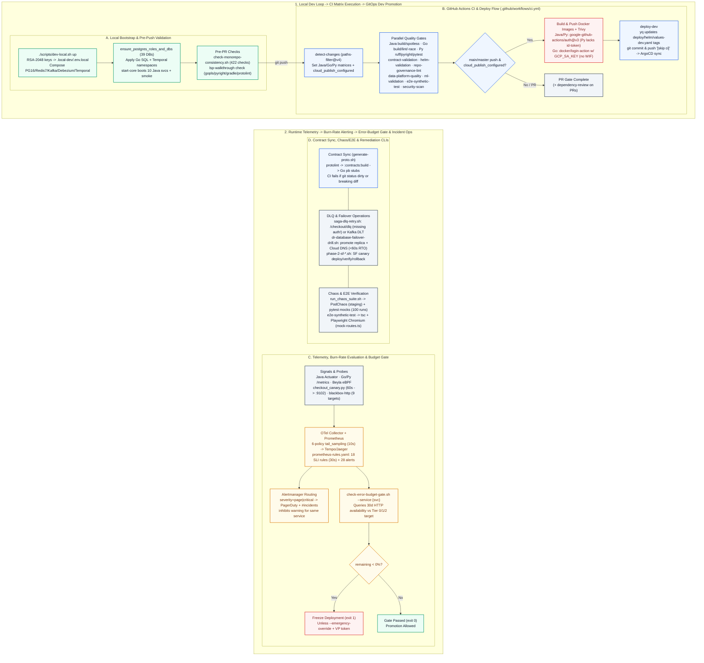

# Component 7: CI/CD Pipelines, Workspace Toolchains, Observability Stack, Developer Scripts & Test Harnesses

> [!NOTE]
> **Part of the InstaCommerce Onboarding Suite:** [Onboarding Hub](../../README.md) · [Code Walkthrough Atlas](../README.md) · [Domain & Event Catalog (`05`)](../../05-domain-model-and-event-catalog.md) · [Incident Drills & Exam (`06`)](../../06-incident-drills-and-readiness-exam.md) · [Dependency Matrix & Cheatsheet (`07`)](../../07-service-dependency-and-command-cheatsheet.md)

> **Scope:** Build, governance, CI/CD, runtime telemetry, SLO burn-rate alerting, developer bootstrap scripts, and verification harnesses spanning `.github/`, root build manifests, `monitoring/`, `prometheus/`, `docs/slos/`, `docs/adr/015-slo-error-budget-policy.md`, `argocd/applications/monitoring*.yaml`, `scripts/`, and `tests/`.

| Attribute | Source of Truth | Key Facts |
| :--- | :--- | :--- |
| **Root Build Toolchains** | [build.gradle.kts](../../../../build.gradle.kts#L1-L133), [settings.gradle.kts](../../../../settings.gradle.kts#L1-L31), [go.work](../../../../go.work#L1-L13), [pyproject.toml](../../../../pyproject.toml#L1-L20), [pyrightconfig.json](../../../../pyrightconfig.json#L1-L88) | Java 21 / Spring Boot `4.0.0` (22 Gradle modules), Go `1.25.0` (9 modules), Python `3.12` (Ruff + Pyright standard mode across 8 include roots) |
| **CI/CD & Security** | [.github/workflows/ci.yml](../../../../.github/workflows/ci.yml#L1-L892), [codeql.yml](../../../../.github/workflows/codeql.yml#L1-L105), [dependabot.yml](../../../../.github/dependabot.yml#L1-L158), [CODEOWNERS](../../../../.github/CODEOWNERS#L1-L179) | `dorny/paths-filter@v4` dynamic matrices, Trivy + Gitleaks + Dependency Review + CodeQL, `deploy-dev` via `yq` on `values-dev.yaml` |
| **Telemetry & Probing** | [otel-collector.yaml](../../../../deploy/helm/templates/observability/otel-collector.yaml#L1-L176), [ebpf-network-profiler.yaml](../../../../deploy/helm/templates/observability/ebpf-network-profiler.yaml#L1-L70), [prometheus.yml](../../../../monitoring/prometheus.yml#L1-L49), [checkout_canary.py](../../../../monitoring/synthetics/checkout_canary.py#L1-L229) | OTel Collector (`:4317`/`:4318`) with 6-policy `tail_sampling`, Beyla eBPF DaemonSet, Blackbox HTTP (`9` targets) / gRPC (`0` targets), 4-step synthetic checkout canary (`:9102`) |
| **SLOs & Alerting** | [015-slo-error-budget-policy.md](../../../../docs/adr/015-slo-error-budget-policy.md#L1-L236), [service-slos.md](../../../../docs/slos/service-slos.md#L1-L246), [error-budget-policy.yaml](../../../../monitoring/error-budget-policy.yaml#L1-L87), [prometheus-rules.yaml](../../../../monitoring/prometheus-rules.yaml#L1-L522), [wave-40-complete-slo-alerts.yml](../../../../prometheus/rules/wave-40-complete-slo-alerts.yml#L1-L798) | 3-tier budgets (`99.9%` / `99.5%` / `99.0%`), `18` SLI recording rules + `28` alerts in `prometheus-rules.yaml`, `51` alerts across `29` labelled services in `wave-40`, Alertmanager PagerDuty + Slack routing |
| **Developer & Ops CLIs** | [dev-local.sh](../../../../scripts/dev-local.sh#L1-L507), [check-monorepo-consistency.sh](../../../../scripts/check-monorepo-consistency.sh#L1-L360), [code_walkthrough.py](../../../../scripts/lsp/code_walkthrough.py#L1-L655), [check-error-budget-gate.sh](../../../../scripts/check-error-budget-gate.sh#L1-L165), [saga-dlq-retry.sh](../../../../scripts/saga-dlq-retry.sh#L1-L171) | Compose + 39-DB bootstrap + RSA-2048 JWT generation, `422` automated drift checks, multi-language LSP/AST CLI, error-budget release gate, DLQ/DR/canary ops scripts |
| **Verification Harnesses** | [tests/chaos/](../../../../tests/chaos/run_chaos_suite.sh#L1-L25), [tests/e2e/](../../../../tests/e2e/playwright.config.ts#L1-L39) | Chaos Mesh `PodChaos` (`@weekly` staging) + `100`-run in-memory Python mock recovery suite; `7` Playwright browser tests driven by `page.route()` mocks |

---

## 1. Architecture & Low-Level Design

Component 7 binds the polyglot InstaCommerce monorepo together across three control loops: **(1) build-time toolchain enforcement and CI path-filtered gating**, **(2) runtime telemetry collection, multi-window SLO burn-rate alerting, and deployment budget gating**, and **(3) local bootstrap, consistency governance, operational remediation CLIs, and synthetic/chaos verification**.

**CI, Observability, Scripts and Test Architecture** — *[Rendered PNG](../diagrams/components/ci-observability-scripts-arch-lld.png) · [Mermaid Source](../diagrams/components/ci-observability-scripts-arch-lld.mmd)*

```mermaid
flowchart TB
    classDef build fill:#EFF6FF,stroke:#2563EB,stroke-width:1.6px,color:#0F172A
    classDef ci fill:#EEF2FF,stroke:#4F46E5,stroke-width:1.6px,color:#0F172A
    classDef obs fill:#ECFDF5,stroke:#059669,stroke-width:1.6px,color:#0F172A
    classDef slo fill:#FFFBEB,stroke:#D97706,stroke-width:1.6px,color:#78350F
    classDef ops fill:#F1F5F9,stroke:#334155,stroke-width:1.6px,color:#0F172A
    classDef gap fill:#FEF2F2,stroke:#DC2626,stroke-width:1.6px,color:#7F1D1D

    subgraph ROW1["1. Workspace Toolchains, Governance & GitHub Actions CI (.github/ + Root Manifests)"]
        direction LR
        subgraph WORKSPACE["Root Build, Toolchain & Ownership Contracts"]
            direction TB
            GRADLE["Java 21 / Spring Boot 4.0.0<br/>settings.gradle.kts: 22 modules (20 svcs + contracts + platform-common)<br/>build.gradle.kts: Spotless · JaCoCo 0.8.12 · lz4-java substitution"]:::build
            GOPY["Polyglot Workspaces<br/>go.work: Go 1.25.0 across 9 Go modules (8 svcs + go-shared)<br/>pyproject.toml: py312, ruff, pytest · pyrightconfig.json: 9 env roots"]:::build
            GH_GOV["GitHub Governance<br/>.github/CODEOWNERS: 30 svcs + infra/contracts/data/docs rules<br/>.github/dependabot.yml: 8 ecosystems, 7d cooldown, grouped PRs"]:::build
            GRADLE --- GOPY --- GH_GOV
        end

        subgraph CI_JOBS["GitHub Actions: ci.yml (892L) & codeql.yml (105L)"]
            direction TB
            DETECT["detect-changes (dorny/paths-filter@v4)<br/>contracts/java-shared -> 20 Java · go-shared -> 8 Go<br/>check-cloud-creds: WIP+SA or GCP_SA_KEY"]:::ci
            MATRICES["Validation & Build Matrices<br/>build-test (20 Java, WIF + Trivy) · go-build-test (9 Go, golangci-lint, -race)<br/>python-build-test (2 AI svcs, ruff, pyright, pytest 7 dirs)<br/>contract-validation · data-platform-quality · ml-validation"]:::ci
            GATES["Always-On PR/Push Gates & Security<br/>helm-validation (helm lint + template + verify-istio-mesh-policies.py)<br/>repo-governance-lint (ruff + pyright scripts/ + 422 checks)<br/>e2e-synthetic-test (Playwright) · security-scan (gitleaks + Trivy)<br/>dependency-review (PR) · codeql.yml (actions/go/java-kotlin/python)"]:::ci
            CI_GAP["CI Auth & Filter Gaps<br/>go-build-test lacks id-token:write & uses GCP_SA_KEY only (no WIF)<br/>python-build-test lacks id-token:write · ml/data/chaos/synthetics ignored by python filter"]:::gap
            DETECT --> MATRICES --> GATES --> CI_GAP
        end
    end

    subgraph ROW2["2. Observability Collection, Burn-Rate SLOs, Dashboards & Verified Telemetry Drift"]
        direction LR
        subgraph COLLECT["Collectors, Probes & Synthetics"]
            direction TB
            OTEL_EBPF["In-Cluster Telemetry (deploy/helm/templates/observability/)<br/>OTel Collector :4317/:4318: 6-policy tail_sampling (10s wait) -> Tempo/Jaeger/Prom<br/>Beyla eBPF DaemonSet (grafana/beyla:1.4.0) ports 80..9090 -> OTel :4318"]:::obs
            PROM_SCRAPE["monitoring/prometheus.yml (49L) & blackbox-exporter.yaml<br/>blackbox-http: 9 readiness/health targets (15s)<br/>blackbox-grpc: targets: [] (empty) · no app /metrics scrape job"]:::obs
            CANARY["monitoring/synthetics/checkout_canary.py (:9102, 60s)<br/>Search -> Cart -> Reserve -> Pay (X-Synthetic-Canary: true)<br/>Exports synthetic_canary_success & consecutive_failures"]:::obs
            OTEL_EBPF --- PROM_SCRAPE --- CANARY
        end

        subgraph RULES_UI["SLO Policy, Alert Rules, Alertmanager & Dashboards"]
            direction TB
            POLICY["docs/adr/015 · docs/slos/service-slos.md · error-budget-policy.yaml<br/>Tier 0: 99.9% (43.2m) · Tier 1: 99.5% (216m) · Tier 2: 99.0% (432m)<br/>Escalation: 75-100% R4 -> 0-25% Freeze (R0) + PagerDuty"]:::slo
            PROM_RULES["Prometheus Rules & Alertmanager<br/>monitoring/prometheus-rules.yaml: 18 recording + 28 alerts (14.4x/6x/3x)<br/>prometheus/rules/: slo-rules.yml (1), slo-alerts.yml (24), wave-40 (51 alerts, 29 svcs)<br/>monitoring/alertmanager.yml: page|critical -> PagerDuty + #incidents"]:::slo
            DASH_ARGO["Dashboards & ArgoCD Applications<br/>monitoring/grafana/dashboards/ (6 JSONs) · dashboards/golden-signals-template.json<br/>docs/observability/grafana-slo-dashboard.json · argocd/applications/monitoring*.yaml"]:::obs
            OBS_GAP["Observability & Manifest Drift<br/>NetworkPolicy allows port:metrics, Deployment exposes only port:http<br/>wave-40 queries http_server_requests/ES/slo_target (absent on Go/Py/PG)<br/>docs/observability/grafana-dashboards/ empty · argocd/monitoring* raw non-K8s paths<br/>ADR-015/service-slos.md budget math (8.6m/2.2m) vs 30d truth (43.2m/21.6m)"]:::gap
            POLICY --> PROM_RULES --> DASH_ARGO --> OBS_GAP
        end
    end

    subgraph ROW3["3. Developer Bootstrap, Consistency/LSP Tooling, Ops CLIs & Test Harnesses"]
        direction LR
        subgraph SCRIPTS_BLK["scripts/ Tooling & Operational CLIs"]
            direction TB
            LOCAL_DEV["Local Stack & Consistency<br/>dev-local.sh (507L) + docker-compose.yml (109L) + init-dbs.sql (39 DBs)<br/>check-monorepo-consistency.sh + consistency_checks*.py: 422 checks<br/>lsp-walkthrough + scripts/lsp/*.py: gopls/pyright/jdtls + AST fallback"]:::ops
            OPS_CLIS["Release Gate, DLQ & DR Scripts<br/>check-error-budget-gate.sh (165L): 30d PromQL freeze + VP override<br/>saga-dlq-retry.sh (171L): /checkout/dlq & Kafka DLT (lacks auth header!)<br/>generate-proto.sh (74L) · verify-istio-mesh-policies.py (112L)<br/>dr-database-failover-drill.sh (75L) · phase-2-sf-*.sh (hardcoded local paths!)"]:::ops
            LOCAL_DEV --- OPS_CLIS
        end

        subgraph TESTS_BLK["tests/ Chaos & Playwright E2E Suites"]
            direction TB
            CHAOS["tests/chaos/<br/>pod-kill-checkout-experiment.yaml: Chaos Mesh PodChaos (@weekly, staging)<br/>run_chaos_suite.sh + test_chaos_recovery.py: 100 simulated checkouts (mocks)"]:::ops
            E2E["tests/e2e/ (Playwright 1.65.1 + TS 5.7)<br/>checkout.spec.ts (3 flows) + checkout-edge-cases.spec.ts (4 flows)<br/>store-app.html + mock-routes.ts: browser SPA w/ full page.route() mocks"]:::ops
            CHAOS --- E2E
        end
    end

    ROW1 ~~~ ROW2 ~~~ ROW3
```



---

## 2. Root Build & Polyglot Workspace Manifests

### 2.1 Java / Gradle Monorepo Configuration

- **[settings.gradle.kts](../../../../settings.gradle.kts#L8-L31)** declares `rootProject.name = "instacommerce"` and includes `22` subprojects: [contracts](../../../../settings.gradle.kts#L10), [libs:platform-common](../../../../settings.gradle.kts#L11), and all `20` Java microservices (`identity-service` through `admin-gateway-service`, [settings.gradle.kts](../../../../settings.gradle.kts#L12-L31)).
- **[build.gradle.kts](../../../../build.gradle.kts#L1-L133)** configures shared plugins and BOM alignment across all `22` subprojects:
  - **Plugins & Compiler ([build.gradle.kts](../../../../build.gradle.kts#L1-L40)):** Applies `org.springframework.boot` `4.0.0`, `io.spring.dependency-management` `1.1.7`, `com.diffplug.spotless` `8.11.0`, and `jacoco` `0.8.12`. Every `JavaCompile` task targets Java `21` with `-Xlint:deprecation`, `-Xlint:unchecked`, and `-Xlint:rawtypes` ([build.gradle.kts](../../../../build.gradle.kts#L27-L30)).
  - **Spotless Formatting ([build.gradle.kts](../../../../build.gradle.kts#L32-L40)):** Targets `src/*/java/**/*.java`, excludes `build/**`, `generated/**`, `**/proto/**`, and `**/grpc/**`, and enforces `removeUnusedImports()`, `trimTrailingWhitespace()`, and `endWithNewline()`.
  - **Dependency Hygiene & BOMs ([build.gradle.kts](../../../../build.gradle.kts#L59-L132)):** Imports `spring-boot-dependencies:4.0.0`, `spring-cloud-gcp-dependencies:8.3.1`, `spring-cloud-dependencies:2024.0.0`, and `grpc-bom:1.75.0`. Globally excludes `spring-cloud-context`, substitutes `org.lz4:lz4-java` with `at.yawk.lz4:lz4-java:1.12.0` ([build.gradle.kts](../../../../build.gradle.kts#L70-L76)), pins Jackson `2.x`/`3.x`, `protobuf-java:4.32.0`, `spring-kafka:4.0.6`, `resilience4j:2.2.0`, `temporal-sdk:1.22.3`, `testcontainers:1.19.3`, and auto-adds `spring-boot-starter-flyway` whenever a Boot service depends on `flyway-core` ([build.gradle.kts](../../../../build.gradle.kts#L63-L67)).

### 2.2 Go Workspace & Linter Configuration

- **[go.work](../../../../go.work#L1-L13)** pins `go 1.25.0` across all `9` Go modules (`./services/go-shared` plus `8` Go services: `cdc-consumer-service`, `dispatch-optimizer-service`, `location-ingestion-service`, `outbox-relay-service`, `payment-webhook-service`, `reconciliation-engine`, `reverse-etl-orchestrator`, `stream-processor-service`).
- **[.golangci.yml](../../../../.golangci.yml#L1-L49)** enables `govet` (`nilness`), `errcheck` (type assertions enabled; excludes HTTP body/file/tx close/rollback helpers), `staticcheck` (`all`, `-SA1019`), `unused`, `ineffassign`, and `misspell`, while exempting `_test.go` files from `errcheck` ([.golangci.yml](../../../../.golangci.yml#L46-L49)).

### 2.3 Python Ruff, Pytest & Pyright Workspace

- **[pyproject.toml](../../../../pyproject.toml#L1-L20)** targets `py312` with `line-length = 120`, selects Ruff `E`, `W`, `F` rules (ignoring `E501`, `E402`, `W291`, `W293`), and configures `pytest` with `asyncio_default_fixture_loop_scope = "function"` and `pythonpath = [".", "data-platform-jobs"]`.
- **[pyrightconfig.json](../../../../pyrightconfig.json#L1-L88)** configures `.venv`, `stubPath = "data-platform/typings"`, `typeCheckingMode = "standard"`, `reportMissingImports = "error"`, `8` `include` directories (`services/ai-inference-service`, `services/ai-orchestrator-service`, `data-platform-jobs`, `data-platform`, `ml`, `monitoring`, `scripts`, `tests/chaos`), and `9` isolated `executionEnvironments` with custom `extraPaths`.

### 2.4 Local Infrastructure Compose & DB Initialization

- **[docker-compose.yml](../../../../docker-compose.yml#L1-L109)** defines `7` local infrastructure containers:

| Container | Image & Tag | Host Ports | Key Runtime Configuration |
| :--- | :--- | :--- | :--- |
| `postgres` | `postgres:16-alpine` | `5432:5432` | Mounts [init-dbs.sql](../../../../scripts/init-dbs.sql#L1-L60) at `/docker-entrypoint-initdb.d/01-init.sql` + `pgdata` volume ([docker-compose.yml](../../../../docker-compose.yml#L2-L16)) |
| `redis` | `redis:7-alpine` | `6379:6379` | Healthchecked via `redis-cli ping` ([docker-compose.yml](../../../../docker-compose.yml#L18-L25)) |
| `kafka` | `confluentinc/cp-kafka:7.5.0` | `9092:9092` | Single-node KRaft (`CLUSTER_ID: "q1Sh-9_ISia_zwGINzRvyQ"`) with dual listeners `INTERNAL://kafka:29092` and `EXTERNAL://localhost:9092` ([docker-compose.yml](../../../../docker-compose.yml#L27-L48)) |
| `kafka-connect` | `debezium/connect:2.4` | `18083:8083` | Connects to `kafka:29092` once `kafka` and `postgres` are healthy ([docker-compose.yml](../../../../docker-compose.yml#L50-L63)) |
| `temporal` | `temporalio/auto-setup:1.24.2` | `7233:7233` | Backed by `postgres12` driver; mounts [temporal-dynamicconfig.yaml](../../../../scripts/temporal-dynamicconfig.yaml#L1-L6) ([docker-compose.yml](../../../../docker-compose.yml#L65-L85)) |
| `temporal-ui` | `temporalio/ui:2.30.0` | `8233:8080` | Points to `temporal:7233` ([docker-compose.yml](../../../../docker-compose.yml#L87-L94)) |
| `kafka-ui` | `provectuslabs/kafka-ui:v0.7.2` | `8070:8080` | Connects to `kafka:29092` and `http://kafka-connect:8083` ([docker-compose.yml](../../../../docker-compose.yml#L96-L106)) |

- **[scripts/init-dbs.sql](../../../../scripts/init-dbs.sql#L1-L60)** creates the `reconciliation` Postgres login role (`devpass`) and provisions `39` databases/aliases ([init-dbs.sql](../../../../scripts/init-dbs.sql#L13-L57): `15` Core Commerce & Sagas + `8` Fulfillment & Fleet + `6` Search/Notification/Engagement + `10` Platform/Governance/Ops, including `reconciliation`/`reconciliation_db` owned by `reconciliation` and `reverse_etl`/`reverse_etl_db`). Note that [scripts/README.md](../../../../scripts/README.md#L9-L50) still documents an outdated list of `17` databases.

---

## 3. GitHub Actions CI/CD, Security Scanning & Governance

### 3.1 CI Pipeline ([.github/workflows/ci.yml](../../../../.github/workflows/ci.yml#L1-L892))

Triggered on `workflow_dispatch`, `push`, and `pull_request` for `main`, `master`, and `develop` ([ci.yml](../../../../.github/workflows/ci.yml#L3-L14)), with `concurrency` canceling prior runs per PR or branch ref ([ci.yml](../../../../.github/workflows/ci.yml#L19-L21)). Global environment pins `REGISTRY: asia-south1-docker.pkg.dev/instacommerce/images` and `JAVA_VERSION: '21'` ([ci.yml](../../../../.github/workflows/ci.yml#L23-L26)).

| Job | Needs / Condition | Matrix & Scope | Key Steps & Validations |
| :--- | :--- | :--- | :--- |
| `detect-changes` ([ci.yml](../../../../.github/workflows/ci.yml#L29-L204)) | Always | `dorny/paths-filter@v4` over `20` Java, `9` Go, `2` Python, `data-platform`, `ml`, `migrations`, `contracts`, `java-shared` | `contracts` or `java-shared` expands `changed_services` to all `20` Java services ([ci.yml](../../../../.github/workflows/ci.yml#L122-L124)); `go-shared` expands `changed_go_services` to all `9` Go modules ([ci.yml](../../../../.github/workflows/ci.yml#L141-L142)); `main`/`master` pushes build full matrices. `check-cloud-creds` sets `cloud_publish_configured=true` if `WIP && SA` or `GCP_SA_KEY` is non-empty ([ci.yml](../../../../.github/workflows/ci.yml#L186-L204)). |
| `security-scan` ([ci.yml](../../../../.github/workflows/ci.yml#L206-L235)) | Always | Full repo (`fetch-depth: 0`) | Runs `gitleaks/gitleaks-action@v3` and `aquasecurity/trivy-action@v0.36.0` FS scan (`CRITICAL,HIGH`, `exit-code: '0'`), uploading `trivy-results.sarif` via `github/codeql-action/upload-sarif@v4`. |
| `dependency-review` ([ci.yml](../../../../.github/workflows/ci.yml#L237-L304)) | `github.event_name == 'pull_request'` | PR dependency diff | Queries GitHub SBOM and GHAS API; runs `actions/dependency-review-action@v5` (`fail-on-severity: high`) only when Dependency Graph + GHAS are active ([ci.yml](../../../../.github/workflows/ci.yml#L248-L301)). |
| `build-test` ([ci.yml](../../../../.github/workflows/ci.yml#L306-L360)) | `detect-changes` (`services != '[]'`) | Matrix over `20` Java services (`id-token: write`) | Runs `./gradlew :services:<svc>:build`, `:spotlessCheck`, and `:bootJar` ([ci.yml](../../../../.github/workflows/ci.yml#L330-L335)). On `main`/`master` with `cloud_publish_configured == 'true'`, builds image, runs Trivy (`exit-code: '0'`), authenticates via `google-github-actions/auth@v3` (WIF), and pushes. |
| `go-build-test` ([ci.yml](../../../../.github/workflows/ci.yml#L362-L449)) | `detect-changes` (`go_services != '[]'`) | Matrix over `9` Go modules (`contents: read` only) | `go mod download`, `go build ./...`, `golangci-lint` (`v1.64`, `--config=.golangci.yml`), `go test -race -coverprofile=coverage.out -covermode=atomic ./...` ([ci.yml](../../../../.github/workflows/ci.yml#L385-L400)). For non-`go-shared` on `main`/`master`, rewrites `Dockerfile` via `awk` when `../go-shared` is referenced ([ci.yml](../../../../.github/workflows/ci.yml#L417-L435)), scans with Trivy, logs in via `docker/login-action@v4` with `secrets.GCP_SA_KEY`, and pushes. |
| `python-build-test` ([ci.yml](../../../../.github/workflows/ci.yml#L451-L539)) | `detect-changes` (`python_services != '[]'`) | Matrix over `ai-orchestrator-service`, `ai-inference-service` | Installs `6` requirements files, runs `ruff check .` + `pyright`, runs `pytest` on `services/<svc>/tests/` plus `ml`, `data-platform/{quality,streaming,airflow}`, `data-platform-jobs`, `monitoring/synthetics`, `tests/chaos` ([ci.yml](../../../../.github/workflows/ci.yml#L468-L507)). On `main`/`master`, builds Docker image (context `.` for `ai-inference-service`), scans with Trivy, runs `google-github-actions/auth@v3`, and pushes. |
| `contract-validation` ([ci.yml](../../../../.github/workflows/ci.yml#L541-L668)) | `contracts_changed == 'true'` or `main`/`master` push | Contracts + Go Proto | Runs `protolint v0.58.0` ([ci.yml](../../../../.github/workflows/ci.yml#L566-L569)), `./gradlew :contracts:build :contracts:test`, `./scripts/generate-proto.sh` + fails if `services/go-shared/pkg/proto/` has uncommitted diff ([ci.yml](../../../../.github/workflows/ci.yml#L572-L581)), verifies JSON validity + unique `title`s, and enforces PR non-breaking JSON Schema (required fields, property types, enum removals) and `.proto` field removal checks ([ci.yml](../../../../.github/workflows/ci.yml#L582-L668)). |
| `data-platform-quality` ([ci.yml](../../../../.github/workflows/ci.yml#L670-L708)) | `data_platform_changed == 'true'` (`data-platform`, `contracts`, or `migrations`) or `main`/`master` | Data quality + dbt YAML | Runs `run_quality_checks.py --fixtures`, `pytest` on `data-platform/quality` and `data-platform-jobs/tests/`, `ruff check data-platform data-platform-jobs`, and `yaml.safe_load` over `data-platform/dbt/**/*.yml`. |
| `ml-validation` ([ci.yml](../../../../.github/workflows/ci.yml#L710-L735)) | `ml_changed == 'true'` or `main`/`master` | `ml/` | Runs `ruff check ml`, `pyright ml`, and `PYTHONPATH=. pytest -v ml`. |
| `helm-validation` ([ci.yml](../../../../.github/workflows/ci.yml#L737-L766)) | Always (no `needs`) | `deploy/helm/` | Installs Helm `v3.14.0`, runs `helm lint deploy/helm/`, renders `helm template` for every `deploy/helm/values*.yaml` overlay, and executes `python3 scripts/verify-istio-mesh-policies.py`. |
| `repo-governance-lint` ([ci.yml](../../../../.github/workflows/ci.yml#L768-L792)) | Always (no `needs`) | Repo-wide governance | Runs `ruff check .`, `pyright scripts/lsp/`, `pyright scripts/`, and `bash scripts/check-monorepo-consistency.sh`. |
| `e2e-synthetic-test` ([ci.yml](../../../../.github/workflows/ci.yml#L794-L821)) | Always (no `needs`) | `tests/e2e/` (Node 22) | Installs Chromium, runs `npx tsc --noEmit`, and executes `npx playwright test --project=chromium`. |
| `deploy-dev` ([ci.yml](../../../../.github/workflows/ci.yml#L823-L892)) | All `11` jobs above; `push` to `main`/`master`, `actor != 'github-actions[bot]'`, `cloud_publish_configured == 'true'` | `deploy/helm/values-dev.yaml` | Translates Go repo dir names to Helm service keys (`cdc-consumer`, `location-ingestion`, `outbox-relay`, `payment-webhook`, `stream-processor`; [ci.yml](../../../../.github/workflows/ci.yml#L842-L851)), sets `.services["<svc>"].tag = github.sha` with `yq` when present ([ci.yml](../../../../.github/workflows/ci.yml#L872-L877)), commits `chore: deploy <sha8> to dev [skip ci]`, rebases, and pushes. |

### 3.2 CodeQL, Dependabot, CODEOWNERS & Diagram Validation

- **[.github/workflows/codeql.yml](../../../../.github/workflows/codeql.yml#L1-L105):** Runs on `push`/`pull_request` to `master` plus weekly cron `37 20 * * 1` across `4` languages: `actions` (`build-mode: none`), `go` (`autobuild`), `java-kotlin` (`none` — comment notes Java-only without Gradle autobuild), and `python` (`none`).
- **[.github/dependabot.yml](../../../../.github/dependabot.yml#L1-L158):** Schedules weekly grouped updates with a `7`-day `cooldown` across `gradle` (`/`), `github-actions` (`/`), `gomod` (`9` Go modules), `pip` (`7` directories: `2` AI services, `ml`, `data-platform-jobs`, `data-platform/{airflow,quality,streaming}`), `npm` (`/tests/e2e`), and `3` `docker` groups covering `20` Java + `8` Go + `2` Python = `30` Dockerfiles.
- **[.github/CODEOWNERS](../../../../.github/CODEOWNERS#L1-L179):** Defaults `*` to `@instacommerce/platform` ([CODEOWNERS](../../../../.github/CODEOWNERS#L12)) and assigns domain teams (`@instacommerce/core-checkout`, `@instacommerce/payment-eng`, `@instacommerce/payments`, `@instacommerce/logistics`, `@instacommerce/search-catalog`, `@instacommerce/identity`, `@instacommerce/engagement`, `@instacommerce/data-ml`, `@instacommerce/platform-infra`, `@instacommerce/sre`) across all `30` services, contracts, Terraform/Helm/ArgoCD/monitoring, scripts, tests, and docs.
- **[.github/workflows/diagram-validation.sh](../../../../.github/workflows/diagram-validation.sh#L1-L111):** Wave 40 helper checking `0[1-7]-*.md` Mermaid files under `docs/services/<svc>/diagrams*` across `29` hardcoded service names — not invoked by `ci.yml` and referencing stale names (`rider-assignment-service`, `identity-cluster`, `recommendation-engine` at lines [24-41](../../../../.github/workflows/diagram-validation.sh#L24-L41)).

---

## 4. End-to-End Execution Flows

**CI, Observability, Scripts and Test Execution Flows** — *[Rendered PNG](../diagrams/components/ci-observability-scripts-flow.png) · [Mermaid Source](../diagrams/components/ci-observability-scripts-flow.mmd)*



1. **Local Bootstrap to GitOps Promotion (Flow A):** Engineers run `./scripts/dev-local.sh up` to generate `.local-dev/jwt/` keys, render `.local-dev/.env.local`, start Compose infrastructure, initialize `39` Postgres DBs/aliases ([dev-local.sh](../../../../scripts/dev-local.sh#L138-L144)), and apply Go SQL + Temporal namespaces; `check-monorepo-consistency.sh` and `lsp-walkthrough check` validate local edits before push. On PR/push, `ci.yml` runs `detect-changes`, fans out parallel validation/build jobs, and on `main`/`master` pushes images and bumps `deploy/helm/values-dev.yaml` tags with `[skip ci]` for ArgoCD ([argocd/app-of-apps.yaml](../../../../argocd/app-of-apps.yaml#L1-L24)).
2. **Telemetry Collection, Burn-Rate Evaluation & Release Gate (Flow B):** Applications and the eBPF DaemonSet stream OTLP spans/metrics to `otel-collector`, while `prometheus.yml` runs `blackbox-http` probes and `checkout_canary.py` exposes synthetic journey metrics on `:9102`. Prometheus evaluates SLI recording rules and multi-window burn-rate alerts, Alertmanager routes `page`/`critical` alerts to PagerDuty and `#incidents`, and `check-error-budget-gate.sh` blocks promotions whenever 30-day availability pushes remaining error budget below `0%` without a VP override token.
3. **Contract Sync & Incident Remediation (Flow C):** Proto changes trigger `generate-proto.sh` and CI backwards-compatibility checks; operators run `saga-dlq-retry.sh` for stuck checkout compensations, `dr-database-failover-drill.sh` for Cloud SQL replica promotion (`< 60s` RTO target), and `phase-2-sf-*.sh` for regional canary rollouts.
4. **Chaos & Browser Verification (Flow D):** `run_chaos_suite.sh` applies Chaos Mesh `PodChaos` in staging (when reachable) and runs `test_chaos_recovery.py` across `100` simulated checkouts; `e2e-synthetic-test` executes `7` Playwright tests against `store-app.html` with `page.route()` HTTP mocks.

---

## 5. Observability Stack, Burn-Rate SLOs & Alerting

### 5.1 OpenTelemetry Collector, eBPF Beyla & Synthetic Probes

- **OTel Collector ([deploy/helm/templates/observability/otel-collector.yaml](../../../../deploy/helm/templates/observability/otel-collector.yaml#L1-L176), [values.yaml](../../../../deploy/helm/values.yaml#L1461-L1480)):** Deployed as a `2`-replica `otel/opentelemetry-collector-contrib:0.96.0` Deployment accepting OTLP gRPC (`:4317`) and HTTP (`:4318`), exposing collector metrics on `:8889`. Applies `memory_limiter` (`75%` limit, `20%` spike) and a `10s` `tail_sampling` window (`100,000` traces) with `6` deterministic/probabilistic policies ([otel-collector.yaml](../../../../deploy/helm/templates/observability/otel-collector.yaml#L25-L77)):
  1. `error-http-status-filter`: `100%` for `http.status_code` in `[500, 599]`
  2. `error-status-code-filter`: `100%` for `ERROR` span status
  3. `high-latency-filter`: `100%` for trace duration `> 2000ms`
  4. `vip-customer-filter`: `100%` for `customer_tier` in `["vip", "VIP"]`
  5. `search-probabilistic-filter`: `0.1%` for `service.name = "search-service"`
  6. `default-probabilistic-filter`: `5.0%` baseline
  Exports sampled traces to `tempo.monitoring:4317` and `jaeger-collector.monitoring:14250`, and remote-writes OTLP metrics to `http://prometheus.monitoring:9090/api/v1/write` ([otel-collector.yaml](../../../../deploy/helm/templates/observability/otel-collector.yaml#L88-L109)).
- **eBPF Network Profiler ([deploy/helm/templates/observability/ebpf-network-profiler.yaml](../../../../deploy/helm/templates/observability/ebpf-network-profiler.yaml#L1-L70)):** Privileged `grafana/beyla:1.4.0` DaemonSet (`hostPID: true`, `hostNetwork: true`) capturing kernel-level RED metrics across `BEYLA_OPEN_PORT` (`80,443,8080..8110,9090`) tagged by `k8s.pod.name`, exporting to `http://otel-collector.monitoring:4318`.
- **Prometheus & Blackbox Exporter ([monitoring/prometheus.yml](../../../../monitoring/prometheus.yml#L1-L49), [blackbox-exporter.yaml](../../../../monitoring/blackbox-exporter.yaml#L1-L20)):** Global `15s` scrape/evaluation interval loading `prometheus-rules.yaml`. Defines `blackbox-http` (`http_2xx` module, `5s` timeout) probing `9` targets (`cart`, `order`, `inventory`, `payment`, `pricing`, `catalog`, `routing-eta`, `dispatch-optimizer-service:8102/health`, `ai-inference-service:8101/health`) via `blackbox-exporter:9115`, and `blackbox-grpc` (`grpc_health`) with `targets: []` ([prometheus.yml](../../../../monitoring/prometheus.yml#L42)).
- **Synthetic Checkout Canary ([monitoring/synthetics/checkout_canary.py](../../../../monitoring/synthetics/checkout_canary.py#L1-L229), [test_checkout_canary.py](../../../../monitoring/synthetics/tests/test_checkout_canary.py#L1-L160)):** Runs every `60s` (`--once` supported for CI) executing Search -> Add to Cart -> Inventory Reserve -> Sandbox Payment Authorize (`_CANARY_PRODUCT_ID = 00000000-0000-0000-0000-000000000002`, headers `X-Synthetic-Canary: true` and `X-Correlation-ID: canary-<uuid>`). Enforces `CANARY_STEP_SLA_SECONDS` (default `2.0s`), rejects error/failure payload fields and `4xx`/`5xx` responses unless `CANARY_ALLOW_MOCK=true` on `404` ([checkout_canary.py](../../../../monitoring/synthetics/checkout_canary.py#L85-L118)), and exports `6` Prometheus metrics on `:9102` (`synthetic_canary_success`, `synthetic_canary_duration_seconds`, `synthetic_canary_consecutive_failures`, `synthetic_canary_failure_total`, `synthetic_canary_step_duration_seconds`, `synthetic_canary_step_failure_total`).

### 5.2 SLO Definitions, Error Budgets & Burn-Rate Rules

| Tier / Source | Services Covered | Availability SLO | 30-Day Budget ([error-budget-policy.yaml](../../../../monitoring/error-budget-policy.yaml#L4-L45)) | Latency Target |
| :--- | :--- | :--- | :--- | :--- |
| **Tier 0** ([error-budget-policy.yaml](../../../../monitoring/error-budget-policy.yaml#L5-L13)) | `identity-service`, `checkout-orchestrator-service`, `payment-service` | `99.9%` | `43.2` min (`30d`) | `<= 500ms` p99 |
| **Tier 1** ([error-budget-policy.yaml](../../../../monitoring/error-budget-policy.yaml#L15-L27)) | `order`, `inventory`, `fulfillment`, `cart`, `pricing`, `rider-fleet`, `routing-eta` | `99.5%` | `216` min (`30d`) | `<= 1000ms` p99 |
| **Tier 2** ([error-budget-policy.yaml](../../../../monitoring/error-budget-policy.yaml#L29-L44)) | `catalog`, `search`, `notification`, `wallet-loyalty`, `fraud-detection`, `warehouse`, `config-feature-flag`, `audit-trail`, `ai-orchestrator`, `ai-inference` | `99.0%` | `432` min (`30d`) | `<= 2000ms` p99 |

- **Escalation Bands ([error-budget-policy.yaml](../../../../monitoring/error-budget-policy.yaml#L46-L72)):** `75-100%` remaining (`normal_development`, `R4`); `50-75%` (`heightened_awareness`, `R3`, `#alerts`); `25-50%` (`reduced_risk`, `R2`, `#incidents`, review required); `0-25%` (`freeze`, `deploy_allowed: false`, `R0`, PagerDuty + weekly exec briefing).
- **Canonical Rules ([monitoring/prometheus-rules.yaml](../../../../monitoring/prometheus-rules.yaml#L1-L522)):** `3` rule groups (`instacommerce-sli-recording`, `instacommerce-burn-rate-alerts`, `instacommerce-operational-alerts`), comprising `18` recording rules (`sli:http_availability:rate{5m,30m,1h,6h}`, `sli:http_latency:rate{5m,1h}`, `sli:checkout_success:rate{5m,30m,1h,6h}`, `job:{checkout,payment}_duration_seconds:{p95,p99}`, `sli:http_latency_{p95,p99}:rate5m`, `slo:availability_target:ratio` for `order-service`, `sli:kafka_consumer_lag:max5m`) and `28` alert rules (`11` Google SRE multi-window burn-rate alerts at `14.4x` `5m+1h`, `6x` `30m+6h`, `3x` `1h`, plus `LatencyBurnRate_Tier0_Critical` and `KafkaLagBurnRate_Critical`; and `17` operational alerts covering `HighErrorRate`, `HighLatency`, JVM heap/GC, HikariCP deadlock/saturation/timeout, Kafka partition lag/starvation, Cloud SQL I/O/WAL, Blackbox HTTP/gRPC, and `SyntheticCanaryFailed`).
- **Additional Rule Files ([prometheus/rules/](../../../../prometheus/rules/wave-40-complete-slo-alerts.yml#L1-L798)):**
  - [slo-rules.yml](../../../../prometheus/rules/slo-rules.yml#L1-L27): `1` rule (`OrderServiceBurnRate_Critical` at `99.5%` / `14.4x`).
  - [slo-alerts.yml](../../../../prometheus/rules/slo-alerts.yml#L1-L332): `6` groups, `24` rules (`slo_fast_burn` `>10%`, `slo_medium_burn` `>5%`, `slo_slow_burn` `>1%`, `error_budget`, `checkout_critical`, `fulfillment_alerts`, `data_pipeline`, `infrastructure`).
  - [wave-40-complete-slo-alerts.yml](../../../../prometheus/rules/wave-40-complete-slo-alerts.yml#L1-L798): `9` groups, `51` rules across `29` labelled services (omitting `reverse-etl-orchestrator`).
- **Alertmanager ([monitoring/alertmanager.yml](../../../../monitoring/alertmanager.yml#L1-L71)):** Groups by `['alertname', 'service', 'tier', 'journey']` (`group_wait: 30s`, `group_interval: 5m`, `repeat_interval: 4h`). Routes `severity =~ "^(critical|page)$"` to `pagerduty-tier0` (`continue: true`, primary + backup escalation keys) and `slack-incidents` (`#incidents`), defaults `warning` to `slack-alerts` (`#alerts`), and inhibits `warning` when `critical` fires for the same `service`.
- **Grafana Dashboards & ArgoCD Monitoring ([monitoring/grafana/dashboards/](../../../../monitoring/grafana/dashboards/slo-burn-rate.json#L1-L381), [argocd/applications/monitoring.yaml](../../../../argocd/applications/monitoring.yaml#L1-L22)):** `6` dashboard JSONs live under `monitoring/grafana/dashboards/` (`slo-burn-rate.json`, `service-health-overview.json`, `golden-signals-template.json`, `feature-flags-monitoring.json`, `payment-reconciliation.json`, `data-pipeline-health.json`), duplicated in `monitoring/grafana-stale-bak/dashboards/`, plus [monitoring/dashboards/golden-signals-template.json](../../../../monitoring/dashboards/golden-signals-template.json#L1-L192) and [docs/observability/grafana-slo-dashboard.json](../../../../docs/observability/grafana-slo-dashboard.json#L1-L499). ArgoCD declares two apps: `monitoring` (`path: monitoring`) and [monitoring-dashboards](../../../../argocd/applications/monitoring-dashboards.yaml#L1-L22) (`path: monitoring/grafana`).

---

## 6. Developer Tooling, Consistency Scanners & Operational Scripts

### 6.1 Local Bootstrap & Kafka Dual-Listener Check

- **[scripts/dev-local.sh](../../../../scripts/dev-local.sh#L1-L507):** Supports `up | down | reset | status | env | start-core | stop-core | smoke`.
  - `ensure_env` ([dev-local.sh](../../../../scripts/dev-local.sh#L55-L99)) generates ephemeral RSA-2048 keys in `.local-dev/jwt/`, strips PEM headers to single-line Base64 DER, and hydrates `.local-dev/.env.local` from [.env.local.example](../../../../.env.local.example#L1-L128) (disabling GCP Secret Manager and OTLP export locally).
  - `cmd_up` ([dev-local.sh](../../../../scripts/dev-local.sh#L212-L230)) runs `docker compose up -d`, waits for Postgres/Redis/Kafka/Temporal health (timeout `DEV_LOCAL_WAIT_SECS=120`), ensures all `39` Postgres databases/aliases ([dev-local.sh](../../../../scripts/dev-local.sh#L138-L144)) and `reconciliation` role, applies `reconciliation-engine` and `reverse-etl-orchestrator` SQL files tracking applied filenames in `_dev_local_migrations` ([dev-local.sh](../../../../scripts/dev-local.sh#L157-L200)), and creates Temporal namespaces `instacommerce` and `reverse-etl` ([dev-local.sh](../../../../scripts/dev-local.sh#L202-L210)).
  - `cmd_start_core` ([dev-local.sh](../../../../scripts/dev-local.sh#L304-L384)) builds `:contracts:jar` + `:services:<svc>:bootJar` for `10` default core Java services (`identity`, `catalog`, `inventory`, `order`, `payment`, `pricing`, `cart`, `checkout-orchestrator`, `mobile-bff`, `admin-gateway`, or overrides via args / `CORE_SERVICES` + [GLOSSARY.md](../../../../GLOSSARY.md) port lookup), launches background JVMs (`-Xms128m -Xmx512m`), and polls `/actuator/health/readiness`.
  - `cmd_smoke` ([dev-local.sh](../../../../scripts/dev-local.sh#L441-L467)) verifies Postgres, `reconciliation` role, Redis, Temporal namespaces, running core services, and invokes [scripts/test-local-kafka.sh](../../../../scripts/test-local-kafka.sh#L1-L49) to test both `localhost:9092` and `kafka:29092`.

### 6.2 Monorepo Consistency & Drift Scanner

- **[scripts/check-monorepo-consistency.sh](../../../../scripts/check-monorepo-consistency.sh#L1-L360)** + **[consistency_checks.py](../../../../scripts/consistency_checks.py#L1-L264)** + **[consistency_checks_extra.py](../../../../scripts/consistency_checks_extra.py#L1-L377):** Executes `9` check groups (`422` checks total — passing `422/422` with `0` warnings and `0` failures in live execution):
  1. `check_ci_workflow`: verifies every `settings.gradle.kts` Java service, `go.mod` Go module, Python AI service, and `services/*` directory appears in `.github/workflows/ci.yml` path filters.
  2. `check_helm_and_istio`: maps all `29` deployable services (including the `5` shortened Go keys) to `deploy/helm/values.yaml` and runs `istio-policies` check (`verify-istio-mesh-policies.py`).
  3. `check_toolchains_and_dependabot`: checks unified `go 1.25.0`, Spring Boot `4.0.0` BOM, `:libs:platform-common`, and `dependabot.yml` cooldowns + grouped Docker coverage across all `30` Dockerfiles.
  4. `check_migrations`: validates outbox migrations in `10` transactional Java services, unique sequential Flyway `V<N>__*` prefixes, and absence of `clean-on-validation-error: true`.
  5. `check_service_artifacts_and_governance`: checks `README.md`, `Dockerfile`, ports across `GLOSSARY.md` / `application.yml` / `values.yaml` / `deploy/helm/README.md`, and `CODEOWNERS` rules.
  6. `check_contracts_and_argocd`: checks `EventEnvelope.v1.json`, `TopicNames.java` (including `.DLT` parity via `topic-dlt`), `protoc` vs `protobuf-java` `4.32.0`, absence of Mach-O/ELF binaries in `services/`, `argocd` duplicate apps/ports/pinned tags, Dockerfile ports & base images (`eclipse-temurin:21-jre-alpine`, `golang:1.25-alpine`, `alpine:3.23`, `python:3.12-slim`, `USER app`), `k8s`/`docker-compose.yml` port collisions, and canonical `hikaricp_connections_*` names in `monitoring/` and `prometheus/`.
  7. `check_agent_customizations`: verifies parity between `.agents/{skills,agents}` and `.github/{skills,agents}` for `22` skills and `6` agents.
  8. `check_data_platform`: parses Jinja `source()`, `ref()`, and `is_incremental()` guards across `data-platform/dbt/models/**/*.sql` ([consistency_checks_extra.py](../../../../scripts/consistency_checks_extra.py#L158-L211)).
  9. `check_live_doc_drift`: enforces banned-claim regexes and zero hardcoded local home paths across root/architecture/repo-truth docs (warning unless `--strict-docs` is passed, [check-monorepo-consistency.sh](../../../../scripts/check-monorepo-consistency.sh#L322-L333)).

### 6.3 LSP Walkthrough & Static Diagnostics Engine

- **[scripts/lsp-walkthrough](../../../../scripts/lsp-walkthrough#L1-L5)** dispatches to **[scripts/lsp/code_walkthrough.py](../../../../scripts/lsp/code_walkthrough.py#L1-L655)**, backed by **[lsp_client.py](../../../../scripts/lsp/lsp_client.py#L1-L381)**, **[ast_parser.py](../../../../scripts/lsp/ast_parser.py#L1-L249)**, and **[test_code_walkthrough.py](../../../../scripts/lsp/test_code_walkthrough.py#L1-L193)**:
  - Subcommands: `status`, `outline <file>`, `def <file> <line> [col]`, `refs <file> <line> [col]`, `check <path> [--json]`, `walkthrough <file>`, and `service <name>`.
  - `lsp_client.py` implements `canonicalize_path` (macOS `fcntl.F_GETPATH` + component-wise true-casing via `_walk_true_case`, [lsp_client.py](../../../../scripts/lsp/lsp_client.py#L25-L76)), a framed JSON-RPC `LSPClient` over stdio (`select.select` non-blocking reads, [lsp_client.py](../../../../scripts/lsp/lsp_client.py#L79-L276)), and CLI wrappers for `gopls`.
  - `cmd_check` auto-detects `.go` / `.py` / `.proto` / `.java` targets and invokes `gopls check` (`cwd=REPO_ROOT` for `go.work`), `pyright --outputjson`, `protolint lint -reporter json`, or `./gradlew <subproject>:compileJava <subproject>:compileTestJava` ([code_walkthrough.py](../../../../scripts/lsp/code_walkthrough.py#L319-L474)).

### 6.4 Release Gates, Contract Sync, Istio Verifier & Operational CLIs

| Script | Responsibility & Mechanics |
| :--- | :--- |
| [check-error-budget-gate.sh](../../../../scripts/check-error-budget-gate.sh#L1-L165) | Maps `--service` to Tier `0` (`0.999`), `1` (`0.995`), or `2` (`0.990`), queries Prometheus 30-day `http_server_requests_seconds_count` availability (`--simulated-availability` or `--dry-run` supported), computes `remaining = (1 - (1 - avail)/(1 - target)) * 100`, and exits `1` if `< 0%` unless `--emergency-override` supplies `--vp-token` (`VP-ENG-OVERRIDE-HOTFIX` or `EMERGENCY_APPROVED`, [check-error-budget-gate.sh](../../../../scripts/check-error-budget-gate.sh#L150-L158)). |
| [saga-dlq-retry.sh](../../../../scripts/saga-dlq-retry.sh#L1-L171) | Supports `--list`, `--retry <ID>`, `--resolve <ID> [--note]`, and `--replay` (`--dry-run` supported). Hits `CHECKOUT_SERVICE_URL` (`http://localhost:8091`) `/checkout/dlq*` HTTP endpoints or replays JSON messages from `orders.dlq` to `orders.events` via `kafka-console-consumer`/`producer` ([saga-dlq-retry.sh](../../../../scripts/saga-dlq-retry.sh#L125-L170)). |
| [generate-proto.sh](../../../../scripts/generate-proto.sh#L1-L74) | Locates `protoc` (`PATH` or `~/.gradle/caches/.../protoc`), installs `protoc-gen-go` / `protoc-gen-go-grpc` if missing, compiles all `contracts/src/main/proto/**/*.proto` files into `services/go-shared/pkg/proto` (`module=github.com/instacommerce/go-shared/pkg/proto`), and runs `go build ./pkg/proto/...`. |
| [verify-istio-mesh-policies.py](../../../../scripts/verify-istio-mesh-policies.py#L1-L112) | Validates `deploy/helm/values.yaml` (`ingress-gateway-jwt` -> `8081/.well-known/jwks.json`, `admin-gateway-service-jwt` `instacommerce-admin` audience, `mobile-bff-service-jwt`, `admin-gateway-rbac-policy` `ALLOW`, `ingress-admin-host-isolation` `DENY`, `mobile-bff-access-policy` public browsing + health probes, 1:1 `istio.servicePolicies` vs `.Values.services`) and `values-prod.yaml` (`istio.enabled: true` + >= 3 auth policies). |
| [dr-database-failover-drill.sh](../../../../scripts/dr-database-failover-drill.sh#L1-L75) | Targets `< 60s` RTO / `< 1.0s` RPO. Verifies `psql` reachability, promotes standby Cloud SQL replica (`gcloud sql instances promote-replica`), updates internal Cloud DNS (`postgres.internal.instacommerce.net.`, TTL `5s`), and supports `--dry-run` / `ALLOW_MOCK=true`. |
| [phase-2-sf-canary-deploy.sh](../../../../scripts/phase-2-sf-canary-deploy.sh#L1-L670), [phase-2-sf-verify.sh](../../../../scripts/phase-2-sf-verify.sh#L1-L639), [phase-2-sf-rollback.sh](../../../../scripts/phase-2-sf-rollback.sh#L1-L467) | Wave 40 Phase 2 SF canary scripts targeting `5` services (`catalog`, `inventory`, `order`, `fulfillment`, `warehouse`) at `5` replicas in namespace `sf-canary` (`us-west-1`). |
| [deploy-wave40-phase3-slo.sh](../../../../scripts/deploy-wave40-phase3-slo.sh#L1-L442) | Copies `wave-40-complete-slo-alerts.yml` to Prometheus, validates via `promtool`, reloads Prometheus, creates `5` Grafana folders, uploads dashboards from `docs/observability/grafana-dashboards`, and provisions PagerDuty/Slack contact points. |
| Auxiliary scripts | [deploy-dbt-docs.sh](../../../../scripts/deploy-dbt-docs.sh#L1-L62) (static `dbt docs generate` + GCS sync to `gs://instacommerce-docs-internal/dbt`), [sync-cursor-plugins.sh](../../../../scripts/sync-cursor-plugins.sh#L1-L216) (clones `cursor/plugins` into Antigravity/Cursor/workspace), [wave34_helm_values_updater.py](../../../../scripts/wave34_helm_values_updater.py#L1-L139) (one-off Wave 34 `INTERNAL_SERVICE_TOKEN` injector), and [runner_publish_issues.py](../../../../scripts/runner_publish_issues.py#L1-L76) + `issues_data_w*.py` (GitHub milestone issue publisher). |

---

## 7. Chaos & Synthetic E2E Test Harnesses

### 7.1 Chaos Engineering Suite (`tests/chaos/`)

- **[pod-kill-checkout-experiment.yaml](../../../../tests/chaos/pod-kill-checkout-experiment.yaml#L1-L19):** Chaos Mesh `PodChaos` (`action: pod-kill`, `mode: fixed`, `value: "1"`, `duration: "30s"`, `cron: "@weekly"`) targeting `app: checkout-orchestrator-service` in `instacommerce-staging`.
- **[run_chaos_suite.sh](../../../../tests/chaos/run_chaos_suite.sh#L1-L25) & [test_chaos_recovery.py](../../../../tests/chaos/test_chaos_recovery.py#L1-L101):** If `kubectl cluster-info` succeeds, applies `pod-kill-checkout-experiment.yaml`, then executes `.venv/bin/pytest tests/chaos/test_chaos_recovery.py -v`. The pytest file tests in-memory `MockPaymentGateway` + `MockTemporalWorkflowEngine` across a single pod-kill recovery (`test_pod_kill_mid_checkout_prevents_duplicate_charge`) and `100` transactions with `33%` simulated pod kills (`test_chaos_suite_100_percent_eventual_completion`).

### 7.2 Playwright Synthetic E2E Suite (`tests/e2e/`)

- **[playwright.config.ts](../../../../tests/e2e/playwright.config.ts#L1-L39) & [package.json](../../../../tests/e2e/package.json#L1-L17):** Uses `@playwright/test` `^1.65.1` and `typescript` `^5.7.0`, running Chromium/Firefox/WebKit projects with `retries: 2` and `workers: 1` under `CI`, defaulting `baseURL` to `STAGING_URL || BASE_URL || 'http://localhost:3000'`.
- **Route-Mocked SPA Architecture ([mock-routes.ts](../../../../tests/e2e/fixtures/mock-routes.ts#L1-L187), [mock-data.ts](../../../../tests/e2e/fixtures/mock-data.ts#L1-L112), [store-app.html](../../../../tests/e2e/fixtures/store-app.html#L1-L150)):** `setupStoreRoutes()` intercepts `**/`, `**/api/v1/search*`, `**/api/v1/cart/items*`, `**/api/v1/pricing/coupons/validate`, `**/api/v1/checkout`, `**/api/v1/orders/<id>`, and `**/api/v1/orders/<id>/cancel` via Playwright `page.route()`, serving the embedded `store-app.html` single-page test harness.
- **Test Cases (`7` total):** [checkout.spec.ts](../../../../tests/e2e/tests/checkout.spec.ts#L1-L178) (`3` tests: happy-path milk checkout, stateful cart increment/decrement/removal, invalid `EXPIRED10` then `FRESH20` promo discount); [checkout-edge-cases.spec.ts](../../../../tests/e2e/tests/checkout-edge-cases.spec.ts#L1-L228) (`4` tests: Stripe declined card recovery, `409` out-of-stock alert, `402` insufficient funds retry preserving `FRESH20`, and order tracking `PLACED` -> `PACKING` -> `OUT_FOR_DELIVERY` cancellation gating).

---

## 8. Verified Bugs, Drift & Architectural Gaps

### Must-Fix Risks (Auth, Scrape Blocking & Broken Gates)

1. **Go & Python CI WIF Authentication Broken + Unwired Test Triggers ([ci.yml](../../../../.github/workflows/ci.yml#L362-L539)):**
   - `go-build-test` only declares `permissions: contents: read` ([ci.yml](../../../../.github/workflows/ci.yml#L367-L368)) and logs into Docker via `docker/login-action@v4` with `password: secrets.GCP_SA_KEY` ([ci.yml](../../../../.github/workflows/ci.yml#L406-L412)), even though `check-cloud-creds` marks `cloud_publish_configured=true` when only WIF (`WIP + SA`) is set ([ci.yml](../../../../.github/workflows/ci.yml#L190)).
   - `python-build-test` uses `google-github-actions/auth@v3` WIF ([ci.yml](../../../../.github/workflows/ci.yml#L528-L534)) without declaring `permissions: id-token: write` (inheriting top-level `contents: read` at [ci.yml](../../../../.github/workflows/ci.yml#L16-L17)).
   - `python-build-test` runs `pytest` on `monitoring/synthetics` and `tests/chaos` ([ci.yml](../../../../.github/workflows/ci.yml#L496-L507)), yet `detect-changes` only populates `python_services` on `ai-orchestrator-service` or `ai-inference-service` edits ([ci.yml](../../../../.github/workflows/ci.yml#L166-L185)), so PR changes to `monitoring/synthetics/**` or `tests/chaos/**` never trigger CI test runs.
2. **Prometheus Scrape Traffic Blocked by Helm `NetworkPolicy` ([network-policy.yaml](../../../../deploy/helm/templates/network-policy.yaml#L41-L55), [deployment.yaml](../../../../deploy/helm/templates/deployment.yaml#L64-L66)):**
   - `network-policy.yaml` permits Prometheus scraping from namespace `monitoring` ONLY on named port `metrics` ([network-policy.yaml](../../../../deploy/helm/templates/network-policy.yaml#L52-L54)), whereas `deployment.yaml` and [service.yaml](../../../../deploy/helm/templates/service.yaml#L13-L16) expose only named port `http` (`svc.port`) and emit no `prometheus.io/scrape` pod annotations. With `networkPolicy.enabled=true` and `default-deny-ingress`, Prometheus cannot scrape any pod `/actuator/prometheus` or `/metrics` endpoint.
3. **Polyglot Metric-Name Drift Across Alert Rules, Dashboards & Services:**
   - **Spring Micrometer Queries on Go & Python Services:** [wave-40-complete-slo-alerts.yml](../../../../prometheus/rules/wave-40-complete-slo-alerts.yml#L439-L647), [slo-alerts.yml](../../../../prometheus/rules/slo-alerts.yml#L13-L160), [prometheus-rules.yaml](../../../../monitoring/prometheus-rules.yaml#L12-L42), and [check-error-budget-gate.sh](../../../../scripts/check-error-budget-gate.sh#L102) all compute availability from `http_server_requests_seconds_count{uri!~"/actuator.*"}`. None of the `8` Go services or `2` Python services emit this metric:
     - [go-shared/pkg/observability/metrics.go](../../../../services/go-shared/pkg/observability/metrics.go#L27-L68) defines `NewHTTPMetrics(namespace)` (`<ns>_http_requests_total`), which is called by **zero** Go services; only [dispatch-optimizer-service](../../../../services/dispatch-optimizer-service/telemetry.go#L49-L65) emits its own `dispatch_optimizer_http_requests_total`.
     - [ai-inference-service](../../../../services/ai-inference-service/app/core/inference.py#L67-L76) emits `ai_inference_requests_total`, while [ai-orchestrator-service](../../../../services/ai-orchestrator-service/app/main.py#L138-L150) exempts `/metrics` in [auth.py](../../../../services/ai-orchestrator-service/app/auth.py#L26) but exposes no `/metrics` route at all.
   - **Phantom / Mismatched Rule Queries in `wave-40-complete-slo-alerts.yml` & Grafana JSONs:**
     - Queries `slo_target{slo_target > 0}` ([wave-40-complete-slo-alerts.yml](../../../../prometheus/rules/wave-40-complete-slo-alerts.yml#L659-L673)), which no exporter or recording rule emits (meanwhile `prometheus-rules.yaml` defines `slo:availability_target:ratio` only for `order-service` at [prometheus-rules.yaml](../../../../monitoring/prometheus-rules.yaml#L109-L113)).
     - Queries `elasticsearch_indices_last_indexed_timestamp` ([wave-40-complete-slo-alerts.yml](../../../../prometheus/rules/wave-40-complete-slo-alerts.yml#L235)), even though `search-service` runs on PostgreSQL `tsvector` FTS.
     - Queries `payment_webhook_delivery_failed_total` / `payment_webhook_sent_total` ([wave-40-complete-slo-alerts.yml](../../../../prometheus/rules/wave-40-complete-slo-alerts.yml#L88-L89)), whereas [payment-webhook-service/handler/metrics.go](../../../../services/payment-webhook-service/handler/metrics.go#L28-L50) emits `payment_webhook_events_received_total` and `payment_webhook_events_failed_total`.
     - Queries `reconciliation_job_failures_total` and `reconciliation_mismatches_count` ([wave-40-complete-slo-alerts.yml](../../../../prometheus/rules/wave-40-complete-slo-alerts.yml#L387-L400)), whereas [reconciliation-engine/telemetry.go](../../../../services/reconciliation-engine/telemetry.go#L23-L39) emits `reconciliation_mismatches_total`, `reconciliation_fixed_total`, and `reconciliation_manual_review_total`, and [payment-reconciliation.json](../../../../monitoring/grafana/dashboards/payment-reconciliation.json#L123) queries `reconciliation_mismatches_detected_total`.
     - Queries `feature_flag_cache_hits_total` / `feature_flag_cache_misses_total` ([wave-40-complete-slo-alerts.yml](../../../../prometheus/rules/wave-40-complete-slo-alerts.yml#L375-L376)) and `featureflag_cache_hits_total` ([feature-flags-monitoring.json](../../../../monitoring/grafana/dashboards/feature-flags-monitoring.json#L87)), whereas [FlagCacheInvalidator.java](../../../../services/config-feature-flag-service/src/main/java/com/instacommerce/featureflag/config/FlagCacheInvalidator.java#L72-L81) registers `feature_flag.cache.invalidations`, `feature_flag.cache.redis.failures`, and `feature_flag.cache.staleness_window_seconds`.
     - Queries `kafka_consumer_lag{consumer_group="cdc-consumer-group"}` ([wave-40-complete-slo-alerts.yml](../../../../prometheus/rules/wave-40-complete-slo-alerts.yml#L427)), whereas [cdc-consumer-service/telemetry.go](../../../../services/cdc-consumer-service/telemetry.go#L28-L32) emits `cdc_consumer_lag{topic, partition}`.
     - Queries unimplemented metrics `eta_accuracy_percent_bucket` ([wave-40#L201](../../../../prometheus/rules/wave-40-complete-slo-alerts.yml#L201)), `jwt_validation_duration_seconds_bucket` ([wave-40#L346](../../../../prometheus/rules/wave-40-complete-slo-alerts.yml#L346)), and `upstream_calls_total` / `upstream_call_duration_seconds_bucket` ([wave-40#L775-L788](../../../../prometheus/rules/wave-40-complete-slo-alerts.yml#L775-L788)).
4. **ArgoCD Monitoring Sync Mismatch & Empty Dashboards Directory:**
   - [argocd/applications/monitoring.yaml](../../../../argocd/applications/monitoring.yaml#L10-L16) (`path: monitoring`) and [monitoring-dashboards.yaml](../../../../argocd/applications/monitoring-dashboards.yaml#L10-L16) (`path: monitoring/grafana`) point ArgoCD directly at raw YAML/JSON/Python files rather than Kubernetes manifests (`ConfigMap`, `PrometheusRule`, or Helm/Kustomize generators).
   - `docs/observability/grafana-dashboards/` referenced by [deploy-wave40-phase3-slo.sh](../../../../scripts/deploy-wave40-phase3-slo.sh#L13) (`28` service + `3` platform JSONs) is **empty** (`0` files).
5. **Unauthenticated DLQ CLI & Hardcoded Error-Budget Bypass Tokens:**
   - [scripts/saga-dlq-retry.sh](../../../../scripts/saga-dlq-retry.sh#L128-L148) calls `/checkout/dlq*` without `Authorization` or `X-Internal-Token` headers, which [CheckoutController.java](../../../../services/checkout-orchestrator-service/src/main/java/com/instacommerce/checkout/controller/CheckoutController.java#L235-L265) and `SecurityConfig` restrict to `ADMIN` or `INTERNAL_SERVICE` roles.
   - [scripts/check-error-budget-gate.sh](../../../../scripts/check-error-budget-gate.sh#L150-L158) validates `--emergency-override` against static plaintext constants (`VP-ENG-OVERRIDE-HOTFIX` or `EMERGENCY_APPROVED`) without cryptographic verification or audit persistence.

### Operational & Follow-Up Drift

6. **SLO Budget Math & Tier Assignment Contradictions:**
   - [docs/adr/015-slo-error-budget-policy.md](../../../../docs/adr/015-slo-error-budget-policy.md#L39-L85) and [docs/slos/service-slos.md](../../../../docs/slos/service-slos.md#L7-L227) state monthly error budgets of `8.6 min` (`99.9%`), `2.2 min` (`99.95%`), `14 min` (`99%`), and `43 min` (`99.5%`), whereas a 30-day (`43,200`-min) calendar budget yields `43.2 min`, `21.6 min`, `432 min`, and `216 min` (matching [error-budget-policy.yaml](../../../../monitoring/error-budget-policy.yaml#L10-L44)).
   - `order-service` is `99.9% / <500ms` in [service-slos.md](../../../../docs/slos/service-slos.md#L14-L16) and [deploy-wave40-phase3-slo.sh](../../../../scripts/deploy-wave40-phase3-slo.sh#L313), but `99.5% / 1000ms` in [error-budget-policy.yaml](../../../../monitoring/error-budget-policy.yaml#L17-L25), [prometheus-rules.yaml](../../../../monitoring/prometheus-rules.yaml#L109-L113), [slo-rules.yml](../../../../prometheus/rules/slo-rules.yml#L13-L25), and [check-error-budget-gate.sh](../../../../scripts/check-error-budget-gate.sh#L81-L82). `error-budget-policy.yaml` also omits all `8` Go services, `mobile-bff-service`, and `admin-gateway-service`.
7. **Broken / Stale SF Phase-2 Canary Scripts:**
   - [phase-2-sf-canary-deploy.sh](../../../../scripts/phase-2-sf-canary-deploy.sh#L31), [phase-2-sf-rollback.sh](../../../../scripts/phase-2-sf-rollback.sh#L31), and [phase-2-sf-verify.sh](../../../../scripts/phase-2-sf-verify.sh#L31) hardcode an author-specific local checkout path for `REPO_ROOT`, probe `catalog-service` on `localhost:8080/health` instead of `:8082/actuator/health/readiness` ([phase-2-sf-canary-deploy.sh](../../../../scripts/phase-2-sf-canary-deploy.sh#L409-L420), [phase-2-sf-verify.sh](../../../../scripts/phase-2-sf-verify.sh#L289-L300)), use GNU `sed -i` ([phase-2-sf-canary-deploy.sh](../../../../scripts/phase-2-sf-canary-deploy.sh#L553)), render the entire 30-service Helm chart inside a `5`-service loop ([phase-2-sf-canary-deploy.sh](../../../../scripts/phase-2-sf-canary-deploy.sh#L316-L327)), and emit hardcoded latency values (`45/180/450 ms`) when Prometheus is absent or skip querying if present ([phase-2-sf-verify.sh](../../../../scripts/phase-2-sf-verify.sh#L321-L339)).
8. **LSP, Synthetic & Chaos Verification Ceilings:**
   - [code_walkthrough.py](../../../../scripts/lsp/code_walkthrough.py#L139-L166) implements `LSPClient` in `lsp_client.py` (tested in `test_code_walkthrough.py`), yet never spawns `jdtls` or `pyright-langserver` — `def` and `refs` only work via `gopls` for `.go` files and fall back to AST parsing ([ast_parser.py](../../../../scripts/lsp/ast_parser.py#L1-L249)) for Java/Python.
   - `tests/chaos/test_chaos_recovery.py` tests in-memory mocks rather than live Temporal/K8s, and `tests/e2e/` exercises a static HTML fixture (`store-app.html`) with `page.route()` mocks rather than live `mobile-bff-service`.
   - `monitoring/prometheus.yml` leaves `blackbox-grpc` empty (`targets: []`), monitors only `9` of `30` HTTP health endpoints, and declares no `/metrics` or `/actuator/prometheus` scrape job.

---

## 9. Local Verification & Command Reference

```bash
# 1. Monorepo consistency & governance scanner (422 checks)
bash scripts/check-monorepo-consistency.sh
bash scripts/check-monorepo-consistency.sh --strict-docs

# 2. LSP status, symbol outlines, static type/compile checks & unit tests
./scripts/lsp-walkthrough status
./scripts/lsp-walkthrough check scripts/lsp/
.venv/bin/pytest scripts/lsp/test_code_walkthrough.py -v

# 3. Istio mesh policy verification & Helm dry-run
python3 scripts/verify-istio-mesh-policies.py
helm lint deploy/helm/

# 4. Synthetic canary, chaos & Playwright E2E unit/mock suites
PYTHONPATH=. .venv/bin/pytest monitoring/synthetics/tests/test_checkout_canary.py -v
PYTHONPATH=. .venv/bin/pytest tests/chaos/test_chaos_recovery.py -v
cd tests/e2e && npx tsc --noEmit && npx playwright test --project=chromium

# 5. Operational dry-runs (no cluster / Prometheus required)
./scripts/check-error-budget-gate.sh --service order-service --simulated-availability 0.996
./scripts/check-error-budget-gate.sh --service payment-service --dry-run
./scripts/saga-dlq-retry.sh --retry 00000000-0000-0000-0000-000000000001 --dry-run
./scripts/dr-database-failover-drill.sh --dry-run

# 6. Full local infra bootstrap + smoke verification
./scripts/dev-local.sh up
./scripts/dev-local.sh status
./scripts/dev-local.sh smoke
```

---

**Previous:** [Infra, Terraform & GitOps](./infra-terraform-gitops.md) | **Atlas Hub:** [Code Walkthrough Atlas](../README.md) | **Next:** [mobile-bff-service](../services/mobile-bff-service.md)
