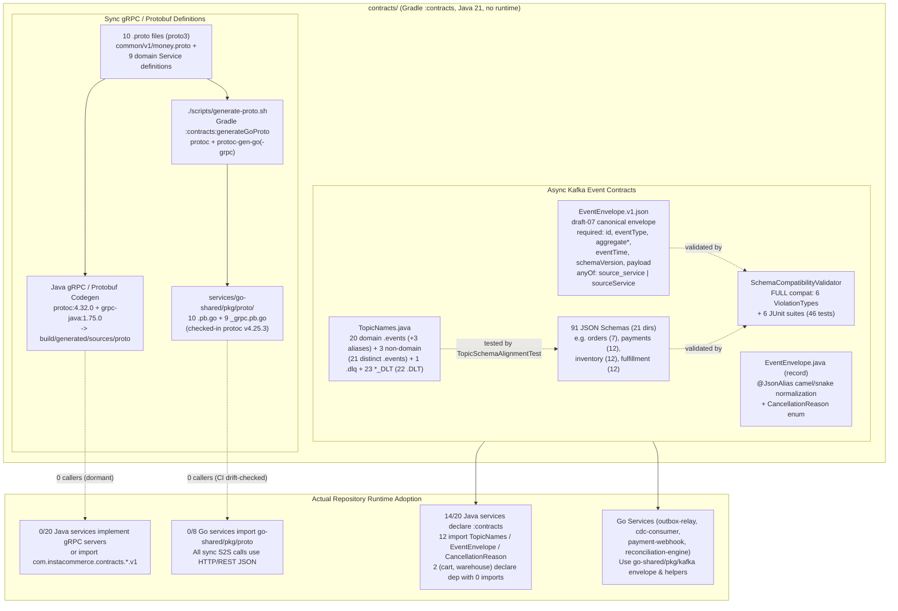
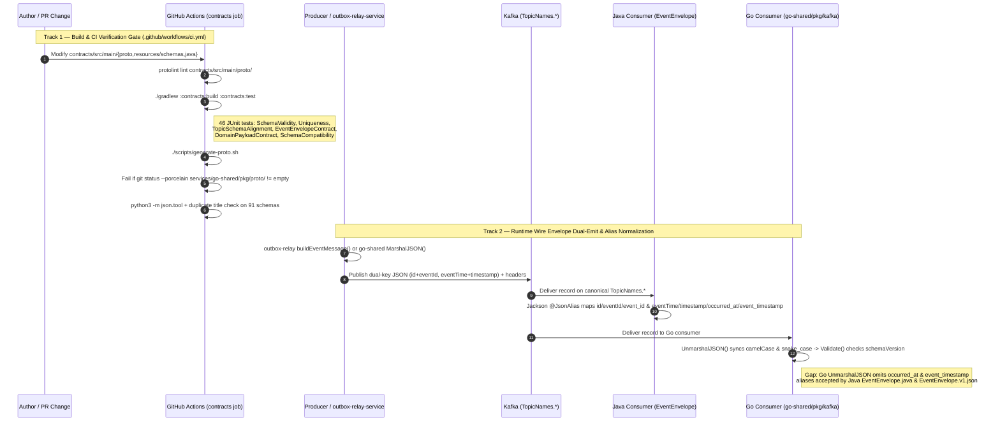

# Shared Event Contracts & Protobuf (`contracts/`) — Code Walkthrough

> [!NOTE]
> **Part of the InstaCommerce Onboarding Suite:** [Onboarding Hub](../../README.md) · [Code Walkthrough Atlas](../README.md) · [Domain & Event Catalog (`05`)](../../05-domain-model-and-event-catalog.md) · [Incident Drills & Exam (`06`)](../../06-incident-drills-and-readiness-exam.md) · [Dependency Matrix & Cheatsheet (`07`)](../../07-service-dependency-and-command-cheatsheet.md)

> **Component Scope:** Canonical Kafka event envelope, topic registry, 91 JSON Schemas, schema compatibility validator, 10 Protocol Buffer / gRPC definitions, Java & Go codegen pipelines, and contract test suites under [`contracts/`](../../../../contracts/).

---

## 1. Purpose, Boundaries & Module Structure

`contracts/` is a **non-deployable leaf Java library** (`java` + `com.google.protobuf` Gradle plugin) that defines the cross-service wire contracts for both asynchronous Kafka domain events and synchronous gRPC service interfaces ([build.gradle.kts](../../../../contracts/build.gradle.kts#L1-L56)).

```text
contracts/
├── build.gradle.kts                                         # protoc 4.32.0, grpc-java 1.75.0, generateGoProto task
├── README.md                                                # Contract catalog (note minor drift vs TopicNames)
└── src/
    ├── main/
    │   ├── java/com/instacommerce/contracts/
    │   │   ├── events/EventEnvelope.java                    # Canonical Java record with @JsonAlias normalization
    │   │   ├── orders/CancellationReason.java               # Shared cancellation enum (5 values)
    │   │   ├── schemas/SchemaCompatibilityValidator.java    # FULL-compatibility schema diff engine
    │   │   └── topics/TopicNames.java                       # Canonical .events, non-domain, DLQ, and .DLT constants
    │   ├── proto/                                           # 10 proto3 definitions (1 common + 9 service APIs)
    │   │   ├── common/v1/money.proto
    │   │   ├── {cart,catalog,fulfillment,inventory,order,payment,rider,routing,wallet}/v1/*.proto
    │   └── resources/schemas/                               # 91 JSON Draft-07 schemas across 21 directories
    │       ├── README.md
    │       ├── common/EventEnvelope.v1.json                 # Canonical envelope schema
    │       └── <20 domain directories>/*.v1.json
    └── test/java/com/instacommerce/contracts/               # 6 JUnit 5 suites (46 tests total)
        ├── events/EventEnvelopeContractTest.java
        ├── schemas/{DomainPayloadContractTest,DomainPayloadFixtures,JsonSchemaValidator,SchemaCompatibilityTest,SchemaUniquenessTest,SchemaValidityTest}.java
        └── topics/TopicSchemaAlignmentTest.java
```

**Contracts & Proto Architecture LLD** — *[Rendered PNG](../diagrams/components/contracts-and-proto-arch-lld.png) · [Mermaid Source](../diagrams/components/contracts-and-proto-arch-lld.mmd)*



---

## 2. Asynchronous Kafka Contracts (`EventEnvelope`, `TopicNames`, 91 JSON Schemas)

### 2.1 Canonical Event Envelope (`EventEnvelope.v1.json` & `EventEnvelope.java`)

Every Kafka domain event wraps its domain body in a shared envelope specified by [`EventEnvelope.v1.json`](../../../../contracts/src/main/resources/schemas/common/EventEnvelope.v1.json#L1-L52) and mirrored by the Java record [`EventEnvelope.java`](../../../../contracts/src/main/java/com/instacommerce/contracts/events/EventEnvelope.java#L16-L43):

| Canonical Field | JSON Schema Requirement | Java `@JsonAlias` Accepted | Go `pkg/kafka` Unmarshal Aliases | Purpose |
|---|---|---|---|---|
| `id` | `required` (`string`) | `eventId`, `event_id` | `id`, `eventId`, `event_id` | Globally unique event UUID for deduplication |
| `eventType` | `required` (`string`) | `event_type` | `eventType`, `event_type` | Domain discriminator (e.g. `OrderPlaced`, `PaymentCaptured`) |
| `aggregateType` | `required` (`string`) | `aggregate_type` | `aggregateType`, `aggregate_type` | Root aggregate (e.g. `Order`, `Payment`) |
| `aggregateId` | `required` (`string`) | `aggregate_id` | `aggregateId`, `aggregate_id` | Partition key / aggregate identifier |
| `eventTime` | `required` (`date-time`) | `event_time`, `timestamp`, `occurred_at`, `event_timestamp` | `eventTime`, `timestamp`, `event_time` | Event emission UTC timestamp |
| `schemaVersion` | `required` (`string`) | `schema_version` | `schemaVersion`, `schema_version` | `"v1"` or semver `"1.0.0"` |
| `sourceService` | `anyOf`: `source_service` or `sourceService` | `source_service`, `sourceService` | `sourceService`, `source_service` | Originating microservice |
| `correlationId` | Optional (`string`) | `correlation_id`, `correlationId` | `correlationId`, `correlation_id` | Request / trace correlation identifier |
| `payload` | `required` (any JSON value) | — | `payload` (`any`) | Domain-specific event body |

**Important wire normalization mechanics:**
- [`EventEnvelope.v1.json`](../../../../contracts/src/main/resources/schemas/common/EventEnvelope.v1.json#L51) sets `"additionalProperties": true`, allowing legacy flattened fields alongside `payload`.
- In Java, `@JsonIgnoreProperties(ignoreUnknown = true)` ([`EventEnvelope.java`](../../../../contracts/src/main/java/com/instacommerce/contracts/events/EventEnvelope.java#L16)) ensures consumers safely ignore unknown envelope keys during rollouts.
- In Go, [`outbox-relay-service`](../../../../services/outbox-relay-service/envelope.go#L199-L251) `buildEventMessage` emits **both** camelCase and snake_case keys (`eventId`/`event_id`/`id`, `eventTime`/`event_time`/`timestamp`, `sourceService`/`source_service`, `correlationId`/`correlation_id`) AND promotes top-level `payload` map keys onto the envelope root for legacy flattened consumers. Meanwhile [`go-shared/pkg/kafka/EventEnvelope`](../../../../services/go-shared/pkg/kafka/envelope_json.go#L28-L90) `MarshalJSON` dual-emits `id`+`eventId` and `eventTime`+`timestamp`.

### 2.2 Topic Registry (`TopicNames.java`) & ADR-003 DLT Rules

[`TopicNames.java`](../../../../contracts/src/main/java/com/instacommerce/contracts/topics/TopicNames.java#L10-L81) defines all canonical Kafka topic constants:
- **23 domain event constants (20 distinct `.events` topics + 3 aliases `ORDER_EVENTS`, `PAYMENT_EVENTS`, `ROUTING_EVENTS`):** `identity.events`, `catalog.events`, `orders.events`, `payments.events`, `inventory.events`, `fulfillment.events`, `rider.events`, `notification.events`, `search.events`, `pricing.events`, `promotion.events`, `customer-support.events`, `returns.events`, `warehouse.events`, `ai-orchestrator.events`, `reconciliation.events`, `wallet.events`, `fraud.events`, `cart.events`, `delivery.events`.
- **3 non-domain topics:** `RIDER_LOCATION_UPDATES` (`"rider.location.updates"`), `RIDER_GEOFENCE_EVENTS` (`"rider.geofence.events"` — making **21** distinct `.events` topics total), `PAYMENT_WEBHOOKS` (`"payment.webhooks"`).
- **1 relay quarantine DLQ:** `OUTBOX_RELAY_DLQ` (`"outbox.relay.dlq"`) — explicitly exempted in [`EventEnvelopeContractTest`](../../../../contracts/src/test/java/com/instacommerce/contracts/events/EventEnvelopeContractTest.java#L170-L174) from ADR-003's `.DLT` rule.
- **Dead-letter topics (`DLT_SUFFIX = ".DLT"`):** 23 `*_DLT` constants covering 22 distinct `.DLT` topics, including duplicate aliases `RIDER_GEOFENCE_DLT` and `RIDER_GEOFENCE_EVENTS_DLT` (both `"rider.geofence.events.DLT"`), plus `AUDIT_DLT` (`"audit.DLT"`). Note `PAYMENT_WEBHOOKS` and `RIDER_LOCATION_UPDATES` do not end in `.events` and define no `.DLT` constant in `TopicNames`.

[`CancellationReason.java`](../../../../contracts/src/main/java/com/instacommerce/contracts/orders/CancellationReason.java#L6-L12) centralizes the 5-value cancellation enum (`CUSTOMER_REQUEST`, `PAYMENT_FAILED`, `INVENTORY_SHORTAGE`, `ETA_UNACCEPTABLE`, `FRAUD_SUSPECTED`) imported directly by `order-service`.

### 2.3 Inventory of the 91 JSON Schemas

All 91 Draft-07 `.json` schemas reside under [`contracts/src/main/resources/schemas/`](../../../../contracts/src/main/resources/schemas/):

| Directory | Count | Schema Files (`*.v1.json`) |
|---|---:|---|
| `common/` | 1 | `EventEnvelope` |
| `ai-orchestrator/` | 1 | `IntentAnalyzed` |
| `cart/` | 4 | `CartCleared`, `CartItemAdded`, `CartItemRemoved`, `CartMerged` |
| `catalog/` | 3 | `ProductCreated`, `ProductDeactivated`, `ProductUpdated` |
| `customer-support/` | 1 | `TicketCreated` |
| `delivery/` | 3 | `DeliveryCreated`, `DeliveryStatusUpdated`, `EtaUpdated` |
| `fraud/` | 1 | `FraudDetected` |
| `fulfillment/` | 12 | `DeliveryCompleted`, `DeliveryFailed`, `DeliveryStatus`, `ItemSubstituted`, `OrderDelivered`, `OrderDispatched`, `OrderModified`, `OrderPacked`, `PickTaskCancelled`, `PickTaskCreated`, `ProofOfDeliveryUploaded`, `RiderHandoffCompleted` |
| `identity/` | 4 | `AccountLocked`, `AccountUnlocked`, `UserErased`, `UserRegistered` |
| `inventory/` | 12 | `CycleCountAuditCompleted`, `DarkStoreCycleCountTaskCreated`, `InboundAsnReconciled`, `LowStockAlert`, `PerishableExpiringSoon`, `ReorderPointReached`, `StockAdjusted`, `StockConfirmed`, `StockDriftDetected`, `StockReleased`, `StockReserved`, `StockReservedShortfallDetected` |
| `notification/` | 1 | `NotificationDispatched` |
| `orders/` | 7 | `OrderCancelled`, `OrderCreated`, `OrderFailed`, `OrderPartiallyRefunded`, `OrderPlaced`, `OrderRefunded`, `OrderStatusChanged` |
| `payments/` | 12 | `PaymentAuthorized`, `PaymentCaptureReverted`, `PaymentCaptured`, `PaymentDisputeLost`, `PaymentDisputeUpdated`, `PaymentDisputeWon`, `PaymentDisputed`, `PaymentFailed`, `PaymentRefundFailed`, `PaymentRefunded`, `PaymentVoidReverted`, `PaymentVoided` |
| `pricing/` | 4 | `CouponRedeemed`, `PromotionCreated`, `PromotionDeactivated`, `PromotionUpdated` |
| `reconciliation/` | 1 | `ReconciliationCompleted` |
| `returns/` | 1 | `ReturnInitiated` |
| `rider/` | 8 | `RiderActivated`, `RiderAssigned`, `RiderAssignmentCancelled`, `RiderCreated`, `RiderGeofenceTransition`, `RiderOnboarded`, `RiderReleased`, `RiderSuspended` |
| `routing/` | 1 | `ETABreachRisk` |
| `search/` | 1 | `SearchIndexed` |
| `wallet/` | 5 | `PointsEarned`, `PointsRedeemed`, `TierUpgraded`, `WalletCredited`, `WalletDebited` |
| `warehouse/` | 8 | `BinAssigned`, `ColdChainBreachAlert`, `StoreCapacityPaused`, `StoreCapacityThrottled`, `StoreCreated`, `StoreDeleted`, `StoreHoursUpdated`, `StoreStatusChanged` |

---

## 3. Schema Compatibility Engine & Contract Tests

**Contract Verification & Wire Envelope Flow** — *[Rendered PNG](../diagrams/components/contracts-and-proto-flow.png) · [Mermaid Source](../diagrams/components/contracts-and-proto-flow.mmd)*



### 3.1 `SchemaCompatibilityValidator`

[`SchemaCompatibilityValidator.java`](../../../../contracts/src/main/java/com/instacommerce/contracts/schemas/SchemaCompatibilityValidator.java#L16-L220) enforces Confluent/CloudEvents **FULL** compatibility (old consumers read new payloads and new consumers read old payloads) by walking `oldSchema` vs `newSchema` recursively (`validate` at [`#L49-L57`](../../../../contracts/src/main/java/com/instacommerce/contracts/schemas/SchemaCompatibilityValidator.java#L49-L57)). Its 6 `ViolationType` checks ([`#L32-L39`](../../../../contracts/src/main/java/com/instacommerce/contracts/schemas/SchemaCompatibilityValidator.java#L32-L39)) catch:
1. `ROOT_TYPE_CHANGED` (`#L67-L79`)
2. `ADDITIONAL_PROPERTIES_RESTRICTED` — transitioning `additionalProperties` from `true`/default to `false` (`#L82-L91`)
3. `REQUIRED_FIELD_REMOVED` — removing a previously required field or deleting any property when `additionalProperties: false` (`#L98-L107`, `#L132-L140`)
4. `REQUIRED_FIELD_ADDED` — adding a brand-new property marked `required` (`#L110-L121`)
5. `PROPERTY_TYPE_CHANGED` — mutating field `"type"`, recursing into nested `"properties"` and `"items[]"` (`#L148-L182`)
6. `ENUM_VALUE_REMOVED` — shrinking allowed enum values (`#L184-L209`)

### 3.2 Six Contract Test Suites (46 Tests)

1. [`SchemaValidityTest`](../../../../contracts/src/test/java/com/instacommerce/contracts/schemas/SchemaValidityTest.java#L17-L93) (1 test): Validates every `.json` file parses, declares Draft-07 `$schema`, matches `title` to filename prefix, sets `type` (`object`, `array`, or `string` with `enum`), and defines every `required` field in `properties`.
2. [`SchemaUniquenessTest`](../../../../contracts/src/test/java/com/instacommerce/contracts/schemas/SchemaUniquenessTest.java#L18-L62) (1 test): Ensures zero duplicate `title` values across all 91 schemas.
3. [`SchemaCompatibilityTest`](../../../../contracts/src/test/java/com/instacommerce/contracts/schemas/SchemaCompatibilityTest.java#L17-L240) (6 tests): Verifies self-compatibility across all 91 production schemas plus 5 negative/positive evolution assertions.
4. [`TopicSchemaAlignmentTest`](../../../../contracts/src/test/java/com/instacommerce/contracts/topics/TopicSchemaAlignmentTest.java#L19-L80) (1 test): Maps every `*.events` constant in `TopicNames` to a schema folder containing at least one `.json` file (explicitly aliasing `promotion` to `pricing`).
5. [`EventEnvelopeContractTest`](../../../../contracts/src/test/java/com/instacommerce/contracts/events/EventEnvelopeContractTest.java#L31-L177) (3 tests): Tests camelCase & snake_case deserialization, asserts `EventEnvelope` record components and `@JsonAlias` annotations match `EventEnvelope.v1.json` properties, and checks ADR-003 `.DLT` coverage for every `.events` topic.
6. [`DomainPayloadContractTest`](../../../../contracts/src/test/java/com/instacommerce/contracts/schemas/DomainPayloadContractTest.java#L18-L199) (34 tests): Runs [`JsonSchemaValidator`](../../../../contracts/src/test/java/com/instacommerce/contracts/schemas/JsonSchemaValidator.java#L22-L364) against [`DomainPayloadFixtures`](../../../../contracts/src/test/java/com/instacommerce/contracts/schemas/DomainPayloadFixtures.java#L8-L308) plus negative constraint tests (UUID, negative money, enum, `additionalProperties: false`, regex `pattern`).

---

## 4. Protobuf / gRPC Definitions & Codegen (`generateGoProto` & `scripts/generate-proto.sh`)

Ten proto3 files under [`contracts/src/main/proto/`](../../../../contracts/src/main/proto/) define shared money and 9 synchronous RPC APIs:

| Proto File | Package / RPCs | Lines |
|---|---|---:|
| [`common/v1/money.proto`](../../../../contracts/src/main/proto/common/v1/money.proto#L1-L13) | `common.v1.Money` (`int64 amount_minor`, ISO-4217 `currency`) | 13 |
| [`cart/v1/cart_service.proto`](../../../../contracts/src/main/proto/cart/v1/cart_service.proto#L1-L53) | `CartService`: `GetCart`, `ValidateCart`, `ClearCart` | 53 |
| [`catalog/v1/catalog_service.proto`](../../../../contracts/src/main/proto/catalog/v1/catalog_service.proto#L1-L34) | `CatalogService`: `GetProductDetails`, `GetProductsBatch` | 34 |
| [`fulfillment/v1/fulfillment_service.proto`](../../../../contracts/src/main/proto/fulfillment/v1/fulfillment_service.proto#L1-L70) | `FulfillmentService`: `CreateFulfillmentTask`, `GetFulfillmentStatus`, `AssignPickWave`, `CompletePacking` | 70 |
| [`inventory/v1/inventory_service.proto`](../../../../contracts/src/main/proto/inventory/v1/inventory_service.proto#L1-L68) | `InventoryService`: `ReserveStock`, `ConfirmReservation`, `CancelReservation`, `CheckAvailability` | 68 |
| [`order/v1/order_service.proto`](../../../../contracts/src/main/proto/order/v1/order_service.proto#L1-L82) | `OrderService`: `CreateOrder`, `GetOrder`, `UpdateOrderStatus`, `CancelOrder` | 82 |
| [`payment/v1/payment_service.proto`](../../../../contracts/src/main/proto/payment/v1/payment_service.proto#L1-L57) | `PaymentService`: `AuthorizePayment`, `CapturePayment`, `VoidAuthorization`, `RefundPayment` | 57 |
| [`rider/v1/rider_service.proto`](../../../../contracts/src/main/proto/rider/v1/rider_service.proto#L1-L66) | `RiderService`: `GetRiderStatus`, `UpdateRiderLocation`, `AssignRiderDispatch`, `UpdateShiftStatus` | 66 |
| [`routing/v1/routing_service.proto`](../../../../contracts/src/main/proto/routing/v1/routing_service.proto#L1-L63) | `RoutingService`: `CalculateETA`, `GetDistanceMatrix`, `OptimizeRoute` | 63 |
| [`wallet/v1/wallet_service.proto`](../../../../contracts/src/main/proto/wallet/v1/wallet_service.proto#L1-L56) | `WalletService`: `GetBalance`, `CreditWallet`, `DebitWallet` | 56 |

**Java & Go codegen pipelines:**
- **Java:** [`contracts/build.gradle.kts`](../../../../contracts/build.gradle.kts#L22-L48) wires `com.google.protobuf` (`0.9.6`) with `com.google.protobuf:protoc:4.32.0` and `io.grpc:protoc-gen-grpc-java:1.75.0`, adding `build/generated/sources/proto/main/{java,grpc}` to the main Java sourceSet. Note [`check-monorepo-consistency.sh`](../../../../scripts/check-monorepo-consistency.sh#L258-L264) enforces exact version parity between `protoc` here and `protobuf-java` in root `build.gradle.kts`.
- **Go:** Gradle task `generateGoProto` ([`contracts/build.gradle.kts`](../../../../contracts/build.gradle.kts#L50-L55)) delegates to [`scripts/generate-proto.sh`](../../../../scripts/generate-proto.sh#L1-L74), which resolves `protoc` from `PATH` or `~/.gradle/caches/...`, ensures `protoc-gen-go` and `protoc-gen-go-grpc` exist, compiles all 10 `.proto` files with `--go_opt=module=github.com/instacommerce/go-shared/pkg/proto`, emits 19 `.pb.go`/`_grpc.pb.go` files into `services/go-shared/pkg/proto/`, and validates `go build ./pkg/proto/...`.
- **CI Drift Gate:** [`.github/workflows/ci.yml`](../../../../.github/workflows/ci.yml#L566-L581) runs `protolint`, `./gradlew :contracts:build :contracts:test`, `./scripts/generate-proto.sh`, and fails the build if `git status --porcelain services/go-shared/pkg/proto/` is non-empty.

---

## 5. Adoption Reality, Seams & Doc-vs-Code Drift

1. **Zero gRPC / Protobuf Runtime Consumers (Java & Go):** Despite compiling stubs for 9 service APIs and checking generated `.pb.go` files in CI, **0 of 20 Java services** import `com.instacommerce.contracts.*.v1` or run gRPC servers, and **0 of 8 Go services** import `github.com/instacommerce/go-shared/pkg/proto/*`. All synchronous service-to-service calls in production code use HTTP/REST + JSON.
2. **Checked-In Go Stub Generator Skew:** Generated headers in [`order_service_grpc.pb.go`](../../../../services/go-shared/pkg/proto/order/v1/order_service_grpc.pb.go#L1-L5) record `protoc v4.25.3` (`protoc-gen-go-grpc v1.6.2`), whereas Java codegen pins `protoc:4.32.0` ([`contracts/build.gradle.kts`](../../../../contracts/build.gradle.kts#L34)).
3. **Java `:contracts` Adoption (14 Declared, 12 Imported):** Fourteen Java services declare `implementation(project(":contracts"))` in `build.gradle.kts`, of which 12 import `TopicNames`, `EventEnvelope`, or `CancellationReason`. Both `cart-service` and `warehouse-service` declare `:contracts` without importing any class from `com.instacommerce.contracts.*`. Six Java services (`checkout-orchestrator-service`, `config-feature-flag-service`, `identity-service`, `inventory-service`, `mobile-bff-service`, `admin-gateway-service`) do not depend on `:contracts`.
4. **Go `EventEnvelope` Alias Gap (`occurred_at` / `event_timestamp`):** [`EventEnvelope.java`](../../../../contracts/src/main/java/com/instacommerce/contracts/events/EventEnvelope.java#L30) and [`EventEnvelope.v1.json`](../../../../contracts/src/main/resources/schemas/common/EventEnvelope.v1.json#L31-L32) accept `occurred_at` and `event_timestamp`, but [`go-shared/pkg/kafka/envelope_json.go`](../../../../services/go-shared/pkg/kafka/envelope_json.go#L42-L52) `UnmarshalJSON` only checks `eventTime`, `timestamp`, and `event_time`. Conversely, [`contracts/README.md`](../../../../contracts/README.md#L63-L68) lists phantom `@JsonAlias` values (`type` and `service`) that do not exist in `EventEnvelope.java`.
5. **Notification Topic Singular/Plural Drift:** [`TopicNames.NOTIFICATION_EVENTS`](../../../../contracts/src/main/java/com/instacommerce/contracts/topics/TopicNames.java#L25) and [`schemas/README.md`](../../../../contracts/src/main/resources/schemas/README.md#L45) specify `notification.events` (singular), whereas Go [`outbox-relay-service`](../../../../services/outbox-relay-service/envelope.go#L62) maps `notification`/`notifications` aggregate types to `"notifications.events"` (plural).

---

## 6. Local Verification Commands

```bash
# Compile protobufs, run all 46 JUnit contract tests across 6 suites
./gradlew :contracts:test

# Regenerate Go stubs into services/go-shared/pkg/proto and verify Go build
./gradlew :contracts:generateGoProto
```

---

**Previous:** [03 — Five E2E Code Flows](../03-system-end-to-end-flows.md) | **Atlas Hub:** [Code Walkthrough Atlas](../README.md) | **Next:** [Java Platform Common](./platform-common-java.md)
