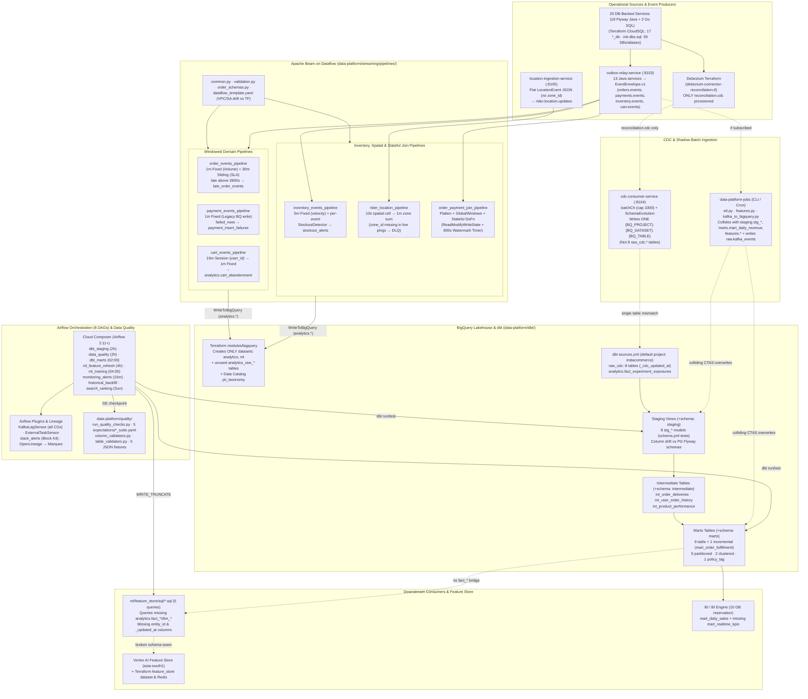
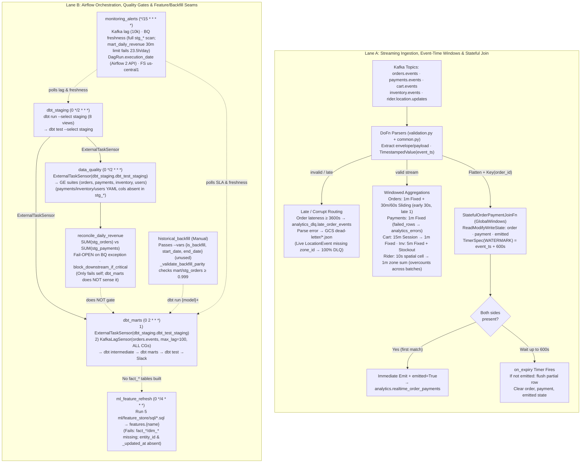

# Data Platform & Analytics Lakehouse (`data-platform/` + `data-platform-jobs/`)

> [!NOTE]
> **Part of the InstaCommerce Onboarding Suite:** [Onboarding Hub](../../README.md) · [Code Walkthrough Atlas](../README.md) · [Domain & Event Catalog (`05`)](../../05-domain-model-and-event-catalog.md) · [Incident Drills & Exam (`06`)](../../06-incident-drills-and-readiness-exam.md) · [Dependency Matrix & Cheatsheet (`07`)](../../07-service-dependency-and-command-cheatsheet.md)

> **Onboarding Scope & Repo-Truth Posture:** Verified directly against [`data-platform/`](../../../../data-platform/README.md), [`data-platform-jobs/`](../../../../data-platform-jobs/README.md), [`infra/terraform/modules/bigquery/`](../../../../infra/terraform/modules/bigquery/main.tf), [`services/cdc-consumer-service/`](../../../../services/cdc-consumer-service/consumer.go), [`services/location-ingestion-service/`](../../../../services/location-ingestion-service/handler/batcher.go), [`contracts/`](../../../../contracts/src/main/java/com/instacommerce/contracts/topics/TopicNames.java), [`ml/feature_store/`](../../../../ml/feature_store/sql/user_features.sql), and service Flyway migrations. While all unit test suites pass with mocked clients and synthetic fixtures (`95/95` pytest checks + `5/5` fixture suites), **end-to-end production dataflow has critical schema, dataset, and contract breaks** across CDC, Beam parsers, Great Expectations YAML rules, and `ml_feature_refresh`.

---

## 1. Component Identity Card

| Subsystem | Location | Stack / Runtime | Primary Responsibilities & Sinks |
|---|---|---|---|
| **dbt Analytics Warehouse** | [`data-platform/dbt/`](../../../../data-platform/dbt/dbt_project.yml#L1-L53) | `dbt-bigquery==1.7.0` · BigQuery (`asia-south1`) | Transforms 8 `raw_cdc.*` + 1 `analytics.fact_experiment_exposures` sources into **8** staging views, **3** intermediate tables, and **10** marts tables |
| **Airflow Orchestration** | [`data-platform/airflow/`](../../../../data-platform/airflow/requirements.txt#L1-L7) | Apache Airflow `>=2.11.0,<3.0.0` (Cloud Composer) + OpenLineage | Runs **8** DAGs (`dbt_staging`, `data_quality`, `dbt_marts`, `ml_feature_refresh`, `ml_training`, `monitoring_alerts`, `historical_backfill`, `search_ranking_weekly_retraining`), custom `KafkaLagSensor`, Slack Block Kit alerts |
| **Data Quality Runner** | [`data-platform/quality/`](../../../../data-platform/quality/run_quality_checks.py#L1-L368) | Python + Great Expectations `0.18.22` | Executes **5** YAML expectation suites against BigQuery (`staging.*`, `marts.mart_daily_sales`) or local synthetic JSON fixtures (`--fixtures`) |
| **Streaming Pipelines** | [`data-platform/streaming/`](../../../../data-platform/streaming/README.md#L1-L64) | Apache Beam `2.53.0` (Dataflow Flex Templates) | **6** Kafka → BigQuery pipelines covering orders, payments, cart sessions, inventory, rider GPS pings, and stateful order-payment join |
| **Shadow CLI / Batch Jobs** | [`data-platform-jobs/`](../../../../data-platform-jobs/data_platform_jobs/job_registry.py#L36-L67) | Python `argparse` CLI + `kafka-python` + `google-cloud-bigquery` | **5** registered jobs (`staging_etl`, `marts_etl`, `feature_refresh`, `kafka_to_bigquery_batch`, `data_quality`) that overlap/collide with dbt & Airflow |
| **Lakehouse Terraform** | [`infra/terraform/modules/bigquery/`](../../../../infra/terraform/modules/bigquery/main.tf#L1-L14) | Terraform GCP (`bigquery`, `data-lake`, `dataflow`, `feature-store`) | Provisions `analytics` and `ml` datasets, 4 unused `analytics_raw_*` tables, BI Engine 10 GB reservation, Data Catalog `pii_taxonomy`, Dataflow SA/bucket, GCS data lake |

---

## 2. High-Level & Low-Level Architecture

**Data Platform & Lakehouse Component Architecture** — *[Rendered PNG](../diagrams/components/data-platform-lakehouse-arch-lld.png) · [Mermaid Source](../diagrams/components/data-platform-lakehouse-arch-lld.mmd)*



### Repository Layout & Boundary Map

- **Transformation layer ([`dbt_project.yml`](../../../../data-platform/dbt/dbt_project.yml#L18-L53)):** Declares profile `instacommerce` ([`profiles.yml`](../../../../data-platform/dbt/profiles.yml#L1-L18)) with `dev` (`oauth`, `GCP_PROJECT_ID` default `'instacommerce-dev'`, `threads: 4`) and `prod` (`service-account`, `GCP_PROJECT_ID` default `'instacommerce-prod'`, `keyfile: GCP_SA_KEY_FILE`, `threads: 8`), both targeting dataset `analytics` in `asia-south1`. Note that `data-platform/dbt/` contains **zero** custom macros, snapshots, seeds, or standalone `tests/` SQL files.
- **Orchestration & Lineage ([`airflow/`](../../../../data-platform/airflow/openlineage.yml#L1-L13)):** [`openlineage.yml`](../../../../data-platform/airflow/openlineage.yml#L4-L13) configures HTTP lineage transport to `http://marquez:5000/api/v1/lineage` under namespace `"instacommerce-data-platform"` with a `simple` circuit breaker.
- **Ingestion Split:** Operational services write domain events to Kafka via [`outbox-relay-service`](../../../../services/outbox-relay-service/README.md#L48-L55) (13 Java services) and [`location-ingestion-service`](../../../../services/location-ingestion-service/handler/batcher.go#L78-L95) (`rider.location.updates`), while [`cdc-consumer-service`](../../../../services/cdc-consumer-service/consumer.go#L120-L137) consumes CDC/Kafka topics into a single BigQuery table (`{BQ_PROJECT}.{BQ_DATASET}.{BQ_TABLE}`). None of those producers natively populate the 8 separate `raw_cdc.*` tables expected by dbt [`sources.yml`](../../../../data-platform/dbt/models/staging/sources.yml#L3-L54).

---

## 3. Deep Dive: dbt Analytics Warehouse (`data-platform/dbt/`)

### 3.1 Sources & Freshness Contracts ([`sources.yml`](../../../../data-platform/dbt/models/staging/sources.yml#L1-L65))

| Source Group | Default Database (`var`) | Schema | Tables & `loaded_at_field` | Freshness SLA (`warn` / `error`) |
|---|---|---|---|---|
| `cdc` | `{{ var('project_id', 'instacommerce') }}` ([`sources.yml`](../../../../data-platform/dbt/models/staging/sources.yml#L4)) | `raw_cdc` | `orders`, `payments`, `deliveries` (`_cdc_updated_at`) | `30m` / `2h` |
| `cdc` | `{{ var('project_id', 'instacommerce') }}` | `raw_cdc` | `users`, `products`, `inventory_movements`, `searches`, `cart_events` (`_cdc_updated_at`) | `1h` / `6h` |
| `analytics` | `{{ var('project_id', 'instacommerce') }}` ([`sources.yml`](../../../../data-platform/dbt/models/staging/sources.yml#L57)) | `analytics` | `fact_experiment_exposures` (`exposed_at`) | `1h` / `6h` |

> **Schema naming pitfall:** Because `dbt_project.yml` sets `+schema: staging` ([`dbt_project.yml`](../../../../data-platform/dbt/dbt_project.yml#L22)), `+schema: intermediate` ([`#L25`](../../../../data-platform/dbt/dbt_project.yml#L25)), and `+schema: marts` ([`#L28`](../../../../data-platform/dbt/dbt_project.yml#L28)) while `profiles.yml` sets base `dataset: analytics` without a custom `generate_schema_name` macro in `data-platform/dbt/`, standard dbt-bigquery resolves model target schemas to `analytics_staging`, `analytics_intermediate`, and `analytics_marts` — yet Airflow DAGs and quality scripts hardcode `staging.stg_*` and `marts.mart_*`.

### 3.2 Staging Layer (8 Views, `+materialized: view`)

Every staging model selects directly from `{{ source('cdc', '...') }}`, renames `id` to `<entity>_id`, casts numeric amounts to `INT64`/`FLOAT64` and timestamps via `TIMESTAMP(...)`, and preserves `_cdc_updated_at`:

| Model | Source | Key Casts / Derived Columns | Schema Tests ([`staging/schema.yml`](../../../../data-platform/dbt/models/staging/schema.yml#L4-L246)) |
|---|---|---|---|
| [`stg_orders`](../../../../data-platform/dbt/models/staging/stg_orders.sql#L1-L26) | `cdc.orders` | `total_cents`, `delivery_fee_cents`, `discount_cents` (`INT64`); `DATE(placed_at) AS order_date` | `order_id` (`unique`, `not_null`), `user_id` (`relationships -> stg_users`), `status` (9 enums) |
| [`stg_payments`](../../../../data-platform/dbt/models/staging/stg_payments.sql#L1-L23) | `cdc.payments` | `amount_cents` (`INT64`); `initiated_at`, `completed_at`, `failed_at` | `payment_id` (`unique`, `not_null`), `order_id` (`relationships -> stg_orders`), `payment_method` (5 enums), `status` (10 enums) |
| [`stg_users`](../../../../data-platform/dbt/models/staging/stg_users.sql#L1-L23) | `cdc.users` | Exposes raw `phone_number`, `email`, `first_name`, `last_name`, `city`, `zone`, `is_active` | `user_id` (`unique`, `not_null`), `phone_number` (`unique`, `not_null`), `created_at` (`not_null`) |
| [`stg_products`](../../../../data-platform/dbt/models/staging/stg_products.sql#L1-L24) | `cdc.products` | `name AS product_name`, `price_cents`, `cost_cents` (`INT64`), `store_id` | `product_id`, `sku` (`unique`, `not_null`), `category`, `price_cents` (`not_null`) |
| [`stg_deliveries`](../../../../data-platform/dbt/models/staging/stg_deliveries.sql#L1-L21) | `cdc.deliveries` | `distance_meters` (`FLOAT64`), `estimated_minutes` (`INT64`) | `delivery_id` (`unique`, `not_null`), `order_id` (`relationships -> stg_orders`), `status` (9 enums incl. `RIDER_ASSIGNED`, `EN_ROUTE`, `NEAR_DESTINATION`) |
| [`stg_inventory_movements`](../../../../data-platform/dbt/models/staging/stg_inventory_movements.sql#L1-L20) | `cdc.inventory_movements` | `quantity`, `quantity_before`, `quantity_after` (`INT64`) | `movement_id` (`unique`, `not_null`), `product_id` (`relationships -> stg_products`), `movement_type` (5 enums) |
| [`stg_searches`](../../../../data-platform/dbt/models/staging/stg_searches.sql#L1-L21) | `cdc.searches` | `query AS search_query`, `results_count`, `clicked_position` (`INT64`), `DATE(searched_at) AS search_date` | `search_id` (`unique`, `not_null`), `user_id`, `search_query`, `searched_at` (`not_null`) |
| [`stg_cart_events`](../../../../data-platform/dbt/models/staging/stg_cart_events.sql#L1-L21) | `cdc.cart_events` | `quantity`, `unit_price_cents` (`INT64`), `DATE(event_at) AS event_date` | `cart_event_id` (`unique`, `not_null`), `event_type` (`ADD`, `REMOVE`, `UPDATE_QUANTITY`) |

### 3.3 Intermediate Layer (3 Tables, `+materialized: table`)

1. **[`int_order_deliveries.sql`](../../../../data-platform/dbt/models/intermediate/int_order_deliveries.sql#L1-L35):**
   - Left-joins `stg_orders` with `stg_deliveries` (on `order_id`) and `stg_users` (on `user_id`, extracting `u.zone AS zone_id`, [`#L9-L15`](../../../../data-platform/dbt/models/intermediate/int_order_deliveries.sql#L9-L15)).
   - Filters `WHERE o.status IN ('DELIVERED', 'OUT_FOR_DELIVERY')` ([`#L35`](../../../../data-platform/dbt/models/intermediate/int_order_deliveries.sql#L35)).
   - Computes 10-minute SLA strictly on delivered orders with non-null `delivered_at`: `WHEN o.status = 'DELIVERED' AND d.delivered_at IS NOT NULL THEN TIMESTAMP_DIFF(d.delivered_at, o.placed_at, MINUTE) <= 10 ELSE NULL` ([`#L25-L29`](../../../../data-platform/dbt/models/intermediate/int_order_deliveries.sql#L25-L29)), keeping `OUT_FOR_DELIVERY` rows as `NULL` so `COUNT(sla_met)` excludes in-flight orders.
   - Computes null-safe incremental watermark `updated_at`: `GREATEST(COALESCE(o._cdc_updated_at, d._cdc_updated_at), COALESCE(d._cdc_updated_at, o._cdc_updated_at))` ([`#L31`](../../../../data-platform/dbt/models/intermediate/int_order_deliveries.sql#L31)), tested by [`test_int_order_deliveries_updated_at_handles_null_order_timestamp`](../../../../data-platform/quality/test_dbt_models.py#L266-L315).
2. **[`int_user_order_history.sql`](../../../../data-platform/dbt/models/intermediate/int_user_order_history.sql#L1-L31):**
   - Aggregates `stg_orders` by `user_id` to compute `total_orders`, `lifetime_revenue_usd`, `avg_order_value_usd`, `cohort_date`, `cohort_week` (`DATE_TRUNC(DATE(MIN(placed_at)), WEEK)`), `customer_lifespan_days`, `cancelled_orders`, `delivered_orders`, `user_segment` (`power_user >= 10`, `regular >= 5`, `repeat >= 2`, else `one_time`), and `cancellation_rate_pct`. Note: despite `data-platform/README.md#L211` drawing `stg_users --> int_user_history`, the SQL model only references `stg_orders`.
3. **[`int_product_performance.sql`](../../../../data-platform/dbt/models/intermediate/int_product_performance.sql#L1-L65):**
   - Aggregates `stg_cart_events` (`ADD`/`REMOVE`/`unique_cart_users`), `stg_searches` (`clicked_product_id` click counts & average position), and `stg_inventory_movements` (`INBOUND - OUTBOUND - WRITE_OFF AS estimated_stock`), left-joining onto `stg_products` filtered by `WHERE p.is_active = TRUE` ([`#L65`](../../../../data-platform/dbt/models/intermediate/int_product_performance.sql#L65)) on `(product_id, store_id)`.

### 3.4 Marts Layer (10 Models), Incremental Rules & PII Governance

| Mart Model | Materialization | Partition & Cluster (`dbt_project.yml` / SQL) | Core Logic & Key Dependencies |
|---|---|---|---|
| [`mart_daily_revenue`](../../../../data-platform/dbt/models/marts/mart_daily_revenue.sql#L1-L12) | `table` | Partition: `order_date` (DAY) · Cluster: none | `net_revenue_usd`, `avg_order_value_usd`, `sla_10min_pct`, `avg_delivery_minutes` from `int_order_deliveries` |
| [`mart_daily_sales`](../../../../data-platform/dbt/models/marts/mart_daily_sales.sql#L1-L23) | `table` | Partition: `sale_date` (DAY) · Cluster: `store_id` | Rounded store GMV (`total_revenue_usd`), `on_time_orders`, `on_time_pct`, `calculated_at` from `int_order_deliveries` |
| [`mart_order_fulfillment`](../../../../data-platform/dbt/models/marts/mart_order_fulfillment.sql#L1-L30) | **`incremental`** (`unique_key='order_id'`) | Partition: `order_date` (DAY) · Cluster: `store_id`, `status` | Guarded by `` (`#L28-L30`): `WHERE d.updated_at > COALESCE((SELECT MAX(updated_at) FROM {{ this }}), TIMESTAMP('1970-01-01 00:00:00+00'))` |
| [`mart_store_performance`](../../../../data-platform/dbt/models/marts/mart_store_performance.sql#L1-L55) | `table` | Partition: `order_date` (DAY) · Cluster: none | Joins `int_order_deliveries` with `stg_payments` + `stg_orders` on `(store_id, DATE(COALESCE(p.completed_at, p.failed_at, p.initiated_at)))` |
| [`mart_rider_performance`](../../../../data-platform/dbt/models/marts/mart_rider_performance.sql#L1-L48) | `table` | Partition: `order_date` (DAY) · Cluster: none | Joins `stg_deliveries` + `stg_orders` for pickup/dropoff timing, `total_distance_km`, `sla_10min_pct`, `active_hours` |
| [`mart_search_funnel`](../../../../data-platform/dbt/models/marts/mart_search_funnel.sql#L1-L70) | `table` | Unpartitioned · Unclustered | Joins daily aggregates of `stg_searches`, `stg_cart_events`, and `DELIVERED` `stg_orders` on `(date, store_id, platform)` |
| [`mart_product_analytics`](../../../../data-platform/dbt/models/marts/mart_product_analytics.sql#L1-L105) | `table` | Unpartitioned · Unclustered | Net positive daily cart intent (`HAVING SUM(ADD - REMOVE) > 0`, `#L28-L34`) matched to earliest same-day `DELIVERED` order via `ROW_NUMBER()` (`#L45-L56`) + `RETURN` movements |
| [`mart_user_cohort_retention`](../../../../data-platform/dbt/models/marts/mart_user_cohort_retention.sql#L1-L37) | `table` | Unpartitioned · Unclustered | Weekly retention (`weeks_since_signup`) via `FIRST_VALUE(COUNT(DISTINCT user_id)) OVER (PARTITION BY cohort_week ...)` (`#L24-L33`) on `DELIVERED` orders |
| [`mart_sponsored_opportunities`](../../../../data-platform/dbt/models/marts/mart_sponsored_opportunities.sql#L1-L136) | `table` | Unpartitioned · Unclustered | Combines `stg_searches`, `stg_cart_events`, `stg_orders`, `stg_products`, `mart_product_analytics`, `mart_daily_revenue` into `monetization_readiness_score` & `HIGH`/`MEDIUM`/`LOW` tier (`#L98-L121`) |
| [`mart_experiment_conversions`](../../../../data-platform/dbt/models/marts/mart_experiment_conversions.sql#L1-L110) | `table` | Unpartitioned · Unclustered | Joins `analytics.fact_experiment_exposures` to post-exposure `DELIVERED` orders; computes two-proportion pooled `z_score` when `total_users > 30` and `control_users > 30` (`#L93-L108`) |

- **PII Governance Tags:** Only [`mart_order_fulfillment.user_id`](../../../../data-platform/dbt/models/marts/schema.yml#L192-L195) declares a BigQuery policy tag (`projects/instacommerce-prod/locations/asia-south1/taxonomies/pii_taxonomy/policyTags/confidential`), corresponding to Terraform's [`data_catalog.tf`](../../../../infra/terraform/modules/bigquery/data_catalog.tf#L4-L35) (`pii_taxonomy`, `confidential`, `sensitive`, and `ALWAYS_NULL` `phone_masking_policy`). Meanwhile, [`stg_users`](../../../../data-platform/dbt/models/staging/stg_users.sql#L8-L11) exposes raw `phone_number`, `email`, `first_name`, and `last_name` with **no** `policy_tags` in [`staging/schema.yml`](../../../../data-platform/dbt/models/staging/schema.yml#L82-L103).

---

## 4. Deep Dive: Airflow Orchestration (`data-platform/airflow/`)

### 4.1 Production DAG Matrix (8 DAGs)

| DAG ID (`file`) | Schedule (UTC) | Retries / Timeout | Sensors & Task Graph | Target / Alerting |
|---|---|---|---|---|
| `dbt_staging` ([`dbt_staging.py`](../../../../data-platform/airflow/dags/dbt_staging.py#L32-L85)) | `0 */2 * * *` | `2` / `5m` delay / `30m` | `dbt_run_staging` (`--full-refresh` from Airflow var) `>> dbt_test_staging` `>> alert_on_failure` (`one_failed`) | `dbt run/test --select staging --target prod` |
| `data_quality` ([`data_quality.py`](../../../../data-platform/airflow/dags/data_quality.py#L63-L265)) | `0 */2 * * *` | `1` / `5m` delay / `30m` | `wait_for_staging` (`ExternalTaskSensor` on `dbt_staging.dbt_test_staging`) `>> validate_{orders,payments,inventory,users} >> reconcile_daily_revenue >> [alert_on_critical_failures, block_downstream_if_critical]` | GE `QUALITY_THRESHOLD = 0.95`; revenue discrepancy `> 0.1%` or `> $100` |
| `dbt_marts` ([`dbt_marts.py`](../../../../data-platform/airflow/dags/dbt_marts.py#L36-L149)) | `0 2 * * *` | `2` / `10m` delay / `60m` | `wait_for_staging` `>> check_kafka_lag` (`orders.events`, `max_lag=100`) `>> dbt_run_intermediate >> dbt_run_marts >> dbt_test_marts >> notify_completion` + `alert_on_failure` | Slack info notification on completion; Slack error on any upstream failure |
| `ml_feature_refresh` ([`ml_feature_refresh.py`](../../../../data-platform/airflow/dags/ml_feature_refresh.py#L68-L192)) | `0 */4 * * *` | `2` / `10m` delay / `45m` | 5 parallel `compute_{user,product,rider,search,store}_features` `>> push_to_online_store >> validate_feature_freshness >> alert_if_stale` | BQ `features.{name}` (`WRITE_TRUNCATE`) → Vertex AI Feature Store (`asia-south1`) |
| `ml_training` ([`ml_training.py`](../../../../data-platform/airflow/dags/ml_training.py#L146-L348)) | `0 4 * * *` | `1` / `15m` delay / `3h` | 4 `TaskGroup`s (`demand_forecast`, `delivery_eta`, `search_ranking`, `fraud_detection`): `train >> evaluate >> gate (BranchPython) >> [promote, skip_promote]` | Vertex AI `CustomJob` (`us-central1`), GCS `{PROJECT_ID}-ml-artifacts`, MLflow, shared gate eval |
| `monitoring_alerts` ([`monitoring_alerts.py`](../../../../data-platform/airflow/dags/monitoring_alerts.py#L79-L275)) | `*/15 * * * *` | `1` / `2m` delay / `10m` | Parallel `[check_kafka_lag, check_bq_freshness, check_dbt_sla, check_feature_store_health] >> aggregate_and_alert` | Lag `> 10000`, BQ freshness `> 30m`, dbt SLA `> 120m`, Vertex FS anomalies (`us-central1`) |
| `historical_backfill` ([`historical_backfill.py`](../../../../data-platform/airflow/dags/historical_backfill.py#L221-L250)) | `None` (Manual) | `1` / `5m` delay / `2h` | `prepare_backfill_params >> run_dbt_backfill >> validate_backfill_parity` | Subprocess (`shell=False`) `dbt run --select {model_name}+ --vars ...`; parity `>= 0.999` |
| `search_ranking_weekly_retraining` ([`search_ranking_retraining.py`](../../../../data-platform/airflow/dags/search_ranking_retraining.py#L383-L429)) | `0 2 * * 0` | `2` / `10m` delay / `2h` | `extract_training_features >> train_lambdamart >> evaluate_candidate >> check_promotion_gates >> [deploy_shadow_mode, alert_degradation]` | LightGBM LambdaMART (or `_LinearFallbackRanker`) + MLflow + local `shadow_deployment.json` |

### 4.2 Plugins & Security Hardening

- **`KafkaLagSensor` & `collect_topic_lags` ([`kafka_lag_sensor.py`](../../../../data-platform/airflow/plugins/kafka_lag_sensor.py#L17-L103)):** Calls `AdminClient.list_consumer_groups()` once per poll (`O(G)` instead of `O(T * G)`), filters `offset >= 0` to ignore negative Kafka sentinel offsets (`-1001`), and compares `max(0, high_watermark - committed_offset)` per topic across **every** valid consumer group in the cluster. `KafkaLagSensor.poke()` ([`#L79-L103`](../../../../data-platform/airflow/plugins/kafka_lag_sensor.py#L79-L103)) returns `False` if `group_lags` is empty, `max(group_lags.values()) > self.max_lag`, or any Kafka exception occurs.
- **`slack_alerts.py` ([`slack_alerts.py`](../../../../data-platform/airflow/plugins/slack_alerts.py#L20-L170)):** Builds Slack Block Kit payloads (`header`, `section` fields, truncated `2000`-char `exception`, optional `View Task Logs` action button, `context` footer), posts via `SlackWebhookHook(slack_webhook_conn_id="slack_data_alerts")`, and falls back to `BaseHook.get_connection(SLACK_CONN_ID)` + `urllib.request.urlopen`, swallowing delivery errors so alerting never crashes tasks in mock/dev runs.
- **`sql_validation.py` ([`sql_validation.py`](../../../../data-platform/airflow/plugins/sql_validation.py#L4-L11)):** Enforces regex `^[a-zA-Z0-9_-]+(?:\.[a-zA-Z0-9_-]+)*$` via `validate_bq_identifier()` before formatting BigQuery project/dataset/table names into SQL strings in `data_quality.py`, `monitoring_alerts.py`, `ml_feature_refresh.py`, `historical_backfill.py`, and `run_quality_checks.py`.

---

## 5. Deep Dive: Great Expectations Quality Framework (`data-platform/quality/`)

### 5.1 Runner Modes & Suite Discovery ([`run_quality_checks.py`](../../../../data-platform/quality/run_quality_checks.py#L52-L368))

`run_quality_checks.py` supports two mutually exclusive execution paths without silent fallback ([`main()`](../../../../data-platform/quality/run_quality_checks.py#L323-L342), enforced by [`test_main_does_not_silently_downgrade_to_fixtures_on_bigquery_failure`](../../../../data-platform/quality/test_quality_checks.py#L280-L290)):
1. **Live BigQuery mode (`build_bigquery_context` + `run_suite_bigquery`):** Connects `SqlAlchemyExecutionEngine` (`bigquery://{project}/{dataset}`), creates a `SimpleCheckpoint` running ``SELECT * FROM `{project}.{table}` `` via `RuntimeBatchRequest`, and maps suites via `SUITE_TABLE_MAP` ([`#L55-L61`](../../../../data-platform/quality/run_quality_checks.py#L55-L61)):
   - `orders_validation` → `staging.stg_orders` ([`orders_suite.yaml`](../../../../data-platform/quality/expectations/orders_suite.yaml#L1-L48), 11 expectations)
   - `payments_validation` → `staging.stg_payments` ([`payments_suite.yaml`](../../../../data-platform/quality/expectations/payments_suite.yaml#L1-L39), 8 expectations)
   - `inventory_validation` → `staging.stg_inventory_movements` ([`inventory_suite.yaml`](../../../../data-platform/quality/expectations/inventory_suite.yaml#L1-L35), 7 expectations)
   - `users_validation` → `staging.stg_users` ([`users_suite.yaml`](../../../../data-platform/quality/expectations/users_suite.yaml#L1-L39), 9 expectations)
   - `daily_sales_validation` → `marts.mart_daily_sales` ([`daily_sales_suite.yaml`](../../../../data-platform/quality/expectations/daily_sales_suite.yaml#L1-L34), 6 expectations)
2. **Fixture mode (`--fixtures`, `run_suite_on_fixture`):** Evaluates YAML expectations directly in Python against `fixtures/{orders,payments,inventory,users,daily_sales}.json`, relaxing `expect_table_row_count_to_be_between` `min_value` to `1` unless `--strict-row-count` is passed ([`table_validators.py`](../../../../data-platform/quality/table_validators.py#L24-L25)).

### 5.2 Validator Dispatch & Fail-Closed Type/Null Guards

- **[`validators.py`](../../../../data-platform/quality/validators.py#L37-L64):** Routes expectations through `TABLE_VALIDATORS` then `COLUMN_VALIDATORS`, returning `(False, error_detail)` on unknown expectation types (fail-closed).
- **[`column_validators.py`](../../../../data-platform/quality/column_validators.py#L14-L250):** Implements 8 validators (`expect_column_to_exist`, `not_be_null`, `be_unique`, `be_between`, `be_in_set`, `match_regex`, `be_of_type`, `mean_to_be_between`). `TYPE_CHECKERS` (`#L14-L25`) and `parse_finite_float` ([`parsing.py`](../../../../data-platform/quality/parsing.py#L10-L22)) explicitly reject Python `bool` (`isinstance(v, bool)` — since `bool` subclasses `int` in Python) and non-finite `NaN`/`Inf` floats.
- **[`table_validators.py`](../../../../data-platform/quality/table_validators.py#L15-L151):** Implements `validate_row_count`, `validate_pair_gte` (`order_count >= on_time_orders`), and `validate_event_time_gaps` (normalizing naive/offset/Z ISO timestamps to UTC via [`parse_iso_timestamp`](../../../../data-platform/quality/parsing.py#L25-L35), failing on empty record sets unless `allow_empty=True`).

---

## 6. Deep Dive: Apache Beam Streaming Pipelines (`data-platform/streaming/`)

### 6.1 Shared Envelope Parsing & Validation Primitives

- **[`common.py`](../../../../data-platform/streaming/pipelines/common.py#L10-L32):** `first_present` bridges camelCase (`EventEnvelope.java`) and snake_case (`EventEnvelope.v1.json`) keys; `parse_event_ts` parses ISO-8601 strings with `dateutil.parser.isoparse`, falling back to `time.time()` if absent/unparseable; `window_end_iso` formats `window.end.to_utc_datetime().isoformat()`.
- **[`validation.py`](../../../../data-platform/streaming/pipelines/validation.py#L8-L140):** Enforces finite numbers (`is_finite_number`), non-empty stripped strings (`require_non_empty_str`), bounded integer/float coercion (`coerce_int`, `coerce_optional_int`, `coerce_float`, `coerce_optional_float`) rejecting `bool` and `NaN`/`Inf`, and `coerce_str_list`.
- **[`order_schemas.py`](../../../../data-platform/streaming/pipelines/order_schemas.py#L3-L33):** Defines BigQuery table schemas `VOLUME_TABLE_SCHEMA`, `SLA_TABLE_SCHEMA`, and `LATE_EVENT_TABLE_SCHEMA`.

### 6.2 Pipeline-by-Pipeline Matrix (6 Pipelines)

| Pipeline (`pipelines/*.py`) | Kafka Topic(s) & Group | Window / Trigger / Accumulation | BigQuery Sinks & Error/DLQ Paths |
|---|---|---|---|
| [`order_events_pipeline.py`](../../../../data-platform/streaming/pipelines/order_events_pipeline.py#L274-L377) | `orders.events` (`order-events-pipeline`) | `VOLUME_EVENT_TYPES` → `FixedWindows(60)` (`ACCUMULATING`, `allowed_lateness=3600s`); `OrderDelivered`/`ORDER_DELIVERED` → `SlidingWindows(1800, 60)` (`early=30s, late=1`) | `analytics.realtime_order_volume` & `analytics.sla_compliance` (`STORAGE_WRITE_API`, `triggering_frequency=2`); lateness `> 3600s` vs `time.time()` → `analytics_dlq.late_order_events`; parse errors → `gs://instacommerce-dataflow/dead-letter/order-events` |
| [`payment_events_pipeline.py`](../../../../data-platform/streaming/pipelines/payment_events_pipeline.py#L217-L292) | `payments.events` (`payment-events-pipeline`) | `FixedWindows(60)` (`early=30s, late=1`, `allowed_lateness=300s`, `ACCUMULATING`); computes `success_rate`, `latency_p50/p95/p99_ms` per `method` | `analytics.payment_metrics` (legacy streaming inserts, `insert_retry_policy="NEVER"`); `write_result.failed_rows` → `analytics_errors.payment_insert_failures`; parse errors → GCS `dead-letter/payment-events` |
| [`cart_events_pipeline.py`](../../../../data-platform/streaming/pipelines/cart_events_pipeline.py#L259-L333) | `cart.events` (`cart-events-pipeline`) | `Sessions(900)` per `user_id` (`DISCARDING`, `allowed_lateness=900s`) → `AttachZone` → `FixedWindows(60)` (`ACCUMULATING`) | `analytics.cart_abandonment`; parse errors → GCS `dead-letter/cart-events` |
| [`inventory_events_pipeline.py`](../../../../data-platform/streaming/pipelines/inventory_events_pipeline.py#L198-L278) | `inventory.events` (`inventory-events-pipeline`) | `FixedWindows(300)` (`DISCARDING`, `allowed_lateness=600s`) per `(sku_id, store_id)` + unwindowed `StockoutDetector(threshold=5)` | `analytics.inventory_velocity` + `analytics.stockout_alerts`; parse errors → GCS `dead-letter/inventory-events` |
| [`rider_location_pipeline.py`](../../../../data-platform/streaming/pipelines/rider_location_pipeline.py#L245-L335) | `rider.location.updates` (`rider-location-pipeline`) | `FixedWindows(10)` `SpatialPreAggregateFn` by `(zone_id, round(lat,3)_round(lng,3))` → `FixedWindows(60)` (`DISCARDING`) `ZoneUtilizationAggregator` | `analytics.rider_utilization`; parse errors → GCS `dead-letter/rider-location` |
| [`order_payment_join_pipeline.py`](../../../../data-platform/streaming/pipelines/order_payment_join_pipeline.py#L258-L343) | `orders.events` (`order-payment-join-orders`) + `payments.events` (`order-payment-join-payments`) | `Flatten` → `GlobalWindows()` → `StatefulOrderPaymentJoinFn` (`ReadModifyWriteStateSpec` `order`/`payment`/`emitted` + `TimerSpec("expiry", TimeDomain.WATERMARK)`, `join_window_seconds=600`) | `analytics.realtime_order_payments`; both `order_dead_letter` + `payment_dead_letter` → GCS `dead-letter/order-payment-join` |

### 6.3 End-to-End Execution & Gate Flows

**Streaming Execution & Airflow Orchestration Flows** — *[Rendered PNG](../diagrams/components/data-platform-lakehouse-flow.png) · [Mermaid Source](../diagrams/components/data-platform-lakehouse-flow.mmd)*



Walking through [`StatefulOrderPaymentJoinFn`](../../../../data-platform/streaming/pipelines/order_payment_join_pipeline.py#L180-L237) in Lane A:
1. Both Kafka streams (`ParseOrderFn`, `ParsePaymentFn`) key tuples by `order_id`, tag them `("order", ...)` / `("payment", ...)`, flatten into `GlobalWindows()`, and enter `StatefulOrderPaymentJoinFn.process()` (`#L191-L217`).
2. Each arrival writes its respective state cell (`order_state.write` or `payment_state.write`), checks `emitted_state.read()` for idempotency across duplicates, and arms `expiry_timer.set(float(timestamp) + self.join_window_seconds)` (`#L213`, default `600s` in watermark time, solving epoch-boundary split misses such as `09:58` order vs `10:02` payment).
3. As soon as both `order_data` and `payment_data` are present, it sets `emitted_state.write(True)` and yields `_build_joined_row(...)` immediately (`#L215-L217`).
4. When the watermark reaches `expiry_timer`, [`on_expiry()`](../../../../data-platform/streaming/pipelines/order_payment_join_pipeline.py#L219-L236) flushes any unmatched single side (provided `not emitted_state.read()`) and clears all three state cells in `finally:` so RocksDB/Dataflow state stays bounded.

---

## 7. Deep Dive: `data-platform-jobs/` & Terraform Lakehouse Provisioning

### 7.1 `data-platform-jobs` CLI & Job Registry

[`cli.py`](../../../../data-platform-jobs/data_platform_jobs/cli.py#L16-L53) exposes `list`, `run --job <name> [--dry-run]`, and `schedules --format {json,text}` (via [`scheduler.py`](../../../../data-platform-jobs/data_platform_jobs/hooks/scheduler.py#L10-L35)) over 5 jobs in [`job_registry.py`](../../../../data-platform-jobs/data_platform_jobs/job_registry.py#L36-L67), configured via [`JobSettings`](../../../../data-platform-jobs/data_platform_jobs/config.py#L14-L52) (`DATA_PLATFORM_PROJECT_ID` default `"instacommerce-dev"`):
- [`etl.py`](../../../../data-platform-jobs/data_platform_jobs/jobs/etl.py#L11-L85): `staging_etl` (`0 */2 * * *`), `marts_etl` (`0 2 * * *`), and `data_quality` (`0 */2 * * *`, running only `SELECT COUNT(*)` queries).
- [`features.py`](../../../../data-platform-jobs/data_platform_jobs/jobs/features.py#L11-L44): `feature_refresh` (`0 */4 * * *`) runs `CREATE OR REPLACE TABLE` on `features.user_features` and `features.product_features` over `[CURRENT_DATE - 30d, CURRENT_DATE - 1d]`.
- [`kafka_to_bigquery.py`](../../../../data-platform-jobs/data_platform_jobs/jobs/kafka_to_bigquery.py#L135-L364): `kafka_to_bigquery_batch` (`*/15 * * * *`) polls Kafka with `enable_auto_commit=False` up to `kafka_max_messages` (`5000`) / `batch_window_minutes` (`15`), routes malformed UTF-8, invalid JSON, or non-dict payloads (`MalformedJsonError`) to `{raw}.kafka_events_quarantine`, inserts valid messages in 500-row chunks via `insert_rows_json(..., row_ids=["{topic}:{partition}:{offset}"])` into `{raw}.kafka_events`, and commits per-partition `OffsetAndMetadata(last_offset + 1, "")` only after BigQuery inserts succeed.

### 7.2 Terraform BigQuery, Data Lake & Dataflow Modules

- [`infra/terraform/modules/bigquery/main.tf`](../../../../infra/terraform/modules/bigquery/main.tf#L1-L14) & [`variables.tf`](../../../../infra/terraform/modules/bigquery/variables.tf#L13-L16): Creates datasets `var.datasets`, defaulting to `["analytics", "ml"]`. Neither [`environments/dev/main.tf`](../../../../infra/terraform/environments/dev/main.tf#L57-L62) nor [`environments/prod/main.tf`](../../../../infra/terraform/environments/prod/main.tf#L57-L62) overrides `datasets`.
- [`tables.tf`](../../../../infra/terraform/modules/bigquery/tables.tf#L4-L29): Creates 4 `DAY`-partitioned (`event_time`, `7776000000 ms` = 90-day expiration), `["store_id", "event_type"]`-clustered tables in `analytics`: `analytics_raw_{order_events,payment_events,inventory_events,rider_pings}`.
- [`bi_engine.tf`](../../../../infra/terraform/modules/bigquery/bi_engine.tf#L4-L20): Creates a 10 GB BigQuery BI Engine reservation targeting `marts.mart_daily_sales` and `marts.mart_realtime_kpis`.
- [`data_catalog.tf`](../../../../infra/terraform/modules/bigquery/data_catalog.tf#L4-L35): Creates `pii_taxonomy` (`FINE_GRAINED_ACCESS_CONTROL`), `confidential` & `sensitive` policy tags, and `mask_customer_phone` (`ALWAYS_NULL`).
- [`data-lake/main.tf`](../../../../infra/terraform/modules/data-lake/main.tf#L1-L33), [`dataflow/main.tf`](../../../../infra/terraform/modules/dataflow/main.tf#L1-L37) & [`feature-store/main.tf`](../../../../infra/terraform/modules/feature-store/main.tf#L3-L80): Provision `${project_id}-data-lake`, `${project_id}-dataflow-staging`, SA `dataflow-worker-${env}`, Redis online store, and `feature_store` BigQuery tables (`user_features`, `product_features`, `store_features`, `realtime_features`, `training_snapshots`) with JSON-blob schema `(entity_id, feature_timestamp, features, source, ingested_at)`.

---

## 8. Exhaustive Catalog of Verified Seams, Schema Mismatches & Bugs

### 8.1 Infrastructure, CDC & BigQuery Dataset Disconnects (Critical)

1. **Missing BigQuery Datasets & Table Mismatch (`raw_cdc`, `raw`, `staging`, `intermediate`, `marts`, `features`, `analytics_dlq`, `analytics_errors`):**
   - Terraform [`bigquery/variables.tf`](../../../../infra/terraform/modules/bigquery/variables.tf#L13-L16) only provisions `["analytics", "ml"]` (plus `feature_store` in [`feature-store/variables.tf`](../../../../infra/terraform/modules/feature-store/variables.tf#L21-L24)), leaving all 8 datasets referenced by dbt, Airflow, `data-platform-jobs`, and streaming DLQs unprovisioned.
   - [`bigquery/tables.tf`](../../../../infra/terraform/modules/bigquery/tables.tf#L4-L10) creates `analytics.analytics_raw_*` tables that **no** pipeline writes to or queries; [`bi_engine.tf`](../../../../infra/terraform/modules/bigquery/bi_engine.tf#L15-L19) pins `marts.mart_realtime_kpis`, which does not exist in `data-platform/dbt/models/marts/`.
   - Terraform [`data_catalog.tf`](../../../../infra/terraform/modules/bigquery/data_catalog.tf#L4-L16) creates an auto-generated taxonomy ID, whereas [`marts/schema.yml`](../../../../data-platform/dbt/models/marts/schema.yml#L194-L195) hardcodes the literal taxonomy slug `.../taxonomies/pii_taxonomy/policyTags/confidential` (and `dbt_project.yml` does not enable `+persist_docs` or policy tags on `stg_users`).
2. **`cdc-consumer-service` Single-Table Sink vs 8-Table `raw_cdc` Contract:**
   - [`services/cdc-consumer-service/config.go`](../../../../services/cdc-consumer-service/config.go#L69-L74) and [`transform.go`](../../../../services/cdc-consumer-service/transform.go#L182-L200) write all subscribed Kafka topics into **one** BigQuery table with envelope columns (`topic`, `partition`, `offset`, `op`, `tombstone`, `ts_ms`, `before`, `after`, `payload`, `ingested_at`), NOT the 8 per-domain relational tables with `_cdc_updated_at` expected by [`sources.yml`](../../../../data-platform/dbt/models/staging/sources.yml#L5-L54).
   - [`infra/terraform/debezium-connector-reconciliation.tf`](../../../../infra/terraform/debezium-connector-reconciliation.tf#L15-L114) provisions Debezium connectors solely for `reconciliation_runs` and `reconciliation_mismatches` → `reconciliation.cdc`; none exist for `orders`, `payments`, `users`, `products`, `deliveries`, `inventory`, `searches`, or `cart_events`.
3. **dbt `var('project_id', 'instacommerce')` vs `profiles.yml` (`instacommerce-prod`):**
   - [`sources.yml`](../../../../data-platform/dbt/models/staging/sources.yml#L4) ([`#L57`](../../../../data-platform/dbt/models/staging/sources.yml#L57)) defaults source `database` to `'instacommerce'`, while [`profiles.yml`](../../../../data-platform/dbt/profiles.yml#L7) ([`#L14`](../../../../data-platform/dbt/profiles.yml#L14)) targets `'instacommerce-dev'` / `'instacommerce-prod'`, and neither [`dbt_staging.py`](../../../../data-platform/airflow/dags/dbt_staging.py#L48-L66), [`dbt_marts.py`](../../../../data-platform/airflow/dags/dbt_marts.py#L70-L99), nor [`historical_backfill.py`](../../../../data-platform/airflow/dags/historical_backfill.py#L131-L142) passes `--vars '{"project_id": ...}'`.

### 8.2 PostgreSQL Flyway Schema vs dbt Staging/Marts Mismatches (Critical)

| dbt Model | Columns / Enums Expected in dbt | Verified Reality in Service Flyway SQL & Contracts |
|---|---|---|
| [`stg_orders.sql`](../../../../data-platform/dbt/models/staging/stg_orders.sql#L7-L23) | `delivery_fee_cents`, `item_count`, `channel`, `platform`, `placed_at`, `confirmed_at`, `cancelled_at` | **None exist** in [`order-service V1`](../../../../services/order-service/src/main/resources/db/migration/V1__create_orders.sql#L6-L24), [`V14`](../../../../services/order-service/src/main/resources/db/migration/V14__add_refunded_status_and_sla_tracking.sql#L3-L5), or [`V15`](../../../../services/order-service/src/main/resources/db/migration/V15__add_wallet_amount_and_item_metadata.sql#L1-L2) (which have `created_at`, `updated_at`, `delivered_at`, `subtotal_cents`, `wallet_amount_cents`, `sla_deadline_at`, `sla_breached_at`). Breaks `mart_search_funnel` (`platform` grouping) and SLA timestamps. |
| [`stg_payments.sql`](../../../../data-platform/dbt/models/staging/stg_payments.sql#L7-L20) | `user_id`, `gateway`, `gateway_reference`, `initiated_at`, `completed_at`, `failed_at`, `failure_reason` | **None exist** in [`payment-service V1`](../../../../services/payment-service/src/main/resources/db/migration/V1__create_payments.sql#L3-L21) (has `psp_reference`, `captured_cents`, `refunded_cents`, `created_at`, `updated_at`; no `user_id`). Also [`mart_store_performance.sql#L30`](../../../../data-platform/dbt/models/marts/mart_store_performance.sql#L30) checks `'COMPLETED'`, which is absent from `payment_status` ([`V1`](../../../../services/payment-service/src/main/resources/db/migration/V1__create_payments.sql#L1), [`V7`](../../../../services/payment-service/src/main/resources/db/migration/V7__add_pending_payment_statuses.sql#L1-L3), [`V16`](../../../../services/payment-service/src/main/resources/db/migration/V16__add_disputed_payment_status.sql#L1)) and `stg_payments` `schema.yml#L76`. |
| [`stg_users.sql`](../../../../data-platform/dbt/models/staging/stg_users.sql#L7-L20) | `phone_number`, `city`, `zone`, `signup_channel`, `referral_code`, `referred_by_user_id`, `last_active_at`, `is_active` | [`identity-service V1`](../../../../services/identity-service/src/main/resources/db/migration/V1__create_users.sql#L3-L14), [`V4`](../../../../services/identity-service/src/main/resources/db/migration/V4__add_user_deletion_fields.sql#L1-L5), [`V8`](../../../../services/identity-service/src/main/resources/db/migration/V8__add_lockout_and_fix_inet.sql#L1-L3) define `phone` (not `phone_number`) and `status` (`ACTIVE`/`SUSPENDED`/`DELETED`, not `is_active`); **none** of `city`, `zone`, `signup_channel`, `referral_code`, `referred_by_user_id`, `last_active_at` exist. Breaks `int_order_deliveries.zone_id` (`u.zone`, [`#L15`](../../../../data-platform/dbt/models/intermediate/int_order_deliveries.sql#L15)). |
| [`stg_products.sql`](../../../../data-platform/dbt/models/staging/stg_products.sql#L7-L21) | `category`, `subcategory`, `price_cents`, `cost_cents` | [`catalog-service V2`](../../../../services/catalog-service/src/main/resources/db/migration/V2__create_products.sql#L1-L17) has `category_id` (UUID FK to `categories`) and `base_price_cents`, with no `cost_cents`. [`V11`](../../../../services/catalog-service/src/main/resources/db/migration/V11__add_store_id_to_products.sql#L3) added nullable `store_id`, so `INNER JOIN products` on `store_id` in [`mart_sponsored_opportunities.sql#L36-L38`](../../../../data-platform/dbt/models/marts/mart_sponsored_opportunities.sql#L36-L38) drops global SKUs. |
| [`stg_deliveries.sql`](../../../../data-platform/dbt/models/staging/stg_deliveries.sql#L7-L18) | `distance_meters`, `assigned_at`, `picked_up_at`, `cancelled_at`, `cancellation_reason` | [`fulfillment-service V2`](../../../../services/fulfillment-service/src/main/resources/db/migration/V2__create_deliveries.sql#L12-L21) has `estimated_minutes`, `dispatched_at`, `delivered_at`, `created_at` (none of the 5 columns exist). Also [`mart_rider_performance.sql#L14`](../../../../data-platform/dbt/models/marts/mart_rider_performance.sql#L14) checks `d.status IN ('CANCELLED', 'FAILED')`, though `'CANCELLED'` is not in `delivery_status` ([`V2`](../../../../services/fulfillment-service/src/main/resources/db/migration/V2__create_deliveries.sql#L1), [`V10`](../../../../services/fulfillment-service/src/main/resources/db/migration/V10__add_delivery_status_canonical_values.sql#L1-L5)) or `stg_deliveries` `schema.yml#L156`. |
| [`stg_inventory_movements.sql`](../../../../data-platform/dbt/models/staging/stg_inventory_movements.sql#L7-L17) | `raw_cdc.inventory_movements` (`movement_type`, `quantity`, `quantity_before`, `quantity_after`) | [`inventory-service V4`](../../../../services/inventory-service/src/main/resources/db/migration/V4__create_stock_adjustment_log.sql#L1-L10) stores `stock_adjustment_log` (`delta`, `reason`, `reference_id`, `actor_id`), not `inventory_movements`. |
| [`stg_searches.sql`](../../../../data-platform/dbt/models/staging/stg_searches.sql#L3) & [`stg_cart_events.sql`](../../../../data-platform/dbt/models/staging/stg_cart_events.sql#L3) | `raw_cdc.searches` & `raw_cdc.cart_events` | [`search-service V1`](../../../../services/search-service/src/main/resources/db/migration/V1__create_search_documents.sql#L1-L14) only persists `search_documents` (no query log table); [`cart-service V1/V2/V8`](../../../../services/cart-service/src/main/resources/db/migration/V2__create_cart_items.sql#L1-L12) stores mutable `carts`/`cart_items` (no append-only `cart_events` table). |
| [`mart_experiment_conversions.sql`](../../../../data-platform/dbt/models/marts/mart_experiment_conversions.sql#L6-L11) | `analytics.fact_experiment_exposures` (`experiment_key`, `experiment_id`, `variant_name`, `user_id`, `exposed_at`) | [`config-feature-flag-service V6`](../../../../services/config-feature-flag-service/src/main/resources/db/migration/V6__create_experiments.sql#L40-L51) logs `experiment_exposures` in Postgres **without** `experiment_key` (normalized on `experiments.key`, `#L3`), and nothing exports `experiment_exposures` into `analytics.fact_experiment_exposures`. |
| [`mart_order_fulfillment.sql`](../../../../data-platform/dbt/models/marts/mart_order_fulfillment.sql#L28-L30) | Incremental upsert (`unique_key='order_id'`) from `int_order_deliveries` | `int_order_deliveries.sql#L35` filters `WHERE o.status IN ('DELIVERED', 'OUT_FOR_DELIVERY')`, so post-delivery transitions to `REFUNDED` stop matching upstream and leave stale `DELIVERED` rows in the incremental table. Furthermore, `WHERE d.updated_at > COALESCE((SELECT MAX(updated_at) FROM {{ this }}), ...)` lacks a partition filter on `{{ this }}` (`order_date`). |
| [`mart_product_analytics.sql`](../../../../data-platform/dbt/models/marts/mart_product_analytics.sql#L11-L70) & [`mart_sponsored_opportunities.sql`](../../../../data-platform/dbt/models/marts/mart_sponsored_opportunities.sql#L42-L60) | Product unit attribution via `stg_cart_events` × `stg_orders` | Neither joins `order_items` (missing from `sources.yml`); `mart_sponsored_opportunities` joins same-day `cart_events` to `orders` without `o.placed_at >= ce.event_at` or `ROW_NUMBER()` deduplication, multiplying GMV across multiple same-day orders. |

### 8.3 Airflow, Quality & `ml_feature_refresh` Seams

1. **`ml_feature_refresh.py` Broken Triple Seam:**
   - Queries [`ml/feature_store/sql/{user,product,rider,search,store}_features.sql`](../../../../ml/feature_store/sql/user_features.sql#L22-L135) target `analytics.fact_orders`, `analytics.fact_payments`, `analytics.fact_deliveries`, `analytics.fact_cart_events`, `analytics.fact_inventory_movements`, `analytics.fact_searches`, `analytics.fact_support_tickets`, `analytics.fact_substitutions`, `analytics.dim_users`, `analytics.dim_products`, `analytics.dim_riders`, `analytics.dim_stores`, and `analytics.dim_store_staff` — **none of these tables exist in dbt**.
   - [`_push_to_online_store`](../../../../data-platform/airflow/dags/ml_feature_refresh.py#L124-L128) calls `entity_type.ingest_from_bq(..., entity_id_field="entity_id")`, whereas the 5 SQL scripts project `user_id`, `product_id`, `rider_id`, `query_hash`, and `store_id` — **never** `entity_id`.
   - [`_validate_feature_freshness`](../../../../data-platform/airflow/dags/ml_feature_refresh.py#L146) queries `MAX(_updated_at)`, whereas all 5 feature SQLs emit `feature_timestamp`, not `_updated_at`.
2. **Great Expectations YAML Suites vs BigQuery `staging.*` Schema Drift:**
   - [`payments_suite.yaml`](../../../../data-platform/quality/expectations/payments_suite.yaml#L22-L35) asserts column `method` (`CREDIT_CARD`, `DEBIT_CARD`, ...) and `latency_ms`, while [`stg_payments.sql`](../../../../data-platform/dbt/models/staging/stg_payments.sql#L10) exposes `payment_method` (`CARD` in [`staging/schema.yml#L70`](../../../../data-platform/dbt/models/staging/schema.yml#L70)) and has no `latency_ms`.
   - [`inventory_suite.yaml`](../../../../data-platform/quality/expectations/inventory_suite.yaml#L9-L31) asserts `sku_id`, `event_type` (`STOCK_RECEIVED`, ...), `quantity_on_hand`, `category`, and `quantity_change` (matching Beam/JSON fixtures), while [`SUITE_TABLE_MAP`](../../../../data-platform/quality/run_quality_checks.py#L58) and [`data_quality.py#L53`](../../../../data-platform/airflow/dags/data_quality.py#L53) run it against `staging.stg_inventory_movements` (`movement_id`, `product_id`, `movement_type`, `quantity`, `quantity_before`, `quantity_after`).
   - [`users_suite.yaml`](../../../../data-platform/quality/expectations/users_suite.yaml#L29-L32) asserts `account_status` (`ACTIVE`/`INACTIVE`/`SUSPENDED`/`DELETED`), while [`stg_users.sql#L19`](../../../../data-platform/dbt/models/staging/stg_users.sql#L19) selects `is_active` (and Postgres `users` uses `status`).
   - [`data_quality.py`](../../../../data-platform/airflow/dags/data_quality.py#L90-L113) omits `daily_sales_validation`, references pre-saved suite names without loading `expectations/*_suite.yaml`, and catches all BigQuery exceptions inside [`_reconcile_daily_revenue`](../../../../data-platform/airflow/dags/data_quality.py#L230-L233) (fail-open). Moreover, [`dbt_marts.py`](../../../../data-platform/airflow/dags/dbt_marts.py#L47-L55) only senses `dbt_staging.dbt_test_staging`, **never** `data_quality` — contradicting [`data-platform/README.md#L248-L251`](../../../../data-platform/README.md#L248-L251).
3. **`historical_backfill.py` Dead `--vars` & Broken Parity Check:**
   - [`_run_dbt_backfill`](../../../../data-platform/airflow/dags/historical_backfill.py#L126-L142) passes `--vars '{"is_backfill": true, "start_date": ..., "end_date": ...}'`, which **zero** dbt SQL models read, while [`_validate_backfill_parity`](../../../../data-platform/airflow/dags/historical_backfill.py#L163-L209) (and [`_PARITY_TABLE_SPEC`](../../../../data-platform/airflow/dags/historical_backfill.py#L63-L70)) enforces `mart_count / stg_orders_count >= 0.999` — impossible for daily-aggregated marts (`mart_daily_revenue`, `mart_daily_sales`, `mart_store_performance`, `mart_rider_performance`) and broken on `mart_order_fulfillment` whenever cancelled/pending orders exist.
4. **`monitoring_alerts.py`, `KafkaLagSensor` & Region Drift:**
   - [`monitoring_alerts.py`](../../../../data-platform/airflow/dags/monitoring_alerts.py#L141-L165) (with threshold at [`#L61`](../../../../data-platform/airflow/dags/monitoring_alerts.py#L61) and table list at [`#L76`](../../../../data-platform/airflow/dags/monitoring_alerts.py#L76)) checks `mart_daily_revenue` `last_modified_time` every 15m against `BQ_FRESHNESS_THRESHOLD_MINUTES = 30` even though `dbt_marts` rebuilds it only once daily at `02:00 UTC` (firing alerts 23.5h/day), scans unpartitioned `MAX(_cdc_updated_at)` on `staging.stg_*`, checks Feature Store in `us-central1` ([`#L216`](../../../../data-platform/airflow/dags/monitoring_alerts.py#L216)) while `ml_feature_refresh.py#L41` uses `asia-south1`, and sorts `DagRun` by `r.execution_date` ([`#L193`](../../../../data-platform/airflow/dags/monitoring_alerts.py#L193)).
   - [`KafkaLagSensor`](../../../../data-platform/airflow/plugins/kafka_lag_sensor.py#L38-L91) takes `max(group_lags.values())` across **all** consumer groups on `orders.events`, so any unrelated stalled group blocks `dbt_marts`.

### 8.4 Apache Beam Streaming vs Contracts, Services & Infra

1. **`rider_location_pipeline.py` Fatal Contract Break + 6x Overcounting:**
   - [`services/location-ingestion-service/handler/batcher.go#L79-L95`](../../../../services/location-ingestion-service/handler/batcher.go#L79-L95) publishes flat `LocationEvent` JSON (`rider_id`, `lat`, `lng`, `timestamp_ms`, `speed`, `h3_index`, `ingested_at`) **without** a `payload` wrapper and **without** `zone_id` (and using `lat`/`lng`/`timestamp_ms`, not `latitude`/`longitude`/`eventTime`). [`RiderLocationParser`](../../../../data-platform/streaming/pipelines/rider_location_pipeline.py#L63-L99) requires `zone_id`, routing 100% of live pings to GCS dead-letter.
   - [`ZoneUtilizationAggregator`](../../../../data-platform/streaming/pipelines/rider_location_pipeline.py#L187-L206) sums `active_count` and `idle_count` across the six 10-second pre-aggregation micro-batches inside each 1-minute window instead of deduplicating rider IDs.
2. **Contract Schema Gaps on `OrderDelivered`, `PaymentCaptured`/`PaymentFailed`, `StockAdjusted` & `CartItemAdded`:**
   - [`OrderDelivered.v1.json`](../../../../contracts/src/main/resources/schemas/fulfillment/OrderDelivered.v1.json#L5-L12) emits `deliveryDurationMinutes` (and no `zoneId` or `deliverySeconds`) on `fulfillment.events` — whereas [`order_events_pipeline.py`](../../../../data-platform/streaming/pipelines/order_events_pipeline.py#L146-L151) (and [`SLAComplianceAggregator`](../../../../data-platform/streaming/pipelines/order_events_pipeline.py#L230-L232)) listens only to `orders.events`, defaults `zone_id` to `""`, and looks only for `deliverySeconds`/`delivery_seconds`.
   - [`PaymentCaptured.v1.json`](../../../../contracts/src/main/resources/schemas/payments/PaymentCaptured.v1.json#L5-L10) and [`PaymentFailed.v1.json`](../../../../contracts/src/main/resources/schemas/payments/PaymentFailed.v1.json#L5-L10) omit `status` (and `method`, `latencyMs`), causing [`PaymentEventParser#L85`](../../../../data-platform/streaming/pipelines/payment_events_pipeline.py#L85) (`require_non_empty_str(..., "status")`) to dead-letter canonical payment events.
   - [`StockAdjusted.v1.json`](../../../../contracts/src/main/resources/schemas/inventory/StockAdjusted.v1.json#L6-L14) emits `productId`, `delta`, `newOnHand` — whereas [`InventoryEventParser`](../../../../data-platform/streaming/pipelines/inventory_events_pipeline.py#L82-L101) requires `skuId`/`sku_id`/`sku` and reads `quantityChange`/`quantityOnHand`, dead-lettering canonical inventory events.
   - [`CartSessionAggregator`](../../../../data-platform/streaming/pipelines/cart_events_pipeline.py#L168-L171) marks sessions converted only on `CHECKOUT_COMPLETED`, `ORDER_PLACED`, or `PAYMENT_CONFIRMED`, which are not emitted to `cart.events`.
3. **Dataflow Deploy Template vs Terraform VPC / SA / Buckets & Docs Drift:**
   - [`dataflow_template.yaml`](../../../../data-platform/streaming/deploy/dataflow_template.yaml#L12-L99) references `gs://instacommerce-dataflow/...`, `network: dataflow-vpc`, `subnetwork: regions/asia-south1/subnetworks/dataflow-subnet`, and `dataflow-sa@instacommerce-prod.iam.gserviceaccount.com`, whereas Terraform provisions `instacommerce-{env}` VPC/subnet ([`vpc/main.tf#L2-L7`](../../../../infra/terraform/modules/vpc/main.tf#L2-L7)), `${project_id}-dataflow-staging`, and `dataflow-worker-{env}` ([`dataflow/main.tf#L5-L12`](../../../../infra/terraform/modules/dataflow/main.tf#L5-L12), [`variables.tf#L15`](../../../../infra/terraform/modules/dataflow/variables.tf#L15)).
   - [`data-platform/README.md#L309`](../../../../data-platform/README.md#L309) and [`streaming/README.md#L29`](../../../../data-platform/streaming/README.md#L29) state `order_payment_join_pipeline` uses `CoGroupByKey`, whereas the code uses `Flatten` + `GlobalWindows` + `StatefulOrderPaymentJoinFn` ([`order_payment_join_pipeline.py#L313-L319`](../../../../data-platform/streaming/pipelines/order_payment_join_pipeline.py#L313-L319)).

### 8.5 `data-platform-jobs` Collisions & Doc Drift

- [`etl.py`](../../../../data-platform-jobs/data_platform_jobs/jobs/etl.py#L21-L61) issues `CREATE OR REPLACE TABLE` on `staging.stg_orders`, `staging.stg_order_items` (does not exist in dbt), `staging.stg_payments` (filtering `DATE(created_at)`), and `marts.mart_daily_revenue` (with column `net_revenue` instead of dbt's `net_revenue_usd`, dropping 4 columns and partitioning) — directly overwriting dbt views/tables if executed in the same BigQuery datasets.
- [`features.py`](../../../../data-platform-jobs/data_platform_jobs/jobs/features.py#L21-L41) overwrites `features.user_features` and `features.product_features` (joining `staging.stg_order_items`) with a 2-column schema incompatible with [`ml_feature_refresh.py`](../../../../data-platform/airflow/dags/ml_feature_refresh.py#L90) and [`feature-store/main.tf`](../../../../infra/terraform/modules/feature-store/main.tf#L3-L29).
- [`data-platform-jobs/README.md#L133`](../../../../data-platform-jobs/README.md#L133) lists `DATA_PLATFORM_KAFKA_TOPICS` default as singular `order.events,payment.events`, whereas [`config.py#L35`](../../../../data-platform-jobs/data_platform_jobs/config.py#L35) defaults to plural `"orders.events,payments.events"`.
- [`data-platform/dbt/README.md#L16`](../../../../data-platform/dbt/README.md#L16) claims 10 partitioned/clustered marts while [`dbt_project.yml#L29-L53`](../../../../data-platform/dbt/dbt_project.yml#L29-L53) partitions 5 and clusters 2; [`airflow/README.md#L9`](../../../../data-platform/airflow/README.md#L9) claims Airflow `3.x` while [`airflow/requirements.txt#L1`](../../../../data-platform/airflow/requirements.txt#L1) pins `apache-airflow>=2.11.0,<3.0.0`.

---

## 9. CI Validation & Local Test Execution

### CI Coverage ([`.github/workflows/ci.yml`](../../../../.github/workflows/ci.yml#L44-L708))

- `paths-filter` triggers `data_platform_changed` on changes to `data-platform/**`, `data-platform-jobs/**`, `contracts/**`, or `services/*/src/main/resources/db/migration/**` ([`ci.yml#L44`](../../../../.github/workflows/ci.yml#L44), [`#L74-L79`](../../../../.github/workflows/ci.yml#L74-L79)).
- Job `data-platform-quality` ([`ci.yml#L670-L708`](../../../../.github/workflows/ci.yml#L670-L708)) runs `run_quality_checks.py --fixtures`, `pytest -v data-platform/quality/test_quality_checks.py`, `pytest -v data-platform-jobs/tests/`, `ruff check data-platform data-platform-jobs`, and `yaml.safe_load` syntax checks on `data-platform/dbt/**/*.yml`.
- **CI gap:** `data-platform-quality` does **not** run `dbt parse`/`dbt compile`, nor does it run `test_dbt_models.py`, `test_dbt_semantic_fixes.py`, `data-platform/airflow/tests/`, or `data-platform/streaming/tests/` (those only execute inside the `python-build-test` job at [`ci.yml#L496-L507`](../../../../.github/workflows/ci.yml#L496-L507) when a Python service changes).

### Local Verification Results (Observed via `.venv`)

```bash
.venv/bin/pytest -v data-platform/airflow/tests/       # 19 passed (stubbed airflow/GCP)
.venv/bin/pytest -v data-platform/quality/             # 33 passed (SQLite + YAML/fixture checks)
.venv/bin/pytest -v data-platform/streaming/tests/     # 17 passed (stubbed apache_beam)
PYTHONPATH=data-platform-jobs:. .venv/bin/pytest -v data-platform-jobs/tests/  # 26 passed
.venv/bin/python data-platform/quality/run_quality_checks.py --fixtures        # 5/5 suites passed (41 expectations)
```

---

**Previous:** [Go Shared Library](./go-shared.md) | **Atlas Hub:** [Code Walkthrough Atlas](../README.md) | **Next:** [ML Platform](./ml-platform.md)
