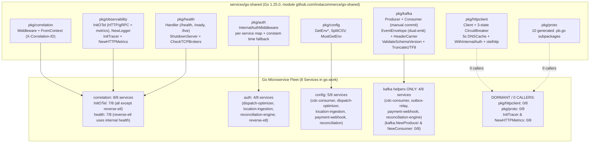

# Go Shared Platform Library (`services/go-shared/`) — Code Walkthrough

> [!NOTE]
> **Part of the InstaCommerce Onboarding Suite:** [Onboarding Hub](../../README.md) · [Code Walkthrough Atlas](../README.md) · [Domain & Event Catalog (`05`)](../../05-domain-model-and-event-catalog.md) · [Incident Drills & Exam (`06`)](../../06-incident-drills-and-readiness-exam.md) · [Dependency Matrix & Cheatsheet (`07`)](../../07-service-dependency-and-command-cheatsheet.md)

> **Component Scope:** Leaf Go `1.25.0` module (`github.com/instacommerce/go-shared`) in [`go.work`](../../../../go.work#L1-L13) providing auth middleware, typed env config, correlation IDs, health probes, a resilient HTTP client, Kafka envelope/tracing wrappers, OpenTelemetry/Prometheus/slog observability, and generated Protobuf stubs.

---

## 1. Purpose, Module Layout & `go.work` Integration

`services/go-shared` is a non-deployable Go workspace dependency (`replace github.com/instacommerce/go-shared => ../go-shared`) imported by all **8 Go microservices** ([`services/go-shared/go.mod`](../../../../services/go-shared/go.mod#L1-L22), [`go.work`](../../../../go.work#L3-L12)).

```text
services/go-shared/
├── go.mod                                     # Go 1.25.0 (toolchain go1.25.1); kafka-go, otel 1.42, grpc 1.79.3
├── README.md                                  # Partially stale docs (claims 0 tests, no envelope/WithInternalAuth)
└── pkg/
    ├── auth/{middleware,middleware_test}.go   # Constant-time S2S auth + per-service allowed callers map
    ├── config/{config,config_test}.go         # GetEnv*, GetEnv*Strict, SplitCSV, MustGetEnv
    ├── correlation/{middleware,middleware_test}.go # X-Correlation-ID HTTP middleware & context helper
    ├── health/{handler,handler_test,probes,probes_test}.go # /health*, ShutdownServer, CheckTCPBrokers
    ├── httpclient/{client,circuit_breaker,dns_cache,client_test,client_resilience_test}.go
    ├── kafka/{producer,consumer,carrier,envelope,envelope_json,*_test}.go
    ├── observability/{otel,tracing,logging,metrics,observability_test}.go
    └── proto/{cart,catalog,common,fulfillment,inventory,order,payment,rider,routing,wallet}/v1/*.pb.go
```

**Go Shared Architecture LLD** — *[Rendered PNG](../diagrams/components/go-shared-arch-lld.png) · [Mermaid Source](../diagrams/components/go-shared-arch-lld.mmd)*



---

## 2. Package-by-Package Code Walkthrough

### 2.1 `pkg/auth` — Internal Service Authentication

[`middleware.go`](../../../../services/go-shared/pkg/auth/middleware.go#L17-L150) mirrors Java's `SharedInternalServiceAuthFilter`:
- `NewInternalAuthMiddleware(logger)` (`#L45-L71`) reads `INTERNAL_SERVICE_TOKEN`, `INTERNAL_SERVICE_NAME`, `INTERNAL_SERVICE_ALLOWED_CALLERS` (JSON `{caller: token}`), and `INTERNAL_SERVICE_STRICT_PER_SERVICE` (`"true"`), exempting `/health`, `/health/ready`, `/health/live`, and `/metrics`.
- `Wrap(next)` (`#L76-L114`) returns HTTP `401` (`{"error":"missing authentication headers"}`) if either `X-Internal-Service` or `X-Internal-Token` is absent, and HTTP `403` (`{"error":"forbidden"}`) when `isValidToken` (`#L130-L150`) rejects the credential.
- `isValidToken` checks `allowedCallers[callingService]` first via `subtle.ConstantTimeCompare`; if absent and `strictPerService` is true it rejects; otherwise it checks `expectedToken` via `subtle.ConstantTimeCompare` and logs a deprecation warning (`#L144-L148`).

### 2.2 `pkg/correlation` & `pkg/config`

- **[`pkg/correlation/middleware.go`](../../../../services/go-shared/pkg/correlation/middleware.go#L12-L34):** `Middleware` reads `X-Correlation-ID` (generating a UUID v4 via `uuid.NewString()` when blank), injects it into `context.Context` under `ContextKey`, and echoes `X-Correlation-ID` on the HTTP response. `FromContext(ctx)` extracts it cleanly.
- **[`pkg/config/config.go`](../../../../services/go-shared/pkg/config/config.go#L19-L158):** Provides `GetEnv`, `GetEnvTrimmed`, `GetEnvInt`, `GetEnvIntStrict`, `GetEnvDuration`, `GetEnvDurationStrict`, `GetEnvBool` (`"true"/"1"/"yes"` vs `"false"/"0"/"no"`), `SplitCSV` (splits on `,`, `;`, space), `GetEnvSlice`, and fail-fast `MustGetEnv` (panics if unset/empty).

### 2.3 `pkg/health` — Probes, Graceful Shutdown & Broker Dialing

- **[`handler.go`](../../../../services/go-shared/pkg/health/handler.go#L38-L146):** `Handler` holds `[]Check` and an `atomic.Bool` `ready` flag (starts `false`). `RegisterRoutes(mux)` exposes `/health` (concurrent checks with 5s timeout, `200 ok` or `503 degraded`), `/health/ready` (`200 ready` / `503 not_ready`), and `/health/live` (unconditional `200 alive`).
- **[`probes.go`](../../../../services/go-shared/pkg/health/probes.go#L17-L133):** `ShutdownServer` atomically flips `healthHandler.SetReady(false)` before `server.Shutdown(ctx)` (falling back to `server.Close()`). `CheckTCPBrokers` + `CheckTCPBrokersWithDial` + `BrokerAttemptContext` divide remaining context deadline across configured Kafka brokers (`2s` default cap per broker) and succeed as soon as any broker accepts TCP.

### 2.4 `pkg/httpclient` — Circuit Breaker, DNS Cache, Retries & `WithInternalAuth`

**Go Shared HTTP Resilience & Kafka/Auth Flow** — *[Rendered PNG](../diagrams/components/go-shared-flow.png) · [Mermaid Source](../diagrams/components/go-shared-flow.mmd)*

```mermaid
flowchart TD
    subgraph HTTPFlow["pkg/httpclient.Client.Do(ctx, req) Resilience Pipeline"]
        H1["Start Do(ctx, req)\ncheck ctx.Err()"] --> H2{"circuitBreaker.allow()\nClosed | Open elapsed > 30s | 1 HalfOpen probe"}
        H2 -- false --> HFailOpen["Return circuit breaker open error"]
        H2 -- true --> H3["Buffer body + injectHeaders:\nOTel traceparent/baggage, X-Correlation-ID,\nX-Internal-Service / X-Internal-Token"]
        H3 --> H4["DNSCache.DialContext (5s TTL, 1024 cap)\nfallback to stale cached IPs on DNS error"]
        H4 --> H5["otelhttp.Transport round-trip (30s timeout)"]
        H5 --> H6{"Status / Err?"}
        H6 -- "2xx-4xx (except 429)" --> HOk["recordSuccess() -> Closed\nreturn response"]
        H6 -- "net err / 429 / 5xx & attempts left" --> HBack["Wait Retry-After (<=30s)\nor baseDelay * 2^(n-1) + 20% jitter"]
        HBack --> H4
        H6 -- "Exhausted / Deadline" --> HFail["recordFailure() once per logical call\n(defer abortProbe if panic/cancel)"]
    end

    subgraph AuthKafkaFlow["pkg/auth + pkg/kafka Consumer & Envelope Flow"]
        A1["HTTP Request -> correlation.Middleware -> InternalAuthMiddleware.Wrap"] --> A2{"Path in skipPaths?\n/health*, /metrics"}
        A2 -- yes --> ANext["Forward to app handler"]
        A2 -- no --> A3["subtle.ConstantTimeCompare:\n1. allowedCallers{caller}\n2. reject if strictPerService\n3. shared expectedToken"]
        A3 -- valid --> ANext
        A3 -- "missing / bad" --> A40x["401 missing headers / 403 forbidden"]

        K1["kafka.Consumer.Start (CommitInterval=0)"] --> K2["FetchMessage -> ContextWithMessageHeaders"]
        K2 --> K3{"handler(msgCtx, msg)"}
        K3 -- nil --> K4["CommitMessages(ctx, msg)"]
        K3 -- err --> K5["Skip commit + ErrorBackoff (250ms) -> redeliver"]
    end
```



[`client.go`](../../../../services/go-shared/pkg/httpclient/client.go#L31-L371), [`circuit_breaker.go`](../../../../services/go-shared/pkg/httpclient/circuit_breaker.go#L9-L109), and [`dns_cache.go`](../../../../services/go-shared/pkg/httpclient/dns_cache.go#L11-L126) compose a full resilient HTTP client:
- **Defaults (`NewClient`, `#L134-L169`):** `30s` HTTP timeout, `MaxIdleConns=100`, `MaxIdleConnsPerHost=100`, `IdleConnTimeout=30s`, `otelhttp.NewTransport(baseTransport)` wrapping `baseTransport`, `5s` `DNSCache` TTL (`maxDNSCacheEntries=1024`), `maxRetries=3`, `baseDelay=500ms`, and `CircuitBreaker(threshold=5, resetTimeout=30s)`. Options include `WithTimeout`, `WithMaxRetries`, `WithBaseDelay`, `WithCircuitBreakerThreshold`, `WithCircuitBreakerResetTimeout`, `WithDNSCacheTTL`, `WithIdleConnTimeout`, `WithLogger`, and `WithInternalAuth(serviceName, token)` (`#L126-L131`).
- **DNS Cache (`dns_cache.go`, `#L37-L126`):** `LookupHost` returns cached IPs before `expiresAt`, falls back to **stale** cached IPs if upstream DNS fails (`#L49-L51`), and evicts expired or earliest-expiring entries at the 1024-host cap.
- **Logical-call Circuit Breaker + Retry (`client.go`, `#L173-L284`):**
  1. `circuitBreaker.allow()` gates requests (`Closed` allows; `Open` transitions to `HalfOpen` after `resetTimeout` setting `halfOpenInFlight = true`; concurrent probes wait). A deferred `abortProbe()` prevents stuck `HalfOpen` locks on panic or caller cancel (`#L184-L189`).
  2. Buffers `req.Body` once so retries replay identically (`#L191-L199`, `#L231-L237`).
  3. `injectHeaders` (`#L286-L309`) injects OTel `traceparent` + `baggage`, `X-Correlation-ID` (from `correlation.FromContext`), and `X-Internal-Service` / `X-Internal-Token` (when `WithInternalAuth` is configured and headers aren't already set).
  4. Retries network errors, `429`, and `5xx` responses (`isRetryableStatus`, `#L311-L313`), respecting integer `Retry-After` capped at `30s` or `baseDelay * 2^(attempt-1) + 20% jitter`. Updates `recordSuccess()` or `recordFailure()` **once per logical call** (`#L275-L281`).

### 2.5 `pkg/kafka` — Producer, Consumer, Carrier & Dual-Emit `EventEnvelope`

- **[`producer.go`](../../../../services/go-shared/pkg/kafka/producer.go#L41-L187):** Synchronous `kafka-go.Writer` (`Async: false`, `RequiredAcks: -1`, `MaxRetries: 5`, `BatchSize: 100`, `LingerMs: 10`, `Hash{}` balancer, `snappy`/`lz4`/`gzip`/`zstd`). `Publish` calls `InjectCorrelationHeaders` without mutating caller maps.
- **[`consumer.go`](../../../../services/go-shared/pkg/kafka/consumer.go#L64-L254):** Sets `CommitInterval: 0` (disabling auto-commit!) so `Start` fetches synchronously, extracts correlation IDs via `ContextWithMessageHeaders` (`X-Correlation-ID`, `correlation_id`, `correlationId`), runs `handler`, backs off `250ms` and skips commit on error, and explicitly calls `CommitMessages` only when `handler` returns `nil`.
- **[`carrier.go`](../../../../services/go-shared/pkg/kafka/carrier.go#L11-L54):** `HeaderCarrier` adapts `*[]kafkago.Header` to `propagation.TextMapCarrier` for OTel trace propagation across Kafka messages.
- **[`envelope.go`](../../../../services/go-shared/pkg/kafka/envelope.go#L13-L79) & [`envelope_json.go`](../../../../services/go-shared/pkg/kafka/envelope_json.go#L10-L90):** `EventEnvelope` defines dual ID/time fields. `MarshalJSON` runs `syncAliases()` to emit both `id`+`eventId` and `eventTime`+`timestamp`. `UnmarshalJSON` normalizes `id`/`eventId`/`event_id`, `eventTime`/`timestamp`/`event_time`, and snake_case metadata keys (`source_service`, `correlation_id`, etc.). `Validate()` requires `EventID`, `EventType`, `AggregateID`, `AggregateType`, and validates `SchemaVersion` via `ValidateSchemaVersion` (`vN` or `X.Y.Z`, defaulting blank to `"v1"`). `TruncateUTF8` safely caps UTF-8 DLQ reasons without splitting multi-byte runes.

### 2.6 `pkg/observability` & `pkg/proto`

- **[`otel.go`](../../../../services/go-shared/pkg/observability/otel.go#L25-L268):** `InitOTel` supports both `OTelProtocolHTTP` (`"http"`) and `OTelProtocolGRPC` (`"grpc"`), optional `OTLP` HTTP metrics (`EnableMetrics`), `StdoutFallback`, `FallbackNoop`, and `NoopIfNoEndpoint`, setting global `TracerProvider`, `MeterProvider`, and `TraceContext` + `Baggage` propagators.
- **[`tracing.go`](../../../../services/go-shared/pkg/observability/tracing.go#L29-L83):** Older HTTP-only `InitTracer` (hardcodes `localhost:4318`, `TraceIDRatioBased(1.0)`).
- **[`logging.go`](../../../../services/go-shared/pkg/observability/logging.go#L21-L65) & [`metrics.go`](../../../../services/go-shared/pkg/observability/metrics.go#L14-L118):** `NewLogger` creates an `slog.Logger` (`TextHandler` for `development`/`local`, JSON otherwise; attaches `service_name` and `service_version`). `NewHTTPMetrics(ns)` registers `{ns}_http_requests_total`, `duration_seconds`, `request_size_bytes`, and `response_size_bytes`, and `InstrumentHandler` wraps `http.ResponseWriter` with `Unwrap()` support.
- **`pkg/proto/`:** Holds 19 generated `.pb.go` and `_grpc.pb.go` files across 10 subpackages (`common`, `cart`, `catalog`, `fulfillment`, `inventory`, `order`, `payment`, `rider`, `routing`, `wallet`).

---

## 3. Exact Adoption Matrix Across All 8 Go Services

| Go Service | `auth` | `config` | `correlation` | `health` | `httpclient` | `kafka` (actual symbols used) | `observability` (actual symbols used) | `proto` |
|---|---|---|---|---|---|---|---|---|
| `cdc-consumer-service` | — | Yes | Yes | `NewHandler` | — | `ValidateSchemaVersion`, `TruncateUTF8`, `NewHeaderCarrier` | `InitOTel` | — |
| `dispatch-optimizer-service` | Yes | Yes | Yes | `NewHandler`, `CheckTCPBrokers` | — | — (`segmentio/kafka-go` direct) | `InitOTel` | — |
| `location-ingestion-service` | Yes | Yes | Yes | `NewHandler`, `ShutdownServer`, `CheckTCPBrokers*` | — | — (`segmentio/kafka-go` direct) | `InitOTel` | — |
| `outbox-relay-service` | — | — | Yes | `NewHandler`, `ShutdownServer` | — | `ValidateSchemaVersion`, `TruncateUTF8`, `ErrInvalidSchemaVersion` | `InitOTel` | — |
| `payment-webhook-service` | — | Yes | Yes | `NewHandler`, `ShutdownServer` | — | `NewHeaderCarrier` | `InitOTel`, `NewLogger` | — |
| `reconciliation-engine` | Yes | Yes | Yes | `NewHandler`, `CheckTCPBrokers` | — | `EventEnvelope` (type alias) | `InitOTel` | — |
| `reverse-etl-orchestrator` | Yes | — | Yes | — (custom `internal/health`) | — | — | — (custom JSON `slog`) | — |
| `stream-processor-service` | — | — | Yes | `NewHandler` | — | — (`segmentio/kafka-go` direct) | `InitOTel` | — |
| **Total Adoption (`8` svcs)** | **4 / 8** | **5 / 8** | **8 / 8** | **7 / 8** | **0 / 8** | **4 / 8 helpers (`0/8` Prod/Cons)** | **7 / 8 `InitOTel` (`1/8` `NewLogger`)** | **0 / 8** |

---

## 4. Verified Seams, Dormant Code & `README.md` Drift

1. **Pervasive `services/go-shared/README.md` Drift:** [`services/go-shared/README.md`](../../../../services/go-shared/README.md#L417-L419) still documents an obsolete snapshot of the library, falsely claiming:
   - "No test files exist in go-shared today" (`#L610`, `#L723`) — **7 test files** with comprehensive unit/race tests exist across all 7 non-proto packages.
   - `CommitInterval=1s` (`#L418`, `#L726`) — actual [`consumer.go`](../../../../services/go-shared/pkg/kafka/consumer.go#L128) sets `CommitInterval: 0` and manually calls `CommitMessages` on `nil` handler return.
   - "No event envelope type" (`#L727`) — [`envelope.go`](../../../../services/go-shared/pkg/kafka/envelope.go#L18-L30) and [`envelope_json.go`](../../../../services/go-shared/pkg/kafka/envelope_json.go#L29-L90) implement dual-emit `EventEnvelope`.
   - "httpclient has no `WithInternalAuth` option" (`#L728`) — [`WithInternalAuth`](../../../../services/go-shared/pkg/httpclient/client.go#L126-L131) exists alongside `DNSCache` and `otelhttp`.
   - "OTLP/HTTP only" (`#L729`) & "No correlation-ID propagation" (`#L730`) — [`InitOTel`](../../../../services/go-shared/pkg/observability/otel.go#L58-L108) supports both HTTP and gRPC, and [`pkg/correlation`](../../../../services/go-shared/pkg/correlation/middleware.go#L17-L34) is used by all 8 Go services.
2. **Dormant Packages/APIs (`0/8` Service Callers):**
   - `pkg/httpclient` has **0** Go service callers (`dispatch-optimizer` and `reverse-etl` do not invoke outbound REST clients via `go-shared`).
   - `kafka.NewProducer` and `kafka.NewConsumer` have **0** Go service callers; services invoke `segmentio/kafka-go` directly (or `IBM/sarama` in `outbox-relay-service`) and import only `pkg/kafka`'s `EventEnvelope`, `ValidateSchemaVersion`, `TruncateUTF8`, and `NewHeaderCarrier`.
   - `observability.InitTracer` and `observability.NewHTTPMetrics` have **0** service callers (superseded by `InitOTel` and per-service Prometheus metrics).
   - `pkg/proto/*` has **0** Go service callers; generated stubs are validated only by `go build ./pkg/proto/...` and CI drift checks.
3. **Envelope Alias Mismatch vs Java:** `go-shared/pkg/kafka`'s [`UnmarshalJSON`](../../../../services/go-shared/pkg/kafka/envelope_json.go#L42-L52) does not handle `occurred_at` or `event_timestamp` (unlike [`EventEnvelope.java`](../../../../contracts/src/main/java/com/instacommerce/contracts/events/EventEnvelope.java#L30)), and [`Validate()`](../../../../services/go-shared/pkg/kafka/envelope.go#L45-L68) does not require `SourceService` or non-zero `EventTime`.

---

## 5. Local Testing

```bash
# Run race-enabled Go unit tests across all go-shared packages
cd services/go-shared && go test -race -v ./...
```

---

**Previous:** [Java Platform Common](./platform-common-java.md) | **Atlas Hub:** [Code Walkthrough Atlas](../README.md) | **Next:** [Data Platform & Lakehouse](./data-platform-lakehouse.md)
