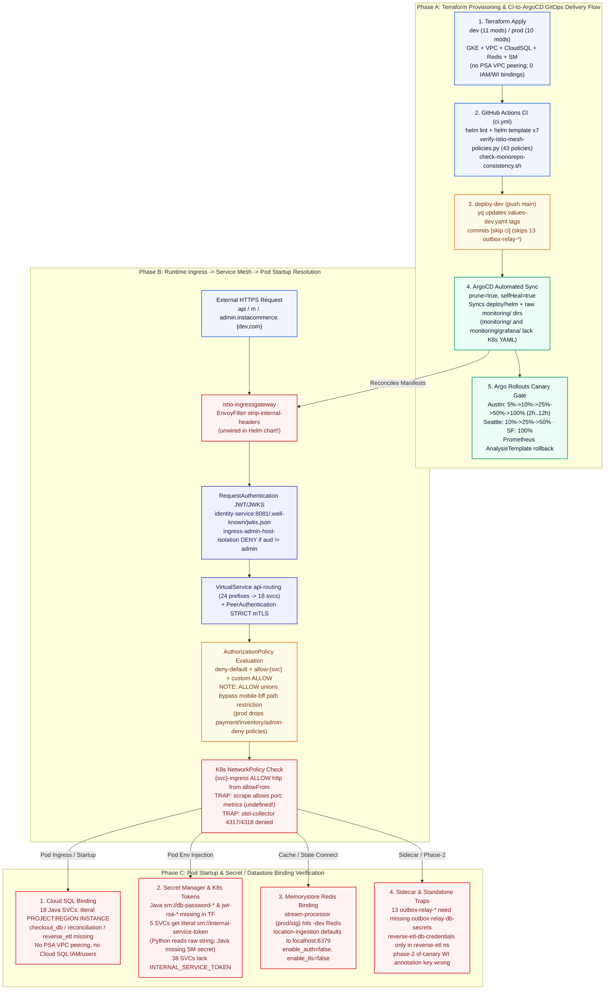

# Component 6 — Infrastructure, Terraform, Helm, Istio & ArgoCD GitOps (`infra-terraform-gitops`)

> [!NOTE]
> **Part of the InstaCommerce Onboarding Suite:** [Onboarding Hub](../../README.md) · [Code Walkthrough Atlas](../README.md) · [Domain & Event Catalog (`05`)](../../05-domain-model-and-event-catalog.md) · [Incident Drills & Exam (`06`)](../../06-incident-drills-and-readiness-exam.md) · [Dependency Matrix & Cheatsheet (`07`)](../../07-service-dependency-and-command-cheatsheet.md)

> **Reading Goal:** Trace every layer of InstaCommerce's cloud provisioning, umbrella Kubernetes packaging, zero-trust Istio mesh, and ArgoCD progressive-delivery pipeline directly against checked-in Terraform (`.tf`), Helm (`.yaml`/`.tpl`), Istio, ArgoCD, and standalone `k8s/` manifests—and separate declared target-state intent from the exact runtime blockers verified in the repository today.

| Dimension | Verified Source Truth |
|---|---|
| **Terraform Roots & Modules** | [`infra/terraform/backend.tf`](../../../../infra/terraform/backend.tf#L1-L6), [`environments/dev/main.tf`](../../../../infra/terraform/environments/dev/main.tf#L1-L92) (`11` modules), [`environments/prod/main.tf`](../../../../infra/terraform/environments/prod/main.tf#L1-L85) (`10` modules), `13` module dirs under `infra/terraform/modules/`, standalone [`debezium-connector-reconciliation.tf`](../../../../infra/terraform/debezium-connector-reconciliation.tf#L1-L132), and [`phases/phase-2/`](../../../../infra/terraform/phases/phase-2/sf_canary_gke_cluster.tf#L1-L272) |
| **Umbrella Helm Chart** | [`deploy/helm/Chart.yaml`](../../../../deploy/helm/Chart.yaml#L1-L6) (`instacommerce v0.1.0`), [`values.yaml`](../../../../deploy/helm/values.yaml#L1-L1491) (`43` `.Values.services` entries), `6` environment/canary overlays (`values-{dev,staging,prod,canary-sf,canary-seattle,canary-austin}.yaml`), `10` core/observability templates, and `9` Istio templates |
| **Standalone Istio & K8s** | [`deploy/istio/envoy-filter-strip-internal-headers.yaml`](../../../../deploy/istio/envoy-filter-strip-internal-headers.yaml#L1-L41), [`infra/kubernetes/phases/phase-2/`](../../../../infra/kubernetes/phases/phase-2/01-namespace-sf-canary.yaml#L1-L229) (`5` SF dark-store files), and [`k8s/reverse-etl-orchestrator-deployment.yaml`](../../../../k8s/reverse-etl-orchestrator-deployment.yaml#L1-L355) + [`k8s/reverse-etl-secrets.yaml`](../../../../k8s/reverse-etl-secrets.yaml#L1-L63) |
| **ArgoCD GitOps & Rollouts** | [`argocd/app-of-apps.yaml`](../../../../argocd/app-of-apps.yaml#L1-L24), `8` manifests in `argocd/applications/`, `2` templates in `argocd/rollouts/`, plus untracked local backup `argocd/applications-stale-bak/` |
| **CI & Consistency Gates** | [`.github/workflows/ci.yml`](../../../../.github/workflows/ci.yml#L745-L892) (`helm-validation` + `deploy-dev`), [`scripts/verify-istio-mesh-policies.py`](../../../../scripts/verify-istio-mesh-policies.py#L14-L112), and [`scripts/check-monorepo-consistency.sh`](../../../../scripts/check-monorepo-consistency.sh#L89-L282) |

---

## 1. Architecture & Control-Plane Overview

**Infra, Terraform & GitOps Architecture LLD** — *[Rendered PNG](../diagrams/components/infra-terraform-gitops-arch-lld.png) · [Mermaid Source](../diagrams/components/infra-terraform-gitops-arch-lld.mmd)*

```mermaid
flowchart TB
    classDef tf fill:#EFF6FF,stroke:#2563EB,stroke-width:1.6px,color:#0F172A
    classDef data fill:#ECFDF5,stroke:#059669,stroke-width:1.6px,color:#0F172A
    classDef helm fill:#F1F5F9,stroke:#334155,stroke-width:1.6px,color:#0F172A
    classDef istio fill:#EEF2FF,stroke:#4338CA,stroke-width:1.6px,color:#1E1B4B
    classDef argo fill:#FFFBEB,stroke:#D97706,stroke-width:1.6px,color:#78350F
    classDef gap fill:#FEF2F2,stroke:#DC2626,stroke-width:1.7px,color:#7F1D1D

    subgraph TF["1. Terraform Infrastructure Layer (infra/terraform/)"]
        direction TB
        subgraph TF_ENV["Root Composition & Remote State"]
            direction LR
            BACKEND["backend.tf<br/>GCS: instacommerce-terraform-state/environments"]:::tf
            DEV_ROOT["environments/dev/main.tf<br/>11 modules (incl. kubernetes_secrets)<br/>10.20/10.21/10.22 CIDRs · asia-south1"]:::tf
            PROD_ROOT["environments/prod/main.tf<br/>10 modules (OMITS kubernetes_secrets)<br/>10.30/10.31/10.32 CIDRs · asia-south1"]:::tf
            DEBEZ["debezium-connector-reconciliation.tf<br/>topic: reconciliation.cdc (12 partitions)<br/>2 Debezium PG connectors (standalone root)"]:::tf
        end

        subgraph TF_CORE["Core Platform Modules (modules/)"]
            direction LR
            VPC["vpc<br/>network + subnet + pods/services ranges<br/>Cloud Router + NAT (NO PSA peering)"]:::tf
            GKE["gke<br/>VPC_NATIVE + Workload Identity pool<br/>general-pool: 2-6 e2-standard-4 (GKE_METADATA)"]:::tf
            SQL["cloudsql<br/>POSTGRES_16 (db-custom-2-8192 · private IP)<br/>17 *_db DBs (NO checkout_db/recon/rev_etl)"]:::gap
            REDIS["memorystore<br/>STANDARD_HA 4GB Redis<br/>enable_auth=false · enable_tls=false"]:::tf
            IAM["iam + secret-manager + k8s-secrets<br/>7 SAs ONLY · 0 IAM/WI bindings<br/>18 SM secrets (16 unused; 25 sm:// missing)<br/>service-tokens K8s Secret (dev-only, 30 keys)"]:::gap
        end

        subgraph TF_DATA["Data, ML & Uninstantiated Compliance / Phase-2 Modules"]
            direction LR
            BQ["bigquery + data-lake + dataflow<br/>datasets: analytics, ml · 4 raw 90d tables<br/>BI Engine marts ref · Data Catalog PII mask<br/>dataflow SA: 4 IAM roles (only IAM module)"]:::data
            FS["feature-store<br/>2nd Redis online store (4GB HA)<br/>BQ feature_store (5 tables)"]:::data
            UNWIRED["Uninstantiated Audit & Phase-2 TF<br/>gcs-audit-archive (7y WORM, invalid block)<br/>gcs-kms-audit-archive (90d KMS)<br/>phases/phase-2/ sf-canary GKE+ILB+FW+SLO"]:::gap
        end

        DEV_ROOT --> VPC
        PROD_ROOT --> VPC
        VPC --> GKE
        VPC --> SQL
        VPC --> REDIS
        VPC --> FS
        DEV_ROOT --> IAM
        PROD_ROOT --> IAM
        PROD_ROOT --> BQ
    end

    subgraph HELM["2. Umbrella Helm Chart & Zero-Trust Mesh (deploy/helm/ + deploy/istio/)"]
        direction TB
        subgraph HELM_TMPL["Chart Templates & Value Overlays (43 .Values.services keys)"]
            direction LR
            VALUES["values.yaml (1,491 lines) + overlays<br/>values-{dev,staging,prod,canary-sf/seattle/austin}<br/>43 entries: 20 Java + 14 outbox-relay* + 7 Go + 2 Py"]:::helm
            WORKLOADS["Unconditional Loop Templates (NO .enabled check)<br/>deployment.yaml (44 incl. otel-collector) · service.yaml (port: http only)<br/>serviceaccount.yaml (wave 0 WI) · hpa (29) · vpa (8 prod) · pdb (43)<br/>otel-collector (env=production) + beyla eBPF DaemonSet"]:::helm
            HELM_GAPS["Helm Runtime Gaps<br/>1. Literal PROJECT:REGION:INSTANCE on 18 DB URLs<br/>2. NetworkPolicy scrapes port: metrics (pods expose http)<br/>3. OTel collector blocked by default-deny-ingress<br/>4. canary .enabled + analysis templates are no-ops<br/>5. 5x sm://internal-service-token; 38x omitted; prod stream-proc uses dev Redis"]:::gap
        end

        subgraph MESH["Istio Service Mesh & NetworkPolicy Enforcement"]
            direction LR
            GATEWAY["gateway.yaml + virtual-service.yaml<br/>HTTPS 443 (instacommerce-tls)<br/>24 HTTP prefix routes -> 18 cluster services"]:::istio
            AUTHN["peer-authentication + request-authentication<br/>Mesh mTLS: STRICT<br/>7 RequestAuth (base/dev/stg) vs 3 (prod replaces list!)"]:::istio
            AUTHZ["authorization-policy + deny-default + service-allow-policies<br/>Base: 1 deny-default + 43 allow-{svc} + 6 custom = 50<br/>Prod: 1 + 43 + 3 = 47 (drops payment/inventory/admin DENY)"]:::istio
            ENVOY["EnvoyFilter<br/>security-headers.yaml (chart ROUTE_CONFIGURATION)<br/>deploy/istio/envoy-filter-strip-internal-headers.yaml (standalone)"]:::gap
        end

        VALUES --> WORKLOADS --> HELM_GAPS
        VALUES --> GATEWAY
        VALUES --> AUTHN
        VALUES --> AUTHZ
    end

    subgraph GITOPS["3. ArgoCD GitOps & Standalone Manifests (argocd/ + infra/kubernetes/ + k8s/)"]
        direction LR
        ARGO_APPS["argocd/ Applications<br/>app-of-apps.yaml (instacommerce -> values-dev)<br/>staging.yaml · monitoring*.yaml<br/>5 canary-*.yaml (raw Rollout+Analysis+VS appended)<br/>applications-stale-bak/ (untracked local backup)"]:::argo
        ROLLOUTS["argocd/rollouts/<br/>canary-rollout-template.yaml (order-service 10/25/50)<br/>analysis-template-error-rate.yaml (5xx lt 1%, p99 lt 1s)<br/>PromQL: http_server_requests_seconds_*"]:::argo
        STANDALONE["Standalone K8s Manifests<br/>infra/kubernetes/phases/phase-2/ (sf-canary 01..05, 5-rep dark-store)<br/>k8s/reverse-etl-{orchestrator-deployment,secrets}.yaml<br/>(reverse-etl ns, Snowflake/Segment, literal placeholders)"]:::gap
    end

    GKE -->|"Hosts Workloads"| WORKLOADS
    IAM -. "Missing WI + SM perms" .-> WORKLOADS
    ARGO_APPS -->|"Syncs deploy/helm"| VALUES
    ARGO_APPS -->|"Traffic Split & Gates"| ROLLOUTS
    ROLLOUTS -. "Istio VirtualService" .-> GATEWAY
```



InstaCommerce separates infrastructure and workload delivery across three loosely coupled planes:

1. **GCP & Cluster Provisioning (`infra/terraform/`):**
   - Root environments (`dev` and `prod` in `asia-south1`) compose core networking (`vpc`), compute (`gke`), stateful stores (`cloudsql`, `memorystore`), identity/secrets (`iam`, `secret-manager`, dev-only `kubernetes-secrets`), and data/ML foundations (`bigquery`, `feature-store`, `data-lake`, `dataflow`).
   - Two compliance modules (`gcs-audit-archive`, `gcs-kms-audit-archive`), a standalone Debezium/Kafka root (`debezium-connector-reconciliation.tf`), and a `us-west1` Phase-2 SF canary stack (`phases/phase-2/`) live alongside the environment roots without being wired into `environments/{dev,prod}/main.tf`.
2. **Umbrella Helm Packaging & Mesh Security (`deploy/helm/` + `deploy/istio/`):**
   - A single chart (`instacommerce v0.1.0`) templates all `43` workload entries under `.Values.services` (`20` Java services, `1` base `outbox-relay` + `13` per-domain `outbox-relay-<domain>` variants, `7` other Go services, and `2` Python AI services) together with cluster-wide observability (`otel-collector` + `otel-ebpf-network-profiler`), Istio `STRICT` mTLS, JWT `RequestAuthentication`, default-deny `AuthorizationPolicy` rules, and Kubernetes `NetworkPolicy` ingress whitelists.
   - `helm lint` and `helm template` pass across all `7` value files (`values.yaml` + `6` overlays), yet cross-checking against [`services/`](../../../../services/) and [`infra/terraform/`](../../../../infra/terraform/) exposes multiple P0 boot blockers (literal `PROJECT:REGION:INSTANCE` JDBC strings, missing DBs/secrets/IAM/WI bindings, un-templated `${sm://...}` tokens on Python pods, `NetworkPolicy` scrape port mismatch, and canary `.enabled` no-ops).
3. **GitOps Sync & Progressive Delivery (`argocd/` + `infra/kubernetes/` + `k8s/`):**
   - [`argocd/app-of-apps.yaml`](../../../../argocd/app-of-apps.yaml#L1-L24) configures automated sync (`prune: true`, `selfHeal: true`) against `deploy/helm` with `values.yaml` + `values-dev.yaml`.
   - Separate manifests in `argocd/applications/` target staging, raw monitoring directories, and `5` regional canary deployments (`sf`, `seattle`, `austin`), while `infra/kubernetes/phases/phase-2/` and `k8s/` carry standalone manifests outside the umbrella chart.

---

## 2. Terraform IaC Topology (`infra/terraform/`)

### 2.1 Remote Backend, Environment Roots & Standalone Roots

- **Remote State ([`infra/terraform/backend.tf`](../../../../infra/terraform/backend.tf#L1-L6)):** Declares a GCS backend (`bucket = "instacommerce-terraform-state"`, `prefix = "environments"`). Notice that `environments/dev/` and `environments/prod/` do **not** declare individual `backend.tf` or `required_providers` overrides; neither environment passes a distinct backend prefix in its `.tf` files.
- **Dev vs. Prod Root Composition:**
  - [`environments/dev/main.tf`](../../../../infra/terraform/environments/dev/main.tf#L1-L92) instantiates **11 modules**: `vpc`, `gke`, `cloudsql`, `memorystore`, `iam`, `secret_manager`, `bigquery`, `feature_store`, `data_lake`, `dataflow`, and `kubernetes_secrets` (`depends_on = [module.gke]` at [`#L87-L92`](../../../../infra/terraform/environments/dev/main.tf#L87-L92)).
  - [`environments/prod/main.tf`](../../../../infra/terraform/environments/prod/main.tf#L1-L85) instantiates **10 modules**—it **omits `module "kubernetes_secrets"`**, leaving Wave 34's `service-tokens` Kubernetes secret absent from production Terraform.
  - Network CIDRs split cleanly across environments:
    - `dev` ([`environments/dev/variables.tf#L20-L33`](../../../../infra/terraform/environments/dev/variables.tf#L20-L33), [`terraform.tfvars#L1-L3`](../../../../infra/terraform/environments/dev/terraform.tfvars#L1-L3)): `project_id = "instacommerce-dev"`, `region = "asia-south1"`, `k8s_namespace = "instacommerce"`, `subnet_cidr = "10.20.0.0/16"`, `pods_cidr = "10.21.0.0/16"`, `services_cidr = "10.22.0.0/16"`.
    - `prod` ([`environments/prod/variables.tf#L15-L28`](../../../../infra/terraform/environments/prod/variables.tf#L15-L28), [`terraform.tfvars#L1-L3`](../../../../infra/terraform/environments/prod/terraform.tfvars#L1-L3)): `project_id = "instacommerce-prod"`, `region = "asia-south1"`, `subnet_cidr = "10.30.0.0/16"`, `pods_cidr = "10.31.0.0/16"`, `services_cidr = "10.32.0.0/16"`.
- **Standalone Debezium & Kafka Root ([`debezium-connector-reconciliation.tf`](../../../../infra/terraform/debezium-connector-reconciliation.tf#L1-L132) + [`variables.tf`](../../../../infra/terraform/variables.tf#L1-L41)):**
  - Provisions `kafka_topic.reconciliation_cdc` (`name = "reconciliation.cdc"`, `partitions = 12`, `min.insync.replicas = "2"`, `retention.ms = 24h`) and two PostgreSQL `debezium_connector` resources (`reconciliation_runs_connector` for `public.reconciliation_runs` and `reconciliation_mismatches_connector` for `public.reconciliation_mismatches`).
  - Both connectors configure `RegexRouter` rewriting `([^.]+)\.([^.]+)\.([^.]+)` to `reconciliation.cdc`, `ExtractNewRecordState` (`drop.tombstones = "true"`), `decimal.handling.mode = "string"`, and heartbeat query `UPDATE reconciliation_outbox SET published = published WHERE id = -1` ([`#L50`](../../../../infra/terraform/debezium-connector-reconciliation.tf#L50), [`#L106`](../../../../infra/terraform/debezium-connector-reconciliation.tf#L106)).
  - **Root quirks:** No `required_providers` or `provider "kafka"` / `provider "debezium"` block exists in `infra/terraform/`, `reconciliation_db_host` defaults to `"reconciliation-db.instacommerce.svc.cluster.local"` ([`variables.tf#L4`](../../../../infra/terraform/variables.tf#L4)) rather than Cloud SQL, and no Debezium connector exists for `payments.cdc` (even though [`reconciliation-engine`](../../../../services/reconciliation-engine/config.go#L63) subscribes to `payments.cdc,reconciliation.cdc`).
- **Docs Drift:** [`infra/terraform/README.md`](../../../../infra/terraform/README.md#L36-L110) documents only `10` modules and completely omits `kubernetes-secrets`, `gcs-audit-archive`, `gcs-kms-audit-archive`, `debezium-connector-reconciliation.tf`, `variables.tf`, and `phases/phase-2/`.

### 2.2 Core Infrastructure Modules (`modules/`)

| Module | File & Lines | Resources Provisioned | Verified Behavior & Gaps |
|---|---|---|---|
| **`vpc`** | [`modules/vpc/main.tf`](../../../../infra/terraform/modules/vpc/main.tf#L1-L35) | `google_compute_network.main`, `google_compute_subnetwork.main` (secondary `pods` & `services` ranges), `google_compute_router.main`, `google_compute_router_nat.main` (`AUTO_ONLY`) | **Missing Private Services Access (PSA):** Creates no `google_compute_global_address` (`INTERNAL` peering range) and no `google_service_networking_connection`, which Cloud SQL private IP (`private_network = var.network_id`) requires to allocate private peering connectivity. |
| **`gke`** | [`modules/gke/main.tf`](../../../../infra/terraform/modules/gke/main.tf#L1-L53) | `google_container_cluster.primary` (`VPC_NATIVE`, `REGULAR` release channel, `remove_default_node_pool = true`, Workload Identity `${var.project_id}.svc.id.goog`) + `google_container_node_pool.general` (`2` nodes, autoscaling `2..6`, `e2-standard-4`, `50 GB pd-ssd`, `GKE_METADATA`) | Sets broad `cloud-platform` OAuth scope on nodes while relying on `GKE_METADATA` for pod Workload Identity; omits private cluster / master-authorized-networks config; `outputs.tf` exports `cluster_name` and `endpoint` only (whereas [`scripts/phase-2-sf-canary-deploy.sh#L218-L219`](../../../../scripts/phase-2-sf-canary-deploy.sh#L218-L219) looks for `kubernetes_cluster_endpoint` and `kubernetes_cluster_ca`). |
| **`cloudsql`** | [`modules/cloudsql/main.tf`](../../../../infra/terraform/modules/cloudsql/main.tf#L1-L36) | `google_sql_database_instance.main` (`instacommerce-pg-${var.env}`, `POSTGRES_16`, `db-custom-2-8192`, `20 GB PD_SSD` autoresize, `REGIONAL` in prod / `ZONAL` in dev, `ipv4_enabled = false`, PITR `02:00`, `log_min_duration_statement = 1000`) + `google_sql_database.databases` (`17` DBs) | **Missing `google_sql_user`**, **no PgBouncer**, **no `cloudsql.iam_authentication` flag**, **3 DBs missing** (`checkout_db`, `reconciliation`, `reverse_etl`), and `tier = "db-custom-2-8192"` (default PostgreSQL `max_connections` ~`100`–`200`) falls well below the `500`-connection PgBouncer ceiling modeled in `docs/architecture/HLD.md`. |
| **`memorystore`** | [`modules/memorystore/main.tf`](../../../../infra/terraform/modules/memorystore/main.tf#L1-L9) | `google_redis_instance.main` (`instacommerce-redis-${var.env}`, `STANDARD_HA`, `4 GB`) | [`modules/memorystore/variables.tf#L17-L25`](../../../../infra/terraform/modules/memorystore/variables.tf#L17-L25) defaults `enable_auth = false` and `enable_tls = false`; neither `dev/main.tf` nor `prod/main.tf` overrides them (`TRANSIT_ENCRYPTION_MODE = DISABLED`). |
| **`iam`** | [`modules/iam/main.tf`](../../../../infra/terraform/modules/iam/main.tf#L1-L5) | `google_service_account.service` (`for_each = toset(var.service_accounts)`) | Creates **7** service accounts only (`identity`, `catalog`, `inventory`, `order`, `payment`, `fulfillment`, `notification`). **Zero** `google_project_iam_member`, **zero** `roles/cloudsql.client`, **zero** `roles/secretmanager.secretAccessor`, **zero** `roles/iam.workloadIdentityUser` bindings. |
| **`secret-manager`** | [`modules/secret-manager/main.tf`](../../../../infra/terraform/modules/secret-manager/main.tf#L1-L7) | `google_secret_manager_secret.secret` (automatic replication) for `18` secret IDs | Creates **empty secret shells only** (no `google_secret_manager_secret_version` or KMS bindings), and `16` of the `18` names do not match what services request via `sm://` (see Section 3.3). |
| **`kubernetes-secrets`** | [`modules/kubernetes-secrets/main.tf`](../../../../infra/terraform/modules/kubernetes-secrets/main.tf#L1-L267) | `30` `random_password` resources (`length = 64, special = true`) + `kubernetes_secret.service_tokens` (`Opaque`, `30` keys `{svc}-token`) | Instantiated **only in `dev`**, omitted in `prod`. Wired only into `identity-service` (`29` of `30` keys—omits `reverse-etl-orchestrator-token`) in `deploy/helm/values.yaml#L496-L611`; zero other services consume their token from `service-tokens`. |

### 2.3 Data, ML & Compliance Modules

- **`bigquery` ([`modules/bigquery/`](../../../../infra/terraform/modules/bigquery/main.tf#L1-L14)):**
  - Creates datasets `analytics` and `ml` (`delete_contents_on_destroy = false`, [`variables.tf#L13-L16`](../../../../infra/terraform/modules/bigquery/variables.tf#L13-L16)).
  - [`tables.tf#L4-L29`](../../../../infra/terraform/modules/bigquery/tables.tf#L4-L29) creates `4` day-partitioned (`90d` expiration, `event_time`, clustered by `["store_id", "event_type"]`) tables in `dataset_id = "analytics"` (`analytics_raw_{order_events,payment_events,inventory_events,rider_pings}`) **without `depends_on = [google_bigquery_dataset.datasets]` and without a `schema` attribute**.
  - [`bi_engine.tf#L4-L20`](../../../../infra/terraform/modules/bigquery/bi_engine.tf#L4-L20) reserves `10 GB` BI Engine capacity targeting `marts.mart_daily_sales` and `marts.mart_realtime_kpis`, even though the `marts` dataset is **not** created by `modules/bigquery/main.tf`.
  - [`data_catalog.tf#L4-L35`](../../../../infra/terraform/modules/bigquery/data_catalog.tf#L4-L35) defines `PII Data Taxonomy` (`FINE_GRAINED_ACCESS_CONTROL`) with `PII.Confidential` and `PII.Sensitive` policy tags plus `google_bigquery_datapolicy_data_policy.phone_masking_policy` (`ALWAYS_NULL` on `PII.Confidential`).
- **`data-lake` ([`modules/data-lake/main.tf`](../../../../infra/terraform/modules/data-lake/main.tf#L1-L33)):** Creates GCS bucket `${var.project_id}-data-lake` (`uniform_bucket_level_access = true`, `public_access_prevention = "enforced"`, versioning enabled, `90`-day `Delete` lifecycle rule on `raw/`).
- **`dataflow` ([`modules/dataflow/main.tf`](../../../../infra/terraform/modules/dataflow/main.tf#L1-L37)):** Creates SA `dataflow-worker-${var.env}`, GCS bucket `${var.project_id}-dataflow-staging`, and **`4` `google_project_iam_member` bindings** (`roles/dataflow.worker`, `roles/bigquery.dataEditor`, `roles/bigquery.jobUser`, `roles/storage.objectAdmin` at [`variables.tf#L18-L26`](../../../../infra/terraform/modules/dataflow/variables.tf#L18-L26)). Notably, `dataflow` is the **only** active Terraform module in `environments/{dev,prod}` that attaches IAM roles to a service account.
- **`feature-store` ([`modules/feature-store/main.tf`](../../../../infra/terraform/modules/feature-store/main.tf#L1-L80)):** Provisions a **second** `STANDARD_HA` `4 GB` Memorystore Redis instance (`instacommerce-feature-store-${var.env}` without `auth_enabled` or `transit_encryption_mode`), BigQuery dataset `feature_store`, and `5` day-partitioned (`feature_timestamp`) tables (`user_features`, `product_features`, `store_features`, `realtime_features`, `training_snapshots`).
- **Uninstantiated Compliance Modules (`gcs-audit-archive` & `gcs-kms-audit-archive`):**
  - Neither module is called by `environments/dev/main.tf` or `environments/prod/main.tf`.
  - [`modules/gcs-audit-archive/main.tf`](../../../../infra/terraform/modules/gcs-audit-archive/main.tf#L1-L282) defines a `7`-year (`2557`-day) WORM retention bucket (`COLDLINE` at `30d`, `ARCHIVE` at `90d`), optional cross-region replica, Pub/Sub notifications + DLQ, access logs bucket, and `2` Cloud Monitoring alert policies. **Verified defects:** (1) references `google_storage_bucket_encryption` ([`#L78-L81`](../../../../infra/terraform/modules/gcs-audit-archive/main.tf#L78-L81), [`#L111-L115`](../../../../infra/terraform/modules/gcs-audit-archive/main.tf#L111-L115)), whereas `hashicorp/google` configures CMEK via an inline `encryption {}` block inside `google_storage_bucket`; (2) defaults `kms_key = "audit-archive-key"` ([`variables.tf#L48`](../../../../infra/terraform/modules/gcs-audit-archive/variables.tf#L48)) while `gcs-kms-audit-archive` creates `primary_key_name = "audit-archive-key-primary"` ([`variables.tf#L30`](../../../../infra/terraform/modules/gcs-kms-audit-archive/variables.tf#L30)).
  - [`modules/gcs-kms-audit-archive/main.tf`](../../../../infra/terraform/modules/gcs-kms-audit-archive/main.tf#L1-L122) creates KMS keyring + primary/secondary `90`-day (`7776000s`) keys and IAM bindings, but places `prevent_destroy = true` directly at resource top level ([`#L14`](../../../../infra/terraform/modules/gcs-kms-audit-archive/main.tf#L14), [`#L30`](../../../../infra/terraform/modules/gcs-kms-audit-archive/main.tf#L30)) outside a `lifecycle {}` block (invalid HCL), and filters KMS rotation alerts on `resource.type="k8s_cluster"` ([`#L78`](../../../../infra/terraform/modules/gcs-kms-audit-archive/main.tf#L78)).

### 2.4 Phase-2 SF Canary Terraform (`infra/terraform/phases/phase-2/`)

A self-contained `us-west1` (`sf-canary-cluster`) stack designed for the Wave 40 Phase-2 SF dark-store pilot:

- [`sf_canary_gke_cluster.tf`](../../../../infra/terraform/phases/phase-2/sf_canary_gke_cluster.tf#L26-L232): Provisions GKE cluster `sf-canary-cluster` (`VPC_NATIVE`, Binary Authorization `PROJECT_SINGLETON_POLICY_ENFORCE`, `network_policy { enabled = true, provider = "PROVIDER_UNSPECIFIED" }` at [`#L44-L47`](../../../../infra/terraform/phases/phase-2/sf_canary_gke_cluster.tf#L44-L47)), `dark-store-pool` (`3..10` `n1-standard-4`, taint `workload=dark-store:NO_SCHEDULE`, `local_ssd_count = 1`), `system-pool` (`2..5` `n1-standard-2`, taint `dedicated=system:NO_SCHEDULE`), `sf-canary-gke-nodes` SA, and Workload Identity binding for `sf-canary/dark-store-sa` to `dark-store-service@{project}.iam.gserviceaccount.com` ([`#L225-L232`](../../../../infra/terraform/phases/phase-2/sf_canary_gke_cluster.tf#L225-L232)).
- [`sf_canary_firewall_rules.tf`](../../../../infra/terraform/phases/phase-2/sf_canary_firewall_rules.tf#L17-L249): Defines `13` VPC ingress/egress firewall rules, including `deny_all_default` (ingress `65534`) and `deny_all_egress` (egress `65534` at [`#L219-L232`](../../../../infra/terraform/phases/phase-2/sf_canary_firewall_rules.tf#L219-L232)). **Verified gaps:** `allow_dns_egress` ([`#L234-L249`](../../../../infra/terraform/phases/phase-2/sf_canary_firewall_rules.tf#L234-L249)) permits UDP `53` only (no TCP `53`), `allow_google_apis_egress` permits TCP `443` only, **no egress rule permits TCP `5432`, `6379`, or `9092`**, and `dark_store_pool` ([`sf_canary_gke_cluster.tf#L108-L148`](../../../../infra/terraform/phases/phase-2/sf_canary_gke_cluster.tf#L108-L148)) defines **no `tags`** matching `target_tags = ["dark-store", "k8s-nodes"]`.
- [`sf_canary_ingress.tf`](../../../../infra/terraform/phases/phase-2/sf_canary_ingress.tf#L26-L162): Provisions regional internal IP `10.0.1.100`, HTTP health check on port `8080` `/actuator/health`, `INTERNAL` TCP backend service `dark-store-backend`, GCE NEG `dark-store-neg`, and forwarding rule `dark-store-ilb-rule`.
- [`sf_canary_monitoring.tf`](../../../../infra/terraform/phases/phase-2/sf_canary_monitoring.tf#L17-L346): Creates `5` alert policies, a `7`-tile `google_monitoring_dashboard`, an uptime check, and a `99.5%` 30-day SLO. **Verified metric/endpoint bugs:** (1) `dark_store_high_error_rate` ([`#L26`](../../../../infra/terraform/phases/phase-2/sf_canary_monitoring.tf#L26)) and `dark_store_availability` SLI ([`#L342-L343`](../../../../infra/terraform/phases/phase-2/sf_canary_monitoring.tf#L342-L343)) filter on `metric.type="http.server.request.duration"` with `http_status_code=~"5.."` instead of a request-count ratio (`threshold_value = 0.001`), while the dashboard tile ([`#L160`](../../../../infra/terraform/phases/phase-2/sf_canary_monitoring.tf#L160)) uses `http.server.request.count`; (2) `uptime_url` probes private host `dark-store.instacommerce.internal` from public GCP locations `["USA", "EUROPE", "ASIA_PACIFIC"]` ([`#L323-L332`](../../../../infra/terraform/phases/phase-2/sf_canary_monitoring.tf#L323-L332)).

---

## 3. Cross-Check Matrix: Terraform vs. Services & Helm

Cross-checking [`infra/terraform/environments/{dev,prod}/variables.tf`](../../../../infra/terraform/environments/dev/variables.tf#L35-L93) against all `30` services under `services/` and [`deploy/helm/values.yaml`](../../../../deploy/helm/values.yaml#L483-L1449) exposes systematic provisioning mismatches across databases, IAM/Workload Identity, and secrets.

### 3.1 Cloud SQL Database Mismatch (`17` TF DBs vs. `20` Service Databases)

Terraform creates `17` `*_db` databases in [`environments/dev/variables.tf#L35-L56`](../../../../infra/terraform/environments/dev/variables.tf#L35-L56) and [`environments/prod/variables.tf#L30-L51`](../../../../infra/terraform/environments/prod/variables.tf#L30-L51). Comparing against the `18` DB-backed Java services, `2` DB-owning Go services (`reconciliation-engine`, `reverse-etl-orchestrator`), Helm `values.yaml`, and [`scripts/init-dbs.sql`](../../../../scripts/init-dbs.sql#L12-L60) reveals:

1. **Missing from Terraform Cloud SQL altogether (`3` production databases):**
   - `checkout_db` — configured in [`deploy/helm/values.yaml#L799`](../../../../deploy/helm/values.yaml#L799) (`checkout-orchestrator-service/application.yml#L16` defaults to `checkout`).
   - `reconciliation` / `reconciliation_db` — [`reconciliation-engine/config.go#L77`](../../../../services/reconciliation-engine/config.go#L77) defaults `DB_NAME` to `"reconciliation"`; Helm [`values.yaml#L1220-L1235`](../../../../deploy/helm/values.yaml#L1220-L1235) omits `DB_*` env vars entirely.
   - `reverse_etl` / `reverse_etl_db` — [`reverse-etl-orchestrator/internal/config/config.go#L60`](../../../../services/reverse-etl-orchestrator/internal/config/config.go#L60) expects `reverse_etl` via `DATABASE_URL`; Helm [`values.yaml#L1267-L1270`](../../../../deploy/helm/values.yaml#L1267-L1270) mounts missing secret `reverse-etl-db-credentials`.
2. **`application.yml` Local Fallback vs. Helm `*_db` Divergence:**
   - Only `2` Java services (`identity_db` in [`identity-service/application.yml#L19`](../../../../services/identity-service/src/main/resources/application.yml#L19) and `audit_db` in [`audit-trail-service/application.yml#L16`](../../../../services/audit-trail-service/src/main/resources/application.yml#L16)) use the same DB name in their `application.yml` default as in Terraform/Helm.
   - The other `16` DB-backed Java services default to un-suffixed or alternate names (`carts`, `catalog`, `checkout`, `feature_flags_db`, `fraud`, `fulfillment`, `inventory`, `notification`, `orders`, `payments`, `pricing`, `rider_fleet`, `routing`, `search`, `wallets`, `warehouse`)—which work locally only because [`scripts/init-dbs.sql#L13-L57`](../../../../scripts/init-dbs.sql#L13-L57) creates **both** spellings (`39` databases/aliases total). In Cloud SQL, those services depend on Helm's `SPRING_DATASOURCE_URL` override (currently broken by literal `PROJECT:REGION:INSTANCE`).

### 3.2 ServiceAccounts, IAM & Workload Identity (`7` TF SAs vs. `43` Helm SAs)

- [`deploy/helm/templates/serviceaccount.yaml#L1-L16`](../../../../deploy/helm/templates/serviceaccount.yaml#L1-L16) generates a Kubernetes `ServiceAccount` for all **`43`** entries in `.Values.services` annotated with `iam.gke.io/gcp-service-account: {{ $name }}@{{ $.Values.global.gcpProject }}.iam.gserviceaccount.com`.
- [`infra/terraform/modules/iam/main.tf#L1-L5`](../../../../infra/terraform/modules/iam/main.tf#L1-L5) provisions GCP service accounts for only **`7`** services (`identity-service`, `catalog-service`, `inventory-service`, `order-service`, `payment-service`, `fulfillment-service`, `notification-service`)—leaving **`36`** Helm ServiceAccounts (`23` distinct services + `13` `outbox-relay-*` variants) without backing GCP service accounts.
- Even for those `7` SAs, `modules/iam/main.tf` defines **zero** `google_service_account_iam_binding` (`roles/iam.workloadIdentityUser`), **zero** `roles/cloudsql.client`, and **zero** `roles/secretmanager.secretAccessor` bindings—so neither Cloud SQL Java `SocketFactory` connections nor `spring.config.import: optional:sm://` lookups can authenticate in GKE via Workload Identity.

### 3.3 Secret Manager & `service-tokens` Mismatch (`18` TF Secrets vs. `27` Unique `sm://` References)

Every Java `application.yml` sets `spring.config.import: optional:sm://` and reads secrets via `${sm://<name>:<fallback>}`. Cross-checking every `sm://` reference in `services/` and `deploy/helm/values.yaml` against Terraform's `18` `var.secrets` entries ([`environments/dev/variables.tf#L71-L93`](../../../../infra/terraform/environments/dev/variables.tf#L71-L93)) yields:

| Category | Exact Names & Counts | Source Reality |
|---|---|---|
| **Matched (`2`)** | `sendgrid-api-key`, `twilio-auth-token` | Created in TF `secret-manager` and read by [`notification-service/application.yml#L46-L51`](../../../../services/notification-service/src/main/resources/application.yml#L46-L51). |
| **Missing from TF (`25` unique `sm://` keys)** | `db-password-{audit,cart,catalog,checkout,feature-flag,fraud,fulfillment,identity,inventory,notification,order,payment,pricing,rider-fleet,routing,search,wallet,warehouse}` (`18`), `jwt-rsa-public-key` (`20` Java svcs + `admin-gateway` Helm), `jwt-rsa-private-key` ([`identity-service#L51`](../../../../services/identity-service/src/main/resources/application.yml#L51)), `google-maps-api-key` ([`routing-eta#L67`](../../../../services/routing-eta-service/src/main/resources/application.yml#L67)), `pricing-quote-hmac-secret` ([`pricing#L50`](../../../../services/pricing-service/src/main/resources/application.yml#L50)), `stripe-api-key` & `stripe-webhook-secret` ([`payment#L77-L78`](../../../../services/payment-service/src/main/resources/application.yml#L77-L78)), `internal-service-token` (`5` services in `values.yaml`) | None of these `25` secret IDs exist in Terraform. Because Helm `values.yaml` sets no `SPRING_DATASOURCE_PASSWORD` or `*_DB_PASSWORD`, all `18` DB-backed Java services lack DB passwords at startup when `sm://db-password-*` fails or is absent. |
| **Unused TF Secrets (`16`)** | `jwt-private-key`, `jwt-public-key` (missing `-rsa-` infix), `internal-service-token-shared`, `13` `internal-svc-token-*` | Provisioned in Terraform `secret-manager`, never referenced by any `sm://` expression in `services/` or `deploy/helm/`. |
| **`service-tokens` K8s Secret (`30` keys, dev-only)** | `kubernetes_secret.service_tokens` ([`modules/kubernetes-secrets/main.tf#L172-L222`](../../../../infra/terraform/modules/kubernetes-secrets/main.tf#L172-L222)) | Omitted from `prod`. In `values.yaml`, **only** `identity-service` mounts `29` keys (`#L496-L611`, omitting `reverse-etl-orchestrator-token` even though [`identity-service/application.yml#L132`](../../../../services/identity-service/src/main/resources/application.yml#L132) expects `REVERSE_ETL_ORCHESTRATOR_TOKEN`). Meanwhile [`scripts/wave34_helm_values_updater.py`](../../../../scripts/wave34_helm_values_updater.py#L11-L26) was never cleanly applied to the remaining services. |
| **Broken `INTERNAL_SERVICE_TOKEN` in Helm** | `5` literal `${sm://internal-service-token}` + `9` un-defaulted Java failures | [`values.yaml#L807`](../../../../deploy/helm/values.yaml#L807) (`checkout-orchestrator-service`), [`#L824`](../../../../deploy/helm/values.yaml#L824) (`ai-orchestrator-service`), [`#L841`](../../../../deploy/helm/values.yaml#L841) (`ai-inference-service`), [`#L1345`](../../../../deploy/helm/values.yaml#L1345) (`wallet-loyalty-service`), and [`#L1380`](../../../../deploy/helm/values.yaml#L1380) (`fraud-detection-service`) inject literal `${sm://internal-service-token}`: Python pods have no `sm://` resolver (and [`ai-orchestrator-service/app/config.py#L8-L48`](../../../../services/ai-orchestrator-service/app/config.py#L8-L48) reads `AI_ORCHESTRATOR_INTERNAL_SERVICE_TOKEN` in `Settings` while [`auth.py#L44`](../../../../services/ai-orchestrator-service/app/auth.py#L44) reads `INTERNAL_SERVICE_TOKEN`), while `9` Java services (`admin-gateway`, `cart`, `fulfillment`, `identity`, `inventory`, `order`, `payment`, `pricing`, `rider-fleet`) declare `token: ${INTERNAL_SERVICE_TOKEN}` **without** a default colon (`:`) and receive no `INTERNAL_SERVICE_TOKEN` env var in Helm, failing Spring placeholder resolution at boot. |

---

## 4. Umbrella Helm Chart & Zero-Trust Mesh (`deploy/helm/` + `deploy/istio/`)

### 4.1 Chart Structure, Templates & Rendered Inventory

Running `helm lint deploy/helm/` and `helm template instacommerce deploy/helm/ -f deploy/helm/values.yaml -f <overlay>` passes with `0` errors across all `7` value files and renders the exact object counts below:

| Kind | Base / Dev / Staging / Canary | Prod Overlay | Template Source & Notes |
|---|---|---|---|
| `Deployment` | `44` | `44` | `43` from [`templates/deployment.yaml#L1-L114`](../../../../deploy/helm/templates/deployment.yaml#L1-L114) (`{{- range $name, $svc := .Values.services }}`) + `1` `otel-collector` from [`templates/observability/otel-collector.yaml#L111-L154`](../../../../deploy/helm/templates/observability/otel-collector.yaml#L111-L154) |
| `Service` | `44` | `44` | `43` `ClusterIP` (`port: {{ $svc.port }}`, `name: http` only) from [`templates/service.yaml#L1-L18`](../../../../deploy/helm/templates/service.yaml#L1-L18) + `1` `otel-collector` |
| `ServiceAccount` | `43` | `43` | [`templates/serviceaccount.yaml#L1-L17`](../../../../deploy/helm/templates/serviceaccount.yaml#L1-L17) (`argocd.argoproj.io/sync-wave: "0"`, `iam.gke.io/gcp-service-account`) |
| `HorizontalPodAutoscaler` | `29` | `29` | [`templates/hpa.yaml#L1-L29`](../../../../deploy/helm/templates/hpa.yaml#L1-L29) (CPU `70%` + default memory `80%`; excludes the `13` `outbox-relay-*` and `stream-processor` which lack `hpa:` blocks) |
| `VerticalPodAutoscaler` | `0` | `8` | [`templates/vpa.yaml#L1-L33`](../../../../deploy/helm/templates/vpa.yaml#L1-L33) (`updateMode: "Off"` recommendation mode for the `8` non-relay Go services in [`values-prod.yaml#L69-L175`](../../../../deploy/helm/values-prod.yaml#L69-L175)) |
| `PodDisruptionBudget` | `43` | `43` | [`templates/pdb.yaml#L1-L14`](../../../../deploy/helm/templates/pdb.yaml#L1-L14) (`maxUnavailable: 1`, even for `1`-replica `outbox-relay-*` and `stream-processor`, which stalls voluntary node drains when `replicas == 1`) |
| `NetworkPolicy` | `44` | `44` | `43` `<svc>-ingress` + `1` `default-deny-ingress` ([`templates/network-policy.yaml#L1-L67`](../../../../deploy/helm/templates/network-policy.yaml#L1-L67)) |
| `AuthorizationPolicy` | `50` | `47` | `1` `deny-default` + `43` `allow-<svc>` + `6` base (`3` in prod) custom policies |
| `RequestAuthentication` | `7` | `3` | [`templates/istio/request-authentication.yaml#L1-L33`](../../../../deploy/helm/templates/istio/request-authentication.yaml#L1-L33) (`prod` overlay replaces the `7`-item list with `3`) |
| `DestinationRule` | `43` | `43` | [`templates/istio/destination-rule.yaml#L1-L26`](../../../../deploy/helm/templates/istio/destination-rule.yaml#L1-L26) (`maxConnections: 100`, `consecutive5xxErrors: 5`, `interval: 10s`, `baseEjectionTime: 30s`) |
| Singletons | `7` | `7` | `Gateway`, `VirtualService`, `PeerAuthentication`, `EnvoyFilter` (`security-headers`), `ResourceQuota` (`64` CPU / `84Gi` req, `128` CPU / `164Gi` lim), `ConfigMap` (`otel-collector-config`), `DaemonSet` (`otel-ebpf-network-profiler` Beyla in `monitoring` ns) |

- **Pod Security & Probes ([`deployment.yaml#L24-L112`](../../../../deploy/helm/templates/deployment.yaml#L24-L112)):** Every workload injects `sidecar.istio.io/inject: "true"`, enforces `runAsNonRoot: true`, `runAsUser: 1001`, `allowPrivilegeEscalation: false`, `readOnlyRootFilesystem: true`, `capabilities.drop: [ALL]`, mounts `/tmp` as `emptyDir`, spreads across `topology.kubernetes.io/zone` (`weight: 100`) and `kubernetes.io/hostname` (`weight: 50`), and defaults probes to `/actuator/health/readiness` and `/actuator/health/liveness` (overridden to `/health/ready` and `/health/live` for Go/Python services).
- **Observability Templates ([`templates/observability/`](../../../../deploy/helm/templates/observability/otel-collector.yaml#L1-L176)):**
  - `otel-collector.yaml` deploys `2` replicas of `otel/opentelemetry-collector-contrib:0.96.0` with tail sampling (`10s` wait, `100,000` traces): `100%` for HTTP `500..599`, `ERROR` status, `latency > 2000ms`, or `customer_tier` in `["vip", "VIP"]`; `0.1%` for `search-service`; `5.0%` baseline. Note [`#L82-L86`](../../../../deploy/helm/templates/observability/otel-collector.yaml#L82-L86) hardcodes resource attribute `environment: "production"` regardless of `values-{dev,staging}.yaml`.
  - [`ebpf-network-profiler.yaml`](../../../../deploy/helm/templates/observability/ebpf-network-profiler.yaml#L1-L70) deploys `grafana/beyla:1.4.0` as a `hostPID`/`hostNetwork`/`privileged: true` DaemonSet in `monitoring`, watching `BEYLA_OPEN_PORT` (`80,443,8080..8110,9090`).

### 4.2 Istio Service Mesh & Zero-Trust Policy Interaction

1. **Ingress Edge & Routing (`gateway.yaml`, `virtual-service.yaml`, `envoy-filter-strip-internal-headers.yaml`):**
   - [`gateway.yaml#L1-L21`](../../../../deploy/helm/templates/istio/gateway.yaml#L1-L21) terminates TLS `443` (`SIMPLE`, `credentialName: instacommerce-tls`) for `api.instacommerce.{dev,com}`, `m.instacommerce.{dev,com}`, and `admin.instacommerce.{dev,com}`. [`ingress.yaml#L1-L19`](../../../../deploy/helm/templates/ingress.yaml#L1-L19) stays disabled (`ingress.enabled: false`).
   - [`virtual-service.yaml#L1-L24`](../../../../deploy/helm/templates/istio/virtual-service.yaml#L1-L24) maps `24` HTTP URI prefixes ([`values.yaml#L29-L77`](../../../../deploy/helm/values.yaml#L29-L77)) to `18` services. Note that `payment-webhook`, `location-ingestion`, `ai-orchestrator-service`, and `ai-inference-service` have **no** `VirtualService` routes despite `payment-webhook` and `location-ingestion` listing `istio-ingressgateway` in `servicePolicies`!
   - [`deploy/istio/envoy-filter-strip-internal-headers.yaml`](../../../../deploy/istio/envoy-filter-strip-internal-headers.yaml#L1-L41) strips `x-internal-token`, `x-internal-service`, `x-user-id`, and `x-user-roles` at `istio-ingressgateway`. **Two implementation seams:** its patch targets `applyTo: HTTP_ROUTE` ([`#L31`](../../../../deploy/istio/envoy-filter-strip-internal-headers.yaml#L31)) rather than the `HTTP_CONNECTION_MANAGER` listener filter claimed in the comment ([`#L12`](../../../../deploy/istio/envoy-filter-strip-internal-headers.yaml#L12)), and the file sits outside `deploy/helm/templates/` so Helm/ArgoCD never deploy it automatically (unlike [`security-headers.yaml`](../../../../deploy/helm/templates/istio/security-headers.yaml#L1-L33)).
2. **mTLS, `deny-default` & the `43` `allow-<svc>` Policies:**
   - [`peer-authentication.yaml#L1-L9`](../../../../deploy/helm/templates/istio/peer-authentication.yaml#L1-L9) enforces mesh-wide `STRICT` mTLS.
   - [`deny-default.yaml#L1-L11`](../../../../deploy/helm/templates/istio/deny-default.yaml#L1-L11) applies an empty `AuthorizationPolicy` (`deny-default`) across `.Release.Namespace`.
   - [`service-allow-policies.yaml#L1-L39`](../../../../deploy/helm/templates/istio/service-allow-policies.yaml#L1-L39) loops over all `43` keys in `.Values.istio.servicePolicies` ([`values.yaml#L188-L478`](../../../../deploy/helm/values.yaml#L188-L478)), creating `allow-<svc>` `ALLOW` policies pinned to SPIFFE identities (`cluster.local/ns/<ns>/sa/<caller>` and `3` `istio-ingressgateway` variants).
   - [`scripts/verify-istio-mesh-policies.py#L14-L30`](../../../../scripts/verify-istio-mesh-policies.py#L14-L30) enforces a strict `1:1` bijection between `.Values.services` (`43`) and `.Values.istio.servicePolicies` (`43`).
3. **Policy Evaluation Bugs (`ALLOW` Unions & Prod List Replacement):**
   - **Additive `ALLOW` Bypass on `mobile-bff-service`:** Because `allow-mobile-bff-service` ([`values.yaml#L373-L376`](../../../../deploy/helm/values.yaml#L373-L376)) emits an unconditional `ALLOW` for `istio-ingressgateway` (with no `allowPaths` or JWT claim condition) while `mobile-bff-access-policy` ([`values.yaml#L154-L167`](../../../../deploy/helm/values.yaml#L154-L167)) is **also** `action: ALLOW`, Istio unions both policies—allowing ingressgateway traffic to reach `mobile-bff-service` without satisfying `mobile-bff-access-policy`'s `requestPrincipals` rule.
   - **`payment-service-internal` / `inventory-service-internal` Overridden by `servicePolicies`:** [`values.yaml#L168-L179`](../../../../deploy/helm/values.yaml#L168-L179) defines `ALLOW` policies restricting `payment-service` and `inventory-service` to `[order-service, fulfillment-service]`, yet `allow-payment-service` ([`#L217-L226`](../../../../deploy/helm/values.yaml#L217-L226)) and `allow-inventory-service` ([`#L227-L236`](../../../../deploy/helm/values.yaml#L227-L236)) still `ALLOW` `8` callers each via `ALLOW` union semantics.
   - **Helm List Overwrite in `values-prod.yaml`:** Helm replaces YAML lists rather than appending them. [`values-prod.yaml#L183-L248`](../../../../deploy/helm/values-prod.yaml#L183-L248) overrides `istio.requestAuthentications` (`7` → `3`, dropping JWT verification rules on `payment-service`, `order-service`, `checkout-orchestrator-service`, and `inventory-service`) and `istio.authorizationPolicies` (`6` → `3`, dropping `payment-service-internal`, `inventory-service-internal`, and `admin-gateway-deny-unauthenticated`).

### 4.3 Verified Helm Runtime Bugs & Drift Summary

1. **Literal `PROJECT:REGION:INSTANCE` on All `18` DB-Backed Java Services:** [`values.yaml#L494`](../../../../deploy/helm/values.yaml#L494) through [`#L1396`](../../../../deploy/helm/values.yaml#L1396) hardcode `jdbc:postgresql:///<db>?cloudSqlInstance=PROJECT:REGION:INSTANCE&socketFactory=com.google.cloud.sql.postgres.SocketFactory`. None of the `6` overlay files replace `PROJECT:REGION:INSTANCE`, and `deployment.yaml` injects neither template substitution nor a Cloud SQL Auth Proxy sidecar.
2. **`NetworkPolicy` Scrape-Port Bug (`port: metrics`) & OTel Collector Self-Block:**
   - [`templates/network-policy.yaml#L42-L54`](../../../../deploy/helm/templates/network-policy.yaml#L42-L54) permits Prometheus ingress on named port `port: metrics`, while [`templates/deployment.yaml#L64-L66`](../../../../deploy/helm/templates/deployment.yaml#L64-L66) and [`templates/service.yaml#L13-L16`](../../../../deploy/helm/templates/service.yaml#L13-L16) declare only `name: http` (`{{ $svc.port }}`). Every Prometheus scrape on `port: metrics` is dropped by `default-deny-ingress` ([`network-policy.yaml#L58-L66`](../../../../deploy/helm/templates/network-policy.yaml#L58-L66)), and even if fixed at L3/L4, `service-allow-policies.yaml` has no `ALLOW` rule for Prometheus under `STRICT` mTLS + `deny-default` unless Prometheus joins the mesh.
   - `otel-collector` deploys in `{{ .Release.Namespace }}` (no namespace override in [`otel-collector.yaml#L114`](../../../../deploy/helm/templates/observability/otel-collector.yaml#L114)), has no entry in `istio.servicePolicies`, and receives no `NetworkPolicy` exception—so `default-deny-ingress` + `deny-default` block all OTLP traffic on `4317`/`4318`.
3. **Canary `.enabled` No-Op & Dead Overlay Keys:** [`deployment.yaml#L1`](../../../../deploy/helm/templates/deployment.yaml#L1), `service.yaml#L1`, `serviceaccount.yaml#L1`, `hpa.yaml#L1`, `pdb.yaml#L1`, and `destination-rule.yaml#L2` never check `$svc.enabled`. Passing `services.<svc>.enabled=true` or using `values-canary-{sf,seattle,austin}.yaml` (`100%`/`10%`/`5%`) still deploys all **`43`** services, and no template consumes `.Values.canary`, `.Values.monitoring`, `.Values.alerting`, `.Values.rollback`, `.Values.argoRollouts`, or `.Values.slo`.
4. **Missing Secret References & Redis Environment Drift:**
   - `13` per-domain `outbox-relay-*` deployments ([`values.yaml#L883-L1168`](../../../../deploy/helm/values.yaml#L883-L1168)) mount `secretKeyRef: name: outbox-relay-db-secrets`, which no Terraform module or Kubernetes manifest creates.
   - `reverse-etl-orchestrator` ([`values.yaml#L1267-L1270`](../../../../deploy/helm/values.yaml#L1267-L1270)) mounts `reverse-etl-db-credentials` (created only in namespace `reverse-etl` by `k8s/reverse-etl-secrets.yaml`).
   - `stream-processor` hardcodes `REDIS_ADDR: "instacommerce-redis-dev.redis.cache.goog:6379"` in [`values.yaml#L1250`](../../../../deploy/helm/values.yaml#L1250) with no override in [`values-staging.yaml#L422-L429`](../../../../deploy/helm/values-staging.yaml#L422-L429) or [`values-prod.yaml#L155-L162`](../../../../deploy/helm/values-prod.yaml#L155-L162), pointing staging/prod pods at dev Redis; `location-ingestion` omits `REDIS_ADDR` altogether ([`values.yaml#L1186-L1201`](../../../../deploy/helm/values.yaml#L1186-L1201)), falling back to `localhost:6379` ([`location-ingestion-service/config.go#L24`](../../../../services/location-ingestion-service/config.go#L24)).

---

## 5. GitOps Delivery Pipeline & Runtime Resolution (`argocd/`, `infra/kubernetes/`, `k8s/`)

**Infra, Terraform & GitOps Delivery and Runtime Flow** — *[Rendered PNG](../diagrams/components/infra-terraform-gitops-flow.png) · [Mermaid Source](../diagrams/components/infra-terraform-gitops-flow.mmd)*



### 5.1 CI-to-ArgoCD Sync & Progressive Rollout Flow

1. **CI Chart Validation & Tag Promotion ([`.github/workflows/ci.yml#L745-L892`](../../../../.github/workflows/ci.yml#L745-L892)):**
   - `helm-validation` runs `helm lint deploy/helm/`, `helm template` across all `7` `deploy/helm/values*.yaml` files (`#L755-L762`), and `python3 scripts/verify-istio-mesh-policies.py`. Note `helm template -f "$values"` checks individual overlays rather than `-f values.yaml -f <overlay>`, and neither `terraform validate` nor `kubeconform` runs in CI.
   - On push to `main`/`master` (when `cloud_publish_configured == 'true'`), `deploy-dev` translates `5` Go module names via `go_service_to_helm` ([`#L842-L851`](../../../../.github/workflows/ci.yml#L842-L851)), runs `yq -i ".services[\"${svc}\"].tag = \"${{ github.sha }}\"" deploy/helm/values-dev.yaml`, and pushes a `[skip ci]` commit (skipping the `13` `outbox-relay-*` entries not listed in `values-dev.yaml`).
2. **Root Applications (`argocd/`):**
   - [`argocd/app-of-apps.yaml`](../../../../argocd/app-of-apps.yaml#L1-L24) (`instacommerce` -> `instacommerce` ns, `values-dev.yaml`) and [`argocd/applications/staging.yaml`](../../../../argocd/applications/staging.yaml#L1-L27) (`instacommerce-staging` -> `instacommerce-staging` ns, `values-staging.yaml`) sync `deploy/helm` with `automated: { prune: true, selfHeal: true }` and `CreateNamespace=true`. Unlike the pattern described in [`argocd/README.md#L7`](../../../../argocd/README.md#L7), `app-of-apps.yaml` syncs `deploy/helm` directly rather than watching `argocd/applications/`.
   - [`argocd/applications/monitoring.yaml`](../../../../argocd/applications/monitoring.yaml#L1-L22) (`path: monitoring`) and [`monitoring-dashboards.yaml`](../../../../argocd/applications/monitoring-dashboards.yaml#L1-L22) (`path: monitoring/grafana`) point to raw Prometheus/Alertmanager YAML files and Grafana JSON files (`monitoring/grafana/dashboards/*.json`) without Kubernetes `ConfigMap`/`Deployment` manifests or `directory.recurse: true`.
3. **Regional Canary Apps & Argo Rollouts (`argocd/applications/canary-*.yaml` + `argocd/rollouts/`):**
   - Five regional applications target three remote clusters: `canary-sf-fulfillment` (`us-west-1`, `100%`, `prune: true`, `sync-wave: "1"`), `canary-seattle-fulfillment` (`us-west-2`, `10%->25%->50%`, `prune: false`), and three Austin Wave-3 apps (`us-central-1`, `5%->10%->25%->50%->100%` over `2h/4h/8h/12h` pauses): `canary-austin-fulfillment` (`sync-wave: "1"`), `canary-austin-warehouse` (`sync-wave: "2"`), and `canary-austin-rider-fleet` (`sync-wave: "3"`).
   - **Multi-document & Target Traps:** Each `canary-*.yaml` passes `services.<svc>.enabled=true` (ignored by `deployment.yaml`) and embeds raw `Rollout`, `AnalysisTemplate`, `VirtualService`, `Service`, and `PDB` documents after `---` in the `argocd` Application file, targeting `namespace: instacommerce-canary-*`—meaning applying those files to the `argocd` control-plane namespace fails to ship the embedded `Rollout` resources to the remote regional cluster (`https://us-*.gke.instacommerce.dev`). Austin also writes `SPRING_DATA_REDIS_HOST: instacommerce-redis-austin.redis.cache.goog` ([`canary-austin-warehouse.yaml#L115`](../../../../argocd/applications/canary-austin-warehouse.yaml#L115)), which Terraform does not provision.
   - [`argocd/rollouts/canary-rollout-template.yaml`](../../../../argocd/rollouts/canary-rollout-template.yaml#L1-L51) + [`analysis-template-error-rate.yaml`](../../../../argocd/rollouts/analysis-template-error-rate.yaml#L1-L36) define a `10% (5m) -> 25% (5m) -> 50% (10m)` `order-service` Rollout gated by `http_server_requests_seconds_{count,bucket}` (`5xx <= 1%`, `p99 <= 1.0s`).
   - **Untracked Backup Drift:** On disk, `argocd/applications-stale-bak/` (excluded from `git ls-files` and therefore bypassed by `scripts/consistency_checks.py`) preserves older pre-remediation copies referencing `https://github.com/your-org/instacommerce`, wrong ports (`8080`/`8087` instead of `8086`/`8092`/`8093`), and non-existent metrics (`http_requests_total` / `http_request_duration_seconds_bucket`).

### 5.2 Standalone Kubernetes Manifests (`infra/kubernetes/phases/phase-2/` & `k8s/`)

| Manifest | Target Namespace & Workloads | Key Configuration & Verified Defects |
|---|---|---|
| [`01-namespace-sf-canary.yaml`](../../../../infra/kubernetes/phases/phase-2/01-namespace-sf-canary.yaml#L1-L229) | `sf-canary` (`ResourceQuota` `20..30` CPU, `80..120Gi` RAM, `50` pods; `LimitRange`; `PriorityClass`; `dark-store-sa` + RBAC) | Sets `ResourceQuota.spec.scopeSelector` to `PriorityClass in ["high", "medium"]` while `dark-store-service` sets no `priorityClassName` (bypassing the scoped quota); annotates SA with `workload-identity:` ([`#L89`](../../../../infra/kubernetes/phases/phase-2/01-namespace-sf-canary.yaml#L89)) instead of `iam.gke.io/gcp-service-account:`; omits `istio-injection: enabled` namespace label. |
| [`02-dark-store-deployment-sf.yaml`](../../../../infra/kubernetes/phases/phase-2/02-dark-store-deployment-sf.yaml#L1-L415) | `dark-store-service` (`5` replicas, HPA `5..15`, `Service`, `BackendConfig`, `PodMonitor`) | Points to `gcr.io/instacommerce-prod/dark-store-service:v1.0.0-wave40-phase2` (`#L108`, image absent from monorepo services); mounts optional `dark-store-secrets` without creating it; omits `tolerations` for `workload=dark-store:NO_SCHEDULE` taint in `sf_canary_gke_cluster.tf#L137-L141`; `PodMonitor` uses `release: prometheus` (`prometheus.io/port: "8080"` vs `PodMonitor` `port: metrics` `9091`). |
| [`03-traffic-routing-sf-100pct.yaml`](../../../../infra/kubernetes/phases/phase-2/03-traffic-routing-sf-100pct.yaml#L1-L319) | Istio `Gateway`, `VirtualService`, `DestinationRule`, `RequestAuthentication`, `AuthorizationPolicy`, `PeerAuthentication`, `Telemetry`, `ServiceEntry`, `ProxyConfig` | `VirtualService` routes `100%` to subset `sf-canary` (missing `service` label selector match vs `dark-store-service`); `DestinationRule` ([`#L153-L155`](../../../../infra/kubernetes/phases/phase-2/03-traffic-routing-sf-100pct.yaml#L153-L155)) duplicates key `minRequestVolume` (`5` then `10`) and sets invalid `timeout: 10s` under `trafficPolicy`; `AuthorizationPolicy` references `cluster.local/ns/default/sa/...` instead of `instacommerce`; `ProxyConfig` sets non-standard env var names (`ISTIO_META_ENABLE_*`). |
| [`04-networking-policies-sf.yaml`](../../../../infra/kubernetes/phases/phase-2/04-networking-policies-sf.yaml#L1-L410) | `11` `NetworkPolicy` objects in `sf-canary` | `dark-store-allow-egress` uses `to: [{ podSelector: {} }]` for ports `5432`, `6379`, `9092`, `443` ([`#L109-L168`](../../../../infra/kubernetes/phases/phase-2/04-networking-policies-sf.yaml#L109-L168)), which matches **only pods inside `sf-canary`** rather than external Cloud SQL/Redis/GCP APIs; `sf-canary-allow-internal` ([`#L226-L234`](../../../../infra/kubernetes/phases/phase-2/04-networking-policies-sf.yaml#L226-L234)) + `dark-store-isolate-namespace` ([`#L254-L257`](../../../../infra/kubernetes/phases/phase-2/04-networking-policies-sf.yaml#L254-L257)) override pod-level zero-trust ingress across `sf-canary`; allows ingress from `ns: default` rather than `instacommerce`. |
| [`05-storage-pvc-sf.yaml`](../../../../infra/kubernetes/phases/phase-2/05-storage-pvc-sf.yaml#L1-L339) | `StorageClass` (`dark-store-ssd`, `regional-pd`), `4` PVCs, `StatefulSet`, `Velero` schedule, `VolumeSnapshot`s, `2` static `PV`s | Creates `4` standalone PVCs + `1` `StatefulSet` (`dark-store-stateful`) + `2` static PVs referencing pre-provisioned GCE PD names (`dark-store-orders-disk`, `dark-store-fulfillment-disk`), none of which are mounted by `dark-store-deployment-sf.yaml`. |
| [`k8s/reverse-etl-orchestrator-deployment.yaml`](../../../../k8s/reverse-etl-orchestrator-deployment.yaml#L1-L355) & [`reverse-etl-secrets.yaml`](../../../../k8s/reverse-etl-secrets.yaml#L1-L63) | Standalone `reverse-etl` namespace (`3` replicas, HPA `3..10`, PDB `minAvailable: 2`, `ServiceAccount` + RBAC) | Diverges from `deploy/helm/values.yaml#L1253-L1279`: injects `WAREHOUSE_TYPE=snowflake` / `MARKETING_PLATFORM=segment` (`values.yaml` runs `WAREHOUSE_SOURCE_MODE=mock` + `TEMPORAL_HOST`); omits `INTERNAL_SERVICE_TOKEN` while `reverse-etl-secrets.yaml` contains un-substituted shell strings (`${DB_PASSWORD}`, `${WAREHOUSE_USER}`, `${SEGMENT_API_KEY}`, `${SNOWFLAKE_ACCOUNT}`). |

---

## 6. Verification Commands & Prioritized Hardening Checklist

### 6.1 Local & CI Validation Commands

```bash
# Lint umbrella chart & render all 7 overlay combinations
helm lint deploy/helm/
for f in deploy/helm/values*.yaml; do
  helm template instacommerce deploy/helm/ -f deploy/helm/values.yaml -f "$f" > /dev/null
done

# Validate Istio servicePolicies bijection & prod overlay security gates
python3 scripts/verify-istio-mesh-policies.py

# Run full repository consistency scanner (Helm, Istio, ArgoCD, ports, Terraform partitions)
bash scripts/check-monorepo-consistency.sh --strict-docs
```

### 6.2 Must-Fix Operational Risks vs. Follow-Up Improvements

| Priority | Verified Gap | Primary Evidence |
|---|---|---|
| **P0 — Boot & Connectivity** | Replace literal `PROJECT:REGION:INSTANCE`, add VPC PSA (`google_service_networking_connection`), add `checkout_db` / `reconciliation` / `reverse_etl` to Cloud SQL, create `google_sql_user` + `db-password-*` secrets + Workload Identity IAM bindings (`36` missing SAs), and align `jwt-rsa-{private,public}-key` + `stripe-*` / `google-maps-api-key` / `pricing-quote-hmac-secret`. | [`deploy/helm/values.yaml#L494`](../../../../deploy/helm/values.yaml#L494), [`modules/vpc/main.tf`](../../../../infra/terraform/modules/vpc/main.tf#L1-L35), [`modules/iam/main.tf`](../../../../infra/terraform/modules/iam/main.tf#L1-L5), [`environments/dev/variables.tf#L35-L93`](../../../../infra/terraform/environments/dev/variables.tf#L35-L93) |
| **P0 — Service Auth & Secrets** | Wire `kubernetes_secrets` in `prod`, inject each service's own `{svc}-token` (not `29` keys into `identity-service` alone and not literal `${sm://internal-service-token}` on Python/Java pods), provision `outbox-relay-db-secrets`, and fix `stream-processor` prod/staging Redis (`-dev`) + `location-ingestion` missing `REDIS_ADDR`. | [`environments/prod/main.tf`](../../../../infra/terraform/environments/prod/main.tf#L1-L85), [`values.yaml#L496-L611`](../../../../deploy/helm/values.yaml#L496-L611), [`values.yaml#L883-L1275`](../../../../deploy/helm/values.yaml#L883-L1275) |
| **P1 — Mesh & NetworkPolicy** | Fix `NetworkPolicy` `port: metrics` mismatch + allow `otel-collector` (`4317`/`4318`); deploy `strip-internal-headers` at `HTTP_CONNECTION_MANAGER` via Helm; restore `payment-service-jwt`/`order-service-jwt`/`checkout-orchestrator-service-jwt`/`inventory-service-jwt` & `DENY` rules dropped by `values-prod.yaml` list overwrite; replace `ALLOW` unions on `mobile-bff` with path-scoped policies. | [`network-policy.yaml#L52-L66`](../../../../deploy/helm/templates/network-policy.yaml#L52-L66), [`values-prod.yaml#L183-L248`](../../../../deploy/helm/values-prod.yaml#L183-L248), [`envoy-filter-strip-internal-headers.yaml#L31`](../../../../deploy/istio/envoy-filter-strip-internal-headers.yaml#L31) |
| **P1 — Canary & ArgoCD Hygiene** | Gate Helm workload loops on `$svc.enabled`, split embedded `Rollout`/`AnalysisTemplate` resources out of `argocd/applications/canary-*.yaml` into target cluster charts/dirs, and fix `gcs-audit-archive` / `gcs-kms-audit-archive` HCL defects + Phase-2 firewall/SLO bugs before applying. | [`deployment.yaml#L1`](../../../../deploy/helm/templates/deployment.yaml#L1), [`argocd/applications/canary-austin-fulfillment.yaml#L71-L273`](../../../../argocd/applications/canary-austin-fulfillment.yaml#L71-L273), [`sf_canary_monitoring.tf#L26`](../../../../infra/terraform/phases/phase-2/sf_canary_monitoring.tf#L26) |
| **P2 — Docs & Stale Artifacts** | Delete untracked `argocd/applications-stale-bak/`, wrap `monitoring/` and `monitoring/grafana/` assets in Kubernetes ConfigMaps/manifests, and sync `infra/terraform/README.md` + `argocd/README.md` with actual code. | [`infra/terraform/README.md#L36-L110`](../../../../infra/terraform/README.md#L36-L110), [`argocd/README.md#L7`](../../../../argocd/README.md#L7) |

---

**Previous:** [ML Platform](./ml-platform.md) | **Atlas Hub:** [Code Walkthrough Atlas](../README.md) | **Next:** [CI, Observability & Scripts](./ci-observability-scripts.md)
