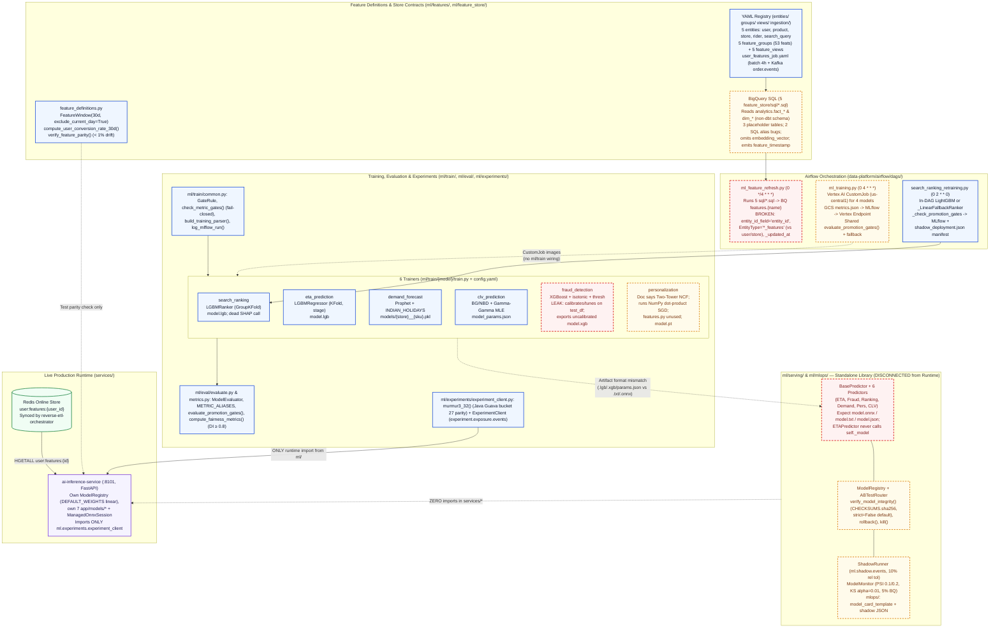
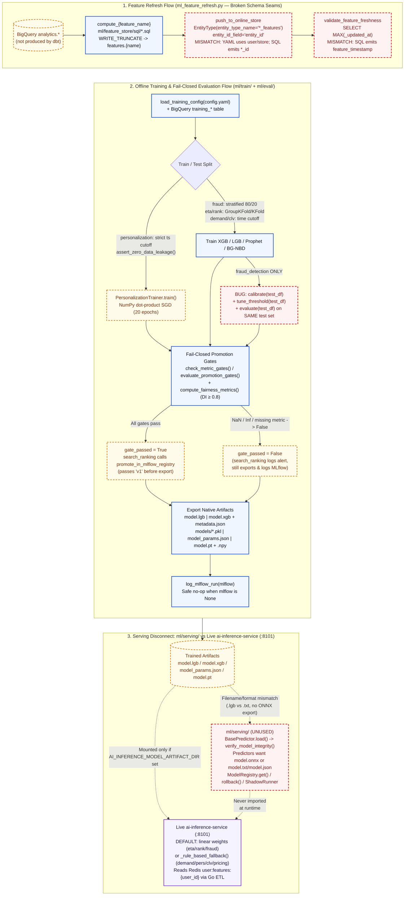

# ML Platform (`ml/` + Airflow ML DAGs) — Deep Code Walkthrough

> [!NOTE]
> **Part of the InstaCommerce Onboarding Suite:** [Onboarding Hub](../../README.md) · [Code Walkthrough Atlas](../README.md) · [Domain & Event Catalog (`05`)](../../05-domain-model-and-event-catalog.md) · [Incident Drills & Exam (`06`)](../../06-incident-drills-and-readiness-exam.md) · [Dependency Matrix & Cheatsheet (`07`)](../../07-service-dependency-and-command-cheatsheet.md)

> **Component Scope:** [`ml/`](../../../../ml/README.md), ML orchestration DAGs in [`data-platform/airflow/dags/`](../../../../data-platform/airflow/dags/ml_feature_refresh.py), and runtime boundary with [`services/ai-inference-service/`](../../../../services/ai-inference-service/app/main.py).  
> **Primary Validation:** `PYTHONDONTWRITEBYTECODE=1 PYTHONPATH=. .venv/bin/pytest -v ml -o cache_dir=/tmp/pytest-cache-ml` (**51 passed**).

---

## 1. Component Identity & Ownership Card

| Dimension | Verified Repo Reality | Source Anchor |
|---|---|---|
| **Package Scope** | Feature definitions (`ml/features/`), YAML/SQL Feature Store (`ml/feature_store/`), 6 model trainers (`ml/train/`), fail-closed evaluator (`ml/eval/`), MurmurHash3 experimentation (`ml/experiments/`), unused serving library (`ml/serving/`), MLOps templates (`ml/mlops/`), unit tests (`ml/tests/`) | [`ml/README.md`](../../../../ml/README.md#L64-L145) · [`CODEOWNERS`](../../../../.github/CODEOWNERS#L154) |
| **Runtime Python & Deps** | Python 3.12 in CI & Docker; 16 dependencies (`lightgbm==4.6.0`, `xgboost==2.0.3`, `scikit-learn==1.5.0`, `prophet==1.1.5`, `mlflow==3.5.0`, `optuna==3.5.0`, `shap==0.45.0`, `google-cloud-aiplatform==1.133.0`, etc.); `torch` & `onnxruntime` are optional imports **not** listed in `ml/requirements.txt` | [`ml/requirements.txt`](../../../../ml/requirements.txt#L1-L16) · [`.github/workflows/ci.yml`](../../../../.github/workflows/ci.yml#L722-L735) |
| **CI Gates** | `ml-validation` job (`ruff check ml`, `pyright ml`, `PYTHONPATH=. pytest -v ml`) triggered on `ml/**` changes or pushes to `main`/`master`; also executed in `python-services` matrix | [`.github/workflows/ci.yml`](../../../../.github/workflows/ci.yml#L77) · [`.github/workflows/ci.yml`](../../../../.github/workflows/ci.yml#L496-L507) · [`.github/workflows/ci.yml`](../../../../.github/workflows/ci.yml#L710-L735) |
| **Airflow Orchestration** | `ml_feature_refresh` (`0 */4 * * *`), `ml_training` (`0 4 * * *`), `search_ranking_weekly_retraining` (`0 2 * * 0`), plus Vertex AI Featurestore health check in `monitoring_alerts` (`*/15 * * * *`) | [`ml_feature_refresh.py`](../../../../data-platform/airflow/dags/ml_feature_refresh.py#L68-L77) · [`ml_training.py`](../../../../data-platform/airflow/dags/ml_training.py#L146-L155) · [`search_ranking_retraining.py`](../../../../data-platform/airflow/dags/search_ranking_retraining.py#L383-L392) |
| **Live Serving Reality** | `services/ai-inference-service/Dockerfile` copies `ml/` into the image, but live FastAPI serving **only** imports `ml.experiments.experiment_client` (plus `ml.features.feature_definitions` in tests). All predictors, registries, and shadow runners in `ml/serving/` have **zero** runtime callers in `services/` | [`Dockerfile`](../../../../services/ai-inference-service/Dockerfile#L11) · [`app/experiments/experiment_client.py`](../../../../services/ai-inference-service/app/experiments/experiment_client.py#L3-L7) · [`app/main.py`](../../../../services/ai-inference-service/app/main.py#L14-L66) |
| **Online Feature Reality** | `ml_feature_refresh.py` targets Vertex AI Feature Store (`asia-south1`) with broken column/entity bindings; live Redis `user:features:{user_id}` hashes read by `ai-inference-service` are written by Go `reverse-etl-orchestrator` | [`ml_feature_refresh.py`](../../../../data-platform/airflow/dags/ml_feature_refresh.py#L112-L150) · [`worker.go`](../../../../services/reverse-etl-orchestrator/internal/subscription/worker.go#L160-L238) · [`redis_client.py`](../../../../services/ai-inference-service/app/features/redis_client.py#L157-L177) |

---

## 2. Repository Layout & Module Inventory

| Path | Contents & Line Count | Runtime Role / Notes |
|---|---|---|
| [`ml/features/feature_definitions.py`](../../../../ml/features/feature_definitions.py#L1-L117) | 117 lines | Canonical `[T-30d, T-1d]` `FeatureWindow`, `compute_user_conversion_rate_30d`, `verify_feature_parity` |
| [`ml/feature_store/`](../../../../ml/feature_store/README.md) | 5 entities, 5 groups, 5 views, 5 SQL files, 1 ingestion YAML, empty `__init__.py` | Declarative Vertex AI Feature Store specs + BigQuery SQL (`integrity.py` is **not** here—checksums live in `ml/serving/integrity.py`) |
| [`ml/train/common.py`](../../../../ml/train/common.py#L1-L188) | 188 lines | `GateRule`, fail-closed `check_metric_gates`, `build_training_parser`, `load_training_config`, `log_mlflow_run` |
| [`ml/train/search_ranking/`](../../../../ml/train/search_ranking/train.py#L1-L343) | `train.py` (343L), `config.yaml` (62L), `tests/test_promotion_gates.py` (77L) | LightGBM `LGBMRanker` (`lambdarank`), GroupKFold CV, MLflow promotion + gates |
| [`ml/train/fraud_detection/`](../../../../ml/train/fraud_detection/train.py#L1-L308) | `train.py` (308L), `config.yaml` (121L) | StratifiedKFold XGBoost + isotonic calibration + threshold tuning (**carries `test_df` leakage bug**) |
| [`ml/train/eta_prediction/`](../../../../ml/train/eta_prediction/train.py#L1-L306) | `train.py` (306L), `config.yaml` (82L) | 3-stage (`pre_order`, `post_assign`, `in_transit`) 5-fold LightGBM L1 regressor |
| [`ml/train/demand_forecast/`](../../../../ml/train/demand_forecast/train.py#L1-L346) | `train.py` (346L), `config.yaml` (50L) | Per-`(store_id, sku_id)` Prophet forecaster + `INDIAN_HOLIDAYS` 2024–2027 (no TFT implemented) |
| [`ml/train/personalization/`](../../../../ml/train/personalization/train.py#L1-L360) | `train.py` (360L), `features.py` (40L), `config.yaml` (41L), `tests/` (113L) | Strict temporal split (`assert_zero_data_leakage`) + **NumPy dot-product SGD** (despite Two-Tower NCF docstring; `features.py` unused) |
| [`ml/train/clv_prediction/`](../../../../ml/train/clv_prediction/train.py#L1-L353) | `train.py` (353L), `config.yaml` (35L) | Custom SciPy Nelder-Mead MLE for BG/NBD + Gamma-Gamma |
| [`ml/eval/`](../../../../ml/eval/evaluate.py#L1-L329) | `evaluate.py` (329L), `metrics.py` (236L) | `ModelEvaluator`, `EvalReport`, `BiasReport`, fail-closed `evaluate_promotion_gates`, 4/5ths `compute_fairness_metrics` |
| [`ml/experiments/`](../../../../ml/experiments/experiment_client.py#L1-L202) | `experiment_client.py` (202L), `tests/test_experiment_client.py` (57L) | Pure-Python `murmur3_32` matching Java Guava `Hashing.murmur3_32_fixed()`, `ExperimentClient` |
| [`ml/serving/`](../../../../ml/serving/README.md) | `predictor.py` (151L), `model_registry.py` (325L), `monitoring.py` (315L), `shadow_mode.py` (310L), `integrity.py` (163L), 6 predictors, 3 test files | Complete standalone predictor/registry/drift/shadow library—**never imported by `services/ai-inference-service`** |
| [`ml/demand_forecast/__init__.py`](../../../../ml/demand_forecast/__init__.py) | 0 lines | Empty stub package separate from `ml/train/demand_forecast/` |
| [`ml/mlops/`](../../../../ml/mlops/model_card_template.md#L1-L33) | `model_card_template.md` (33L), `dashboards/shadow_agreement_dashboard.json` (60L), empty `__init__.py` | Model card template + BigQuery dashboard querying `analytics.ml_shadow_predictions` |
| [`ml/tests/`](../../../../ml/tests/test_ml_suite.py#L1-L237) | `test_eval_gates_and_rollback.py` (238L), `test_holidays_2024_2027.py` (26L), `test_ml_suite.py` (237L), `test_mlflow_none_training.py` (446L) | Core unit & regression suite (all 51 tests across `ml/` pass locally) |

---

## 3. Architecture & Low-Level Module Topology

**ml-platform Architecture & Module LLD** — *[Rendered PNG](../diagrams/components/ml-platform-arch-lld.png) · [Mermaid Source](../diagrams/components/ml-platform-arch-lld.mmd)*



**Key architectural takeaway:** Every offline building block (`ml/features/`, `ml/train/`, `ml/eval/`, `ml/experiments/`, `ml/serving/`) is well-factored and unit-tested in isolation, yet **three integration boundaries break or bypass the intended architecture**:

1. **Feature Store SQL ↔ Airflow Refresh ↔ dbt:** [`ml/feature_store/sql/*.sql`](../../../../ml/feature_store/sql/user_features.sql) query `analytics.fact_*` / `analytics.dim_*` tables that [`data-platform/dbt`](../../../../data-platform/dbt/dbt_project.yml#L20-L28) never creates (`staging.*`, `intermediate.*`, `marts.*`), while [`ml_feature_refresh.py`](../../../../data-platform/airflow/dags/ml_feature_refresh.py#L120-L150) passes mismatched EntityType names, a nonexistent `entity_id` join column, and a nonexistent `_updated_at` timestamp column.
2. **Trainers ↔ `ml/serving/` Artifact Contracts:** `ml/train/*` write `.lgb`, `.xgb`, `models/*.pkl`, `model_params.json`, and `model.pt`, whereas `ml/serving/*_predictor.py` expect `model.onnx`, `model.txt` (LightGBM), or `model.json` (XGBoost / Prophet JSON)—with **no ONNX export script** anywhere in `ml/train/`.
3. **`ml/serving/` ↔ Live FastAPI Serving (`ai-inference-service`):** [`services/ai-inference-service/app/main.py`](../../../../services/ai-inference-service/app/main.py#L14-L66) implements a completely separate registry, shadow runner, ONNX session wrapper, and 7 model wrappers under `app/models/`, leaving `ml/serving/` unused at runtime.

---

## 4. Feature Definitions & Feature Store (`ml/features/`, `ml/feature_store/`)

### 4.1 Canonical Window & Parity Contract (`ml/features/feature_definitions.py`)

[`FeatureWindow`](../../../../ml/features/feature_definitions.py#L15-L35) standardizes rolling metrics so offline training and online serving aggregate over identical closed day boundaries:

- [`WINDOW_30D_EXCLUDING_TODAY`](../../../../ml/features/feature_definitions.py#L39) sets `FeatureWindow(days=30, exclude_current_day=True)`, so `get_date_bounds(ref)` returns `(ref - 30d, ref - 1d)` inclusive ([`feature_definitions.py#L28-L35`](../../../../ml/features/feature_definitions.py#L28-L35)).
- [`compute_user_conversion_rate_30d`](../../../../ml/features/feature_definitions.py#L42-L75) counts `orders` and `searches_or_carts` strictly inside `[T-30d, T-1d]`, clamping the ratio to `min(1.0, valid_orders / valid_sessions)` (`0.0` when `valid_sessions == 0`).
- [`verify_feature_parity`](../../../../ml/features/feature_definitions.py#L78-L117) compares `offline_features` vs. `online_features`: a feature drifts if `abs(off - on) / abs(off) > 0.01` (for `off != 0`) or `abs(off - on) > 0.005` (when `off == 0`), passing when `drift_rate_pct < max_drift_pct` (default `1.0%`). *(Note: docstring at `#L85` says `1e-4`, whereas code at `#L98-L104` checks `1%` relative / `0.005` absolute.)*
- **Cross-service parity mirror:** [`services/ai-inference-service/app/features/parity.py`](../../../../services/ai-inference-service/app/features/parity.py#L23-L101) implements `compute_trailing_conversion_rate` and `evaluate_feature_parity` with identical `[T-30d, T-1d]` and `0.01`/`0.005` thresholds, tested directly against `ml/features/feature_definitions.py` in [`test_feature_parity.py`](../../../../services/ai-inference-service/tests/test_feature_parity.py#L13).

### 4.2 Entities, Feature Groups, Feature Views & Ingestion Specs

`ml/feature_store/` defines **5 entities**, **5 feature groups** (`53` declared features), **5 feature views**, and **1 ingestion config**:

| Entity (`entities/*.yaml`) | Join Key | Feature Group (`feature_groups/*.yaml`) | `#` Features | Update Freq / TTL | SQL Query (`sql/*.sql`) |
|---|---|---|---|---|---|
| `user` (`user_id`) | `user_id` | [`user_features.yaml`](../../../../ml/feature_store/feature_groups/user_features.yaml#L1-L54) | 14 | `per_event` / `30d` | [`user_features.sql`](../../../../ml/feature_store/sql/user_features.sql#L1-L165) |
| `product` (`product_id`) | `product_id` | [`product_features.yaml`](../../../../ml/feature_store/feature_groups/product_features.yaml#L1-L49) | 12 | `hourly` / `7d` | [`product_features.sql`](../../../../ml/feature_store/sql/product_features.sql#L1-L153) |
| `store` (`store_id`) | `store_id` | [`store_features.yaml`](../../../../ml/feature_store/feature_groups/store_features.yaml#L1-L36) | 8 | `5min` / `1d` | [`store_features.sql`](../../../../ml/feature_store/sql/store_features.sql#L1-L88) |
| `rider` (`rider_id`) | `rider_id` | [`rider_features.yaml`](../../../../ml/feature_store/feature_groups/rider_features.yaml#L1-L39) | 9 | `per_location_ping` / `7d` | [`rider_features.sql`](../../../../ml/feature_store/sql/rider_features.sql#L1-L124) |
| `search_query` (`query_hash`) | `query_hash` | [`search_features.yaml`](../../../../ml/feature_store/feature_groups/search_features.yaml#L1-L42) | 10 | `hourly` / `7d` | [`search_features.sql`](../../../../ml/feature_store/sql/search_features.sql#L1-L85) |

The 5 feature views under `ml/feature_store/feature_views/` compose group + request-time features per use case:
- [`search_ranking_view.yaml`](../../../../ml/feature_store/feature_views/search_ranking_view.yaml#L1-L24) (`user`, `product`, `15m` online TTL, `<50ms`, fallback `popularity_based`)
- [`fraud_detection_view.yaml`](../../../../ml/feature_store/feature_views/fraud_detection_view.yaml#L1-L46) (`user`, 6 request signals like `vpn_detected`, `5m` TTL, `<100ms`, thresholds `30`/`70`/`100`)
- [`eta_prediction_view.yaml`](../../../../ml/feature_store/feature_views/eta_prediction_view.yaml#L1-L56) (`store`, `rider`, 6 request signals, `5m` TTL, `<30ms`, stages `pre_order`/`post_order`/`in_transit`)
- [`demand_forecast_view.yaml`](../../../../ml/feature_store/feature_views/demand_forecast_view.yaml#L1-L64) (`product`, `store`, 11 calendar/weather/promo request signals, `60m` TTL, `<50ms`)
- [`personalization_view.yaml`](../../../../ml/feature_store/feature_views/personalization_view.yaml#L1-L61) (`user`, `product`, 3 request signals, `30m` TTL, `<50ms`, cold-start `0` / `1-3` / `4+` orders)
- *(Doc drift: [`ml/feature_store/README.md#L60`](../../../../ml/feature_store/README.md#L60) lists `clv_view`, which has no YAML file under `feature_views/`.)*

[`ingestion/user_features_job.yaml`](../../../../ml/feature_store/ingestion/user_features_job.yaml#L1-L146) specifies batch Vertex AI ingestion every 4 hours (`region: asia-south1`, `featurestore_id: instacommerce_features`, `entity_type_id: user`) plus a Dataflow Java streaming job (`dataflow/pipelines/user_features_streaming.java`, not present in repo) consuming Kafka topic `order.events` (`#L47`, contrasting with `orders.events` in [`monitoring_alerts.py#L66`](../../../../data-platform/airflow/dags/monitoring_alerts.py#L66)) with DLQ topic `feature-ingestion.DLT` (`#L135`). Note also that `ml/feature_store/` contains only `__init__.py`, `entities/`, `feature_groups/`, `feature_views/`, `ingestion/`, and `sql/`—the `integrity.py` module and `format_feature_view_name()` helper live in [`ml/serving/integrity.py`](../../../../ml/serving/integrity.py#L43-L47), not `ml/feature_store/`.

### 4.3 Verified SQL Defects & Non-Existent Warehouse Tables (`ml/feature_store/sql/`)

1. **Missing `analytics.fact_*` / `analytics.dim_*` schema:** All 5 SQL scripts read `analytics.fact_orders`, `analytics.fact_deliveries`, `analytics.fact_payments`, `analytics.fact_inventory_movements`, `analytics.fact_searches`, `analytics.fact_cart_events`, and `analytics.dim_{users,products,stores,riders}`. In reality, [`data-platform/dbt/dbt_project.yml`](../../../../data-platform/dbt/dbt_project.yml#L20-L28) materializes `staging.*`, `intermediate.*`, and `marts.*`—the only declared `analytics.*` source table in [`sources.yml`](../../../../data-platform/dbt/models/staging/sources.yml#L56-L65) is `analytics.fact_experiment_exposures`.
2. **Unbacked placeholder tables:** [`user_features.sql#L129-L138`](../../../../ml/feature_store/sql/user_features.sql#L129-L138) queries `analytics.fact_support_tickets`, [`product_features.sql#L95-L104`](../../../../ml/feature_store/sql/product_features.sql#L95-L104) queries `analytics.fact_substitutions`, and [`store_features.sql#L38-L48`](../../../../ml/feature_store/sql/store_features.sql#L38-L48) queries `analytics.dim_store_staff`—each flagged inline as `-- Placeholder: assumes ... exists`.
3. **BigQuery SQL syntax / alias bugs:**
   - [`user_features.sql#L49`](../../../../ml/feature_store/sql/user_features.sql#L49) writes `ARRAY_AGG(p.category ...)` in `preferred_cats` where alias `p` is undefined (`o` and `cat` are in scope).
   - [`product_features.sql#L108-L125`](../../../../ml/feature_store/sql/product_features.sql#L108-L125) selects `a.product_id` from a subquery aliased `paired` (`a` is out of scope).
   - [`search_features.sql#L47-L48`](../../../../ml/feature_store/sql/search_features.sql#L47-L48) joins aggregated `sub` back onto `analytics.fact_searches` and `analytics.dim_products`, multiplying rows across every product in the same category.
   - [`search_features.sql#L53-L66`](../../../../ml/feature_store/sql/search_features.sql#L53-L66) comments "within 2 minutes", yet orders `LEAD(search_date)` on `DATE` granularity with no timestamp delta check.
4. **Omitted embedding column:** [`product_features.yaml#L46-L48`](../../../../ml/feature_store/feature_groups/product_features.yaml#L46-L48) defines a 128-dim `embedding_vector`, which [`product_features.sql#L128-L129`](../../../../ml/feature_store/sql/product_features.sql#L128-L129) explicitly skips (`ml/train/item2vec/` does not exist).

---

## 5. End-to-End Execution Flows & Broken Airflow/Serving Seams

**ml-platform Training, Evaluation, Feature & Serving Flow** — *[Rendered PNG](../diagrams/components/ml-platform-flow.png) · [Mermaid Source](../diagrams/components/ml-platform-flow.mmd)*



### 5.1 `ml_feature_refresh` DAG Broken Schema Seams (`data-platform/airflow/dags/ml_feature_refresh.py`)

[`ml_feature_refresh.py`](../../../../data-platform/airflow/dags/ml_feature_refresh.py#L68-L192) runs `compute_{feature_name}` -> `push_to_online_store` -> `validate_feature_freshness` -> `alert_if_stale` every 4 hours (`0 */4 * * *`), but has **five verified schema/API mismatches** against [`ml/feature_store/`](../../../../ml/feature_store/README.md):

| Stage & Anchor | What `ml_feature_refresh.py` Assumes | What `ml/feature_store/sql/*.sql` & YAML Actually Produce | Consequence |
|---|---|---|---|
| **1. Vertex `EntityType` name** ([`#L120-L123`](../../../../data-platform/airflow/dags/ml_feature_refresh.py#L120-L123)) | Instantiates `EntityType(entity_type_name=feature_name, ...)` using `user_features`, `product_features`, `rider_features`, `search_features`, `store_features` | [`entities/*.yaml`](../../../../ml/feature_store/entities/user.yaml#L1-L6) & [`user_features_job.yaml#L28`](../../../../ml/feature_store/ingestion/user_features_job.yaml#L28) name entities `user`, `product`, `rider`, `search_query`, `store` | Lookup targets wrong Vertex AI EntityType IDs |
| **2. Join key column** ([`#L124-L128`](../../../../data-platform/airflow/dags/ml_feature_refresh.py#L124-L128)) | Calls `entity_type.ingest_from_bq(..., entity_id_field="entity_id")` for all 5 tables | Each SQL emits its entity's key (`user_id`, `product_id`, `store_id`, `rider_id`, `query_hash`); **none** emit `entity_id` | Vertex AI BQ ingestion fails on missing `entity_id` column |
| **3. Freshness timestamp** ([`#L143-L150`](../../../../data-platform/airflow/dags/ml_feature_refresh.py#L143-L150)) | Queries `MAX(_updated_at)` from `instacommerce-prod.features.{feature_name}` | All 5 `sql/*.sql` scripts emit `CURRENT_TIMESTAMP() AS feature_timestamp` (never `_updated_at`) | Freshness query fails with unrecognized column `_updated_at` |
| **4. Date template & row XCom** ([`#L87`](../../../../data-platform/airflow/dags/ml_feature_refresh.py#L87), [`#L98-L100`](../../../../data-platform/airflow/dags/ml_feature_refresh.py#L98-L100)) | Calls `query.replace("{{ ds }}", context["ds"])` and pushes `job.num_dml_affected_rows` | None of the 5 `.sql` files use `{{ ds }}` (all use `CURRENT_TIMESTAMP()`/`CURRENT_DATE()`); `QueryJobConfig(destination=...)` `SELECT` jobs return `num_dml_affected_rows = None` | Backfill runs against live wall clock; XCom row metric is always `None` |
| **5. Cross-DAG region & dataset split** ([`#L41, #L90`](../../../../data-platform/airflow/dags/ml_feature_refresh.py#L41)) | Writes `features.{feature_name}` and pushes to Vertex Featurestore in `asia-south1` | [`monitoring_alerts.py#L216`](../../../../data-platform/airflow/dags/monitoring_alerts.py#L216) checks Featurestore health in `us-central1`; [`ml_training.py#L99`](../../../../data-platform/airflow/dags/ml_training.py#L99) runs training in `us-central1` | Health checks and training jobs look in the wrong GCP region |

Meanwhile, the working online user-feature path bypasses Vertex AI Feature Store completely: [`services/reverse-etl-orchestrator/internal/subscription/worker.go`](../../../../services/reverse-etl-orchestrator/internal/subscription/worker.go#L160-L238) writes Redis hashes at `user:features:{user_id}` (`36h` TTL via Lua + atomic `RENAME`), which [`RedisFeatureStoreClient.get_user_features`](../../../../services/ai-inference-service/app/features/redis_client.py#L157-L177) reads via `HGETALL`.

### 5.2 Training & Retraining DAGs (`ml_training.py` & `search_ranking_retraining.py`)

- [`ml_training.py`](../../../../data-platform/airflow/dags/ml_training.py#L102-L348) schedules daily `04:00 UTC` Vertex AI `CustomJob`s for 4 models (`demand_forecast`, `delivery_eta`, `search_ranking`, `fraud_detection`—**omitting** `personalization` and `clv_prediction`). Each group executes `train` -> `evaluate` (reading `gs://instacommerce-prod-ml-artifacts/{model}/{ds}/metrics.json`) -> `gate` -> `[promote, skip_promote]`. `_check_promotion_gate` (`#L239-L269`) delegates to `ml.eval.metrics.evaluate_promotion_gates` (with an inline fallback `_evaluate_model_gates` at `#L63-L78`) and only deploys (`traffic_percentage=100`) if all gates pass. Notice `ml_training.py` launches external container images `gcr.io/instacommerce-prod/{model}:latest` and does **not** directly invoke `ml/train/*/train.py`.
- [`search_ranking_retraining.py`](../../../../data-platform/airflow/dags/search_ranking_retraining.py#L1-L429) runs weekly (`0 2 * * 0` in `asia-south1`) and **directly imports** `SearchRankingTrainer`, `load_training_config`, `log_mlflow_run`, `_check_promotion_gates`, and `promote_in_mlflow_registry` (`#L34-L40`). When BigQuery fails or `SEARCH_RANKING_DRY_RUN=true`, it synthesizes a 30-query × 12-doc dataset via `_build_local_ranking_dataset` (`#L104-L124`) and trains a deterministic ridge fallback [`_LinearFallbackRanker`](../../../../data-platform/airflow/dags/search_ranking_retraining.py#L134-L175) if native `lightgbm` is unavailable. Two subtle bugs: `_evaluate_candidate` (`#L309`) passes `gate_passed=True` hardcoded to `log_mlflow_run` *before* `check_promotion_gates` executes, and `_deploy_shadow_mode` (`#L342-L369`) writes a local `shadow_deployment.json` file rather than deploying a live shadow container.

---

## 6. Training Pipelines (`ml/train/`) — Shared Mechanics & All 6 Trainers

### 6.1 Shared Training Core (`ml/train/common.py`)

- [`GateRule`](../../../../ml/train/common.py#L50-L61) + [`check_metric_gates`](../../../../ml/train/common.py#L73-L127): evaluates `"le"` / `"ge"` thresholds fail-closed. [`as_finite_float`](../../../../ml/train/common.py#L64-L70) rejects `bool`, `None`, `NaN`, and `±Inf` so any missing or non-finite metric returns `passed=False`.
- [`log_mlflow_run`](../../../../ml/train/common.py#L150-L188): safely returns immediately when `mlflow_client is None` (verified by 6 parametrized tests in [`test_mlflow_none_training.py`](../../../../ml/tests/test_mlflow_none_training.py#L258-L330)). Logs only scalar params and finite float metrics plus `promotion_gate_passed`, and all 6 trainers execute `train()`, `evaluate()`, and `export()` *outside* `mlflow.start_run()` so artifacts still persist locally if MLflow errors.

### 6.2 All 6 Trainers Matrix & Verified Findings

| Model (`ml/train/<name>/`) | Algorithm & CV / Split | BQ Table (`config.yaml`) | Exported Artifacts | Promotion Gates (`config.yaml` vs `_GATE_RULES`) | Verified Bugs / Reality Gaps |
|---|---|---|---|---|---|
| **`search_ranking`** ([`train.py`](../../../../ml/train/search_ranking/train.py#L69-L343), [`config.yaml`](../../../../ml/train/search_ranking/config.yaml#L1-L62)) | `LGBMRanker` (`lambdarank`, 5-fold `GroupKFold`, `80/20` query split) | `analytics.training_search_clicks` (`90d`) | `model.lgb` | `min_ndcg_at_10: 0.65`, `min_ndcg_gain_pct: 1.5` (vs `baseline_ndcg_at_10: 0.65`), `max_p99_latency_ms: 15.0`, optional `min_shadow_agreement: 0.92` | `feature_importance()` calls `shap.TreeExplainer(self.model)` and discards result, returning gain (`#L215-L218`). `main()` calls `promote_in_mlflow_registry(..., "v1")` **before** `export()`/`log_mlflow_run()` (`#L321-L338`). |
| **`fraud_detection`** ([`train.py`](../../../../ml/train/fraud_detection/train.py#L80-L308), [`config.yaml`](../../../../ml/train/fraud_detection/config.yaml#L1-L121)) | `XGBClassifier` (`hist`, dynamic `scale_pos_weight`, 5-fold `StratifiedKFold`, `80/20` stratified split) | `analytics.training_fraud_labels` (`180d`, `78` features in `FEATURE_COLUMNS`) | `model.xgb` + `metadata.json` (`optimal_threshold`) | `min_auc_roc: 0.98`, `min_precision_at_95_recall: 0.70` (`config.yaml` also lists `max_false_positive_rate: 0.05` & `min_improvement_pct: 1.0`, **unused** in `_GATE_RULES`) | **Test-set leakage:** `main()` calls `calibrate(test_df)`, `tune_threshold(test_df)`, and `evaluate(test_df)` on the **same `test_df`** (`#L273-L275`). **Export mismatch:** `export()` (`#L231`) saves uncalibrated `self.model` (`model.xgb`), discarding `self.calibrated_model`, alongside a threshold tuned on the calibrated model. |
| **`eta_prediction`** ([`train.py`](../../../../ml/train/eta_prediction/train.py#L109-L306), [`config.yaml`](../../../../ml/train/eta_prediction/config.yaml#L1-L82)) | `LGBMRegressor` (`regression_l1`, 5-fold `KFold`, random `80/20` split) for 3 stages (`23`/`16`/`10` feats) | `analytics.training_delivery_times` (`90d`, `actual_eta_min`) | `{version}/{stage}/model.lgb` | `max_mae_min: 1.5`, `min_within_2min_pct: 0.85` (`min_improvement_pct: 5.0` in YAML unused) | Random split via `df.sample(frac=1)` (`#L265`) instead of time-based split; `ETAPredictor` in `ml/serving/` looks for `model.txt` / `model.onnx` and ignores ML weights anyway. |
| **`demand_forecast`** ([`train.py`](../../../../ml/train/demand_forecast/train.py#L154-L346), [`config.yaml`](../../../../ml/train/demand_forecast/config.yaml#L1-L50)) | Per-`(store_id, sku_id)` `Prophet` (`multiplicative`, hourly Fourier order `8`, `8` regressors, `INDIAN_HOLIDAYS` 2024–2027) | `analytics.training_demand_history` (`365d`, `test_days: 7`) | `models/{store}__{sku}.pkl` + `manifest.json` | `max_mape: 0.08`, `min_accuracy_pct: 92.0` (`min_improvement_pct: 3.0` in YAML unused) | Despite docstrings mentioning "Phase 2 TFT", only Prophet is implemented. Skips series with `< 168` rows (`#L202`). `evaluate()` raises `RuntimeError` if zero models trained (`#L220-L221`). |
| **`personalization`** ([`train.py`](../../../../ml/train/personalization/train.py#L90-L360), [`features.py`](../../../../ml/train/personalization/features.py#L1-L40), [`config.yaml`](../../../../ml/train/personalization/config.yaml#L1-L41)) | **Actual:** NumPy dot-product SGD (`20` epochs, `dim=64`, `lr=0.01`, `reg=0.01`, row-by-row `iterrows()`); strict timestamp split via `assert_zero_data_leakage()` (`#L64-L87`) | `analytics.training_user_interactions` (`180d`, `test_days: 7`) | `user_embeddings.npy`, `item_embeddings.npy`, `user_id_map.json`, `item_id_map.json`, `popular_items.json`, `feature_vocab.json`, `model.pt` | `min_hit_at_10: 0.30`, `min_ndcg_at_10: 0.20` (`min_improvement_pct: 2.0` in YAML unused) | **Doc vs code mismatch:** claims "Two-Tower NCF" with MLPs & ANN index and imports `torch` + `USER_FEATURES`/`ITEM_FEATURES` (`#L26, #L43`), but neither `torch.nn` nor `features.py` is used (`#L182` even logs `"Training ALS"` while running SGD). `model.pt` stores pickled/saved NumPy arrays, not a `nn.Module`. |
| **`clv_prediction`** ([`train.py`](../../../../ml/train/clv_prediction/train.py#L55-L353), [`config.yaml`](../../../../ml/train/clv_prediction/config.yaml#L1-L35)) | Custom `scipy.optimize.minimize(..., method="Nelder-Mead")` MLE for BG/NBD (`r, alpha, a, b`) + Gamma-Gamma (`p, q, v`), `holdout_days: 90` | `analytics.training_customer_transactions` (`730d`) | `model_params.json` + `clv_predictions.parquet` | `max_mae: 50.0`, `min_correlation: 0.60` (`min_improvement_pct: 3.0` in YAML unused) | Segments use **dollar** thresholds (`platinum >= 500`, `gold >= 200`, `silver >= 50`, `bronze < 50`, `#L42-L47`), whereas `ml/serving/clv_predictor.py#L158-L164` uses `50_000 / 20_000 / 5_000` (100x cents mismatch). |

---

## 7. Fail-Closed Evaluation & Fairness Gates (`ml/eval/`)

[`ml/eval/metrics.py`](../../../../ml/eval/metrics.py#L1-L236) and [`ml/eval/evaluate.py`](../../../../ml/eval/evaluate.py#L1-L329) form the shared evaluation layer (also imported by [`ml_training.py#L28`](../../../../data-platform/airflow/dags/ml_training.py#L28)):

- **Metric Aliases & Fail-Closed Gates (`metrics.py#L23-L47, L156-L197`):** `METRIC_ALIASES` normalizes `mae` / `mae_min` / `mae_minutes` and `ndcg_at_10` / `ndcg@10` / `hit_at_10` / `hit@10`. `evaluate_promotion_gates(metrics, gates, require_present=True)` parses `min_*` and `max_*` keys and **fails closed** whenever a gated metric is missing, `bool`, `NaN`, or `±Inf`. Non-numeric config keys like `auto_promote: true` are safely skipped (`#L165-L166`).
- **Task Routing (`metrics.py#L92-L153`):**
  - `task_type == "ranking"`: computes group-wise `ndcg_at_10`, `hit_at_10`, `mrr`, plus `mae`/`rmse`.
  - Classification (`binary` / `multiclass` or `<= 20` integer labels): `accuracy`, weighted `f1_score`/`precision`/`recall`, `false_positive_rate` (via binary confusion matrix), `auc_roc`, and `precision_at_95_recall` (`#L128-L130`).
  - Regression: `mae`, `mae_min`, `mae_minutes`, `rmse`, `r2_score`, `within_2min_pct` (`|y - yhat| <= 2.0`), `correlation`, `mape`, and `accuracy_pct` (`max(0, (1 - mape) * 100)`).
- **4/5ths Fairness & Bias Gates (`metrics.py#L200-L236`, `evaluate.py#L209-L250`):** `ModelEvaluator.bias_check()` auto-selects protected attributes `("gender", "age_bucket", "city_tier", "language")` (excluding them plus `NON_FEATURE_COLUMNS` and `*_id` columns from model inputs via `_select_feature_columns` at `#L117-L128`) and delegates to `compute_fairness_metrics()`. It records demographic parity selection rates, per-group equalized odds (`tpr`, `fpr`), and **fails the bias gate** (`passed = False`) if any protected attribute's disparate impact ratio `min(rates) / max(rates) < 0.8` (`#L230-L235`).
- **CLI Support Gaps (`evaluate.py#L288-L303`):** Supports `.xgb` (`XGBClassifier`), `.lgb` (`lgb.Booster`), and `.pkl`, but does **not** load PyTorch `.pt` or `model_params.json`, and `bias_check` is only run when `--bias-check` is explicitly passed.

---

## 8. Cross-Language Experimentation (`ml/experiments/`)

[`ml/experiments/experiment_client.py`](../../../../ml/experiments/experiment_client.py#L1-L202) implements deterministic traffic allocation matching `config-feature-flag-service` (Java Guava):

- `murmur3_32(key, seed=0)` (`#L18-L59`) + `to_signed_32` (`#L62-L66`) + `compute_bucket_percent(assignment_key, experiment_salt)` (`#L69-L77`) compute `(to_signed_32(murmur3_32(f"{assignment_key}:{experiment_salt}")) & 0x7FFFFFFF) % 100`. Cross-language parity is pinned in [`test_experiment_client.py#L9-L12`](../../../../ml/experiments/tests/test_experiment_client.py#L9-L12) asserting `compute_bucket_percent("user_123", "exp_pricing_v1") == 27`.
- `ExperimentClient.evaluate()` (`#L92-L154`) maps bucket `[0..99]` onto weighted variants, records an exposure UUID in `_exposure_log`, and optionally emits to Kafka topic `experiment.exposure.events` (`#L86, #L142-L146`).
- **Live adoption:** This is the **sole** module under `ml/` imported in production runtime code via [`services/ai-inference-service/app/experiments/experiment_client.py`](../../../../services/ai-inference-service/app/experiments/experiment_client.py#L3-L7).

---

## 9. Unused `ml/serving/` Subsystem vs. Live `ai-inference-service` Disconnect

### 9.1 What Exists in `ml/serving/` & `ml/mlops/`

1. **Predictor Hierarchy ([`predictor.py`](../../../../ml/serving/predictor.py#L49-L151)):** `BasePredictor` manages `ModelStatus` (`LOADING`, `READY`, `DEGRADED`, `FAILED`), calls `self._verify_integrity(self.model_dir)` before `_load_model()`, and falls back to `rule_based_fallback()` returning `PredictionResult(..., is_fallback=True)`.
2. **Integrity Verification ([`integrity.py`](../../../../ml/serving/integrity.py#L75-L163)):** `verify_model_integrity()` verifies SHA-256 checksums in `CHECKSUMS.sha256`, blocks path traversal (`is_relative_to(resolved_base)`), and increments `ml_model_integrity_{pass,fail,skip}_total`. **Caveat:** `strict` defaults to `False` (`#L78`), so missing or empty `CHECKSUMS.sha256` files log a warning and return `True`! Also, `BasePredictor.load()` verifies `self.model_dir` (parent dir) whereas `ModelRegistry._build_version_predictor()` verifies `self.model_dir / target_version` ([`model_registry.py#L115`](../../../../ml/serving/model_registry.py#L115)).
3. **Registry, A/B Routing, Rollback & Kill Switch ([`model_registry.py`](../../../../ml/serving/model_registry.py#L25-L325)):** `ModelRegistry` is thread-safe (`RLock`), clones predictors per version via `copy.copy()` to prevent concurrent A/B overwrite races (`#L114-L160`, verified by 12-thread test in [`test_eval_gates_and_rollback.py#L181-L238`](../../../../ml/tests/test_eval_gates_and_rollback.py#L181-L238)), supports deterministic SHA-256 `ABTestRouter` (`#L25-L58`), `rollback()` to `_previous_versions` (preserving state on failed load, `#L177-L203`), and `kill()`/`unkill()` switching status to `DEGRADED`.
4. **Shadow Mode ([`shadow_mode.py`](../../../../ml/serving/shadow_mode.py#L74-L310)):** `ShadowRunner` runs shadow predictors on a 4-thread `ThreadPoolExecutor` (`1.0s` timeout), checks numeric parity within `10%` relative tolerance (`#L211-L212`, rejecting `NaN`/`Inf` and booleans), buffers `ShadowPredictionLog` in memory, optionally emits to `ml.shadow.events`, and exposes `verify_promotion_gate(threshold=0.92, raise_on_failure=True)` (`#L157-L191`).
5. **Drift & Prometheus Monitoring ([`monitoring.py`](../../../../ml/serving/monitoring.py#L49-L315)):** `ModelMonitor` registers `ml_model_prediction_total`, `ml_model_prediction_latency_seconds`, `ml_model_drift_psi` (warn `> 0.1`, alert `> 0.2`), `ml_model_drift_ks_statistic`, `ml_model_drift_ks_pvalue` (`scipy.stats.ks_2samp`, `alpha=0.01`), `ml_model_error_rate`, a 5% sampling buffer `sample_feature_vector()`, and 1h feature freshness (`_FEATURE_MAX_AGE_S = 3_600.0`).
6. **MLOps Templates ([`ml/mlops/`](../../../../ml/mlops/dashboards/shadow_agreement_dashboard.json#L1-L60)):** `model_card_template.md` (`33L`, unused by trainers) and `shadow_agreement_dashboard.json` querying `instacommerce-prod.analytics.ml_shadow_predictions` (a BigQuery table with **no** writer wired in `ml/serving/shadow_mode.py` or `ai-inference-service`).

### 9.2 Five Verified Disconnects Between `ml/serving/`, `ml/train/`, and Live FastAPI

1. **Zero runtime imports in `services/ai-inference-service/`:** Even though [`services/ai-inference-service/Dockerfile#L11`](../../../../services/ai-inference-service/Dockerfile#L11) executes `COPY ml ./ml`, a repo-wide search confirms `ai-inference-service` **never** imports `ml.serving.*`. Instead, it defines parallel classes in [`app/core/config.py#L344-L375`](../../../../services/ai-inference-service/app/core/config.py#L344-L375) (`ModelRegistry` using `DEFAULT_WEIGHTS` + `weights.json`), [`app/core/shadow.py#L84-L334`](../../../../services/ai-inference-service/app/core/shadow.py#L84-L334) (`ShadowRunner` with `0.25s` timeout & `0.1` absolute delta), [`app/models/onnx_runner.py#L89-L147`](../../../../services/ai-inference-service/app/models/onnx_runner.py#L89-L147) (`ManagedOnnxSession` with RSS monitoring), and 7 classes in [`app/models/`](../../../../services/ai-inference-service/app/models/__init__.py) (including `DynamicPricingModel`, which has no trainer in `ml/train/`).
2. **Default live FastAPI execution path is linear weights or rule heuristics:** In [`serve_inference_request`](../../../../services/ai-inference-service/app/core/inference.py#L823-L891), default versions for `eta` (`eta-linear-v1`), `ranking` (`ranking-linear-v1`), and `fraud` (`fraud-logit-v1`) match `_LINEAR_VERSIONS` (`#L435, L837`) and execute `linear_score()` + `safe_sigmoid()` over `DEFAULT_WEIGHTS`. Meanwhile `demand`, `personalization`, `clv`, and `pricing` fall through to `_predict_with_domain_model()`, where `AI_INFERENCE_MODEL_ARTIFACT_DIR` and `AI_INFERENCE_ONNX_MODEL_DIR` default to `""` ([`config.py#L69-L70`](../../../../services/ai-inference-service/app/core/config.py#L69-L70)), leaving `self._model = None` and `_is_mock = True` so they execute `_rule_based_fallback()`.
3. **Training-to-serving artifact contract mismatches across all 6 models:**
   - **ETA & Ranking:** Trainers export `model.lgb` ([`eta_prediction/train.py#L278`](../../../../ml/train/eta_prediction/train.py#L278), [`search_ranking/train.py#L326`](../../../../ml/train/search_ranking/train.py#L326)); `ml/serving/` looks for `model.onnx` or `model.txt` ([`eta_predictor.py#L177`](../../../../ml/serving/eta_predictor.py#L177), [`ranking_predictor.py#L182`](../../../../ml/serving/ranking_predictor.py#L182)); `ai-inference-service` looks for `eta.lgb` / `ranking.lgb` ([`inference.py#L463-L464`](../../../../services/ai-inference-service/app/core/inference.py#L463-L464)) with a smaller 9-feature / 13-feature schema than the 23/32 trainer features.
   - **Fraud:** Trainer exports uncalibrated `model.xgb` + `{"optimal_threshold": ...}` ([`fraud_detection/train.py#L231-L234`](../../../../ml/train/fraud_detection/train.py#L231-L234)); `FraudPredictor` looks for `model.onnx` or `model.json` + `ModelMetadata` (`metadata.json` schema clash!, [`fraud_predictor.py#L73-L77, L191`](../../../../ml/serving/fraud_predictor.py#L73-L77)); `ai-inference-service` expects `fraud.xgb` with 15 features (`vs.` 78 in trainer).
   - **Demand:** Trainer exports `models/{store}__{sku}.pkl` + `manifest.json` ([`demand_forecast/train.py#L279-L285`](../../../../ml/train/demand_forecast/train.py#L279-L285)); `DemandPredictor` looks for single Prophet `model.json` ([`demand_predictor.py#L51`](../../../../ml/serving/demand_predictor.py#L51)); `ai-inference-service` tries `pickle.load` on `demand.lgb` and expects `.predict(X)` ([`inference.py#L466`](../../../../services/ai-inference-service/app/core/inference.py#L466), [`demand_model.py#L115-L172`](../../../../services/ai-inference-service/app/models/demand_model.py#L115-L172)).
   - **Personalization:** Trainer exports `model.pt` + `.npy` embeddings ([`personalization/train.py#L290-L311`](../../../../ml/train/personalization/train.py#L290-L311)); `PersonalizationPredictor` looks for LightGBM `model.onnx` or `model.txt` ([`personalization_predictor.py#L211`](../../../../ml/serving/personalization_predictor.py#L211)); `ai-inference-service` tries `pickle.load` on `personalization.lgb` ([`inference.py#L467`](../../../../services/ai-inference-service/app/core/inference.py#L467)).
   - **CLV:** Trainer exports `model_params.json` (`bgnbd_params` / `gamma_gamma_params`, [`clv_prediction/train.py#L281-L287`](../../../../ml/train/clv_prediction/train.py#L281-L287)); `CLVPredictor` looks for LightGBM `model.onnx` or `model.txt` and segments at `50_000`/`20_000`/`5_000` instead of `500`/`200`/`50` ([`clv_predictor.py#L158-L177`](../../../../ml/serving/clv_predictor.py#L158-L177)); `ai-inference-service` tries `pickle.load` on `clv.lgb` ([`inference.py#L468`](../../../../services/ai-inference-service/app/core/inference.py#L468)).
4. **`ETAPredictor.predict()` never calls `self._model`:** Even when [`ETAPredictor._load_model`](../../../../ml/serving/eta_predictor.py#L44-L72) loads an ONNX session or LightGBM booster into `self._model`, [`ETAPredictor.predict`](../../../../ml/serving/eta_predictor.py#L74-L160) dispatches to `_stage1_pre_order` (lookup in `zone_averages.json`), `_stage2_post_assign` (`distance_km / speed * 60 * multiplier`), or `_stage3_in_transit` (`remaining_km / speed * 60`)—never calling `self._model.run` or `self._model.predict`!
5. **`ai-inference-service` Shadow Runner ignores domain models:** [`maybe_run_shadow`](../../../../services/ai-inference-service/app/core/inference.py#L282-L308) invokes `perform_inference` (the linear `DEFAULT_WEIGHTS` scorer), not `_predict_with_domain_model()`, whereas [`ml/serving/shadow_mode.py#L93-L103`](../../../../ml/serving/shadow_mode.py#L93-L103) invokes `shadow_predictor.predict(features)`.

---

## 10. Configuration, Testing & Verification

### 10.1 Trainer CLI & Environment Entry Points

All 6 trainers share [`build_training_parser`](../../../../ml/train/common.py#L130-L141) (`--config`, `--experiment`, `--output-dir`, `--run-name`; `eta_prediction` adds `--stage`), while [`ml/eval/evaluate.py#L272-L326`](../../../../ml/eval/evaluate.py#L272-L326) exposes `--model-path`, `--test-data`, `--gates-config`, `--output`, `--bias-check`, `--protected-attrs` and reads `MLFLOW_TRACKING_URI` if set.

### 10.2 Verified Local Test Run

```bash
PYTHONDONTWRITEBYTECODE=1 PYTHONPATH=. .venv/bin/pytest -v ml -o cache_dir=/tmp/pytest-cache-ml
```

Observed output in this environment: **`51 passed, 2 warnings in 5.04s`** across:
- [`ml/experiments/tests/test_experiment_client.py`](../../../../ml/experiments/tests/test_experiment_client.py#L1-L57) (`3` tests)
- [`ml/serving/tests/test_integrity.py`](../../../../ml/serving/tests/test_integrity.py#L1-L97) (`8` tests)
- [`ml/serving/tests/test_ks_drift.py`](../../../../ml/serving/tests/test_ks_drift.py#L1-L66) (`4` tests)
- [`ml/serving/tests/test_shadow_mode.py`](../../../../ml/serving/tests/test_shadow_mode.py#L1-L93) (`3` tests)
- [`ml/tests/test_eval_gates_and_rollback.py`](../../../../ml/tests/test_eval_gates_and_rollback.py#L1-L238) (`5` tests)
- [`ml/tests/test_holidays_2024_2027.py`](../../../../ml/tests/test_holidays_2024_2027.py#L1-L26) (`1` test)
- [`ml/tests/test_ml_suite.py`](../../../../ml/tests/test_ml_suite.py#L1-L237) (`9` tests)
- [`ml/tests/test_mlflow_none_training.py`](../../../../ml/tests/test_mlflow_none_training.py#L1-L446) (`8` tests)
- [`ml/train/personalization/tests/test_personalization_leakage_and_cold_start.py`](../../../../ml/train/personalization/tests/test_personalization_leakage_and_cold_start.py#L1-L113) (`6` tests)
- [`ml/train/search_ranking/tests/test_promotion_gates.py`](../../../../ml/train/search_ranking/tests/test_promotion_gates.py#L1-L77) (`4` tests)

---

**Previous:** [Data Platform & Lakehouse](./data-platform-lakehouse.md) | **Atlas Hub:** [Code Walkthrough Atlas](../README.md) | **Next:** [Infra, Terraform & GitOps](./infra-terraform-gitops.md)
