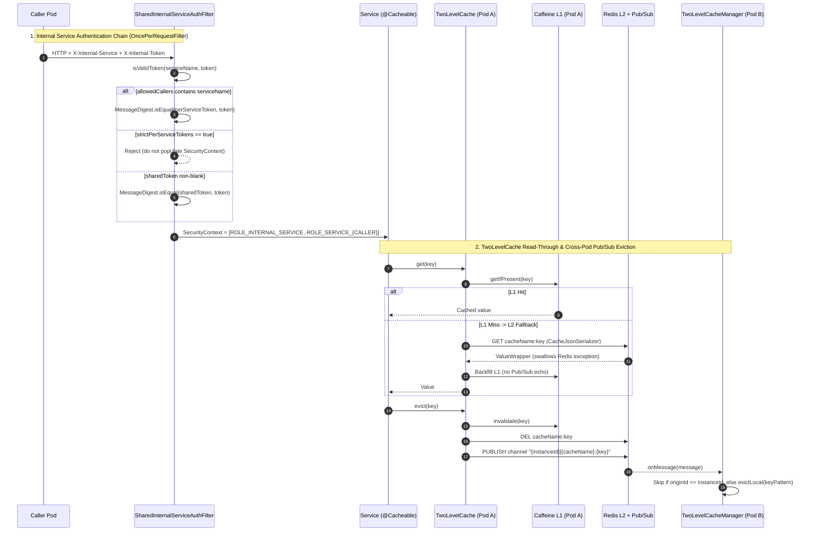

# Java Platform Common Library (`libs/platform-common/`) — Code Walkthrough

> [!NOTE]
> **Part of the InstaCommerce Onboarding Suite:** [Onboarding Hub](../../README.md) · [Code Walkthrough Atlas](../README.md) · [Domain & Event Catalog (`05`)](../../05-domain-model-and-event-catalog.md) · [Incident Drills & Exam (`06`)](../../06-incident-drills-and-readiness-exam.md) · [Dependency Matrix & Cheatsheet (`07`)](../../07-service-dependency-and-command-cheatsheet.md)

> **Component Scope:** Shared Spring Boot 4 / Java 21 library under [`libs/platform-common/`](../../../../libs/platform-common/) providing internal S2S authentication, RSA JWT key loading/verification, role normalization, two-level Caffeine+Redis caching, RFC 7807 error formatting, pagination clamping, and geospatial math.

---

## 1. Purpose, Dependencies & Package Tree

Every Java microservice (`20/20`) declares `implementation(project(":libs:platform-common"))` in its `build.gradle.kts`, inheriting BOM-managed Spring Boot `4.0.0`, Redis, Caffeine, Jackson, and JJWT dependencies via `compileOnly` scope ([`libs/platform-common/build.gradle.kts`](../../../../libs/platform-common/build.gradle.kts#L1-L32)).

```text
libs/platform-common/
├── build.gradle.kts                                          # java-library; compileOnly Spring/Redis/Caffeine/JJWT
└── src/
    ├── main/java/com/instacommerce/platform/
    │   ├── cache/
    │   │   ├── CacheJsonSerializer.java                      # GenericJackson2JsonRedisSerializer + JavaTimeModule
    │   │   ├── CaffeineL1Cache.java                          # Package-private Caffeine L1 adapter
    │   │   ├── TwoLevelCache.java                            # L1 -> L2 read-through + Pub/Sub invalidation
    │   │   └── TwoLevelCacheManager.java                     # CacheManager + MessageListener + DisposableBean
    │   ├── geo/
    │   │   └── GeoUtils.java                                 # haversineKm() + coordinate validation
    │   ├── security/
    │   │   ├── InternalServiceProperties.java                # @ConfigurationProperties("internal.service")
    │   │   ├── InternalServiceSecurityConfiguration.java     # Registers SharedInternalServiceAuthFilter bean
    │   │   ├── JwtKeyLoader.java                             # X.509/PKCS#8 PEM+Base64 parser & kid keyring
    │   │   ├── JwtTokenVerifier.java                         # RS256 kid + iss + aud fail-closed verifier
    │   │   ├── SecurityRoleUtils.java                        # ROLE_ normalization, aud checks, Authentication helpers
    │   │   └── SharedInternalServiceAuthFilter.java          # Constant-time S2S header auth filter
    │   └── web/
    │       ├── PageableUtils.java                            # Page size clamping (default=20, max=100)
    │       └── ProblemDetailFactory.java                     # RFC 7807 ProblemDetail builder + traceId lookup
    └── test/java/com/instacommerce/platform/                 # 8 JUnit 5 test suites (22 tests)
```

**Java Platform Common Architecture LLD** — *[Rendered PNG](../diagrams/components/platform-common-java-arch-lld.png) · [Mermaid Source](../diagrams/components/platform-common-java-arch-lld.mmd)*

```mermaid
flowchart TB
    subgraph PlatformCommon["libs/platform-common (20/20 Java build.gradle.kts declare dependency)"]
        direction TB
        subgraph SecPkg["security/"]
            S1["SharedInternalServiceAuthFilter\nInternalServiceSecurityConfiguration\nInternalServiceProperties"]
            S2["JwtKeyLoader\nX.509/PKCS#8 PEM+Base64, kid SHA-256"]
            S3["JwtTokenVerifier\nRS256 kid+iss+aud fail-closed"]
            S4["SecurityRoleUtils\nROLE_ normalization, aud & role checks"]
        end
        subgraph CachePkg["cache/"]
            C1["TwoLevelCacheManager + TwoLevelCache\nCaffeineL1Cache + CacheJsonSerializer"]
        end
        subgraph WebPkg["web/"]
            W1["ProblemDetailFactory\nRFC 7807 application/problem+json + traceId"]
            W2["PageableUtils\ndefaultSize=20, maxSize=100 clamp"]
        end
        subgraph GeoPkg["geo/"]
            G1["GeoUtils\nhaversineKm + coordinate bounds"]
        end
    end

    subgraph Matrix["Exact 20-Service Code Adoption Reality"]
        direction TB
        M1["11/20 Internal Auth Filter\ncart, fraud, fulfillment, identity,\ninventory, notification, pricing,\nrider-fleet, routing-eta, wallet, warehouse"]
        M2["5/20 Local Duplicate Auth Filter\naudit-trail, catalog, config-feature-flag,\norder, payment"]
        M3["4/20 No Internal Service Filter\nadmin-gateway, mobile-bff,\ncheckout-orchestrator, search"]
        M4["JwtKeyLoader: 1/20 (audit-trail only)\nJwtTokenVerifier: 0/20 (UNUSED)\nSecurityRoleUtils: 9/20"]
        M5["TwoLevelCacheManager: 4/20\n(cart, catalog, pricing, search)\nProblemDetailFactory: 3/20 (admin, catalog, wallet)\nPageableUtils: 7/20 | GeoUtils: 3/20"]
        M6["0/20 classes imported in:\nconfig-feature-flag-service, payment-service\n(Observability/OTel lives in service POM/YAML, not here)"]
    end

    S1 --> M1
    S2 --> M4
    S3 -. "0 callers" .-> M4
    S4 --> M4
    C1 --> M5
    W1 --> M5
    W2 --> M5
    G1 --> M5
```



---

## 2. Security Primitives (`com.instacommerce.platform.security`)

### 2.1 Internal Service Auth (`SharedInternalServiceAuthFilter`, `InternalServiceProperties`, `InternalServiceSecurityConfiguration`)

[`InternalServiceSecurityConfiguration`](../../../../libs/platform-common/src/main/java/com/instacommerce/platform/security/InternalServiceSecurityConfiguration.java#L12-L21) enables [`InternalServiceProperties`](../../../../libs/platform-common/src/main/java/com/instacommerce/platform/security/InternalServiceProperties.java#L10-L48) (`internal.service.{name,token,allowed-callers,strict-per-service-tokens}`) and creates a `@ConditionalOnMissingBean` [`SharedInternalServiceAuthFilter`](../../../../libs/platform-common/src/main/java/com/instacommerce/platform/security/SharedInternalServiceAuthFilter.java#L30-L116).

Runtime execution inside `doFilterInternal` (`#L64-L85`) and `isValidToken` (`#L95-L115`):
1. Reads `X-Internal-Service` and `X-Internal-Token`. If only one is non-blank, logs a missing-header warning and passes down the filter chain unauthenticated (`#L80-L83`).
2. Checks `allowedCallers.get(serviceName)` first (`#L99-L104`). When present and non-blank, validates with constant-time `MessageDigest.isEqual`.
3. If `strictPerServiceTokens == true` and the caller has no per-service entry, fails closed (`#L105-L108`).
4. Otherwise compares against `sharedToken` (`internal.service.token`) using `MessageDigest.isEqual`, failing closed when `sharedToken` is blank (`#L109-L114`).
5. On success, populates `SecurityContextHolder` with principal `trimmedService` and authorities `ROLE_INTERNAL_SERVICE` plus `ROLE_SERVICE_<UPPER_SNAKE_CALLER>` (`authoritiesFor`, `#L87-L93`).

### 2.2 JWT Keyring & Verification (`JwtKeyLoader`, `JwtTokenVerifier`, `SecurityRoleUtils`)

- **[`JwtKeyLoader`](../../../../libs/platform-common/src/main/java/com/instacommerce/platform/security/JwtKeyLoader.java#L27-L160):** Parses X.509 RSA public keys (`parsePublicKey`, `#L85-L92`) and PKCS#8 private keys (`parsePrivateKey`, `#L94-L101`), stripping `-----BEGIN ...-----` PEM headers and trying standard Base64 then URL-safe Base64 (`decodeKeyMaterial`, `#L133-L151`). Can derive the public key from an `RSAPrivateCrtKey` (`resolvePublicKey`, `#L103-L117`) and computes deterministic JWK key IDs via `SHA-256(unsignedModulus || unsignedExponent)` encoded as unpadded Base64URL (`computeKeyId`, `#L119-L131`). Supports multi-key verification rings via `previousPublicKeys` (`getVerificationKey(kid)`, `#L74-L79`).
- **[`JwtTokenVerifier`](../../../../libs/platform-common/src/main/java/com/instacommerce/platform/security/JwtTokenVerifier.java#L18-L76):** Enforces RS256 verification via JJWT `keyLocator`: if the JWS header carries a `kid` not found in `JwtKeyLoader`, it **fails closed** by throwing `JwtException("Unknown JWT key id: ...")` (`#L51-L56`), verifies `expectedIssuer` (`#L62-L64`) and `clockSkewSeconds`, and requires intersection with `acceptedAudiences` via `SecurityRoleUtils.hasAcceptedAudience` (`#L66-L69`).
- **[`SecurityRoleUtils`](../../../../libs/platform-common/src/main/java/com/instacommerce/platform/security/SecurityRoleUtils.java#L17-L130):** Normalizes role strings or comma-delimited claims into `ROLE_`-prefixed `SimpleGrantedAuthority` objects (`normalizeRole`, `extractAuthorities`), validates JWT audience intersections (`hasAcceptedAudience`), and provides `isPrivileged(auth)` (`ROLE_ADMIN` or `ROLE_INTERNAL_SERVICE`), `isAdmin`, and `isInternalService`.

---

## 3. Caching (`TwoLevelCacheManager`, `TwoLevelCache`, `CaffeineL1Cache`, `CacheJsonSerializer`)

**Internal Auth & TwoLevelCache Execution Flow** — *[Rendered PNG](../diagrams/components/platform-common-java-flow.png) · [Mermaid Source](../diagrams/components/platform-common-java-flow.mmd)*



[`TwoLevelCacheManager`](../../../../libs/platform-common/src/main/java/com/instacommerce/platform/cache/TwoLevelCacheManager.java#L30-L143) orchestrates a pod-local Caffeine L1 near-cache ([`CaffeineL1Cache`](../../../../libs/platform-common/src/main/java/com/instacommerce/platform/cache/CaffeineL1Cache.java#L10-L54)) in front of an optional Spring `RedisCacheManager` L2 backed by [`CacheJsonSerializer`](../../../../libs/platform-common/src/main/java/com/instacommerce/platform/cache/CacheJsonSerializer.java#L12-L24) (`GenericJackson2JsonRedisSerializer` + `JavaTimeModule` ISO-8601 dates).

Key invariants inside [`TwoLevelCache`](../../../../libs/platform-common/src/main/java/com/instacommerce/platform/cache/TwoLevelCache.java#L17-L153):
1. **Read-through & fault tolerance (`get`, `#L53-L70`):** Checks L1 first; on miss, queries L2 (`l2RedisCache.get(key)`), backfills L1 on hit, and catches/logs Redis exceptions so Redis outages degrade gracefully to L1 + DB.
2. **Echo suppression (`put` vs `evict`/`clear`, `#L102-L152`):** `put()` writes L1 and L2 **without** publishing to Redis Pub/Sub so cache fills never trigger cross-pod invalidation storms. Only `evict(key)` and `clear()` publish `"{instanceId}|{cacheName}:{keyPattern}"` to `invalidationChannel`.
3. **Self-message filtering (`onMessage`, [`TwoLevelCacheManager.java`](../../../../libs/platform-common/src/main/java/com/instacommerce/platform/cache/TwoLevelCacheManager.java#L100-L123)):** Parses `originIdx = payload.indexOf('|')`, drops messages matching its own random UUID `instanceId`, and otherwise calls `twoLevelCache.evictLocal(keyPattern)`. Wildcard `"*"` invalidates all L1 entries (`CaffeineL1Cache#invalidateByPattern`, `#L38-L45`).
4. **Two constructor styles in use:** Passing `RedisConnectionFactory` to the 5-arg constructor auto-starts an internal `RedisMessageListenerContainer` and cleans it up in `DisposableBean.destroy()` (`#L49-L97`, `#L140-L142`) — used by [`catalog-service`](../../../../services/catalog-service/src/main/java/com/instacommerce/catalog/config/CacheConfig.java#L72-L86) and [`search-service`](../../../../services/search-service/src/main/java/com/instacommerce/search/config/CacheConfig.java#L72-L82). Passing `null` via the 4-arg constructor leaves listener lifecycle to the service's own `RedisMessageListenerContainer` + `ApplicationReadyEvent` ping starter — used by [`cart-service`](../../../../services/cart-service/src/main/java/com/instacommerce/cart/config/CacheConfig.java#L78-L118) and [`pricing-service`](../../../../services/pricing-service/src/main/java/com/instacommerce/pricing/config/CacheConfig.java#L80-L89).

---

## 4. Web, Geo & Observability Reality (`ProblemDetailFactory`, `PageableUtils`, `GeoUtils`)

- **[`ProblemDetailFactory`](../../../../libs/platform-common/src/main/java/com/instacommerce/platform/web/ProblemDetailFactory.java#L19-L173):** Constructs Spring `ProblemDetail` (`application/problem+json`) responses with `type = urn:instacommerce:problem:<code>`, `instance = request.getRequestURI()`, `code`, `timestamp`, `traceId`, and optional `errors` (`List<FieldViolation>`). `resolveTraceId` (`#L112-L128`) checks `MDC.get("traceId")`, then headers `X-B3-TraceId`, `X-Trace-Id`, `traceparent`, `X-Request-Id` (extracting the 32-hex trace segment when a W3C `00-<traceId>-...` header is present).
- **[`PageableUtils`](../../../../libs/platform-common/src/main/java/com/instacommerce/platform/web/PageableUtils.java#L10-L44):** Clamps Spring Data `Pageable` requests (`DEFAULT_PAGE_SIZE = 20`, `DEFAULT_MAX_PAGE_SIZE = 100`), converting `null` or `isUnpaged()` requests to bounded `PageRequest.of(0, defaultSize, sort)` to protect PostgreSQL queries from unbounded scans.
- **[`GeoUtils`](../../../../libs/platform-common/src/main/java/com/instacommerce/platform/geo/GeoUtils.java#L6-L40):** Computes spherical Haversine distance (`EARTH_RADIUS_KM = 6371.0`) via `haversineKm(lat1, lng1, lat2, lng2)` with strict finiteness and `[-90, 90]` / `[-180, 180]` coordinate guards.
- **Observability & Tracing Boundary:** `libs/platform-common` contains **zero** OpenTelemetry or Micrometer tracing/metric auto-configuration classes. Distributed tracing and structured JSON logging are instead declared per service via `micrometer-tracing-bridge-otel`, `micrometer-registry-otlp`, `logstash-logback-encoder` ([`build.gradle.kts`](../../../../build.gradle.kts#L109-L111), [`order-service/build.gradle.kts`](../../../../services/order-service/build.gradle.kts#L17-L19)), and per-service `logback-spring.xml` ([`order-service/logback-spring.xml`](../../../../services/order-service/src/main/resources/logback-spring.xml#L1-L12)) + `management.tracing`/`management.otlp` YAML blocks ([`identity-service/application.yml`](../../../../services/identity-service/src/main/resources/application.yml#L65-L84)).

---

## 5. Exact Adoption Matrix Across All 20 Java Services

While **20/20** Java services declare `implementation(project(":libs:platform-common"))`, verified `import com.instacommerce.platform.*` usage across `services/*/src/main/java` is highly uneven:

| Service | Internal Auth Filter | `JwtKeyLoader` (`platform-common`) | `JwtTokenVerifier` | `SecurityRoleUtils` | `TwoLevelCache*` | `ProblemDetailFactory` | `PageableUtils` | `GeoUtils` |
|---|---|---|---|---|---|---|---|---|
| `admin-gateway-service` | None | Local | — | Yes | — | Yes | — | — |
| `audit-trail-service` | Local duplicate | **Yes** | — | Yes | — | — | Yes | — |
| `cart-service` | **Shared** | Local | — | Yes | **Yes** | — | — | — |
| `catalog-service` | Local duplicate | Local | — | — | **Yes** | Yes | Yes | — |
| `checkout-orchestrator-service` | None | Local | — | Yes | — | — | — | — |
| `config-feature-flag-service` | Local duplicate | Local | — | — | — | — | — | — |
| `fraud-detection-service` | **Shared** | Local | — | Yes | — | — | Yes | Yes |
| `fulfillment-service` | **Shared** | Local | — | Yes | — | — | — | — |
| `identity-service` | **Shared** | Local | — | — | — | — | Yes | — |
| `inventory-service` | **Shared** | Local | — | — | — | — | — | — |
| `mobile-bff-service` | None | Local | — | Yes | — | — | — | — |
| `notification-service` | **Shared** | Local | — | — | — | — | — | — |
| `order-service` | Local duplicate | Local | — | Yes | — | — | Yes | — |
| `payment-service` | Local duplicate | Local | — | — | — | — | — | — |
| `pricing-service` | **Shared** | Local | — | — | **Yes** | — | — | — |
| `rider-fleet-service` | **Shared** | Local | — | — | — | — | — | Yes |
| `routing-eta-service` | **Shared** | Local | — | — | — | — | — | Yes |
| `search-service` | None | Local | — | — | **Yes** | — | Yes | — |
| `wallet-loyalty-service` | **Shared** | Local | — | Yes | — | Yes | Yes | — |
| `warehouse-service` | **Shared** | Local | — | — | — | — | — | — |
| **Total Adoption (`20` svcs)** | **11 Shared / 5 Local / 4 None** | **1 / 20** | **0 / 20** | **9 / 20** | **4 / 20** | **3 / 20** | **7 / 20** | **3 / 20** |

---

## 6. Verified Drift & Architectural Gaps

1. **`JwtTokenVerifier` Has Zero Consumers (`0/20`):** Although [`JwtTokenVerifier`](../../../../libs/platform-common/src/main/java/com/instacommerce/platform/security/JwtTokenVerifier.java#L43-L71) fails closed on unknown `kid` and audience mismatch, every Java service runs its own JWT filter + local `JwtKeyLoader` (for example, [`order-service/JwtKeyLoader.java`](../../../../services/order-service/src/main/java/com/instacommerce/order/security/JwtKeyLoader.java#L13-L52) parses only a single key, and [`identity-service/DefaultJwtService.java`](../../../../services/identity-service/src/main/java/com/instacommerce/identity/security/DefaultJwtService.java#L51-L69) falls back to `keyLoader.getPublicKey()` on unknown `kid`). Only [`audit-trail-service/JwtAuthenticationFilter.java`](../../../../services/audit-trail-service/src/main/java/com/instacommerce/audit/security/JwtAuthenticationFilter.java#L4-L80) imports `platform-common`'s `JwtKeyLoader`.
2. **5 Local `InternalServiceAuthFilter` Clones & 4 Unfiltered Services:** Five services ([`audit-trail`](../../../../services/audit-trail-service/src/main/java/com/instacommerce/audit/security/InternalServiceAuthFilter.java#L27-L81), [`catalog`](../../../../services/catalog-service/src/main/java/com/instacommerce/catalog/security/InternalServiceAuthFilter.java#L24-L72), [`config-feature-flag`](../../../../services/config-feature-flag-service/src/main/java/com/instacommerce/featureflag/security/InternalServiceAuthFilter.java#L24-L66), [`order`](../../../../services/order-service/src/main/java/com/instacommerce/order/security/InternalServiceAuthFilter.java#L28-L66), [`payment`](../../../../services/payment-service/src/main/java/com/instacommerce/payment/security/InternalServiceAuthFilter.java#L28-L66)) maintain hand-rolled `InternalServiceAuthFilter` clones that omit `ROLE_SERVICE_<CALLER>` authorities; four of them (`catalog`, `config-feature-flag`, `order`, `payment`) also omit `strictPerServiceTokens` (only `audit-trail` supports it at `#L39`), and `order`/`payment` omit blank-token guards. Meanwhile `checkout-orchestrator-service` ([`SecurityConfig.java`](../../../../services/checkout-orchestrator-service/src/main/java/com/instacommerce/checkout/security/SecurityConfig.java#L27-L43)), `search-service`, `mobile-bff-service`, and `admin-gateway-service` omit internal service auth filtering entirely.
3. **Per-Service Token Map Only Populated in `identity-service`:** Only [`identity-service/application.yml`](../../../../services/identity-service/src/main/resources/application.yml#L105-L135) binds `internal.service.allowed-callers`; all other internal-auth services rely on the shared `INTERNAL_SERVICE_TOKEN` fallback (`strictPerServiceTokens=false`).
4. **Dead Gradle Dependency in Two Services:** `config-feature-flag-service` and `payment-service` declare `implementation(project(":libs:platform-common"))` while importing zero classes from `com.instacommerce.platform.*`.
5. **Partial RFC 7807 Adoption (`3/20`):** Only `admin-gateway-service`, `catalog-service`, and `wallet-loyalty-service` ([`GlobalExceptionHandler.java`](../../../../services/wallet-loyalty-service/src/main/java/com/instacommerce/wallet/exception/GlobalExceptionHandler.java#L20-L70)) return `ProblemDetail` via `ProblemDetailFactory`; the remaining services emit bespoke `ErrorResponse` JSON.

---

## 7. Local Testing

```bash
# Run all 8 JUnit 5 suites (22 tests) in platform-common
./gradlew :libs:platform-common:test
```

---

**Previous:** [Contracts & Proto](./contracts-and-proto.md) | **Atlas Hub:** [Code Walkthrough Atlas](../README.md) | **Next:** [Go Shared Library](./go-shared.md)
