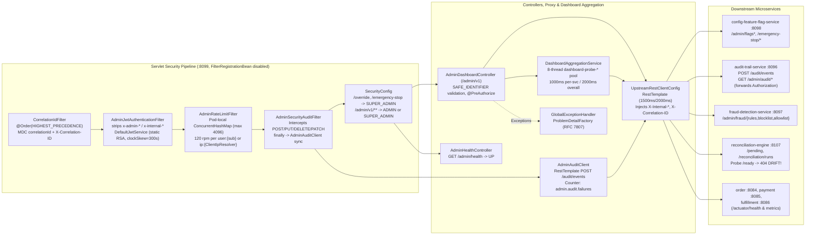
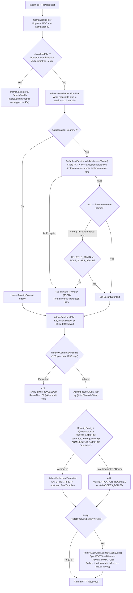
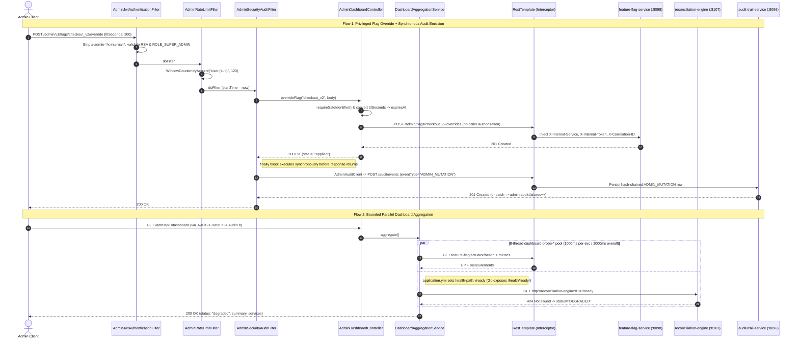

# `admin-gateway-service` — Code Walkthrough

> [!NOTE]
> **Part of the InstaCommerce Onboarding Suite:** [Onboarding Hub](../../README.md) · [Code Walkthrough Atlas](../README.md) · [Domain & Event Catalog (`05`)](../../05-domain-model-and-event-catalog.md) · [Incident Drills & Exam (`06`)](../../06-incident-drills-and-readiness-exam.md) · [Dependency Matrix & Cheatsheet (`07`)](../../07-service-dependency-and-command-cheatsheet.md)

> **Module:** `:services:admin-gateway-service` · **Port:** `:8099` (`SERVER_PORT`) · **Runtime:** Java 21, Spring Boot `4.0.0` (MVC), Spring Security (`@EnableMethodSecurity`), `RestTemplate`, JJWT, `ProblemDetailFactory` & `SecurityRoleUtils` (`libs/platform-common`)
>
> **Scope & Verification:** Verified directly against all Java sources and YAML configs under [`services/admin-gateway-service/`](../../../../services/admin-gateway-service/build.gradle.kts#L1-L32), [`docs/adr/011-admin-gateway-auth-model.md`](../../../../docs/adr/011-admin-gateway-auth-model.md#L1-L134), [`deploy/helm/values.yaml`](../../../../deploy/helm/values.yaml#L143-L154), and [`services/go-shared/pkg/health/handler.go`](../../../../services/go-shared/pkg/health/handler.go#L1-L146).

---

## 1. Purpose, Boundaries & Package Tree

`admin-gateway-service` is the dedicated internal control-plane gateway (`admin.instacommerce.dev`) separating operator workflows from customer ingress. It strips spoofed `x-admin-*` / `x-internal-*` headers, verifies RS256 admin JWTs, enforces pod-local RPM rate limits, records synchronous `ADMIN_MUTATION` audit events to `audit-trail-service`, aggregates live health/metrics across 6 backend services, and proxies flag, fraud, audit, and reconciliation APIs.

```text
services/admin-gateway-service/
├── build.gradle.kts                                    # MVC, Security, Validation, Actuator, JJWT, OTel
└── src/main/
    ├── resources/
    │   ├── application.yml                             # Port 8099, JWT audiences, 6 dashboard targets, RestTemplate timeouts
    │   └── application-local.yml                       # Localhost URLs, local-dev-internal-token, OTLP disabled
    └── java/com/instacommerce/admingateway/
        ├── AdminGatewayServiceApplication.java         # @SpringBootApplication + @ConfigurationPropertiesScan
        ├── config/
        │   ├── AdminDashboardProperties.java           # @ConfigurationProperties("admin-gateway.dashboard")
        │   ├── JacksonConfig.java                      # ISO-8601 date formatting
        │   └── UpstreamRestClientConfig.java           # RestTemplate (1500ms/2000ms) + X-Internal-* & X-Correlation-ID interceptor
        ├── security/
        │   ├── SecurityConfig.java                     # Filter order + FilterRegistrationBean disablers + SUPER_ADMIN gates
        │   ├── CorrelationIdFilter.java                # @Order(HIGHEST_PRECEDENCE) SAFE_ID -> MDC & response header
        │   ├── AdminJwtAuthenticationFilter.java       # Header strip + RSA JWT + aud/admin role bridge
        │   ├── AdminRateLimitFilter.java               # Pod-local ConcurrentHashMap (4096 keys, 120 rpm)
        │   ├── AdminSecurityAuditFilter.java           # Mutation finally-block -> AdminAuditClient
        │   ├── JwtService.java                         # JWT service SPI
        │   ├── DefaultJwtService.java                  # Issuer + acceptedAudiences + 300s clock skew (single RSA key)
        │   ├── JwtKeyLoader.java                       # Fails startup if admin-gateway.jwt.public-key blank
        │   ├── ClientIpResolver.java                   # Right-to-left X-Forwarded-For across loopback/site-local/link-local
        │   ├── RestAuthenticationEntryPoint.java       # 401 JSON {"code":"AUTHENTICATION_REQUIRED",...}
        │   └── RestAccessDeniedHandler.java            # 403 JSON {"code":"ACCESS_DENIED",...}
        ├── audit/
        │   └── AdminAuditClient.java                   # Sync RestTemplate POST /audit/events + admin.audit.failures counter
        ├── service/
        │   └── DashboardAggregationService.java        # 8-thread dashboard-probe-* pool + JSON/Prometheus metric parser
        └── controller/
            ├── AdminHealthController.java              # GET /admin/health -> {"status":"UP"}
            ├── AdminDashboardController.java           # /admin/v1/** proxy endpoints + SAFE_IDENTIFIER validation
            └── GlobalExceptionHandler.java             # @RestControllerAdvice delegating to ProblemDetailFactory
```

- [AdminGatewayServiceApplication.java](../../../../services/admin-gateway-service/src/main/java/com/instacommerce/admingateway/AdminGatewayServiceApplication.java#L7-L13)
- [SecurityConfig.java](../../../../services/admin-gateway-service/src/main/java/com/instacommerce/admingateway/security/SecurityConfig.java#L14-L66)
- [AdminDashboardController.java](../../../../services/admin-gateway-service/src/main/java/com/instacommerce/admingateway/controller/AdminDashboardController.java#L33-L419)
- [DashboardAggregationService.java](../../../../services/admin-gateway-service/src/main/java/com/instacommerce/admingateway/service/DashboardAggregationService.java#L30-L390)

---

## 2. Internal Architecture & Trust Boundaries

**admin-gateway-service LLD architecture** — *[Rendered PNG](../diagrams/services/admin-gateway-service-arch-lld.png) · [Mermaid Source](../diagrams/services/admin-gateway-service-arch-lld.mmd)*



### Filter Pipeline & Downstream Clients

- **Explicit Single-Registration Filters:** Unlike `identity-service`, `audit-trail-service`, `config-feature-flag-service`, and `catalog-service`, [`SecurityConfig`](../../../../services/admin-gateway-service/src/main/java/com/instacommerce/admingateway/security/SecurityConfig.java#L43-L65) declares three `FilterRegistrationBean` beans with `setEnabled(false)` for `AdminJwtAuthenticationFilter`, `AdminRateLimitFilter`, and `AdminSecurityAuditFilter` so Spring Boot executes them strictly inside `SecurityFilterChain` in exact order: `CorrelationIdFilter` -> `AdminJwtAuthenticationFilter` -> `AdminRateLimitFilter` -> `AdminSecurityAuditFilter` -> Spring `AuthorizationFilter`.
- **Shared `RestTemplate` Interceptor ([`UpstreamRestClientConfig`](../../../../services/admin-gateway-service/src/main/java/com/instacommerce/admingateway/config/UpstreamRestClientConfig.java#L21-L51)):** Injects `X-Internal-Service`, `X-Internal-Token`, and `X-Correlation-ID` (from MDC) on every outbound request if not already set, using `SimpleClientHttpRequestFactory` (`connectTimeout = 1500ms`, `readTimeout = 2000ms`).

---

## 3. Startup, Config Properties & Security Filter Chain

1. **Startup Requirements:** [`JwtKeyLoader`](../../../../services/admin-gateway-service/src/main/java/com/instacommerce/admingateway/security/JwtKeyLoader.java#L16-L28) throws `IllegalStateException` at startup if `admin-gateway.jwt.public-key` is null or blank. Likewise, [`application.yml`](../../../../services/admin-gateway-service/src/main/resources/application.yml#L101) declares `internal.service.token: ${INTERNAL_SERVICE_TOKEN}` **with no default value** — Spring context startup fails unless `INTERNAL_SERVICE_TOKEN` is present (it defaults to `local-dev-internal-token` in `application-local.yml`).
2. **`AdminJwtAuthenticationFilter` ([`AdminJwtAuthenticationFilter.java`](../../../../services/admin-gateway-service/src/main/java/com/instacommerce/admingateway/security/AdminJwtAuthenticationFilter.java#L58-L160)):**
   - `shouldNotFilter` skips `/actuator*`, `/admin/health*`, `/admin/metrics*`, and `/error`.
   - Wraps the request in an `HttpServletRequestWrapper` removing any header starting with `x-admin-` or `x-internal-` (case-insensitive).
   - Validates Bearer JWT via [`DefaultJwtService.validateAccessToken`](../../../../services/admin-gateway-service/src/main/java/com/instacommerce/admingateway/security/DefaultJwtService.java#L54-L73): verifies single RSA key, `requireIssuer("instacommerce-identity")`, `clockSkewSeconds(300)`, and `SecurityRoleUtils.hasAcceptedAudience(audiences, acceptedAudiences)` (`instacommerce-admin,instacommerce-api`).
   - **Audience Bridge:** If token `audiences` is non-empty and does not include `adminAudience` (`instacommerce-admin`), lines 83–91 require `ROLE_ADMIN` or `ROLE_SUPER_ADMIN` inside the filter itself so customer `instacommerce-api` tokens fail immediately with `401 TOKEN_INVALID`.
3. **`AdminRateLimitFilter` ([`AdminRateLimitFilter.java`](../../../../services/admin-gateway-service/src/main/java/com/instacommerce/admingateway/security/AdminRateLimitFilter.java#L50-L135)):**
   - Uses a pod-local `ConcurrentHashMap<String, WindowCounter>` capped at `MAX_TRACKED_KEYS = 4096`. Under saturation, `acquireCounter` synchronizes on `evictionLock`, removes expired `>= 60_000ms` windows, and evicts oldest entries by `windowStartMillis()`.
   - Keys authenticated callers by `user:{authentication.getName()}` and unauthenticated callers by `ip:{ClientIpResolver.resolveClientIp(request)}` (`120` rpm default).
   - On exceedance, returns `429` JSON `RATE_LIMIT_EXCEEDED` with `Retry-After: 60` **before** `AdminSecurityAuditFilter` runs.
4. **`AdminSecurityAuditFilter` ([`AdminSecurityAuditFilter.java`](../../../../services/admin-gateway-service/src/main/java/com/instacommerce/admingateway/security/AdminSecurityAuditFilter.java#L32-L133)):**
   - Wraps `filterChain.doFilter(request, response)` in `try / finally`.
   - For `POST`, `PUT`, `DELETE`, or `PATCH`, resolves `principal`, `authorities`, `status`, `durationMs`, `ClientIpResolver.resolveClientIp(request)`, and `correlationId`; logs `SECURITY_AUDIT_MUTATION_SUCCESS` or `SECURITY_AUDIT_MUTATION_REJECTED`; and calls [`AdminAuditClient.publishAuditEvent`](../../../../services/admin-gateway-service/src/main/java/com/instacommerce/admingateway/audit/AdminAuditClient.java#L45-L96) synchronously **before** returning the response.

---

## 4. State, Rate-Limit Memory Bounds & Client IP Resolution

`admin-gateway-service` has **no SQL database, Flyway migrations, or Redis client**. State is limited to:

- **Pod-Local Sliding/Fixed Window Map:** `AdminRateLimitFilter.counters` (`<= 4096` `WindowCounter` entries, `synchronized` per counter on `tryAcquire` and `windowStartMillis`).
- **Bounded Probe Executor:** [`DashboardAggregationService`](../../../../services/admin-gateway-service/src/main/java/com/instacommerce/admingateway/service/DashboardAggregationService.java#L52-L63) owns an 8-thread daemon fixed thread pool (`dashboard-probe-1..8`), shut down via `@PreDestroy` (`shutdownNow()`).
- **Proxy-Aware Client IP ([`ClientIpResolver`](../../../../services/admin-gateway-service/src/main/java/com/instacommerce/admingateway/security/ClientIpResolver.java#L21-L74)):** Walks `X-Forwarded-For` right-to-left only when `remoteAddr` is loopback, site-local, or link-local (`isTrustedProxy`). Invalid IP literals log `SECURITY_AUDIT_SPOOFED_IP_DETECTED` and fall back to `remoteAddr`.

---

## 5. Core Execution Paths & Call-Stack Walkthrough

**admin-gateway-service security, rate limit and audit flowchart** — *[Rendered PNG](../diagrams/services/admin-gateway-service-flowchart.png) · [Mermaid Source](../diagrams/services/admin-gateway-service-flowchart.mmd)*



**admin-gateway-service flag override and dashboard aggregation sequence** — *[Rendered PNG](../diagrams/services/admin-gateway-service-sequence.png) · [Mermaid Source](../diagrams/services/admin-gateway-service-sequence.mmd)*



### Endpoint & RBAC Proxy Surface ([`AdminDashboardController`](../../../../services/admin-gateway-service/src/main/java/com/instacommerce/admingateway/controller/AdminDashboardController.java#L81-L361))

| Method & Route | Effective Roles | Target Service & Downstream Route | Notes |
|---|---|---|---|
| `GET /admin/health` | `permitAll()` | Local [`AdminHealthController`](../../../../services/admin-gateway-service/src/main/java/com/instacommerce/admingateway/controller/AdminHealthController.java#L10-L13) | Returns `{"status":"UP"}` |
| `GET /admin/v1/dashboard` | `ADMIN`, `SUPER_ADMIN` | 6 targets in [`DashboardAggregationService`](../../../../services/admin-gateway-service/src/main/java/com/instacommerce/admingateway/service/DashboardAggregationService.java#L69-L123) | `CompletableFuture.allOf` bounded to `timeoutMs=2000`, `perServiceTimeoutMs=1000` |
| `GET /admin/v1/flags` | `ADMIN`, `SUPER_ADMIN` | `config-feature-flag-service` `GET /admin/flags` | `normalizeObjectResponse("flags", body)` |
| `POST /admin/v1/flags/{key}/enable`, `/disable` | `ADMIN`, `SUPER_ADMIN` | `config-feature-flag-service` `POST /admin/flags/{key}/enable` & `/disable` | `SAFE_IDENTIFIER` check (`^[a-zA-Z0-9._:@-]{1,128}$`) |
| `POST /admin/v1/flags/{key}/emergency-stop` | **`ROLE_SUPER_ADMIN`** | `config-feature-flag-service` `POST /admin/flags/emergency-stop/{key}` | Both URL rule (`SecurityConfig#L30`) and `@PreAuthorize` (`#L132`) |
| `POST /admin/v1/flags/{id}/override` | **`ROLE_SUPER_ADMIN`** | `config-feature-flag-service` `POST /admin/flags/{key}/overrides` | Converts `ttlSeconds` (`1..31536000`) to `expiresAt` |
| `GET`/`POST` `/admin/v1/fraud/rules`, `/blocklist`, `/allowlist`, `DELETE` | `ADMIN`, `SUPER_ADMIN` | `fraud-detection-service` `/admin/fraud/*` | Clamps `page >= 0`, `size` in `1..100` |
| `GET /admin/v1/audit/events`, `/audit/integrity/verify` | `ADMIN`, `SUPER_ADMIN` | `audit-trail-service` `GET /admin/audit/events` & `/integrity/verify` | Calls `authForwardEntity(httpRequest)` to forward caller `Authorization` header (`batchSize` `1..5000`) |
| `GET /admin/v1/reconciliation/pending`, `/summary` | `ADMIN`, `SUPER_ADMIN` | `reconciliation-engine` `GET /pending` & `GET /reconciliation/runs` | Returns default `{items:[]}` / `{status:"ok",count:0}` on null body |

### Call-Stack Trace: Privileged Mutation & Dashboard Aggregation

1. **Mutation (`POST /admin/v1/flags/{id}/override`):**
   - `CorrelationIdFilter` sets MDC `"correlationId"` and `"X-Correlation-ID"`.
   - `AdminJwtAuthenticationFilter` strips untrusted headers, parses JWT, verifies `ROLE_SUPER_ADMIN`, sets `SecurityContext`.
   - `AdminRateLimitFilter` acquires token under `"user:{sub}"`.
   - `AdminSecurityAuditFilter` records `startTime` and enters `filterChain.doFilter`.
   - Spring `AuthorizationFilter` + `@PreAuthorize("hasRole('SUPER_ADMIN')")` invoke `AdminDashboardController.overrideFlag`, which validates `id`, translates `ttlSeconds` -> `expiresAt`, and sends `POST /admin/flags/{key}/overrides` via `RestTemplate` (attaching `X-Internal-*` + `X-Correlation-ID`, **without** forwarding caller `Authorization`).
   - In `AdminSecurityAuditFilter`'s `finally` block, `publishAuditEvent` derives `resourceType = uriParts[3]` (`"flags"`) and `resourceId = uriParts[4]` (`"{id}"`), builds `details`, and calls `AdminAuditClient.publishAuditEvent` -> `restTemplate.postForLocation(baseUrl + "/audit/events", entity)`. Failures increment `admin.audit.failures` without failing the HTTP response.
2. **Dashboard Probe (`GET /admin/v1/dashboard`):**
   - `DashboardAggregationService.aggregate()` spawns `CompletableFuture.supplyAsync(..., executorService).orTimeout(1000ms)` for each of the 6 configured `ServiceTarget`s, awaits `CompletableFuture.allOf` up to `2000ms` (canceling stragglers), parses either Spring Actuator JSON (`measurements` array `COUNT`) or Prometheus exposition text (`http_requests_total`, max 25 metrics), and computes `status = degradedCount == 0 ? "ok" : "degraded"`.

---

## 6. Error Contract & Downstream Auth Mechanics

- **Two Error Shapes:**
  - Filter-layer rejections emit plain JSON `{code, message, timestamp}`: `TOKEN_INVALID` (`401` in `AdminJwtAuthenticationFilter`), `RATE_LIMIT_EXCEEDED` (`429` in `AdminRateLimitFilter`), `AUTHENTICATION_REQUIRED` (`401` in [`RestAuthenticationEntryPoint`](../../../../services/admin-gateway-service/src/main/java/com/instacommerce/admingateway/security/RestAuthenticationEntryPoint.java#L22-L31)), and `ACCESS_DENIED` (`403` in [`RestAccessDeniedHandler`](../../../../services/admin-gateway-service/src/main/java/com/instacommerce/admingateway/security/RestAccessDeniedHandler.java#L22-L31)).
  - Controller/downstream errors go through [`GlobalExceptionHandler`](../../../../services/admin-gateway-service/src/main/java/com/instacommerce/admingateway/controller/GlobalExceptionHandler.java#L31-L97), which extracts downstream JSON `code`/`detail`/`message` from `HttpStatusCodeException` and delegates to `ProblemDetailFactory.response(...)` (`application/problem+json` RFC 7807), mapping `RestClientException` to `502 UPSTREAM_UNAVAILABLE`.
- **Authorization Forwarding Difference:** Audit read routes (`/audit/events`, `/audit/integrity/verify`) call [`authForwardEntity(httpRequest)`](../../../../services/admin-gateway-service/src/main/java/com/instacommerce/admingateway/controller/AdminDashboardController.java#L381-L395) because `audit-trail-service` requires `ADMIN`/`SUPER_ADMIN` on `/admin/**`, whereas flag/fraud mutations call `jsonEntity(payload, null)` and rely solely on `X-Internal-*` headers injected by `UpstreamRestClientConfig`.

---

## 7. Config Matrix, Metrics, Tests & Verified Bugs / Drift

### Configuration Matrix

| Property / Env Var | `application.yml` Default | Helm / Local Notes |
|---|---|---|
| `SERVER_PORT` | `8099` | Helm sets `"8099"` |
| `ADMIN_GATEWAY_JWT_PUBLIC_KEY` | `${sm://jwt-rsa-public-key:${ADMIN_GATEWAY_JWT_PUBLIC_KEY:${JWT_PUBLIC_KEY:#{null}}}}` | Helm sets both `JWT_PUBLIC_KEY` and `ADMIN_GATEWAY_JWT_PUBLIC_KEY` |
| `JWT_ISSUER` / `JWT_AUD` / `JWT_ACCEPTED_AUDIENCES` | `instacommerce-identity` / `instacommerce-admin` / `instacommerce-admin,instacommerce-api` | `JWT_CLOCK_SKEW_SECONDS: 300` |
| `ADMIN_RATE_LIMIT_RPM` | `120` | Pod-local `ConcurrentHashMap` (`60s` window) |
| `ADMIN_HTTP_CONNECT_TIMEOUT_MS` / `READ_TIMEOUT_MS` | `1500` / `2000` | Shared `RestTemplate` |
| `DASHBOARD_TIMEOUT_MS` / `PER_SERVICE_TIMEOUT_MS` | `2000` / `1000` | Bounds `DashboardAggregationService` |
| `AUDIT_TRAIL_ENABLED` / `AUDIT_TRAIL_BASE_URL` | `true` / `http://audit-trail-service:8096` | Helm sets both `AUDIT_TRAIL_SERVICE_URL` and `AUDIT_TRAIL_BASE_URL` |
| `INTERNAL_SERVICE_TOKEN` | `${INTERNAL_SERVICE_TOKEN}` (**no default!**) | `local`: `local-dev-internal-token`; **omitted in Helm `values.yaml`** |

### Metrics

- [`AdminAuditClient`](../../../../services/admin-gateway-service/src/main/java/com/instacommerce/admingateway/audit/AdminAuditClient.java#L40-L42): Counter `admin.audit.failures`.
- Standard Spring Boot Actuator HTTP server metrics (`http.server.requests`), Prometheus endpoint `/actuator/prometheus`, OTLP traces/metrics.

### Narrow Test & Build Commands

```bash
./gradlew :services:admin-gateway-service:test
./gradlew :services:admin-gateway-service:test --tests "com.instacommerce.admingateway.security.AdminJwtAuthenticationFilterTest"
./gradlew :services:admin-gateway-service:spotlessCheck :services:admin-gateway-service:bootJar
```

### Verified Code-Level Bugs & Doc-vs-Code Drift

1. **Bug — Dashboard Probes `reconciliation-engine` at `/ready` (`404`):** [`application.yml`](../../../../services/admin-gateway-service/src/main/resources/application.yml#L77-L80) configures `reconciliation-engine` with `health-path: /ready`, whereas Go [`go-shared/pkg/health/handler.go`](../../../../services/go-shared/pkg/health/handler.go#L46-L70) registers `/health`, `/health/ready`, and `/health/live`. On every `GET /admin/v1/dashboard`, `reconciliation-engine` returns `HTTP 404` -> `DEGRADED`, forcing overall dashboard `status` to `"degraded"`.
2. **Startup Crash Risk — Required `INTERNAL_SERVICE_TOKEN` Omitted in Helm:** [`application.yml`](../../../../services/admin-gateway-service/src/main/resources/application.yml#L101) declares `${INTERNAL_SERVICE_TOKEN}` inside backticks without a default fallback (`:`), yet Helm [`values.yaml`](../../../../deploy/helm/values.yaml#L1434-L1445) omits `INTERNAL_SERVICE_TOKEN` (and `FRAUD_DETECTION_SERVICE_URL`). Without external env injection, Spring fails placeholder resolution on boot.
3. **ADR-011 & Istio Policy Drift:** [`docs/adr/011-admin-gateway-auth-model.md`](../../../../docs/adr/011-admin-gateway-auth-model.md#L30-L60) and Helm `admin-gateway-rbac-policy` ([`values.yaml`](../../../../deploy/helm/values.yaml#L143-L154)) require `aud == "instacommerce-admin"` and JWKS rotation. Because `identity-service` mints `aud: "instacommerce-api"`, `DefaultJwtService` accepts `instacommerce-api` tokens carrying admin roles, uses a single static RSA key (no JWKS `kid` lookup), and performs no blocklist check.
4. **Filter Ordering & Unmapped `/admin/metrics`:** `AdminRateLimitFilter` runs **before** `AdminSecurityAuditFilter`, so `429` rate-limit rejections and `401` JWT failures are never sent to `audit-trail-service` (`ADMIN_MUTATION`). Also, `AdminRateLimitFilter` is pod-local (allowing `2-6x` RPM across HPA pods), and [`SecurityConfig`](../../../../services/admin-gateway-service/src/main/java/com/instacommerce/admingateway/security/SecurityConfig.java#L29) permits `/admin/metrics` even though no controller maps it.
5. **Stale `README.md`:** [`services/admin-gateway-service/README.md`](../../../../services/admin-gateway-service/README.md#L1-L467) omits `ROLE_SUPER_ADMIN` gates on `/override` and `/emergency-stop`, omits `/fraud/**`, `/audit/**`, `/flags/{key}/{enable,disable}`, and `/reconciliation/summary`, cites wrong audit path `POST /audit-trail/events` (actual: `POST /audit/events`), and falsely claims audit emission is asynchronous.

---

**Previous:** [identity-service](./identity-service.md) | **Atlas Hub:** [Code Walkthrough Atlas](../README.md) | **Next:** [audit-trail-service](./audit-trail-service.md)
