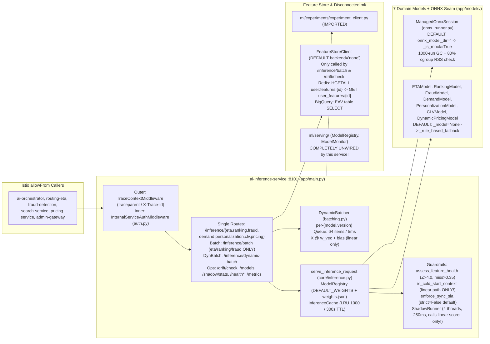
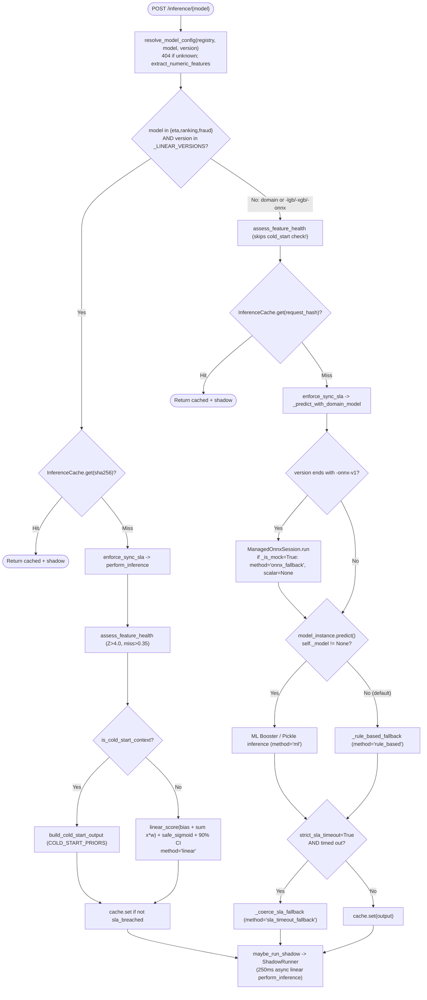
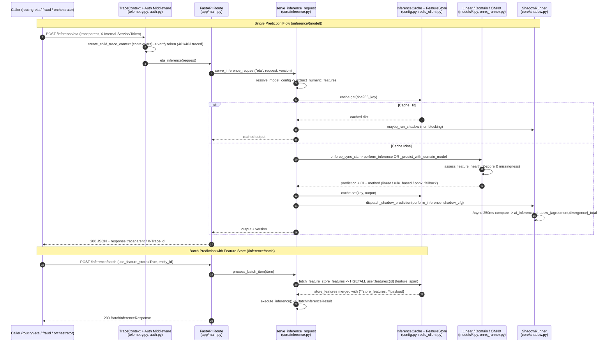

# `ai-inference-service` Code Walkthrough

> [!NOTE]
> **Part of the InstaCommerce Onboarding Suite:** [Onboarding Hub](../../README.md) · [Code Walkthrough Atlas](../README.md) · [Domain & Event Catalog (`05`)](../../05-domain-model-and-event-catalog.md) · [Incident Drills & Exam (`06`)](../../06-incident-drills-and-readiness-exam.md) · [Dependency Matrix & Cheatsheet (`07`)](../../07-service-dependency-and-command-cheatsheet.md)

> **Service identity:** Python `3.12` FastAPI low-latency ML serving engine on port `8101` (`AI_INFERENCE_PORT`) | **Domain:** 7 real-time model endpoints (`eta`, `ranking`, `fraud`, `demand`, `personalization`, `clv`, `pricing`), synchronous `/inference/batch` (with optional Redis/BigQuery feature store enrichment), micro-batching `/inference/dynamic-batch`, shadow mode, drift detection, and ONNX/LightGBM/linear fallback pipelines | **Source root:** [`services/ai-inference-service/`](../../../../services/ai-inference-service/)

---

## 1. Service Boundaries & Module Layout

`ai-inference-service` implements deterministic scoring with graceful degradation: when serialized `.pkl` artifacts, `.onnx` binaries, or external feature stores are absent—**which is the default out-of-the-box configuration**—every endpoint falls back seamlessly to hardcoded linear `DEFAULT_WEIGHTS`, domain `_rule_based_fallback` heuristics, and mock ONNX sessions (`_is_mock=True`) without failing HTTP readiness.

| Attribute | Authoritative Code / Config Value | Source |
| :--- | :--- | :--- |
| **HTTP Port & Runtime** | `:8101`, `python:3.12-slim`, repo-root Docker context (`COPY services/ai-inference-service/...`, `COPY ml ./ml`) | [`Dockerfile#L7-L11`](../../../../services/ai-inference-service/Dockerfile#L7-L11), [`app/main.py`](../../../../services/ai-inference-service/app/main.py) |
| **Middleware Stack** | Outer `TraceContextMiddleware` (W3C `traceparent` + `X-Trace-Id` contextvars, bound even on `401`/`403`) -> Inner `InternalServiceAuthMiddleware` | [`app/main.py#L131-L132`](../../../../services/ai-inference-service/app/main.py#L131-L132), [`app/core/telemetry.py`](../../../../services/ai-inference-service/app/core/telemetry.py), [`app/auth.py`](../../../../services/ai-inference-service/app/auth.py) |
| **Single Inference Routes** | `POST /inference/{eta,ranking,fraud,demand,personalization,clv,pricing}` (no `feature_store` lookup!) | [`app/main.py#L168-L382`](../../../../services/ai-inference-service/app/main.py#L168-L382) |
| **Batch & Ops Routes** | `POST /inference/batch` (<=100, `eta`/`ranking`/`fraud` ONLY, uses `feature_store`), `POST /inference/dynamic-batch`, `POST /drift/check`, `GET /models`, `GET /shadow/stats`, `GET /health*`, `GET /metrics` | [`app/main.py#L168-L382`](../../../../services/ai-inference-service/app/main.py#L168-L382), [`app/batching.py`](../../../../services/ai-inference-service/app/batching.py) |
| **Feature Store Seam** | `AI_INFERENCE_FEATURE_STORE_BACKEND="none"` default; Redis reads `HGETALL user:features:{id}` written by `reverse-etl-orchestrator` | [`app/core/config.py#L59`](../../../../services/ai-inference-service/app/core/config.py#L59), [`app/features/redis_client.py`](../../../../services/ai-inference-service/app/features/redis_client.py) |
| **ML Repo Imports** | Imports [`ml/experiments/experiment_client.py`](../../../../ml/experiments/experiment_client.py); **`ml/serving/` is completely unwired!** | [`pytest.ini`](../../../../services/ai-inference-service/pytest.ini), [`app/experiments/experiment_client.py`](../../../../services/ai-inference-service/app/experiments/experiment_client.py) |

### Package & File Inventory

```text
services/ai-inference-service/
├── Dockerfile                           # Requires repo-root build context (`COPY ml ./ml` & service paths)
├── pytest.ini                           # pythonpath = . ../.. so `import ml...` resolves in unit tests
└── app/
    ├── main.py                          # FastAPI app wiring auth, TraceContextMiddleware, routes, ShadowRunner, DynamicBatcher
    ├── auth.py                          # InternalServiceAuthMiddleware (skips /health*, /metrics)
    ├── schemas.py                       # Pydantic DTOs (single request, BatchInferenceRequest max=100, DriftCheck, DynamicBatch)
    ├── batching.py                      # DynamicBatcher (`64` batch / `5ms` timeout queues; vectorized linear X @ w_vec + bias ONLY)
    ├── core/
    │   ├── config.py                    # Settings (`env_prefix="AI_INFERENCE_"`), DEFAULT_WEIGHTS, COLD_START_PRIORS
    │   ├── inference.py                 # serve_inference_request, execute_inference, perform_inference, _predict_with_domain_model, InferenceCache
    │   ├── feature_health.py            # assess_feature_health (Z-score > 4.0 & missing_rate > 0.35 quarantine)
    │   ├── cold_start.py                # is_cold_start_context & build_cold_start_output (linear path ONLY)
    │   ├── guardrails.py                # Input sanitization / monotonic prediction bounds
    │   ├── sla.py                       # enforce_sync_sla (`strict_sla_timeout=False` default -> records observed_breach without aborting)
    │   ├── shadow.py                    # ShadowRunner (ThreadPoolExecutor 4 threads, `250ms` timeout, `0.1` tolerance)
    │   └── telemetry.py                 # TraceContextMiddleware + Prometheus counters/histograms exported at `/metrics`
    ├── features/
    │   ├── store.py                     # FeatureStoreClient factory (`none` | `redis` | `bigquery`)
    │   ├── redis_client.py              # RedisFeatureStoreClient: `HGETALL user:features:{id}` -> fallback `GET user_features:{id}`
    │   ├── redis_parsing.py             # Typed hash/JSON feature decoders
    │   ├── parity.py & extractors.py    # Feature alignment & numeric extraction
    └── models/
        ├── onnx_runner.py               # ManagedOnnxSession (default `onnx_model_dir=""` -> `_is_mock=True`; 1000-call GC + 80% RSS check)
        ├── base.py                      # Abstract domain model base
        ├── eta_model.py, ranking_model.py, fraud_model.py
        ├── demand_model.py, personalization_model.py, dynamic_pricing_model.py
        └── clv_model.py                 # DEFAULT_VERSION = "clv-bgnbd-v1" (vs config.py `"clv-bg-nbd-v1"`)
```

---

## 2. Architecture & Request Wiring (`arch-lld`)

**ai-inference-service Low-Level Architecture** — *[Rendered PNG](../diagrams/services/ai-inference-service-arch-lld.png) · [Mermaid Source](../diagrams/services/ai-inference-service-arch-lld.mmd)*



### Middleware Stack ([`app/main.py#L131-L132`](../../../../services/ai-inference-service/app/main.py#L131-L132))

1. **Outer — `TraceContextMiddleware` ([`app/core/telemetry.py`](../../../../services/ai-inference-service/app/core/telemetry.py)):** Registered after `InternalServiceAuthMiddleware` (`app.user_middleware` wraps later `add_middleware` calls outermost), so incoming W3C `traceparent` / `X-Trace-Id` contextvars are bound before auth checks and remain populated even on `401`/`403` rejections.
2. **Inner — `InternalServiceAuthMiddleware` ([`app/auth.py`](../../../../services/ai-inference-service/app/auth.py)):** Guards all `/inference/*`, `/drift/check`, `/models`, and `/shadow/stats` endpoints while bypassing `/health*` and `/metrics`.

---

## 3. Caching, Feature Store, ONNX & Batching Subsystems

### `InferenceCache` & `DynamicBatcher` ([`core/inference.py`](../../../../services/ai-inference-service/app/core/inference.py), [`batching.py`](../../../../services/ai-inference-service/app/batching.py))

- **`InferenceCache`:** Thread-safe LRU cache (`max_size = 1000`, `TTL = 300s`) keyed by SHA-256 hash of `(model, version, sorted numeric features)`. Entries computed under an SLA breach are NOT cached.
- **`DynamicBatcher` (`/inference/dynamic-batch`):** Buffers requests per `(model, version)` in async queues up to **`64` items or `5ms`** max wait, then executes NumPy vectorized math (`X @ w_vec + bias`) inside `DynamicBatcher._execute_batch` ([`batching.py#L176`](../../../../services/ai-inference-service/app/batching.py#L176)). **It never invokes domain `.pkl` or `.onnx` models.**

### `ManagedOnnxSession` & Memory Guard ([`models/onnx_runner.py`](../../../../services/ai-inference-service/app/models/onnx_runner.py))

- When `AI_INFERENCE_ONNX_MODEL_DIR` is empty (`""`, default), sessions boot with `_is_mock = True` and return `method = "onnx_fallback"`, causing `_predict_with_domain_model` to fall through to the Python domain model (`.predict()` -> `_rule_based_fallback`).
- Every `1000` ONNX inferences triggers explicit `gc.collect()` and checks Linux cgroup RSS against an `80%` threshold.

### Feature Store Hydration ([`features/store.py`](../../../../services/ai-inference-service/app/features/store.py), [`features/redis_client.py`](../../../../services/ai-inference-service/app/features/redis_client.py))

- **Only `/inference/batch` and `/drift/check` invoke `feature_store`.** Single-item `/inference/{model}` routes and `/inference/dynamic-batch` expect callers to pass all features inline.
- `RedisFeatureStoreClient` first tries `HGETALL user:features:{entity_id}` (the schema populated by `reverse-etl-orchestrator`) and falls back to JSON string `GET user_features:{entity_id}`, merging `{**store_features, **item.features}` so request overrides win.

---

## 4. Dual Serving Decision Flow & Sequence Walkthrough

### Linear vs. Domain/ONNX Decision Flowchart

**ai-inference-service Prediction Flowchart** — *[Rendered PNG](../diagrams/services/ai-inference-service-flowchart.png) · [Mermaid Source](../diagrams/services/ai-inference-service-flowchart.mmd)*



### Single & Batch Inference Sequence Diagram

**ai-inference-service Request Sequence** — *[Rendered PNG](../diagrams/services/ai-inference-service-sequence.png) · [Mermaid Source](../diagrams/services/ai-inference-service-sequence.mmd)*



### Function-by-Function Trace (`serve_inference_request`, [`core/inference.py#L823-L891`](../../../../services/ai-inference-service/app/core/inference.py#L823-L891))

1. **Config & Feature Extraction:** `resolve_model_config(registry, model, version)` resolves active weights (`404` if unknown model), extracts numeric features, and splits cleanly into two distinct pipelines:
2. **Branch 1 — Linear Scoring Path (`model in {eta, ranking, fraud}` AND `version in _LINEAR_VERSIONS` [`eta-linear-v1`, `ranking-linear-v1`, `fraud-logit-v1`]):**
   - Checks `InferenceCache.get(sha256_key)`; hits immediately return cached payload + trigger async `maybe_run_shadow`.
   - On cache miss, calls `enforce_sync_sla` -> `perform_inference`:
     - Runs `assess_feature_health` (flags out-of-distribution features with `|Z| > 4.0` or `missing_rate > 0.35`).
     - Checks `is_cold_start_context` ([`core/cold_start.py`](../../../../services/ai-inference-service/app/core/cold_start.py)); cold users/stores emit `COLD_START_PRIORS` via `build_cold_start_output`.
     - Otherwise computes `linear_score` (`bias + sum(x * w)`), `safe_sigmoid`, and `90%` confidence intervals (`method = "linear"`).
   - Stores output in `InferenceCache` unless `sla_breached`, then triggers `maybe_run_shadow`.
3. **Branch 2 — Domain Model / ONNX Path (All Other Versions & `{demand, personalization, clv, pricing}`):**
   - Runs `assess_feature_health` **up front** (note: **`is_cold_start_context` is skipped on this branch!**).
   - Checks `InferenceCache.get(request_hash)`.
   - On miss, runs `enforce_sync_sla` -> `_predict_with_domain_model`:
     - If `version` ends with `"-onnx-v1"`, attempts `ManagedOnnxSession.run`; if `_is_mock=True` (`scalar is None`, `method="onnx_fallback"`), falls through to domain `model_instance.predict()`.
     - Domain model runs loaded ML booster/pickle (`method="ml"`) when `self._model` is present, or deterministic `_rule_based_fallback` (`method="rule_based"`) when `_model is None` (default).
   - Evaluates `strict_sla_timeout`: since default is **`False`**, timed-out predictions log/record `observed_breach` metrics rather than substituting `_coerce_sla_fallback`.
4. **Shadow Evaluation (`maybe_run_shadow`, [`core/inference.py#L303`](../../../../services/ai-inference-service/app/core/inference.py#L303), [`core/shadow.py`](../../../../services/ai-inference-service/app/core/shadow.py)):**
   - Offloads comparison to `ShadowRunner` (4-thread executor, `250ms` timeout, `0.1` divergence threshold), executing **linear `perform_inference` only** and exporting `ai_inference_shadow_{agreement,divergence}_total`.

---

## 5. Configuration, Observability & Testing

### Key Environment Settings ([`app/core/config.py#L59-L70`](../../../../services/ai-inference-service/app/core/config.py#L59-L70))

| Env Var (`AI_INFERENCE_*`) | Default | Runtime Effect |
| :--- | :--- | :--- |
| `AI_INFERENCE_FEATURE_STORE_BACKEND` | `"none"` | Must be `"redis"` or `"bigquery"` to hydrate features on `/inference/batch` |
| `AI_INFERENCE_MODEL_ARTIFACT_DIR` | `""` | Empty means domain `.pkl` models stay unloaded (`_model=None` -> `_rule_based_fallback`) |
| `AI_INFERENCE_ONNX_MODEL_DIR` | `""` | Empty puts `ManagedOnnxSession` into `_is_mock=True` (`onnx_fallback`) |
| `AI_INFERENCE_STRICT_SLA_TIMEOUT` | `False` | When `False`, SLA violations only increment telemetry rather than aborting |

### Verification Command

```bash
cd services/ai-inference-service && ../../.venv/bin/pytest -q
```

---

## 6. Verified Code-Level Bugs, Drift & Unwired Subsystems

1. **Out-of-the-Box Fallback Mode (`DEFAULT_WEIGHTS`, `_rule_based_fallback`, Mock ONNX, Disabled Feature Store):** [`app/core/config.py#L59-L70`](../../../../services/ai-inference-service/app/core/config.py#L59-L70) defaults `FEATURE_STORE_BACKEND="none"`, `MODEL_ARTIFACT_DIR=""`, and `ONNX_MODEL_DIR=""`, so unconfigured deployments serve hardcoded linear priors, rule heuristics, and mock ONNX sessions.
2. **`ml/serving/` Completely Unwired:** Only [`ml/experiments/experiment_client.py`](../../../../ml/experiments/experiment_client.py) is bridged; [`ml/serving/`](../../../../ml/serving/README.md) predictors, integrity checks, and shadow helpers are not imported anywhere in `services/ai-inference-service/`.
3. **Asymmetric Feature Store, Cold-Start, Dynamic Batcher & Shadow Coverage:**
   - Single-item `/inference/*` routes never consult `feature_store`; only `/inference/batch` (`eta`/`ranking`/`fraud` max 100) and `/drift/check` hydrate stored user features.
   - Domain/ONNX branch skips `is_cold_start_context` ([`core/inference.py#L823-L891`](../../../../services/ai-inference-service/app/core/inference.py#L823-L891)).
   - `DynamicBatcher._execute_batch` ([`app/batching.py#L176`](../../../../services/ai-inference-service/app/batching.py#L176)) and `maybe_run_shadow` ([`app/core/inference.py#L303`](../../../../services/ai-inference-service/app/core/inference.py#L303)) only support vectorized/linear scoring and cannot run domain LightGBM/XGBoost/ONNX models.
4. **CLV Default Version Naming Mismatch:** [`CLVModel.DEFAULT_VERSION`](../../../../services/ai-inference-service/app/models/clv_model.py#L120) sets `"clv-bgnbd-v1"`, while [`DEFAULT_WEIGHTS["clv"]["default_version"]`](../../../../services/ai-inference-service/app/core/config.py#L228) sets `"clv-bg-nbd-v1"`.
5. **Docker Build Context, Helm Literal Token, Docs & Alert Drift:**
   - [`Dockerfile#L7-L11`](../../../../services/ai-inference-service/Dockerfile#L7-L11) requires repository-root build context (`COPY services/ai-inference-service/...` and `COPY ml ./ml`).
   - [`README.md#L7`](../../../../services/ai-inference-service/README.md#L7) claims Python `3.14` (`Dockerfile` uses `3.12-slim`).
   - [`deploy/helm/values.yaml`](../../../../deploy/helm/values.yaml) passes literal `${sm://internal-service-token}` directly to Python instead of a resolved Kubernetes Secret value.
   - [`wave-40-complete-slo-alerts.yml#L587`](../../../../prometheus/rules/wave-40-complete-slo-alerts.yml#L587) queries Spring's `http_server_requests_seconds_count` metric rather than Python metrics exposed at `/metrics`.

---

**Previous:** [ai-orchestrator-service](./ai-orchestrator-service.md) | **Atlas Hub:** [Code Walkthrough Atlas](../README.md) | **Next:** [Code Walkthrough Atlas](../README.md)
