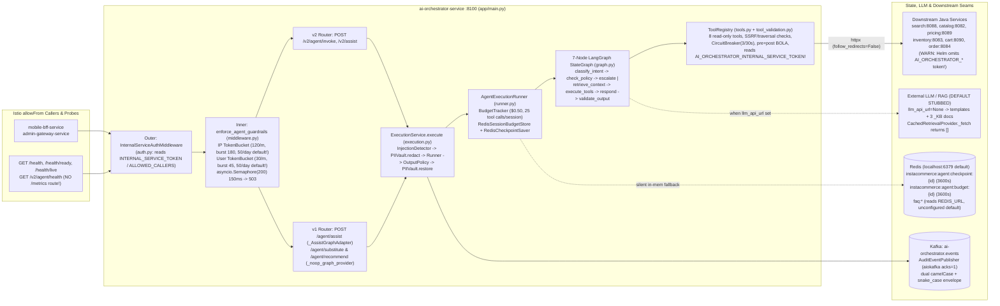
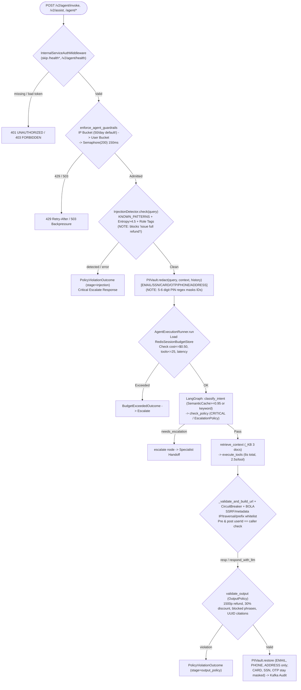
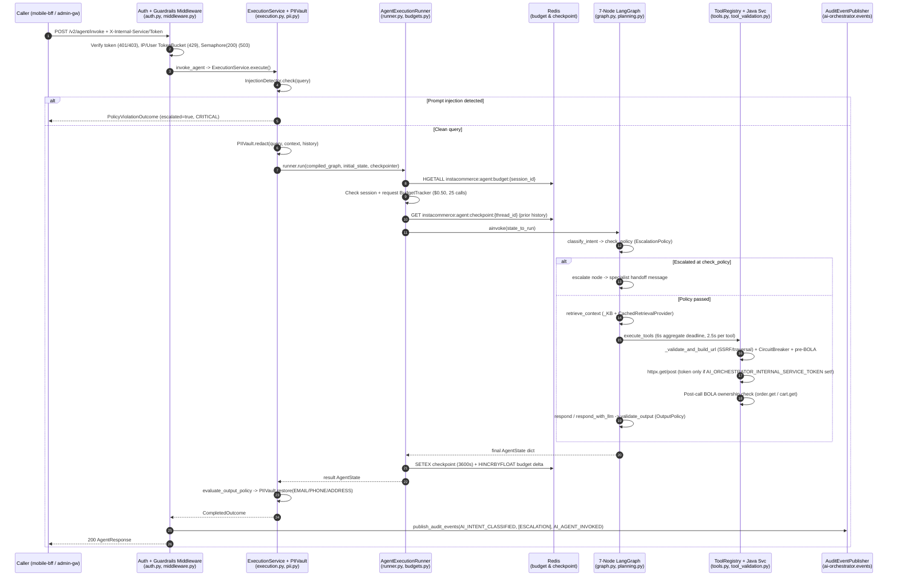

# `ai-orchestrator-service` Code Walkthrough

> [!NOTE]
> **Part of the InstaCommerce Onboarding Suite:** [Onboarding Hub](../../README.md) · [Code Walkthrough Atlas](../README.md) · [Domain & Event Catalog (`05`)](../../05-domain-model-and-event-catalog.md) · [Incident Drills & Exam (`06`)](../../06-incident-drills-and-readiness-exam.md) · [Dependency Matrix & Cheatsheet (`07`)](../../07-service-dependency-and-command-cheatsheet.md)

> **Service identity:** Python `3.12` FastAPI + LangGraph agent service on port `8100` (`AI_ORCHESTRATOR_PORT`) | **Domain:** Customer/ops agent orchestration with layered rate/concurrency limits, prompt-injection firewall, PII vaulting, session dollar/tool-call budgeting, SSRF/BOLA-protected tool calls, output policy gates, and Kafka audit trails | **State:** Optional Redis checkpoints/budgets/semantic cache + Kafka `ai-orchestrator.events` | **Source root:** [`services/ai-orchestrator-service/`](../../../../services/ai-orchestrator-service/)

---

## 1. Service Boundaries & Module Layout

`ai-orchestrator-service` exposes synchronous **v2 LangGraph agent endpoints** (`POST /v2/agent/invoke`, `POST /v2/agent/assist`) alongside **v1 compatibility routes** (`/agent/assist`, `/agent/substitute`, `/agent/recommend`). Only the `/v2/*` flow and `/agent/assist` (`_AssistGraphAdapter`) invoke the full 7-node LangGraph graph; `/agent/substitute` and `/agent/recommend` intentionally bypass it via `_noop_graph_provider`.

| Attribute | Authoritative Code / Config Value | Source |
| :--- | :--- | :--- |
| **HTTP Port & Runtime** | `:8100` (`python:3.12-slim`, `uvicorn`) | [`Dockerfile`](../../../../services/ai-orchestrator-service/Dockerfile), [`app/main.py`](../../../../services/ai-orchestrator-service/app/main.py) |
| **Middleware Chain** | Outer `InternalServiceAuthMiddleware` -> Inner `enforce_agent_guardrails` (`TokenBucketRateLimiter` + `asyncio.Semaphore(200)`) | [`app/main.py#L125-L135`](../../../../services/ai-orchestrator-service/app/main.py#L125-L135), [`app/auth.py`](../../../../services/ai-orchestrator-service/app/auth.py), [`app/middleware.py`](../../../../services/ai-orchestrator-service/app/middleware.py) |
| **LangGraph Topology** | 7 nodes (`classify_intent`, `check_policy`, `escalate`, `retrieve_context`, `execute_tools`, `respond` / `respond_with_llm`, `validate_output`) | [`app/graph/graph.py`](../../../../services/ai-orchestrator-service/app/graph/graph.py) |
| **Redis Keyspaces** | `instacommerce:agent:budget:{session_id}` (`3600s`), `instacommerce:agent:checkpoint:{thread_id}` (`3600s`), `faq:*` (`SemanticCache`) | [`app/graph/budgets.py`](../../../../services/ai-orchestrator-service/app/graph/budgets.py), [`app/graph/checkpoints.py`](../../../../services/ai-orchestrator-service/app/graph/checkpoints.py), [`app/cache/semantic_cache.py`](../../../../services/ai-orchestrator-service/app/cache/semantic_cache.py) |
| **Kafka Audit Topic** | `ai-orchestrator.events` (`aiokafka`, `acks=1`, dual `camelCase` + `snake_case` payload) | [`app/audit.py`](../../../../services/ai-orchestrator-service/app/audit.py), [`app/audit_envelope.py`](../../../../services/ai-orchestrator-service/app/audit_envelope.py) |

### Package & File Inventory

```text
services/ai-orchestrator-service/
├── Dockerfile                        # python:3.12-slim (note README claims 3.14-slim)
└── app/
    ├── main.py                       # FastAPI lifespan (Redis/Kafka/SemanticCache), v1/v2 routers, middleware registration (NO /metrics!)
    ├── config.py                     # pydantic-settings Settings(env_prefix="AI_ORCHESTRATOR_")
    ├── auth.py                       # Outer InternalServiceAuthMiddleware reading unprefixed INTERNAL_SERVICE_TOKEN / ALLOWED_CALLERS
    ├── middleware.py                 # enforce_agent_guardrails: IP & User TokenBucketRateLimiter + asyncio.Semaphore(200, 150ms)
    ├── audit.py & audit_envelope.py  # aiokafka AuditEventPublisher + camel/snake dual-key event envelope
    ├── cache/semantic_cache.py       # SemanticCache (reads REDIS_URL directly; scans KEYS b"faq:*")
    ├── api/
    │   ├── execution.py              # ExecutionService.execute: Injection -> PIIVault -> Runner -> OutputPolicy -> PII restore -> Audit
    │   ├── handlers.py               # POST /v2/agent/invoke, /v2/agent/assist, GET /v2/agent/health
    │   ├── v1.py                     # _AssistGraphAdapter (forwards to ExecutionService) + /agent/substitute, /agent/recommend
    │   └── v1_flows.py               # /agent/substitute & /agent/recommend using _noop_graph_provider (bypasses graph)
    ├── guardrails/
    │   ├── injection.py              # InjectionDetector: regex KNOWN_PATTERNS + Shannon entropy (>4.5, len>=20) + ROLE_BOUNDARY_PATTERNS
    │   ├── pii.py                    # PIIVault regex masking (EMAIL/SSN/CARD/OTP/PHONE/ADDRESS) + selective restore
    │   ├── rate_limiter.py           # TokenBucketRateLimiter with silent _DEFAULT_PER_DAY = 50 cap!
    │   ├── escalation.py             # EscalationPolicy rule engine (food safety, medical, legal, >USD 50 refund, repeated complaints)
    │   └── output_validator.py       # OutputPolicy (1500p refund cap, 30% discount cap, blocked phrases, UUID citation check)
    └── graph/
        ├── graph.py                  # StateGraph compilation (7 nodes, no native checkpointer; manual Redis checkpointing)
        ├── runner.py                 # AgentExecutionRunner: RedisSessionBudgetStore (USD 0.50, 25 tool calls) + checkpoints
        ├── planning.py               # classify_intent, check_policy, retrieve_context (3-doc _KB + stub CachedRetrievalProvider)
        ├── tools.py                  # 8 read-only HTTP tools (`6s` total / `2.5s` each), reads AI_ORCHESTRATOR_INTERNAL_SERVICE_TOKEN!
        ├── tool_validation.py        # _validate_and_build_url (SSRF/IP/traversal/prefix checks) + pre/post BOLA validation
        ├── circuit_breaker.py        # Per-tool CircuitBreaker(failure_threshold=3, reset_timeout=30s)
        ├── response_node.py          # Template responder + optional httpx LLM call (`llm_api_url=None` default)
        ├── escalation_node.py        # Specialist handoff node formatting escalation payload
        ├── output_guard.py           # validate_output graph node wrapper
        ├── substitution.py           # Deterministic basket substitution fallback helpers
        └── budgets.py & checkpoints.py
```

---

## 2. Architecture & Middleware Stack (`arch-lld`)

**ai-orchestrator-service Low-Level Architecture** — *[Rendered PNG](../diagrams/services/ai-orchestrator-service-arch-lld.png) · [Mermaid Source](../diagrams/services/ai-orchestrator-service-arch-lld.mmd)*



### HTTP Middleware Stack ([`app/main.py#L125-L135`](../../../../services/ai-orchestrator-service/app/main.py#L125-L135))

Starlette executes middlewares in reverse registration order, putting `InternalServiceAuthMiddleware` outermost:

1. **Outer — `InternalServiceAuthMiddleware` ([`app/auth.py`](../../../../services/ai-orchestrator-service/app/auth.py)):**
   - Skips `/health`, `/health/live`, `/health/ready`, `/metrics`, and `/v2/agent/health`.
   - Reads unprefixed `INTERNAL_SERVICE_TOKEN` and `INTERNAL_SERVICE_ALLOWED_CALLERS` from `os.environ`, verifying `X-Internal-Service` and `X-Internal-Token` via `hmac.compare_digest` (`401`/`403`).
2. **Inner — `enforce_agent_guardrails` ([`app/middleware.py`](../../../../services/ai-orchestrator-service/app/middleware.py)):**
   - Skips `SKIP_PATHS` (including `/metrics`, even though **`app/main.py` exposes no `/metrics` route**).
   - Evaluates IP `TokenBucketRateLimiter` (`120/min`, burst `180`) then user `TokenBucketRateLimiter` (`30/min`, burst `45`), returning `429` with `Retry-After` on exhaustion.
   - Acquires `asyncio.Semaphore(200)` with `150ms` timeout (`503` backpressure on saturation).

---

## 3. Guardrail Vaults, Budgeting & State Checkpointing

### PII Redaction (`PIIVault`, [`app/guardrails/pii.py`](../../../../services/ai-orchestrator-service/app/guardrails/pii.py))

Before entering `AgentExecutionRunner`, `ExecutionService.execute` redacts `query`, `context`, and `conversation_history` into session-scoped placeholders (`[PII_EMAIL_1]`, `[PII_PHONE_1]`, `[PII_CARD_1]`, `[PII_SSN_1]`, `[PII_OTP_1]`, `[PII_ADDRESS_1]`). After output validation completes, **`PIIVault.restore` selectively unmasks ONLY `EMAIL`, `PHONE`, and `ADDRESS`**—leaving `CARD`, `SSN`, and `OTP` permanently redacted in customer responses.

### Budgeting & Manual Checkpoints (`runner.py`, `budgets.py`, `checkpoints.py`)

- `RedisSessionBudgetStore`: Stores `tokens_in`, `tokens_out`, `cost_usd`, and `tool_calls` under `instacommerce:agent:budget:{session_id}` (`3600s` TTL). Hard caps per session are **`USD 0.50`** (`$0.50`) and **`25` tool calls**, returning `BudgetExceededOutcome` before entering LangGraph if already spent.
- `RedisCheckpointSaver`: `build_agent_graph()` compiles LangGraph **without** passing a native `checkpointer=`; instead, `run_agent_graph` manually `GET`s `instacommerce:agent:checkpoint:{thread_id}` before `ainvoke()` and `SETEX` (`3600s`) after completion—silently falling back to `InMemoryCheckpointSaver` when Redis is unset or unreachable.

---

## 4. Guardrail Decision Pipeline & LangGraph Execution Trace

### Guardrail & Graph Flowchart

**ai-orchestrator-service Guardrail Flowchart** — *[Rendered PNG](../diagrams/services/ai-orchestrator-service-flowchart.png) · [Mermaid Source](../diagrams/services/ai-orchestrator-service-flowchart.mmd)*



### End-to-End Invocation Sequence Diagram

**ai-orchestrator-service Execution Sequence** — *[Rendered PNG](../diagrams/services/ai-orchestrator-service-sequence.png) · [Mermaid Source](../diagrams/services/ai-orchestrator-service-sequence.mmd)*



### Function-by-Function Walkthrough ([`api/execution.py`](../../../../services/ai-orchestrator-service/app/api/execution.py), [`graph/runner.py`](../../../../services/ai-orchestrator-service/app/graph/runner.py), [`graph/tools.py`](../../../../services/ai-orchestrator-service/app/graph/tools.py))

1. **`ExecutionService.execute` ([`app/api/execution.py`](../../../../services/ai-orchestrator-service/app/api/execution.py)):**
   - Runs `InjectionDetector.check(query)` ([`app/guardrails/injection.py`](../../../../services/ai-orchestrator-service/app/guardrails/injection.py)), scanning regex `KNOWN_PATTERNS`, high-entropy strings (Shannon entropy `> 4.5` when length `>= 20`), and `ROLE_BOUNDARY_PATTERNS`. **Fails closed** on detector exceptions, returning `PolicyViolationOutcome(escalated=True, risk="CRITICAL")`.
   - Calls `PIIVault.redact(...)`, builds `initial_state`, and calls `AgentExecutionRunner.run(...)`.
2. **`AgentExecutionRunner.run` ([`app/graph/runner.py`](../../../../services/ai-orchestrator-service/app/graph/runner.py)):**
   - Checks `RedisSessionBudgetStore` and creates a per-request `BudgetTracker`.
   - Loads prior state from `RedisCheckpointSaver` (`thread_id`), merges state, and invokes the compiled 7-node LangGraph `StateGraph`:
     1. **`classify_intent` ([`graph/planning.py`](../../../../services/ai-orchestrator-service/app/graph/planning.py)):** Checks `SemanticCache` (similarity `>= 0.95`) or deterministic keyword classifiers.
     2. **`check_policy`:** Evaluates `EscalationPolicy` (high-value refunds, safety/medical/legal triggers, `CRITICAL` risk); routes either to **`escalate`** (`Specialist Handoff`) or **`retrieve_context`**.
     3. **`retrieve_context`:** Queries built-in 3-doc `_KB` plus `CachedRetrievalProvider` (whose `_fetch()` is currently a stub returning `[]`).
     4. **`execute_tools` ([`graph/tools.py`](../../../../services/ai-orchestrator-service/app/graph/tools.py), [`graph/tool_validation.py`](../../../../services/ai-orchestrator-service/app/graph/tool_validation.py)):** Executes up to an aggregate `6s` deadline (`2.5s` per HTTP tool across 8 read-only tools targeting `search`, `catalog`, `pricing`, `inventory`, `cart`, `order`):
        - Validates URLs via `_validate_and_build_url` (blocks private/loopback/metadata IPs, path traversal, and off-prefix paths; enforces `follow_redirects=False`).
        - Enforces per-tool `CircuitBreaker(3 failures / 30s reset)`.
        - Enforces **pre-call and post-call BOLA ownership verification** on `order.get` and `cart.get` (`userId == callerId`).
     5. **`respond` / `respond_with_llm` ([`graph/response_node.py`](../../../../services/ai-orchestrator-service/app/graph/response_node.py)):** Synthesizes deterministic templates unless `llm_api_url` is set.
     6. **`validate_output` ([`graph/output_guard.py`](../../../../services/ai-orchestrator-service/app/graph/output_guard.py)):** Runs `OutputPolicy` (`1500` paise refund cap, `30%` discount cap, blocked phrases, fabricated UUID citation detection), conditionally routing violations to **`escalate`**.
3. **Checkpoint Save, PII Restore & Audit ([`app/audit.py`](../../../../services/ai-orchestrator-service/app/audit.py)):**
   - Persists checkpoint (`SETEX 3600s`) and increments budget hash (`HINCRBYFLOAT`).
   - Restores `EMAIL`/`PHONE`/`ADDRESS` tokens via `PIIVault.restore` and emits `AI_INTENT_CLASSIFIED`, optional `ESCALATION`, and `AI_AGENT_INVOKED` records to Kafka `ai-orchestrator.events`.

---

## 5. Configuration, Observability & Testing

### Key Environment Settings ([`app/config.py`](../../../../services/ai-orchestrator-service/app/config.py))

`Settings` inherits `BaseSettings` with `env_prefix = "AI_ORCHESTRATOR_"` ([`app/config.py#L8`](../../../../services/ai-orchestrator-service/app/config.py#L8), [`#L48`](../../../../services/ai-orchestrator-service/app/config.py#L48)), meaning Pydantic settings (including `internal_service_token`, `llm_api_url=None`, `redis_url`) read `AI_ORCHESTRATOR_*` env vars, whereas `auth.py` and `semantic_cache.py` read unprefixed env vars directly!

### Verification Command

```bash
cd services/ai-orchestrator-service && ../../.venv/bin/pytest -q
```

---

## 6. Verified Code-Level Bugs, Security Quirks & Doc Drift

1. **Outbound Internal Auth Token Mismatch (Silent Broken Downstream Calls):**
   - `Settings` (`env_prefix="AI_ORCHESTRATOR_"`, [`app/config.py#L8`](../../../../services/ai-orchestrator-service/app/config.py#L8), [`#L48`](../../../../services/ai-orchestrator-service/app/config.py#L48)) requires `AI_ORCHESTRATOR_INTERNAL_SERVICE_TOKEN`, which `ToolRegistry.call` ([`app/graph/tools.py#L236-L238`](../../../../services/ai-orchestrator-service/app/graph/tools.py#L236-L238)) attaches when calling Java services.
   - However, [`app/auth.py#L44`](../../../../services/ai-orchestrator-service/app/auth.py#L44) and [`deploy/helm/values.yaml#L824`](../../../../deploy/helm/values.yaml#L824) only provide unprefixed `INTERNAL_SERVICE_TOKEN` (and Helm sets literal `${sm://internal-service-token}` directly on Python!). Outbound tool calls omit `X-Internal-Token` under default Helm!
2. **Hidden Daily Quota Exhaustion (`50/day` Even Per IP!):** [`app/main.py#L86-L93`](../../../../services/ai-orchestrator-service/app/main.py#L86-L93) instantiates both IP and user `TokenBucketRateLimiter` instances without `max_per_day`, causing [`app/guardrails/rate_limiter.py#L23`](../../../../services/ai-orchestrator-service/app/guardrails/rate_limiter.py#L23), [`#L110`](../../../../services/ai-orchestrator-service/app/guardrails/rate_limiter.py#L110) to apply `_DEFAULT_PER_DAY = 50`, rejecting legitimate BFF/mobile traffic after 50 requests/day (`429 daily_quota_exceeded`).
3. **False-Positive Injection & Over-Broad PIN PII Redaction:**
   - [`app/guardrails/injection.py#L61`](../../../../services/ai-orchestrator-service/app/guardrails/injection.py#L61) matches `r"issue\s+(a\s+)?(full\s+)?refund"`, falsely blocking benign customer refund inquiries as prompt injections.
   - [`app/guardrails/pii.py#L57`](../../../../services/ai-orchestrator-service/app/guardrails/pii.py#L57) matches an optional `PIN` prefix before 5–6 digits, masking ordinary 5–6 digit order/store IDs as `[PII_ADDRESS_N]`.
4. **Stubbed LLM, RAG & Disconnected `SemanticCache` / `/metrics`:**
   - `llm_api_url` defaults to `None`, `CachedRetrievalProvider._fetch` returns `[]`, and `_KB` contains only 3 static docs.
   - [`app/main.py#L65`](../../../../services/ai-orchestrator-service/app/main.py#L65) constructs `SemanticCache()` without `settings.redis_url` (falling back to unprefixed `REDIS_URL`, scanning `KEYS b"faq:*"` rather than `FT.SEARCH`).
   - `v1_flows.py` routes `/agent/substitute` and `/agent/recommend` through `_noop_graph_provider`.
   - `app/main.py` mounts **no `/metrics` endpoint**, while [`wave-40-complete-slo-alerts.yml#L572`](../../../../prometheus/rules/wave-40-complete-slo-alerts.yml#L572) queries Spring's `http_server_requests_seconds_count`.
5. **Dockerfile vs. `README.md` Python Version Drift:** [`README.md#L12`](../../../../services/ai-orchestrator-service/README.md#L12) claims `python:3.14-slim`, whereas [`Dockerfile`](../../../../services/ai-orchestrator-service/Dockerfile) builds `python:3.12-slim`.

---

**Previous:** [reverse-etl-orchestrator](./reverse-etl-orchestrator.md) | **Atlas Hub:** [Code Walkthrough Atlas](../README.md) | **Next:** [ai-inference-service](./ai-inference-service.md)
