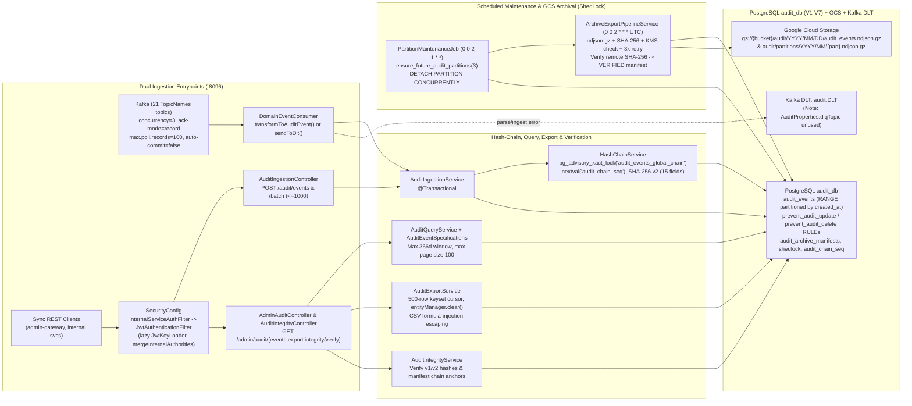
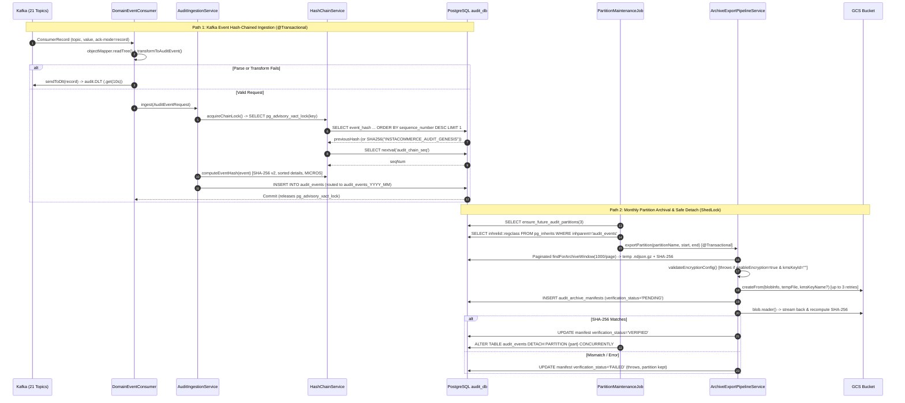

# `audit-trail-service` (`:8096`) — Code Walkthrough

> [!NOTE]
> **Part of the InstaCommerce Onboarding Suite:** [Onboarding Hub](../../README.md) · [Code Walkthrough Atlas](../README.md) · [Domain & Event Catalog (`05`)](../../05-domain-model-and-event-catalog.md) · [Incident Drills & Exam (`06`)](../../06-incident-drills-and-readiness-exam.md) · [Dependency Matrix & Cheatsheet (`07`)](../../07-service-dependency-and-command-cheatsheet.md)

> **Scope & Accuracy:** Audited against source, Flyway migrations (`V1`–`V7`), tests, and deployment manifests in `services/audit-trail-service/` and `deploy/helm/values.yaml`. `audit-trail-service` is a Spring Boot 4 / Java 21 **Tier 2** compliance ledger (`99.0%` availability, `2000ms` p99 SLO in [`monitoring/error-budget-policy.yaml`](../../../../monitoring/error-budget-policy.yaml#L29-L44)) operating on PostgreSQL monthly range partitions, Kafka domain events, and GCS archival exports.

---

## 1. Purpose, Boundaries & Package Tree

`audit-trail-service` is InstaCommerce's centralized immutable compliance ledger. It records administrative, service, and domain mutations from two entry paths—**REST batch/single ingestion** and **Kafka consumption across 21 domain topics**—links every row into a **SHA-256 tamper-evident hash chain** backed by PostgreSQL advisory locks, enforces DB-level append-only guarantees (`REVOKE UPDATE, DELETE` + `DO INSTEAD NOTHING` rules), serves admin search and formula-safe CSV streaming exports, runs monthly range-partition creation/detachment, verifies chain continuity across active DB partitions and archived GCS manifests, and ships gzipped NDJSON archives to GCS.

### Service Topology & Boundaries

- **Upstream callers:** Edge/admin surfaces (`admin-gateway-service` on `/admin/**`) and internal microservices sending HTTP audit events or publishing Kafka domain events.
- **Kafka subscriptions (21 topics):** [`DomainEventConsumer`](../../../../services/audit-trail-service/src/main/java/com/instacommerce/audit/consumer/DomainEventConsumer.java#L42-L192) subscribes to 21 topic constants defined in [`TopicNames`](../../../../contracts/src/main/java/com/instacommerce/contracts/topics/TopicNames.java#L1-L81), committing one record at a time (`ack-mode: record`) and routing poison records synchronously to `audit.DLT`.
- **Persistence:** Dedicated PostgreSQL database (`audit_db`, partitioned `audit_events` + `audit_archive_manifests` + `shedlock`) with Hibernate batching enabled (`batch_size=50`).
- **Archival storage:** Google Cloud Storage (`com.google.cloud:google-cloud-storage`), gated by `audit.archive.bucket-name` and `audit.archive.enable-encryption` + `kms-key-id`.

### Package Tree

```text
services/audit-trail-service/
├── build.gradle.kts                                         # Boot 4, JPA, Flyway, Kafka, GCS, ShedLock, JJWT
└── src/
    ├── main/
    │   ├── java/com/instacommerce/audit/
    │   │   ├── AuditTrailServiceApplication.java            # Entrypoint + @EnableConfigurationProperties
    │   │   ├── config/
    │   │   │   ├── AuditProperties.java                     # audit.{jwt,retention-days,dlt-topic,archive,partition}
    │   │   │   ├── JacksonConfig.java                       # Custom ObjectMapper wiring
    │   │   │   ├── KafkaConfig.java                         # StringSerializer KafkaTemplate bean
    │   │   │   └── ShedLockConfig.java                      # @EnableScheduling + JdbcTemplateLockProvider
    │   │   ├── consumer/
    │   │   │   └── DomainEventConsumer.java                 # 21-topic Kafka listener + DLT fallback
    │   │   ├── controller/
    │   │   │   ├── AdminAuditController.java                # GET /admin/audit/{events,export}
    │   │   │   ├── AuditIngestionController.java            # POST /audit/events{,/batch}
    │   │   │   └── AuditIntegrityController.java            # GET /admin/audit/integrity/verify
    │   │   ├── domain/model/
    │   │   │   ├── AuditArchiveManifest.java                # GCS manifest entity (PENDING|VERIFIED|FAILED)
    │   │   │   └── AuditEvent.java                          # Composite PK + Persistable<UUID> entity
    │   │   ├── dto/
    │   │   │   ├── AuditEventRequest.java                   # Bean-validated ingestion payload
    │   │   │   └── AuditSearchCriteria.java                 # Search/export window bounds (366d / 90d)
    │   │   ├── exception/
    │   │   │   └── GlobalExceptionHandler.java              # RestControllerAdvice (emits null traceId)
    │   │   ├── repository/
    │   │   │   ├── AuditArchiveManifestRepository.java      # Manifest lookups by month & seq order
    │   │   │   └── AuditEventRepository.java                # Native nextval, keyset cursor & chain queries
    │   │   ├── security/
    │   │   │   ├── InternalServiceAuthFilter.java           # X-Internal-Service / X-Internal-Token filter
    │   │   │   ├── JwtAuthenticationFilter.java             # Lazy RSA public key loader + authority merge
    │   │   │   ├── RestAccessDeniedHandler.java             # 403 ErrorResponse handler
    │   │   │   ├── RestAuthenticationEntryPoint.java        # 401 ErrorResponse handler
    │   │   │   └── SecurityConfig.java                      # Route ACLs + filter order
    │   │   └── service/
    │   │       ├── ArchiveExportPipelineService.java        # Nightly & partition NDJSON.GZ GCS archival + verify
    │   │       ├── AuditEventSpecifications.java            # JPA Specifications for admin search/export
    │   │       ├── AuditExportService.java                  # Streaming CSV export with formula escaping
    │   │       ├── AuditIngestionService.java               # Single/batch ingest under advisory lock
    │   │       ├── AuditIntegrityService.java               # Batched chain + archive continuity verifier
    │   │       ├── AuditQueryService.java                   # Paginated admin query service
    │   │       ├── HashChainService.java                    # Advisory locks + SHA-256 v1/v2 canonical hashes
    │   │       └── PartitionMaintenanceJob.java             # Monthly future partition + retention detach job
    │   └── resources/
    │       ├── application.yml                              # Core JPA, Kafka, archive & actuator settings
    │       ├── application-local.yml                        # Local dev overrides
    │       └── db/migration/
    │           ├── V1__create_audit_events.sql              # Monthly RANGE partition table + REVOKE
    │           ├── V2__create_audit_retention_policy.sql    # create_audit_partition & ensure_future_* PL/pgSQL
    │           ├── V3__create_shedlock.sql                  # shedlock table (TIMESTAMP)
    │           ├── V4__enforce_append_only_and_add_indexes.sql # DO INSTEAD NOTHING rules + indexes
    │           ├── V5__add_tamper_evident_chain.sql         # sequence_number, hashes, audit_chain_seq
    │           ├── V6__create_audit_archive_manifests.sql   # audit_archive_manifests table
    │           └── V7__add_hash_version_and_role_guard.sql  # hash_version DEFAULT 1 + IF EXISTS REVOKE
    └── test/                                                # 10 unit/integration test suites
```

---

## 2. Low-Level Component Architecture

**audit-trail-service low-level architecture** — *[Rendered PNG](../diagrams/services/audit-trail-service-arch-lld.png) · [Mermaid Source](../diagrams/services/audit-trail-service-arch-lld.mmd)*



---

## 3. Startup, Configuration & Security Filter Chain Walkthrough

### Startup & Configuration Properties

1. **Application bootstrap:** [`AuditTrailServiceApplication`](../../../../services/audit-trail-service/src/main/java/com/instacommerce/audit/AuditTrailServiceApplication.java#L8-L14) enables configuration properties via `@EnableConfigurationProperties(AuditProperties.class)`.
2. **Typed properties & validation:** [`AuditProperties`](../../../../services/audit-trail-service/src/main/java/com/instacommerce/audit/config/AuditProperties.java#L9-L74) binds the `audit` prefix and marks `jwt.issuer` and `jwt.publicKey` as `@NotBlank`. Notably, `AuditProperties` declares a field `dlqTopic = "audit.dlq"` (`#L13`) that is **unused**; [`DomainEventConsumer`](../../../../services/audit-trail-service/src/main/java/com/instacommerce/audit/consumer/DomainEventConsumer.java#L42-L192) instead injects `${audit.dlt-topic:audit.DLT}` directly (which defaults to `audit.DLT` in [`application.yml`](../../../../services/audit-trail-service/src/main/resources/application.yml#L57)).
3. **Database & Hibernate tuning:** [`application.yml`](../../../../services/audit-trail-service/src/main/resources/application.yml#L1-L105) sizes the Hikari pool to `maximum-pool-size: 30` and `minimum-idle: 10`, enables `hibernate.jdbc.batch_size: 50` and `order_inserts: true`, and sets `open-in-view: false`.
4. **Kafka & ShedLock configuration:**
   - [`KafkaConfig`](../../../../services/audit-trail-service/src/main/java/com/instacommerce/audit/config/KafkaConfig.java#L16-L35) constructs a `StringSerializer`-backed `KafkaTemplate<String, String>` specifically for dead-letter publishing, while `application.yml` configures consumer `group-id: audit-trail-service`, `auto-offset-reset: earliest`, `enable-auto-commit: false`, `max.poll.interval.ms: 600000`, `max.poll.records: 100`, and `ack-mode: record`.
   - [`ShedLockConfig`](../../../../services/audit-trail-service/src/main/java/com/instacommerce/audit/config/ShedLockConfig.java#L12-L26) activates `@EnableScheduling` and `@EnableSchedulerLock(defaultLockAtMostFor = "PT30M")` using `JdbcTemplateLockProvider` configured with `.usingDbTime()`.
5. **Deployment topology:** Helm chart values in [`deploy/helm/values.yaml`](../../../../deploy/helm/values.yaml#L1352-L1366) deploy `2` baseline replicas with HPA autoscaling `2`–`5`, and leave `audit.archive.kms-key-id` unpopulated.

### Security Filter Chain

[`SecurityConfig`](../../../../services/audit-trail-service/src/main/java/com/instacommerce/audit/security/SecurityConfig.java#L19-L64) enforces stateless (`SessionCreationPolicy.STATELESS`) security with custom 401/403 JSON error writers and two custom filters registered explicitly before `UsernamePasswordAuthenticationFilter`:

| Order | Filter / Mechanism | Class & Lines | Behavior |
| --- | --- | --- | --- |
| 1 | Servlet filter chain | [`SecurityConfig`](../../../../services/audit-trail-service/src/main/java/com/instacommerce/audit/security/SecurityConfig.java#L60) | Registers `internalServiceAuthFilter` first (no `FilterRegistrationBean` disabling servlet registration; relies on `OncePerRequestFilter`). |
| 2 | Internal service auth | [`InternalServiceAuthFilter`](../../../../services/audit-trail-service/src/main/java/com/instacommerce/audit/security/InternalServiceAuthFilter.java#L26-L81) | Reads `X-Internal-Service` + `X-Internal-Token`. Supports `allowedCallers`, `strictPerServiceTokens=false`, and shared-token fallback via constant-time `MessageDigest.isEqual`. Grants `ROLE_INTERNAL_SERVICE` only (does not emit `ROLE_SERVICE_*`). |
| 3 | JWT bearer auth | [`JwtAuthenticationFilter`](../../../../services/audit-trail-service/src/main/java/com/instacommerce/audit/security/JwtAuthenticationFilter.java#L26-L103) | Registered at [`SecurityConfig#L61`](../../../../services/audit-trail-service/src/main/java/com/instacommerce/audit/security/SecurityConfig.java#L61). Uses lazy double-checked [`loadPublicKey()`](../../../../services/audit-trail-service/src/main/java/com/instacommerce/audit/security/JwtAuthenticationFilter.java#L69-L80) (delegating to `platform-common` `JwtKeyLoader.parsePublicKey` on the **first** Bearer request rather than failing at startup). Validates `requireIssuer` only (no `aud` or JWKS) and runs [`mergeInternalAuthorities`](../../../../services/audit-trail-service/src/main/java/com/instacommerce/audit/security/JwtAuthenticationFilter.java#L82-L102) to keep any existing `ROLE_INTERNAL_SERVICE` when a user JWT is also present. |
| 4 | Authorization rules | [`SecurityConfig#L51-L58`](../../../../services/audit-trail-service/src/main/java/com/instacommerce/audit/security/SecurityConfig.java#L51-L58) | Permits `/actuator/**`, `/error`. Requires `SYSTEM`, `SERVICE`, `INTERNAL_SERVICE`, `ADMIN`, or `SUPER_ADMIN` on `POST /audit/events`, `/audit/events/batch`, `/api/v1/audit/events`, `/api/v1/audit/events/batch`. Requires `ADMIN` or `SUPER_ADMIN` on `/admin/**`. |
| 5 | Exception formatting | [`RestAuthenticationEntryPoint`](../../../../services/audit-trail-service/src/main/java/com/instacommerce/audit/security/RestAuthenticationEntryPoint.java#L1-L33) & [`RestAccessDeniedHandler`](../../../../services/audit-trail-service/src/main/java/com/instacommerce/audit/security/RestAccessDeniedHandler.java#L1-L33) | Emit `ErrorResponse` (`UNAUTHORIZED` / `ACCESS_DENIED`) with `traceId = null`. [`GlobalExceptionHandler`](../../../../services/audit-trail-service/src/main/java/com/instacommerce/audit/exception/GlobalExceptionHandler.java#L76-L78) likewise passes `null` for `traceId`. |

> [!WARNING]
> **Dead route ACLs & silent startup key drift:** [`SecurityConfig#L51-L54`](../../../../services/audit-trail-service/src/main/java/com/instacommerce/audit/security/SecurityConfig.java#L51-L54) authorizes `/api/v1/audit/events` and `/api/v1/audit/events/batch`, but [`AuditIngestionController`](../../../../services/audit-trail-service/src/main/java/com/instacommerce/audit/controller/AuditIngestionController.java#L16-L37) maps `/audit/events` and `/audit/events/batch` only (no `/api/v1/**` paths). Furthermore, because `JwtAuthenticationFilter` parses `audit.jwt.public-key` lazily on the first Bearer request, a malformed PEM key passes pod readiness checks and only fails once admin traffic hits the service.

---

## 4. Data Model, Flyway Migrations & Locking Invariants

### Entity & Table Design

- **`audit_events` (`PARTITION BY RANGE (created_at)`):** Mapped by [`AuditEvent`](../../../../services/audit-trail-service/src/main/java/com/instacommerce/audit/domain/model/AuditEvent.java#L1-L185) using a composite primary key `(id, created_at)` (`pk_audit_events`). Because `AuditEvent` implements `Persistable<UUID>` ([`AuditEvent#L21`](../../../../services/audit-trail-service/src/main/java/com/instacommerce/audit/domain/model/AuditEvent.java#L21), [`#L113-L131`](../../../../services/audit-trail-service/src/main/java/com/instacommerce/audit/domain/model/AuditEvent.java#L113-L131)), Hibernate's `save`/`saveAll` treats every instance as new (`INSERT`-only), skipping a prior `SELECT` round-trip.
- **`audit_archive_manifests`:** Mapped by [`AuditArchiveManifest`](../../../../services/audit-trail-service/src/main/java/com/instacommerce/audit/domain/model/AuditArchiveManifest.java#L1-L304), recording monthly/partition archival runs (`partition_name`, `partition_month`, `event_count`, `s3_glacier_path`, `checksum_sha256`, `verification_status`, `creation_method`, `first_sequence`, `last_sequence`, `last_event_hash`).

### Flyway Migrations (`V1`–`V7`)

| Version | Migration | Key DDL & Behavioral Notes |
| --- | --- | --- |
| `V1` | [`V1__create_audit_events.sql`](../../../../services/audit-trail-service/src/main/resources/db/migration/V1__create_audit_events.sql#L1-L30) | Creates partitioned `audit_events` (`PARTITION BY RANGE (created_at)`), `pk_audit_events (id, created_at)`, `chk_actor_type ('USER','SYSTEM','ADMIN')`, and unconditional `REVOKE UPDATE, DELETE ON audit_events FROM audit_app;` (`#L30`). |
| `V2` | [`V2__create_audit_retention_policy.sql`](../../../../services/audit-trail-service/src/main/resources/db/migration/V2__create_audit_retention_policy.sql#L1-L40) | Defines PL/pgSQL `create_audit_partition(DATE)` and `ensure_future_audit_partitions(INT DEFAULT 3)`, pre-creating `audit_events_YYYY_MM` partitions for the current + next 3 months. |
| `V3` | [`V3__create_shedlock.sql`](../../../../services/audit-trail-service/src/main/resources/db/migration/V3__create_shedlock.sql#L1-L7) | Creates `shedlock` (`lock_until`, `locked_at` as `TIMESTAMP`, not `TIMESTAMPTZ`). |
| `V4` | [`V4__enforce_append_only_and_add_indexes.sql`](../../../../services/audit-trail-service/src/main/resources/db/migration/V4__enforce_append_only_and_add_indexes.sql#L1-L14) | Installs PostgreSQL rules `prevent_audit_update` and `prevent_audit_delete` (`DO INSTEAD NOTHING`, `#L5-L6`) plus secondary indexes. |
| `V5` | [`V5__add_tamper_evident_chain.sql`](../../../../services/audit-trail-service/src/main/resources/db/migration/V5__add_tamper_evident_chain.sql#L1-L13) | Adds `sequence_number BIGINT`, `event_hash VARCHAR(64)`, `previous_hash VARCHAR(64)`, `SEQUENCE audit_chain_seq`, and partial index `idx_audit_chain_seq`. |
| `V6` | [`V6__create_audit_archive_manifests.sql`](../../../../services/audit-trail-service/src/main/resources/db/migration/V6__create_audit_archive_manifests.sql#L1-L23) | Creates `audit_archive_manifests` tracking GCS archive URIs (`s3_glacier_path`), verification status, and sequence bounds. |
| `V7` | [`V7__add_hash_version_and_role_guard.sql`](../../../../services/audit-trail-service/src/main/resources/db/migration/V7__add_hash_version_and_role_guard.sql#L1-L11) | Adds `hash_version INTEGER NOT NULL DEFAULT 1` (`#L1`) and role-existence-guarded `REVOKE` statements for `audit_app` and `audit_reader` (`#L2-L10`). |

### Locking & Chain Serialization Invariants

- **Global advisory lock over chain head:** [`AuditIngestionService`](../../../../services/audit-trail-service/src/main/java/com/instacommerce/audit/service/AuditIngestionService.java#L30-L100) executes inside `@Transactional` and delegates serialization to [`HashChainService`](../../../../services/audit-trail-service/src/main/java/com/instacommerce/audit/service/HashChainService.java#L20-L153). Although `HashChainService` provides [`acquirePartitionLock`](../../../../services/audit-trail-service/src/main/java/com/instacommerce/audit/service/HashChainService.java#L54-L57), ingestion always invokes [`acquireChainLock()`](../../../../services/audit-trail-service/src/main/java/com/instacommerce/audit/service/HashChainService.java#L50-L52), which issues `pg_advisory_xact_lock(sha256_long("audit_chain:audit_events_global_chain"))`.
- **Single-writer bottleneck vs total ordering:** This transaction-scoped advisory lock enforces a strict global total order across all REST callers and all 3 Kafka consumer threads, eliminating sequence forks across `audit_chain_seq` at the cost of serializing concurrent write transactions.
- **Distributed scheduler locking:** Monthly partition maintenance (`"partitionMaintenance"`) and nightly archival (`"auditArchiveExport"`) coordinate across pods via ShedLock (`shedlock` table).

---

## 5. Core Execution Paths & Sequence Analysis

### Decision & Branching Overview

**audit-trail-service decision and error-branching flowchart** — *[Rendered PNG](../diagrams/services/audit-trail-service-flowchart.png) · [Mermaid Source](../diagrams/services/audit-trail-service-flowchart.mmd)*

```mermaid
flowchart TD
    subgraph IngestFlow["Event Ingestion & DLT Flow"]
        Src{"Source"} -- "Kafka Record" --> Parse["DomainEventConsumer.onDomainEvent()<br/>readTree + transformToAuditEvent()"]
        Src -- "REST POST" --> Valid["AuditIngestionController<br/>@Valid AuditEventRequest(s)"]
        Parse -- "JSON/Transform/DB Exception" --> DltSend["sendToDlt(): kafkaTemplate.send(audit.DLT)<br/>.get(10s) -> throws if DLT fails"]
        Parse -- "OK" --> Lock["AuditIngestionService<br/>HashChainService.acquireChainLock()<br/>pg_advisory_xact_lock(global_chain)"]
        Valid --> Lock
        Lock --> Prev["getLatestHash() (latest or GENESIS)<br/>+ nextval('audit_chain_seq')"]
        Prev --> Hash["computeEventHash() SHA-256 v2<br/>15 fields, MICROS timestamp, sorted details"]
        Hash --> SavePG["Save to monthly audit_events_YYYY_MM"]
    end

    subgraph ArchiveFlow["Partition Retention & Archival Flow"]
        Cron["PartitionMaintenanceJob (Monthly 1st 02:00 UTC)<br/>@SchedulerLock('partitionMaintenance')"] --> Future["ensure_future_audit_partitions(3)"]
        Future --> Scan["Query pg_inherits for partitions<br/>older than retentionDays (365d)"]
        Scan --> EmptyChk{"rowCount == 0?"}
        EmptyChk -- "Yes" --> EmptyMan["Persist empty VERIFIED manifest"]
        EmptyChk -- "No" --> KmsChk{"enableEncryption &&<br/>kmsKeyId blank?"}
        KmsChk -- "Yes" --> FailEnc["Throw IllegalStateException<br/>(Archive fails, partition NOT detached!)"]
        KmsChk -- "No" --> Upload["uploadToGcsGlacier() (<=3 retries, exp backoff)<br/>Save manifest status=PENDING"]
        Upload --> Verify["verifyArchiveIntegrity(): stream remote GCS<br/>Compute SHA-256 == manifest checksum?"]
        Verify -- "Mismatch / Missing" --> MarkFail["Set status=FAILED, throw<br/>Partition NOT detached"]
        Verify -- "Match" --> MarkOk["Set status=VERIFIED"]
        EmptyMan --> Detach["ALTER TABLE audit_events<br/>DETACH PARTITION {part} CONCURRENTLY"]
        MarkOk --> Detach
    end
```



### End-to-End Execution Sequence

**audit-trail-service ingestion, verification, and archival sequence diagram** — *[Rendered PNG](../diagrams/services/audit-trail-service-sequence.png) · [Mermaid Source](../diagrams/services/audit-trail-service-sequence.mmd)*



### Method-by-Method Call-Stack Walkthrough

1. **HTTP Ingestion Path ([`AuditIngestionController`](../../../../services/audit-trail-service/src/main/java/com/instacommerce/audit/controller/AuditIngestionController.java#L16-L37) -> [`AuditIngestionService`](../../../../services/audit-trail-service/src/main/java/com/instacommerce/audit/service/AuditIngestionService.java#L30-L100)):**
   - `POST /audit/events` (`201 Created`) and `POST /audit/events/batch` (validated with `@Size(max = 1000)`) accept [`AuditEventRequest`](../../../../services/audit-trail-service/src/main/java/com/instacommerce/audit/dto/AuditEventRequest.java#L1-L33) payloads.
   - `AuditIngestionService.ingest` / `ingestBatch` open `@Transactional`, acquire [`HashChainService.acquireChainLock()`](../../../../services/audit-trail-service/src/main/java/com/instacommerce/audit/service/HashChainService.java#L50-L52), and look up the latest `event_hash` via [`AuditEventRepository`](../../../../services/audit-trail-service/src/main/java/com/instacommerce/audit/repository/AuditEventRepository.java#L1-L57) (falling back to `SHA-256("INSTACOMMERCE_AUDIT_GENESIS")` when the chain is empty).
   - Each event requests `nextval('audit_chain_seq')`, truncates `createdAt` to `MICROS`, recursively sorts keys in `canonicalizeDetails`, sets `hashVersion = 2` ([`AuditEvent#L74`](../../../../services/audit-trail-service/src/main/java/com/instacommerce/audit/domain/model/AuditEvent.java#L74)), computes the `v2` SHA-256 digest over 15 pipe-delimited fields, and writes via `save` / `saveAll` (`Persistable` direct `INSERT`).
2. **Admin Search & Formula-Safe CSV Export ([`AdminAuditController`](../../../../services/audit-trail-service/src/main/java/com/instacommerce/audit/controller/AdminAuditController.java#L17-L65) -> [`AuditQueryService`](../../../../services/audit-trail-service/src/main/java/com/instacommerce/audit/service/AuditQueryService.java#L1-L34) / [`AuditExportService`](../../../../services/audit-trail-service/src/main/java/com/instacommerce/audit/service/AuditExportService.java#L55-L202)):**
   - `GET /admin/audit/events` binds [`AuditSearchCriteria`](../../../../services/audit-trail-service/src/main/java/com/instacommerce/audit/dto/AuditSearchCriteria.java#L1-L104) (`page >= 0`, `size` `1..100`, default 30-day lookback, max `366d`) and evaluates [`AuditEventSpecifications`](../../../../services/audit-trail-service/src/main/java/com/instacommerce/audit/service/AuditEventSpecifications.java#L1-L47).
   - `GET /admin/audit/export` uses `AuditSearchCriteria.forExport` (capped at `90d`). `AuditExportService` runs inside `@Transactional(readOnly = true)`, pages via keyset cursor `(createdAt, id)` in `500`-row chunks, flushes output, calls `entityManager.clear()` per batch to bound heap usage, and runs `escapeCsv` to prefix leading `=`, `+`, `-`, `@`, `\t`, or `\r` (even after `stripLeading()`) with `'`.
3. **Integrity Verification Path ([`AuditIntegrityController`](../../../../services/audit-trail-service/src/main/java/com/instacommerce/audit/controller/AuditIntegrityController.java#L8-L34) -> [`AuditIntegrityService`](../../../../services/audit-trail-service/src/main/java/com/instacommerce/audit/service/AuditIntegrityService.java#L42-L189)):**
   - `GET /admin/audit/integrity/verify` clamps `batchSize` (default `1000`) to `1..5000`.
   - `AuditIntegrityService` walks `sequenceNumber` via keyset pagination, verifying `hashVersion <= 1 ? computeLegacyV1EventHash : computeEventHash`.
   - When `from == null` and `firstSeq > 1`, `resolveArchiveAnchor` validates contiguous `VERIFIED` [`AuditArchiveManifest`](../../../../services/audit-trail-service/src/main/java/com/instacommerce/audit/domain/model/AuditArchiveManifest.java#L1-L304) records spanning `firstSequence == 1` through `lastSequence`.
   - **Verification gap ([`AuditIntegrityService#L107-L109`](../../../../services/audit-trail-service/src/main/java/com/instacommerce/audit/service/AuditIntegrityService.java#L107-L109)):** When `from != null`, no DB predecessor exists (`findFirstBySequenceNumberLessThanOrderBySequenceNumberDesc` is empty), and `firstSeq > 1`, the method returns `InitialAnchor(true, null)` instead of checking [`AuditArchiveManifestRepository`](../../../../services/audit-trail-service/src/main/java/com/instacommerce/audit/repository/AuditArchiveManifestRepository.java#L1-L13), meaning `linkValid` only checks that `previousHash` is non-blank.
4. **Partition Maintenance & Archival Pipeline ([`PartitionMaintenanceJob`](../../../../services/audit-trail-service/src/main/java/com/instacommerce/audit/service/PartitionMaintenanceJob.java#L59-L133) -> [`ArchiveExportPipelineService`](../../../../services/audit-trail-service/src/main/java/com/instacommerce/audit/service/ArchiveExportPipelineService.java#L114-L486)):**
   - `PartitionMaintenanceJob` runs monthly (`0 0 2 1 * *`) under `@SchedulerLock("partitionMaintenance")`: creates future partitions via `ensure_future_audit_partitions(3)`, scans `pg_inherits` for partitions older than `LocalDate.now(clock).minusDays(365).withDayOfMonth(1)`, calls `archiveExportPipelineService.exportPartition(...)`, and executes `ALTER TABLE audit_events DETACH PARTITION ... CONCURRENTLY` **only** when `manifest.getVerificationStatus()` equals `"VERIFIED"`.
   - `ArchiveExportPipelineService` also runs a nightly UTC job (`0 0 2 * * *`, lock `"auditArchiveExport"`, method `AUTOMATED`, skipping empty windows). By contrast, `exportPartition` (`PARTITION_MAINTENANCE`) persists an empty `VERIFIED` manifest when zero rows exist.
   - `exportPartition` ([`ArchiveExportPipelineService#L131-L141`](../../../../services/audit-trail-service/src/main/java/com/instacommerce/audit/service/ArchiveExportPipelineService.java#L131-L141)) is `@Transactional` for the entire export pipeline: keyset-pages DB rows to a temp `.ndjson.gz` file, uploads to GCS (up to 3 retries with exponential backoff `1000ms * 2^n`, capped at `30s`), saves a `PENDING` manifest, and streams the remote GCS blob back to verify SHA-256 before marking `VERIFIED`.

---

## 6. Kafka Consumers, Reliability & Archival Mechanics

### 21-Topic Kafka Consumption & Synchronous DLT

- [`DomainEventConsumer`](../../../../services/audit-trail-service/src/main/java/com/instacommerce/audit/consumer/DomainEventConsumer.java#L42-L192) runs with `concurrency = "3"` across all 21 topics from [`TopicNames`](../../../../contracts/src/main/java/com/instacommerce/contracts/topics/TopicNames.java#L1-L81) (`IDENTITY_EVENTS` through `RIDER_GEOFENCE_EVENTS`).
- **Envelope & actor extraction:** Accepts both camelCase and snake_case event envelopes, derives the originating service from the topic prefix, and attempts to parse `userId` UUID from top-level envelope fields or nested `payload`.
- **Error handling:** Any deserialization, validation, or persistence failure inside `DomainEventConsumer` invokes `sendToDlt(...)`, blocking synchronously (`kafkaTemplate.send(dltTopic, ...).get(10, SECONDS)`) to publish the failed payload to `audit.DLT` before allowing the listener container (`ack-mode: record`) to advance the offset.

### Resilience & Operational Failure Modes

- **GCS CMEK pre-flight check:** [`ArchiveExportPipelineService.validateEncryptionConfig`](../../../../services/audit-trail-service/src/main/java/com/instacommerce/audit/service/ArchiveExportPipelineService.java#L205-L211) throws `IllegalStateException` whenever `enableEncryption=true` (`application.yml#L62`) and `kmsKeyId` is blank (`application.yml#L61`, also unconfigured in [`values.yaml#L1352-L1366`](../../../../deploy/helm/values.yaml#L1352-L1366)).
- **Long-lived transaction risk:** Because `exportPartition` (`#L131-L141`) keeps a JDBC transaction open while compressing temp `.ndjson.gz` files, uploading with 30s-capped retries, and downloading the GCS object back for SHA-256 verification, a multi-million-row partition holds a Hikari connection and delays vacuum/locks for the full GCS network round-trip duration.
- **JPA serialization leakage:** [`ArchiveExportPipelineService#L239`](../../../../services/audit-trail-service/src/main/java/com/instacommerce/audit/service/ArchiveExportPipelineService.java#L239) serializes the `AuditEvent` JPA entity directly to NDJSON, exposing the `Persistable.isNew()` bean property (`isNew`) unless explicitly excluded by Jackson config or DTO projection.

---

## 7. Configuration Matrix, Metrics, Tests & Known Drift

### Configuration Matrix

| Property / Key | Default (`application.yml`) | Helm / Production Override | Source Reference |
| --- | --- | --- | --- |
| `server.port` | `8096` | `8096` (container & service port) | [`application.yml`](../../../../services/audit-trail-service/src/main/resources/application.yml#L1-L105), [`values.yaml`](../../../../deploy/helm/values.yaml#L1352-L1366) |
| `spring.datasource.hikari` | `max=30`, `min=10` | `audit_db` JDBC URL | [`application.yml`](../../../../services/audit-trail-service/src/main/resources/application.yml#L1-L105) |
| `spring.jpa.properties.hibernate.jdbc.batch_size` | `50` (`order_inserts: true`) | Same | [`application.yml`](../../../../services/audit-trail-service/src/main/resources/application.yml#L1-L105) |
| `spring.kafka.consumer.group-id` | `audit-trail-service` (`concurrency=3`, `ack-mode=record`) | Same | [`application.yml`](../../../../services/audit-trail-service/src/main/resources/application.yml#L1-L105), [`DomainEventConsumer`](../../../../services/audit-trail-service/src/main/java/com/instacommerce/audit/consumer/DomainEventConsumer.java#L42-L192) |
| `audit.dlt-topic` | `audit.DLT` | Unset (uses `audit.DLT`) | [`application.yml#L57`](../../../../services/audit-trail-service/src/main/resources/application.yml#L57) |
| `audit.partition.retention-days` / `future-months` | `365` / `3` | Same | [`AuditProperties`](../../../../services/audit-trail-service/src/main/java/com/instacommerce/audit/config/AuditProperties.java#L9-L74) |
| `audit.archive.enable-encryption` / `kms-key-id` | `true` / `""` | Omitted in Helm (`IllegalStateException` risk) | [`application.yml#L61-L62`](../../../../services/audit-trail-service/src/main/resources/application.yml#L61-L62), [`values.yaml#L1352-L1366`](../../../../deploy/helm/values.yaml#L1352-L1366) |
| `audit.archive.retention-days` | `2557` (~7 years) | Same | [`application.yml`](../../../../services/audit-trail-service/src/main/resources/application.yml#L1-L105) |

### Validation & Narrow Test Commands

```bash
# Run all tests for audit-trail-service only
./gradlew :services:audit-trail-service:test

# Run targeted hash-chain or archival unit tests
./gradlew :services:audit-trail-service:test --tests "com.instacommerce.audit.service.HashChainServiceTest"
./gradlew :services:audit-trail-service:test --tests "com.instacommerce.audit.service.AuditIntegrityServiceTest"
./gradlew :services:audit-trail-service:test --tests "com.instacommerce.audit.service.ArchiveExportPipelineServiceTest"
./gradlew :services:audit-trail-service:test --tests "com.instacommerce.audit.consumer.DomainEventConsumerTest"
```

### Exact Code-Level Bugs & Documentation Drift

1. **Archive CMEK startup/run mismatch:** `audit.archive.enable-encryption` defaults to `true` (`application.yml#L62`) while `kms-key-id` defaults to `""` (`#L61`) and is missing from [`values.yaml#L1352-L1366`](../../../../deploy/helm/values.yaml#L1352-L1366), causing [`validateEncryptionConfig`](../../../../services/audit-trail-service/src/main/java/com/instacommerce/audit/service/ArchiveExportPipelineService.java#L205-L211) to throw `IllegalStateException`.
2. **Integrity anchor bypass when `from != null`:** [`AuditIntegrityService#L107-L109`](../../../../services/audit-trail-service/src/main/java/com/instacommerce/audit/service/AuditIntegrityService.java#L107-L109) returns `InitialAnchor(true, null)` instead of querying [`AuditArchiveManifestRepository`](../../../../services/audit-trail-service/src/main/java/com/instacommerce/audit/repository/AuditArchiveManifestRepository.java#L1-L13) if no DB predecessor precedes `firstSeq > 1`.
3. **Unused properties & dead security routes:** [`AuditProperties#L13`](../../../../services/audit-trail-service/src/main/java/com/instacommerce/audit/config/AuditProperties.java#L13) defines `dlqTopic = "audit.dlq"` which is never read; [`SecurityConfig#L51-L54`](../../../../services/audit-trail-service/src/main/java/com/instacommerce/audit/security/SecurityConfig.java#L51-L54) secures `/api/v1/audit/events*` which no controller maps.
4. **Schema vs entity/column naming drift:** [`V7__add_hash_version_and_role_guard.sql#L1`](../../../../services/audit-trail-service/src/main/resources/db/migration/V7__add_hash_version_and_role_guard.sql#L1) sets SQL `DEFAULT 1` for `hash_version` while [`AuditEvent#L74`](../../../../services/audit-trail-service/src/main/java/com/instacommerce/audit/domain/model/AuditEvent.java#L74) defaults `hashVersion = 2`; [`V6`](../../../../services/audit-trail-service/src/main/resources/db/migration/V6__create_audit_archive_manifests.sql#L1-L23) stores `gs://...` GCS URIs in a column named `s3_glacier_path`.
5. **Null `traceId` in error payloads:** [`GlobalExceptionHandler#L76-L78`](../../../../services/audit-trail-service/src/main/java/com/instacommerce/audit/exception/GlobalExceptionHandler.java#L76-L78), [`RestAuthenticationEntryPoint`](../../../../services/audit-trail-service/src/main/java/com/instacommerce/audit/security/RestAuthenticationEntryPoint.java#L1-L33), and [`RestAccessDeniedHandler`](../../../../services/audit-trail-service/src/main/java/com/instacommerce/audit/security/RestAccessDeniedHandler.java#L1-L33) populate `traceId = null`.
6. **`README.md` drift:** [`services/audit-trail-service/README.md`](../../../../services/audit-trail-service/README.md#L1-L469) falsely claims 14 Kafka topics (actual: 21), `audit.dlq` DLT (actual: `audit.DLT`), a table `audit_retention_policies` (does not exist), and trigger `trg_audit_events_immutable` (actual mechanism: `V4` rules `prevent_audit_update` / `prevent_audit_delete`).

---

**Previous:** [admin-gateway-service](./admin-gateway-service.md) | **Atlas Hub:** [Code Walkthrough Atlas](../README.md) | **Next:** [config-feature-flag-service](./config-feature-flag-service.md)
