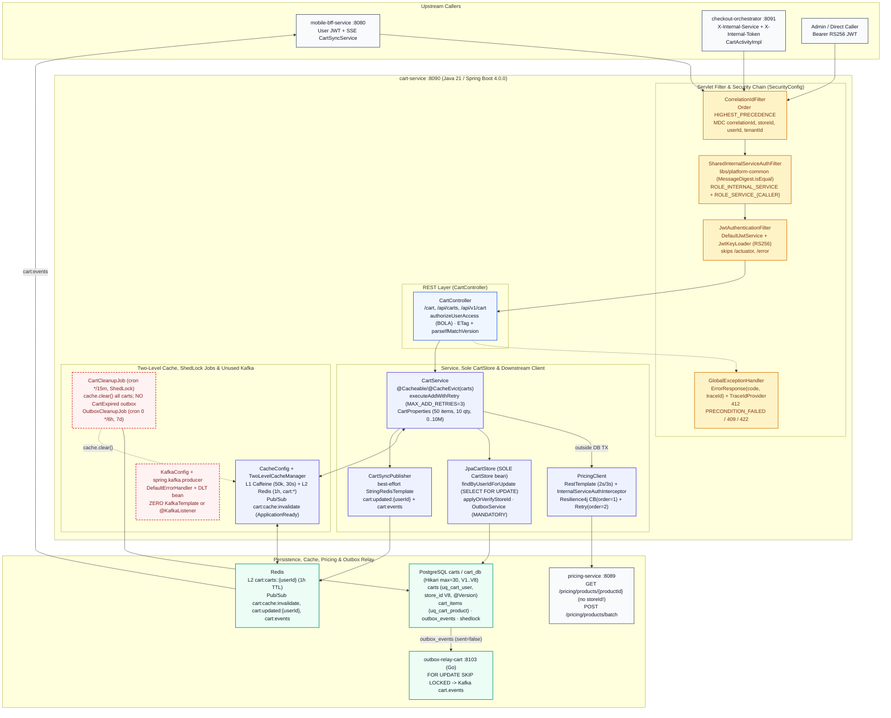
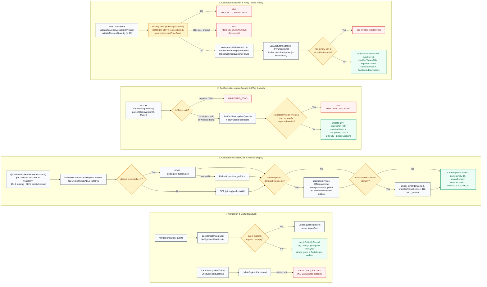
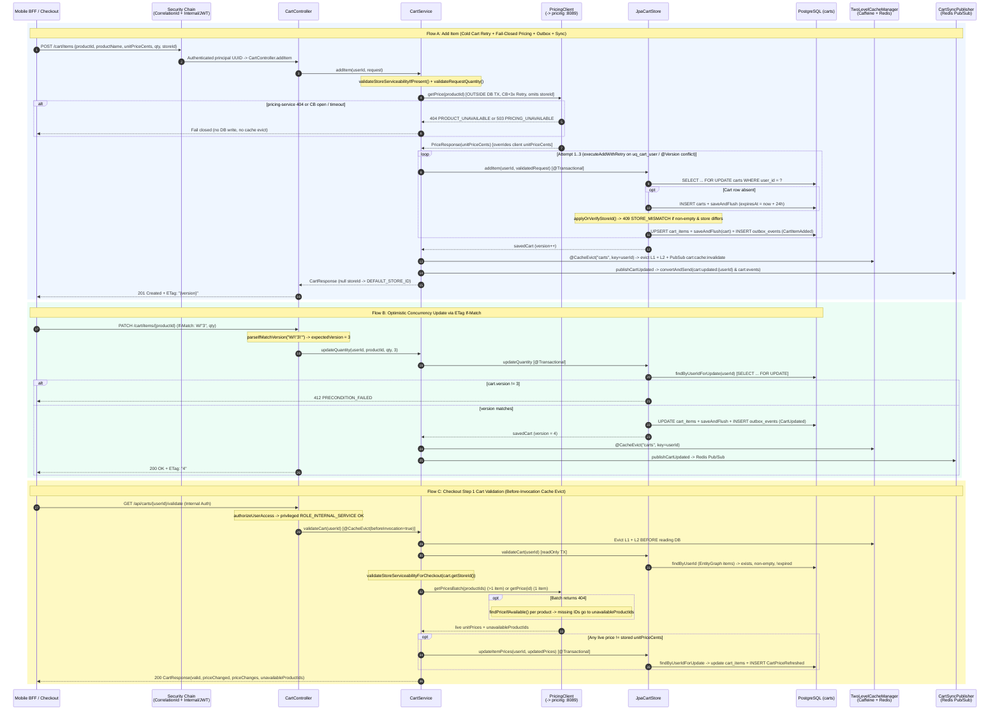

# `cart-service` — Code Walkthrough (`:8090`)

> [!NOTE]
> **Part of the InstaCommerce Onboarding Suite:** [Onboarding Hub](../../README.md) · [Code Walkthrough Atlas](../README.md) · [Domain & Event Catalog (`05`)](../../05-domain-model-and-event-catalog.md) · [Incident Drills & Exam (`06`)](../../06-incident-drills-and-readiness-exam.md) · [Dependency Matrix & Cheatsheet (`07`)](../../07-service-dependency-and-command-cheatsheet.md)

> **Service Identity Card**
>
> | Attribute | Verified Reality | Source |
> |---|---|---|
> | **Stack** | Java 21 / Spring Boot 4.0.0 (`:services:cart-service`, `:libs:platform-common`, `:contracts`) | [build.gradle.kts](../../../../services/cart-service/build.gradle.kts#L1-L44) |
> | **HTTP Port & Probes** | `8090` (`${SERVER_PORT:8090}`); Liveness `/actuator/health/liveness`, Readiness `/actuator/health/readiness` (`readinessState,db`) | [application.yml](../../../../services/cart-service/src/main/resources/application.yml#L1-L92), [Dockerfile](../../../../services/cart-service/Dockerfile#L8-L11) |
> | **Primary Durable Store** | PostgreSQL (`carts` local / `cart_db` Helm), Flyway `V1`–`V8`, HikariCP (`max=30`, `min=10`), `open-in-view: false` | [application.yml](../../../../services/cart-service/src/main/resources/application.yml#L18-L33), [JpaCartStore.java](../../../../services/cart-service/src/main/java/com/instacommerce/cart/service/JpaCartStore.java#L23-L24) |
> | **Redis Usage** | **Non-authoritative** L2 cache (`cart:carts::{userId}`, `1h` TTL) + Pub/Sub invalidation (`cart:cache:invalidate`) + SSE live sync (`cart:updated:{userId}`, `cart:events`) | [CacheConfig.java](../../../../services/cart-service/src/main/java/com/instacommerce/cart/config/CacheConfig.java#L34-L118), [CartSyncPublisher.java](../../../../services/cart-service/src/main/java/com/instacommerce/cart/service/CartSyncPublisher.java#L35-L60) |
> | **Kafka Topics** | **Publishes via Outbox Relay:** `cart.events` (`outbox-relay-cart` `:8103`) · **Consumes:** none (unused `spring.kafka.producer` & `KafkaConfig` beans) | [TopicNames.java](../../../../contracts/src/main/java/com/instacommerce/contracts/topics/TopicNames.java#L36), [values.yaml](../../../../deploy/helm/values.yaml#L927-L947), [KafkaConfig.java](../../../../services/cart-service/src/main/java/com/instacommerce/cart/config/KafkaConfig.java#L14-L31) |
> | **Synchronous Dependencies** | **Outbound:** `pricing-service` (`:8089`) via `PricingClient` · **Inbound:** `mobile-bff-service` (`:8080`), `checkout-orchestrator-service` (`:8091`), `admin-gateway-service` (`:8099`), `order-service`, `ai-orchestrator-service` | [PricingClient.java](../../../../services/cart-service/src/main/java/com/instacommerce/cart/client/PricingClient.java#L34-L51), [values.yaml](../../../../deploy/helm/values.yaml#L237-L243) |
> | **Helm Keys & Scaling** | `cart-service` (`replicas: 2`, HPA `2–15` at `70%` CPU) + `outbox-relay-cart` (`replicas: 1`) | [values.yaml](../../../../deploy/helm/values.yaml#L770-L787), [values.yaml](../../../../deploy/helm/values.yaml#L927-L947), [values-prod.yaml](../../../../deploy/helm/values-prod.yaml#L48-L53) |
> | **SLO Tier** | **Tier 1** in policy (`99.5%` avail / `1000ms` P99, `216m`/30d budget) · `99.8%` / `300ms` P99 in `service-slos.md` · Wave-40 alerts labeled `tier-2` | [error-budget-policy.yaml](../../../../monitoring/error-budget-policy.yaml#L15-L27), [service-slos.md](../../../../docs/slos/service-slos.md#L53-L58), [wave-40-complete-slo-alerts.yml](../../../../prometheus/rules/wave-40-complete-slo-alerts.yml#L260-L273) |
> | **Bounded Context Role** | Server-authoritative shopping cart persistence enforcing dark-store affinity (`409 STORE_MISMATCH`), optimistic HTTP ETags (`412 PRECONDITION_FAILED`), fail-closed unit pricing via `pricing-service`, checkout validation/price refresh, and best-effort Redis SSE fanout. | [CartService.java](../../../../services/cart-service/src/main/java/com/instacommerce/cart/service/CartService.java#L29-L181) |

---

## 1. Service Boundaries & Package Tree

`cart-service` owns the mutable pre-checkout shopping basket (`carts`, `cart_items`), its outbox ledger (`outbox_events`), and its distributed job locks (`shedlock`). It intentionally does **not** own product metadata (`catalog-service`), inventory holds (`inventory-service`), promo/tax/delivery totals (`pricing-service`), or checkout orchestration (`checkout-orchestrator-service`). Contrary to legacy prose in [GLOSSARY.md](../../../../GLOSSARY.md#L68), **PostgreSQL is the single durable source of truth**, while Redis acts strictly as a best-effort L2 read cache and Pub/Sub broadcast bus.

### Package & Resource Tree (`services/cart-service`)

| Layer | Files | Responsibility |
|---|---|---|
| **Bootstrap** | [CartServiceApplication.java](../../../../services/cart-service/src/main/java/com/instacommerce/cart/CartServiceApplication.java#L9-L16) | `@SpringBootApplication`, `@EnableConfigurationProperties({CartProperties.class})`, `@EnableScheduling` |
| **Controller** | [CartController.java](../../../../services/cart-service/src/main/java/com/instacommerce/cart/controller/CartController.java#L26-L207) | Multi-prefix REST routes (`/cart`, `/api/carts`, `/api/v1/cart`), ETag emission/parsing, BOLA ownership checks |
| **Services & Store** | [CartService.java](../../../../services/cart-service/src/main/java/com/instacommerce/cart/service/CartService.java#L29-L337), [CartStore.java](../../../../services/cart-service/src/main/java/com/instacommerce/cart/service/CartStore.java#L13-L36), [JpaCartStore.java](../../../../services/cart-service/src/main/java/com/instacommerce/cart/service/JpaCartStore.java#L23-L326), [CartSyncPublisher.java](../../../../services/cart-service/src/main/java/com/instacommerce/cart/service/CartSyncPublisher.java#L16-L61), [OutboxService.java](../../../../services/cart-service/src/main/java/com/instacommerce/cart/service/OutboxService.java#L12-L57), [CartCleanupJob.java](../../../../services/cart-service/src/main/java/com/instacommerce/cart/service/CartCleanupJob.java#L14-L40), [OutboxCleanupJob.java](../../../../services/cart-service/src/main/java/com/instacommerce/cart/service/OutboxCleanupJob.java#L13-L32) | Cacheable reads, fail-closed price lookup & retry loop, sole `CartStore` JPA persistence with `SELECT ... FOR UPDATE`, Redis SSE fanout, mandatory outbox writes, ShedLock cleanup jobs |
| **Client** | [PricingClient.java](../../../../services/cart-service/src/main/java/com/instacommerce/cart/client/PricingClient.java#L34-L183) | `RestTemplate` (`2s` connect / `3s` read) + Resilience4j `@CircuitBreaker` + `@Retry` calling `pricing-service` |
| **Domain Models** | [Cart.java](../../../../services/cart-service/src/main/java/com/instacommerce/cart/domain/model/Cart.java#L20-L145), [CartItem.java](../../../../services/cart-service/src/main/java/com/instacommerce/cart/domain/model/CartItem.java#L17-L106), [OutboxEvent.java](../../../../services/cart-service/src/main/java/com/instacommerce/cart/domain/model/OutboxEvent.java#L15-L171) | JPA entities (`carts`, `cart_items`, `outbox_events`) with `@Version` and envelope `@PrePersist` defaults |
| **Repositories** | [CartRepository.java](../../../../services/cart-service/src/main/java/com/instacommerce/cart/repository/CartRepository.java#L15-L26), [CartItemRepository.java](../../../../services/cart-service/src/main/java/com/instacommerce/cart/repository/CartItemRepository.java#L8-L10), [OutboxEventRepository.java](../../../../services/cart-service/src/main/java/com/instacommerce/cart/repository/OutboxEventRepository.java#L12-L18) | `@EntityGraph` reads vs `@Lock(PESSIMISTIC_WRITE)` updates, bulk expiry/retention deletes |
| **DTOs** | [AddItemRequest.java](../../../../services/cart-service/src/main/java/com/instacommerce/cart/dto/request/AddItemRequest.java#L9-L29), [UpdateQuantityRequest.java](../../../../services/cart-service/src/main/java/com/instacommerce/cart/dto/request/UpdateQuantityRequest.java#L7-L13), [CartResponse.java](../../../../services/cart-service/src/main/java/com/instacommerce/cart/dto/response/CartResponse.java#L9-L126), [CartItemResponse.java](../../../../services/cart-service/src/main/java/com/instacommerce/cart/dto/response/CartItemResponse.java#L5-L12), [ErrorResponse.java](../../../../services/cart-service/src/main/java/com/instacommerce/cart/dto/response/ErrorResponse.java#L6-L13), [ErrorDetail.java](../../../../services/cart-service/src/main/java/com/instacommerce/cart/dto/response/ErrorDetail.java#L3-L7) | Immutable Java records; `CartResponse` carries `DEFAULT_STORE_ID`, `PriceChangeDetail`, and `unavailableProductIds` |
| **Config** | [CacheConfig.java](../../../../services/cart-service/src/main/java/com/instacommerce/cart/config/CacheConfig.java#L34-L119), [CartProperties.java](../../../../services/cart-service/src/main/java/com/instacommerce/cart/config/CartProperties.java#L7-L97), [SecurityConfig.java](../../../../services/cart-service/src/main/java/com/instacommerce/cart/config/SecurityConfig.java#L24-L66), [CorrelationIdFilter.java](../../../../services/cart-service/src/main/java/com/instacommerce/cart/config/CorrelationIdFilter.java#L15-L86), [ShedLockConfig.java](../../../../services/cart-service/src/main/java/com/instacommerce/cart/config/ShedLockConfig.java#L12-L26), [JacksonConfig.java](../../../../services/cart-service/src/main/java/com/instacommerce/cart/config/JacksonConfig.java#L12-L25), [KafkaConfig.java](../../../../services/cart-service/src/main/java/com/instacommerce/cart/config/KafkaConfig.java#L14-L31) | Two-level cache, properties, security chain, MDC filter, ShedLock, Jackson ISO-8601 dates, unused Kafka error handler |
| **Security** | [JwtAuthenticationFilter.java](../../../../services/cart-service/src/main/java/com/instacommerce/cart/security/JwtAuthenticationFilter.java#L25-L100), [DefaultJwtService.java](../../../../services/cart-service/src/main/java/com/instacommerce/cart/security/DefaultJwtService.java#L15-L54), [JwtKeyLoader.java](../../../../services/cart-service/src/main/java/com/instacommerce/cart/security/JwtKeyLoader.java#L12-L52), [JwtService.java](../../../../services/cart-service/src/main/java/com/instacommerce/cart/security/JwtService.java#L8-L12), [InternalServiceAuthInterceptor.java](../../../../services/cart-service/src/main/java/com/instacommerce/cart/security/InternalServiceAuthInterceptor.java#L13-L29), [RestAuthenticationEntryPoint.java](../../../../services/cart-service/src/main/java/com/instacommerce/cart/security/RestAuthenticationEntryPoint.java#L16-L41), [RestAccessDeniedHandler.java](../../../../services/cart-service/src/main/java/com/instacommerce/cart/security/RestAccessDeniedHandler.java#L16-L41) | RS256 verification, outbound internal auth headers, custom `401`/`403` JSON handlers |
| **Exceptions** | [GlobalExceptionHandler.java](../../../../services/cart-service/src/main/java/com/instacommerce/cart/exception/GlobalExceptionHandler.java#L23-L108), [ApiException.java](../../../../services/cart-service/src/main/java/com/instacommerce/cart/exception/ApiException.java#L5-L22), [CartNotFoundException.java](../../../../services/cart-service/src/main/java/com/instacommerce/cart/exception/CartNotFoundException.java#L6-L10), [CartItemNotFoundException.java](../../../../services/cart-service/src/main/java/com/instacommerce/cart/exception/CartItemNotFoundException.java#L6-L10), [TraceIdProvider.java](../../../../services/cart-service/src/main/java/com/instacommerce/cart/exception/TraceIdProvider.java#L8-L39) | Custom `ErrorResponse` mapping (`400`, `403`, `404`, `409`, `412`, `422`, `500`, `503`) |
| **Migrations & Resources** | `V1`–`V8` in [db/migration](../../../../services/cart-service/src/main/resources/db/migration/V1__create_carts.sql), [application.yml](../../../../services/cart-service/src/main/resources/application.yml#L1-L124), [application-local.yml](../../../../services/cart-service/src/main/resources/application-local.yml#L1-L36), [logback-spring.xml](../../../../services/cart-service/src/main/resources/logback-spring.xml#L1-L12) | PostgreSQL DDL (`carts`, `cart_items`, `shedlock`, `outbox_events`), GCP Secret Manager (`optional:sm://`), Logstash JSON |

---

## 2. Startup, Configuration Properties & Security Filter Chain

### Application Boot & Property Wiring

1. [CartServiceApplication.java](../../../../services/cart-service/src/main/java/com/instacommerce/cart/CartServiceApplication.java#L9-L16) activates `@SpringBootApplication`, `@EnableScheduling`, and `@EnableConfigurationProperties({CartProperties.class})`. Note that `@EnableScheduling` appears redundantly on both `CartServiceApplication` and [ShedLockConfig.java](../../../../services/cart-service/src/main/java/com/instacommerce/cart/config/ShedLockConfig.java#L12-L15).
2. [application.yml](../../../../services/cart-service/src/main/resources/application.yml#L11-L37) sets `spring.http.converters.preferred-json-mapper: jackson2`, `spring.config.import: optional:sm://`, `spring.jpa.open-in-view: false`, `spring.jpa.hibernate.ddl-auto: validate`, and graceful shutdown (`server.shutdown: graceful`, `30s` per phase) with long `620s` Tomcat keep-alive/connection timeouts.
3. [JwtKeyLoader.java](../../../../services/cart-service/src/main/java/com/instacommerce/cart/security/JwtKeyLoader.java#L16-L51) eagerly parses `cart.jwt.public-key` (`X509EncodedKeySpec` RSA, supporting both PEM headers and raw standard/URL-safe Base64) during bean construction. Because `application-local.yml#L16-L17` leaves `cart.jwt.public-key` defaulting to empty (`${CART_JWT_PUBLIC_KEY:${JWT_PUBLIC_KEY:}}`), startup **fails fast** unless a valid RSA public key is provided via GCP Secret Manager (`sm://jwt-rsa-public-key`) or env vars.
4. [CacheConfig.java](../../../../services/cart-service/src/main/java/com/instacommerce/cart/config/CacheConfig.java#L103-L118) defers Redis Pub/Sub subscription until `ApplicationReadyEvent`: it creates `RedisMessageListenerContainer` with `setAutoStartup(false)`, then pings Redis at startup and only starts the listener if Redis responds, allowing the service to boot cleanly in L1-only mode if Redis is unreachable.

### Request Security & Filter Chain (`SecurityConfig`)

[SecurityConfig.java](../../../../services/cart-service/src/main/java/com/instacommerce/cart/config/SecurityConfig.java#L24-L65) imports [InternalServiceSecurityConfiguration.java](../../../../libs/platform-common/src/main/java/com/instacommerce/platform/security/InternalServiceSecurityConfiguration.java#L12-L21) (from `:libs:platform-common`) and constructs a stateless filter chain:

```text
Incoming HTTP Request
  │
  ├─► 1. CorrelationIdFilter (@Order(HIGHEST_PRECEDENCE))
  │      Reads/generates X-Correlation-ID, populates MDC (correlationId, correlation_id,
  │      plus storeId/userId/tenantId from X-*-Id headers or query params), echoes header, clears in finally.
  │
  ├─► 2. SharedInternalServiceAuthFilter (platform-common, added before UsernamePasswordAuthenticationFilter)
  │      Inspects X-Internal-Service + X-Internal-Token via constant-time MessageDigest.isEqual.
  │      Checks internal.service.allowed-callers[svc] first, else shared internal.service.token
  │      (unless strictPerServiceTokens=true). Blank token always fails closed.
  │      Grants ROLE_INTERNAL_SERVICE + ROLE_SERVICE_<CALLER> with principal = serviceName.
  │
  ├─► 3. JwtAuthenticationFilter (added before UsernamePasswordAuthenticationFilter)
  │      Skips /actuator/** and /error (shouldNotFilter).
  │      If Authorization: Bearer <jwt> present: validates RS256 signature + issuer ("instacommerce-identity"),
  │      writes MDC userId/storeId/tenantId from claims, sets principal = subject UUID + ROLE_* authorities.
  │      On JwtException/IllegalArgumentException: clears SecurityContext, returns HTTP 401 JSON TOKEN_INVALID.
  │
  ├─► 4. FilterSecurityInterceptor (authorizeHttpRequests)
  │      /actuator/** and /error -> permitAll()
  │      /cart/**, /api/carts/**, /api/v1/cart/**, anyRequest() -> authenticated()
  │      Unauthenticated -> RestAuthenticationEntryPoint (401 AUTHENTICATION_REQUIRED)
  │      Forbidden -> RestAccessDeniedHandler (403 ACCESS_DENIED)
  │
  └─► 5. CartController BOLA & ETag Layer
         authorizeUserAccess(targetUserId, auth): permits ROLE_ADMIN / ROLE_INTERNAL_SERVICE
         via SecurityRoleUtils.isPrivileged(auth), otherwise enforces UUID.fromString(auth.getName()) == targetUserId.
```

> [!NOTE]
> Because `JwtAuthenticationFilter` only acts when an `Authorization: Bearer ...` header is present ([JwtAuthenticationFilter.java#L49-L53](../../../../services/cart-service/src/main/java/com/instacommerce/cart/security/JwtAuthenticationFilter.java#L49-L53)), service-to-service requests from `checkout-orchestrator-service` carrying `X-Internal-Service` + `X-Internal-Token` preserve the `SharedInternalServiceAuthFilter` authentication through `JwtAuthenticationFilter` into `CartController`.

### REST Route Matrix ([CartController.java](../../../../services/cart-service/src/main/java/com/instacommerce/cart/controller/CartController.java#L26-L162))

All handler paths live under `@RequestMapping({"/cart", "/api/carts", "/api/v1/cart"})`:

| Method & Subpath | Caller & Auth Guard | Response & Headers | Service Call |
|---|---|---|---|
| `GET ""` | Customer JWT (`extractUserId`) | `200 CartResponse` + `ETag: "{version}"` | `cartService.getCart(userId)` (`@Cacheable`) |
| `GET "/{userId}"` | Customer self or Privileged (`authorizeUserAccess`) | `200 CartResponse` + `ETag: "{version}"` | `cartService.getCart(userId)` (`@Cacheable`) |
| `POST "/items"` | Customer JWT (`extractUserId`) | `201 Created` + `ETag: "{version}"` | `cartService.addItem(userId, request)` |
| `PATCH "/items/{productId}"` | Customer JWT + optional `If-Match` | `200 CartResponse` + `ETag` (or `400 INVALID_ETAG` / `412 PRECONDITION_FAILED`) | `cartService.updateQuantity(userId, productId, qty, expectedVersion)` |
| `DELETE "/items/{productId}"` | Customer JWT (`extractUserId`) | `200 CartResponse` + `ETag: "{version}"` | `cartService.removeItem(userId, productId)` |
| `DELETE ""` | Customer JWT (`extractUserId`) | `204 No Content` | `cartService.clearCart(userId)` |
| `DELETE "/{userId}"` | Checkout Step 10 / Privileged or self | `204 No Content` | `cartService.clearCart(userId)` |
| `POST "/merge"`, `POST "/merge/{guestUserId}"` | Customer JWT or Privileged (`?userId=...`) | `200 CartResponse` + `ETag: "{version}"` | `cartService.mergeCart(targetUserId, guestUserId)` |
| `POST "/validate"` | Customer JWT (`extractUserId`) | `200 CartResponse` (with `priceChanges`, `unavailableProductIds`) | `cartService.validateCart(userId)` |
| `GET "/{userId}/validate"`, `GET "/validate/{userId}"` | Checkout Step 1 (`CartActivityImpl`) / Privileged or self | `200 CartResponse` | `cartService.validateCart(userId)` |

---

## 3. Architecture LLD, Flyway Schema (`V1`–`V8`) & Storage Invariants

**cart-service internal architecture and LLD** — *[Rendered PNG](../diagrams/services/cart-service-arch-lld.png) · [Mermaid Source](../diagrams/services/cart-service-arch-lld.mmd)*



### Flyway Schema & Invariants (`V1`–`V8`)

| Migration | Table / Change | Exact Constraints & Indexes | Link |
|---|---|---|---|
| `V1` | `carts` | `id UUID PK`, `user_id UUID NOT NULL`, `created_at`, `updated_at`, `expires_at TIMESTAMPTZ DEFAULT now() + 24h`, `version BIGINT DEFAULT 0`, `CONSTRAINT uq_cart_user UNIQUE (user_id)`, indexes `idx_carts_user`, `idx_carts_expires_at` | [V1__create_carts.sql](../../../../services/cart-service/src/main/resources/db/migration/V1__create_carts.sql#L1-L12) |
| `V2` | `cart_items` | `id UUID PK`, `cart_id UUID FK -> carts(id) ON DELETE CASCADE`, `product_id UUID`, `product_name VARCHAR(255)`, `unit_price_cents BIGINT`, `quantity INT`, `added_at`, `CHECK (quantity > 0)`, `UNIQUE (cart_id, product_id)`, `idx_cart_items_cart` | [V2__create_cart_items.sql](../../../../services/cart-service/src/main/resources/db/migration/V2__create_cart_items.sql#L1-L13) |
| `V3` | `shedlock` | `name VARCHAR(64) PK`, `lock_until TIMESTAMPTZ`, `locked_at TIMESTAMPTZ`, `locked_by VARCHAR(255)` | [V3__create_shedlock.sql](../../../../services/cart-service/src/main/resources/db/migration/V3__create_shedlock.sql#L1-L7) |
| `V4` | `outbox_events` | `id UUID PK`, `aggregate_type VARCHAR(50)`, `aggregate_id VARCHAR(255)`, `event_type VARCHAR(50)`, `payload JSONB`, `created_at`, `sent BOOLEAN DEFAULT false`, partial index `idx_outbox_unsent ON outbox_events (sent) WHERE sent = false` | [V4__create_outbox_events.sql](../../../../services/cart-service/src/main/resources/db/migration/V4__create_outbox_events.sql#L1-L11) |
| `V5` | `outbox_events` envelope | Adds `event_id UUID NOT NULL`, `schema_version VARCHAR(20) DEFAULT 'v1'`, `source_service VARCHAR(100) DEFAULT 'cart-service'`, `correlation_id VARCHAR(255)`, `event_timestamp TIMESTAMPTZ`, index `idx_outbox_events_correlation` | [V5__add_outbox_envelope_fields.sql](../../../../services/cart-service/src/main/resources/db/migration/V5__add_outbox_envelope_fields.sql#L1-L13) |
| `V6` | `carts` sweep indexes | `idx_carts_updated_at (updated_at)`, `idx_carts_expires_updated (expires_at, updated_at)` | [V6__add_carts_updated_at_index.sql](../../../../services/cart-service/src/main/resources/db/migration/V6__add_carts_updated_at_index.sql#L1-L3) |
| `V7` | `outbox_events` retention | `idx_outbox_events_sent_created_at ON outbox_events (sent, created_at)` | [V7__add_outbox_events_retention_index.sql](../../../../services/cart-service/src/main/resources/db/migration/V7__add_outbox_events_retention_index.sql#L1) |
| `V8` | `carts` store affinity | `ALTER TABLE carts ADD COLUMN IF NOT EXISTS store_id VARCHAR(64)` | [V8__add_store_id_to_carts.sql](../../../../services/cart-service/src/main/resources/db/migration/V8__add_store_id_to_carts.sql#L1) |

### Locking & Store Dualities

- **Sole `CartStore` Bean:** [CartStore.java](../../../../services/cart-service/src/main/java/com/instacommerce/cart/service/CartStore.java#L10-L36) documents *"PostgreSQL, Redis, or any other data store"*, yet [JpaCartStore.java](../../../../services/cart-service/src/main/java/com/instacommerce/cart/service/JpaCartStore.java#L23-L24) is the **only** `@Service` implementing `CartStore`.
- **Pessimistic Row Locks + Optimistic `@Version`:** Every mutating method in `JpaCartStore` (`addItem`, `updateQuantity`, `removeItem`, `clearCart`, `updateItemPrices`, `mergeCart`) acquires `findByUserIdForUpdate` (`@Lock(LockModeType.PESSIMISTIC_WRITE)` in [CartRepository.java#L19-L21](../../../../services/cart-service/src/main/java/com/instacommerce/cart/repository/CartRepository.java#L19-L21)), serializing concurrent mutations per `user_id` inside PostgreSQL, while `@Version` on [Cart.java#L42-L43](../../../../services/cart-service/src/main/java/com/instacommerce/cart/domain/model/Cart.java#L42-L43) supplies the HTTP `ETag` counter and catches stale Hibernate state.
- **Lazy vs Eager Items Fetch:** Read queries (`CartRepository.findByUserId`, [CartRepository.java#L16-L17](../../../../services/cart-service/src/main/java/com/instacommerce/cart/repository/CartRepository.java#L16-L17)) carry `@EntityGraph(attributePaths = "items")`, whereas `findByUserIdForUpdate` does **not**—loading `cart_items` lazily inside the active `@Transactional` write session (`open-in-view: false`).
- **Redis Cache & Sync Layout:**
  - **L1/L2 Cache (`carts`):** `TwoLevelCacheManager` wraps a `50,000`-entry / `30s` Caffeine L1 near-cache in front of Redis L2 keys prefixed `"cart:"` (`cart:carts::{userId}`, `1h` TTL, `CacheJsonSerializer`) with cross-pod invalidation over Redis Pub/Sub channel `cart:cache:invalidate` ([CacheConfig.java#L38-L85](../../../../services/cart-service/src/main/java/com/instacommerce/cart/config/CacheConfig.java#L38-L85)). Note that `application.yml#L34-L37` declares `spring.cache.caffeine.spec: maximumSize=50000,expireAfterWrite=3600s`, which is **overridden** programmatically by `CacheConfig`'s `30s` L1 builder!
  - **Live SSE Sync:** [CartSyncPublisher.java#L50-L54](../../../../services/cart-service/src/main/java/com/instacommerce/cart/service/CartSyncPublisher.java#L50-L54) emits `{userId, cartId, itemCount, subtotalCents, version, updatedAt}` to both `cart:updated:{userId}` and global `cart:events` (`mobile-bff-service` [CartSyncService.java#L54](../../../../services/mobile-bff-service/src/main/java/com/instacommerce/mobilebff/service/CartSyncService.java#L54) subscribes to `cart:events`).

---

## 4. Algorithmic & Concurrency Deep Dive

**cart-service algorithmic and concurrency flowchart** — *[Rendered PNG](../diagrams/services/cart-service-flowchart.png) · [Mermaid Source](../diagrams/services/cart-service-flowchart.mmd)*



### 4.1 `CartService.addItem` & `executeAddWithRetry` ([CartService.java#L60-L95](../../../../services/cart-service/src/main/java/com/instacommerce/cart/service/CartService.java#L60-L95))

1. **Pre-Flight Checks:** `validateStoreServiceabilityIfPresent(request.storeId())` enforces `cart.serviceable-stores` (when non-empty) with HTTP `422 UNPROCESSABLE_CONTENT` (`UNSERVICEABLE_STORE`); `validateRequestQuantity` checks `1 <= quantity <= maxQuantityPerItem` (`10`), throwing `IllegalArgumentException` (`400 VALIDATION_ERROR`).
2. **Fail-Closed Pricing Outside DB Transaction:** Calls `pricingClient.getPrice(request.productId())` **before** acquiring any database connection or transaction. Client-supplied `request.unitPriceCents()` is **never trusted**: if present and mismatched with `serverPrice`, `CartService` logs a fraud warning (`CartService.java#L68-L71`) and constructs a new `AddItemRequest` carrying `serverPrice`.
3. **Cold-Cart Race Retry (`MAX_ADD_RETRIES = 3`):** On a user's first `addItem`, two concurrent requests can both see `findByUserIdForUpdate` return empty and race to `INSERT INTO carts`, causing one to fail on `uq_cart_user` (`DataIntegrityViolationException`) or `ObjectOptimisticLockingFailureException`. `executeAddWithRetry` (`CartService.java#L83-L95`) catches both exceptions up to `3` attempts; on retry, `findByUserIdForUpdate` locks the winning row and merges cleanly.
4. **Store Affinity & Caps inside `JpaCartStore.addItem` ([JpaCartStore.java#L62-L100](../../../../services/cart-service/src/main/java/com/instacommerce/cart/service/JpaCartStore.java#L62-L100)):**
   - `applyOrVerifyStoreId` (`JpaCartStore.java#L276-L290`): if `cart.getStoreId()` is already set **and** `!cart.getItems().isEmpty()`, any differing `requestedStoreId` (case-insensitive) throws `409 Conflict` (`STORE_MISMATCH`). If the cart is empty or had no store, `cart.setStoreId(normalized)` binds/re-binds it.
   - Enforces `maxItemsPerCart` (`50`) for new SKUs, `maxQuantityPerItem` (`10`) on combined quantity (`Math.addExact`), and `maxCartValueCents` (`10_000_000L`) via `validateCartTotalLimit`.
   - Advances `expiresAt` to `now + 24h`, calls `cartRepository.saveAndFlush(cart)`, and writes `OutboxEvent` (`"Cart"`, `cart.getId()`, `"CartItemAdded"`).

### 4.2 Optimistic Concurrency via HTTP `ETag` & `If-Match` ([CartController.java#L64-L101](../../../../services/cart-service/src/main/java/com/instacommerce/cart/controller/CartController.java#L64-L101), [JpaCartStore.java#L109-L132](../../../../services/cart-service/src/main/java/com/instacommerce/cart/service/JpaCartStore.java#L109-L132))

- Every `CartResponse` endpoint (except `POST /validate`, `GET /{userId}/validate`, and `DELETE`) sets HTTP `ETag: "{version}"`.
- `PATCH /cart/items/{productId}` parses an optional `If-Match` header via `parseIfMatchVersion`:
  - `null`, blank, or `"*"` returns `null` (skip version check).
  - Weak prefix `"W/"` and quotes `"` are stripped, then parsed as `Long`. Non-numeric or negative values immediately throw `400 Bad Request` (`INVALID_ETAG`).
  - Inside `JpaCartStore.updateQuantity`, after acquiring `findByUserIdForUpdate`, if `expectedVersion != null && cart.getVersion() != expectedVersion`, the service throws `412 Precondition Failed` (`PRECONDITION_FAILED`). Notice this does **not** emit an outbox event or update `expiresAt`.

### 4.3 `CartService.validateCart` (Checkout Step 1, [CartService.java#L134-L181](../../../../services/cart-service/src/main/java/com/instacommerce/cart/service/CartService.java#L134-L181))

1. **Before-Invocation Cache Eviction:** Annotated `@CacheEvict(value = "carts", key = "#userId", beforeInvocation = true)` (`CartService.java#L134`) so a stale L1/L2 entry never bypasses DB truth during checkout.
2. **Structural & Store Checks:** `JpaCartStore.validateCart` (`@Transactional(readOnly = true)`) verifies cart existence (`404 CART_NOT_FOUND`), non-empty items (`422 CART_INVALID`), and `expiresAt >= now` (`422 CART_INVALID`). Then `validateStoreServiceabilityForCheckout` ensures `cart.getStoreId()` is present and serviceable when `cart.serviceable-stores` is configured (`422 UNSERVICEABLE_STORE`).
3. **Live Price Refresh & Partial Availability (`fetchLatestUnitPrices`, `CartService.java#L207-L244`):**
   - If `distinct productIds.size() > 1`, calls `pricingClient.getPricesBatch(productIds)` (`POST /pricing/products/batch`). If the batch endpoint returns `404` (e.g., partial/missing SKUs), [PricingClient.java#L105-L115](../../../../services/cart-service/src/main/java/com/instacommerce/cart/client/PricingClient.java#L105-L115) automatically falls back to per-item `findPriceIfAvailable(productId)`, collecting `404` products into `unavailableProductIds` instead of failing the whole batch!
   - If `productIds.size() == 1`, calls `pricingClient.getPrice(id)`, catching `404` into `unavailableProductIds`.
   - Any SKU whose live `unitPriceCents >= 0` differs from stored `item.getUnitPriceCents()` triggers `cartStore.updateItemPrices` (`CartService.java#L159-L163`), which re-locks the cart `FOR UPDATE`, persists the updated prices, and emits `"CartPriceRefreshed"` via `OutboxService`.
4. **Order Bounds & `valid` Flag:** Only when `unavailableProductIds.isEmpty()` does `CartService` enforce `minOrderCents` and `maxCartValueCents` (`IllegalStateException` -> `422 CART_INVALID`). Otherwise it returns `200 OK` with `valid = !items.isEmpty() && unavailable.isEmpty()` (`false`), `priceChanged`, `priceChanges[]`, and `unavailableProductIds[]`.

### 4.4 `mergeCart` & `CartCleanupJob`

- **`mergeCart(targetUserId, sourceGuestUserId)`** ([JpaCartStore.java#L210-L265](../../../../services/cart-service/src/main/java/com/instacommerce/cart/service/JpaCartStore.java#L210-L265)): Locks target cart first, then guest cart (`findByUserIdForUpdate`). If the guest cart is missing, expired, or empty, deletes it (if present) and returns target. Otherwise verifies store affinity (`409 STORE_MISMATCH`), merges overlapping items up to `min(target + guest, maxQtyPerItem)`, adds unseen items up to `maxItemsPerCart`, validates `maxCartValueCents`, deletes the guest cart, and writes `"CartMerged"` (`{targetUserId, guestUserId}`). `CartService.mergeCart` evicts both `#targetUserId` and `#sourceGuestUserId` from `"carts"`.
- **`CartCleanupJob`** ([CartCleanupJob.java#L27-L39](../../../../services/cart-service/src/main/java/com/instacommerce/cart/service/CartCleanupJob.java#L27-L39)): Runs every 15 minutes (`0 */15 * * * *`) under ShedLock (`cartCleanup`, `lockAtLeastFor = "PT5M"`, `lockAtMostFor = "PT14M"`). Executes bulk `DELETE FROM Cart c WHERE c.expiresAt < :now` (cascading to `cart_items` via FK `ON DELETE CASCADE`) and, if `deleted > 0`, calls `cache.clear()` across the entire `"carts"` cache.

---

## 5. Call-Stack Sequence, Outbox, Cache & Resilience4j Mechanics

**cart-service call-stack sequence diagram** — *[Rendered PNG](../diagrams/services/cart-service-sequence.png) · [Mermaid Source](../diagrams/services/cart-service-sequence.mmd)*



### End-to-End Trace Highlights (Steps `(1)`–`(36)`)

- **Flow A — Add Item (`(1)`–`(16)`):** Requests enter `CartController.addItem` with `userId` extracted from the RS256 JWT `sub` claim `(1)–(3)`. `CartService.addItem` calls `PricingClient.getPrice(productId)` **outside** any transaction `(5)`. Resilience4j wraps `PricingClient` with `@CircuitBreaker(name = "pricingService", aspectOrder = 1)` outer to `@Retry(name = "pricingService", aspectOrder = 2)` (`application.yml#L94-L119`)—Wait: verify the Retry vs CB order! In Spring AOP, **lower `aspectOrder` executes first (outer)**; thus `circuitBreakerAspectOrder: 1` sits outside `retryAspectOrder: 2`, meaning up to `3` attempts (`500ms` wait on `IOException`, `SocketTimeoutException`, `ResourceAccessException`) execute inside one circuit breaker invocation, and `404` (`HttpClientErrorException.NotFound`) is mapped to `404 PRODUCT_UNAVAILABLE` without tripping the CB because `getPriceFallback` rethrows `ApiException` ([PricingClient.java#L86-L93](../../../../services/cart-service/src/main/java/com/instacommerce/cart/client/PricingClient.java#L86-L93)). Once `serverPrice` returns `(8)`, `JpaCartStore.addItem` locks `carts` `FOR UPDATE` `(10)`, writes `cart_items` + `outbox_events` `(12)`, and returns `(13)`. Only after `@Transactional` commits does Spring's `@CacheEvict` remove L1/L2 and publish `cart:cache:invalidate` `(14)`, followed by `CartSyncPublisher` `(15)`.
- **Flow B — `If-Match` Update (`(17)`–`(26)`):** `parseIfMatchVersion` normalizes `W/"3"` `(18)`, `JpaCartStore.updateQuantity` verifies `cart.version == 3` under `PESSIMISTIC_WRITE` `(20)`, returning `412 PRECONDITION_FAILED` on drift `(21)` or incrementing `version` to `4` with `ETag: "4"` `(26)`.
- **Flow C — Checkout Validation (`(27)`–`(36)`):** `checkout-orchestrator-service` calls `GET /api/carts/{userId}/validate` using `X-Internal-Service` + `X-Internal-Token` (`CartActivityImpl.java#L25`). `authorizeUserAccess` permits `ROLE_INTERNAL_SERVICE` `(28)`, `@CacheEvict(beforeInvocation = true)` flushes L1/L2 before DB read `(30)`, `PricingClient` refreshes drifted unit prices `(33)–(35)`, and `CartResponse` returns `(36)`.

### Outbox, Relay & Cache Consistency Mechanics

- **`OutboxService` (`Propagation.MANDATORY`):** [OutboxService.java#L22-L48](../../../../services/cart-service/src/main/java/com/instacommerce/cart/service/OutboxService.java#L22-L48) requires an active transaction, reads `MDC.get("correlationId")` (or `X-Correlation-ID`), and persists `OutboxEvent` (`schemaVersion = "v1"`, `sourceService = "cart-service"`).
- **Published Outbox Event Types:** `"CartItemAdded"`, `"CartUpdated"`, `"CartItemRemoved"`, `"CartCleared"`, `"CartMerged"`, `"CartPriceRefreshed"`. Contrast with `contracts/src/main/resources/schemas/cart/`: schemas exist for `CartItemAdded.v1.json`, `CartItemRemoved.v1.json`, `CartCleared.v1.json`, and `CartMerged.v1.json`, whereas `CartUpdated` and `CartPriceRefreshed` have no checked-in JSON schema.
- **Relay Pipeline:** `outbox-relay-cart` (`services/outbox-relay-service`, port `8103`, [values.yaml#L927-L947](../../../../deploy/helm/values.yaml#L927-L947)) polls `outbox_events WHERE sent = false` every `500ms` (batch `100`) and publishes to `cart.events`. [OutboxCleanupJob.java#L24-L31](../../../../services/cart-service/src/main/java/com/instacommerce/cart/service/OutboxCleanupJob.java#L24-L31) purges `sent = true` rows older than `7 days` every 6 hours (`0 0 */6 * * *`) under ShedLock `outbox-cleanup`.
- **`TwoLevelCacheManager` Protocol ([TwoLevelCacheManager.java](../../../../libs/platform-common/src/main/java/com/instacommerce/platform/cache/TwoLevelCacheManager.java#L38-L132), [TwoLevelCache.java](../../../../libs/platform-common/src/main/java/com/instacommerce/platform/cache/TwoLevelCache.java#L53-L152)):** `put()` writes L1 + L2 without publishing Pub/Sub (preventing self-echo loops). `evict(key)` and `clear()` clear L1 + L2 and publish `{instanceId}|carts:{key}` (or `*`) to `cart:cache:invalidate`; remote pods ignore messages matching their own `instanceId` and invalidate L1 locally.

---

## 6. Configuration Matrix, Metrics & Test Suite

### Configuration & Helm Matrix

| Setting | Default (`application.yml` / `CartProperties`) | Local / Helm Override | Reference |
|---|---|---|---|
| `server.port` | `${SERVER_PORT:8090}` | Helm `8090` | [application.yml](../../../../services/cart-service/src/main/resources/application.yml#L2) |
| `spring.datasource.url` | `${CART_DB_URL:jdbc:postgresql://localhost:5432/carts}` | Helm `cart_db` (Cloud SQL placeholder `PROJECT:REGION:INSTANCE`) | [application.yml](../../../../services/cart-service/src/main/resources/application.yml#L19), [values.yaml](../../../../deploy/helm/values.yaml#L780) |
| `spring.datasource.hikari.*` | `max=30`, `min=10`, `connTimeout=5000ms`, `maxLifetime=1800000ms` | Staging sets `MAXIMUM_POOL_SIZE: "10"` | [application.yml](../../../../services/cart-service/src/main/resources/application.yml#L22-L26), [values-staging.yaml](../../../../deploy/helm/values-staging.yaml#L123) |
| `cart.max-items-per-cart` / `max-quantity-per-item` | `50` / `10` | Same across envs | [CartProperties.java](../../../../services/cart-service/src/main/java/com/instacommerce/cart/config/CartProperties.java#L11-L12) |
| `cart.min-order-cents` / `max-cart-value-cents` | `0` / `10_000_000` | `CartProperties` defaults | [CartProperties.java](../../../../services/cart-service/src/main/java/com/instacommerce/cart/config/CartProperties.java#L13-L14) |
| `cart.serviceable-stores` | `[]` (empty = allow any) | `CartProperties` default | [CartProperties.java](../../../../services/cart-service/src/main/java/com/instacommerce/cart/config/CartProperties.java#L15) |
| `cart.cache.redis.enabled` | `true` (`@Value` default) | `SPRING_DATA_REDIS_HOST` set in `values.yaml` & `values-prod.yaml` (`6379`) | [CacheConfig.java](../../../../services/cart-service/src/main/java/com/instacommerce/cart/config/CacheConfig.java#L41), [values.yaml](../../../../deploy/helm/values.yaml#L781-L782) |
| `pricing-service.base-url` | `${PRICING_SERVICE_URL:http://pricing-service:8089}` | Local `http://localhost:8089`; Helm `http://pricing-service:8089` | [application.yml](../../../../services/cart-service/src/main/resources/application.yml#L56), [application-local.yml](../../../../services/cart-service/src/main/resources/application-local.yml#L20) |
| `resilience4j.*.pricingService` | CB `COUNT_BASED(20, min=10, 50%, 30s open, 5 half-open)` order `1`; Retry `3x 500ms` order `2` | `application.yml` | [application.yml](../../../../services/cart-service/src/main/resources/application.yml#L94-L119) |
| `internal.service.token` | `${INTERNAL_SERVICE_TOKEN}` (no default in `application.yml`) | Local `local-dev-internal-token` | [application.yml](../../../../services/cart-service/src/main/resources/application.yml#L121-L124), [application-local.yml](../../../../services/cart-service/src/main/resources/application-local.yml#L22-L24) |

### Observability & Metrics

- **No Custom `MeterRegistry` Beans:** `cart-service` relies on Spring Boot Actuator + Micrometer (`http_server_requests_seconds_*`, `hikaricp_*`, `resilience4j_circuitbreaker_*`, `resilience4j_retry_*`, `cache_*` via Caffeine `recordStats()`) tagged with `service=cart-service, environment=${ENVIRONMENT:dev}` ([application.yml#L67-L73](../../../../services/cart-service/src/main/resources/application.yml#L67-L73)).
- **SLO Alerting:** [wave-40-complete-slo-alerts.yml](../../../../prometheus/rules/wave-40-complete-slo-alerts.yml#L260-L273) alerts on `http_server_requests_seconds_count{service="cart-service", status=~"5..", uri!~"/actuator.*"}`, and [prometheus-rules.yaml](../../../../monitoring/prometheus-rules.yaml#L222-L245) evaluates multi-window burn rates alongside `order-service` and `inventory-service`.

### Test Inventory (`42` `@Test` Cases Across `8` Files)

| Test Class | `@Test` Count | Scope | Link |
|---|---|---|---|
| `PricingClientTest` | `6` | Single/batch lookups, `404` fallback, `503` failures, auth headers | [PricingClientTest.java](../../../../services/cart-service/src/test/java/com/instacommerce/cart/client/PricingClientTest.java) |
| `CacheConfigPubSubTest` | `3` | `TwoLevelCache` no self-echo, `CacheJsonSerializer` `Instant` round-trip, no-Redis fallback | [CacheConfigPubSubTest.java](../../../../services/cart-service/src/test/java/com/instacommerce/cart/config/CacheConfigPubSubTest.java) |
| `CorrelationIdFilterTest` | `1` | `X-Correlation-ID` generation/propagation and MDC cleanup | [CorrelationIdFilterTest.java](../../../../services/cart-service/src/test/java/com/instacommerce/cart/config/CorrelationIdFilterTest.java) |
| `CartControllerTest` | `15` | `@WebMvcTest` routes, BOLA checks, `ETag`/`If-Match` (`412`/`400`), error mapping | [CartControllerTest.java](../../../../services/cart-service/src/test/java/com/instacommerce/cart/controller/CartControllerTest.java) |
| `CartServiceIntegrationTest` | `5` | `@Testcontainers` PostgreSQL + Flyway `V1`–`V8` CRUD lifecycle (`PricingClient` mocked) | [CartServiceIntegrationTest.java](../../../../services/cart-service/src/test/java/com/instacommerce/cart/integration/CartServiceIntegrationTest.java) |
| `CartServiceCheckoutAndValidationTest` | `9` | Price staleness refresh, batch `404` fallback, min/max bounds, `beforeInvocation` eviction, store mismatch | [CartServiceCheckoutAndValidationTest.java](../../../../services/cart-service/src/test/java/com/instacommerce/cart/service/CartServiceCheckoutAndValidationTest.java) |
| `CartServiceConcurrentTest` | `1` | Cold-cart `addItem` retry recovery under concurrent contention | [CartServiceConcurrentTest.java](../../../../services/cart-service/src/test/java/com/instacommerce/cart/service/CartServiceConcurrentTest.java) |
| `CartSyncPublisherTest` | `2` | `cart:updated:{userId}` + `cart:events` emission and best-effort error swallowing | [CartSyncPublisherTest.java](../../../../services/cart-service/src/test/java/com/instacommerce/cart/service/CartSyncPublisherTest.java) |

```bash
# Narrow test execution (recommended)
./gradlew :services:cart-service:test

# Single test class
./gradlew :services:cart-service:test --tests "com.instacommerce.cart.service.CartServiceCheckoutAndValidationTest"
```

---

## 7. Verified Seams, Bugs & Doc-vs-Code Drift

1. **`JpaCartStore` Sole Implementation vs. Redis Primary-Store Myth:**
   - [GLOSSARY.md#L68](../../../../GLOSSARY.md#L68) lists `Redis + PostgreSQL` as primary storage, and [CartStore.java#L10-L12](../../../../services/cart-service/src/main/java/com/instacommerce/cart/service/CartStore.java#L10-L12) mentions a Redis backing implementation. In code, [JpaCartStore.java#L23-L24](../../../../services/cart-service/src/main/java/com/instacommerce/cart/service/JpaCartStore.java#L23-L24) is the sole `CartStore` bean; Redis is exclusively L2 cache + Pub/Sub.
2. **`PricingClient.getPrice` Omits `storeId`:**
   - [PricingController.getProductPrice](../../../../services/pricing-service/src/main/java/com/instacommerce/pricing/controller/PricingController.java#L73-L83) supports `@RequestParam(value = "storeId", required = false) UUID storeId` for store-level surge pricing, yet [CartService.addItem](../../../../services/cart-service/src/main/java/com/instacommerce/cart/service/CartService.java#L65) calls `pricingClient.getPrice(request.productId())` and [PricingClient.getPrice](../../../../services/cart-service/src/main/java/com/instacommerce/cart/client/PricingClient.java#L62-L65) calls `GET /pricing/products/{productId}` without `?storeId=...`. `getPricesBatch` (`POST /pricing/products/batch`) likewise carries no `storeId`. Store-specific surge prices are therefore invisible inside the cart until `checkout-orchestrator-service` calls `POST /pricing/calculate`.
3. **`CartResponse` Masks Null/Blank `storeId` With `DEFAULT_STORE_ID`:**
   - [CartResponse.java#L23-L55](../../../../services/cart-service/src/main/java/com/instacommerce/cart/dto/response/CartResponse.java#L23-L55) coerces any `null` or blank `storeId` to `DEFAULT_STORE_ID` (`"00000000-0000-0000-0000-000000000001"`). While `JpaCartStore.validateCart` and `validateStoreServiceabilityForCheckout` inspect raw `cart.getStoreId()` ([CartService.java#L137](../../../../services/cart-service/src/main/java/com/instacommerce/cart/service/CartService.java#L137)), empty `serviceableStores` lets checkout proceed and receive a synthetic `DEFAULT_STORE_ID` from `CartController` even when no store was stored in `carts.store_id`.
4. **`CartCleanupJob` Clears Entire Cache & Emits No `CartExpired` Event:**
   - [CartCleanupJob.java#L30-L37](../../../../services/cart-service/src/main/java/com/instacommerce/cart/service/CartCleanupJob.java#L30-L37) invokes `cache.clear()` across **all** cached user carts whenever `deleted > 0`, publishing `"*"` over `cart:cache:invalidate` and flushing L1/L2 across every pod every 15 minutes if even one cart expired. Additionally, the bulk JPQL `DELETE` writes **no** `CartExpired` outbox event. Conversely, mutating methods in `CartService` use default `@CacheEvict(beforeInvocation = false)` while `validateCart` uses `beforeInvocation = true`.
5. **Dead `KafkaTemplate` / `KafkaConfig` & Unused Topic Property:**
   - [application.yml#L38-L54](../../../../services/cart-service/src/main/resources/application.yml#L38-L54) configures `spring.kafka.producer.*` and `cart.kafka.cart-events-topic`, and [KafkaConfig.java#L14-L31](../../../../services/cart-service/src/main/java/com/instacommerce/cart/config/KafkaConfig.java#L14-L31) defines a `CommonErrorHandler` bean—but `cart-service` has **zero** `@KafkaListener` or `KafkaTemplate` callers. Events move strictly via `outbox_events` + `outbox-relay-cart`.
6. **Stale `README.md` & SLO Tier Drift:**
   - [services/cart-service/README.md](../../../../services/cart-service/README.md) documents only `V1`–`V7` (omitting `V8` `store_id`), reports `502 Bad Gateway` for pricing outages (actual is `503 PRICING_UNAVAILABLE`), `200 OK` for `DELETE /cart` (actual is `204 No Content`), omits `GET /{userId}`, `GET /{userId}/validate`, `POST /merge`, `If-Match` (`412`), `STORE_MISMATCH` (`409`), uses wrong event names (`ITEM_ADDED`/`ITEM_REMOVED` vs `CartItemAdded`/`CartItemRemoved`), lists Caffeine-only cache in the summary table, and cites port `8087` for `pricing-service` in prerequisites.
   - `error-budget-policy.yaml` classifies `cart-service` as **Tier 1** (`99.5%` / `1000ms`), `service-slos.md` lists `99.8%` / `300ms`, and `wave-40-complete-slo-alerts.yml#L271` tags `CartServiceFastBurn` as `tier: tier-2`.

---

**Previous:** [pricing-service](./pricing-service.md) | **Atlas Hub:** [Code Walkthrough Atlas](../README.md) | **Next:** [inventory-service](./inventory-service.md)
