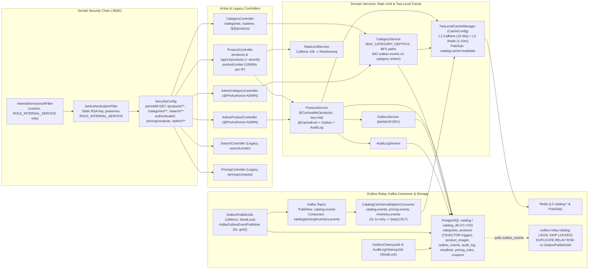
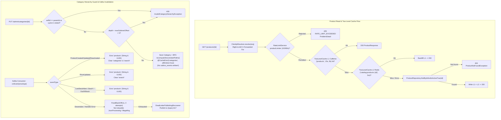
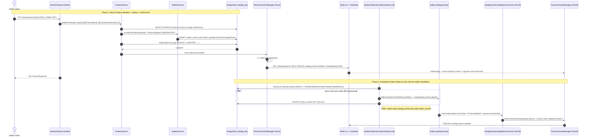

# `catalog-service` (`:8082`) — Code Walkthrough

> [!NOTE]
> **Part of the InstaCommerce Onboarding Suite:** [Onboarding Hub](../../README.md) · [Code Walkthrough Atlas](../README.md) · [Domain & Event Catalog (`05`)](../../05-domain-model-and-event-catalog.md) · [Incident Drills & Exam (`06`)](../../06-incident-drills-and-readiness-exam.md) · [Dependency Matrix & Cheatsheet (`07`)](../../07-service-dependency-and-command-cheatsheet.md)

> **Scope & Accuracy:** Audited against source, Flyway migrations (`V1`–`V15`), `platform-common` `TwoLevelCacheManager`, tests, and Helm manifests in `services/catalog-service/`, `libs/platform-common/`, and `deploy/helm/values.yaml`. Note an SLO policy divergence: `catalog-service` is listed as **Tier 2** (`99.0%` availability, `2000ms` p99) in [`monitoring/error-budget-policy.yaml`](../../../../monitoring/error-budget-policy.yaml#L29-L44) vs `99.5%` / `500ms` p99 in [`docs/slos/service-slos.md`](../../../../docs/slos/service-slos.md#L46-L52).

---

## 1. Purpose, Boundaries & Package Tree

`catalog-service` owns the authoritative product catalog, hierarchical category tree (materialized `path` + `depth` capped at `5`), dark-store product scoping (`store_id`), two-tier Caffeine + Redis caching with Pub/Sub invalidation, transactional `outbox_events` publishing to `catalog.events`, and cross-domain cache invalidation from `catalog.events`, `pricing.events`, and `inventory.events`. It also still carries legacy `search` (PostgreSQL `tsvector`) and `pricing` / `coupon` submodules.

### Service Topology & Boundaries

- **Public read endpoints (`permitAll` `GET`):** `/products/**`, `/api/v1/products/**`, `/categories/**`, `/api/v1/categories/**`, `/search/**`, `/api/v1/search/**`.
- **Admin & authenticated endpoints:** `AdminProductController` and `AdminCategoryController` enforce `@PreAuthorize("hasRole('ADMIN')")`; legacy `POST /pricing/compute` sits behind `.anyRequest().authenticated()` with no method-level role check.
- **Caching & invalidation:** `TwoLevelCacheManager` (L1 Caffeine + L2 Redis + `catalog:cache:invalidate` Pub/Sub) combined with Kafka listener `CatalogCacheInvalidationConsumer`.
- **Outbox & CDC topology:** Writes `outbox_events` (`V5`, `V9`, `V10`, `V14`), published by the in-process ShedLock-guarded [`OutboxPublishJob`](../../../../services/catalog-service/src/main/java/com/instacommerce/catalog/service/OutboxPublishJob.java#L17-L51) **and** targeted by a separate Go relay pod (`outbox-relay-catalog` in [`deploy/helm/values.yaml`](../../../../deploy/helm/values.yaml#L1015-L1035)).

### Package Tree

```text
services/catalog-service/
├── build.gradle.kts                                         # Boot 4, JPA, Flyway, Kafka, Redis, Caffeine, Resilience4j, JJWT
└── src/
    ├── main/
    │   ├── java/com/instacommerce/catalog/
    │   │   ├── CatalogServiceApplication.java               # Entrypoint
    │   │   ├── config/
    │   │   │   ├── CacheConfig.java                         # TwoLevelCacheManager (Caffeine L1 + Redis L2 + Pub/Sub)
    │   │   │   ├── CatalogProperties.java                   # catalog.jwt & rate-limiter config properties
    │   │   │   ├── KafkaConfig.java                         # KafkaTemplate + DefaultErrorHandler (3x @ 1s -> .DLT)
    │   │   │   ├── SchedulerConfig.java                     # @EnableScheduling + ShedLock (defaultLockAtMostFor="10m")
    │   │   │   └── SecurityConfig.java                      # Stateless security rules & filter chain
    │   │   ├── controller/
    │   │   │   ├── AdminCategoryController.java             # @PreAuthorize("hasRole('ADMIN')") category mutations
    │   │   │   ├── AdminProductController.java              # @PreAuthorize("hasRole('ADMIN')") product mutations
    │   │   │   ├── CategoryController.java                  # Public category reads (no RateLimitService)
    │   │   │   ├── PricingController.java                   # Legacy POST /pricing/compute (authenticated, no role)
    │   │   │   ├── ProductController.java                   # Public product reads + RateLimitService
    │   │   │   └── SearchController.java                    # Legacy PostgreSQL FTS reads + RateLimitService
    │   │   ├── domain/model/
    │   │   │   ├── Category.java                            # Self-referencing parent + materialized path & depth
    │   │   │   ├── OutboxEvent.java                         # Transactional outbox entity
    │   │   │   └── Product.java                             # SKU, store_id, perishability, temp zone, VAT bps
    │   │   ├── event/
    │   │   │   └── ProductChangedEvent.java                 # Catalog Kafka event payload (has active & inStock)
    │   │   ├── exception/
    │   │   │   └── GlobalExceptionHandler.java              # ProblemDetail/ErrorResponse exception mapping
    │   │   ├── kafka/
    │   │   │   └── CatalogCacheInvalidationConsumer.java    # Consumes catalog/pricing/inventory.events
    │   │   ├── pricing/
    │   │   │   ├── BasePriceStrategy.java                   # Base price calculation
    │   │   │   ├── PromotionStrategy.java                   # No-op promotion stub
    │   │   │   └── ZoneOverrideStrategy.java                # Zone pricing lookup
    │   │   ├── repository/
    │   │   │   ├── AuditLogRepository.java                  # audit_log repository
    │   │   │   ├── CategoryRepository.java                  # Category queries & descendant subtree lookups
    │   │   │   ├── CouponRepository.java                    # Legacy coupon lookups
    │   │   │   ├── CouponUsageRepository.java               # Legacy coupon usage tracking
    │   │   │   ├── OutboxEventRepository.java               # findTop100BySentFalseOrderByCreatedAtAsc
    │   │   │   ├── PricingRuleRepository.java               # Pricing rule queries
    │   │   │   ├── ProductRepository.java                   # storeId-filtered product queries
    │   │   │   └── SearchRepository.java                    # Native SQL tsvector search
    │   │   ├── security/
    │   │   │   ├── ClientIpResolver.java                    # Trusted proxy / X-Forwarded-For extraction
    │   │   │   ├── DefaultJwtService.java                   # RSA JWT parsing + issuer validation
    │   │   │   ├── InternalServiceAuthFilter.java           # X-Internal-Service / X-Internal-Token filter
    │   │   │   ├── JwtAuthenticationFilter.java             # Bearer token filter (preserves ROLE_INTERNAL_SERVICE)
    │   │   │   └── JwtKeyLoader.java                        # Eager RSA public-key loader (throws if blank)
    │   │   └── service/
    │   │       ├── AuditLogCleanupJob.java                  # Daily 730d audit cleanup (@SchedulerLock)
    │   │       ├── AuditLogService.java                     # Writes audit_log rows (trace_id VARCHAR(32))
    │   │       ├── CategoryService.java                     # Tree/subtree cache + BFS path recompute (no outbox!)
    │   │       ├── CouponService.java                       # Legacy coupon evaluation
    │   │       ├── KafkaOutboxEventPublisher.java           # Synchronous KafkaTemplate.get(5s) to catalog.events
    │   │       ├── LoggingOutboxEventPublisher.java         # Logging fallback publisher
    │   │       ├── OutboxCleanupJob.java                    # 6-hourly 7d sent outbox cleanup (@SchedulerLock)
    │   │       ├── OutboxEventPublisher.java                # Publisher interface (unused by OutboxService)
    │   │       ├── OutboxPublishJob.java                    # 1000ms @SchedulerLock relay polling outbox_events
    │   │       ├── OutboxService.java                       # MANDATORY Tx writer (passes isActive() for inStock!)
    │   │       ├── PostgresOutboxEventPublisher.java        # Unused Postgres publisher implementation
    │   │       ├── PostgresSearchProvider.java              # Legacy FTS provider
    │   │       ├── PricingService.java                      # Legacy pricing (passes zoneId = null!)
    │   │       ├── ProductService.java                      # @Cacheable/@CacheEvict CRUD + storeId filter
    │   │       ├── RateLimitService.java                    # Caffeine 10k/5m + Resilience4j 100/60s per IP
    │   │       └── SearchService.java                       # Legacy FTS wrapper (no storeId filter)
    │   └── resources/
    │       ├── application.yml                              # Port 8082, Hikari 20/5, Kafka acks=all, rate limiters
    │       ├── application-local.yml                        # Local dev overrides
    │       └── db/migration/                                # V1..V15 Flyway SQL scripts
    └── test/                                                # 10 unit/integration test suites
```

---

## 2. Low-Level Component Architecture

**catalog-service low-level architecture** — *[Rendered PNG](../diagrams/services/catalog-service-arch-lld.png) · [Mermaid Source](../diagrams/services/catalog-service-arch-lld.mmd)*



---

## 3. Startup, Configuration & Security Filter Chain Walkthrough

### Startup, Datasource & Helm Drift

1. **Startup configuration:** [`CatalogServiceApplication`](../../../../services/catalog-service/src/main/java/com/instacommerce/catalog/CatalogServiceApplication.java#L8-L14) boots [`CatalogProperties`](../../../../services/catalog-service/src/main/java/com/instacommerce/catalog/config/CatalogProperties.java#L5-L33) and [`SchedulerConfig`](../../../../services/catalog-service/src/main/java/com/instacommerce/catalog/config/SchedulerConfig.java#L12-L25) (`@EnableScheduling`, `@EnableSchedulerLock(defaultLockAtMostFor = "10m")`).
2. **Fail-fast JWT key:** [`JwtKeyLoader`](../../../../services/catalog-service/src/main/java/com/instacommerce/catalog/security/JwtKeyLoader.java#L16-L28) throws `IllegalStateException` at startup if `catalog.jwt.public-key` is blank.
3. **Helm vs `application.yml` configuration gaps:**
   - [`application.yml`](../../../../services/catalog-service/src/main/resources/application.yml#L1-L100) configures DB `catalog` (Hikari `20` max / `5` min), Kafka producer (`acks: all`, `retries: 3`, `enable.idempotence: true`), and Resilience4j rate limiters (`productLimiter`, `searchLimiter` at `100` / `60s`).
   - [`deploy/helm/values.yaml`](../../../../deploy/helm/values.yaml#L617-L631) configures `catalog-service` with `2` replicas (HPA `2`–`8`) against `catalog_db`, **omitting** `SPRING_DATA_REDIS_HOST`, `INTERNAL_SERVICE_TOKEN`, and `allowed-callers`. Without Redis configured in Helm, `TwoLevelCacheManager` falls back to L1-only Caffeine per pod.

### Security Filter Chain & Per-IP Rate Limiting

[`SecurityConfig`](../../../../services/catalog-service/src/main/java/com/instacommerce/catalog/config/SecurityConfig.java#L23-L67) configures stateless HTTP security:

1. [`InternalServiceAuthFilter`](../../../../services/catalog-service/src/main/java/com/instacommerce/catalog/security/InternalServiceAuthFilter.java#L24-L72) validates internal service headers and grants `ROLE_INTERNAL_SERVICE` only.
2. [`JwtAuthenticationFilter`](../../../../services/catalog-service/src/main/java/com/instacommerce/catalog/security/JwtAuthenticationFilter.java#L28-L90) parses RSA tokens via [`DefaultJwtService`](../../../../services/catalog-service/src/main/java/com/instacommerce/catalog/security/DefaultJwtService.java#L1-L54) (static key + issuer check) and **preserves** any existing `ROLE_INTERNAL_SERVICE`.
3. **Endpoint authorization:**
   - `GET` requests to `/products/**`, `/api/v1/products/**`, `/categories/**`, `/api/v1/categories/**`, `/search/**`, `/api/v1/search/**`, `/actuator/**`, and `/error` are `permitAll()`.
   - [`AdminProductController`](../../../../services/catalog-service/src/main/java/com/instacommerce/catalog/controller/AdminProductController.java#L1-L48) and [`AdminCategoryController`](../../../../services/catalog-service/src/main/java/com/instacommerce/catalog/controller/AdminCategoryController.java#L1-L49) gate mutations with `@PreAuthorize("hasRole('ADMIN')")` (**rejecting** `SUPER_ADMIN` and `INTERNAL_SERVICE` unless `ADMIN` is explicitly present).
   - [`PricingController`](../../../../services/catalog-service/src/main/java/com/instacommerce/catalog/controller/PricingController.java#L1-L25) (`POST /pricing/compute`) falls through to `.anyRequest().authenticated()` with **no** `@PreAuthorize` annotation.
4. **Rate limiting asymmetry:** [`ProductController`](../../../../services/catalog-service/src/main/java/com/instacommerce/catalog/controller/ProductController.java#L1-L53) and [`SearchController`](../../../../services/catalog-service/src/main/java/com/instacommerce/catalog/controller/SearchController.java#L1-L56) enforce [`RateLimitService`](../../../../services/catalog-service/src/main/java/com/instacommerce/catalog/service/RateLimitService.java#L1-L58) (`Caffeine` `10k` / `5m` idle -> Resilience4j `100` req / `60s`) keyed by [`ClientIpResolver`](../../../../services/catalog-service/src/main/java/com/instacommerce/catalog/security/ClientIpResolver.java#L1-L292), whereas [`CategoryController`](../../../../services/catalog-service/src/main/java/com/instacommerce/catalog/controller/CategoryController.java#L1-L39) applies **no** rate limit.

---

## 4. Data Model, Flyway Migrations & Two-Tier Caching Invariants

### Flyway Schema (`V1`–`V15`)

| Version | Migration | Schema Changes |
| --- | --- | --- |
| `V1` | [`V1__create_categories.sql`](../../../../services/catalog-service/src/main/resources/db/migration/V1__create_categories.sql#L1-L16) | Base `categories` table. |
| `V2` | [`V2__create_products.sql`](../../../../services/catalog-service/src/main/resources/db/migration/V2__create_products.sql#L1-L40) | `products` table, `chk_price_positive`, and `trg_products_search` `TSVECTOR` trigger (`A=name`, `B=brand`, `C=description`). |
| `V3` | [`V3__create_pricing_rules.sql`](../../../../services/catalog-service/src/main/resources/db/migration/V3__create_pricing_rules.sql#L1-L15) | Legacy `pricing_rules` table. |
| `V4` | [`V4__create_coupons.sql`](../../../../services/catalog-service/src/main/resources/db/migration/V4__create_coupons.sql#L1-L26) | Legacy `coupons` and `coupon_usages` tables. |
| `V5` | [`V5__create_outbox_events.sql`](../../../../services/catalog-service/src/main/resources/db/migration/V5__create_outbox_events.sql#L1-L11) | `outbox_events` table. |
| `V6` | [`V6__create_product_images.sql`](../../../../services/catalog-service/src/main/resources/db/migration/V6__create_product_images.sql#L1-L11) | `product_images` gallery table. |
| `V7` | [`V7__create_audit_log.sql`](../../../../services/catalog-service/src/main/resources/db/migration/V7__create_audit_log.sql#L1-L16) | `audit_log` table with `trace_id VARCHAR(32)`. |
| `V8` | [`V8__create_shedlock.sql`](../../../../services/catalog-service/src/main/resources/db/migration/V8__create_shedlock.sql#L1-L7) | `shedlock` distributed lock table. |
| `V9` | [`V9__add_catalog_indexes.sql`](../../../../services/catalog-service/src/main/resources/db/migration/V9__add_catalog_indexes.sql#L1-L8) | Secondary indexes across `products`, `pricing_rules`, `outbox_events`. |
| `V10` | [`V10__add_outbox_envelope_fields.sql`](../../../../services/catalog-service/src/main/resources/db/migration/V10__add_outbox_envelope_fields.sql#L1-L13) | Event envelope columns (`aggregate_type`, `aggregate_id`, `event_type`, `correlation_id`). |
| `V11` | [`V11__add_store_id_to_products.sql`](../../../../services/catalog-service/src/main/resources/db/migration/V11__add_store_id_to_products.sql#L1-L5) | Nullable dark-store scoping column `store_id UUID` on `products`. |
| `V12` | [`V12__add_product_packaging_and_tax_attributes.sql`](../../../../services/catalog-service/src/main/resources/db/migration/V12__add_product_packaging_and_tax_attributes.sql#L1-L8) | Adds `is_perishable`, `temperature_zone`, `vat_rate_bps`. |
| `V13` | [`V13__add_materialized_path_to_categories.sql`](../../../../services/catalog-service/src/main/resources/db/migration/V13__add_materialized_path_to_categories.sql#L1-L14) | Materialized `path` + `varchar_pattern_ops` index for prefix subtree scans. |
| `V14` | [`V14__add_outbox_events_retention_index.sql`](../../../../services/catalog-service/src/main/resources/db/migration/V14__add_outbox_events_retention_index.sql#L1) | Composite `(sent, created_at)` index for outbox relay polling. |
| `V15` | [`V15__add_category_version_and_depth.sql`](../../../../services/catalog-service/src/main/resources/db/migration/V15__add_category_version_and_depth.sql#L1-L6) | Adds `version` (optimistic locking) and integer `depth`. |

### Two-Tier Cache & Pub/Sub Mechanics

[`CacheConfig`](../../../../services/catalog-service/src/main/java/com/instacommerce/catalog/config/CacheConfig.java#L28-L88) wires `platform-common`'s [`TwoLevelCacheManager`](../../../../libs/platform-common/src/main/java/com/instacommerce/platform/cache/TwoLevelCacheManager.java#L1-L143) and [`TwoLevelCache`](../../../../libs/platform-common/src/main/java/com/instacommerce/platform/cache/TwoLevelCache.java#L1-L153):

| Cache Name | L1 Caffeine TTL (Max 5,000) | L2 Redis TTL (`catalog:*` via `CacheJsonSerializer`) | Pub/Sub Invalidation Channel |
| --- | --- | --- | --- |
| `categories` | `30s` | `10m` | `catalog:cache:invalidate` (`{instanceId}\|{cache}:{pattern}`) |
| `products` | `15s` | `5m` | `catalog:cache:invalidate` |
| `search` | `10s` | `1m` | `catalog:cache:invalidate` |

---

## 5. Core Execution Paths & Sequence Analysis

### Decision & Branching Overview

**catalog-service decision and branching flowchart** — *[Rendered PNG](../diagrams/services/catalog-service-flowchart.png) · [Mermaid Source](../diagrams/services/catalog-service-flowchart.mmd)*



### End-to-End Product, Category, Outbox & Cache Invalidation Sequence

**catalog-service execution sequence diagram** — *[Rendered PNG](../diagrams/services/catalog-service-sequence.png) · [Mermaid Source](../diagrams/services/catalog-service-sequence.mmd)*



### Method-by-Method Call-Stack Walkthrough

1. **Product Reads & Dark-Store Scoping ([`ProductService#L42-L218`](../../../../services/catalog-service/src/main/java/com/instacommerce/catalog/service/ProductService.java#L42-L218)):**
   - `getProduct(id)` is `@Cacheable("products", key = "#id")` and queries `findByIdAndIsActiveTrue` in [`ProductRepository`](../../../../services/catalog-service/src/main/java/com/instacommerce/catalog/repository/ProductRepository.java#L1-L42).
   - `listProducts` filters optional `storeId` via `p.storeId = :storeId OR p.storeId IS NULL` (global catalog items plus store-specific SKUs).
2. **Product Mutations, Outbox & Audit ([`ProductService#L42-L218`](../../../../services/catalog-service/src/main/java/com/instacommerce/catalog/service/ProductService.java#L42-L218) -> [`OutboxService#L1-L112`](../../../../services/catalog-service/src/main/java/com/instacommerce/catalog/service/OutboxService.java#L1-L112)):**
   - `createProduct`, `updateProduct`, and `deleteProduct` (soft delete setting `isActive = false`) annotate `@CacheEvict("products")`, write an outbox row inside the active transaction via `OutboxService.recordProductEvent(..., "ProductCreated|ProductUpdated|ProductDeactivated")` (`Propagation.MANDATORY`), and insert an audit entry via [`AuditLogService`](../../../../services/catalog-service/src/main/java/com/instacommerce/catalog/service/AuditLogService.java#L1-L82).
   - **Data-accuracy bug in [`OutboxService#L33`](../../../../services/catalog-service/src/main/java/com/instacommerce/catalog/service/OutboxService.java#L33), [`#L39`](../../../../services/catalog-service/src/main/java/com/instacommerce/catalog/service/OutboxService.java#L39):** Constructs [`ProductChangedEvent`](../../../../services/catalog-service/src/main/java/com/instacommerce/catalog/event/ProductChangedEvent.java#L1-L70) (`#L13`, `#L19`) by passing `product.isActive()` for **both** `active` and `inStock`. Furthermore, `OutboxService` writes directly to [`OutboxEventRepository`](../../../../services/catalog-service/src/main/java/com/instacommerce/catalog/repository/OutboxEventRepository.java#L1-L19) and never injects the [`OutboxEventPublisher`](../../../../services/catalog-service/src/main/java/com/instacommerce/catalog/service/OutboxEventPublisher.java#L1-L7) abstraction ([`PostgresOutboxEventPublisher`](../../../../services/catalog-service/src/main/java/com/instacommerce/catalog/service/PostgresOutboxEventPublisher.java#L1-L40) / [`LoggingOutboxEventPublisher`](../../../../services/catalog-service/src/main/java/com/instacommerce/catalog/service/LoggingOutboxEventPublisher.java#L1-L26)).
3. **Category Hierarchy & Path Recomputation ([`CategoryService#L35-L284`](../../../../services/catalog-service/src/main/java/com/instacommerce/catalog/service/CategoryService.java#L35-L284)):**
   - Enforces `MAX_CATEGORY_DEPTH = 5`. `getCategoryTree()` uses `@Cacheable("categories")`; `getSubtree(pathPrefix)` caches under `'subtree-' + #pathPrefix` using [`CategoryRepository`](../../../../services/catalog-service/src/main/java/com/instacommerce/catalog/repository/CategoryRepository.java#L1-L19) prefix scans; mutations annotate `@CacheEvict("categories", allEntries = true)`.
   - Parent re-parenting guards against cycles using a `visited` set and validates subtree depth offset before BFS-updating all descendants (`recomputeDescendantPaths`).
   - **Two category bugs:** (a) [`CategoryService#L200`](../../../../services/catalog-service/src/main/java/com/instacommerce/catalog/service/CategoryService.java#L200) throws `CategoryNotFoundException(parentId)` instead of `cursorId` if an upper ancestor is missing during traversal; (b) category mutations emit **zero** outbox events, leaving downstream `search_documents.category` stale after category renames.
4. **Legacy Search & Pricing Submodules:**
   - [`SearchService`](../../../../services/catalog-service/src/main/java/com/instacommerce/catalog/service/SearchService.java#L1-L41) -> [`PostgresSearchProvider`](../../../../services/catalog-service/src/main/java/com/instacommerce/catalog/service/PostgresSearchProvider.java#L1-L38) -> [`SearchRepository`](../../../../services/catalog-service/src/main/java/com/instacommerce/catalog/repository/SearchRepository.java#L1-L115) executes native PostgreSQL FTS on query `q` with **no** `storeId` filter.
   - [`PricingService#L56`](../../../../services/catalog-service/src/main/java/com/instacommerce/catalog/service/PricingService.java#L56) passes `zoneId = null` to [`ZoneOverrideStrategy`](../../../../services/catalog-service/src/main/java/com/instacommerce/catalog/pricing/ZoneOverrideStrategy.java#L1-L29), while [`PromotionStrategy`](../../../../services/catalog-service/src/main/java/com/instacommerce/catalog/pricing/PromotionStrategy.java#L1-L18) is a no-op ([`BasePriceStrategy`](../../../../services/catalog-service/src/main/java/com/instacommerce/catalog/pricing/BasePriceStrategy.java#L1-L18), [`CouponService`](../../../../services/catalog-service/src/main/java/com/instacommerce/catalog/service/CouponService.java#L1-L71)).

---

## 6. Outbox Relay, Kafka Consumers & Scheduled Cleanup Mechanics

### In-Process Outbox Polling vs External Relay (`OutboxPublishJob` vs `outbox-relay-catalog`)

- [`OutboxPublishJob`](../../../../services/catalog-service/src/main/java/com/instacommerce/catalog/service/OutboxPublishJob.java#L17-L51) (`@ConditionalOnBean(KafkaOutboxEventPublisher.class)`) polls `findTop100BySentFalseOrderByCreatedAtAsc()` every `1000ms` under `@SchedulerLock("outbox-publish")` (no `FOR UPDATE SKIP LOCKED`), holding a database `@Transactional` open across synchronous `kafkaTemplate.send(CATALOG_EVENTS, key, envelope).get(5s)` calls inside [`KafkaOutboxEventPublisher#L45-L76`](../../../../services/catalog-service/src/main/java/com/instacommerce/catalog/service/KafkaOutboxEventPublisher.java#L45-L76) (emitting a dual camelCase/snake_case envelope).
- **Duplicate relay contention risk:** [`deploy/helm/values.yaml#L1015-L1035`](../../../../deploy/helm/values.yaml#L1015-L1035) simultaneously deploys the Go `outbox-relay-catalog` (`:8103`) service reading the same `catalog_db` outbox table. Running both pollers against the same outbox creates duplicate Kafka publishes and lock contention unless one is disabled.

### Cross-Service Cache Invalidation Consumer & Cleanup Jobs

- [`CatalogCacheInvalidationConsumer`](../../../../services/catalog-service/src/main/java/com/instacommerce/catalog/kafka/CatalogCacheInvalidationConsumer.java#L29-L115) (`groupId = "catalog-cache-invalidator"`) subscribes to `catalog.events`, `pricing.events`, and `inventory.events`, evicting `products` by **both** `String` and `UUID` keys (when parseable) and clearing `categories` and `search`.
- [`KafkaConfig#L66-L101`](../../../../services/catalog-service/src/main/java/com/instacommerce/catalog/config/KafkaConfig.java#L66-L101) attaches a `DefaultErrorHandler` that retries `3` times at `1s` intervals before delegating to `DeadLetterPublishingRecoverer` (`{topic}.DLT`).
- Scheduled retention jobs: [`OutboxCleanupJob`](../../../../services/catalog-service/src/main/java/com/instacommerce/catalog/service/OutboxCleanupJob.java#L1-L32) (`0 0 */6 * * *`, deletes sent rows older than 7d under `@SchedulerLock("outbox-cleanup")`) and [`AuditLogCleanupJob`](../../../../services/catalog-service/src/main/java/com/instacommerce/catalog/service/AuditLogCleanupJob.java#L1-L30) (`0 0 3 * * *`, retains 730d under `@SchedulerLock("auditLogCleanup")`).

---

## 7. Configuration Matrix, Tests & Known Drift

### Configuration Matrix

| Property / Key | Default (`application.yml`) | Helm / Production Override | Source Reference |
| --- | --- | --- | --- |
| `server.port` | `8082` | `8082` (`2` replicas, HPA `2`–`8`) | [`application.yml`](../../../../services/catalog-service/src/main/resources/application.yml#L1-L100), [`values.yaml#L617-L631`](../../../../deploy/helm/values.yaml#L617-L631) |
| `spring.datasource.url` / Hikari | `catalog` (`max=20, min=5`) | `catalog_db` | [`application.yml`](../../../../services/catalog-service/src/main/resources/application.yml#L1-L100), [`values.yaml#L617-L631`](../../../../deploy/helm/values.yaml#L617-L631) |
| `catalog.jwt.public-key` | Required (`IllegalStateException` if blank) | Supplied via secret/env | [`JwtKeyLoader#L16-L28`](../../../../services/catalog-service/src/main/java/com/instacommerce/catalog/security/JwtKeyLoader.java#L16-L28) |
| Redis (`SPRING_DATA_REDIS_HOST`) | `TwoLevelCacheManager` + Pub/Sub | Omitted in Helm (falls back to L1 Caffeine) | [`CacheConfig#L28-L88`](../../../../services/catalog-service/src/main/java/com/instacommerce/catalog/config/CacheConfig.java#L28-L88), [`values.yaml#L617-L631`](../../../../deploy/helm/values.yaml#L617-L631) |
| Resilience4j (`productLimiter`, `searchLimiter`) | `100` req / `60s`, Caffeine `10k` / `5m` | Same | [`application.yml`](../../../../services/catalog-service/src/main/resources/application.yml#L1-L100), [`RateLimitService`](../../../../services/catalog-service/src/main/java/com/instacommerce/catalog/service/RateLimitService.java#L1-L58) |
| `spring.kafka.producer` | `acks: all`, `retries: 3`, `enable.idempotence: true` | Same; error handler `3x @ 1s -> {topic}.DLT` | [`application.yml`](../../../../services/catalog-service/src/main/resources/application.yml#L1-L100), [`KafkaConfig#L66-L101`](../../../../services/catalog-service/src/main/java/com/instacommerce/catalog/config/KafkaConfig.java#L66-L101) |

### Validation & Narrow Test Commands

```bash
# Run all tests for catalog-service only
./gradlew :services:catalog-service:test

# Targeted cache, consumer, and category tests + formatting/packaging check
./gradlew :services:catalog-service:test --tests "com.instacommerce.catalog.config.CacheConfigPubSubTest"
./gradlew :services:catalog-service:test --tests "com.instacommerce.catalog.kafka.CatalogCacheInvalidationConsumerTest"
./gradlew :services:catalog-service:test --tests "com.instacommerce.catalog.service.CategoryServiceTest"
./gradlew :services:catalog-service:spotlessCheck :services:catalog-service:bootJar
```

### Exact Code-Level Bugs & Documentation Drift

1. **`OutboxService` conflates `active` with `inStock`:** [`OutboxService#L33`](../../../../services/catalog-service/src/main/java/com/instacommerce/catalog/service/OutboxService.java#L33), [`#L39`](../../../../services/catalog-service/src/main/java/com/instacommerce/catalog/service/OutboxService.java#L39) passes `product.isActive()` for both `active` and `inStock` in `ProductChangedEvent`, and ignores `OutboxEventPublisher` (`PostgresOutboxEventPublisher` / `LoggingOutboxEventPublisher` sit unused).
2. **Duplicate outbox relay with `outbox-relay-catalog`:** [`OutboxPublishJob`](../../../../services/catalog-service/src/main/java/com/instacommerce/catalog/service/OutboxPublishJob.java#L17-L51) holds `@Transactional` across blocking `kafkaTemplate.send(...).get(5s)` calls (`KafkaOutboxEventPublisher#L45-L76`) while Helm also deploys [`outbox-relay-catalog`](../../../../deploy/helm/values.yaml#L1015-L1035).
3. **Helm omits Redis & internal-service tokens:** [`values.yaml#L617-L631`](../../../../deploy/helm/values.yaml#L617-L631) omits `SPRING_DATA_REDIS_HOST`, `INTERNAL_SERVICE_TOKEN`, and `allowed-callers`, degrading `TwoLevelCacheManager` to per-pod L1 Caffeine.
4. **Category path & outbox gaps:** [`CategoryService#L200`](../../../../services/catalog-service/src/main/java/com/instacommerce/catalog/service/CategoryService.java#L200) reports `parentId` instead of `cursorId` on a missing upper ancestor, and category mutations emit zero outbox events (leaving `search_documents.category` stale).
5. **Security & pricing gaps:** `AdminProductController`/`AdminCategoryController` restrict to `hasRole('ADMIN')` (excluding `SUPER_ADMIN`/`INTERNAL_SERVICE`); `POST /pricing/compute` has no `@PreAuthorize`; `PricingService#L56` passes `zoneId = null` and `PromotionStrategy` is a no-op; `CategoryController` bypasses `RateLimitService`.
6. **SLO & `README.md` drift:** Tier 2 (`99.0%` / `2000ms` in `error-budget-policy.yaml`) conflicts with `docs/slos/service-slos.md` (`99.5%` / `500ms`); [`services/catalog-service/README.md`](../../../../services/catalog-service/README.md#L1-L459) cites `V1`–`V14` (actual `V1`–`V15`), omits `AdminCategoryController`, `CatalogCacheInvalidationConsumer`, and `storeId` filtering, and depicts single-tier Caffeine caching.

---

**Previous:** [config-feature-flag-service](./config-feature-flag-service.md) | **Atlas Hub:** [Code Walkthrough Atlas](../README.md) | **Next:** [search-service](./search-service.md)
