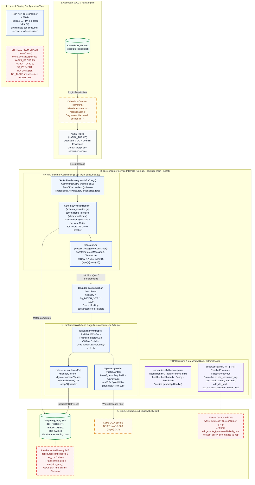
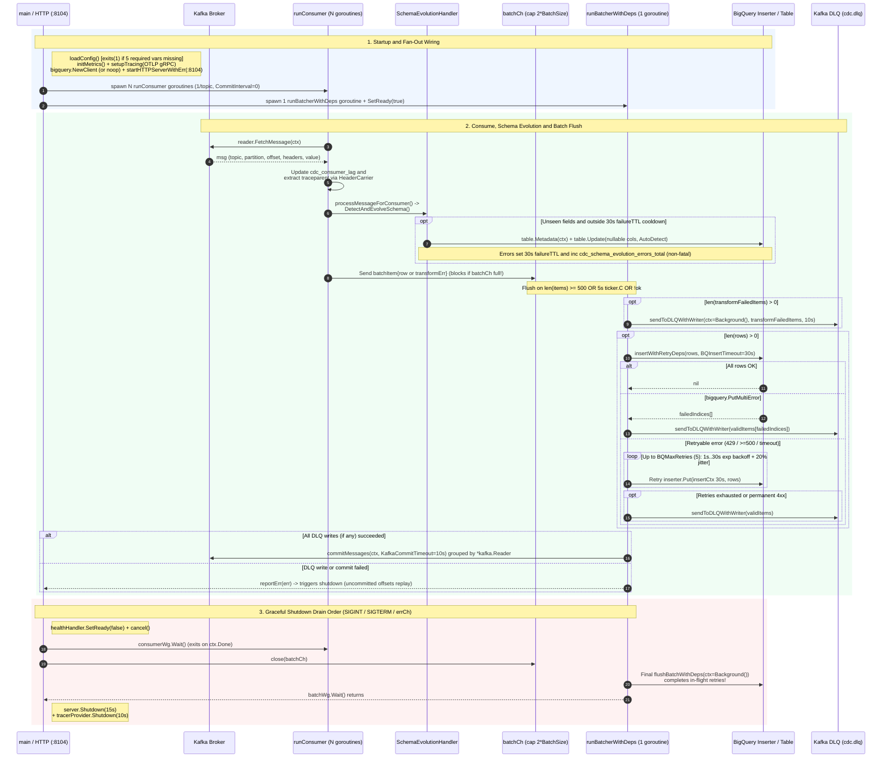

# CDC Consumer Service (`cdc-consumer-service`) — Deep Code Walkthrough

> [!NOTE]
> **Part of the InstaCommerce Onboarding Suite:** [Onboarding Hub](../../README.md) · [Code Walkthrough Atlas](../README.md) · [Domain & Event Catalog (`05`)](../../05-domain-model-and-event-catalog.md) · [Incident Drills & Exam (`06`)](../../06-incident-drills-and-readiness-exam.md) · [Dependency Matrix & Cheatsheet (`07`)](../../07-service-dependency-and-command-cheatsheet.md)

> **Repo-Truth & Onboarding Posture:** Verified directly against [`services/cdc-consumer-service/`](../../../../services/cdc-consumer-service), [`services/go-shared/`](../../../../services/go-shared), [`deploy/helm/`](../../../../deploy/helm), [`data-platform/dbt/models/staging/sources.yml`](../../../../data-platform/dbt/models/staging/sources.yml), [`infra/terraform/`](../../../../infra/terraform), [`prometheus/rules/`](../../../../prometheus/rules), [`monitoring/`](../../../../monitoring), and [`GLOSSARY.md`](../../../../GLOSSARY.md). **Critical deployment fact:** default Helm manifests omit all five mandatory environment variables (`KAFKA_BROKERS`, `KAFKA_TOPICS`, `BQ_PROJECT`, `BQ_DATASET`, `BQ_TABLE`), causing an immediate `os.Exit(1)` crash loop in Kubernetes unless patched externally.

---

## 1. Service Identity Card

| Dimension | Verified Code Truth | Source |
|---|---|---|
| **Module / Runtime** | `github.com/instacommerce/cdc-consumer-service` · Go `1.25.0` (toolchain `go1.25.1`), `segmentio/kafka-go` (`v0.4.50`), `cloud.google.com/go/bigquery` (`v1.74.0`) | [`go.mod`](../../../../services/cdc-consumer-service/go.mod#L1-L17) |
| **HTTP Port & Image** | `:8104` (`PORT` &rarr; `SERVER_PORT` &rarr; `"8104"`), multi-stage Alpine `3.23` non-root `app:1001` (`CGO_ENABLED=0`) | [`config.go`](../../../../services/cdc-consumer-service/config.go#L42), [`Dockerfile`](../../../../services/cdc-consumer-service/Dockerfile#L1-L17) |
| **Storage / Sink** | Streams rows into a single BigQuery table `{BQ_PROJECT}.{BQ_DATASET}.{BQ_TABLE}` (or `noopBQInserter{}` if `DISABLE_BIGQUERY=true` / local fallback) | [`main.go`](../../../../services/cdc-consumer-service/main.go#L45-L67), [`main.go`](../../../../services/cdc-consumer-service/main.go#L168-L180) |
| **Kafka Topics** | Consumes comma/space/semicolon-separated `KAFKA_TOPICS` (group default `cdc-consumer-service`); writes failed items/batches to `KAFKA_DLQ_TOPIC` (default `cdc.dlq`) | [`config.go`](../../../../services/cdc-consumer-service/config.go#L43-L67) |
| **Helm Release Key** | Shortened key **`cdc-consumer`** (`2` replicas, HPA `2..6`, prod VPA `Off`) mapped in `.github/workflows/ci.yml` | [`values.yaml`](../../../../deploy/helm/values.yaml#L1169-L1184), [`ci.yml`](../../../../.github/workflows/ci.yml#L843) |
| **SLO Tier Status** | Omitted from `error-budget-policy.yaml`; targeted by drifted consumer-group alert in `wave-40-complete-slo-alerts.yml` | [`error-budget-policy.yaml`](../../../../monitoring/error-budget-policy.yaml#L4-L45), [`wave-40-complete-slo-alerts.yml`](../../../../prometheus/rules/wave-40-complete-slo-alerts.yml#L425-L436) |
| **First-Principles Role** | Bridges Kafka Debezium WAL/domain topics into BigQuery via bounded channel backpressure (`batchCh`), deterministic streaming dedup (`insertID = "{topic}-{partition}-{offset}"`), automatic nullable column evolution (`SchemaEvolutionHandler`), and strict commit-after-insert-or-DLQ semantics. It **never** reads Postgres WAL directly. | [`consumer.go`](../../../../services/cdc-consumer-service/consumer.go#L139-L362), [`transform.go`](../../../../services/cdc-consumer-service/transform.go#L101-L202) |

---

## 2. Package & File Layout

All runtime logic sits in `package main` across seven cohesive files, paired with four unit-test suites:

| File | Lines | Responsibility | Link |
|---|---|---|---|
| `main.go` | 180 | Startup, config/BigQuery/DLQ writer/Kafka reader init, fan-out goroutines (`N` consumers + `1` batcher), `noopBQInserter`, graceful drain order | [`main.go`](../../../../services/cdc-consumer-service/main.go#L1-L180) |
| `config.go` | 128 | Strict env loading via `go-shared/pkg/config` (`GetEnvTrimmed`, `GetEnvIntStrict`, `GetEnvDurationStrict`, `SplitCSV`), 5-var mandatory validation | [`config.go`](../../../../services/cdc-consumer-service/config.go#L1-L128) |
| `consumer.go` | 433 | `bqInserter`/`dlqMessageWriter`/`schemaEvolver` interfaces, `runConsumer`, `processMessageForConsumer`, `runBatcherWithDeps`, `flushBatchWithDeps`, `insertWithRetryDeps`, `isRetryable` | [`consumer.go`](../../../../services/cdc-consumer-service/consumer.go#L1-L433) |
| `transform.go` | 259 | `bqRow` (`bigquery.ValueSaver`), `isTombstonePayload`, `extractSchemaVersion`, `extractPartitionKey`, `transformMessage`, `transformParsedMessage`, `parseTsMs` | [`transform.go`](../../../../services/cdc-consumer-service/transform.go#L1-L259) |
| `dlq.go` | 207 | `batchItem`, `markReadyForCommit`, `classifyDLQCategory`, `sendToDLQWithWriter`, `buildDLQKafkaMessages`, `upsertKafkaHeader`, `commitMessages` | [`dlq.go`](../../../../services/cdc-consumer-service/dlq.go#L1-L207) |
| `schema_evolution.go` | 231 | `schemaTable` interface, `SchemaEvolutionHandler` (`sync.Map` cache + `30s` `failureTTL` circuit breaker), `InferBigQueryType`, `ExtractCDCFieldsFromMap`, `DetectAndEvolveSchema` | [`schema_evolution.go`](../../../../services/cdc-consumer-service/schema_evolution.go#L1-L231) |
| `telemetry.go` | 109 | Prometheus metrics registration (`cdc_*`), JSON `slog`, OTel gRPC trace initialization, `startHTTPServerWithErr` with `correlation.Middleware` + `health.Handler` | [`telemetry.go`](../../../../services/cdc-consumer-service/telemetry.go#L1-L109) |
| `cdc_consumer_test.go` | 346 | Debezium envelope parsing, offset reset (`earliest`/`latest`), altered-column tolerant parsing, `InferBigQueryType`, `markReadyForCommit` | [`cdc_consumer_test.go`](../../../../services/cdc-consumer-service/cdc_consumer_test.go#L1-L346) |
| `cdc_batcher_test.go` | 331 | `loadConfig` validation, `insertWithRetryDeps` (503 retry, 400 non-retry, `PutMultiError`), `flushBatchWithDeps` mixed transform+row DLQ, `runBatcherWithDeps` flush/close, schema error span/metric | [`cdc_batcher_test.go`](../../../../services/cdc-consumer-service/cdc_batcher_test.go#L1-L331) |
| `cdc_hardening_test.go` | 139 | `SchemaEvolutionHandler` 30s failure cooldown & cache hit, single-unmarshal `processMessageForConsumer`, HTTP bind error propagation to `errCh` | [`cdc_hardening_test.go`](../../../../services/cdc-consumer-service/cdc_hardening_test.go#L1-L139) |
| `cdc_transform_dlq_test.go` | 152 | Tombstones (`nil` & `"null"`), partition-key fallback, schema version errors, DLQ header upsert/dedup, `TruncateUTF8` multi-byte safety | [`cdc_transform_dlq_test.go`](../../../../services/cdc-consumer-service/cdc_transform_dlq_test.go#L1-L152) |
| `Dockerfile`, `go.mod`, `README.md` | 17 / 82 / 501 | Multi-stage Alpine container, Go dependencies (`replace ../go-shared`), and stale pre-refactor docs | [`Dockerfile`](../../../../services/cdc-consumer-service/Dockerfile#L1-L17), [`go.mod`](../../../../services/cdc-consumer-service/go.mod#L1-L82), [`README.md`](../../../../services/cdc-consumer-service/README.md#L1-L501) |

---

## 3. Architecture LLD & Concurrency Topology

**CDC Consumer Service Architecture LLD** — *[Rendered PNG](../diagrams/services/cdc-consumer-service-arch-lld.png) · [Mermaid Source](../diagrams/services/cdc-consumer-service-arch-lld.mmd)*



### Startup, BigQuery Fallback & `go-shared` HTTP Stack

1. **Mandatory Configuration Gate ([`main.go`](../../../../services/cdc-consumer-service/main.go#L21-L26), [`config.go`](../../../../services/cdc-consumer-service/config.go#L38-L113)):**
   - `loadConfig()` uses [`go-shared/pkg/config`](../../../../services/go-shared/pkg/config/config.go#L27-L125) helpers (`GetEnvTrimmed`, `GetEnvIntStrict`, `GetEnvDurationStrict`, `SplitCSV`).
   - Startup exits with code `1` unless **all five** required env vars are non-empty: `KAFKA_BROKERS`, `KAFKA_TOPICS`, `BQ_PROJECT`, `BQ_DATASET`, and `BQ_TABLE` (and `BQ_BATCH_SIZE > 0` plus valid `LOG_LEVEL`).
2. **BigQuery Client vs Local No-Op Fallback ([`main.go`](../../../../services/cdc-consumer-service/main.go#L45-L67), [`main.go`](../../../../services/cdc-consumer-service/main.go#L168-L180)):**
   - If `DISABLE_BIGQUERY=true` (case-insensitive), `inserter` stays `noopBQInserter{}` and `schemaHandler` stays `nil`.
   - Otherwise `bigquery.NewClient(ctx, cfg.BQProject)` is invoked; if it fails and `isLocalBigQueryOptional()` is true (`ENVIRONMENT` in `local`/`dev`/`development` or `DISABLE_BIGQUERY=true`), it warns and falls back to `noopBQInserter{}`; in staging/prod it calls `os.Exit(1)`.
   - When connected, `table := bqClient.Dataset(cfg.BQDataset).Table(cfg.BQTable)` initializes `bqIns := table.Inserter()` with **`bqIns.IgnoreUnknownValues = true`** and **`bqIns.SkipInvalidRows = true`**, plus `NewSchemaEvolutionHandler(table, logger)`.
3. **Kafka Readers, DLQ Writer & HTTP Probes ([`main.go`](../../../../services/cdc-consumer-service/main.go#L69-L108), [`telemetry.go`](../../../../services/cdc-consumer-service/telemetry.go#L84-L109)):**
   - Creates one `kafka.Writer` for `KAFKA_DLQ_TOPIC` (`kafka.LeastBytes{}`, `RequiredAcks: kafka.RequireAll`, `Async: false`) and `N` `kafka.Reader` instances (1 per topic in `cfg.KafkaTopics`, **`CommitInterval: 0`** for manual commits, `StartOffset` = `kafka.FirstOffset` unless `KAFKA_AUTO_OFFSET_RESET=latest`).
   - `startHTTPServerWithErr` registers [`healthHandler.RegisterRoutes(mux)`](../../../../services/go-shared/pkg/health/handler.go#L108-L112) (`/health`, `/health/ready`, `/health/live`), alias `/ready`, and `/metrics` (`promhttp.Handler()`), wrapped in [`correlation.Middleware`](../../../../services/go-shared/pkg/correlation/middleware.go#L17-L27). Note `health.NewHandler()` has **zero registered dependency checks**, so `/health` always returns `200 {"status":"ok"}` and `/health/ready` / `/ready` tracks `healthHandler.SetReady(true/false)`.

### Goroutine & Bounded Channel Model

- **`N` `runConsumer` goroutines** (`consumerWg`) read concurrently from per-topic `*kafka.Reader`s and push `batchItem` values into **`batchCh := make(chan batchItem, cfg.BatchSize*2)`** (`1000` slots by default).
- **`1` `runBatcherWithDeps` goroutine** (`batchWg`) drains `batchCh`, owns all BigQuery `Put` and DLQ writes, and commits Kafka offsets per `*kafka.Reader` only after BigQuery/DLQ persistence succeeds.
- **Backpressure coupling:** If BigQuery slows or enters exponential retry backoff, the single batcher stops draining `batchCh`; once `batchCh` fills (`1000` items), every `runConsumer` goroutine blocks on `batchCh <- ...` and pauses `reader.FetchMessage(ctx)`, bounding heap growth instead of OOMing.

---

## 4. BigQuery Row Schema, Kafka Envelopes & DLQ Contract

### BigQuery Streaming Row & `insertID` ([`transform.go`](../../../../services/cdc-consumer-service/transform.go#L24-L31), [`#L101-L202`](../../../../services/cdc-consumer-service/transform.go#L101-L202))

Each `bqRow` implements `bigquery.ValueSaver`:
- **`insertID`:** `fmt.Sprintf("%s-%d-%d", msg.Topic, msg.Partition, msg.Offset)` — leverages BigQuery's streaming deduplication window for safe restarts/replays within roughly a minute.
- **17 Columns Emitted (`map[string]bigquery.Value`):**

| Column | Non-Tombstone Source | Tombstone (`nil` / `""` / `"null"`) |
|---|---|---|
| `topic`, `partition`, `offset` | `msg.Topic`, `msg.Partition`, `msg.Offset` | Same |
| `key` | `bytesToString(msg.Key)` (UTF-8 or base64) | Same |
| `partition_key` | `extractPartitionKey(msg, payload, innerPayload)` | `extractPartitionKey(msg, nil, nil)` (must have `msg.Key`) |
| `schema_version` | `extractSchemaVersion(msg, payload)` (defaults `"v1"`) | `extractSchemaVersion(msg, nil)` |
| `op` | `payload.op` (or inner `payload.op` if wrapped) | `"d"` |
| `tombstone` | `false` | `true` |
| `ts_ms` | `parseTsMs(...)` (`float64`/`int64`/`int`/`json.Number`/decimal `string` &rarr; `int64`) | `nil` |
| `source`, `before`, `after`, `payload` | `mustJSONValue(...)` JSON-marshaled strings (or `nil`) | `nil` |
| `headers` | `mustJSONValue(headersToMap(msg.Headers))` | Same |
| `raw` | `bytesToString(msg.Value)` | `bytesToString(msg.Value)` |
| `kafka_timestamp`, `ingested_at` | `msg.Time`, `time.Now()` | Same |

### Input Envelope Precedence & Validation ([`transform.go`](../../../../services/cdc-consumer-service/transform.go#L42-L99), [`#L145-L171`](../../../../services/cdc-consumer-service/transform.go#L145-L171))

- **Wrapped vs Unwrapped Envelopes:** `transformParsedMessage` checks whether `payload["payload"]` is a nested `map[string]any`. If present (Kafka Connect schema/payload wrapper or outbox envelope), `op`, `ts_ms`, `before`, `after`, `source`, and `payload` come from that inner map; otherwise they are read directly from the root JSON object.
- **Schema Version Precedence (`extractSchemaVersion`):** Checks Kafka headers (`schema_version`, `schemaVersion`, case-insensitive) &rarr; root JSON (`schema_version`, `schemaVersion`) &rarr; inner `payload` (`schema_version`, `schemaVersion`) &rarr; defaults to `"v1"`. Validated by [`sharedkafka.ValidateSchemaVersion`](../../../../services/go-shared/pkg/kafka/envelope.go#L33-L42).
- **Partition Key Precedence (`extractPartitionKey`):** Checks `msg.Key` &rarr; `inner` (`aggregate_id`, `aggregateId`, `id`, then nested `after`/`before` keys `aggregate_id`, `id`, `order_id`, `payment_id`) &rarr; `root` (same precedence). Missing everywhere returns `errMissingPartitionKey`.

### Kafka DLQ Contract (`cdc.dlq`, [`dlq.go`](../../../../services/cdc-consumer-service/dlq.go#L64-L182))

- Preserves original `msg.Key` and `msg.Value` verbatim and clones `msg.Headers`, upserting provenance headers case-insensitively via `upsertKafkaHeader`:
  - `dlq_reason`: `sharedkafka.TruncateUTF8(reason.Error(), 512)` (per-item `item.transformErr` overrides batch reason when set)
  - `error_category`: `partition_key_missing`, `schema_version_invalid`, or `processing_error`
  - `quarantined_at` (RFC3339Nano UTC), `consumer_group` (`cfg.KafkaGroupID`), `schema_version` (`schema_version`/`schemaVersion` header or `"unknown"`), `original_topic`, `original_partition`, `original_offset`
  - `trace_id` and `traceparent` when the active OTel `SpanContext` is valid.

---

## 5. Schema Evolution, Backpressure, Retry & Drain Walkthrough

### Flowchart: Consumer Schema Evolution, `batchCh` Backpressure & Retry/DLQ

**CDC Consumer Flowchart** — *[Rendered PNG](../diagrams/services/cdc-consumer-service-flowchart.png) · [Mermaid Source](../diagrams/services/cdc-consumer-service-flowchart.mmd)*

```mermaid
flowchart TB
    classDef step fill:#EFF6FF,stroke:#1D4ED8,stroke-width:1.8px,color:#0F172A
    classDef dec fill:#F8FAFC,stroke:#475569,stroke-width:1.8px,color:#0F172A
    classDef ok fill:#F0FDF4,stroke:#15803D,stroke-width:1.8px,color:#0F172A
    classDef warn fill:#FFFBEB,stroke:#D97706,stroke-width:2px,color:#78350F
    classDef err fill:#FEF2F2,stroke:#DC2626,stroke-width:2px,color:#7F1D1D

    subgraph CONSUME["1. Per-Topic Consumer Path (N× runConsumer)"]
        direction TB
        Fetch["reader.FetchMessage(ctx)<br/>Update cdc_consumer_lag<br/>Extract W3C traceparent"]:::step --> IsTomb{"isTombstonePayload?<br/>(empty or 'null')"}:::dec
        IsTomb -->|"Yes"| Tomb["transformMessage(msg)<br/>op='d', tombstone=true"]:::step
        IsTomb -->|"No"| Unmarshal{"json.Unmarshal<br/>into map?"}:::dec
        Unmarshal -->|"Err"| EnqErr["Enqueue batchItem{transformErr}<br/>into batchCh"]:::warn
        Unmarshal -->|"OK"| Extract["ExtractCDCFieldsFromMap<br/>(payload.after &rarr; payload &rarr; after &rarr; root)"]:::step
        Extract --> FastPath{"All fields in<br/>knownFields sync.Map?"}:::dec
        FastPath -->|"Yes"| Xform["transformParsedMessage()<br/>SchemaVersion + PartitionKey"]:::step
        FastPath -->|"Unseen field"| Breaker{"Lock h.mu:<br/>Within 30s failureTTL?"}:::dec
        Breaker -->|"Yes (CB open)"| EvoFail["Inc cdc_schema_evolution_errors_total<br/>Log warn; non-fatal continue"]:::warn
        Breaker -->|"No"| BQMeta["table.Metadata(ctx)<br/>&amp; table.Update(nullable, AutoDetect)"]:::step
        BQMeta -->|"OK"| UpdateCache["Store fields in knownFields<br/>Clear lastFailureAt"]:::ok --> Xform
        BQMeta -->|"Err"| SetTTL["Set lastFailureAt = now()"]:::warn --> EvoFail --> Xform
        Tomb --> EnqRow
        Xform -->|"Err"| EnqErr
        Xform -->|"OK"| EnqRow["Enqueue batchItem{row}<br/>into bounded batchCh<br/>(cap = 2×BatchSize, blocks if full)"]:::ok
    end

    subgraph FLUSH["2. Single Batcher Path (1× runBatcherWithDeps &amp; flushBatchWithDeps)"]
        direction TB
        Trigger(["Flush Trigger:<br/>len &gt;= 500 OR 5s ticker<br/>OR close(batchCh)"]):::step --> Split["ctx := context.Background()<br/>Split transformFailedItems<br/>vs validItems/rows"]:::step
        Split --> HasTxErr{"transformFailedItems<br/>&gt; 0?"}:::dec
        HasTxErr -->|"Yes"| SendTxDLQ["sendToDLQWithWriter(transformFailedItems)"]:::warn
        SendTxDLQ --> TxDLQOK{"DLQ Write OK?"}:::dec
        TxDLQOK -->|"No"| AbortFlush["Return err (no BQ insert,<br/>no offset commit -> reportErr)"]:::err
        TxDLQOK -->|"Yes"| HasRows
        HasTxErr -->|"No"| HasRows{"len(rows) &gt; 0?"}:::dec
        HasRows -->|"No"| Commit["markReadyForCommit(items)<br/>commitMessages(10s/reader)"]:::ok

        HasRows -->|"Yes"| BQPut["insertWithRetryDeps:<br/>inserter.Put(insertCtx 30s, rows)"]:::step
        BQPut --> PutRes{"Put Result?"}:::dec
        PutRes -->|"nil (All OK)"| Commit
        PutRes -->|"bigquery.PutMultiError"| PartialDLQ["Extract failed rowIndexes<br/>sendToDLQWithWriter(failedItems)"]:::warn
        PartialDLQ --> PartialOK{"DLQ Write OK?"}:::dec
        PartialOK -->|"Yes"| Commit
        PartialOK -->|"No"| AbortFlush

        PutRes -->|"Error"| Retryable{"attempt &lt; 5 AND<br/>(DeadlineExceeded /<br/>429 / &gt;=500 / net.Timeout)?"}:::dec
        Retryable -->|"Yes"| Backoff["Sleep min(30s, backoff + 20% jitter)<br/>backoff *= 2"]:::warn --> BQPut
        Retryable -->|"No (exhausted or 400/403)"| FullDLQ["sendToDLQWithWriter(validItems)"]:::warn
        FullDLQ --> FullDLQOK{"DLQ Write OK?"}:::dec
        FullDLQOK -->|"Yes"| Commit
        FullDLQOK -->|"No"| AbortFlush
    end

    EnqRow -->|"batchCh"| Trigger
    EnqErr -->|"batchCh"| Trigger
```



1. **Per-Message Processing & Schema Evolution ([`consumer.go`](../../../../services/cdc-consumer-service/consumer.go#L90-L206), [`schema_evolution.go`](../../../../services/cdc-consumer-service/schema_evolution.go#L75-L231)):**
   - `runConsumer` calls `reader.FetchMessage(ctx)`. On non-context errors, it calls `reportErr` (non-blocking send to `errCh` cap `1`), initiating service shutdown.
   - Computes `lag = max(0, msg.HighWaterMark - msg.Offset - 1)` into `cdc_consumer_lag{topic,partition}` and extracts W3C `traceparent` via [`sharedkafka.NewHeaderCarrier`](../../../../services/go-shared/pkg/kafka/carrier.go#L16-L18).
   - `processMessageForConsumer` handles tombstones via `transformMessage(msg)`, or unmarshals JSON **once** into `payload map[string]any` and runs `evolveSchemaFromMap` + `transformParsedMessage`.
   - `ExtractCDCFieldsFromMap` pulls `payload.after` &rarr; `payload` &rarr; `after` &rarr; root `raw`.
   - `DetectAndEvolveSchema` checks each column name against lock-free `knownFields` (`sync.Map`). Only when unseen fields exist does it acquire `h.mu`, enforce a **`30s` `failureTTL` circuit breaker** (`lastFailureAt`), fetch `table.Metadata(ctx)`, populate `knownFields` from `md.Schema`, map unseen types with `InferBigQueryType` (`Required: false` nullable), and apply `table.Update(ctx, update, md.ETag, bigquery.WithAutoDetectSchema(true))`.
   - **Non-fatal evolution errors:** Any metadata/update failure sets `lastFailureAt`, increments `cdc_schema_evolution_errors_total`, records the exception on the span, and **continues** processing with `IgnoreUnknownValues = true`.
   - Transform errors are **not** DLQ'd inline on the consumer goroutine: `runConsumer` enqueues `batchItem{reader, message, transformErr}` into `batchCh` so Kafka offsets never commit out of order ahead of earlier buffered items.
2. **Batch Flushing, Retries & Partial `PutMultiError` DLQ ([`consumer.go`](../../../../services/cdc-consumer-service/consumer.go#L221-L433), [`dlq.go`](../../../../services/cdc-consumer-service/dlq.go#L184-L207)):**
   - `runBatcherWithDeps` accumulates up to `BQ_BATCH_SIZE` (`500`) items or flushes on the `BQ_BATCH_TIMEOUT` (`5s`) ticker (and performs a final flush when `close(batchCh)` arrives).
   - `flushBatchWithDeps` splits `transformFailedItems` from `validItems`/`rows` and derives `ctx := context.Background()` so shutdown drains do not abort an in-progress flush.
   - Step A: Writes any `transformFailedItems` to `cdc.dlq`; if that DLQ write fails, returns immediately (no BigQuery `Put`, no offset commits).
   - Step B: Calls `insertWithRetryDeps` (`BQ_INSERT_TIMEOUT = 30s` per `inserter.Put` call).
     - `bigquery.PutMultiError` returns `failedIndices` immediately without retrying the whole batch; `flushBatchWithDeps` extracts `validItems[failedIndices]` and routes only those failing rows to `cdc.dlq`.
     - Retryable errors (`context.DeadlineExceeded`, `*googleapi.Error` HTTP `429` or `>= 500`, `net.Error` with `Timeout() == true`) retry up to `BQ_MAX_RETRIES` (`5`) with `sleep = min(BQMaxBackoff=30s, backoff + rand(0..0.2)*backoff)` and `backoff *= 2` (`BQBaseBackoff = 1s`).
     - Exhausted retries or permanent 4xx errors send all `validItems` to `cdc.dlq`.
   - Step C: Only once all BigQuery/DLQ writes succeed does `markReadyForCommit` + `commitMessages` group messages by `*kafka.Reader` and call `reader.CommitMessages` (`KAFKA_COMMIT_TIMEOUT = 10s`).

### Sequence Diagram: Fan-Out, Schema Evolution & Shutdown Drain Order

**CDC Consumer Sequence Diagram** — *[Rendered PNG](../diagrams/services/cdc-consumer-service-sequence.png) · [Mermaid Source](../diagrams/services/cdc-consumer-service-sequence.mmd)*



**Graceful Shutdown Drain Order ([`main.go`](../../../../services/cdc-consumer-service/main.go#L139-L166)):**
1. On `SIGINT`, `SIGTERM`, or `errCh` error (`runConsumer` fetch failure, `runBatcherWithDeps` DLQ/commit failure, or HTTP bind failure), `healthHandler.SetReady(false)` immediately returns `503` on `/health/ready` and `/ready`.
2. `cancel()` stops all `N` `runConsumer` goroutines (`FetchMessage` or `batchCh` send exits on `ctx.Done()`).
3. `consumerWg.Wait()` ensures **all** producers to `batchCh` have stopped **before** `close(batchCh)` runs.
4. `batchWg.Wait()` blocks until `runBatcherWithDeps` drains and flushes any remaining buffered items via `flushBatchWithDeps`.
5. `server.Shutdown(15s)`, deferred `reader.Close()`, `dlqWriter.Close()`, `bqClient.Close()`, and `tracerProvider.Shutdown(10s)` complete teardown.

---

## 6. Configuration, Observability & Local Testing

### Environment Variables ([`config.go`](../../../../services/cdc-consumer-service/config.go#L38-L113))

| Env Var | Code Default | Helm (`values*.yaml`) | Behavior / Validation |
|---|---|---|---|
| `PORT` / `SERVER_PORT` | `"8104"` | `"8104"` (`values.yaml`) | `PORT` checked first; `Dockerfile` sets `ENV PORT=8104` |
| `KAFKA_BROKERS` | *Required* | **MISSING** | CSV (`SplitCSV`); `os.Exit(1)` if unset |
| `KAFKA_TOPICS` | *Required* | **MISSING** | CSV (`SplitCSV`); spawns 1 `runConsumer` per topic |
| `BQ_PROJECT`, `BQ_DATASET`, `BQ_TABLE` | *Required* | **MISSING** | Single BigQuery target table; `os.Exit(1)` if any empty |
| `KAFKA_GROUP_ID` | `"cdc-consumer-service"` | *(unset)* | Consumer group ID |
| `KAFKA_DLQ_TOPIC` | `"cdc.dlq"` | *(unset)* | DLQ destination topic |
| `KAFKA_AUTO_OFFSET_RESET` | `"earliest"` | *(unset)* | `"latest"` &rarr; `kafka.LastOffset`; else `kafka.FirstOffset` |
| `KAFKA_MIN_BYTES` / `KAFKA_MAX_BYTES` / `KAFKA_MAX_WAIT` | `10240` / `10485760` / `5s` | *(unset)* | `kafka.Reader` fetch tuning |
| `KAFKA_COMMIT_TIMEOUT` / `DLQ_WRITE_TIMEOUT` | `10s` / `10s` | *(unset)* | Offset commit & synchronous DLQ write timeouts |
| `BQ_BATCH_SIZE` / `BQ_BATCH_TIMEOUT` | `500` / `5s` | *(unset)* | `batchCh` capacity is `BQ_BATCH_SIZE * 2` (`1000`); `BQ_BATCH_SIZE &gt; 0` |
| `BQ_INSERT_TIMEOUT` / `BQ_MAX_RETRIES` | `30s` / `5` | *(unset)* | Per-`Put` timeout & max retry attempts |
| `BQ_BACKOFF_BASE` / `BQ_BACKOFF_MAX` | `1s` / `30s` | *(unset)* | Exponential backoff + `20%` jitter |
| `DISABLE_BIGQUERY` / `ENVIRONMENT` | `""` / `""` | *(unset)* | `"true"` or `ENVIRONMENT` in `{local, dev, development}` allows `noopBQInserter{}` |
| `LOG_LEVEL` | `"info"` | `"info"` (`values-staging.yaml`) | Strict: `debug`, `info`, `warn`/`warning`, `error` |
| `OTEL_EXPORTER_OTLP_ENDPOINT` / `OTEL_EXPORTER_OTLP_TRACES_ENDPOINT` | `""` | *(unset)* | Resolved via `go-shared/pkg/observability` (`OTelProtocolGRPC`) |

### Telemetry Inventory ([`telemetry.go`](../../../../services/cdc-consumer-service/telemetry.go#L21-L78))

- **Prometheus (`/metrics`):** `cdc_consumer_lag{topic,partition}` (GaugeVec), `cdc_batch_latency_seconds` (Histogram, `DefBuckets`), `cdc_dlq_total` (Counter), `cdc_schema_evolution_errors_total` (Counter).
- **OTel Spans (OTLP gRPC):** `kafka.consume` (parent extracted via `HeaderCarrier`), `bigquery.batch.insert` (`batch.size`, `bq.dataset`, `bq.table`), `kafka.dlq.write` (`messaging.destination`, `dlq.count`, `dlq.category`).

### Verification & Test Commands

```bash
# Run full unit test suite with race detector (verified locally: 14 top-level tests PASS in 1.982s)
cd services/cdc-consumer-service && go test -v -race -count=1 ./...

# Targeted test execution
cd services/cdc-consumer-service && go test -race -run '^TestFlushBatchWithDeps$' ./...
```

---

## 7. Verified Seams, Bugs & Doc-vs-Code Drift

1. **CRITICAL Helm Startup Crash Across All Environments:** [`config.go`](../../../../services/cdc-consumer-service/config.go#L51-L74) fails startup (`os.Exit(1)`) unless `KAFKA_BROKERS`, `KAFKA_TOPICS`, `BQ_PROJECT`, `BQ_DATASET`, and `BQ_TABLE` are all set. Neither [`values.yaml`](../../../../deploy/helm/values.yaml#L1169-L1184), [`values-dev.yaml`](../../../../deploy/helm/values-dev.yaml#L41), [`values-staging.yaml`](../../../../deploy/helm/values-staging.yaml#L289-L296), nor [`values-prod.yaml`](../../../../deploy/helm/values-prod.yaml#L81-L89) supplies any of these five variables, and [`deployment.yaml`](../../../../deploy/helm/templates/deployment.yaml#L69-L87) only injects `$svc.env`. Every Helm-deployed pod crashes immediately unless patched externally.
2. **Single BigQuery Table vs dbt 8-Table Lakehouse Contract & Terraform Scope:** `cdc-consumer-service` streams every topic in `KAFKA_TOPICS` into one `{BQ_PROJECT}.{BQ_DATASET}.{BQ_TABLE}` table, whereas [`data-platform/dbt/models/staging/sources.yml`](../../../../data-platform/dbt/models/staging/sources.yml#L5-L54) expects **8** separate `raw_cdc.*` source tables (`orders`, `payments`, `users`, `products`, `deliveries`, `inventory_movements`, `searches`, `cart_events`), [`infra/terraform/modules/bigquery/tables.tf`](../../../../infra/terraform/modules/bigquery/tables.tf#L4-L28) defines **4** `analytics.analytics_raw_*` tables, and [`debezium-connector-reconciliation.tf`](../../../../infra/terraform/debezium-connector-reconciliation.tf#L15-L114) only provisions Debezium connectors for `reconciliation.cdc`.
3. **Prometheus Alert, Grafana Dashboard & NetworkPolicy Mismatch:** [`wave-40-complete-slo-alerts.yml`](../../../../prometheus/rules/wave-40-complete-slo-alerts.yml#L425-L436) alerts on `kafka_consumer_lag{consumer_group="cdc-consumer-group"}`, whereas [`config.go`](../../../../services/cdc-consumer-service/config.go#L43) defaults `KAFKA_GROUP_ID` to `"cdc-consumer-service"` and [`telemetry.go`](../../../../services/cdc-consumer-service/telemetry.go#L29-L32) exposes `cdc_consumer_lag{topic,partition}` (no `consumer_group` label). Likewise [`data-pipeline-health.json`](../../../../monitoring/grafana/dashboards/data-pipeline-health.json#L83-L125) & [`#L250-L345`](../../../../monitoring/grafana/dashboards/data-pipeline-health.json#L250-L345) query nonexistent `cdc_events_processed_total`, `cdc_events_failed_total`, and `cdc_processing_latency_ms_bucket` instead of `cdc_batch_latency_seconds` / `cdc_dlq_total` / `cdc_schema_evolution_errors_total`, and [`network-policy.yaml`](../../../../deploy/helm/templates/network-policy.yaml#L53) restricts scrapes to `port: metrics` instead of container `port: http`.
4. **Unbounded Shutdown Flush & Single-Batcher Serialization:** [`flushBatchWithDeps`](../../../../services/cdc-consumer-service/consumer.go#L314) switches to `context.Background()`, and `main()` runs a single `runBatcherWithDeps` goroutine across all topics ([`main.go`](../../../../services/cdc-consumer-service/main.go#L110-L128)). During a sustained BigQuery outage, `insertWithRetryDeps` (`5` retries &times; up to `30s` backoff + `30s` `BQ_INSERT_TIMEOUT`) can block `batchWg.Wait()` past Kubernetes `terminationGracePeriodSeconds` (`30s` default) and cause `SIGKILL` before `commitMessages` executes.
5. **Schema Evolution Cooldown & Silent Tolerant Drops:** [`SchemaEvolutionHandler`](../../../../services/cdc-consumer-service/schema_evolution.go#L110-L231) only inspects top-level keys of `after`/`payload`/`raw` (ignoring nested struct changes), shares one global `30s` `failureTTL` across all new columns, and lets `IgnoreUnknownValues = true` + `SkipInvalidRows = true` ([`main.go`](../../../../services/cdc-consumer-service/main.go#L62-L63)) silently drop unmapped fields when schema evolution is in cooldown or fails.
6. **ADR-003 DLQ Drift, `GLOSSARY.md` / `contracts/README.md` & `README.md` Drift:** Defaults `KAFKA_DLQ_TOPIC` to `"cdc.dlq"` ([`config.go`](../../../../services/cdc-consumer-service/config.go#L44)) instead of `{source-topic}.DLT` per [ADR-003](../../../../docs/adr/003-kafka-dlt-naming.md#L38); [`GLOSSARY.md`](../../../../GLOSSARY.md#L79) marks storage as `Stateless` (omitting BigQuery); [`contracts/README.md`](../../../../contracts/README.md#L339) claims `cdc-consumer` uses generated Protobuf stubs while [`go.mod`](../../../../services/cdc-consumer-service/go.mod#L7-L17) consumes only JSON via `go-shared/pkg/kafka`; and [`services/cdc-consumer-service/README.md`](../../../../services/cdc-consumer-service/README.md#L89-L170) still describes the pre-refactor single-file `main.go` without `config.go`, `consumer.go`, `transform.go`, `dlq.go`, `telemetry.go`, or `cdc_schema_evolution_errors_total`.

---

**Previous:** [outbox-relay-service](./outbox-relay-service.md) | **Atlas Hub:** [Code Walkthrough Atlas](../README.md) | **Next:** [stream-processor-service](./stream-processor-service.md)
