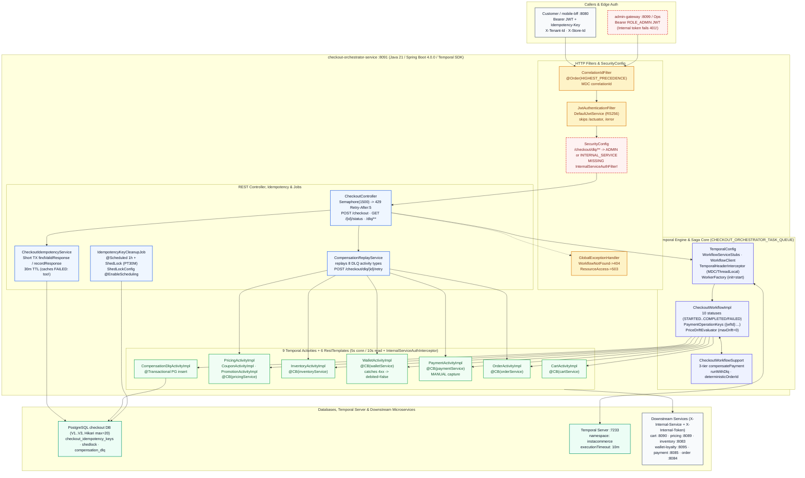
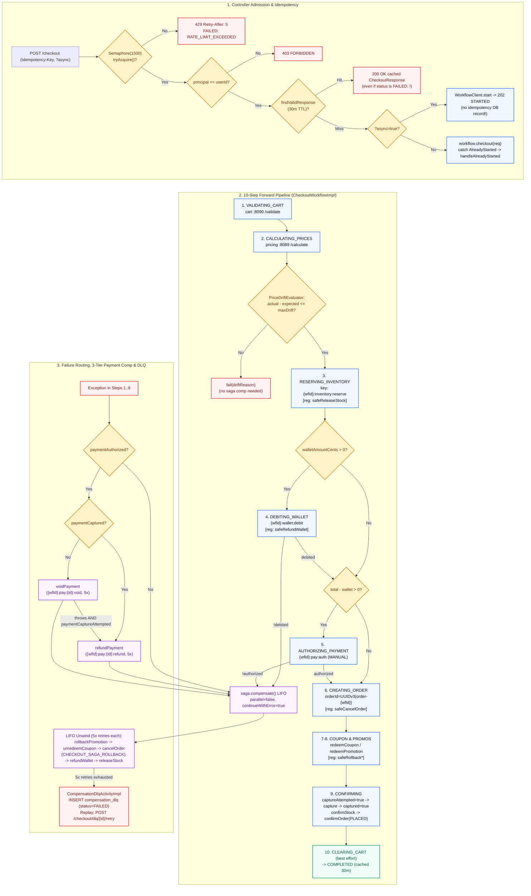
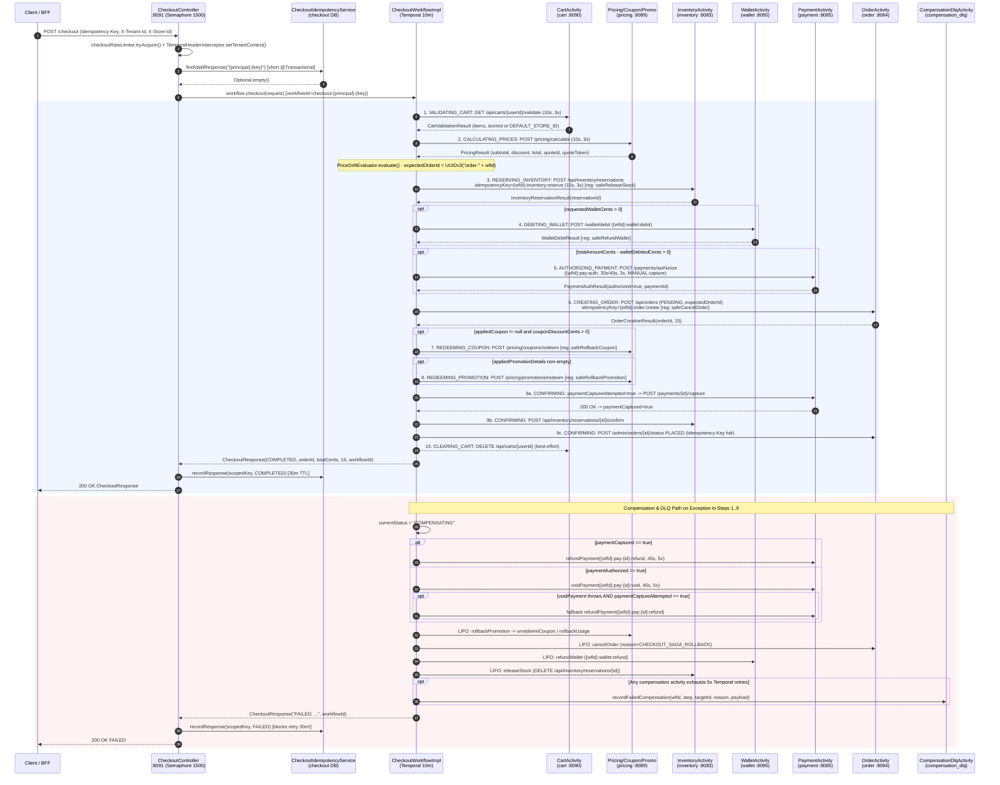

# `checkout-orchestrator-service` — Code Walkthrough

> [!NOTE]
> **Part of the InstaCommerce Onboarding Suite:** [Onboarding Hub](../../README.md) · [Code Walkthrough Atlas](../README.md) · [Domain & Event Catalog (`05`)](../../05-domain-model-and-event-catalog.md) · [Incident Drills & Exam (`06`)](../../06-incident-drills-and-readiness-exam.md) · [Dependency Matrix & Cheatsheet (`07`)](../../07-service-dependency-and-command-cheatsheet.md)

> **Sole Authoritative Temporal Checkout Saga Orchestrator ([ADR-001](../../../../docs/adr/001-checkout-authority.md))**
>
> | Dimension | Verified Repo Truth |
> |---|---|
> | **Module & Runtime** | Java 21 / Spring Boot 4.0.0 / Temporal Java SDK ([build.gradle.kts](../../../../services/checkout-orchestrator-service/build.gradle.kts#L1-L36)) · Dependency: `:libs:platform-common` |
> | **HTTP Port** | `8091` (`${SERVER_PORT:8091}` in [application.yml](../../../../services/checkout-orchestrator-service/src/main/resources/application.yml#L1-L3)) |
> | **Primary Storage & Workflow** | Temporal Server (`${TEMPORAL_HOST:localhost}:7233`, namespace `instacommerce`, queue `CHECKOUT_ORCHESTRATOR_TASK_QUEUE`) + PostgreSQL `checkout` (`checkout_db` in Helm), Flyway `V1`–`V3` (`ddl-auto: validate`, Hikari `max=20`) |
> | **Kafka Topics** | **None.** Publishes zero Kafka events directly; downstream state owners emit domain events from their own transactional outboxes |
> | **Helm Key** | `checkout-orchestrator-service` ([values.yaml](../../../../deploy/helm/values.yaml#L789-L811)) |
> | **SLO Tier** | **Tier 0** (`99.9%` 30d availability, `43.2 min` budget, `500 ms` p99) per [error-budget-policy.yaml](../../../../monitoring/error-budget-policy.yaml#L5-L13) |

---

## 1. Service Boundaries & Package Tree

`checkout-orchestrator-service` is the distributed Temporal saga coordinator spanning six independent state owners (`cart-service`, `pricing-service`, `inventory-service`, `wallet-loyalty-service`, `payment-service`, `order-service`). It owns **no** catalog, inventory, payment, or order domain state—only the `checkout_idempotency_keys` 30-minute response cache, `shedlock`, and the `compensation_dlq` failure table. Every downstream mutation happens over synchronous REST inside Temporal `@Activity` beans with deterministic, workflow-stable idempotency keys (`PaymentOperationKeys`), LIFO `Saga` compensation, and operator-replayable DLQ entries.

### Package Layout (`com.instacommerce.checkout`)

```text
services/checkout-orchestrator-service/src/main/java/com/instacommerce/checkout/
├── CheckoutOrchestratorApplication.java  # @SpringBootApplication + @EnableConfigurationProperties
├── config/
│   ├── CheckoutProperties.java           # checkout.jwt + checkout.clients.{cart,pricing,inventory,payment,order,wallet}
│   ├── CorrelationIdFilter.java          # @Order(HIGHEST_PRECEDENCE) X-Correlation-ID MDC filter
│   ├── JacksonConfig.java
│   ├── RestClientConfig.java             # 6 named RestTemplate beans (5s conn, 10s read, InternalServiceAuthInterceptor)
│   ├── ShedLockConfig.java               # @EnableScheduling + @EnableSchedulerLock(PT30M) + JdbcTemplateLockProvider
│   ├── TemporalConfig.java               # WorkflowServiceStubs, WorkflowClient, WorkerFactory -> CheckoutWorkflowImpl
│   └── TemporalProperties.java           # temporal.{service-address,namespace,task-queue}
├── controller/
│   └── CheckoutController.java           # Semaphore(1500), POST /checkout, GET /{wfId}/status, /dlq/**
├── domain/
│   ├── CheckoutIdempotencyKey.java       # Entity (note unused RETENTION_TTL = 7d constant)
│   ├── CompensationDlq.java              # Entity (FAILED / RESOLVED, retry_count)
│   └── PriceDriftEvaluator.java          # Pure static evaluator: actual - expected <= maxDrift
├── dto/                                  # CartItem (3-field stripping!), CartValidationResult (DEFAULT_STORE_ID),
│                                         # CheckoutRequest/Response, PricingResult, OrderCreateRequest, etc.
├── exception/                            # CheckoutException, ServiceUnavailableException, GlobalExceptionHandler, TraceIdProvider
├── interceptor/
│   └── TemporalHeaderInterceptor.java    # Temporal ContextPropagator for X-Tenant-Id & X-Store-Id
├── job/
│   └── IdempotencyKeyCleanupJob.java     # Hourly ShedLock purge of expired checkout_idempotency_keys
├── repository/                           # CheckoutIdempotencyKeyRepository, CompensationDlqRepository
├── security/
│   ├── DefaultJwtService.java            # RS256 JJWT validation + ROLE_* extraction
│   ├── InternalServiceAuthInterceptor.java
│   ├── JwtAuthenticationFilter.java      # Bearer JWT filter (skips /actuator, /error)
│   ├── JwtKeyLoader.java / JwtService.java / RestAccessDeniedHandler.java / RestAuthenticationEntryPoint.java
│   └── SecurityConfig.java               # Stateless SecurityFilterChain (OMITS InternalServiceAuthFilter!)
├── service/
│   ├── CheckoutIdempotencyService.java   # Short @Transactional cache lookups/writes (30m TTL)
│   └── CompensationReplayService.java    # Operator DLQ replay across 8 compensation activity types
└── workflow/
    ├── CheckoutWorkflow.java             # @WorkflowInterface + @QueryMethod getStatus / getResultSnapshot
    ├── CheckoutWorkflowImpl.java         # 10-step saga, lazy wallet/promo stubs, LIFO unwind
    ├── CheckoutWorkflowSupport.java      # 3-tier compensatePayment, runWithDlq, deterministicOrderId
    ├── PaymentOperationKeys.java         # {wfId}:pay:auth, {wfId}:pay:{id}:{capture|void|refund}, {wfId}:wallet:*
    └── activity/                         # 9 *Activity + *ActivityImpl pairs with @CircuitBreaker fallbacks
```

---

## 2. Startup, Configuration & Security Filter Chain

1. **Bootstrap & Temporal Worker Startup ([CheckoutOrchestratorApplication.java](../../../../services/checkout-orchestrator-service/src/main/java/com/instacommerce/checkout/CheckoutOrchestratorApplication.java#L9-L15), [TemporalConfig.java](../../../../services/checkout-orchestrator-service/src/main/java/com/instacommerce/checkout/config/TemporalConfig.java#L26-L77)):**
   - `@EnableScheduling` is declared on [ShedLockConfig.java](../../../../services/checkout-orchestrator-service/src/main/java/com/instacommerce/checkout/config/ShedLockConfig.java#L12-L15) (not on the application main class), activating [IdempotencyKeyCleanupJob](../../../../services/checkout-orchestrator-service/src/main/java/com/instacommerce/checkout/job/IdempotencyKeyCleanupJob.java#L23-L30).
   - `TemporalConfig` configures `WorkflowServiceStubs` (gRPC keep-alive `30s` / timeout `10s`, RPC timeout `10s`), registers `TemporalHeaderInterceptor` on `WorkflowClientOptions`, and starts `WorkerFactory` (`initMethod = "start"`, `destroyMethod = "shutdown"`) polling `CHECKOUT_ORCHESTRATOR_TASK_QUEUE` with `CheckoutWorkflowImpl` and all 9 `@Component` activity implementations.
2. **HTTP Filter Chain & Auth Gap ([SecurityConfig.java](../../../../services/checkout-orchestrator-service/src/main/java/com/instacommerce/checkout/security/SecurityConfig.java#L26-L43), [JwtAuthenticationFilter.java](../../../../services/checkout-orchestrator-service/src/main/java/com/instacommerce/checkout/security/JwtAuthenticationFilter.java#L25-L76)):**
   - [CorrelationIdFilter.java](../../../../services/checkout-orchestrator-service/src/main/java/com/instacommerce/checkout/config/CorrelationIdFilter.java#L16-L37) (`@Order(HIGHEST_PRECEDENCE)`) sets `correlationId` in MDC and `X-Correlation-ID` response header.
   - `SecurityConfig` sets `SessionCreationPolicy.STATELESS`, permits `/actuator/**` and `/error`, restricts `/checkout/dlq/**` and `/api/v1/checkout/dlq/**` to `hasAnyRole("ADMIN", "INTERNAL_SERVICE")`, requires authentication on all remaining routes, and registers **only** `JwtAuthenticationFilter` before `UsernamePasswordAuthenticationFilter` (RS256 verified by [DefaultJwtService.java](../../../../services/checkout-orchestrator-service/src/main/java/com/instacommerce/checkout/security/DefaultJwtService.java#L25-L53)).
   - **Critical Security Gap:** Unlike `order-service` or `:libs:platform-common`'s `SharedInternalServiceAuthFilter`, `SecurityConfig` never registers an inbound `InternalServiceAuthFilter`, so service-to-service callers presenting only `X-Internal-Service`/`X-Internal-Token` headers against `/checkout/dlq/**` receive `401 Unauthorized`.
3. **Cross-Boundary Header Propagation ([TemporalHeaderInterceptor.java](../../../../services/checkout-orchestrator-service/src/main/java/com/instacommerce/checkout/interceptor/TemporalHeaderInterceptor.java#L15-L116)):**
   - [CheckoutController.initiateCheckout](../../../../services/checkout-orchestrator-service/src/main/java/com/instacommerce/checkout/controller/CheckoutController.java#L90) calls `TemporalHeaderInterceptor.setTenantContext(tenantId, storeId)`, writing `X-Tenant-Id` and `X-Store-Id` into both `ThreadLocal` and SLF4J MDC, and clears them in `finally` (line 144). Temporal's `ContextPropagator` serializes those keys into workflow/activity headers so downstream Temporal worker threads inherit tenant/store MDC context.

---

## 3. Low-Level Design, Flyway Schema & Downstream Wiring

**checkout-orchestrator-service low-level architecture** — *[Rendered PNG](../diagrams/services/checkout-orchestrator-service-arch-lld.png) · [Mermaid Source](../diagrams/services/checkout-orchestrator-service-arch-lld.mmd)*



### Flyway Schema (`V1`–`V3`) & Hikari Pool Discipline

| Migration | Table | Columns, Indexes & Purpose | Source |
|---|---|---|---|
| `V1` | `checkout_idempotency_keys` | `id UUID PK`, `idempotency_key VARCHAR(255) NOT NULL` (`UNIQUE INDEX idx_idempotency_key`), `checkout_response TEXT NOT NULL`, `created_at TIMESTAMPTZ`, `expires_at TIMESTAMPTZ` | [V1__create_checkout_idempotency_keys.sql](../../../../services/checkout-orchestrator-service/src/main/resources/db/migration/V1__create_checkout_idempotency_keys.sql#L1-L10) |
| `V2` | `shedlock` | `name VARCHAR(64) PK`, `lock_until`, `locked_at`, `locked_by` for hourly `IdempotencyKeyCleanupJob` | [V2__create_shedlock.sql](../../../../services/checkout-orchestrator-service/src/main/resources/db/migration/V2__create_shedlock.sql#L1-L7) |
| `V3` | `compensation_dlq` | `id UUID PK`, `workflow_id VARCHAR(255)`, `activity_name VARCHAR(100)`, `target_id VARCHAR(255)`, `reason TEXT`, `payload TEXT`, `status VARCHAR(50) DEFAULT 'FAILED'`, `retry_count INT DEFAULT 0`; indexes on `workflow_id` & `status` | [V3__create_compensation_dlq.sql](../../../../services/checkout-orchestrator-service/src/main/resources/db/migration/V3__create_compensation_dlq.sql#L1-L15) |

- **Connection Pool Protection ([CheckoutIdempotencyService.java](../../../../services/checkout-orchestrator-service/src/main/java/com/instacommerce/checkout/service/CheckoutIdempotencyService.java#L34-L56)):** `CheckoutController` never annotates `initiateCheckout` with `@Transactional`. Instead, `findValidResponse` (deletes and flushes expired entries inline if `expiresAt <= now()`) and `recordResponse` (`IDEMPOTENCY_TTL = 30 minutes`) run as short, discrete transactions so none of the 20 Hikari connections are ever held across a multi-second Temporal saga.

### Downstream RestTemplates, Circuit Breakers & Temporal Activity Stubs

[RestClientConfig.java](../../../../services/checkout-orchestrator-service/src/main/java/com/instacommerce/checkout/config/RestClientConfig.java#L22-L61) constructs 6 dedicated `RestTemplate` beans (`cartRestTemplate`, `pricingRestTemplate`, `inventoryRestTemplate`, `paymentRestTemplate`, `orderRestTemplate`, `walletRestTemplate`), each configured with `5000 ms` connect / `10000 ms` read timeouts and [InternalServiceAuthInterceptor](../../../../services/checkout-orchestrator-service/src/main/java/com/instacommerce/checkout/security/InternalServiceAuthInterceptor.java#L13-L28) (`X-Internal-Service`, `X-Internal-Token`). Every remote `@Activity` method wraps its `RestTemplate` call in a Resilience4j `@CircuitBreaker` (`COUNT_BASED`, `slidingWindowSize=20`, `minimumNumberOfCalls=10`, `failureRateThreshold=50%`, `waitDurationInOpenState=30s`, `permittedNumberOfCallsInHalfOpenState=5` in [application.yml](../../../../services/checkout-orchestrator-service/src/main/resources/application.yml#L107-L181)), whose fallback throws [ServiceUnavailableException](../../../../services/checkout-orchestrator-service/src/main/java/com/instacommerce/checkout/exception/ServiceUnavailableException.java#L9-L25) so Temporal handles retries according to [CheckoutWorkflowImpl.java](../../../../services/checkout-orchestrator-service/src/main/java/com/instacommerce/checkout/workflow/CheckoutWorkflowImpl.java#L49-L97):

| Activity Stub | StartToClose / ScheduleToClose | Retry (`backoff = 2.0`) | Configured `doNotRetry` |
|---|---|---|---|
| `CartActivity` (`cartActivity`) | `10s` / `—` | `1s` init, `3` max | — |
| `PricingActivity` (`pricingActivity`) | `10s` / `—` | `1s` init, `3` max | — |
| `InventoryActivity` (`inventoryActivity`) | `15s` / `—` | `1s` init, `3` max | `InsufficientStockException` |
| `WalletActivity` (lazy `walletActivity()`) | `15s` / `—` | `1s` init, `3` max | — *(catches `4xx` -> `debited=false`)* |
| `PaymentActivity` (`paymentActivity`) | `30s` / `45s` | `2s` init, `3` max | `PaymentDeclinedException` |
| `OrderActivity` (`orderActivity`) | `15s` / `—` | `1s` init, `3` max | — |
| `CouponActivity` (`couponActivity`) | `10s` / `—` | `1s` init, `3` max | `InvalidCouponException`, `CouponNotFoundException` |
| `PromotionActivity` (lazy `promotionActivity()`) | `10s` / `—` | `1s` init, `3` max | `CheckoutException` *(catches `4xx` -> `CheckoutException`)* |
| Compensation stubs (`compensation*`) | `20s`–`45s` / `—` | `1s`–`2s` init, `5` max | *(exhaustion caught by `runWithDlq` -> `compensation_dlq`)* |
| `CompensationDlqActivity` (`dlqActivity`) | `15s` / `—` | `1s` init, `3` max | — |

---

## 4. Algorithmic Flows & 10-Step Saga Walkthrough

**checkout-orchestrator-service saga and compensation flowchart** — *[Rendered PNG](../diagrams/services/checkout-orchestrator-service-flowchart.png) · [Mermaid Source](../diagrams/services/checkout-orchestrator-service-flowchart.mmd)*



### Admission, Duplicate Race Handling & Status Queries ([CheckoutController.java](../../../../services/checkout-orchestrator-service/src/main/java/com/instacommerce/checkout/controller/CheckoutController.java#L75-L233))

1. **Pod-Local Backpressure (`Semaphore(1500)`, lines 84–89 & 145):** `checkoutRateLimiter.tryAcquire()` bounds concurrent in-flight checkout HTTP requests; exhaustion immediately returns HTTP `429` with `Retry-After: 5` and body `FAILED: RATE_LIMIT_EXCEEDED: ...`.
2. **Ownership & Scoped Key (lines 92–107):** Rejects `principal == null || !principal.equals(request.userId())` (`403 FORBIDDEN`). Generates a UUID if `Idempotency-Key` is blank, builds `scopedIdempotencyKey = principal + ":" + idempotencyKey` and `workflowId = "checkout-" + principal + "-" + idempotencyKey`, and checks `idempotencyService.findValidResponse`.
3. **Sync vs `?async=true` & `WorkflowExecutionAlreadyStarted` (lines 118–142, 201–233):**
   - If `async=true`, calls `WorkflowClient.start(workflow::checkout, request)` and returns `202 Accepted` `{status: "STARTED", workflowId}` without persisting `checkout_idempotency_keys`.
   - If `async=false`, blocks on `workflow.checkout(request)` (`WorkflowExecutionTimeout = 10m`), records the `CheckoutResponse` for `30m`, and returns `200 OK`.
   - If two concurrent requests race before `recordResponse` commits, Temporal throws `WorkflowExecutionAlreadyStarted`. `handleAlreadyStarted` re-checks `checkout_idempotency_keys` and otherwise queries `existingWorkflow.getStatus()` and `existingWorkflow.getResultSnapshot()`, returning `200` if `COMPLETED` with a snapshot or `202` (`CHECKOUT_ALREADY_*`) otherwise.
4. **Status Endpoint (`GET /{workflowId}/status`, lines 165–199):** `isAuthorizedForWorkflow` grants access to `ADMIN`/`INTERNAL_SERVICE` or owners whose `workflowId` starts with `"checkout-" + principal + "-"`. Calls Temporal `@QueryMethod`s `getStatus()` and `getResultSnapshot()`.

### 10-Step Forward Pipeline ([CheckoutWorkflowImpl.java](../../../../services/checkout-orchestrator-service/src/main/java/com/instacommerce/checkout/workflow/CheckoutWorkflowImpl.java#L100-L278))

1. **`VALIDATING_CART` (lines 112–121):** `CartActivityImpl.validateCart` -> `GET /api/carts/{userId}/validate`. Fails immediately (`fail(...)`, no saga compensation needed) if `!valid`, empty, or any item has `quantity <= 0`. Note [CartValidationResult.java](../../../../services/checkout-orchestrator-service/src/main/java/com/instacommerce/checkout/dto/CartValidationResult.java#L15-L29) replaces blank `storeId` with `00000000-0000-0000-0000-000000000001`.
2. **`CALCULATING_PRICES` (lines 123–139):** `PricingActivityImpl.calculatePrice` -> `POST /pricing/calculate`. Runs [PriceDriftEvaluator.evaluate](../../../../services/checkout-orchestrator-service/src/main/java/com/instacommerce/checkout/domain/PriceDriftEvaluator.java#L18-L68): rejects negative totals/drift and fails if `actualTotalCents - expectedTotalCents > allowedDrift` (`0L` when `maxPriceDriftCents` is null). Pre-computes `expectedOrderId = UUID.nameUUIDFromBytes("order-" + workflowId)` ([CheckoutWorkflowSupport.deterministicOrderId](../../../../services/checkout-orchestrator-service/src/main/java/com/instacommerce/checkout/workflow/CheckoutWorkflowSupport.java#L75-L77)).
3. **`RESERVING_INVENTORY` (lines 141–147):** `InventoryActivityImpl.reserveStock` -> `POST /api/inventory/reservations` with `idempotencyKey = workflowId + ":inventory:reserve"`. Registers LIFO compensation `safeReleaseStock(reservationId)`.
4. **`DEBITING_WALLET` (lines 149–172):** Conditional on `requestedWalletCents = min(request.walletAmountCents, totalAmountCents) > 0`. Calls lazy `walletActivity().debitWallet` (`POST /wallet/debit`, `referenceId = {workflowId}:wallet:debit`). Note [WalletActivityImpl.java](../../../../services/checkout-orchestrator-service/src/main/java/com/instacommerce/checkout/workflow/activity/WalletActivityImpl.java#L45-L49) catches `HttpClientErrorException` and returns `debited=false`. On failure, immediately transitions to `COMPENSATING`, calls `saga.compensate()` (`releaseStock`), and returns `fail("Wallet debit failed: ...")`; on success, registers `safeRefundWallet`. Computes `paymentAmountCents = totalAmountCents - walletDebitedCents`.
5. **`AUTHORIZING_PAYMENT` (lines 174–200):** Conditional on `paymentAmountCents > 0`. Calls `PaymentActivityImpl.authorizePayment` (`POST /payments/authorize`, `idempotencyKey = {workflowId}:pay:auth`, `expectedOrderId`). Throws `IllegalStateException` if result or `paymentId` is missing; if `!authorized`, calls `saga.compensate()` (`refundWallet` -> `releaseStock`) and maps `"TOKEN_EXPIRED"` to `"PAYMENT_TOKEN_EXPIRED: Client re-authentication required"`.
6. **`CREATING_ORDER` (lines 202–220):** `OrderActivityImpl.createOrder` -> `POST /api/orders` (`PENDING` order with `expectedOrderId`, `idempotencyKey = {workflowId}:order:create`, `walletDebitedCents`). Registers `safeCancelOrder(orderId)`.
7. **`REDEEMING_COUPON` (lines 221–235):** Conditional on `appliedCoupon != null && couponDiscountCents > 0`. Calls `CouponActivityImpl.redeemCoupon` (`POST /pricing/coupons/redeem`); registers `safeRollbackCoupon` (`unredeemCoupon`).
8. **`REDEEMING_PROMOTION` (lines 237–256):** Loops `pricingResult.appliedPromotionDetails()`, calling lazy `promotionActivity().redeemPromotion` (`POST /pricing/promotions/redeem`) and registering `safeRollbackPromotion` per promotion.
9. **`CONFIRMING` (lines 258–267):**
   - **9a:** If `paymentAmountCents > 0`, sets `paymentCaptureAttempted = true`, calls `paymentActivity.capturePayment(paymentId, {workflowId}:pay:{paymentId}:capture)`, and sets `paymentCaptured = true`.
   - **9b:** Calls `inventoryActivity.confirmStock(reservationId)` (`POST /api/inventory/reservations/{id}/confirm`).
   - **9c:** Calls `orderActivity.confirmOrder(orderId, workflowId + ":order:confirm")` (`POST /admin/orders/{id}/status` `{status: "PLACED"}` with `Idempotency-Key` header).
10. **`CLEARING_CART` -> `COMPLETED` (lines 269–277, 314–322):** Best-effort `DELETE /api/carts/{userId}`; logs and swallows exceptions so cart cleanup failure never rolls back a paid order.

---

## 5. End-to-End Call-Stack Trace, 3-Tier Compensation & DLQ Replay

**checkout-orchestrator-service end-to-end call-stack sequence** — *[Rendered PNG](../diagrams/services/checkout-orchestrator-service-sequence.png) · [Mermaid Source](../diagrams/services/checkout-orchestrator-service-sequence.mmd)*



### 3-Tier Payment Compensation & LIFO Unwind ([CheckoutWorkflowImpl.java](../../../../services/checkout-orchestrator-service/src/main/java/com/instacommerce/checkout/workflow/CheckoutWorkflowImpl.java#L278-L295), [CheckoutWorkflowSupport.java](../../../../services/checkout-orchestrator-service/src/main/java/com/instacommerce/checkout/workflow/CheckoutWorkflowSupport.java#L126-L209))

Any uncaught exception during Steps 1–9 drops into `catch (Exception e)`:
1. Records `failedStep = currentStatus` (for user-safe `failureMessageFor(failedStep)`) and sets `currentStatus = "COMPENSATING"`.
2. **Pre-Saga 3-Tier Payment Compensation (`compensatePayment`, lines 126–165):**
   - **Tier 1 (`paymentCaptured == true`):** Calls `compensationPaymentActivity.refundPayment(paymentId, paymentAmountCents, {wfId}:pay:{id}:refund)`.
   - **Tier 2 (`paymentAuthorized == true && !paymentCaptured`):** Calls `compensationPaymentActivity.voidPayment(paymentId, {wfId}:pay:{id}:void)`.
   - **Tier 3 (Capture Ambiguity Fallback):** If `voidPayment` throws **and** `paymentCaptureAttempted == true` (e.g., Step 9a capture timed out after the PSP captured), `compensatePayment` catches the void error and falls back to `refundPayment`!
3. **Sequential LIFO `Saga.compensate()` (`parallelCompensation = false`, `continueWithError = true`):** Executes registered compensations in reverse order (`rollbackPromotion` -> `unredeemCoupon` -> `cancelOrder(reason="CHECKOUT_SAGA_ROLLBACK")` -> `refundWallet` -> `releaseStock`), continuing even if an individual compensation exhausts retries.
4. **Compensation DLQ & Operator Replay ([CompensationDlqActivityImpl.java](../../../../services/checkout-orchestrator-service/src/main/java/com/instacommerce/checkout/workflow/activity/CompensationDlqActivityImpl.java#L21-L29), [CompensationReplayService.java](../../../../services/checkout-orchestrator-service/src/main/java/com/instacommerce/checkout/service/CompensationReplayService.java#L59-L142)):**
   - Every compensation wrapper uses `runWithDlq(...)`; after 5 Temporal retries fail, it catches the exception and calls `dlqActivity.recordFailedCompensation` to insert a `FAILED` row into `compensation_dlq`.
   - Operators inspect rows via `GET /checkout/dlq`, manually close via `POST /checkout/dlq/{id}/resolve`, or replay via `POST /checkout/dlq/{id}/retry` (or [scripts/saga-dlq-retry.sh](../../../../scripts/saga-dlq-retry.sh)), which dispatches across all 8 activity handlers (`releaseStock`, `voidPayment`, `refundPayment`, `refundWallet`, `cancelOrder`, `rollbackUsage`, `unredeemCoupon`, `rollbackPromotion`) using the original `workflowId` to reconstruct identical `PaymentOperationKeys`.

---

## 6. Configuration Matrix, Observability & Targeted Tests

### Config & Helm Matrix ([application.yml](../../../../services/checkout-orchestrator-service/src/main/resources/application.yml#L1-L186), [application-local.yml](../../../../services/checkout-orchestrator-service/src/main/resources/application-local.yml#L1-L44), [values.yaml](../../../../deploy/helm/values.yaml#L789-L811))

| Property / Env Var | `application.yml` Default | Helm (`values.yaml` / `values-staging` / `values-prod`) | Notes |
|---|---|---|---|
| `SERVER_PORT` | `8091` | `"8091"` | — |
| `TEMPORAL_HOST` / `TEMPORAL_SERVICE_ADDRESS` | `${TEMPORAL_HOST:localhost}:7233` | `TEMPORAL_SERVICE_ADDRESS: temporal:7233` | Namespace `instacommerce`, queue `CHECKOUT_ORCHESTRATOR_TASK_QUEUE` |
| `CHECKOUT_DB_URL` / Hikari `maximum-pool-size` | `jdbc:postgresql://localhost:5432/checkout` / `20` | `checkout_db` / `10` staging, `20` prod | Readiness probe checks `readinessState` only (not `db`)! |
| `checkout.concurrency.max-in-flight` | `1500` (`@Value` default in `CheckoutController`) | *not overridden* | Not declared in `application.yml` |
| `checkout.clients.*.connect-timeout` / `read-timeout` | `5000 ms` / `10000 ms` | All 6 service URLs injected | Every client attaches `InternalServiceAuthInterceptor` |
| `resilience4j.circuitbreaker.instances.*` | `COUNT_BASED`, `20`, min `10`, `50%`, `30s` open, `5` half-open | inherited | Applied to all 6 downstream services |

### Targeted Validation & Test Inventory

```bash
# Run Temporal workflow, controller, security & DLQ replay tests (uses io.temporal:temporal-testing)
./gradlew :services:checkout-orchestrator-service:test

# Run a single saga or compensation test class
./gradlew :services:checkout-orchestrator-service:test --tests "com.instacommerce.checkout.integration.CheckoutSagaCompensationIntegrationTest"

# Check formatting & build bootJar
./gradlew :services:checkout-orchestrator-service:spotlessCheck :services:checkout-orchestrator-service:bootJar
```

All 19 test files live under [src/test/java/com/instacommerce/checkout/](../../../../services/checkout-orchestrator-service/src/test/java/com/instacommerce/checkout): `CheckoutControllerTest`, `CheckoutDuplicateIdempotencyTest`, `PriceDriftEvaluatorTest`, `CheckoutDtoJsonTest`, `PaymentAuthResultJsonTest`, `CheckoutSagaCompensationIntegrationTest`, `TemporalHeaderInterceptorTest`, `IdempotencyKeyCleanupJobTest`, `CheckoutSecurityConfigTest`, `CompensationReplayServiceTest`, `CheckoutSplitTenderAndDriftTest`, `CheckoutWorkflowImplTest`, `PaymentOperationKeysTest`, and 6 `*ActivityImplTest` suites.

---

## 7. Verified Seams, Bugs & Doc-vs-Code Drift

1. **Missing `InternalServiceAuthFilter` Breaks Internal Calls to `/checkout/dlq/**`:**
   - [SecurityConfig.java](../../../../services/checkout-orchestrator-service/src/main/java/com/instacommerce/checkout/security/SecurityConfig.java#L36-L42) requires `hasAnyRole("ADMIN", "INTERNAL_SERVICE")` on `/checkout/dlq/**` and `/api/v1/checkout/dlq/**`, yet only registers `JwtAuthenticationFilter` (no `InternalServiceAuthFilter` or `SharedInternalServiceAuthFilter`). Internal automation calling `/checkout/dlq/**` with only `X-Internal-Service`/`X-Internal-Token` headers gets `401 Unauthorized`.
2. **Cached `FAILED:` Responses Block Client Retries & `?async=true` Skips Cache Persistence:**
   - [CheckoutController.initiateCheckout](../../../../services/checkout-orchestrator-service/src/main/java/com/instacommerce/checkout/controller/CheckoutController.java#L136-L142) saves every synchronous `CheckoutResponse`—including `"FAILED: ..."`—into `checkout_idempotency_keys` for `30m` ([CheckoutIdempotencyService.java](../../../../services/checkout-orchestrator-service/src/main/java/com/instacommerce/checkout/service/CheckoutIdempotencyService.java#L23)), so retrying after a transient downstream failure with the same `Idempotency-Key` returns the cached `FAILED:` payload with HTTP `200`. Conversely, `?async=true` (lines 120–124) returns `202 STARTED` and never writes to `checkout_idempotency_keys` when the workflow finishes (also note unused `RETENTION_TTL = 7 days` on [CheckoutIdempotencyKey.java](../../../../services/checkout-orchestrator-service/src/main/java/com/instacommerce/checkout/domain/CheckoutIdempotencyKey.java#L17)).
3. **`doNotRetry` Non-Retryable Exception Class Mismatch & 4xx Retries:**
   - [CheckoutWorkflowSupport.java](../../../../services/checkout-orchestrator-service/src/main/java/com/instacommerce/checkout/workflow/CheckoutWorkflowSupport.java#L23-L32) registers `doNotRetry` class names `com.instacommerce.checkout.exception.InsufficientStockException`, `com.instacommerce.checkout.exception.PaymentDeclinedException` (neither exists in `checkout-orchestrator-service`), and `com.instacommerce.pricing.exception.{InvalidCouponException,CouponNotFoundException}` (which belong to `pricing-service`). Because `InventoryActivityImpl`, `PaymentActivityImpl`, and `CouponActivityImpl` do not catch `HttpClientErrorException` (unlike `WalletActivityImpl` and `PromotionActivityImpl`), HTTP `4xx` rejections fall into Resilience4j `@CircuitBreaker` fallbacks, get wrapped in `ServiceUnavailableException`, trip circuit breakers, and retry 3x in Temporal instead of failing fast.
4. **`CartItem` Strips Handling Metadata & `CartValidationResult` Masks Blank `storeId`:**
   - [CartItem.java](../../../../services/checkout-orchestrator-service/src/main/java/com/instacommerce/checkout/dto/CartItem.java#L11-L19) only binds `(productId, quantity, unitPriceCents)`, dropping `productName`, `productSku`, `coldChain`, `fragile`, `storageTemperature`, and `tareWeightGrams` returned by `cart-service`; [OrderActivityImpl.createOrder](../../../../services/checkout-orchestrator-service/src/main/java/com/instacommerce/checkout/workflow/activity/OrderActivityImpl.java#L30-L33) thus sends bare items to `order-service`, forcing synthetic `"Product {uuid}"` / `"SKU-{8chars}"` defaults. Separately, [CartValidationResult.java](../../../../services/checkout-orchestrator-service/src/main/java/com/instacommerce/checkout/dto/CartValidationResult.java#L15-L29) substitutes `DEFAULT_STORE_ID` (`00000000-0000-0000-0000-000000000001`) if `storeId` is blank.
5. **Inventory Idempotency Key Length Overflow (`> 64` Chars):**
   - [CheckoutController.java](../../../../services/checkout-orchestrator-service/src/main/java/com/instacommerce/checkout/controller/CheckoutController.java#L107) constructs `workflowId = "checkout-" + principal + "-" + idempotencyKey` (`~82+` chars for UUIDs). Step 3 ([CheckoutWorkflowImpl.java](../../../../services/checkout-orchestrator-service/src/main/java/com/instacommerce/checkout/workflow/CheckoutWorkflowImpl.java#L142-L143)) forwards `workflowId + ":inventory:reserve"` (`~100` chars) to `inventory-service`, whose `reservations.idempotency_key` column is `VARCHAR(64)` without SHA-256 truncation (unlike `order-service`'s `OrderCreationService.normalizeIdempotencyKey`).
6. **Zero `FraudActivity` Call, Ignored Step 9c `Idempotency-Key` & `README.md` Drift:**
   - Although [deploy/helm/values.yaml](../../../../deploy/helm/values.yaml#L323) allows `checkout-orchestrator-service` in Istio `fraud-detection-service.allowFrom`, zero fraud-scoring client or workflow step exists here.
   - Step 9c ([OrderActivityImpl.confirmOrder](../../../../services/checkout-orchestrator-service/src/main/java/com/instacommerce/checkout/workflow/activity/OrderActivityImpl.java#L51-L59)) sends header `Idempotency-Key: {workflowId}:order:confirm`, which `order-service`'s `AdminOrderController.updateStatus` ignores.
   - [checkout-orchestrator-service/README.md](../../../../services/checkout-orchestrator-service/README.md#L67-L194) still claims 7 sequential steps and "no dead-letter queue", omitting `WalletActivity`, `PromotionActivity`, `PriceDriftEvaluator`, and `compensation_dlq`.

---

**Previous:** [order-service](./order-service.md) | **Atlas Hub:** [Code Walkthrough Atlas](../README.md) | **Next:** [payment-service](./payment-service.md)
