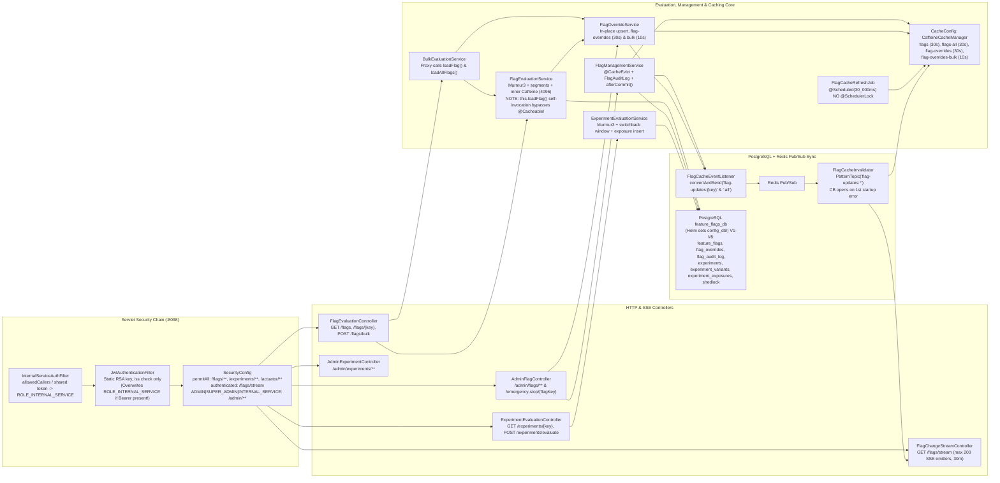
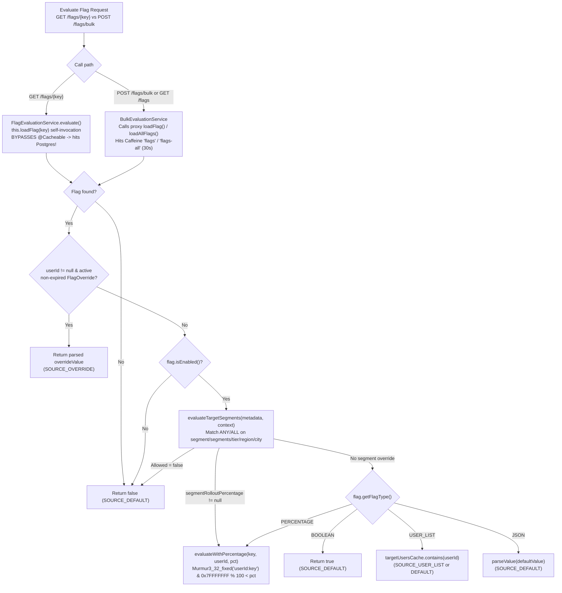
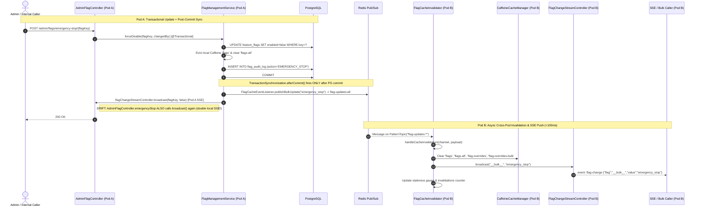

# `config-feature-flag-service` (`:8098`) — Code Walkthrough

> [!NOTE]
> **Part of the InstaCommerce Onboarding Suite:** [Onboarding Hub](../../README.md) · [Code Walkthrough Atlas](../README.md) · [Domain & Event Catalog (`05`)](../../05-domain-model-and-event-catalog.md) · [Incident Drills & Exam (`06`)](../../06-incident-drills-and-readiness-exam.md) · [Dependency Matrix & Cheatsheet (`07`)](../../07-service-dependency-and-command-cheatsheet.md)

> **Scope & Accuracy:** Audited against source, Flyway migrations (`V1`–`V8`), tests, ADR-013, and Helm manifests in `services/config-feature-flag-service/` and `deploy/helm/values.yaml`. `config-feature-flag-service` is a Spring Boot 4 / Java 21 **Tier 2** control plane (`99.0%` availability, `2000ms` p99 SLO in [`monitoring/error-budget-policy.yaml`](../../../../monitoring/error-budget-policy.yaml#L29-L44)) managing feature flags, user overrides, Murmur3 rollouts, switchback/A-B experiments, Redis Pub/Sub invalidation, and SSE live push.

---

## 1. Purpose, Boundaries & Package Tree

`config-feature-flag-service` provides deterministic feature flag evaluation, per-user override resolution, segment targeting, A/B & switchback experiment assignment with exposure recording, admin lifecycle mutations, and push invalidation via Redis Pub/Sub and Server-Sent Events (SSE).

### Service Topology & Boundaries

- **Read callers (unauthenticated per security config):** Client apps and internal services evaluate flags (`GET /flags`, `GET /flags/{key}`, `POST /flags/evaluate`) and experiments (`GET /experiments/{key}/evaluate`) without a bearer token; `GET /flags/stream` alone under `/flags/**` requires authentication.
- **Admin callers:** [`AdminFlagController`](../../../../services/config-feature-flag-service/src/main/java/com/instacommerce/featureflag/controller/AdminFlagController.java#L1-L135) and [`AdminExperimentController`](../../../../services/config-feature-flag-service/src/main/java/com/instacommerce/featureflag/controller/AdminExperimentController.java#L1-L55) require `ADMIN`, `SUPER_ADMIN`, or `INTERNAL_SERVICE`.
- **Caching & Fan-out:** Local Caffeine caches (`flags`, `flags-all`, `flag-overrides`, `flag-overrides-bulk`, plus in-service `segmentMetadataCache` & `targetUsersCache`) paired with optional Redis Pub/Sub (`flag-updates:*`, per [`ADR-013`](../../../../docs/adr/013-feature-flag-cache-invalidation.md#L1-L86)) and per-pod SSE emitters.
- **Persistence:** PostgreSQL (`feature_flags`, `flag_overrides`, `flag_audit_log`, `experiments`, `experiment_variants`, `experiment_exposures`, `shedlock`).

### Package Tree

```text
services/config-feature-flag-service/
├── build.gradle.kts                                         # Boot 4, JPA, Flyway, Caffeine, Redis, Guava Murmur3, ShedLock
└── src/
    ├── main/
    │   ├── java/com/instacommerce/featureflag/
    │   │   ├── ConfigFeatureFlagServiceApplication.java     # @EnableCaching, @EnableScheduling, @EnableConfigurationProperties
    │   │   ├── config/
    │   │   │   ├── CacheConfig.java                         # CaffeineCacheManager + RedisTemplate + MessageListenerContainer
    │   │   │   ├── FeatureFlagProperties.java               # feature-flag.{jwt,cache,internal-service}
    │   │   │   ├── FlagCacheEventListener.java              # @TransactionalEventListener -> Redis Pub/Sub
    │   │   │   ├── FlagCacheInvalidator.java                # PatternTopic("flag-updates:*") + Micrometer metrics
    │   │   │   └── ShedLockConfig.java                      # JdbcTemplateLockProvider (defaultLockAtMostFor="30s")
    │   │   ├── controller/
    │   │   │   ├── AdminExperimentController.java           # /admin/experiments CRUD & lifecycle transitions
    │   │   │   ├── AdminFlagController.java                 # /admin/flags CRUD, overrides & emergency-stop
    │   │   │   ├── ExperimentEvaluationController.java      # GET /experiments/{key}/evaluate
    │   │   │   ├── FlagChangeStreamController.java          # GET /flags/stream SSE hub (max 200 connections)
    │   │   │   └── FlagEvaluationController.java            # GET /flags, GET /flags/{key}, POST /flags/evaluate
    │   │   ├── domain/                                      # Entities: FeatureFlag, FlagOverride, FlagAuditLog, Experiment*
    │   │   ├── exception/
    │   │   │   └── GlobalExceptionHandler.java              # ProblemDetail / ErrorResponse exception mapping
    │   │   ├── repository/
    │   │   │   ├── ExperimentExposureRepository.java        # Exposure persistence
    │   │   │   ├── ExperimentRepository.java                # Experiment lookups
    │   │   │   ├── ExperimentVariantRepository.java         # Experiment variants lookup
    │   │   │   ├── FeatureFlagRepository.java               # Flag lookups by key / enabled
    │   │   │   ├── FlagAuditLogRepository.java              # Append-only flag audit trail
    │   │   │   └── FlagOverrideRepository.java              # Per-user & bulk override queries
    │   │   ├── security/
    │   │   │   ├── DefaultJwtService.java                   # RSA JWT parsing + issuer validation
    │   │   │   ├── InternalServiceAuthFilter.java           # X-Internal-Service / X-Internal-Token filter
    │   │   │   ├── JwtAuthenticationFilter.java             # Bearer token auth (overwrites internal auth!)
    │   │   │   ├── JwtKeyLoader.java                        # Eager RSA public-key loader (throws at startup)
    │   │   │   └── SecurityConfig.java                      # Stateless security rules & filter ordering
    │   │   └── service/
    │   │       ├── BulkEvaluationService.java               # Cross-bean cached bulk evaluation + parseUserId
    │   │       ├── ExperimentEvaluationService.java         # Switchback/A-B Murmur3 assignment + exposures
    │   │       ├── ExperimentManagementService.java         # Experiment lifecycle management
    │   │       ├── FlagCacheRefreshJob.java                 # 30s scheduled warm refresh (missing @SchedulerLock)
    │   │       ├── FlagEvaluationService.java               # Single evaluation (self-invocation bug!), Murmur3, segments
    │   │       ├── FlagManagementService.java               # Transactional CRUD, audit log & afterCommit publish
    │   │       ├── FlagOverrideService.java                 # Override CRUD + bulk Pub/Sub fan-out
    │   │       └── FlagTargetingValidator.java              # Metadata JSON schema & segment validation
    │   └── resources/
    │       ├── application.yml                              # Port 8098, Hikari, Caffeine/Redis TTLs, actuator
    │       ├── application-local.yml                        # Local overrides
    │       └── db/migration/
    │           ├── V1__create_feature_flags.sql             # feature_flags + version BIGINT
    │           ├── V2__create_flag_overrides.sql            # flag_overrides + UNIQUE(flag_id, user_id)
    │           ├── V3__create_flag_audit_log.sql            # flag_audit_log
    │           ├── V4__create_shedlock.sql                  # shedlock table
    │           ├── V5__add_override_removed_audit_action.sql # Adds OVERRIDE_REMOVED action
    │           ├── V6__create_experiments.sql               # experiments, experiment_variants, experiment_exposures
    │           ├── V7__add_experiment_salt.sql              # Adds salt VARCHAR(120)
    │           └── V8__allow_emergency_stop_audit_action.sql # Allows EMERGENCY_STOP action
    └── test/                                                # 13 unit/integration test suites
```

---

## 2. Low-Level Component Architecture

**config-feature-flag-service low-level architecture** — *[Rendered PNG](../diagrams/services/config-feature-flag-service-arch-lld.png) · [Mermaid Source](../diagrams/services/config-feature-flag-service-arch-lld.mmd)*



---

## 3. Startup, Configuration & Security Filter Chain Walkthrough

### Startup & Fail-Fast Key / Datasource Risk

1. **Application annotations:** [`ConfigFeatureFlagServiceApplication`](../../../../services/config-feature-flag-service/src/main/java/com/instacommerce/featureflag/ConfigFeatureFlagServiceApplication.java#L10-L19) enables `@EnableConfigurationProperties`, `@EnableCaching`, and `@EnableScheduling`.
2. **Eager RSA public-key validation:** Unlike `audit-trail-service`, [`JwtKeyLoader`](../../../../services/config-feature-flag-service/src/main/java/com/instacommerce/featureflag/security/JwtKeyLoader.java#L17-L28) parses `feature-flag.jwt.public-key` eagerly at bean construction and **throws `IllegalStateException`** if it is blank or invalid.
3. **Helm chart mismatch:** [`deploy/helm/values.yaml`](../../../../deploy/helm/values.yaml#L1386-L1403) deploys `2` replicas (HPA `2`–`5`), omits both `FEATURE_FLAG_JWT_PUBLIC_KEY` and `INTERNAL_SERVICE_TOKEN`, and sets `SPRING_DATASOURCE_URL` to `config_db`, whereas [`application.yml`](../../../../services/config-feature-flag-service/src/main/resources/application.yml#L16) defaults to `feature_flags_db`. Without external secret/env injection, pods fail `ApplicationContext` startup.

### Security Filter Chain & Authority Overwrite Bug

[`SecurityConfig`](../../../../services/config-feature-flag-service/src/main/java/com/instacommerce/featureflag/security/SecurityConfig.java#L26-L60) registers two filters before `UsernamePasswordAuthenticationFilter`:

1. [`InternalServiceAuthFilter`](../../../../services/config-feature-flag-service/src/main/java/com/instacommerce/featureflag/security/InternalServiceAuthFilter.java#L1-L66) (registered at [`SecurityConfig#L44`](../../../../services/config-feature-flag-service/src/main/java/com/instacommerce/featureflag/security/SecurityConfig.java#L44)): authenticates service-to-service headers and grants `ROLE_INTERNAL_SERVICE`.
2. [`JwtAuthenticationFilter`](../../../../services/config-feature-flag-service/src/main/java/com/instacommerce/featureflag/security/JwtAuthenticationFilter.java#L1-L79) (registered at [`SecurityConfig#L45`](../../../../services/config-feature-flag-service/src/main/java/com/instacommerce/featureflag/security/SecurityConfig.java#L45)): validates Bearer tokens via [`DefaultJwtService`](../../../../services/config-feature-flag-service/src/main/java/com/instacommerce/featureflag/security/DefaultJwtService.java#L27-L33), checking only static RSA signature + issuer (no `aud`, JWKS, or revocation blocklist).

> [!CAUTION]
> **Authority overwrite in `JwtAuthenticationFilter`:** Inside [`JwtAuthenticationFilter#L57-L62`](../../../../services/config-feature-flag-service/src/main/java/com/instacommerce/featureflag/security/JwtAuthenticationFilter.java#L57-L62), setting a valid `Authorization: Bearer ...` header constructs a **brand-new** `UsernamePasswordAuthenticationToken` without merging existing authorities from `SecurityContextHolder`. If an internal caller forwards both service-token headers and an end-user JWT on an `/admin/**` request, `ROLE_INTERNAL_SERVICE` is silently wiped out.

**Route Authorization Order ([`SecurityConfig#L36-L42`](../../../../services/config-feature-flag-service/src/main/java/com/instacommerce/featureflag/security/SecurityConfig.java#L36-L42)):**
- `GET /flags/stream` is matched **first** ([`#L38-L39`](../../../../services/config-feature-flag-service/src/main/java/com/instacommerce/featureflag/security/SecurityConfig.java#L38-L39)) and requires `.authenticated()`.
- `/actuator/**`, `/error`, `/flags`, `/flags/**`, `/experiments`, `/experiments/**` are `permitAll()`.
- `/admin/**` requires `hasAnyRole("ADMIN", "SUPER_ADMIN", "INTERNAL_SERVICE")`.

---

## 4. Data Model, Flyway Migrations & Caching Invariants

### Flyway Schema (`V1`–`V8`)

| Version | Migration | Tables & Key Constraints |
| --- | --- | --- |
| `V1` | [`V1__create_feature_flags.sql`](../../../../services/config-feature-flag-service/src/main/resources/db/migration/V1__create_feature_flags.sql#L1-L24) | `feature_flags` with optimistic-locking `version BIGINT` and key uniqueness. |
| `V2` | [`V2__create_flag_overrides.sql`](../../../../services/config-feature-flag-service/src/main/resources/db/migration/V2__create_flag_overrides.sql#L1-L13) | `flag_overrides` with `UNIQUE(flag_id, user_id)` and expiration timestamp. |
| `V3` | [`V3__create_flag_audit_log.sql`](../../../../services/config-feature-flag-service/src/main/resources/db/migration/V3__create_flag_audit_log.sql#L1-L12) | `flag_audit_log` capturing actor, action, before/after state. |
| `V4` | [`V4__create_shedlock.sql`](../../../../services/config-feature-flag-service/src/main/resources/db/migration/V4__create_shedlock.sql#L1-L6) | `shedlock` table for distributed job coordination. |
| `V5` | [`V5__add_override_removed_audit_action.sql`](../../../../services/config-feature-flag-service/src/main/resources/db/migration/V5__add_override_removed_audit_action.sql#L1-L7) | Expands `flag_audit_log` check constraint with `'OVERRIDE_REMOVED'`. |
| `V6` | [`V6__create_experiments.sql`](../../../../services/config-feature-flag-service/src/main/resources/db/migration/V6__create_experiments.sql#L1-L54) | Creates `experiments`, `experiment_variants`, and `experiment_exposures`. |
| `V7` | [`V7__add_experiment_salt.sql`](../../../../services/config-feature-flag-service/src/main/resources/db/migration/V7__add_experiment_salt.sql#L1) | Adds `salt VARCHAR(120)` to `experiments`. |
| `V8` | [`V8__allow_emergency_stop_audit_action.sql`](../../../../services/config-feature-flag-service/src/main/resources/db/migration/V8__allow_emergency_stop_audit_action.sql#L1-L7) | Updates `flag_audit_log` check constraint to allow `'EMERGENCY_STOP'`. |

### Caching Architecture (`CacheConfig`)

[`CacheConfig`](../../../../services/config-feature-flag-service/src/main/java/com/instacommerce/featureflag/config/CacheConfig.java#L28-L65) configures:
- **Standard Caffeine caches** (`flags`, `flags-all`, `flag-overrides`): TTL `flagsTtlSeconds = 30s`, max entries `5000`.
- **Short-lived bulk overrides cache** (`flag-overrides-bulk`): custom `10s` TTL.
- **In-service parsed caches** inside [`FlagEvaluationService`](../../../../services/config-feature-flag-service/src/main/java/com/instacommerce/featureflag/service/FlagEvaluationService.java#L1-L328): two local Caffeine caches sized at `4096` entries (`segmentMetadataCache` and `targetUsersCache`) that avoid re-parsing JSON targeting rules on every call.
- **Redis Pub/Sub beans:** `RedisTemplate<String, String>` and `RedisMessageListenerContainer`, registered conditionally when `feature-flag.cache.redis-enabled=true`.

> [!WARNING]
> **Critical Spring AOP Self-Invocation Bug:** [`FlagEvaluationService.evaluate`](../../../../services/config-feature-flag-service/src/main/java/com/instacommerce/featureflag/service/FlagEvaluationService.java#L61) invokes `this.loadFlag(key)` directly inside the same bean instance, bypassing Spring's `@Cacheable("flags")` proxy at [`#L76-L79`](../../../../services/config-feature-flag-service/src/main/java/com/instacommerce/featureflag/service/FlagEvaluationService.java#L76-L79). Consequently, every `GET /flags/{key}` call queries PostgreSQL via [`FeatureFlagRepository`](../../../../services/config-feature-flag-service/src/main/java/com/instacommerce/featureflag/repository/FeatureFlagRepository.java#L1-L14). By contrast, [`BulkEvaluationService`](../../../../services/config-feature-flag-service/src/main/java/com/instacommerce/featureflag/service/BulkEvaluationService.java#L40) ([`#L40`](../../../../services/config-feature-flag-service/src/main/java/com/instacommerce/featureflag/service/BulkEvaluationService.java#L40), [`#L62`](../../../../services/config-feature-flag-service/src/main/java/com/instacommerce/featureflag/service/BulkEvaluationService.java#L62)) calls `flagEvaluationService.loadFlag` / `loadAllFlags` across the Spring bean boundary and successfully hits Caffeine.

---

## 5. Core Execution Paths & Sequence Analysis

### Decision & Branching Overview

**config-feature-flag-service decision and branching flowchart** — *[Rendered PNG](../diagrams/services/config-feature-flag-service-flowchart.png) · [Mermaid Source](../diagrams/services/config-feature-flag-service-flowchart.mmd)*



### End-to-End Evaluation, Mutation & Invalidation Sequence

**config-feature-flag-service execution sequence diagram** — *[Rendered PNG](../diagrams/services/config-feature-flag-service-sequence.png) · [Mermaid Source](../diagrams/services/config-feature-flag-service-sequence.mmd)*



### Method-by-Method Call-Stack Walkthrough

1. **Flag Evaluation Precedence ([`FlagEvaluationController`](../../../../services/config-feature-flag-service/src/main/java/com/instacommerce/featureflag/controller/FlagEvaluationController.java#L1-L58) -> [`FlagEvaluationService#L86-L186`](../../../../services/config-feature-flag-service/src/main/java/com/instacommerce/featureflag/service/FlagEvaluationService.java#L86-L186)):**
   - `GET /flags/{key}` resolves non-UUID `userId` inputs through [`BulkEvaluationService.parseUserId`](../../../../services/config-feature-flag-service/src/main/java/com/instacommerce/featureflag/service/BulkEvaluationService.java#L81-L90) (called at [`FlagEvaluationController#L46`](../../../../services/config-feature-flag-service/src/main/java/com/instacommerce/featureflag/controller/FlagEvaluationController.java#L46)), deterministically converting arbitrary strings via `UUID.nameUUIDFromBytes(...)`.
   - **Step 1 — User override check:** Queries [`FlagOverrideRepository`](../../../../services/config-feature-flag-service/src/main/java/com/instacommerce/featureflag/repository/FlagOverrideRepository.java#L1-L27); if a non-expired `FlagOverride` matches `(flag.id, userId)`, returns `SOURCE_OVERRIDE` immediately.
   - **Step 2 — Global kill-switch:** If `!flag.isEnabled()`, short-circuits to `false` (or default).
   - **Step 3 — Segment evaluation (`evaluateTargetSegments`):** Inspects metadata JSON (`targetSegments`/`segments`, `segmentMatchMode: ANY|ALL`, `segmentRolloutPercentages`) against lowercased context keys (`segment`, `segments`, `tier`, `region`, `city`), backed by the `4096`-entry `segmentMetadataCache`.
   - **Step 4 — Typed strategy:** Evaluates `BOOLEAN`, `USER_LIST` (`targetUsersCache`), `JSON`, or `PERCENTAGE`. Percentage bucketing uses Guava Murmur3:
     `Hashing.murmur3_32_fixed().hashString(userId + ":" + key, UTF_8).asInt()`, mapped to `(hash & 0x7FFFFFFF) % 100`.
2. **Experiment Assignment ([`ExperimentEvaluationController`](../../../../services/config-feature-flag-service/src/main/java/com/instacommerce/featureflag/controller/ExperimentEvaluationController.java#L1-L44) -> [`ExperimentEvaluationService#L43-L203`](../../../../services/config-feature-flag-service/src/main/java/com/instacommerce/featureflag/service/ExperimentEvaluationService.java#L43-L203)):**
   - Verifies experiment status `RUNNING` and window bounds `[startAt, endAt]`.
   - Resolves bucketing key in priority order: `assignmentKey` -> `context[assignmentUnit]` -> `context["assignmentKey"]` -> `userId` -> `"anonymous"`.
   - For switchback experiments, computes `switchbackWindow = max(0, Duration.between(start, now).toMinutes()) / intervalMinutes` and incorporates `salt` (defaulting to `experiment.getKey()` when `salt` is unset).
   - Persists an `ExperimentExposure` row via [`ExperimentExposureRepository`](../../../../services/config-feature-flag-service/src/main/java/com/instacommerce/featureflag/repository/ExperimentExposureRepository.java#L1-L8), catching persistence errors cleanly so exposure logging failures do not break assignment responses.
3. **Admin Mutations, Audit Trail & Commit-Synchronized Broadcasts ([`FlagManagementService#L63-L288`](../../../../services/config-feature-flag-service/src/main/java/com/instacommerce/featureflag/service/FlagManagementService.java#L63-L288), [`FlagOverrideService#L58-L150`](../../../../services/config-feature-flag-service/src/main/java/com/instacommerce/featureflag/service/FlagOverrideService.java#L58-L150)):**
   - Validates targeting rules with [`FlagTargetingValidator`](../../../../services/config-feature-flag-service/src/main/java/com/instacommerce/featureflag/service/FlagTargetingValidator.java#L1-L158), applies `@CacheEvict`, updates `FeatureFlag` / `FlagOverride`, and inserts a [`FlagAuditLogRepository`](../../../../services/config-feature-flag-service/src/main/java/com/instacommerce/featureflag/repository/FlagAuditLogRepository.java#L1-L11) record.
   - Registers a `TransactionSynchronization.afterCommit()` callback so [`FlagCacheEventListener`](../../../../services/config-feature-flag-service/src/main/java/com/instacommerce/featureflag/config/FlagCacheEventListener.java#L1-L63) publishes to Redis Pub/Sub channels `flag-updates:{key}` and `flag-updates:all` (`FlagOverrideService` calls `publishBulkUpdate`) and triggers local SSE `broadcast` only after PostgreSQL commit succeeds.
   - **Duplicate SSE bug in [`AdminFlagController.emergencyStop`](../../../../services/config-feature-flag-service/src/main/java/com/instacommerce/featureflag/controller/AdminFlagController.java#L128-L133):** Calls `flagChangeStreamController.broadcast(flagKey, false)` explicitly even though `flagManagementService.forceDisable(...)` already broadcasts inside `afterCommit`, producing a duplicate local `flag-change` event.
4. **SSE Live Stream ([`FlagChangeStreamController#L47-L103`](../../../../services/config-feature-flag-service/src/main/java/com/instacommerce/featureflag/controller/FlagChangeStreamController.java#L47-L103)):**
   - `GET /flags/stream` enforces `maxConnections = 200` (returning `429` above capacity), sets a `1_800_000ms` (30m) emitter timeout, and pushes `flag-change` events with JSON `{flag, value}`.

---

## 6. Pub/Sub Cache Invalidation, Refresh Job & Failure Modes

### Redis Pub/Sub & ADR-013 Drift (`FlagCacheInvalidator`)

[`FlagCacheInvalidator`](../../../../services/config-feature-flag-service/src/main/java/com/instacommerce/featureflag/config/FlagCacheInvalidator.java#L84-L206) registers a listener on `PatternTopic("flag-updates:*")` when `ApplicationReadyEvent` fires and tracks Prometheus counters/gauges:
- `feature_flag.cache.invalidations`
- `feature_flag.cache.redis.failures`
- Gauge `feature_flag.cache.staleness_window_seconds`

**ADR-013 implementation drift:** [`ADR-013`](../../../../docs/adr/013-feature-flag-cache-invalidation.md#L1-L86) describes automatic circuit-breaker fallback and recovery for Redis Pub/Sub. In code, [`subscribeToRedisUpdates`](../../../../services/config-feature-flag-service/src/main/java/com/instacommerce/featureflag/config/FlagCacheInvalidator.java#L85-L98) opens `circuitBreakerOpen` on the **very first** startup subscription exception and never auto-recovers (`"Will retry on next restart"`), while runtime exceptions inside [`onMessage`](../../../../services/config-feature-flag-service/src/main/java/com/instacommerce/featureflag/config/FlagCacheInvalidator.java#L116-L119) increment failure metrics without ever tripping the circuit breaker.

### Periodic Refresh Job (`FlagCacheRefreshJob`)

[`FlagCacheRefreshJob`](../../../../services/config-feature-flag-service/src/main/java/com/instacommerce/featureflag/service/FlagCacheRefreshJob.java#L25-L48) runs `@Scheduled(fixedRate = 30_000)` to reload active flags into Caffeine. Two gaps exist:
1. It is **missing `@SchedulerLock`** despite [`ShedLockConfig#L12`](../../../../services/config-feature-flag-service/src/main/java/com/instacommerce/featureflag/config/ShedLockConfig.java#L12) configuring `defaultLockAtMostFor = "30s"` and `V4` creating the `shedlock` table.
2. It calls `cache.put(...)` for active flags without evicting stale/deleted keys (`flags-all` relies on TTL/Pub/Sub eviction).

---

## 7. Configuration Matrix, Metrics, Tests & Known Drift

### Configuration Matrix

| Property / Key | Default (`application.yml`) | Helm / Production Override | Source Reference |
| --- | --- | --- | --- |
| `server.port` | `8098` | `8098` | [`application.yml`](../../../../services/config-feature-flag-service/src/main/resources/application.yml#L1-L95), [`values.yaml`](../../../../deploy/helm/values.yaml#L1386-L1403) |
| `spring.datasource.url` | `jdbc:postgresql://.../feature_flags_db` | Helm sets `config_db` | [`application.yml#L16`](../../../../services/config-feature-flag-service/src/main/resources/application.yml#L16), [`values.yaml#L1386-L1403`](../../../../deploy/helm/values.yaml#L1386-L1403) |
| `feature-flag.jwt.public-key` | Required (`IllegalStateException` if blank) | Omitted in Helm values | [`JwtKeyLoader#L17-L28`](../../../../services/config-feature-flag-service/src/main/java/com/instacommerce/featureflag/security/JwtKeyLoader.java#L17-L28), [`values.yaml#L1386-L1403`](../../../../deploy/helm/values.yaml#L1386-L1403) |
| `feature-flag.cache.flags-ttl-seconds` / `max-size` | `30` / `5000` (`flag-overrides-bulk`: `10s`) | Same | [`CacheConfig#L28-L65`](../../../../services/config-feature-flag-service/src/main/java/com/instacommerce/featureflag/config/CacheConfig.java#L28-L65) |
| `feature-flag.cache.redis-enabled` | Conditional listener wiring | Controls Pub/Sub bean creation | [`CacheConfig#L28-L65`](../../../../services/config-feature-flag-service/src/main/java/com/instacommerce/featureflag/config/CacheConfig.java#L28-L65) |
| SSE stream capacity / timeout | `maxConnections = 200`, `1_800_000ms` | Per pod | [`FlagChangeStreamController#L47-L103`](../../../../services/config-feature-flag-service/src/main/java/com/instacommerce/featureflag/controller/FlagChangeStreamController.java#L47-L103) |

### Validation & Narrow Test Commands

```bash
# Run all tests for config-feature-flag-service only
./gradlew :services:config-feature-flag-service:test

# Run targeted evaluation & invalidator unit tests
./gradlew :services:config-feature-flag-service:test --tests "com.instacommerce.featureflag.config.FlagCacheInvalidatorTest"
./gradlew :services:config-feature-flag-service:test --tests "com.instacommerce.featureflag.service.FlagEvaluationServiceTest"
./gradlew :services:config-feature-flag-service:test --tests "com.instacommerce.featureflag.ConfigFeatureFlagIntegrationTest"
```

### Exact Code-Level Bugs & Documentation Drift

1. **AOP self-invocation bypasses `@Cacheable("flags")`:** [`FlagEvaluationService#L61`](../../../../services/config-feature-flag-service/src/main/java/com/instacommerce/featureflag/service/FlagEvaluationService.java#L61) calls `this.loadFlag(key)`, forcing `GET /flags/{key}` to hit PostgreSQL on every request while `BulkEvaluationService` hits Caffeine.
2. **`JwtAuthenticationFilter` wipes `ROLE_INTERNAL_SERVICE`:** [`JwtAuthenticationFilter#L57-L62`](../../../../services/config-feature-flag-service/src/main/java/com/instacommerce/featureflag/security/JwtAuthenticationFilter.java#L57-L62) replaces the `SecurityContext` authentication instead of merging authorities from `InternalServiceAuthFilter`.
3. **Helm chart config omissions & DB name conflict:** [`values.yaml#L1386-L1403`](../../../../deploy/helm/values.yaml#L1386-L1403) omits `FEATURE_FLAG_JWT_PUBLIC_KEY` (causing [`JwtKeyLoader#L17-L28`](../../../../services/config-feature-flag-service/src/main/java/com/instacommerce/featureflag/security/JwtKeyLoader.java#L17-L28) startup failure) and `INTERNAL_SERVICE_TOKEN`, and uses `config_db` vs [`application.yml#L16`](../../../../services/config-feature-flag-service/src/main/resources/application.yml#L16) `feature_flags_db`.
4. **Redis Pub/Sub CB half-wired vs ADR-013:** [`FlagCacheInvalidator#L85-L98`](../../../../services/config-feature-flag-service/src/main/java/com/instacommerce/featureflag/config/FlagCacheInvalidator.java#L85-L98) latches `circuitBreakerOpen = true` permanently on first startup failure; runtime [`onMessage`](../../../../services/config-feature-flag-service/src/main/java/com/instacommerce/featureflag/config/FlagCacheInvalidator.java#L116-L119) failures never trip it.
5. **Duplicate SSE broadcast on emergency stop:** [`AdminFlagController#L128-L133`](../../../../services/config-feature-flag-service/src/main/java/com/instacommerce/featureflag/controller/AdminFlagController.java#L128-L133) broadcasts to SSE directly alongside `forceDisable`'s `afterCommit` listener.
6. **Un-locked `FlagCacheRefreshJob`:** [`FlagCacheRefreshJob#L25-L48`](../../../../services/config-feature-flag-service/src/main/java/com/instacommerce/featureflag/service/FlagCacheRefreshJob.java#L25-L48) lacks `@SchedulerLock` and never evicts deleted flags from Caffeine.
7. **`README.md` drift:** [`services/config-feature-flag-service/README.md`](../../../../services/config-feature-flag-service/README.md#L1-L461) omits Redis Pub/Sub, SSE `/flags/stream`, `V8`, `/emergency-stop`, and `GET /flags`, and erroneously claims `FlagCacheRefreshJob` uses ShedLock, `/flags/**` requires authentication, and `SERVER_PORT` is `8096`.

---

**Previous:** [audit-trail-service](./audit-trail-service.md) | **Atlas Hub:** [Code Walkthrough Atlas](../README.md) | **Next:** [catalog-service](./catalog-service.md)
