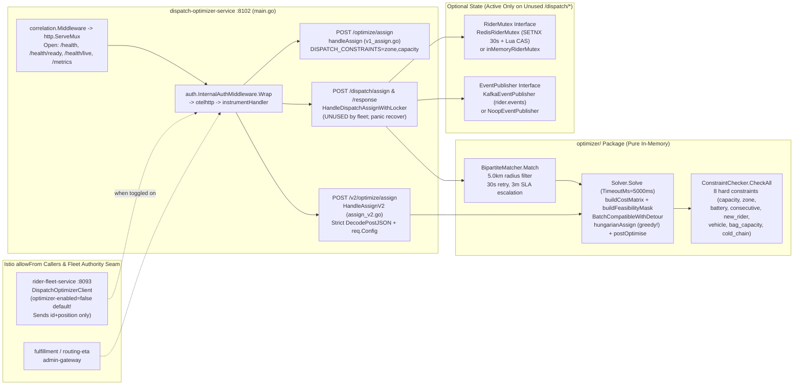
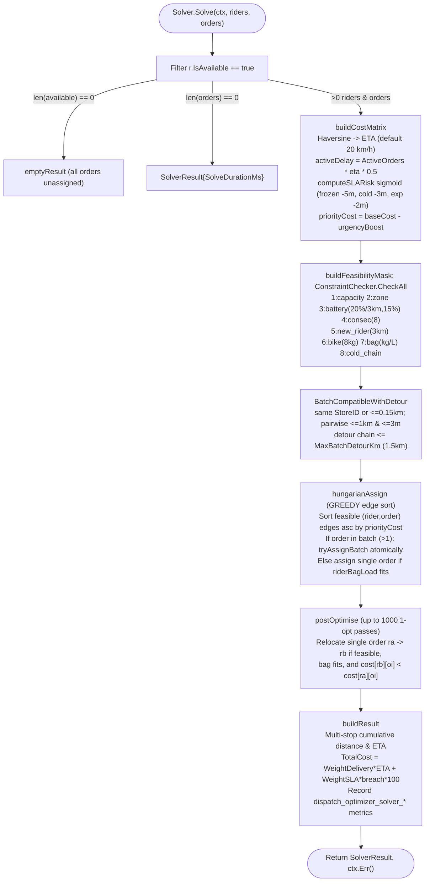
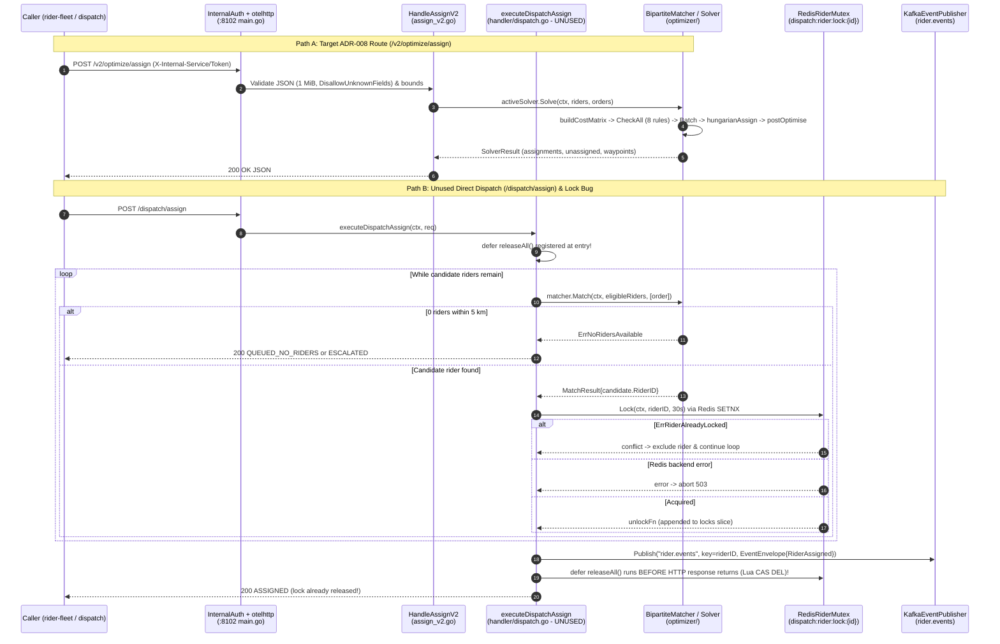

# `dispatch-optimizer-service` Code Walkthrough

> [!NOTE]
> **Part of the InstaCommerce Onboarding Suite:** [Onboarding Hub](../../README.md) · [Code Walkthrough Atlas](../README.md) · [Domain & Event Catalog (`05`)](../../05-domain-model-and-event-catalog.md) · [Incident Drills & Exam (`06`)](../../06-incident-drills-and-readiness-exam.md) · [Dependency Matrix & Cheatsheet (`07`)](../../07-service-dependency-and-command-cheatsheet.md)

> **Service identity:** Go `1.25.0` pure-compute geospatial optimization service on port `8102` (`SERVER_PORT`) | **Domain:** Rider-to-order matching, multi-stop micro-batching, 8-rule dispatch constraint verification, and optional direct assignment locking | **Database:** **None** (optional Redis rider mutex + Kafka `rider.events` active only on `/dispatch/assign`) | **Source root:** [`services/dispatch-optimizer-service/`](../../../../services/dispatch-optimizer-service/)

---

## 1. Service Boundaries & Package Layout

`dispatch-optimizer-service` exposes two distinct operational modes inside one binary:

1. **Stateless Batch Optimizer (`POST /optimize/assign`, `POST /v2/optimize/assign`):** Computes deterministic rider-to-order routes and multi-stop waypoints purely in memory using `optimizer.Solver`. Neither Redis nor Kafka is touched on these paths.
2. **Direct Single-Order Dispatch (`POST /dispatch/assign`, `POST /dispatch/response`):** Uses `optimizer.BipartiteMatcher` (5.0 km radius + SLA urgency escalation), `RedisRiderMutex` (`SETNX` 30s + Lua CAS unlock), and `KafkaEventPublisher` (`rider.events`). **In the current codebase, `rider-fleet-service` never calls `/dispatch/assign` and disables the optimizer client by default (`optimizer-enabled: false`).**

| Attribute | Authoritative Code / Config Value | Source |
| :--- | :--- | :--- |
| **HTTP Port** | `:8102` (`SERVER_PORT`, default `8102`) | [`main.go`](../../../../services/dispatch-optimizer-service/main.go) |
| **Open Probe / Metrics Routes** | `GET /health`, `GET /health/live`, `GET /health/ready`, `GET /metrics` | [`main.go#L76-L86`](../../../../services/dispatch-optimizer-service/main.go#L76-L86) |
| **Authenticated API Routes** | `POST /optimize/assign`, `POST /v2/optimize/assign`, `POST /dispatch/assign`, `POST /dispatch/response` | [`main.go#L127-L169`](../../../../services/dispatch-optimizer-service/main.go#L127-L169) |
| **Constraints Enforced** | **8** hard rules in `CheckAll` (`capacity`, `zone`, `battery`, `consecutive_limit`, `new_rider_distance`, `vehicle_suitability`, `bag_capacity`, `cold_chain`) | [`optimizer/constraints.go#L28-L204`](../../../../services/dispatch-optimizer-service/optimizer/constraints.go#L28-L204) |
| **Upstream Java Caller Seam** | `rider-fleet-service` [`DispatchOptimizerClient`](../../../../services/rider-fleet-service/src/main/java/com/instacommerce/riderfleet/client/DispatchOptimizerClient.java#L35-L47) (`optimizer-enabled: false` default) | [`application.yml#L61`](../../../../services/rider-fleet-service/src/main/resources/application.yml#L61) |

### Module & File Inventory

```text
services/dispatch-optimizer-service/
├── main.go                    # HTTP mux, correlation.Middleware, InternalAuthMiddleware + otelhttp + Prometheus wrap
├── v1_assign.go               # POST /optimize/assign legacy V1 handler + DISPATCH_CONSTRAINTS env filter
├── telemetry.go               # OpenTelemetry setup + Prometheus dispatch_optimizer_http_* counters/histograms
├── go.mod                     # Go 1.25.0 + github.com/instacommerce/go-shared local replace
├── Dockerfile                 # Multi-stage Go 1.25 alpine build on port 8102
├── handler/
│   ├── assign_v2.go           # POST /v2/optimize/assign strict JSON decoder (1 MiB, DisallowUnknownFields), calls Solver.Solve
│   ├── dispatch.go            # POST /dispatch/assign & /dispatch/response (unused by fleet; holds defer unlock bug)
│   ├── dispatch_types.go      # V2 & /dispatch request/response DTOs
│   ├── kafka_publisher.go     # EventPublisher interface, KafkaEventPublisher (rider.events), NoopEventPublisher
│   ├── redis_lock.go          # RedisRiderMutex (SETNX 30s + Lua CAS delete) & inMemoryRiderMutex
│   └── rider_lock.go          # RiderMutex interface, LockResult, ErrRiderAlreadyLocked
└── optimizer/
    ├── solver.go              # Solver.Solve entrypoint, empty/timeout guards, activeSolver orchestration
    ├── routing.go             # buildCostMatrix, buildFeasibilityMask, hungarianAssign (greedy!), tryAssignBatch, postOptimise, buildResult
    ├── constraints.go         # ConstraintChecker.CheckAll enforcing 8 dispatch constraints + BatchCompatibleWithDetour
    ├── haversine.go           # Earth spherical distance, speed->ETA (20 km/h default), computeSLARisk sigmoid
    ├── matcher.go             # BipartiteMatcher (5km radius, 30s retry, 3m SLA escalation) used by /dispatch/assign
    ├── types.go               # RiderState, PendingOrder, SolverConfig, WeightConfig, Assignment, Waypoint
    ├── metrics.go             # Solver Prometheus metrics (dispatch_optimizer_solver_*)
    └── doc.go                 # Package doc comment
```

---

## 2. Architecture & Middleware Stack (`arch-lld`)

**dispatch-optimizer-service Low-Level Architecture** — *[Rendered PNG](../diagrams/services/dispatch-optimizer-service-arch-lld.png) · [Mermaid Source](../diagrams/services/dispatch-optimizer-service-arch-lld.mmd)*



### HTTP Middleware & Security Wiring ([`main.go#L76-L86`](../../../../services/dispatch-optimizer-service/main.go#L76-L86), [`main.go#L127-L169`](../../../../services/dispatch-optimizer-service/main.go#L127-L169))

- Root router wraps `http.ServeMux` in `correlation.Middleware(mux)` for `X-Correlation-ID` propagation.
- `/health`, `/health/live`, `/health/ready`, and `/metrics` bypass authentication so Kubernetes probes and Prometheus scrapers remain unauthenticated.
- All business endpoints (`/optimize/assign`, `/v2/optimize/assign`, `/dispatch/assign`, `/dispatch/response`) are wrapped per-route with:
  1. `auth.InternalAuthMiddleware.Wrap(...)` (HMAC/token verification against `INTERNAL_SERVICE_TOKEN` and `X-Internal-Service` caller checks)
  2. `otelhttp.NewHandler(...)`
  3. `instrumentHandler(...)` emitting `dispatch_optimizer_http_requests_total` and duration histograms ([`telemetry.go#L53`](../../../../services/dispatch-optimizer-service/telemetry.go#L53)).

---

## 3. Data Structures, Constraints & Redis Lock Mechanics

### In-Memory Solver Model (`optimizer/types.go`, `optimizer/constraints.go`)

`Solver.Solve` ([`optimizer/solver.go#L26-L56`](../../../../services/dispatch-optimizer-service/optimizer/solver.go#L26-L56)) operates on typed domain snapshots—it makes **zero database queries**. Every `ConstraintChecker.CheckAll` invocation tests **8 hard rules** ([`optimizer/constraints.go#L28-L204`](../../../../services/dispatch-optimizer-service/optimizer/constraints.go#L28-L204)), whereas [`README.md#L159-L170`](../../../../services/dispatch-optimizer-service/README.md#L159-L170) only documents 6:

1. **`capacity`**: `rider.ActiveOrders + 1 <= maxOrders` (`MaxOrdersPerRider`, default `3`).
2. **`zone`**: Matching `ZoneID` required unless `order.CrossZoneAllowed` is true.
3. **`battery`**: EV/e-bike riders must meet `MinBatteryPct` (`20%` default) when leg distance exceeds `3.0 km`, or unconditional `15%` floor (`CriticalBatteryPct`).
4. **`consecutive_limit`**: Prevents overloading riders past `MaxConsecutiveOrders` (`8` default).
5. **`new_rider_distance`**: Probationary/new riders (`CompletedTrips < threshold`) are capped at `NewRiderMaxKm` (`3.0 km`).
6. **`vehicle_suitability`**: Bicycle riders reject orders above `8.0 kg` (`BikeMaxWeightKg`).
7. **`bag_capacity`**: Checks remaining weight (`kg`) and volume (`L`) headroom in the thermal bag.
8. **`cold_chain`**: Frozen/chilled items require riders equipped with insulated/cold-chain capability.

Batching compatibility (`BatchCompatibleWithDetour`) requires either the same `StoreID` or stores within `0.15 km`, customer drop-offs within `1.0 km` and `3.0 min`, and chained multi-stop detour `<= MaxBatchDetourKm` (`1.5 km`).

### Optional Redis Mutex (`handler/redis_lock.go#L21-L88`)

Active **only** when calling `/dispatch/assign`:
- **Acquire (`Lock`):** Redis `SET dispatch:rider:lock:{riderID} <token> NX PX 30000` (`ErrRiderAlreadyLocked` if already held).
- **Release (`Unlock`):** Atomic Lua CAS script (`if redis.call("GET", KEYS[1]) == ARGV[1] then return redis.call("DEL", KEYS[1]) else return 0 end`) so expired locks are never deleted by a slow caller.

---

## 4. Solver Algorithm & Dispatch Sequence Traces

### Solver Decision & Constraint Flowchart

**dispatch-optimizer-service Solver Flowchart** — *[Rendered PNG](../diagrams/services/dispatch-optimizer-service-flowchart.png) · [Mermaid Source](../diagrams/services/dispatch-optimizer-service-flowchart.mmd)*



### V2 Solver & `/dispatch/assign` Lock-Bug Sequence Diagram

**dispatch-optimizer-service Request Sequence** — *[Rendered PNG](../diagrams/services/dispatch-optimizer-service-sequence.png) · [Mermaid Source](../diagrams/services/dispatch-optimizer-service-sequence.mmd)*



### Function-by-Function Execution Walkthrough

#### Path A: `POST /v2/optimize/assign` (`HandleAssignV2`, [`handler/assign_v2.go`](../../../../services/dispatch-optimizer-service/handler/assign_v2.go))

1. Decodes request strictly (`1 MiB` limit, `DisallowUnknownFields`, rejects trailing JSON tokens) and validates request bounds and optional `SolverConfig` overrides.
2. Calls `optimizer.Solver.Solve(ctx, riders, orders)` ([`optimizer/solver.go#L26-L56`](../../../../services/dispatch-optimizer-service/optimizer/solver.go#L26-L56)):
   - Filters `riders` where `r.IsAvailable == true`. If `len(available) == 0`, returns `emptyResult` marking all orders unassigned; if `len(orders) == 0`, returns empty assignments with `SolveDurationMs`.
   - **`buildCostMatrix` ([`optimizer/routing.go#L30-L368`](../../../../services/dispatch-optimizer-service/optimizer/routing.go#L30-L368)):** Computes Haversine store-to-customer and rider-to-store distances, converts distance to ETA using `20 km/h` default speed (`DefaultTrafficFactor = 1.0`, [`optimizer/haversine.go#L67-L136`](../../../../services/dispatch-optimizer-service/optimizer/haversine.go#L67-L136)), adds `activeDelay = ActiveOrders * eta * 0.5`, computes `computeSLARisk` sigmoid `1 / (1 + exp(-10 * (ratio - 0.7)))` (tightening deadlines by `5m` frozen, `3m` cold-chain, `2m` express), and sets `priorityCost = baseCost - urgencyBoost` (`+slaRisk*10`, `+8` express, `+12`/`+18` cold/frozen).
   - **`buildFeasibilityMask`:** Runs `ConstraintChecker.CheckAll` across every `(rider, order)` pair.
   - **Batching + Assignment (`hungarianAssign`, [`optimizer/routing.go#L83-L148`](../../../../services/dispatch-optimizer-service/optimizer/routing.go#L83-L148)):** Groups compatible orders via `BatchCompatibleWithDetour`, then sorts feasible `(rider, order)` edges ascending by `priorityCost`. Despite its function name, `hungarianAssign` executes a **greedy sorted-edge pass** plus `tryAssignBatch` (atomic multi-order assignment to a single rider) and bag-headroom tracking.
   - **Local Search (`postOptimise`, [`optimizer/routing.go#L186-L256`](../../../../services/dispatch-optimizer-service/optimizer/routing.go#L186-L256)):** Runs up to `1000` 1-opt single-order relocation passes (`ra -> rb`) when `rb` is feasible, fits bag weight/volume, and improves `cost[rb][oi] < cost[ra][oi]` (note: ignores multi-stop batch detour recalculation).
   - **`buildResult` ([`optimizer/routing.go#L339-L340`](../../../../services/dispatch-optimizer-service/optimizer/routing.go#L339-L340)):** Constructs ordered `Waypoint` routes, records `dispatch_optimizer_solver_*` metrics, and returns `TotalCost`.

#### Path B: Unused Direct Dispatch `POST /dispatch/assign` ([`handler/dispatch.go#L71-L80`](../../../../services/dispatch-optimizer-service/handler/dispatch.go#L71-L80))

1. `executeDispatchAssign(ctx, req)` immediately registers `defer releaseAll()` at function entry before locking any rider.
2. Enters a retry loop calling `matcher.Match(ctx, eligibleRiders, []Order{order})` (`5.0 km` radius, 30s retry escalation).
3. On candidate selection, calls `mutex.Lock(ctx, candidate.RiderID, 30*time.Second)` (`SETNX`). On `ErrRiderAlreadyLocked`, adds rider to exclusion list and loops; on Redis backend failure, aborts with HTTP `503`.
4. Publishes `RiderAssigned` event (`EventEnvelope`) to Kafka topic `rider.events` partitioned by `riderID`.
5. On function exit, `defer releaseAll()` **executes Lua CAS `DEL`, immediately unlocking `dispatch:rider:lock:{riderID}` before the HTTP `200 ASSIGNED` response is sent**.

---

## 5. Configuration, Observability & Testing

### Configuration ([`main.go`](../../../../services/dispatch-optimizer-service/main.go), [`deploy/helm/values.yaml`](../../../../deploy/helm/values.yaml))

| Env Var | Purpose | Default / Behavior |
| :--- | :--- | :--- |
| `SERVER_PORT` | HTTP listen port | `8102` |
| `DISPATCH_CONSTRAINTS` | V1 `/optimize/assign` constraint filter | Defaults to `zone,capacity` (`assign_v2.go` runs all 8) |
| `REDIS_ADDR` / `KAFKA_BROKERS` | Used exclusively by `/dispatch/*` handlers | Optional; falls back to `inMemoryRiderMutex` & `NoopEventPublisher` |
| `INTERNAL_SERVICE_TOKEN` | Inbound `InternalAuthMiddleware` shared secret | Enforced on all non-health/metrics endpoints |

### Verification Command

```bash
cd services/dispatch-optimizer-service && go test -race ./...
```

---

## 6. Verified Code-Level Bugs, Drift & Cross-Service Gaps

1. **`hungarianAssign` Misnomer & Documentation Drift:** [`optimizer/routing.go#L83-L148`](../../../../services/dispatch-optimizer-service/optimizer/routing.go#L83-L148) (plus comments in [`optimizer/matcher.go#L39`](../../../../services/dispatch-optimizer-service/optimizer/matcher.go#L39) and [`README.md#L176-L178`](../../../../services/dispatch-optimizer-service/README.md#L176-L178)) claims Kuhn-Munkres (`O(n^3)` Hungarian algorithm), but the implementation is a greedy ascending-edge pass with 1-opt relocation (`postOptimise`, [`routing.go#L186-L256`](../../../../services/dispatch-optimizer-service/optimizer/routing.go#L186-L256)) that does not re-evaluate batch detour chains when moving single orders.
2. **Broken Distributed Lock Semantics on `/dispatch/assign`:** [`executeDispatchAssign`](../../../../services/dispatch-optimizer-service/handler/dispatch.go#L71-L80) defers `releaseAll()` at handler entry, deleting `dispatch:rider:lock:{riderID}` via Lua CAS before returning HTTP `200 ASSIGNED` to callers.
3. **`buildResult` Drops `WeightIdleTime`:** [`optimizer/routing.go#L339-L340`](../../../../services/dispatch-optimizer-service/optimizer/routing.go#L339-L340) calculates `TotalCost = WeightDeliveryTime*totalOrderETA + WeightSLABreach*float64(SLABreachCount)*100`, omitting `WeightIdleTime`.
4. **Disconnected / Degraded `rider-fleet-service` Integration:**
   - `rider-fleet-service` disables the optimizer by default (`optimizer-enabled: false`, [`application.yml#L61`](../../../../services/rider-fleet-service/src/main/resources/application.yml#L61)).
   - [`DispatchOptimizerClient.OrderRequest`](../../../../services/rider-fleet-service/src/main/java/com/instacommerce/riderfleet/client/DispatchOptimizerClient.java#L85-L88) serializes **only** `id` and `position`, dropping `store_id`, `weight_kg`, `volume_l`, `cold_chain`, `express`, and SLA timestamps needed by 6 of the 8 solver constraints.
   - [`DispatchOptimizerClient.requestAssignment`](../../../../services/rider-fleet-service/src/main/java/com/instacommerce/riderfleet/client/DispatchOptimizerClient.java#L35-L47) catches `Exception` inside `try/catch` and returns `Optional.empty()`, preventing Resilience4j `@CircuitBreaker` from counting HTTP/timeout failures.
5. **Broken SLO Alert PromQL Query & Undocumented Constraints:** [`wave-40-complete-slo-alerts.yml#L476-L478`](../../../../prometheus/rules/wave-40-complete-slo-alerts.yml#L476-L478) queries Spring's `http_server_requests_seconds_count` instead of `dispatch_optimizer_http_requests_total` ([`telemetry.go#L53`](../../../../services/dispatch-optimizer-service/telemetry.go#L53)), and [`README.md#L159-L170`](../../../../services/dispatch-optimizer-service/README.md#L159-L170) omits `bag_capacity` and `cold_chain` from its constraint list.

---

**Previous:** [payment-webhook-service](./payment-webhook-service.md) | **Atlas Hub:** [Code Walkthrough Atlas](../README.md) | **Next:** [reconciliation-engine](./reconciliation-engine.md)
