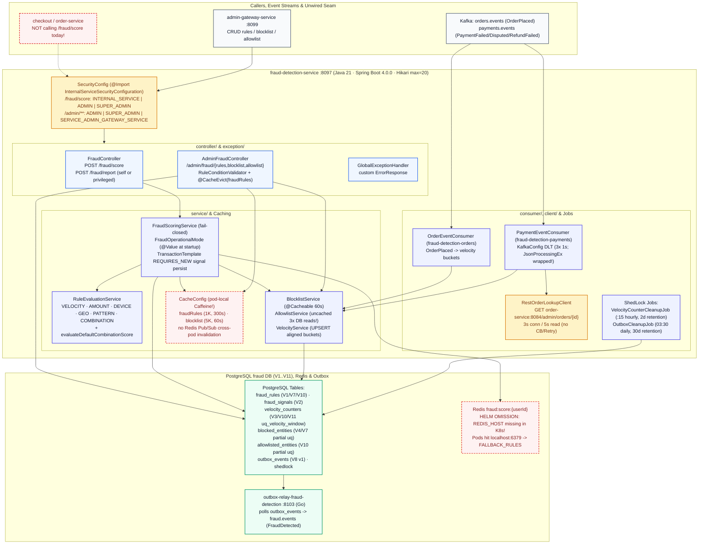
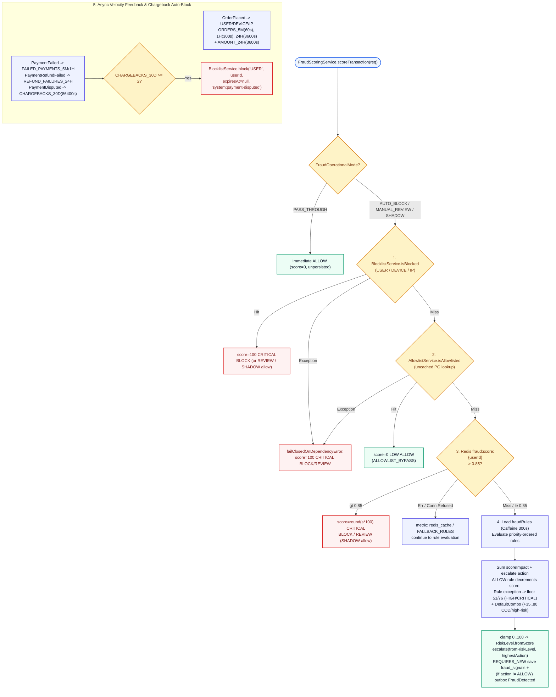
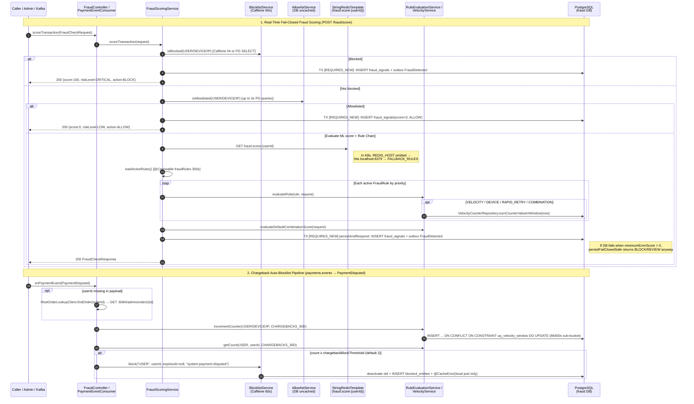

# `fraud-detection-service` — Code Walkthrough

> [!NOTE]
> **Part of the InstaCommerce Onboarding Suite:** [Onboarding Hub](../../README.md) · [Code Walkthrough Atlas](../README.md) · [Domain & Event Catalog (`05`)](../../05-domain-model-and-event-catalog.md) · [Incident Drills & Exam (`06`)](../../06-incident-drills-and-readiness-exam.md) · [Dependency Matrix & Cheatsheet (`07`)](../../07-service-dependency-and-command-cheatsheet.md)

> **Fail-Closed Rule Engine, Redis ML Score Cache, Aligned Velocity Buckets & Chargeback Auto-Blocklist**
>
> | Dimension | Verified Repo Truth |
> |---|---|
> | **Module & Runtime** | Java 21 / Spring Boot 4.0.0 ([build.gradle.kts](../../../../services/fraud-detection-service/build.gradle.kts#L1-L42)) · Spring Data Redis, Caffeine (`fraudRules`, `blocklist`), ShedLock · Dependencies: `:libs:platform-common`, `:contracts` |
> | **HTTP Port** | `8097` (`${SERVER_PORT:8097}` in [application.yml](../../../../services/fraud-detection-service/src/main/resources/application.yml#L1-L4)) |
> | **Primary Storage** | PostgreSQL `fraud` (`fraud_db` in Helm), Flyway `V1`–`V11` (`ddl-auto: validate`, `open-in-view: false`, Hikari `max=20`) + Redis (`fraud:score:{userId}`, **broken in Helm**!) + pod-local Caffeine |
> | **Kafka Topics** | **Produces** (via Go `outbox-relay-fraud-detection` `:8103`): `fraud.events` (`FraudDetected`)<br>**Consumes:** `orders.events` (`OrderPlaced`, group `fraud-detection-orders`) · `payments.events` (`PaymentFailed`, `PaymentDisputed`, `PaymentRefundFailed`, group `fraud-detection-payments`) · **DLT:** `{topic}.DLT` |
> | **Helm Keys** | `fraud-detection-service` ([values.yaml](../../../../deploy/helm/values.yaml#L1368-L1384)) · Relay: `outbox-relay-fraud-detection` ([values.yaml](../../../../deploy/helm/values.yaml#L1125)) · **Helm bug:** omits `REDIS_HOST`! |
> | **SLO Tier** | **Tier 2** (`99.0%` availability, `2000 ms` p99, `432 min/30d` budget) per [error-budget-policy.yaml](../../../../monitoring/error-budget-policy.yaml#L29-L44) *(doc drift: [service-slos.md](../../../../docs/slos/service-slos.md#L188) claims `fail open` while code explicitly fails closed!)* |

---

## 1. Service Boundaries & Package Tree

`fraud-detection-service` computes real-time risk scores (`0–100`), maintains entity blocklists and allowlists (`USER`, `DEVICE`, `IP`), aggregates time-bucketed velocity counters from `orders.events` and `payments.events`, and emits `FraudDetected` events to `fraud.events` whenever a check returns an action other than `ALLOW`.

**Crucial System-Level Reality:** Although `fraud-detection-service` exposes `POST /fraud/score` for synchronous pre-checkout risk checks, **neither `checkout-orchestrator-service` nor `order-service` calls `POST /fraud/score` today**. In live traffic, the active code path is asynchronous feedback ingestion (`OrderEventConsumer` + `PaymentEventConsumer`) plus administrative CRUD via `admin-gateway-service`.

### Package Layout (`com.instacommerce.fraud`)

```text
services/fraud-detection-service/src/main/java/com/instacommerce/fraud/
├── FraudDetectionServiceApplication.java     # @SpringBootApplication, @ConfigurationPropertiesScan
├── client/
│   └── RestOrderLookupClient.java            # RestClient -> order-service:8084/admin/orders/{id} (3s/5s, NO CB/Retry)
├── config/
│   ├── CacheConfig.java                      # Pod-local Caffeine: fraudRules (1K, 300s), blocklist (5K, 60s)
│   ├── FraudProperties.java                  # @ConfigurationProperties(prefix = "fraud") jwt, cors, order
│   ├── KafkaConfig.java                      # DefaultErrorHandler(FixedBackOff 1s, 3x) -> {topic}.DLT (no non-retryable exclusions)
│   ├── SecurityConfig.java                   # @Import(InternalServiceSecurityConfiguration) + JwtAuthenticationFilter
│   └── ShedLockConfig.java                   # JdbcTemplateLockProvider usingDbTime(), PT30M
├── consumer/
│   ├── OrderEventConsumer.java               # orders.events -> OrderPlaced velocity (+ count & amount)
│   └── PaymentEventConsumer.java             # payments.events -> PaymentFailed, PaymentRefundFailed, PaymentDisputed auto-block
├── controller/
│   ├── FraudController.java                  # POST /fraud/score (INTERNAL/ADMIN), POST /fraud/report
│   └── AdminFraudController.java             # /admin/fraud/{rules,blocklist,allowlist} (ADMIN/SUPER_ADMIN/ADMIN_GATEWAY)
├── domain/model/                             # FraudRule (@Version), FraudSignal, VelocityCounter, BlockedEntity, AllowlistedEntity
├── exception/
│   └── GlobalExceptionHandler.java           # Custom ErrorResponse (NOT ProblemDetailFactory)
├── repository/                               # VelocityCounterRepository (native PG ON CONFLICT UPSERT)
└── service/
    ├── FraudScoringService.java              # Fail-closed scoring pipeline, FraudOperationalMode, REQUIRES_NEW persistence
    ├── RuleEvaluationService.java            # VELOCITY, AMOUNT, DEVICE, GEO, PATTERN, COMBINATION + default combo heuristics
    ├── BlocklistService.java                 # @Cacheable("blocklist") + @CacheEvict (local pod only)
    ├── AllowlistService.java                 # Uncached DB lookup across USER / DEVICE / IP
    ├── VelocityService.java                  # Sub-bucket time alignment + increment + rolling window sum
    ├── RuleConditionValidator.java           # Strict schema validation on admin rule JSON before save
    ├── OutboxService.java                    # Propagation.MANDATORY outbox_events writer
    ├── VelocityCounterCleanupJob.java        # Hourly :15 ShedLock purge (window_end < now - 2d)
    └── OutboxCleanupJob.java                 # Daily 03:30 ShedLock purge (default 30d retention)
```

---

## 2. Startup, Configuration & Security Filter Chain

1. **Auth Rules ([SecurityConfig](../../../../services/fraud-detection-service/src/main/java/com/instacommerce/fraud/config/SecurityConfig.java#L1-L73)):** Imports `InternalServiceSecurityConfiguration` (`SharedInternalServiceAuthFilter`) and registers `JwtAuthenticationFilter` ahead of `UsernamePasswordAuthenticationFilter`:
   - `POST /fraud/score`: requires `ROLE_INTERNAL_SERVICE`, `ROLE_ADMIN`, or `ROLE_SUPER_ADMIN`.
   - `/admin/**`: requires `ROLE_ADMIN`, `ROLE_SUPER_ADMIN`, or `ROLE_SERVICE_ADMIN_GATEWAY_SERVICE`.
   - `POST /fraud/report`: authenticated callers can report fraud (internal/admin callers can specify another `userId`; normal users report against themselves in [FraudController](../../../../services/fraud-detection-service/src/main/java/com/instacommerce/fraud/controller/FraudController.java#L1-L75)).
2. **Dynamic Flag Caveat:** [FraudScoringService](../../../../services/fraud-detection-service/src/main/java/com/instacommerce/fraud/service/FraudScoringService.java#L65) binds `FraudOperationalMode` via `@Value("${fraud.operational-mode:AUTO_BLOCK}")` once at startup (contrary to javadoc text claiming live flag switching without restart).
3. **Strict Rule Validation & Error DTO:** [AdminFraudController](../../../../services/fraud-detection-service/src/main/java/com/instacommerce/fraud/controller/AdminFraudController.java#L1-L174) passes rule mutations through [RuleConditionValidator](../../../../services/fraud-detection-service/src/main/java/com/instacommerce/fraud/service/RuleConditionValidator.java#L1-L83) (`VELOCITY`, `AMOUNT`, `DEVICE`, `GEO`, `PATTERN`, `COMBINATION`) and evicts `fraudRules` on the local pod. Errors format through [GlobalExceptionHandler](../../../../services/fraud-detection-service/src/main/java/com/instacommerce/fraud/exception/GlobalExceptionHandler.java#L21-L92) (`ErrorResponse` DTO).

---

## 3. PostgreSQL Schema (`V1`–`V11`) & Aligned Velocity Sub-Buckets

| Migration | Schema & Constraint Details |
|---|---|
| `V1`, `V2`, `V7` | `fraud_rules` (JSONB `condition`, `score_impact`, `priority`, `version`; `V7` expands `rule_type` to add `COMBINATION`) and `fraud_signals` (`order_id`, `user_id`, `score` `0..100`, `risk_level`, `action`, `triggered_rules`). |
| `V3`, `V10`, `V11` | `velocity_counters` (`entity_type`, `entity_id`, `counter_type`, `counter_value`, `window_start`, `window_end`; `uq_velocity_window` constraint over `(entity_type, entity_id, counter_type, window_start)`). `V10` adds burst counter types (`*_5M`, `*_1H`) and `allowlisted_entities`; `V11` adds `CHARGEBACKS_30D` and `REFUND_FAILURES_24H`. |
| `V4`, `V7`, `V10` | `blocked_entities` (`V4` + `V7` partial unique index `WHERE active = true` on `(entity_type, entity_id)`) and `allowlisted_entities` (`V10` partial unique index `WHERE active = true`). |
| `V5`, `V6`, `V8`, `V9` | `outbox_events` (`V8` aligns `EventEnvelope` `schema_version = 'v1'`; `V9` adds retention index) and `shedlock` (`V6`). |

### Sub-Bucket Alignment Mechanics ([VelocityService](../../../../services/fraud-detection-service/src/main/java/com/instacommerce/fraud/service/VelocityService.java#L66-L77))
Rather than maintaining a single counter row per rolling window or mutating raw event logs, `VelocityService.alignSubBucketStart` floors `Instant.now()` onto fixed sub-bucket boundaries and writes atomically via `INSERT ... ON CONFLICT ON CONSTRAINT uq_velocity_window DO UPDATE SET counter_value = velocity_counters.counter_value + :delta`:

| Counter Type | Sub-Bucket Size | Effective Window Span |
|---|---|---|
| `ORDERS_5M`, `FAILED_PAYMENTS_5M` | `60s` | `5 minutes` |
| `ORDERS_1H`, `FAILED_PAYMENTS_1H` | `300s` (`5m`) | `1 hour` |
| `ORDERS_24H`, `AMOUNT_24H`, `REFUND_FAILURES_24H`, `VELOCITY` | `3600s` (`1h`) | `24 hours` |
| `CHARGEBACKS_30D` | `86400s` (`1d`) | `30 days` |

Reads call [VelocityCounterRepository.sumCounterValueInWindow](../../../../services/fraud-detection-service/src/main/java/com/instacommerce/fraud/repository/VelocityCounterRepository.java#L1-L36) (`WHERE window_end > :now`). Because `windowEnd = alignedStart + windowDuration`, `VelocityCounterCleanupJob` (`WHERE window_end < now - 2d`) automatically preserves `CHARGEBACKS_30D` sub-buckets until their 30-day window actually expires!

---

## 4. Architecture & Low-Level Component Topology

**fraud-detection-service Architecture LLD** — *[Rendered PNG](../diagrams/services/fraud-detection-service-arch-lld.png) · [Mermaid Source](../diagrams/services/fraud-detection-service-arch-lld.mmd)*



**Architectural Reality Check:**
- **Broken Redis ML Cache Link in K8s:** `FraudScoringService` injects `StringRedisTemplate` to read pre-computed ML risk scores at `fraud:score:{userId}` (`application.yml` defaults `spring.data.redis.host` to `localhost:6379`). However, [deploy/helm/values.yaml](../../../../deploy/helm/values.yaml#L1368-L1384) and environment overlays omit `REDIS_HOST`, so every Kubernetes pod hits `localhost:6379`, gets connection refused, increments `fraud.scoring.errors{stage="redis_cache", fallback_action="FALLBACK_RULES"}`, and silently falls back to deterministic rules.
- **No CB/Retry on Order Lookup:** Unlike `wallet-loyalty-service` and `notification-service`, [RestOrderLookupClient](../../../../services/fraud-detection-service/src/main/java/com/instacommerce/fraud/client/RestOrderLookupClient.java#L1-L79) has `3s/5s` timeouts with **zero** `@CircuitBreaker` or `@Retry`.

---

## 5. Scoring Pipeline & Fail-Closed Error Tree

**fraud-detection-service Flowchart** — *[Rendered PNG](../diagrams/services/fraud-detection-service-flowchart.png) · [Mermaid Source](../diagrams/services/fraud-detection-service-flowchart.mmd)*



### Step-by-Step Scoring Logic ([FraudScoringService](../../../../services/fraud-detection-service/src/main/java/com/instacommerce/fraud/service/FraudScoringService.java#L1-L405))
1. **Mode Gate:** If `FraudOperationalMode.PASS_THROUGH`, returns immediate `ALLOW` (`score=0`) without hitting DB or Redis and without writing `fraud_signals`.
2. **Step 1 — Blocklist Check:** Calls [BlocklistService.isBlocked](../../../../services/fraud-detection-service/src/main/java/com/instacommerce/fraud/service/BlocklistService.java#L1-L75) for `USER`, `DEVICE`, and `IP` (Caffeine `60s`, caches both `true` and `false`). Any hit returns `score=100`, `CRITICAL`, `BLOCK` (`REVIEW` in `MANUAL_REVIEW`, `ALLOW` in `SHADOW`).
3. **Step 2 — Uncached Allowlist Bypass:** Calls [AllowlistService.isAllowlisted](../../../../services/fraud-detection-service/src/main/java/com/instacommerce/fraud/service/AllowlistService.java#L1-L93), which executes **up to 3 uncached PostgreSQL queries** per check. A hit immediately persists `fraud_signals(score=0, ALLOW)` inside a `TransactionTemplate` (`REQUIRES_NEW`) and exits.
4. **Step 3 — Fail-Closed Dependency Semantics:** If *either* `BlocklistService` or `AllowlistService` throws an exception, `failClosedOnDependencyError` immediately returns `score=100`, `CRITICAL`, `BLOCK` (or `REVIEW`) and attempts to persist a best-effort audit signal. In contrast, Redis failures in `getCachedFraudRiskScore` degrade safely to `FALLBACK_RULES`; if Redis returns `score > 0.85`, scoring short-circuits to `round(s * 100)` (`CRITICAL` / `BLOCK`).
5. **Step 4 — Rule Chain + Default Combination Heuristic ([RuleEvaluationService](../../../../services/fraud-detection-service/src/main/java/com/instacommerce/fraud/service/RuleEvaluationService.java#L1-L250)):**
   - Evaluates active `FraudRule` rows sorted by `priority` (cached `300s` per pod). `ALLOW` rules decrement score; non-`ALLOW` matches add `scoreImpact` and escalate `action`. Rule-level exceptions bump a failure floor (`51` `HIGH`, or `76` `CRITICAL` if `totalCents` exceeds threshold).
   - Appends `evaluateDefaultCombinationScore(request)` (e.g., high order value + velocity burst + COD).
   - Persists `FraudSignal` and writes `FraudDetected` to `outbox_events` inside `REQUIRES_NEW` whenever `action != ALLOW`; if persistence itself fails when `minimumErrorScore > 0`, `persistFailClosedSafe` still returns `BLOCK`/`REVIEW` to protect checkout!

---

## 6. Call-Stack Sequence: Sync Scoring & Chargeback Auto-Blocklist

**fraud-detection-service Sequence Diagram** — *[Rendered PNG](../diagrams/services/fraud-detection-service-sequence.png) · [Mermaid Source](../diagrams/services/fraud-detection-service-sequence.mmd)*



Trace 2 in the sequence diagram illustrates [PaymentEventConsumer](../../../../services/fraud-detection-service/src/main/java/com/instacommerce/fraud/consumer/PaymentEventConsumer.java#L1-L176) reacting to `PaymentDisputed` on `payments.events`:
- If `userId` is missing in the payload, it resolves it synchronously via `RestOrderLookupClient.findOrder(orderId)` (`GET order-service:8084/admin/orders/{id}`).
- Increments `CHARGEBACKS_30D` across available `USER`, `DEVICE`, and `IP` identifiers (`86400s` daily sub-bucket).
- Reads `getCount(USER, userId, CHARGEBACKS_30D)`. Once `count >= chargebackBlockThreshold` (default `2`), it invokes `BlocklistService.block("USER", userId, expiresAt=null, "system:payment-disputed")`, deactivating prior entries and inserting a permanent `blocked_entities` row.

---

## 7. Consumers, Scheduled Jobs & Outbox

- **[OrderEventConsumer](../../../../services/fraud-detection-service/src/main/java/com/instacommerce/fraud/consumer/OrderEventConsumer.java#L1-L75):** Listens on `orders.events` (`fraud-detection-orders`). For `OrderPlaced`, increments `ORDERS_5M`, `ORDERS_1H`, `ORDERS_24H`, and `AMOUNT_24H` across `USER`, `DEVICE`, and `IP`.
- **[PaymentEventConsumer](../../../../services/fraud-detection-service/src/main/java/com/instacommerce/fraud/consumer/PaymentEventConsumer.java#L1-L176):** Listens on `payments.events` (`fraud-detection-payments`) for `PaymentFailed` (`FAILED_PAYMENTS_5M`/`1H`), `PaymentRefundFailed` (`REFUND_FAILURES_24H`), and `PaymentDisputed` (`CHARGEBACKS_30D` + auto-block).
- **[VelocityCounterCleanupJob](../../../../services/fraud-detection-service/src/main/java/com/instacommerce/fraud/service/VelocityCounterCleanupJob.java#L1-L35) & [OutboxCleanupJob](../../../../services/fraud-detection-service/src/main/java/com/instacommerce/fraud/service/OutboxCleanupJob.java#L14-L35):** Run under ShedLock (`PT5M`/`PT30M`): `:15` past every hour for expired velocity counters (`window_end < now - 2d`) and `03:30` daily for outbox cleanup (`30d` default retention).

---

## 8. Configuration, Helm Overrides & Narrow Test Verification

- **Key Properties ([application.yml](../../../../services/fraud-detection-service/src/main/resources/application.yml#L1-L100)):** `fraud.operational-mode: AUTO_BLOCK`, `fraud.score-cache-ttl-seconds: 300`, `fraud.chargeback.auto-block-threshold: 2`, `outbox.retention: 30d`, `spring.data.redis.host: ${REDIS_HOST:localhost}`, `spring.data.redis.port: ${REDIS_PORT:6379}`.
- **Tests:** `10` test classes live under `services/fraud-detection-service/src/test` (including `FraudScoringServiceTest`, `FraudScoringTransactionBoundaryTest`, `FraudVelocityAllowlistAndComboTest`, `PaymentEventConsumerTest`, `FraudDetectionPostgresFlywayIntegrationTest`). Run narrow verification via:

```bash
./gradlew :services:fraud-detection-service:test --tests "com.instacommerce.fraud.service.FraudScoringTransactionBoundaryTest"
```

---

## 9. Must-Fix Code Risks & Documentation Drift

| Severity | Finding | Exact Evidence & Impact |
|---|---|---|
| **MUST-FIX** | **Checkout does NOT invoke `fraud-detection-service`** | Neither `checkout-orchestrator-service` nor `order-service` calls `POST /fraud/score` synchronously today; velocity counters and chargeback auto-blocks accumulate in DB without blocking fraudulent checkouts. |
| **MUST-FIX** | **Missing `REDIS_HOST` / `REDIS_PORT` in Helm chart** | [deploy/helm/values.yaml](../../../../deploy/helm/values.yaml#L1368-L1384) omits `REDIS_HOST`, forcing K8s pods to dial `localhost:6379` for `fraud:score:{userId}` and fall back to rules on every scoring request (`fraud.scoring.errors`). |
| **HIGH** | **Single-pod Caffeine cache split-brain (`blocklist` / `fraudRules`) & uncached allowlist** | [CacheConfig](../../../../services/fraud-detection-service/src/main/java/com/instacommerce/fraud/config/CacheConfig.java#L1-L34) uses pod-local Caffeine (`fraudRules` 300s, `blocklist` 60s caching `false` too) with no Redis Pub/Sub invalidation—an auto-block or admin rule edit on Pod A leaves Pod B stale up to `60s`/`300s`. Meanwhile, `AllowlistService` runs up to 3 uncached DB queries per `/fraud/score`. |
| **MEDIUM** | **Malformed JSON retries 3x before DLT & static operational mode** | Both Kafka consumers wrap `JsonProcessingException` in `IllegalStateException`, and [KafkaConfig](../../../../services/fraud-detection-service/src/main/java/com/instacommerce/fraud/config/KafkaConfig.java#L1-L24) registers no `addNotRetryableExceptions`—wasting `3 x 1s` backoff per poison pill. `FraudOperationalMode` (`@Value`) also cannot switch dynamically at runtime without pod restart. |
| **DRIFT** | **SLO doc & service README diverge from code** | [service-slos.md](../../../../docs/slos/service-slos.md#L188) falsely states `fraud-detection-service` `fails open` (code fails closed in `FraudScoringService`). [fraud-detection-service/README.md](../../../../services/fraud-detection-service/README.md) omits `V10`/`V11`, `COMBINATION` rules, `AllowlistService`, `PaymentDisputed`, `RestOrderLookupClient`, and cites singular topic names. |

---

**Previous:** [wallet-loyalty-service](./wallet-loyalty-service.md) | **Atlas Hub:** [Code Walkthrough Atlas](../README.md) | **Next:** [warehouse-service](./warehouse-service.md)
