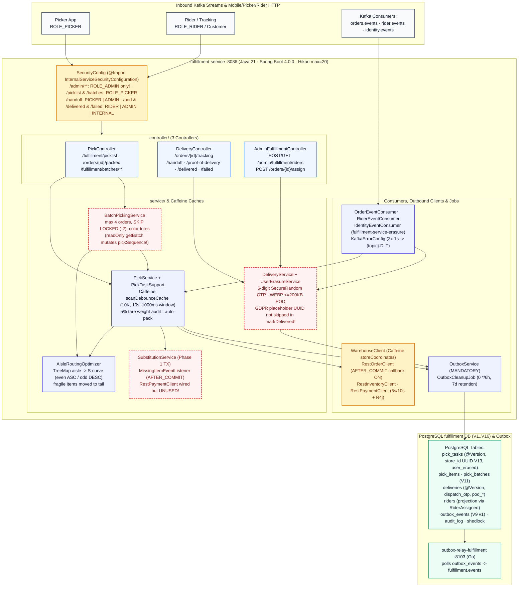
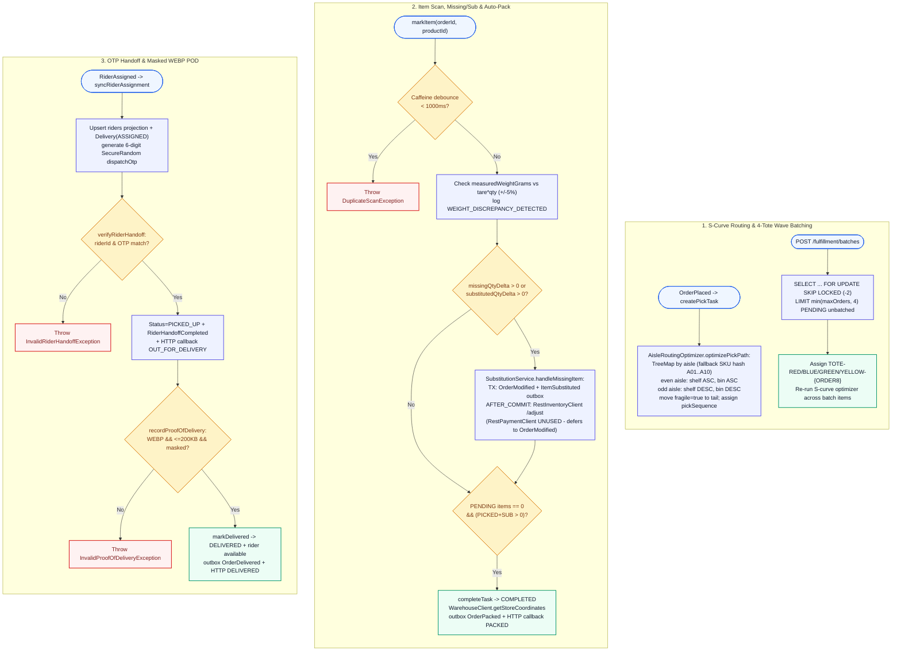
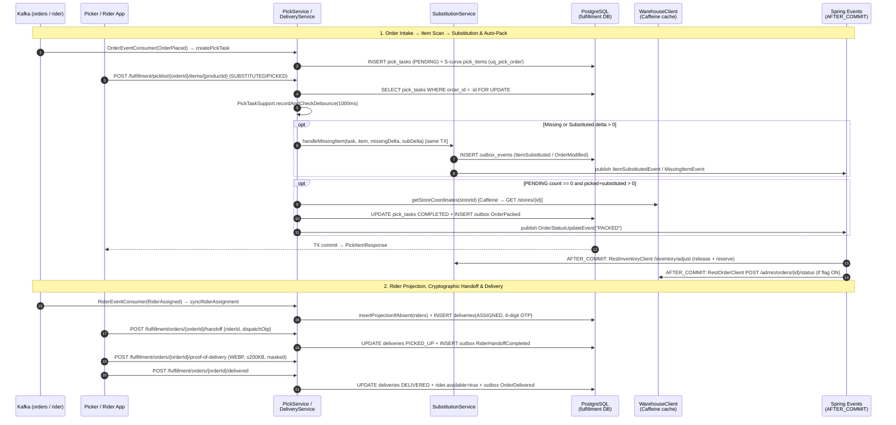

# `fulfillment-service` — Code Walkthrough

> [!NOTE]
> **Part of the InstaCommerce Onboarding Suite:** [Onboarding Hub](../../README.md) · [Code Walkthrough Atlas](../README.md) · [Domain & Event Catalog (`05`)](../../05-domain-model-and-event-catalog.md) · [Incident Drills & Exam (`06`)](../../06-incident-drills-and-readiness-exam.md) · [Dependency Matrix & Cheatsheet (`07`)](../../07-service-dependency-and-command-cheatsheet.md)

> **Dark-Store S-Curve Picking, 4-Tote Wave Batching, Substitution Callbacks, Rider OTP Handoff & WEBP POD**
>
> | Dimension | Verified Repo Truth |
> |---|---|
> | **Module & Runtime** | Java 21 / Spring Boot 4.0.0 ([build.gradle.kts](../../../../services/fulfillment-service/build.gradle.kts#L1-L43)) · Caffeine (`scanDebounceCache`, `storeCoordinates`), Resilience4j, ShedLock · Dependencies: `:libs:platform-common`, `:contracts` |
> | **HTTP Port** | `8086` (`${SERVER_PORT:8086}` in [application.yml](../../../../services/fulfillment-service/src/main/resources/application.yml#L1-L4)) |
> | **Primary Storage** | PostgreSQL `fulfillment`, Flyway `V1`–`V16` (`ddl-auto: validate`, `open-in-view: false`, Hikari `max=20`) — **zero Redis, zero Temporal SDK** |
> | **Kafka Topics** | **Produces** (via Go `outbox-relay-fulfillment` `:8103`): `fulfillment.events` (`OrderPacked`, `OrderDispatched`, `OrderDelivered`, `DeliveryFailed`, `RiderHandoffCompleted`, `ItemSubstituted`, `OrderModified`)<br>**Consumes:** `orders.events` (`OrderPlaced`, group `fulfillment-service`) · `rider.events` (`RiderAssigned`, group `fulfillment-service`) · `identity.events` (`UserErased`, group `fulfillment-service-erasure`) · **DLT:** `{topic}.DLT` |
> | **Helm Keys** | `fulfillment-service` ([values.yaml](../../../../deploy/helm/values.yaml)) · Relay: `outbox-relay-fulfillment` ([values.yaml](../../../../deploy/helm/values.yaml#L949)) |
> | **SLO Tier** | **Tier 1** (`99.5%` availability, `1000 ms` p99, `216 min/30d` budget) per [error-budget-policy.yaml](../../../../monitoring/error-budget-policy.yaml#L15-L27) *(doc drift: `service-slos.md` lists `2s` p99 / `< 43 min`)* |

---

## 1. Service Boundaries & Package Tree

`fulfillment-service` bridges order confirmation and last-mile delivery inside each dark store:
1. Consumes `OrderPlaced` (`orders.events`) and converts order items into S-curve routed pick tasks (`pick_tasks`, `pick_items`).
2. Lets pickers batch up to `4` orders into color-coded waves (`RED`, `BLUE`, `GREEN`, `YELLOW`), scan items with `1000ms` debounce + `+-5%` tare weight checks, substitute/short-pick items, and auto-pack when all items resolve.
3. Consumes `RiderAssigned` (`rider.events`) to upsert local `riders` projections and pre-create `deliveries(ASSIGNED)` with a 6-digit `SecureRandom` `dispatchOtp`.
4. Enforces cryptographic-strength OTP rider handoff, WEBP-only (`<= 200KB`, GPS-masked) proof-of-delivery upload, and final `OrderDelivered` / `DeliveryFailed` emission.

### Package Layout (`com.instacommerce.fulfillment`)

```text
services/fulfillment-service/src/main/java/com/instacommerce/fulfillment/
├── FulfillmentServiceApplication.java         # @SpringBootApplication, @EnableCaching, @EnableConfigurationProperties
├── client/
│   ├── RestInventoryClient.java               # POST inventory-service:8083/inventory/adjust (5s/10s, CB + Retry)
│   ├── RestOrderClient.java                   # POST order-service:8084/admin/orders/{id}/status (CB + Retry)
│   ├── RestPaymentClient.java                 # Wired toward payment-service:8085 — CURRENTLY UNUSED by SubstitutionService!
│   └── WarehouseClient.java                   # GET warehouse-service:8092/stores/{id} (@Cacheable storeCoordinates)
├── config/
│   ├── FulfillmentProperties.java             # @ConfigurationProperties(prefix = "fulfillment")
│   ├── KafkaErrorConfig.java                  # DefaultErrorHandler(FixedBackOff 1s, 3x) -> {topic}.DLT
│   ├── SecurityConfig.java                    # @Import(InternalServiceSecurityConfiguration) (/admin/** ADMIN only!)
│   └── ShedLockConfig.java                    # @EnableScheduling, JdbcTemplateLockProvider PT30M
├── consumer/
│   ├── OrderEventConsumer.java                # orders.events (OrderPlaced -> PickService.createPickTask)
│   ├── RiderEventConsumer.java                # rider.events (RiderAssigned -> DeliveryService.syncRiderAssignment)
│   └── IdentityEventConsumer.java             # identity.events (UserErased -> UserErasureService)
├── controller/
│   ├── PickController.java                    # /fulfillment/picklist/**, /orders/{id}/packed, /fulfillment/batches/**
│   ├── DeliveryController.java                # /fulfillment/orders/{id}/{tracking,handoff,proof-of-delivery,delivered,failed}
│   └── AdminFulfillmentController.java        # /admin/fulfillment/riders, /admin/fulfillment/orders/{id}/assign
├── domain/model/                              # PickTask (@Version, user_erased), PickItem, PickBatch, Delivery (@Version), Rider
├── event/
│   ├── MissingItemEventListener.java          # @TransactionalEventListener(AFTER_COMMIT) -> RestInventoryClient /adjust
│   └── OrderStatusEventListener.java          # @TransactionalEventListener(AFTER_COMMIT) -> RestOrderClient callback
├── exception/
│   └── GlobalExceptionHandler.java            # Custom ErrorResponse (missing OCC lock handler)
├── repository/
│   ├── PickTaskRepository.java                # findByOrderIdForUpdate + findUnbatchedPendingTasksForUpdate SKIP LOCKED (-2)
│   └── RiderRepository.java                   # Native insertProjectionIfAbsent (ON CONFLICT DO NOTHING)
└── service/
    ├── PickService.java                       # createPickTask, markItem, manual markPacked, completeTask
    ├── PickTaskSupport.java                   # Caffeine scanDebounceCache (10K, 10s TTL) + +-5% tare weight check
    ├── AisleRoutingOptimizer.java             # TreeMap S-curve traversal + fragile tail ordering
    ├── BatchPickingService.java               # 4-tote wave creation (NOTE: readOnly getBatch mutates pickSequence!)
    ├── SubstitutionService.java               # Phase-1 TX outbox (OrderModified/ItemSubstituted) + AFTER_COMMIT inventory
    ├── DeliveryService.java                   # syncRiderAssignment, verifyRiderHandoff, WEBP POD, markDelivered, markFailed
    ├── UserErasureService.java                # Sets userId = 00000000-0000-0000-0000-000000000000, userErased = true
    ├── OutboxService.java                     # Propagation.MANDATORY outbox_events writer
    └── OutboxCleanupJob.java                  # 6h ShedLock purge (7d retention)
```

---

## 2. Startup, Configuration & Security Filter Chain

1. **Endpoint Access Control ([SecurityConfig](../../../../services/fulfillment-service/src/main/java/com/instacommerce/fulfillment/config/SecurityConfig.java#L1-L77)):** Imports `InternalServiceSecurityConfiguration` and enforces tight role-separated paths:
   - `/admin/**`: **`hasRole("ADMIN")` ONLY** (line `45`)—note that `ROLE_INTERNAL_SERVICE` is **blocked** from calling `/admin/fulfillment/**`!
   - `/fulfillment/picklist/**`, `/fulfillment/batches/**`, `/fulfillment/orders/*/packed`: `hasRole("PICKER")`.
   - `/fulfillment/orders/*/handoff`: `hasAnyRole("PICKER", "ADMIN")`.
   - `/fulfillment/orders/*/proof-of-delivery`, `/delivered`, `/failed`: `hasAnyRole("RIDER", "ADMIN", "INTERNAL_SERVICE")`.
   - `GET /fulfillment/orders/*/tracking`: `authenticated()`.
2. **Error Format:** Uses custom `ErrorResponse` in [GlobalExceptionHandler](../../../../services/fulfillment-service/src/main/java/com/instacommerce/fulfillment/exception/GlobalExceptionHandler.java#L21-L92) without explicit `OptimisticLockingFailureException` mapping (`@Version` conflicts fall into `500 INTERNAL_ERROR`).

---

## 3. PostgreSQL Schema (`V1`–`V16`) & Storage Invariants

| Migration Range | Tables & Structural Changes |
|---|---|
| `V1`, `V5`, `V6`, `V8`, `V13`–`V16` | `pick_tasks` (`order_id` unique, `store_id` upgraded to `UUID` in `V13`, `user_erased` boolean in `V5`, `version` in `V6`, `dropoff_lat`/`lng` in `V14`, `has_insulated_bag`/`cold_packs` in `V15`, `order_weight_grams` in `V16`) and `pick_items` (`V8` adds `sku`). |
| `V2`, `V10` | `riders` and `deliveries` (`order_id` unique, `dispatch_otp`, `pod_image_url`, `pod_lat`, `pod_lng`; `V10` adds canonical status values `ASSIGNED`, `PICKED_UP`, `DELIVERED`, `FAILED`). |
| `V11` | `pick_batches` and `pick_task_id` / `batch_id` / `tote_code` / `pick_sequence` columns (`uq_pick_order` unique constraint on `pick_items`). |
| `V3`, `V4`, `V7`, `V9`, `V12` | `outbox_events` (`V9` aligns `EventEnvelope` `schema_version = 'v1'`, `V12` adds retention index), `audit_log`, `shedlock` (`V7`). |

---

## 4. Architecture & Low-Level Component Topology

**fulfillment-service Architecture LLD** — *[Rendered PNG](../diagrams/services/fulfillment-service-arch-lld.png) · [Mermaid Source](../diagrams/services/fulfillment-service-arch-lld.mmd)*



**Key Integration Seams:**
- **Dual-Channel Order Status Sync:** When picking finishes (`completeTask`), `PickService` *both* writes `OrderPacked` to PostgreSQL `outbox_events` **and** publishes a local Spring `OrderStatusUpdateEvent` handled after transaction commit by [OrderStatusEventListener](../../../../services/fulfillment-service/src/main/java/com/instacommerce/fulfillment/event/OrderStatusEventListener.java#L1-L42) -> [RestOrderClient](../../../../services/fulfillment-service/src/main/java/com/instacommerce/fulfillment/client/RestOrderClient.java#L1-L50) (`POST /admin/orders/{id}/status`, gated by `fulfillment.choreography.order-status-callback-enabled: true`).
- **Store Coordinate Enrichment:** [WarehouseClient](../../../../services/fulfillment-service/src/main/java/com/instacommerce/fulfillment/client/WarehouseClient.java#L1-L65) caches `storeCoordinates` in Caffeine so `OrderPacked` outbox payloads carry `pickupLat`/`pickupLng` for downstream `routing-eta-service` and `dispatch-optimizer-service`.

---

## 5. S-Curve Routing, 4-Tote Batching, Scan Debounce & Substitution Decisions

**fulfillment-service Flowchart** — *[Rendered PNG](../diagrams/services/fulfillment-service-flowchart.png) · [Mermaid Source](../diagrams/services/fulfillment-service-flowchart.mmd)*



### 1. S-Curve Aisle Routing ([AisleRoutingOptimizer](../../../../services/fulfillment-service/src/main/java/com/instacommerce/fulfillment/service/AisleRoutingOptimizer.java#L1-L101))
- Groups non-fragile pick items into a `TreeMap` by `aisle` (`A01`–`A10`, synthesized deterministically from SKU hash when missing).
- Traverses aisles in **serpentine S-curve order**: even-numbered aisles sort `(shelf ASC, bin ASC)` and odd-numbered aisles sort `(shelf DESC, bin DESC)` to eliminate backtracking across dark-store corridors.
- Appends `fragile = true` items at the very end (`pickSequence` tail) so fragile SKUs sit on top of totes rather than getting crushed.

### 2. 4-Tote Wave Batching ([BatchPickingService](../../../../services/fulfillment-service/src/main/java/com/instacommerce/fulfillment/service/BatchPickingService.java#L1-L234))
- Claims up to `min(maxOrders, 4)` unbatched `PENDING` tasks for a `storeId` using [PickTaskRepository.findUnbatchedPendingTasksForUpdate](../../../../services/fulfillment-service/src/main/java/com/instacommerce/fulfillment/repository/PickTaskRepository.java#L1-L44) (`SELECT ... FOR UPDATE SKIP LOCKED` with JPA lock timeout `-2`).
- Assigns color-coded tote IDs (`TOTE-RED-{ORDER8}`, `BLUE`, `GREEN`, `YELLOW`) and optimizes `pickSequence` across all combined items in the wave.

### 3. Item Scan Debounce, Tare Weight Audit & Substitution ([PickService](../../../../services/fulfillment-service/src/main/java/com/instacommerce/fulfillment/service/PickService.java#L1-L342), [PickTaskSupport](../../../../services/fulfillment-service/src/main/java/com/instacommerce/fulfillment/service/PickTaskSupport.java#L1-L192), [SubstitutionService](../../../../services/fulfillment-service/src/main/java/com/instacommerce/fulfillment/service/SubstitutionService.java#L1-L171))
- Acquires `PickTask` row `FOR UPDATE`, checks `PickTaskSupport.recordAndCheckDebounce` (`1000ms` window backed by `scanDebounceCache`), throwing `DuplicateScanException` on rapid double-scans.
- Compares `measuredWeightGrams` against expected `tare * qty` (`+-5%` tolerance), logging `WEIGHT_DISCREPANCY_DETECTED` to `audit_log` if out of tolerance.
- On `MISSING` or `SUBSTITUTED` deltas `> 0`, `SubstitutionService.handleMissingItem` writes `OrderModified` / `ItemSubstituted` to `outbox_events` in the **same DB transaction**, then triggers [MissingItemEventListener](../../../../services/fulfillment-service/src/main/java/com/instacommerce/fulfillment/event/MissingItemEventListener.java#L1-L33) (`AFTER_COMMIT`) -> [RestInventoryClient](../../../../services/fulfillment-service/src/main/java/com/instacommerce/fulfillment/client/RestInventoryClient.java#L17-L92) (`POST /inventory/adjust` releasing original stock and reserving substitute stock). **Note:** `RestPaymentClient` is injected in `SubstitutionService`, but `releaseStockAndRefund` ([lines 153–156](../../../../services/fulfillment-service/src/main/java/com/instacommerce/fulfillment/service/SubstitutionService.java#L153-L156)) intentionally logs and **defers refunds** to downstream `OrderModified` consumers rather than calling `RestPaymentClient`.
- Once `PENDING` item count hits `0` (with `picked + substituted > 0`), `PickService` auto-completes the task (`PACKED`), snapshots `storeCoordinates`, writes `OrderPacked` to `outbox_events`, and fires `OrderStatusUpdateEvent("PACKED")`.

---

## 6. Call-Stack Sequence: Pick-to-Pack & OTP Rider Handoff / POD

**fulfillment-service Sequence Diagram** — *[Rendered PNG](../diagrams/services/fulfillment-service-sequence.png) · [Mermaid Source](../diagrams/services/fulfillment-service-sequence.mmd)*



Trace 2 covers [DeliveryService](../../../../services/fulfillment-service/src/main/java/com/instacommerce/fulfillment/service/DeliveryService.java#L1-L441) from dispatch assignment through proof-of-delivery:
1. **Event-Driven Projection (`syncRiderAssignment`):** [RiderEventConsumer](../../../../services/fulfillment-service/src/main/java/com/instacommerce/fulfillment/consumer/RiderEventConsumer.java#L1-L107) consumes `RiderAssigned` on `rider.events`, runs `RiderRepository.insertProjectionIfAbsent` (`ON CONFLICT DO NOTHING`), creates `Delivery(ASSIGNED)`, and generates a 6-digit `SecureRandom` `dispatchOtp`. *(Contrast legacy [AdminFulfillmentController.assignRider](../../../../services/fulfillment-service/src/main/java/com/instacommerce/fulfillment/controller/AdminFulfillmentController.java#L64-L73), which sets `dispatchedAt` and emits `OrderDispatched` immediately prior to physical handoff!)*
2. **OTP Handoff (`POST /fulfillment/orders/{orderId}/handoff`):** Verifies `riderId` + `dispatchOtp` (via `.equals()` at [line 340](../../../../services/fulfillment-service/src/main/java/com/instacommerce/fulfillment/service/DeliveryService.java#L340)), flips delivery to `PICKED_UP`, writes `RiderHandoffCompleted` + `OrderDispatched` to `outbox_events`, and sends `OUT_FOR_DELIVERY` HTTP callback to `order-service`.
3. **WEBP POD & Delivery Completion (`markDelivered`):** `POST /proof-of-delivery` enforces `.webp` / WEBP mime check, `<= 200KB` payload size, and coordinate masking before persisting `pod_*` columns; `POST /delivered` sets `DELIVERED`, marks `rider.available = true`, writes `OrderDelivered`, and sends `DELIVERED` HTTP callback.

---

## 7. Consumers, Scheduled Jobs & Outbox

- **[IdentityEventConsumer](../../../../services/fulfillment-service/src/main/java/com/instacommerce/fulfillment/consumer/IdentityEventConsumer.java#L14-L40) -> [UserErasureService](../../../../services/fulfillment-service/src/main/java/com/instacommerce/fulfillment/service/UserErasureService.java#L1-L31):** Consumes `UserErased` on `identity.events` (`fulfillment-service-erasure`), replacing `pick_tasks.user_id` with `00000000-0000-0000-0000-000000000000` and setting `user_erased = true`.
- **[OutboxCleanupJob](../../../../services/fulfillment-service/src/main/java/com/instacommerce/fulfillment/service/OutboxCleanupJob.java#L13-L32):** Cron `0 0 */6 * * *` under ShedLock (`PT5M`/`PT30M`), deleting `sent = true` rows older than `7` days.
- **[KafkaErrorConfig](../../../../services/fulfillment-service/src/main/java/com/instacommerce/fulfillment/config/KafkaErrorConfig.java#L1-L70):** Retries failed Kafka records `3x` at `1000ms` before routing to `{topic}.DLT`.

---

## 8. Configuration, Helm Overrides & Narrow Test Verification

- **Key Properties ([application.yml](../../../../services/fulfillment-service/src/main/resources/application.yml#L1-L179) & [FulfillmentProperties](../../../../services/fulfillment-service/src/main/java/com/instacommerce/fulfillment/config/FulfillmentProperties.java#L5-L100)):** `SERVER_PORT:8086`, `hikari.maximum-pool-size: 20`, `fulfillment.delivery.default-eta-minutes: 15`, `fulfillment.choreography.order-status-callback-enabled: true`.
- **Helm & Relay:** `fulfillment-service` and `outbox-relay-fulfillment` ([values.yaml](../../../../deploy/helm/values.yaml#L949)) publish `outbox_events` (`fulfillment.events`).
- **Tests:** `14` test classes exist under `services/fulfillment-service/src/test` (`BatchPickingIntegrationTest`, `PickServiceIntegrationTest`, `AisleRoutingOptimizerTest`, `DeliveryServiceTest`, etc.). Run targeted checks via:

```bash
./gradlew :services:fulfillment-service:test --tests "com.instacommerce.fulfillment.service.DeliveryServiceTest"
```

---

## 9. Must-Fix Code Risks & Documentation Drift

| Severity | Finding | Exact Evidence & Impact |
|---|---|---|
| **MUST-FIX** | **GDPR-erased users leak nil UUID in `OrderDelivered` events** | [UserErasureService.anonymizeUser](../../../../services/fulfillment-service/src/main/java/com/instacommerce/fulfillment/service/UserErasureService.java#L12-L24) sets `pick_tasks.user_id = 00000000-0000-0000-0000-000000000000` (non-null) and `user_erased = true`. [DeliveryService.markDelivered](../../../../services/fulfillment-service/src/main/java/com/instacommerce/fulfillment/service/DeliveryService.java#L202-L212) checks `userId != null` instead of `!task.isUserErased()`, so deliveries completed post-erasure emit `OrderDelivered` events with the nil UUID downstream! |
| **HIGH** | **Read-only `getBatch()` mutates managed entities on read** | [BatchPickingService.getBatch](../../../../services/fulfillment-service/src/main/java/com/instacommerce/fulfillment/service/BatchPickingService.java#L134-L151) is marked `@Transactional(readOnly = true)` yet calls `aisleRoutingOptimizer.optimizePickPath(allItems)`, mutating `pickSequence` (and blank `aisle`/`shelf`/`bin`) on JPA-managed entities in memory (`createBatch` also calls `task.setBatchId(batch.getId())` at line `93` *before* `batch` is saved when `id == null`, then overwrites it after save at lines `106`–`110`). |
| **MEDIUM** | **Wired `RestPaymentClient` unused, `/admin/**` blocks `INTERNAL_SERVICE`, non-constant-time OTP** | [SubstitutionService.releaseStockAndRefund](../../../../services/fulfillment-service/src/main/java/com/instacommerce/fulfillment/service/SubstitutionService.java#L153-L156) leaves `RestPaymentClient` dead code; [SecurityConfig](../../../../services/fulfillment-service/src/main/java/com/instacommerce/fulfillment/config/SecurityConfig.java#L45) blocks `ROLE_INTERNAL_SERVICE` from `/admin/**`; `DeliveryService` compares `dispatchOtp` via `String.equals` ([line 340](../../../../services/fulfillment-service/src/main/java/com/instacommerce/fulfillment/service/DeliveryService.java#L340)); and `GlobalExceptionHandler` lacks OCC `409` mapping. |
| **DRIFT** | **`fulfillment-service/README.md` & SLO doc misstate ports, migrations, consumers & tests** | [fulfillment-service/README.md](../../../../services/fulfillment-service/README.md) claims port `8080` (actual `8086`), `V1`–`V8` (actual `V1`–`V16`), omits `rider.events` / `DeliveryFailed`, claims `RestPaymentClient` executes refunds, and claims only `1` test exists (`14` exist). [service-slos.md](../../../../docs/slos/service-slos.md) lists `2s` p99 / `< 43 min` vs Tier 1 `1000ms` / `216 min` in [error-budget-policy.yaml](../../../../monitoring/error-budget-policy.yaml#L15-L27). |

---

**Previous:** [warehouse-service](./warehouse-service.md) | **Atlas Hub:** [Code Walkthrough Atlas](../README.md) | **Next:** [rider-fleet-service](./rider-fleet-service.md)
